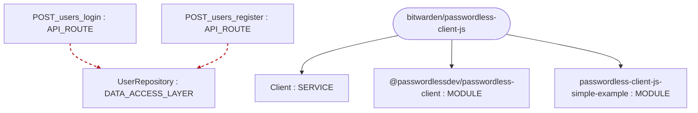
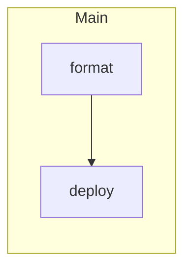

# Repository Architecture Analysis: bitwarden/passwordless-client-js

## Metadata
- **SHA**: `0c113a61c6b4d03fcc70ea694213425e2185fd71`
- **Primary Ecosystem**: JavaScript/TypeScript

## Quality Metrics
- **ast_engine**: tree-sitter
- **avg_cognitive_complexity**: 1.14
- **avg_cyclomatic_complexity**: 2.04
- **component_count**: 6
- **dead_code_count**: 0
- **dead_code_symbols**: 0 entry(ies)
- **duplication_pct**: 52.57
- **file_complexities**: 14 entry(ies)
- **files_analyzed**: 14
- **fitness_passed**: False
- **fitness_violation_count**: 3
- **framework**: Express / Node API
- **import_edges**: 38 entry(ies)
- **loc**: 1016
- **max_cognitive_complexity**: 7
- **max_cyclomatic_complexity**: 6
- **sloc**: 762
- **test_file_count**: 1

# Architecture: bitwarden/passwordless-client-js

## Context
- **Repository**: `bitwarden/passwordless-client-js`
- **SHA**: `0c113a61c6b4d03fcc70ea694213425e2185fd71`
- **Ecosystem**: JavaScript/TypeScript
- **Framework**: Express / Node API

## Building Block View

## Component Details
- **passwordless-client-js-simple-example** (`examples/simple-example/package.json`): MODULE
- **@passwordlessdev/passwordless-client** (`package.json`): MODULE
- **POST_users_register** (`examples/simple-example/src/index.ts`): API_ROUTE (deps: UserRepository)
- **POST_users_login** (`examples/simple-example/src/index.ts`): API_ROUTE (deps: UserRepository)
- **UserRepository** (`examples/simple-example/src/repositories/UserRepository.ts`): DATA_ACCESS_LAYER
- **Client** (`src/passwordless.ts`): SERVICE

## 6-Dimension Repository Scorecard

- **Overall Grade**: `C` (74.45/100)
- **Technical Debt Score**: 25.55
- **Estimated Remediation Effort**: 32.90h

| Dimension | Grade | Score | Weight | Details |
| :--- | :---: | :---: | :---: | :--- |
| Code Quality | `C` | 75.00 | 0.20 | avg_cc=2.04, max_cc=6, duplication=52.57%, dead_code=0 |
| Dependency Health | `A` | 100.00 | 0.15 | dependencies=504, outdated=0, vulnerable=0, has_lockfile=True |
| Maintainability | `D` | 65.00 | 0.15 | avg_cognitive=1.14, max_cognitive=7, fitness_violations=3, oversized_files=1 |
| Pipeline Health | `C` | 76.00 | 0.15 | workflows=1, operational_antipatterns=4, parallel_branches=False |
| Security | `D` | 64.00 | 0.20 | vulnerabilities=0, secrets=0, pipeline_security_findings=3 |
| Test Coverage | `C` | 70.00 | 0.15 | coverage=unavailable, ci_test_job=False, test_files_detected=True |

## Architecture Fitness & Workspace Boundaries

- **[HIGH] `ATRUSS-ARCH-001` (LAYER_VIOLATION)**: API_ROUTE cannot directly import DATA_ACCESS_LAYER when SERVICE components exist. (POST_users_login -> UserRepository)
- **[HIGH] `ATRUSS-ARCH-001` (LAYER_VIOLATION)**: API_ROUTE cannot directly import DATA_ACCESS_LAYER when SERVICE components exist. (POST_users_register -> UserRepository)
- **[MEDIUM] `ATRUSS-ARCH-005` (COMPLEXITY_THRESHOLD)**: Repository duplication_pct (52.57) exceeds policy threshold (15.0).

## Supply Chain Dependencies, Vulnerabilities & Secrets

- **Dependencies Parsed**: 504 | **Vulnerabilities**: 0 | **Secrets**: 0

### Inventory Sample
- `@eslint/js` `9.35.0` (npm, `package-lock.json`)
- `@eslint/js` `9.35.0` (npm, `package.json`)
- `@passwordlessdev/passwordless-nodejs` `1.0.1` (npm, `examples/simple-example/package.json`)
- `@rollup/plugin-terser` `0.4.4` (npm, `package-lock.json`)
- `@rollup/plugin-terser` `0.4.4` (npm, `package.json`)
- `@rollup/plugin-typescript` `12.1.4` (npm, `package-lock.json`)
- `@rollup/plugin-typescript` `12.1.4` (npm, `package.json`)
- `@types/body-parser` `1.19.2` (npm, `examples/simple-example/package.json`)
- `@types/dotenv` `8.2.0` (npm, `examples/simple-example/package.json`)
- `@types/express` `4.17.17` (npm, `examples/simple-example/package.json`)
- `@types/jest` `29.5.14` (npm, `package-lock.json`)
- `@types/jest` `29.5.14` (npm, `package.json`)
- `@types/node` `16.18.38` (npm, `examples/simple-example/package.json`)
- `@types/uuid` `9.0.2` (npm, `examples/simple-example/package.json`)
- `body-parser` `1.20.2` (npm, `examples/simple-example/package.json`)
- `concurrently` `8.2.0` (npm, `examples/simple-example/package.json`)
- `dotenv` `16.3.1` (npm, `examples/simple-example/package.json`)
- `eslint` `9.35.0` (npm, `package-lock.json`)
- `eslint` `9.35.0` (npm, `package.json`)
- `eslint-config-prettier` `10.1.8` (npm, `package-lock.json`)
- `eslint-config-prettier` `10.1.8` (npm, `package.json`)
- `express` `4.18.2` (npm, `examples/simple-example/package.json`)
- `jest` `29.7.0` (npm, `package-lock.json`)
- `jest` `29.7.0` (npm, `package.json`)
- `jest-environment-jsdom` `29.7.0` (npm, `package-lock.json`)
- `jest-environment-jsdom` `29.7.0` (npm, `package.json`)
- `nodemon` `3.0.1` (npm, `examples/simple-example/package.json`)
- `prettier` `3.6.2` (npm, `package-lock.json`)
- `prettier` `3.6.2` (npm, `package.json`)
- `prettier-plugin-organize-imports` `4.2.0` (npm, `package-lock.json`)
- ... (+474 more dependencies)

## CI/CD Pipeline Topology

