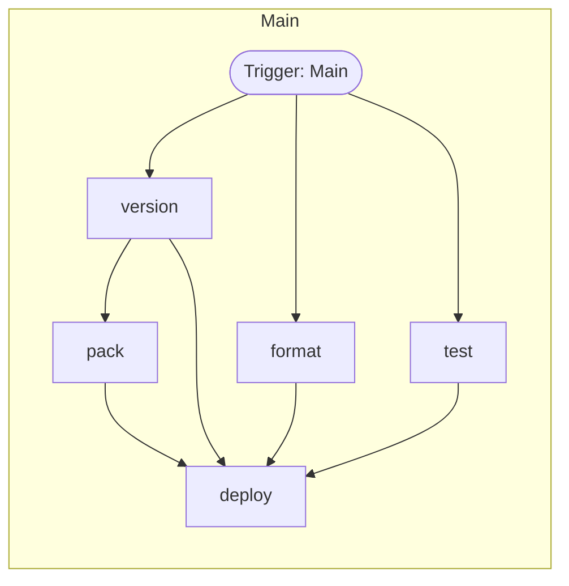

# Repository Architecture Analysis: bitwarden/passwordless-dotnet

## Metadata
- **SHA**: `486c4e93de361542dcf8d3a2a116bdda0e04d6c3`
- **Primary Ecosystem**: .NET

## Quality Metrics
- **ast_engine**: tree-sitter
- **avg_cognitive_complexity**: 0.46
- **avg_cyclomatic_complexity**: 1.49
- **component_count**: 17
- **dead_code_count**: 23
- **dead_code_symbols**: 23 entry(ies)
- **duplication_pct**: 70.75
- **file_complexities**: 25 entry(ies)
- **files_analyzed**: 92
- **fitness_passed**: False
- **fitness_violation_count**: 1
- **framework**: ASP.NET Core
- **import_edges**: 100 entry(ies)
- **loc**: 5189
- **max_cognitive_complexity**: 10
- **max_cyclomatic_complexity**: 9
- **sloc**: 3764
- **test_file_count**: 22

# Architecture: bitwarden/passwordless-dotnet

## Context
- **Repository**: `bitwarden/passwordless-dotnet`
- **SHA**: `486c4e93de361542dcf8d3a2a116bdda0e04d6c3`
- **Ecosystem**: .NET
- **Framework**: ASP.NET Core

## Building Block View

```mermaid
graph TD;
    Passwordless_AspNetIdentity_Example["Passwordless.AspNetIdentity.Example : MODULE"]
    Passwordless_Example["Passwordless.Example : MODULE"]
    Passwordless_MultiTenancy_Example["Passwordless.MultiTenancy.Example : MODULE"]
    Passwordless["Passwordless : MODULE"]
    Passwordless_AspNetCore["Passwordless.AspNetCore : MODULE"]
    Passwordless_AspNetCore_Tests["Passwordless.AspNetCore.Tests : MODULE"]
    Passwordless_AspNetCore_Tests_Dummy["Passwordless.AspNetCore.Tests.Dummy : MODULE"]
    Passwordless_Tests["Passwordless.Tests : MODULE"]
    Passwordless_Tests_Infra["Passwordless.Tests.Infra : MODULE"]
    GET_AccessDenied["GET_AccessDenied : API_ROUTE"]
    POST_stepup["POST_stepup : API_ROUTE"]
    StepUpAuthorizationHandler["StepUpAuthorizationHandler : SERVICE"]
    PasswordlessController["PasswordlessController : API_ROUTE"]
    MultiTenancyController["MultiTenancyController : API_ROUTE"]
    PasswordlessHttpHandler["PasswordlessHttpHandler : SERVICE"]
    PasswordlessService["PasswordlessService : SERVICE"]
    PasswordlessDbContext["PasswordlessDbContext : DATA_ACCESS_LAYER"]
    repo_root(["bitwarden/passwordless-dotnet"])
    repo_root --> MultiTenancyController
    repo_root --> PasswordlessController
    repo_root --> PasswordlessDbContext
    repo_root --> PasswordlessHttpHandler
    repo_root --> PasswordlessService
    GET_AccessDenied --> StepUpAuthorizationHandler
    POST_stepup --> StepUpAuthorizationHandler
    Passwordless_AspNetCore --> Passwordless
    Passwordless_AspNetCore_Tests --> Passwordless_AspNetCore
    Passwordless_AspNetCore_Tests --> Passwordless_AspNetCore_Tests_Dummy
    Passwordless_AspNetCore_Tests --> Passwordless_Tests_Infra
    Passwordless_AspNetCore_Tests_Dummy --> Passwordless_AspNetCore
    Passwordless_AspNetIdentity_Example --> Passwordless_AspNetCore
    Passwordless_Example --> Passwordless
    Passwordless_MultiTenancy_Example --> Passwordless
    Passwordless_Tests --> Passwordless
    Passwordless_Tests --> Passwordless_Tests_Infra
    Passwordless_Tests_Infra --> Passwordless
```

## Component Details
- **Passwordless.AspNetIdentity.Example** (`examples/Passwordless.AspNetIdentity.Example/Passwordless.AspNetIdentity.Example.csproj`): MODULE (deps: Passwordless.AspNetCore)
- **Passwordless.Example** (`examples/Passwordless.Example/Passwordless.Example.csproj`): MODULE (deps: Passwordless)
- **Passwordless.MultiTenancy.Example** (`examples/Passwordless.MultiTenancy.Example/Passwordless.MultiTenancy.Example.csproj`): MODULE (deps: Passwordless)
- **Passwordless** (`src/Passwordless/Passwordless.csproj`): MODULE
- **Passwordless.AspNetCore** (`src/Passwordless.AspNetCore/Passwordless.AspNetCore.csproj`): MODULE (deps: Passwordless)
- **Passwordless.AspNetCore.Tests** (`tests/Passwordless.AspNetCore.Tests/Passwordless.AspNetCore.Tests.csproj`): MODULE (deps: Passwordless.AspNetCore, Passwordless.AspNetCore.Tests.Dummy, Passwordless.Tests.Infra)
- **Passwordless.AspNetCore.Tests.Dummy** (`tests/Passwordless.AspNetCore.Tests.Dummy/Passwordless.AspNetCore.Tests.Dummy.csproj`): MODULE (deps: Passwordless.AspNetCore)
- **Passwordless.Tests** (`tests/Passwordless.Tests/Passwordless.Tests.csproj`): MODULE (deps: Passwordless, Passwordless.Tests.Infra)
- **Passwordless.Tests.Infra** (`tests/Passwordless.Tests.Infra/Passwordless.Tests.Infra.csproj`): MODULE (deps: Passwordless)
- **GET_AccessDenied** (`examples/Passwordless.AspNetIdentity.Example/Program.cs`): API_ROUTE (deps: StepUpAuthorizationHandler)
- **POST_stepup** (`examples/Passwordless.AspNetIdentity.Example/Program.cs`): API_ROUTE (deps: StepUpAuthorizationHandler)
- **StepUpAuthorizationHandler** (`examples/Passwordless.AspNetIdentity.Example/Authorization/StepUpAuthorizationHandler.cs`): SERVICE
- **PasswordlessController** (`examples/Passwordless.Example/PasswordlessController.cs`): API_ROUTE
- **MultiTenancyController** (`examples/Passwordless.MultiTenancy.Example/Controllers/MultiTenancyController.cs`): API_ROUTE
- **PasswordlessHttpHandler** (`src/Passwordless/PasswordlessHttpHandler.cs`): SERVICE
- **PasswordlessService** (`src/Passwordless.AspNetCore/Services/Implementations/PasswordlessService.cs`): SERVICE
- **PasswordlessDbContext** (`tests/Passwordless.AspNetCore.Tests.Dummy/Program.cs`): DATA_ACCESS_LAYER

## 6-Dimension Repository Scorecard

- **Overall Grade**: `D` (69.00/100)
- **Technical Debt Score**: 31.00
- **Estimated Remediation Effort**: 40.65h

| Dimension | Grade | Score | Weight | Details |
| :--- | :---: | :---: | :---: | :--- |
| Code Quality | `F` | 55.00 | 0.20 | avg_cc=1.49, max_cc=9, duplication=70.75%, dead_code=23 |
| Dependency Health | `B` | 85.00 | 0.15 | dependencies=43, outdated=0, vulnerable=0, has_lockfile=False |
| Maintainability | `B` | 89.00 | 0.15 | avg_cognitive=0.46, max_cognitive=10, fitness_violations=1, oversized_files=1 |
| Pipeline Health | `B` | 84.00 | 0.15 | workflows=1, operational_antipatterns=6, parallel_branches=True |
| Security | `F` | 44.00 | 0.20 | vulnerabilities=0, secrets=0, pipeline_security_findings=4 |
| Test Coverage | `C` | 70.00 | 0.15 | coverage=unavailable, ci_test_job=True, test_files_detected=True |

## Architecture Fitness & Workspace Boundaries

- **[MEDIUM] `ATRUSS-ARCH-005` (COMPLEXITY_THRESHOLD)**: Repository duplication_pct (70.75) exceeds policy threshold (15.0).

## Supply Chain Dependencies, Vulnerabilities & Secrets

- **Dependencies Parsed**: 43 | **Vulnerabilities**: 0 | **Secrets**: 0

### Inventory Sample
- `AutoFixture` `4.18.1` (NuGet, `tests/Passwordless.AspNetCore.Tests/Passwordless.AspNetCore.Tests.csproj`)
- `FluentAssertions` `7.0.0` (NuGet, `tests/Passwordless.AspNetCore.Tests/Passwordless.AspNetCore.Tests.csproj`)
- `FluentAssertions` `7.0.0` (NuGet, `tests/Passwordless.Tests/Passwordless.Tests.csproj`)
- `GitHubActionsTestLogger` `3.0.1` (NuGet, `tests/Passwordless.AspNetCore.Tests/Passwordless.AspNetCore.Tests.csproj`)
- `GitHubActionsTestLogger` `3.0.1` (NuGet, `tests/Passwordless.Tests/Passwordless.Tests.csproj`)
- `Microsoft.AspNetCore.Authentication.JwtBearer` `8.0.0` (NuGet, `examples/Passwordless.AspNetIdentity.Example/Passwordless.AspNetIdentity.Example.csproj`)
- `Microsoft.AspNetCore.Authentication.OpenIdConnect` `8.0.0` (NuGet, `examples/Passwordless.AspNetIdentity.Example/Passwordless.AspNetIdentity.Example.csproj`)
- `Microsoft.AspNetCore.Identity.EntityFrameworkCore` `8.0.0` (NuGet, `examples/Passwordless.AspNetIdentity.Example/Passwordless.AspNetIdentity.Example.csproj`)
- `Microsoft.AspNetCore.Identity.EntityFrameworkCore` `8.0.11` (NuGet, `tests/Passwordless.AspNetCore.Tests.Dummy/Passwordless.AspNetCore.Tests.Dummy.csproj`)
- `Microsoft.AspNetCore.Identity.EntityFrameworkCore` `8.0.11` (NuGet, `tests/Passwordless.AspNetCore.Tests/Passwordless.AspNetCore.Tests.csproj`)
- `Microsoft.AspNetCore.Mvc.Testing` `8.0.11` (NuGet, `tests/Passwordless.AspNetCore.Tests/Passwordless.AspNetCore.Tests.csproj`)
- `Microsoft.EntityFrameworkCore.Design` `8.0.0` (NuGet, `examples/Passwordless.AspNetIdentity.Example/Passwordless.AspNetIdentity.Example.csproj`)
- `Microsoft.EntityFrameworkCore.Sqlite` `8.0.0` (NuGet, `examples/Passwordless.AspNetIdentity.Example/Passwordless.AspNetIdentity.Example.csproj`)
- `Microsoft.EntityFrameworkCore.Sqlite` `8.0.11` (NuGet, `tests/Passwordless.AspNetCore.Tests.Dummy/Passwordless.AspNetCore.Tests.Dummy.csproj`)
- `Microsoft.Extensions.Configuration` `8.0.0` (NuGet, `tests/Passwordless.Tests/Passwordless.Tests.csproj`)
- `Microsoft.Extensions.Configuration.Abstractions` `8.0.0` (NuGet, `src/Passwordless/Passwordless.csproj`)
- `Microsoft.Extensions.DependencyInjection` `8.0.1` (NuGet, `tests/Passwordless.AspNetCore.Tests/Passwordless.AspNetCore.Tests.csproj`)
- `Microsoft.Extensions.DependencyInjection` `8.0.1` (NuGet, `tests/Passwordless.Tests.Infra/Passwordless.Tests.Infra.csproj`)
- `Microsoft.Extensions.DependencyInjection` `8.0.1` (NuGet, `tests/Passwordless.Tests/Passwordless.Tests.csproj`)
- `Microsoft.Extensions.Http` `8.0.1` (NuGet, `src/Passwordless/Passwordless.csproj`)
- `Microsoft.Extensions.Options` `8.0.2` (NuGet, `src/Passwordless/Passwordless.csproj`)
- `Microsoft.Extensions.Options.ConfigurationExtensions` `8.0.0` (NuGet, `src/Passwordless/Passwordless.csproj`)
- `Microsoft.Identity.Web` `2.15.5` (NuGet, `examples/Passwordless.AspNetIdentity.Example/Passwordless.AspNetIdentity.Example.csproj`)
- `Microsoft.Identity.Web.UI` `2.15.5` (NuGet, `examples/Passwordless.AspNetIdentity.Example/Passwordless.AspNetIdentity.Example.csproj`)
- `Microsoft.NET.Test.Sdk` `17.12.0` (NuGet, `tests/Passwordless.AspNetCore.Tests/Passwordless.AspNetCore.Tests.csproj`)
- `Microsoft.NET.Test.Sdk` `17.12.0` (NuGet, `tests/Passwordless.Tests/Passwordless.Tests.csproj`)
- `Microsoft.SourceLink.GitHub` `8.0.0` (NuGet, `src/Passwordless.AspNetCore/Passwordless.AspNetCore.csproj`)
- `Microsoft.SourceLink.GitHub` `8.0.0` (NuGet, `src/Passwordless/Passwordless.csproj`)
- `Moq` `4.20.72` (NuGet, `tests/Passwordless.AspNetCore.Tests/Passwordless.AspNetCore.Tests.csproj`)
- `Swashbuckle.AspNetCore` `6.4.0` (NuGet, `examples/Passwordless.MultiTenancy.Example/Passwordless.MultiTenancy.Example.csproj`)
- ... (+13 more dependencies)

## CI/CD Pipeline Topology

