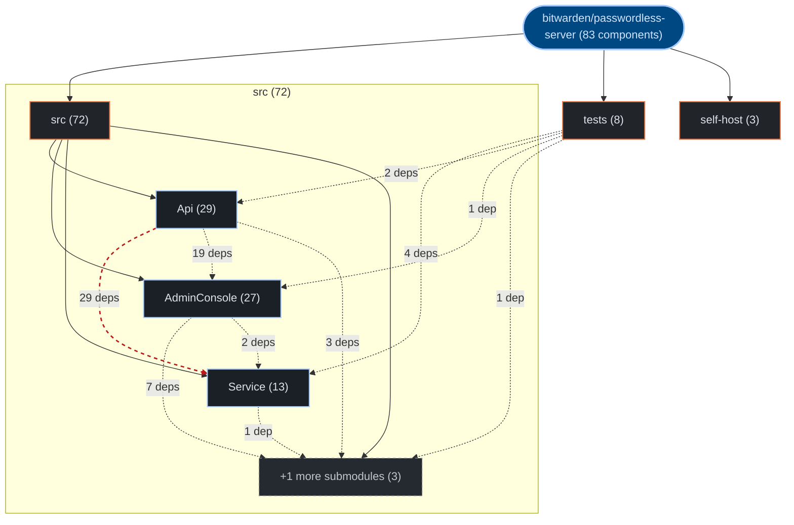
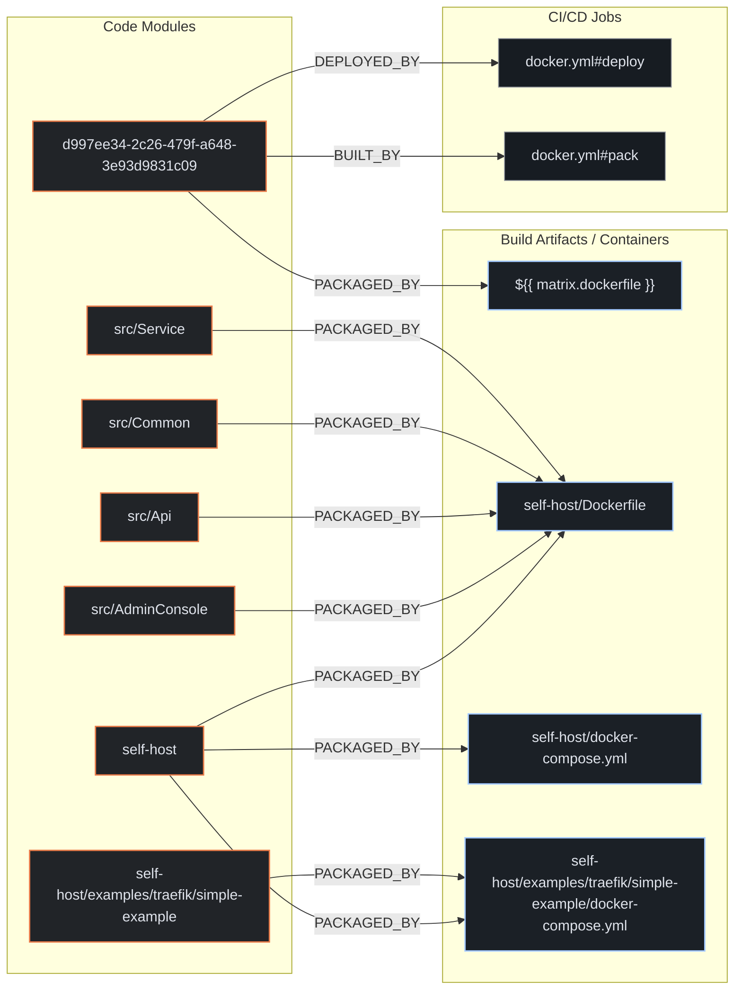

# Repository Architecture Analysis: bitwarden/passwordless-server

## Metadata
- **SHA**: `78b409298eaf7ae168396d80fcb220149fdabd6f`
- **Primary Ecosystem**: .NET

## Quality Metrics
- **ast_engine**: tree-sitter
- **avg_cognitive_complexity**: 0.61
- **avg_cyclomatic_complexity**: 1.51
- **component_count**: 83
- **dead_code_count**: 130
- **dead_code_symbols**: 50 entry(ies)
- **duplication_pct**: 92.19
- **file_complexities**: 25 entry(ies)
- **files_analyzed**: 663
- **fitness_passed**: False
- **fitness_violation_count**: 10
- **framework**: ASP.NET Core
- **import_edges**: 100 entry(ies)
- **loc**: 56103
- **max_cognitive_complexity**: 46
- **max_cyclomatic_complexity**: 24
- **sloc**: 42301
- **test_file_count**: 113

# Architecture: bitwarden/passwordless-server

## Context
- **Repository**: `bitwarden/passwordless-server`
- **SHA**: `78b409298eaf7ae168396d80fcb220149fdabd6f`
- **Ecosystem**: .NET
- **Framework**: ASP.NET Core

## Building Block View

## Component Details

Showing top 60 representative components out of 83 across 3 module group(s):

- **Module `src`** (72 components — SERVICE: 38, API_ROUTE: 22, DATA_ACCESS_LAYER: 8)
- **Module `tests`** (8 components — MODULE: 5, SERVICE: 3)
- **Module `self-host`** (3 components — module: 3)

- **GET_root** (`src/Api/Program.cs`): API_ROUTE (deps: ApplicationService, AuthenticationConfigurationService, DbGlobalContext, DispatchedEmailCleanupService, Fido2Service, MetaDataService (+4 more))
- **NoOpBillingService** (`src/AdminConsole/Billing/NoOpBillingService.cs`): SERVICE (deps: BaseBillingService, ConsoleDbContext, DataService, SharedStripeBillingService)
- **HttpRequestExceptionResponseHandler** (`tests/Service.Tests/MDS/CacheHandlerTests.cs`): SERVICE (deps: CacheHandler, NotFoundResponseHandler, OkResponseHandler)
- **NotFoundResponseHandler** (`tests/Service.Tests/MDS/CacheHandlerTests.cs`): SERVICE (deps: CacheHandler, HttpRequestExceptionResponseHandler, OkResponseHandler)
- **OkResponseHandler** (`tests/Service.Tests/MDS/CacheHandlerTests.cs`): SERVICE (deps: CacheHandler, HttpRequestExceptionResponseHandler, NotFoundResponseHandler)
- **SharedStripeBillingService** (`src/AdminConsole/Services/SharedStripeBillingService.cs`): SERVICE (deps: BaseBillingService, ConsoleDbContext, DataService)
- **ActiveUserReportingBackgroundService** (`src/Api/Reporting/Background/ActiveUserReportingBackgroundService.cs`): SERVICE (deps: BasePeriodicBackgroundService, ReportingService)
- **ApplicationCleanupBackgroundService** (`src/AdminConsole/BackgroundServices/ApplicationCleanupBackgroundService.cs`): SERVICE (deps: ApplicationService, BasePeriodicBackgroundService)
- **BaseBillingService** (`src/AdminConsole/Services/BaseBillingService.cs`): SERVICE (deps: ConsoleDbContext, DataService)
- **DELETE_admin_apps_{appId}** (`src/Api/Endpoints/Apps.cs`): API_ROUTE (deps: ApplicationService, SharedManagementService)
- **DELETE_admin_apps_{appId}_api-keys_{apiKeyId}** (`src/Api/Endpoints/Apps.cs`): API_ROUTE (deps: ApplicationService, SharedManagementService)
- **EventDeletionBackgroundWorker** (`src/Service/EventLog/EventDeletionBackgroundWorker.cs`): SERVICE (deps: BasePeriodicBackgroundService, DbGlobalContext)
- **Fido2Service** (`src/Service/Fido2Service.cs`): SERVICE (deps: AuthenticationConfigurationService, TokenService)
- **GET_admin_apps_{appId}_api-keys** (`src/Api/Endpoints/Apps.cs`): API_ROUTE (deps: ApplicationService, SharedManagementService)
- **GET_admin_apps_{appId}_available** (`src/Api/Endpoints/Apps.cs`): API_ROUTE (deps: ApplicationService, SharedManagementService)
- **GET_admin_apps_{appId}_can-delete-immediately** (`src/Api/Endpoints/Apps.cs`): API_ROUTE (deps: ApplicationService, SharedManagementService)
- **GET_admin_apps_{appId}_features** (`src/Api/Endpoints/Apps.cs`): API_ROUTE (deps: ApplicationService, SharedManagementService)
- **GET_apps_list-pending-deletion** (`src/Api/Endpoints/Apps.cs`): API_ROUTE (deps: ApplicationService, SharedManagementService)
- **OnboardingCleanupBackgroundService** (`src/AdminConsole/BackgroundServices/OnboardingCleanupBackgroundService.cs`): SERVICE (deps: BasePeriodicBackgroundService, DataService)
- **POST_admin_apps_{appId}_api-keys_{apiKeyId}_lock** (`src/Api/Endpoints/Apps.cs`): API_ROUTE (deps: ApplicationService, SharedManagementService)
- **POST_admin_apps_{appId}_api-keys_{apiKeyId}_unlock** (`src/Api/Endpoints/Apps.cs`): API_ROUTE (deps: ApplicationService, SharedManagementService)
- **POST_admin_apps_{appId}_cancel-delete** (`src/Api/Endpoints/Apps.cs`): API_ROUTE (deps: ApplicationService, SharedManagementService)
- **POST_admin_apps_{appId}_create** (`src/Api/Endpoints/Apps.cs`): API_ROUTE (deps: ApplicationService, SharedManagementService)
- **POST_admin_apps_{appId}_features** (`src/Api/Endpoints/Apps.cs`): API_ROUTE (deps: ApplicationService, SharedManagementService)
- **POST_admin_apps_{appId}_freeze** (`src/Api/Endpoints/Apps.cs`): API_ROUTE (deps: ApplicationService, SharedManagementService)
- **POST_admin_apps_{appId}_mark-delete** (`src/Api/Endpoints/Apps.cs`): API_ROUTE (deps: ApplicationService, SharedManagementService)
- **POST_admin_apps_{appId}_public-keys** (`src/Api/Endpoints/Apps.cs`): API_ROUTE (deps: ApplicationService, SharedManagementService)
- **POST_admin_apps_{appId}_secret-keys** (`src/Api/Endpoints/Apps.cs`): API_ROUTE (deps: ApplicationService, SharedManagementService)
- **POST_admin_apps_{appId}_unfreeze** (`src/Api/Endpoints/Apps.cs`): API_ROUTE (deps: ApplicationService, SharedManagementService)
- **POST_apps_features** (`src/Api/Endpoints/Apps.cs`): API_ROUTE (deps: ApplicationService, SharedManagementService)
- **PeriodicCredentialReportsBackgroundService** (`src/Api/Reporting/Background/UsersCountReportingBackgroundService.cs`): SERVICE (deps: BasePeriodicBackgroundService, ReportingService)
- **UserCountUpdaterBackgroundService** (`src/AdminConsole/Billing/BackgroundServices/UserCountUpdaterBackgroundService.cs`): SERVICE (deps: BaseDelayedPeriodicBackgroundService, UsageService)
- **AdminConsole** (`src/AdminConsole/AdminConsole.csproj`): MODULE (deps: Common)
- **AdminConsole.Tests** (`tests/AdminConsole.Tests/AdminConsole.Tests.csproj`): MODULE (deps: AdminConsole)
- **AdminService** (`src/AdminConsole/Services/AdminService.cs`): SERVICE (deps: ConsoleDbContext)
- **Api** (`src/Api/Api.csproj`): MODULE (deps: Service)
- **Api.IntegrationTests** (`tests/Api.IntegrationTests/Api.IntegrationTests.csproj`): MODULE (deps: Api)
- **Api.Tests** (`tests/Api.Tests/Api.Tests.csproj`): MODULE (deps: Api)
- **ApplicationService** (`src/AdminConsole/Services/ApplicationService.cs`): SERVICE (deps: ConsoleDbContext)
- **ApplicationService** (`src/Service/ApplicationService.cs`): SERVICE (deps: MetaDataService)
- **Common.Tests** (`tests/Common.Tests/Common.Tests.csproj`): MODULE (deps: Common)
- **DataService** (`src/AdminConsole/Services/DataService.cs`): SERVICE (deps: ConsoleDbContext)
- **DispatchedEmailCleanupService** (`src/Api/Email/DispatchedEmailCleanupService.cs`): SERVICE (deps: BasePeriodicBackgroundService)
- **EventDeletionBackgroundWorker** (`src/AdminConsole/EventLog/EventDeletionBackgroundWorker.cs`): SERVICE (deps: BasePeriodicBackgroundService)
- **HasAppHandler** (`src/AdminConsole/Authorization/HasAppHandler.cs`): SERVICE (deps: ConsoleDbContext)
- **InvitationService** (`src/AdminConsole/Services/InvitationService.cs`): SERVICE (deps: ConsoleDbContext)
- **MagicLinkService** (`src/Service/MagicLinks/MagicLinkService.cs`): SERVICE (deps: Fido2Service)
- **MeteredBillingBackgroundService** (`src/AdminConsole/Billing/BackgroundServices/MeteredBillingBackgroundService.cs`): SERVICE (deps: BasePeriodicBackgroundService)
- **MsSqlContextFactory** (`src/Api/Helpers/DesignTimeFactories.cs`): DATA_ACCESS_LAYER (deps: SqliteContextFactory)
- **MsSqlDesignTimeDbContextFactory** (`src/AdminConsole/Db/MsSqlDesignTimeDbContextFactory.cs`): DATA_ACCESS_LAYER (deps: MssqlConsoleDbContext)
- **MssqlConsoleDbContext** (`src/AdminConsole/Db/MssqlConsoleDbContext.cs`): DATA_ACCESS_LAYER (deps: ConsoleDbContext)
- **OrganizationFeatureService** (`src/AdminConsole/Services/OrganizationFeatureService.cs`): SERVICE (deps: ConsoleDbContext)
- **PostSignInHandlerService** (`src/AdminConsole/Services/PostSignInHandlerService.cs`): SERVICE (deps: ConsoleDbContext)
- **Service** (`src/Service/Service.csproj`): MODULE (deps: Common)
- **Service.Tests** (`tests/Service.Tests/Service.Tests.csproj`): MODULE (deps: Service)
- **SqliteConsoleDbContext** (`src/AdminConsole/Db/SqliteConsoleDbContext.cs`): DATA_ACCESS_LAYER (deps: ConsoleDbContext)
- **SqliteContextFactory** (`src/Api/Helpers/DesignTimeFactories.cs`): DATA_ACCESS_LAYER (deps: MsSqlContextFactory)
- **SqliteDesignTimeDbContextFactory** (`src/AdminConsole/Db/SqliteDesignTimeDbContextFactory.cs`): DATA_ACCESS_LAYER (deps: SqliteConsoleDbContext)
- **UsageService** (`src/AdminConsole/Services/UsageService.cs`): SERVICE (deps: ConsoleDbContext)
- **AuthenticationConfigurationService** (`src/Service/AuthenticationConfigurationService.cs`): SERVICE

## 6-Dimension Repository Scorecard

- **Overall Grade**: `F` (33.80/100)
- **Technical Debt Score**: 66.20
- **Estimated Remediation Effort**: 127.99h

| Dimension | Grade | Score | Weight | Details |
| :--- | :---: | :---: | :---: | :--- |
| Code Quality | `F` | 41.50 | 0.20 | avg_cc=1.51, max_cc=24, duplication=92.19%, dead_code=130 |
| Dependency Health | `A` | 100.00 | 0.15 | dependencies=297, outdated=0, vulnerable=0, has_lockfile=True |
| Maintainability | `F` | 0.00 | 0.15 | avg_cognitive=0.61, max_cognitive=46, fitness_violations=10, oversized_files=3 |
| Pipeline Health | `F` | 0.00 | 0.15 | workflows=8, operational_antipatterns=23, parallel_branches=True |
| Security | `F` | 0.00 | 0.20 | vulnerabilities=0, secrets=7, pipeline_security_findings=2 |
| Test Coverage | `C` | 70.00 | 0.15 | coverage=unavailable, ci_test_job=True, test_files_detected=True |

## Architecture Fitness & Workspace Boundaries

- **[HIGH] `ATRUSS-ARCH-001` (LAYER_VIOLATION)**: API_ROUTE cannot directly import DATA_ACCESS_LAYER when SERVICE components exist. (GET_root -> DbGlobalContext)
- **[HIGH] `ATRUSS-ARCH-004` (CIRCULAR_DEPENDENCY)**: Circular dependency detected between architectural components. (HttpRequestExceptionResponseHandler -> NotFoundResponseHandler -> HttpRequestExceptionResponseHandler)
- **[HIGH] `ATRUSS-ARCH-004` (CIRCULAR_DEPENDENCY)**: Circular dependency detected between architectural components. (HttpRequestExceptionResponseHandler -> NotFoundResponseHandler -> OkResponseHandler -> HttpRequestExceptionResponseHandler)
- **[HIGH] `ATRUSS-ARCH-004` (CIRCULAR_DEPENDENCY)**: Circular dependency detected between architectural components. (HttpRequestExceptionResponseHandler -> OkResponseHandler -> HttpRequestExceptionResponseHandler)
- **[HIGH] `ATRUSS-ARCH-004` (CIRCULAR_DEPENDENCY)**: Circular dependency detected between architectural components. (HttpRequestExceptionResponseHandler -> OkResponseHandler -> NotFoundResponseHandler -> HttpRequestExceptionResponseHandler)
- **[HIGH] `ATRUSS-ARCH-004` (CIRCULAR_DEPENDENCY)**: Circular dependency detected between architectural components. (MsSqlContextFactory -> SqliteContextFactory -> MsSqlContextFactory)
- **[HIGH] `ATRUSS-ARCH-004` (CIRCULAR_DEPENDENCY)**: Circular dependency detected between architectural components. (NotFoundResponseHandler -> OkResponseHandler -> NotFoundResponseHandler)
- **[MEDIUM] `ATRUSS-ARCH-005` (COMPLEXITY_THRESHOLD)**: Repository duplication_pct (92.19) exceeds policy threshold (15.0).
- **[MEDIUM] `ATRUSS-ARCH-005` (COMPLEXITY_THRESHOLD)**: Repository max_cognitive_complexity (46.0) exceeds policy threshold (25.0).
- **[MEDIUM] `ATRUSS-ARCH-005` (COMPLEXITY_THRESHOLD)**: Repository max_cyclomatic_complexity (24.0) exceeds policy threshold (20.0).

## Supply Chain Dependencies, Vulnerabilities & Secrets

- **Dependencies Parsed**: 297 | **Vulnerabilities**: 0 | **Secrets**: 7

### Secret Findings (Redacted)
- **[HIGH] `ATRUSS-SEC-005`** at `src/Api/appsettings.Development.json:14` (`"SALT_TOKEN": "VGhp***REDACTED***"`)
- **[HIGH] `ATRUSS-SEC-005`** at `tests/Api.IntegrationTests/Endpoints/SignIn/SignInTests.cs:174` (`AuthenticatorData = "8egi***REDACTED***",`)
- **[HIGH] `ATRUSS-SEC-005`** at `tests/Common.Tests/Utils/ApiKeyUtilsTests.cs:49` (`const string hashedApiKey = "4Rtm***REDACTED***";`)
- **[HIGH] `ATRUSS-SEC-005`** at `tests/Common.Tests/Utils/ApiKeyUtilsTests.cs:60` (`const string hashedApiKey = "4Rtm***REDACTED***";`)
- **[HIGH] `ATRUSS-SEC-005`** at `tests/Common.Tests/Utils/ApiKeyUtilsTests.cs:71` (`const string hashedApiKey = "4Rtm***REDACTED***";`)
- **[HIGH] `ATRUSS-SEC-005`** at `tests/Common.Tests/Utils/ApiKeyUtilsTests.cs:82` (`const string hashedApiKey = "4Rtm***REDACTED***";`)
- **[HIGH] `ATRUSS-SEC-005`** at `tests/Service.Tests/Implementations/SharedManagementServiceTests.cs:380` (`ApiKey = "Wx9X***REDACTED***",`)

### Inventory Sample
- `AWSSDK.SimpleEmailV2` `4.0.5.1` (NuGet, `src/Common/Common.csproj`)
- `AspNetCore.HealthChecks.SqlServer` `9.0.0` (NuGet, `src/Api/Api.csproj`)
- `AspNetCore.HealthChecks.Sqlite` `9.0.0` (NuGet, `src/Api/Api.csproj`)
- `AutoFixture` `4.18.1` (NuGet, `tests/AdminConsole.Tests/AdminConsole.Tests.csproj`)
- `AutoFixture` `4.18.1` (NuGet, `tests/Api.Tests/Api.Tests.csproj`)
- `AutoFixture` `4.18.1` (NuGet, `tests/Common.Tests/Common.Tests.csproj`)
- `AutoFixture.AutoMoq` `4.18.1` (NuGet, `tests/Service.Tests/Service.Tests.csproj`)
- `Azure.Extensions.AspNetCore.DataProtection.Keys` `1.6.1` (NuGet, `src/AdminConsole/AdminConsole.csproj`)
- `Azure.Identity` `1.15.0` (NuGet, `src/AdminConsole/AdminConsole.csproj`)
- `Bogus` `35.6.3` (NuGet, `tests/Api.IntegrationTests/Api.IntegrationTests.csproj`)
- `Datadog.Trace` `3.2.0` (NuGet, `src/AdminConsole/AdminConsole.csproj`)
- `Datadog.Trace` `3.2.0` (NuGet, `src/Api/Api.csproj`)
- `Fido2` `4.0.0` (NuGet, `src/Common/Common.csproj`)
- `Fido2` `4.0.0` (NuGet, `src/Service/Service.csproj`)
- `Fido2.AspNet` `4.0.0` (NuGet, `src/Service/Service.csproj`)
- `Fido2.Models` `4.0.0` (NuGet, `src/Common/Common.csproj`)
- `Fido2.Models` `4.0.0` (NuGet, `src/Service/Service.csproj`)
- `FluentAssertions` `7.2.0` (NuGet, `tests/Api.IntegrationTests/Api.IntegrationTests.csproj`)
- `FluentAssertions` `7.2.0` (NuGet, `tests/Api.Tests/Api.Tests.csproj`)
- `FluentAssertions` `7.2.0` (NuGet, `tests/Common.Tests/Common.Tests.csproj`)
- `FluentAssertions` `7.2.0` (NuGet, `tests/Service.Tests/Service.Tests.csproj`)
- `HtmlSanitizer` `9.0.892` (NuGet, `src/Common/Common.csproj`)
- `Humanizer.Core` `3.0.1` (NuGet, `src/AdminConsole/AdminConsole.csproj`)
- `Humanizer.Core` `3.0.1` (NuGet, `src/Service/Service.csproj`)
- `MailKit` `4.16.0` (NuGet, `src/Common/Common.csproj`)
- `MartinCostello.Logging.XUnit` `0.6.0` (NuGet, `tests/Api.IntegrationTests/Api.IntegrationTests.csproj`)
- `MessagePack` `3.1.7` (NuGet, `src/Service/Service.csproj`)
- `MessagePackAnalyzer` `3.1.7` (NuGet, `src/Service/Service.csproj`)
- `Microsoft.AspNetCore.Cryptography.KeyDerivation` `9.0.9` (NuGet, `src/Service/Service.csproj`)
- `Microsoft.AspNetCore.DataProtection.EntityFrameworkCore` `9.0.9` (NuGet, `src/AdminConsole/AdminConsole.csproj`)
- ... (+267 more dependencies)

## Section 7: Code-to-Cloud Deployment Traceability

- `d997ee34-2c26-479f-a648-3e93d9831c09` (code_module) --[BUILT_BY]--> `docker.yml#pack` (ci_job)
- `d997ee34-2c26-479f-a648-3e93d9831c09` (code_module) --[DEPLOYED_BY]--> `docker.yml#deploy` (ci_job)
- `d997ee34-2c26-479f-a648-3e93d9831c09` (code_module) --[PACKAGED_BY]--> `${{ matrix.dockerfile }}` (container)
- `self-host` (code_module) --[PACKAGED_BY]--> `self-host/Dockerfile` (container)
- `self-host` (code_module) --[PACKAGED_BY]--> `self-host/docker-compose.yml` (container)
- `self-host` (code_module) --[PACKAGED_BY]--> `self-host/examples/traefik/simple-example/docker-compose.yml` (container)
- `self-host/examples/traefik/simple-example` (code_module) --[PACKAGED_BY]--> `self-host/examples/traefik/simple-example/docker-compose.yml` (container)
- `src/AdminConsole` (code_module) --[PACKAGED_BY]--> `self-host/Dockerfile` (container)
- `src/Api` (code_module) --[PACKAGED_BY]--> `self-host/Dockerfile` (container)
- `src/Common` (code_module) --[PACKAGED_BY]--> `self-host/Dockerfile` (container)
- `src/Service` (code_module) --[PACKAGED_BY]--> `self-host/Dockerfile` (container)

## CI/CD Pipeline Topology

```mermaid
graph TD;
  classDef atlasRoot fill:#004882,stroke:#a3c9ff,stroke-width:2px,color:#d3e4ff
  classDef atlasCategory fill:#212428,stroke:#E87A48,stroke-width:1.5px,color:#dfe3eb
  classDef atlasWorkflow fill:#1b2026,stroke:#a3c9ff,stroke-width:1.5px,color:#dfe3eb
  classDef atlasJob fill:#171c22,stroke:#8d9199,stroke-width:1px,color:#dfe3eb
  classDef atlasTarget fill:#005227,stroke:#8bd99b,stroke-width:1.5px,color:#a7f6b6
  classDef atlasAlert fill:#93000a,stroke:#ffb4ab,stroke-width:1.5px,color:#ffdad6
  classDef atlasMore fill:#252a31,stroke:#8d9199,stroke-dasharray:4 4,color:#c3c6cf
  pipeline_root(["bitwarden/passwordless-server (8 workflows)"]):::atlasRoot
  subgraph sg_grp_0_Release___Deploy["Release & Deploy (4 workflows · 12 jobs)"]
    direction TB
    subgraph sg_wf_0_Request_Deploy["Request Deploy (1 jobs)"]
      direction TB
      wf_0_Request_Deploy(["Trigger: Request Deploy"]):::atlasWorkflow
      job_0_request_deploy["request-deploy"]:::atlasJob
      wf_0_Request_Deploy --> job_0_request_deploy
    end
    pipeline_root --> wf_0_Request_Deploy
    subgraph sg_wf_3_CI["CI (6 jobs)"]
      direction TB
      wf_3_CI(["Trigger: CI"]):::atlasWorkflow
      job_3_version["version"]:::atlasJob
      job_3_validate["validate"]:::atlasJob
      job_3_pack["pack"]:::atlasJob
      wf_3_CI --> job_3_version
      wf_3_CI --> job_3_validate
      job_3_version --> job_3_pack
    end
    pipeline_root --> wf_3_CI
    subgraph sg_wf_4_Docker["Docker (4 jobs)"]
      direction TB
      wf_4_Docker(["Trigger: Docker"]):::atlasWorkflow
      job_4_version["version"]:::atlasJob
      job_4_validate["validate"]:::atlasJob
      job_4_pack["pack"]:::atlasJob
      wf_4_Docker --> job_4_version
      wf_4_Docker --> job_4_validate
      job_4_version --> job_4_pack
    end
    pipeline_root --> wf_4_Docker
    subgraph sg_wf_5_Migrations["Migrations (1 jobs)"]
      direction TB
      wf_5_Migrations(["Trigger: Migrations"]):::atlasWorkflow
      job_5_script["script"]:::atlasJob
      wf_5_Migrations --> job_5_script
    end
    pipeline_root --> wf_5_Migrations
  end
  subgraph sg_grp_1_Automation___Other["Automation & Other (2 workflows · 3 jobs)"]
    direction TB
    subgraph sg_wf_1_Validate["Validate (2 jobs)"]
      direction TB
      wf_1_Validate(["Trigger: Validate"]):::atlasWorkflow
      job_1_format["format"]:::atlasJob
      job_1_test["test"]:::atlasJob
      wf_1_Validate --> job_1_format
      wf_1_Validate --> job_1_test
    end
    pipeline_root --> wf_1_Validate
    subgraph sg_wf_2_Determine_Version["Determine Version (1 jobs)"]
      direction TB
      wf_2_Determine_Version(["Trigger: Determine Version"]):::atlasWorkflow
      job_2_version["version"]:::atlasJob
      wf_2_Determine_Version --> job_2_version
    end
    pipeline_root --> wf_2_Determine_Version
  end
  subgraph sg_grp_2_CI___Verification["CI & Verification (2 workflows · 2 jobs)"]
    direction TB
    subgraph sg_wf_6_Respond["Respond (1 jobs)"]
      direction TB
      wf_6_Respond(["Trigger: Respond"]):::atlasWorkflow
      job_6_respond["respond"]:::atlasJob
      wf_6_Respond --> job_6_respond
    end
    pipeline_root --> wf_6_Respond
    subgraph sg_wf_7_Code_Review["Code Review (1 jobs)"]
      direction TB
      wf_7_Code_Review(["Trigger: Code Review"]):::atlasWorkflow
      job_7_review["review"]:::atlasJob
      wf_7_Code_Review --> job_7_review
    end
    pipeline_root --> wf_7_Code_Review
  end
```

