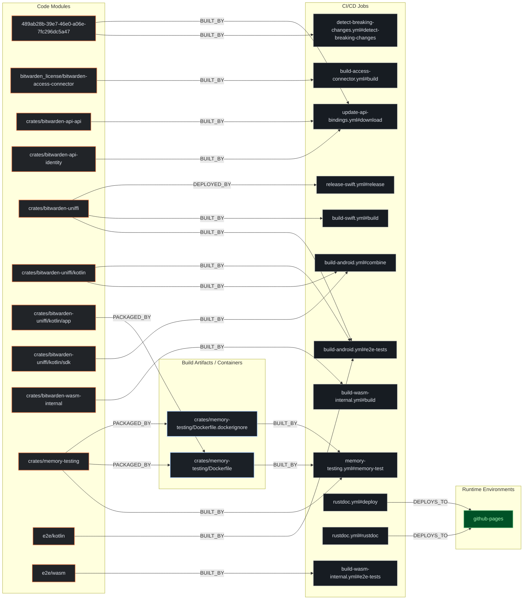

# Repository Architecture Analysis: bitwarden/sdk-internal

## Metadata
- **SHA**: `6238472451e4fa7b5c592b4b24a84e950a258957`
- **Primary Ecosystem**: Rust

## Quality Metrics
- **ast_engine**: tree-sitter
- **avg_cognitive_complexity**: 2.04
- **avg_cyclomatic_complexity**: 3.47
- **component_count**: 257
- **dead_code_count**: 7
- **dead_code_symbols**: 7 entry(ies)
- **duplication_pct**: 2.93
- **file_complexities**: 25 entry(ies)
- **files_analyzed**: 1928
- **fitness_passed**: False
- **fitness_violation_count**: 1
- **framework**: Rust Cargo
- **import_edges**: 100 entry(ies)
- **loc**: 318850
- **max_cognitive_complexity**: 19
- **max_cyclomatic_complexity**: 27
- **sloc**: 232497
- **test_file_count**: 179

# Architecture: bitwarden/sdk-internal

## Context
- **Repository**: `bitwarden/sdk-internal`
- **SHA**: `6238472451e4fa7b5c592b4b24a84e950a258957`
- **Ecosystem**: Rust
- **Framework**: Rust Cargo

## Building Block View

```mermaid
graph TD;
  classDef atlasRoot fill:#004882,stroke:#a3c9ff,stroke-width:2px,color:#d3e4ff
  classDef atlasCategory fill:#212428,stroke:#E87A48,stroke-width:1.5px,color:#dfe3eb
  classDef atlasWorkflow fill:#1b2026,stroke:#a3c9ff,stroke-width:1.5px,color:#dfe3eb
  classDef atlasJob fill:#171c22,stroke:#8d9199,stroke-width:1px,color:#dfe3eb
  classDef atlasTarget fill:#005227,stroke:#8bd99b,stroke-width:1.5px,color:#a7f6b6
  classDef atlasAlert fill:#93000a,stroke:#ffb4ab,stroke-width:1.5px,color:#ffdad6
  classDef atlasMore fill:#252a31,stroke:#8d9199,stroke-dasharray:4 4,color:#c3c6cf
    repo_root(["bitwarden/sdk-internal (257 components)"]):::atlasRoot
    subgraph sg_dir_0_crates["crates (148)"]
      direction TB
      dir_0_crates["crates (148)"]:::atlasCategory
      sub_0_0_bitwarden_api_api["bitwarden-api-api (132)"]:::atlasWorkflow
      dir_0_crates --> sub_0_0_bitwarden_api_api
      sub_0_1_bitwarden_access_token_crypto["bitwarden-access-token-crypto (8)"]:::atlasWorkflow
      dir_0_crates --> sub_0_1_bitwarden_access_token_crypto
      sub_0_2_bitwarden_access_token["bitwarden-access-token (6)"]:::atlasWorkflow
      dir_0_crates --> sub_0_2_bitwarden_access_token
      sub_0_more["+1 more submodules (2)"]:::atlasMore
      dir_0_crates --> sub_0_more
    end
    repo_root --> dir_0_crates
    subgraph sg_dir_1_bitwarden_license["bitwarden_license (104)"]
      direction TB
      dir_1_bitwarden_license["bitwarden_license (104)"]:::atlasCategory
      sub_1_0_bitwarden_access_connector["bitwarden-access-connector (40)"]:::atlasWorkflow
      dir_1_bitwarden_license --> sub_1_0_bitwarden_access_connector
      sub_1_1_bitwarden_pam["bitwarden-pam (34)"]:::atlasWorkflow
      dir_1_bitwarden_license --> sub_1_1_bitwarden_pam
      sub_1_2_bitwarden_sm["bitwarden-sm (21)"]:::atlasWorkflow
      dir_1_bitwarden_license --> sub_1_2_bitwarden_sm
      sub_1_more["+3 more submodules (9)"]:::atlasMore
      dir_1_bitwarden_license --> sub_1_more
    end
    repo_root --> dir_1_bitwarden_license
    dir_2_e2e["e2e (5)"]:::atlasCategory
    repo_root --> dir_2_e2e
```

## Component Details

Showing top 60 representative components out of 257 across 3 module group(s):

- **Module `crates`** (148 components — module: 146, MODULE: 2)
- **Module `bitwarden_license`** (104 components — module: 104)
- **Module `e2e`** (5 components — DATA_ACCESS_LAYER: 4, MODULE: 1)

- **MasterPasswordAuthenticationDataModel** (`e2e/wasm/server-emulator/dto/master-password.ts`): DATA_ACCESS_LAYER (deps: KdfModel)
- **MasterPasswordUnlockDataModel** (`e2e/wasm/server-emulator/dto/master-password.ts`): DATA_ACCESS_LAYER (deps: KdfModel)
- **@bitwarden/commercial-sdk-internal** (`crates/bitwarden-wasm-internal/bitwarden_license/npm/package.json`): MODULE
- **@bitwarden/sdk-internal** (`crates/bitwarden-wasm-internal/npm/package.json`): MODULE
- **KdfModel** (`e2e/wasm/server-emulator/dto/kdf.ts`): DATA_ACCESS_LAYER
- **TestRepository** (`e2e/wasm/client-emulator/local-state.ts`): DATA_ACCESS_LAYER
- **accept_organization_invite_link_request_model** (`crates/bitwarden-api-api/src/models/accept_organization_invite_link_request_model.rs`): module
- **access_approval_mode** (`crates/bitwarden-api-api/src/models/access_approval_mode.rs`): module
- **access_audit_event_response_model** (`crates/bitwarden-api-api/src/models/access_audit_event_response_model.rs`): module
- **access_audit_event_response_model_list_response_model** (`crates/bitwarden-api-api/src/models/access_audit_event_response_model_list_response_model.rs`): module
- **access_audit_item_response_model** (`crates/bitwarden-api-api/src/models/access_audit_item_response_model.rs`): module
- **access_audit_item_response_model_list_response_model** (`crates/bitwarden-api-api/src/models/access_audit_item_response_model_list_response_model.rs`): module
- **access_connector_flow** (`bitwarden_license/bitwarden-access-connector/tests/access_connector_flow.rs`): module
- **access_decider_kind** (`crates/bitwarden-api-api/src/models/access_decider_kind.rs`): module
- **access_decision_request_model** (`crates/bitwarden-api-api/src/models/access_decision_request_model.rs`): module
- **access_decision_verdict** (`crates/bitwarden-api-api/src/models/access_decision_verdict.rs`): module
- **access_lease_extension_request_model** (`crates/bitwarden-api-api/src/models/access_lease_extension_request_model.rs`): module
- **access_lease_response_model** (`crates/bitwarden-api-api/src/models/access_lease_response_model.rs`): module
- **access_lease_response_model_list_response_model** (`crates/bitwarden-api-api/src/models/access_lease_response_model_list_response_model.rs`): module
- **access_lease_revoke_request_model** (`crates/bitwarden-api-api/src/models/access_lease_revoke_request_model.rs`): module
- **access_lease_status** (`crates/bitwarden-api-api/src/models/access_lease_status.rs`): module
- **access_policies_api** (`crates/bitwarden-api-api/src/apis/access_policies_api.rs`): module
- **access_policy_request** (`crates/bitwarden-api-api/src/models/access_policy_request.rs`): module
- **access_pre_check_response_model** (`crates/bitwarden-api-api/src/models/access_pre_check_response_model.rs`): module
- **access_request_create_request_model** (`crates/bitwarden-api-api/src/models/access_request_create_request_model.rs`): module
- **access_request_decision_response_model** (`crates/bitwarden-api-api/src/models/access_request_decision_response_model.rs`): module
- **access_request_details_response_model** (`crates/bitwarden-api-api/src/models/access_request_details_response_model.rs`): module
- **access_request_details_response_model_list_response_model** (`crates/bitwarden-api-api/src/models/access_request_details_response_model_list_response_model.rs`): module
- **access_request_result_response_model** (`crates/bitwarden-api-api/src/models/access_request_result_response_model.rs`): module
- **access_request_revoke_request_model** (`crates/bitwarden-api-api/src/models/access_request_revoke_request_model.rs`): module
- **access_request_status** (`crates/bitwarden-api-api/src/models/access_request_status.rs`): module
- **access_requests_api** (`crates/bitwarden-api-api/src/apis/access_requests_api.rs`): module
- **access_rule_request_model** (`crates/bitwarden-api-api/src/models/access_rule_request_model.rs`): module
- **access_rule_response_model** (`crates/bitwarden-api-api/src/models/access_rule_response_model.rs`): module
- **access_rule_response_model_list_response_model** (`crates/bitwarden-api-api/src/models/access_rule_response_model_list_response_model.rs`): module
- **access_rules_api** (`crates/bitwarden-api-api/src/apis/access_rules_api.rs`): module
- **access_token** (`crates/bitwarden-access-token-crypto/examples/access_token.rs`): module
- **access_token_create_request_model** (`crates/bitwarden-api-api/src/models/access_token_create_request_model.rs`): module
- **access_token_creation_response_model** (`crates/bitwarden-api-api/src/models/access_token_creation_response_model.rs`): module
- **access_token_response_model** (`crates/bitwarden-api-api/src/models/access_token_response_model.rs`): module
- **access_token_response_model_list_response_model** (`crates/bitwarden-api-api/src/models/access_token_response_model_list_response_model.rs`): module
- **account_billing_v_next_api** (`crates/bitwarden-api-api/src/apis/account_billing_v_next_api.rs`): module
- **account_data_request_model** (`crates/bitwarden-api-api/src/models/account_data_request_model.rs`): module
- **account_keys_request_model** (`crates/bitwarden-api-api/src/models/account_keys_request_model.rs`): module
- **accounts_api** (`crates/bitwarden-api-api/src/apis/accounts_api.rs`): module
- **accounts_billing_api** (`crates/bitwarden-api-api/src/apis/accounts_billing_api.rs`): module
- **accounts_key_management_api** (`crates/bitwarden-api-api/src/apis/accounts_key_management_api.rs`): module
- **actions** (`bitwarden_license/bitwarden-pam/src/rotation/actions.rs`): module
- **active_directory_integration** (`bitwarden_license/bitwarden-access-connector/tests/active_directory_integration.rs`): module
- **add_existing_organization_request_body** (`crates/bitwarden-api-api/src/models/add_existing_organization_request_body.rs`): module
- **add_organization_report_request_model** (`crates/bitwarden-api-api/src/models/add_organization_report_request_model.rs`): module
- **admin_auth_request_update_request_model** (`crates/bitwarden-api-api/src/models/admin_auth_request_update_request_model.rs`): module
- **algorithm** (`crates/bitwarden-api-api/src/models/algorithm.rs`): module
- **api_key_response_model** (`crates/bitwarden-api-api/src/models/api_key_response_model.rs`): module
- **assertion_options** (`crates/bitwarden-api-api/src/models/assertion_options.rs`): module
- **assertion_response** (`crates/bitwarden-api-api/src/models/assertion_response.rs`): module
- **assign_access_connector_target_request_model** (`crates/bitwarden-api-api/src/models/assign_access_connector_target_request_model.rs`): module
- **attachment_request_model** (`crates/bitwarden-api-api/src/models/attachment_request_model.rs`): module
- **attachment_response_model** (`crates/bitwarden-api-api/src/models/attachment_response_model.rs`): module
- **attachment_upload_data_response_model** (`crates/bitwarden-api-api/src/models/attachment_upload_data_response_model.rs`): module

## 6-Dimension Repository Scorecard

- **Overall Grade**: `F` (51.19/100)
- **Technical Debt Score**: 48.81
- **Estimated Remediation Effort**: 355.54h

| Dimension | Grade | Score | Weight | Details |
| :--- | :---: | :---: | :---: | :--- |
| Code Quality | `D` | 61.72 | 0.20 | avg_cc=3.47, max_cc=27, duplication=2.93%, dead_code=7 |
| Dependency Health | `A` | 100.00 | 0.15 | dependencies=2319, outdated=0, vulnerable=0, has_lockfile=True |
| Maintainability | `B` | 89.00 | 0.15 | avg_cognitive=2.04, max_cognitive=19, fitness_violations=1, oversized_files=1 |
| Pipeline Health | `F` | 0.00 | 0.15 | workflows=25, operational_antipatterns=54, parallel_branches=True |
| Security | `F` | 0.00 | 0.20 | vulnerabilities=0, secrets=129, pipeline_security_findings=29 |
| Test Coverage | `C` | 70.00 | 0.15 | coverage=unavailable, ci_test_job=True, test_files_detected=True |

## Architecture Fitness & Workspace Boundaries

- **[MEDIUM] `ATRUSS-ARCH-005` (COMPLEXITY_THRESHOLD)**: Repository max_cyclomatic_complexity (27.0) exceeds policy threshold (20.0).

### Workspace Packages
- **bitwarden-access-connector** (`bitwarden_license/bitwarden-access-connector`, rust, cargo) -> internal deps: `bitwarden-access-token, bitwarden-api-api, bitwarden-api-base, bitwarden-commercial-marker, bitwarden-core, bitwarden-crypto, bitwarden-encoding, bitwarden-generators, bitwarden-pam, bitwarden-pam-sealed, bitwarden-sensitive-value, bitwarden-state, bitwarden-threading, bitwarden-vault`
- **bitwarden-commercial-marker** (`bitwarden_license/bitwarden-commercial-marker`, rust, cargo)
- **bitwarden-commercial-vault** (`bitwarden_license/bitwarden-commercial-vault`, rust, cargo) -> internal deps: `bitwarden-commercial-marker, bitwarden-core, bitwarden-ffi`
- **bitwarden-pam** (`bitwarden_license/bitwarden-pam`, rust, cargo) -> internal deps: `bitwarden-access-token, bitwarden-api-api, bitwarden-collections, bitwarden-commercial-marker, bitwarden-core, bitwarden-crypto, bitwarden-error, bitwarden-ffi, bitwarden-generators, bitwarden-pam-sealed, bitwarden-sensitive-value, bitwarden-uuid, bitwarden-vault`
- **bitwarden-pam-sealed** (`bitwarden_license/bitwarden-pam-sealed`, rust, cargo) -> internal deps: `bitwarden-commercial-marker, bitwarden-crypto, bitwarden-encoding, bitwarden-generators`
- **bitwarden-sm** (`bitwarden_license/bitwarden-sm`, rust, cargo) -> internal deps: `bitwarden-api-api, bitwarden-auth, bitwarden-commercial-marker, bitwarden-core, bitwarden-crypto, bitwarden-generators`
- **bitwarden-access-token** (`crates/bitwarden-access-token`, rust, cargo) -> internal deps: `bitwarden-access-token-crypto, bitwarden-crypto, bitwarden-encoding, bitwarden-sensitive-value`
- **bitwarden-access-token-crypto** (`crates/bitwarden-access-token-crypto`, rust, cargo) -> internal deps: `bitwarden-crypto, bitwarden-encoding, bitwarden-random`
- **bitwarden-api-api** (`crates/bitwarden-api-api`, rust, cargo) -> internal deps: `bitwarden-api-base`
- **bitwarden-api-base** (`crates/bitwarden-api-base`, rust, cargo) -> internal deps: `bitwarden-uniffi-error`
- **bitwarden-api-identity** (`crates/bitwarden-api-identity`, rust, cargo) -> internal deps: `bitwarden-api-base`
- **bitwarden-api-key-connector** (`crates/bitwarden-api-key-connector`, rust, cargo) -> internal deps: `bitwarden-api-base`
- **bitwarden-auth** (`crates/bitwarden-auth`, rust, cargo) -> internal deps: `bitwarden-api-api, bitwarden-api-identity, bitwarden-api-key-connector, bitwarden-core, bitwarden-crypto, bitwarden-encoding, bitwarden-error, bitwarden-ffi, bitwarden-policies, bitwarden-state, bitwarden-test`
- **bitwarden-autotype** (`crates/bitwarden-autotype`, rust, cargo) -> internal deps: `bitwarden-ffi, bitwarden-ipc, bitwarden-threading`
- **bitwarden-cli** (`crates/bitwarden-cli`, rust, cargo)
- **bitwarden-collections** (`crates/bitwarden-collections`, rust, cargo) -> internal deps: `bitwarden-api-api, bitwarden-core, bitwarden-crypto, bitwarden-error, bitwarden-ffi, bitwarden-uuid`
- **bitwarden-core** (`crates/bitwarden-core`, rust, cargo) -> internal deps: `bitwarden-api-api, bitwarden-api-base, bitwarden-api-identity, bitwarden-api-key-connector, bitwarden-core-macro, bitwarden-crypto, bitwarden-encoding, bitwarden-error, bitwarden-ffi, bitwarden-logging, bitwarden-managed-settings-types, bitwarden-random, bitwarden-state, bitwarden-state-bridge-macro, bitwarden-test, bitwarden-threading, bitwarden-uniffi-error, bitwarden-uuid`
- **bitwarden-core-macro** (`crates/bitwarden-core-macro`, rust, cargo)
- **bitwarden-crypto** (`crates/bitwarden-crypto`, rust, cargo) -> internal deps: `bitwarden-api-key-connector, bitwarden-encoding, bitwarden-error, bitwarden-ffi, bitwarden-logging, bitwarden-random, bitwarden-sensitive-value, bitwarden-uniffi-error`
- **bitwarden-crypto-cipher-suite** (`crates/bitwarden-crypto-cipher-suite`, rust, cargo) -> internal deps: `bitwarden-core, bitwarden-crypto, bitwarden-ffi`
- **bitwarden-crypto-sync-handler** (`crates/bitwarden-crypto-sync-handler`, rust, cargo) -> internal deps: `bitwarden-api-api, bitwarden-core, bitwarden-crypto, bitwarden-ffi, bitwarden-sync`
- **bitwarden-emergency-access** (`crates/bitwarden-emergency-access`, rust, cargo) -> internal deps: `bitwarden-api-api, bitwarden-core, bitwarden-crypto, bitwarden-encoding, bitwarden-error, bitwarden-ffi, bitwarden-policies, bitwarden-uuid, bitwarden-vault`
- **bitwarden-encoding** (`crates/bitwarden-encoding`, rust, cargo) -> internal deps: `bitwarden-ffi, bitwarden-uniffi-error`
- **bitwarden-encrypted-migrator** (`crates/bitwarden-encrypted-migrator`, rust, cargo) -> internal deps: `bitwarden-api-api, bitwarden-core, bitwarden-crypto, bitwarden-ffi, bitwarden-member-administration, bitwarden-organizations, bitwarden-state, bitwarden-test`
- **bitwarden-error** (`crates/bitwarden-error`, rust, cargo) -> internal deps: `bitwarden-error-macro`
- **bitwarden-error-macro** (`crates/bitwarden-error-macro`, rust, cargo)
- **bitwarden-exporters** (`crates/bitwarden-exporters`, rust, cargo) -> internal deps: `bitwarden-collections, bitwarden-core, bitwarden-crypto, bitwarden-encoding, bitwarden-error, bitwarden-ffi, bitwarden-fido, bitwarden-ssh, bitwarden-vault`
- **bitwarden-ffi** (`crates/bitwarden-ffi`, rust, cargo) -> internal deps: `bitwarden-error, bitwarden-ffi-macro`
- **bitwarden-ffi-macro** (`crates/bitwarden-ffi-macro`, rust, cargo)
- **bitwarden-fido** (`crates/bitwarden-fido`, rust, cargo) -> internal deps: `bitwarden-api-api, bitwarden-core, bitwarden-crypto, bitwarden-encoding, bitwarden-vault`
- **bitwarden-generators** (`crates/bitwarden-generators`, rust, cargo) -> internal deps: `bitwarden-api-base, bitwarden-core, bitwarden-crypto, bitwarden-error, bitwarden-ffi, bitwarden-random`
- **bitwarden-importers** (`crates/bitwarden-importers`, rust, cargo) -> internal deps: `bitwarden-api-api, bitwarden-api-base, bitwarden-collections, bitwarden-core, bitwarden-crypto, bitwarden-error, bitwarden-exporters, bitwarden-ffi, bitwarden-random, bitwarden-ssh, bitwarden-threading, bitwarden-vault`
- **bitwarden-ipc** (`crates/bitwarden-ipc`, rust, cargo) -> internal deps: `bitwarden-error, bitwarden-ffi, bitwarden-random, bitwarden-threading`
- **bitwarden-logging** (`crates/bitwarden-logging`, rust, cargo) -> internal deps: `bitwarden-ffi, bitwarden-logging-macro`
- **bitwarden-logging-macro** (`crates/bitwarden-logging-macro`, rust, cargo)
- **bitwarden-managed-settings** (`crates/bitwarden-managed-settings`, rust, cargo) -> internal deps: `bitwarden-core, bitwarden-ffi, bitwarden-managed-settings-types`
- **bitwarden-managed-settings-types** (`crates/bitwarden-managed-settings-types`, rust, cargo) -> internal deps: `bitwarden-error, bitwarden-ffi`
- **bitwarden-member-administration** (`crates/bitwarden-member-administration`, rust, cargo) -> internal deps: `bitwarden-api-api, bitwarden-core, bitwarden-crypto, bitwarden-error, bitwarden-ffi, bitwarden-organization-crypto, bitwarden-organizations`
- **bitwarden-organization-crypto** (`crates/bitwarden-organization-crypto`, rust, cargo) -> internal deps: `bitwarden-crypto, bitwarden-encoding, bitwarden-ffi, bitwarden-random, bitwarden-sensitive-value`
- **bitwarden-organization-crypto-management** (`crates/bitwarden-organization-crypto-management`, rust, cargo) -> internal deps: `bitwarden-api-api, bitwarden-core, bitwarden-crypto, bitwarden-error, bitwarden-ffi, bitwarden-organizations, bitwarden-state, bitwarden-test`

## Supply Chain Dependencies, Vulnerabilities & Secrets

- **Dependencies Parsed**: 2319 | **Vulnerabilities**: 0 | **Secrets**: 129

### Secret Findings (Redacted)
- **[HIGH] `ATRUSS-SEC-005`** at `bitwarden_license/bitwarden-access-connector/tests/fixtures/ciphers/keyed_login.json:6` (`"key": "2.lG***REDACTED***",`)
- **[HIGH] `ATRUSS-SEC-005`** at `bitwarden_license/bitwarden-access-connector/tests/fixtures/ciphers/keyed_login.json:8` (`"password": "2.2s***REDACTED***",`)
- **[HIGH] `ATRUSS-SEC-005`** at `bitwarden_license/bitwarden-access-connector/tests/fixtures/ciphers/keyed_login.json:25` (`"password": "2.eS***REDACTED***"`)
- **[HIGH] `ATRUSS-SEC-005`** at `bitwarden_license/bitwarden-access-connector/tests/fixtures/ciphers/keyed_login_with_attachment.json:6` (`"key": "2.vm***REDACTED***",`)
- **[HIGH] `ATRUSS-SEC-005`** at `bitwarden_license/bitwarden-access-connector/tests/fixtures/ciphers/keyed_login_with_attachment.json:16` (`"key": "2.kB***REDACTED***",`)
- **[HIGH] `ATRUSS-SEC-005`** at `bitwarden_license/bitwarden-access-connector/tests/fixtures/ciphers/keyed_login_with_attachment.json:18` (`"password": "2.V2***REDACTED***",`)
- **[HIGH] `ATRUSS-SEC-005`** at `bitwarden_license/bitwarden-access-connector/tests/fixtures/ciphers/keyed_login_with_attachment.json:35` (`"password": "2.S3***REDACTED***"`)
- **[HIGH] `ATRUSS-SEC-005`** at `bitwarden_license/bitwarden-access-connector/tests/fixtures/ciphers/keyless_login.json:5` (`"password": "2.GQ***REDACTED***",`)
- **[HIGH] `ATRUSS-SEC-005`** at `bitwarden_license/bitwarden-access-connector/tests/fixtures/ciphers/keyless_login.json:21` (`"password": "2.rM***REDACTED***"`)
- **[HIGH] `ATRUSS-SEC-005`** at `bitwarden_license/bitwarden-access-connector/tests/fixtures/ciphers/restricted_login.json:6` (`"key": "2.lG***REDACTED***",`)
- **[HIGH] `ATRUSS-SEC-005`** at `bitwarden_license/bitwarden-pam/tests/fixtures/ciphers/keyed_login.json:6` (`"key": "2.lG***REDACTED***",`)
- **[HIGH] `ATRUSS-SEC-005`** at `bitwarden_license/bitwarden-pam/tests/fixtures/ciphers/keyed_login.json:8` (`"password": "2.2s***REDACTED***",`)
- **[HIGH] `ATRUSS-SEC-005`** at `bitwarden_license/bitwarden-pam/tests/fixtures/ciphers/keyed_login.json:25` (`"password": "2.eS***REDACTED***"`)
- **[HIGH] `ATRUSS-SEC-005`** at `bitwarden_license/bitwarden-pam/tests/fixtures/ciphers/keyed_login_with_attachment.json:6` (`"key": "2.vm***REDACTED***",`)
- **[HIGH] `ATRUSS-SEC-005`** at `bitwarden_license/bitwarden-pam/tests/fixtures/ciphers/keyed_login_with_attachment.json:16` (`"key": "2.kB***REDACTED***",`)
- **[HIGH] `ATRUSS-SEC-005`** at `bitwarden_license/bitwarden-pam/tests/fixtures/ciphers/keyed_login_with_attachment.json:18` (`"password": "2.V2***REDACTED***",`)
- **[HIGH] `ATRUSS-SEC-005`** at `bitwarden_license/bitwarden-pam/tests/fixtures/ciphers/keyed_login_with_attachment.json:35` (`"password": "2.S3***REDACTED***"`)
- **[HIGH] `ATRUSS-SEC-005`** at `bitwarden_license/bitwarden-pam/tests/fixtures/ciphers/keyless_login.json:5` (`"password": "2.GQ***REDACTED***",`)
- **[HIGH] `ATRUSS-SEC-005`** at `bitwarden_license/bitwarden-pam/tests/fixtures/ciphers/keyless_login.json:21` (`"password": "2.rM***REDACTED***"`)
- **[HIGH] `ATRUSS-SEC-005`** at `bitwarden_license/bitwarden-pam/tests/fixtures/ciphers/restricted_login.json:6` (`"key": "2.lG***REDACTED***",`)
- **[HIGH] `ATRUSS-SEC-005`** at `bitwarden_license/bitwarden-sm/src/client_secrets.rs:152` (`"key":"2.pM***REDACTED***",`)
- **[HIGH] `ATRUSS-SEC-005`** at `bitwarden_license/bitwarden-sm/src/client_secrets.rs:165` (`"key":"2.pM***REDACTED***",`)
- **[HIGH] `ATRUSS-SEC-005`** at `bitwarden_license/bitwarden-sm/src/client_secrets.rs:179` (`access_token: "0.ec***REDACTED***".into(),`)
- **[HIGH] `ATRUSS-SEC-005`** at `crates/bitwarden-auth/src/login/api/send_login_request.rs:164` (`"Key": "2.Q/***REDACTED***",`)
- **[HIGH] `ATRUSS-SEC-005`** at `crates/bitwarden-auth/src/login/api/send_login_request.rs:165` (`"PrivateKey": "2.pM***REDACTED***",`)
- **[HIGH] `ATRUSS-SEC-005`** at `crates/bitwarden-auth/src/login/api/send_login_request.rs:179` (`"MasterKeyEncryptedUserKey": "2.Q/***REDACTED***",`)
- **[HIGH] `ATRUSS-SEC-005`** at `crates/bitwarden-auth/src/login/models/webauthn_prf_user_decryption_option.rs:46` (`encrypted_private_key: "2.fk***REDACTED***".parse().unwrap(),`)
- **[HIGH] `ATRUSS-SEC-005`** at `crates/bitwarden-auth/src/login/models/webauthn_prf_user_decryption_option.rs:47` (`encrypted_user_key: "4.DM***REDACTED***".parse().unwrap(),`)
- **[HIGH] `ATRUSS-SEC-005`** at `crates/bitwarden-auth/src/login/models/webauthn_prf_user_decryption_option.rs:63` (`encrypted_private_key: "2.fk***REDACTED***".parse().unwrap(),`)
- **[HIGH] `ATRUSS-SEC-005`** at `crates/bitwarden-auth/src/login/models/webauthn_prf_user_decryption_option.rs:64` (`encrypted_user_key: "4.DM***REDACTED***".parse().unwrap(),`)
- **[HIGH] `ATRUSS-SEC-005`** at `crates/bitwarden-core/src/auth/access_token.rs:96` (`let access_token = "0.ec***REDACTED***";`)
- **[HIGH] `ATRUSS-SEC-005`** at `crates/bitwarden-core/src/auth/auth_request.rs:155` (`let user_key = "2.Q/***REDACTED***".parse().unwrap();`)
- **[HIGH] `ATRUSS-SEC-005`** at `crates/bitwarden-core/src/auth/auth_request.rs:156` (`let private_key ="2.yN***REDACTED***".parse().unwrap();`)
- **[HIGH] `ATRUSS-SEC-005`** at `crates/bitwarden-core/src/auth/auth_request.rs:186` (`let private_key = "MIIE***REDACTED***".parse()`)
- **[HIGH] `ATRUSS-SEC-005`** at `crates/bitwarden-core/src/auth/auth_request.rs:189` (`let enc_user_key = "4.dx***REDACTED***".parse().unwrap();`)
- **[HIGH] `ATRUSS-SEC-005`** at `crates/bitwarden-core/src/auth/auth_request.rs:203` (`let private_key = "MIIE***REDACTED***".parse().unwrap();`)
- **[HIGH] `ATRUSS-SEC-005`** at `crates/bitwarden-core/src/auth/auth_request.rs:205` (`let enc_master_key = "4.dx***REDACTED***".parse().unwrap();`)
- **[HIGH] `ATRUSS-SEC-005`** at `crates/bitwarden-core/src/auth/auth_request.rs:206` (`let enc_user_key = "2.Q/***REDACTED***".parse().unwrap();`)
- **[HIGH] `ATRUSS-SEC-005`** at `crates/bitwarden-core/src/auth/auth_request.rs:228` (`let user_key = "2.Q/***REDACTED***".parse().unwrap();`)
- **[HIGH] `ATRUSS-SEC-005`** at `crates/bitwarden-core/src/auth/password/validate.rs:100` (`let password_hash = "7kTq***REDACTED***"`)

### Inventory Sample
- `androidx.activity:activity-compose` `1.10.1` (Maven, `crates/bitwarden-uniffi/kotlin/app/build.gradle`)
- `androidx.biometric:biometric` `1.1.0` (Maven, `crates/bitwarden-uniffi/kotlin/app/build.gradle`)
- `androidx.compose.material3:material3` `*` (Maven, `crates/bitwarden-uniffi/kotlin/app/build.gradle`)
- `androidx.compose.ui:ui` `*` (Maven, `crates/bitwarden-uniffi/kotlin/app/build.gradle`)
- `androidx.compose.ui:ui-graphics` `*` (Maven, `crates/bitwarden-uniffi/kotlin/app/build.gradle`)
- `androidx.compose.ui:ui-test-manifest` `*` (Maven, `crates/bitwarden-uniffi/kotlin/app/build.gradle`)
- `androidx.compose.ui:ui-tooling` `*` (Maven, `crates/bitwarden-uniffi/kotlin/app/build.gradle`)
- `androidx.compose.ui:ui-tooling-preview` `*` (Maven, `crates/bitwarden-uniffi/kotlin/app/build.gradle`)
- `androidx.core:core-ktx` `1.15.0` (Maven, `crates/bitwarden-uniffi/kotlin/app/build.gradle`)
- `androidx.core:core-ktx` `1.15.0` (Maven, `crates/bitwarden-uniffi/kotlin/sdk/build.gradle`)
- `androidx.lifecycle:lifecycle-runtime-ktx` `2.8.7` (Maven, `crates/bitwarden-uniffi/kotlin/app/build.gradle`)
- `io.ktor:ktor-client-cio` `2.3.3` (Maven, `crates/bitwarden-uniffi/kotlin/app/build.gradle`)
- `io.ktor:ktor-client-content-negotiation` `2.3.3` (Maven, `crates/bitwarden-uniffi/kotlin/app/build.gradle`)
- `io.ktor:ktor-client-core` `2.3.3` (Maven, `crates/bitwarden-uniffi/kotlin/app/build.gradle`)
- `io.ktor:ktor-serialization-kotlinx-json` `2.3.3` (Maven, `crates/bitwarden-uniffi/kotlin/app/build.gradle`)
- `junit:junit` `4.13.2` (Maven, `crates/bitwarden-uniffi/kotlin/app/build.gradle`)
- `junit:junit` `4.13.2` (Maven, `crates/bitwarden-uniffi/kotlin/sdk/build.gradle`)
- `junit:junit` `4.13.2` (Maven, `e2e/kotlin/build.gradle`)
- `net.java.dev.jna:jna` `*` (Maven, `crates/bitwarden-uniffi/kotlin/sdk/build.gradle`)
- `net.java.dev.jna:jna` `5.17.0` (Maven, `e2e/kotlin/build.gradle`)
- `org.jetbrains.kotlinx:kotlinx-coroutines-android` `1.10.1` (Maven, `crates/bitwarden-uniffi/kotlin/sdk/build.gradle`)
- `org.jetbrains.kotlinx:kotlinx-coroutines-core` `1.10.1` (Maven, `e2e/kotlin/build.gradle`)
- `aes` `*` (cargo, `crates/bitwarden-crypto/Cargo.toml`)
- `aes` `*` (cargo, `crates/bitwarden-importers/Cargo.toml`)
- `aes-gcm` `*` (cargo, `crates/bitwarden-crypto/Cargo.toml`)
- `aes-gcm` `*` (cargo, `crates/bitwarden-importers/Cargo.toml`)
- `anyhow` `*` (cargo, `bitwarden_license/bitwarden-access-connector/Cargo.toml`)
- `anyhow` `1.0` (cargo, `crates/bitwarden-uniffi-error/Cargo.toml`)
- `argon2` `0.6.0-rc.8` (cargo, `crates/bitwarden-crypto/Cargo.toml`)
- `async-trait` `*` (cargo, `bitwarden_license/bitwarden-access-connector/Cargo.toml`)
- ... (+2289 more dependencies)

## Section 7: Code-to-Cloud Deployment Traceability

- `rustdoc.yml#deploy` (ci_job) --[DEPLOYS_TO]--> `github-pages` (environment)
- `rustdoc.yml#rustdoc` (ci_job) --[DEPLOYS_TO]--> `github-pages` (environment)
- `489ab28b-39e7-46e0-a06e-7fc296dc5a47` (code_module) --[BUILT_BY]--> `detect-breaking-changes.yml#detect-breaking-changes` (ci_job)
- `489ab28b-39e7-46e0-a06e-7fc296dc5a47` (code_module) --[BUILT_BY]--> `update-api-bindings.yml#download` (ci_job)
- `bitwarden_license/bitwarden-access-connector` (code_module) --[BUILT_BY]--> `build-access-connector.yml#build` (ci_job)
- `crates/bitwarden-api-api` (code_module) --[BUILT_BY]--> `update-api-bindings.yml#download` (ci_job)
- `crates/bitwarden-api-identity` (code_module) --[BUILT_BY]--> `update-api-bindings.yml#download` (ci_job)
- `crates/bitwarden-uniffi` (code_module) --[BUILT_BY]--> `build-android.yml#e2e-tests` (ci_job)
- `crates/bitwarden-uniffi` (code_module) --[BUILT_BY]--> `build-swift.yml#build` (ci_job)
- `crates/bitwarden-uniffi` (code_module) --[DEPLOYED_BY]--> `release-swift.yml#release` (ci_job)
- `crates/bitwarden-uniffi/kotlin` (code_module) --[BUILT_BY]--> `build-android.yml#combine` (ci_job)
- `crates/bitwarden-uniffi/kotlin` (code_module) --[BUILT_BY]--> `build-android.yml#e2e-tests` (ci_job)
- `crates/bitwarden-uniffi/kotlin/app` (code_module) --[PACKAGED_BY]--> `crates/memory-testing/Dockerfile` (container)
- `crates/bitwarden-uniffi/kotlin/sdk` (code_module) --[BUILT_BY]--> `build-android.yml#combine` (ci_job)
- `crates/bitwarden-wasm-internal` (code_module) --[BUILT_BY]--> `build-wasm-internal.yml#build` (ci_job)
- `crates/memory-testing` (code_module) --[BUILT_BY]--> `memory-testing.yml#memory-test` (ci_job)
- `crates/memory-testing` (code_module) --[PACKAGED_BY]--> `crates/memory-testing/Dockerfile` (container)
- `crates/memory-testing` (code_module) --[PACKAGED_BY]--> `crates/memory-testing/Dockerfile.dockerignore` (container)
- `e2e/kotlin` (code_module) --[BUILT_BY]--> `build-android.yml#e2e-tests` (ci_job)
- `e2e/wasm` (code_module) --[BUILT_BY]--> `build-wasm-internal.yml#e2e-tests` (ci_job)
- `crates/memory-testing/Dockerfile` (container) --[BUILT_BY]--> `memory-testing.yml#memory-test` (ci_job)
- `crates/memory-testing/Dockerfile.dockerignore` (container) --[BUILT_BY]--> `memory-testing.yml#memory-test` (ci_job)

## CI/CD Pipeline Topology

```mermaid
graph TD;
  classDef atlasRoot fill:#004882,stroke:#a3c9ff,stroke-width:2px,color:#d3e4ff
  classDef atlasCategory fill:#212428,stroke:#E87A48,stroke-width:1.5px,color:#dfe3eb
  classDef atlasWorkflow fill:#1b2026,stroke:#a3c9ff,stroke-width:1.5px,color:#dfe3eb
  classDef atlasJob fill:#171c22,stroke:#8d9199,stroke-width:1px,color:#dfe3eb
  classDef atlasTarget fill:#005227,stroke:#8bd99b,stroke-width:1.5px,color:#a7f6b6
  classDef atlasAlert fill:#93000a,stroke:#ffb4ab,stroke-width:1.5px,color:#ffdad6
  classDef atlasMore fill:#252a31,stroke:#8d9199,stroke-dasharray:4 4,color:#c3c6cf
  pipeline_root(["bitwarden/sdk-internal (25 workflows)"]):::atlasRoot
  subgraph sg_grp_0_Scheduled___Manual["Scheduled & Manual (16 workflows · 34 jobs)"]
    direction TB
    subgraph sg_wf_2_Build_Android["Build Android (5 jobs)"]
      direction TB
      wf_2_Build_Android(["Trigger: Build Android"]):::atlasWorkflow
      job_2_build["build"]:::atlasJob
      job_2_combine["combine"]:::atlasJob
      job_2_e2e_tests["e2e-tests"]:::atlasJob
      wf_2_Build_Android --> job_2_build
      job_2_build --> job_2_combine
      wf_2_Build_Android --> job_2_e2e_tests
    end
    pipeline_root --> wf_2_Build_Android
    subgraph sg_wf_4_Build_Swift_Package["Build Swift Package (4 jobs)"]
      direction TB
      wf_4_Build_Swift_Package(["Trigger: Build Swift Package"]):::atlasWorkflow
      job_4_version["version"]:::atlasJob
      job_4_build["build"]:::atlasJob
      job_4_e2e_tests["e2e-tests"]:::atlasJob
      wf_4_Build_Swift_Package --> job_4_version
      job_4_version --> job_4_build
      job_4_version --> job_4_e2e_tests
      job_4_build --> job_4_e2e_tests
    end
    pipeline_root --> wf_4_Build_Swift_Package
    subgraph sg_wf_5_Build__bitwarden_sdk_internal["Build @bitwarden/sdk-internal (4 jobs)"]
      direction TB
      wf_5_Build__bitwarden_sdk_internal(["Trigger: Build @bitwarden/sdk-internal"]):::atlasWorkflow
      job_5_build["build"]:::atlasJob
      job_5_e2e_tests["e2e-tests"]:::atlasJob
      job_5_trigger_wasm_publish["trigger-wasm-publish"]:::atlasJob
      wf_5_Build__bitwarden_sdk_internal --> job_5_build
      job_5_build --> job_5_e2e_tests
      job_5_build --> job_5_trigger_wasm_publish
    end
    pipeline_root --> wf_5_Build__bitwarden_sdk_internal
    subgraph sg_wf_20_Rust_tests["Rust tests (4 jobs)"]
      direction TB
      wf_20_Rust_tests(["Trigger: Rust tests"]):::atlasWorkflow
      job_20_ci_pass["ci-pass"]:::atlasJob
      job_20_test["test"]:::atlasJob
      job_20_test_wasm["test-wasm"]:::atlasJob
      job_20_test --> job_20_ci_pass
      wf_20_Rust_tests --> job_20_test
      wf_20_Rust_tests --> job_20_test_wasm
    end
    pipeline_root --> wf_20_Rust_tests
  end
  subgraph sg_grp_1_CI___Verification["CI & Verification (6 workflows · 11 jobs)"]
    direction TB
    subgraph sg_wf_0_Breaking_change_check__Fork_PR_["Breaking change check (Fork PR) (5 jobs)"]
      direction TB
      wf_0_Breaking_change_check__Fork_PR_(["Trigger: Breaking change check (Fork PR)"]):::atlasWorkflow
      job_0_check_run["check-run"]:::atlasJob
      job_0_remove_label["remove-label"]:::atlasJob
      job_0_check_approval["check-approval"]:::atlasJob
      wf_0_Breaking_change_check__Fork_PR_ --> job_0_check_run
      job_0_check_run --> job_0_remove_label
      job_0_check_run --> job_0_check_approval
    end
    pipeline_root --> wf_0_Breaking_change_check__Fork_PR_
    subgraph sg_wf_19_Code_Review["Code Review (1 jobs)"]
      direction TB
      wf_19_Code_Review(["Trigger: Code Review"]):::atlasWorkflow
      job_19_review["review"]:::atlasJob
      wf_19_Code_Review --> job_19_review
    end
    pipeline_root --> wf_19_Code_Review
    wf_21_Rustdoc["Rustdoc (2 jobs)"]:::atlasWorkflow
    pipeline_root --> wf_21_Rustdoc
  end
  subgraph sg_grp_2_Release___Deploy["Release & Deploy (2 workflows · 2 jobs)"]
    direction TB
    wf_16_Publish_Rust_crates["Publish Rust crates (1 jobs)"]:::atlasWorkflow
    pipeline_root --> wf_16_Publish_Rust_crates
    wf_17_Release_Swift_Package["Release Swift Package (1 jobs)"]:::atlasWorkflow
    pipeline_root --> wf_17_Release_Swift_Package
  end
  subgraph sg_grp_3_Automation___Other["Automation & Other (1 workflows · 1 jobs)"]
    direction TB
    wf_9_SDK_Breaking_Change_Detection["SDK Breaking Change Detection (1 jobs)"]:::atlasWorkflow
    pipeline_root --> wf_9_SDK_Breaking_Change_Detection
  end
  wf_more["+15 more workflows"]:::atlasMore
  pipeline_root --> wf_more
```

