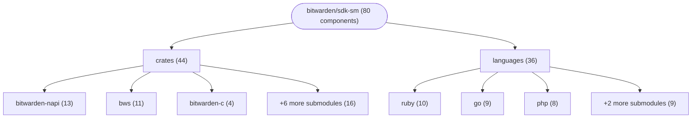
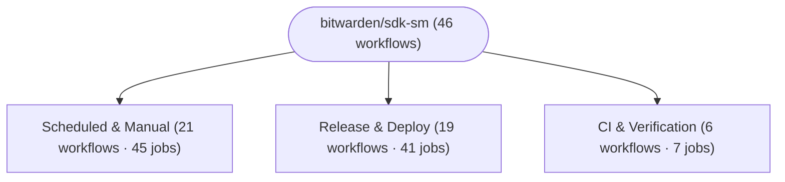

# Repository Architecture Analysis: bitwarden/sdk-sm

## Metadata
- **SHA**: `db735a12a8da505d99bec9498e3b21b4584acc6c`
- **Primary Ecosystem**: Rust

## Quality Metrics
- **ast_engine**: tree-sitter
- **avg_cognitive_complexity**: 1.34
- **avg_cyclomatic_complexity**: 1.81
- **component_count**: 80
- **dead_code_count**: 6
- **dead_code_symbols**: 6 entry(ies)
- **duplication_pct**: 30.84
- **file_complexities**: 25 entry(ies)
- **files_analyzed**: 99
- **fitness_passed**: False
- **fitness_violation_count**: 2
- **framework**: Axum / Actix / Rocket
- **import_edges**: 100 entry(ies)
- **loc**: 8214
- **max_cognitive_complexity**: 56
- **max_cyclomatic_complexity**: 14
- **sloc**: 6313
- **test_file_count**: 2

# Architecture: bitwarden/sdk-sm

## Context
- **Repository**: `bitwarden/sdk-sm`
- **SHA**: `db735a12a8da505d99bec9498e3b21b4584acc6c`
- **Ecosystem**: Rust
- **Framework**: Axum / Actix / Rocket

## Building Block View

## Component Details

Showing top 60 representative components out of 80 across 2 module group(s):

- **Module `crates`** (44 components — module: 34, MODULE: 5, SERVICE: 5)
- **Module `languages`** (36 components — module: 27, MODULE: 6, SERVICE: 3)

- **Bitwarden.Sdk.Samples** (`languages/csharp/Bitwarden.Sdk.Samples/Bitwarden.Sdk.Samples.csproj`): MODULE (deps: Bitwarden.Sdk)
- **Bitwarden.Sdk.Tests** (`languages/csharp/Bitwarden.Sdk.Tests/Bitwarden.Sdk.Tests.csproj`): MODULE (deps: Bitwarden.Sdk)
- **@bitwarden/sdk-client** (`languages/js/sdk-client/package.json`): MODULE
- **@bitwarden/sdk-napi** (`crates/bitwarden-napi/package.json`): MODULE
- **@bitwarden/sdk-napi-darwin-arm64** (`crates/bitwarden-napi/npm/darwin-arm64/package.json`): MODULE
- **@bitwarden/sdk-napi-darwin-x64** (`crates/bitwarden-napi/npm/darwin-x64/package.json`): MODULE
- **@bitwarden/sdk-napi-linux-x64-gnu** (`crates/bitwarden-napi/npm/linux-x64-gnu/package.json`): MODULE
- **@bitwarden/sdk-napi-win32-x64-msvc** (`crates/bitwarden-napi/npm/win32-x64-msvc/package.json`): MODULE
- **@bitwarden/sdk-wasm** (`languages/js/wasm/package.json`): MODULE
- **AuthClient** (`crates/bitwarden-napi/src-ts/bitwarden_client/index.ts`): SERVICE
- **AuthClient** (`languages/php/src/AuthClient.php`): module
- **Bitwarden.Sdk** (`languages/csharp/Bitwarden.Sdk/Bitwarden.Sdk.csproj`): MODULE
- **BitwardenClient** (`crates/bitwarden-napi/binding.d.ts`): SERVICE
- **BitwardenClient** (`crates/bitwarden-napi/src-ts/bitwarden_client/index.ts`): SERVICE
- **BitwardenClient** (`languages/js/sdk-client/src/client.ts`): SERVICE
- **BitwardenClient** (`languages/php/src/BitwardenClient.php`): module
- **BitwardenLib** (`languages/php/src/BitwardenLib.php`): module
- **BitwardenSettings** (`languages/php/src/BitwardenSettings.php`): module
- **CommandRunner** (`languages/php/src/CommandRunner.php`): module
- **ProjectsClient** (`crates/bitwarden-napi/src-ts/bitwarden_client/index.ts`): SERVICE
- **ProjectsClient** (`languages/js/sdk-client/src/client.ts`): SERVICE
- **ProjectsClient** (`languages/php/src/ProjectsClient.php`): module
- **SecretsClient** (`crates/bitwarden-napi/src-ts/bitwarden_client/index.ts`): SERVICE
- **SecretsClient** (`languages/js/sdk-client/src/client.ts`): SERVICE
- **SecretsClient** (`languages/php/src/SecretsClient.php`): module
- **auth** (`languages/ruby/bitwarden_sdk_secrets/lib/auth.rb`): module
- **bitwarden-sdk-secrets** (`languages/ruby/bitwarden_sdk_secrets/lib/bitwarden-sdk-secrets.rb`): module
- **bitwarden_client** (`languages/go/bitwarden_client.go`): module
- **bitwarden_client_test** (`languages/go/bitwarden_client_test.go`): module
- **bitwarden_error** (`languages/ruby/bitwarden_sdk_secrets/lib/bitwarden_error.rb`): module
- **bitwarden_lib** (`languages/ruby/bitwarden_sdk_secrets/lib/bitwarden_lib.rb`): module
- **bitwarden_library** (`languages/go/internal/cinterface/bitwarden_library.go`): module
- **build** (`crates/bitwarden-napi/build.rs`): module
- **build** (`crates/bitwarden-py/build.rs`): module
- **build** (`crates/bws/build.rs`): module
- **c** (`crates/bitwarden-c/src/c.rs`): module
- **cli** (`crates/bws/src/cli.rs`): module
- **client** (`crates/bitwarden-json/src/client.rs`): module
- **client** (`crates/bitwarden-napi/src/client.rs`): module
- **client** (`crates/bitwarden-py/src/client.rs`): module
- **client** (`crates/bitwarden-wasm/src/client.rs`): module
- **command** (`crates/bitwarden-json/src/command.rs`): module
- **command_runner** (`languages/go/command_runner.go`): module
- **command_runner** (`languages/ruby/bitwarden_sdk_secrets/lib/command_runner.rb`): module
- **config** (`crates/bws/src/config.rs`): module
- **error** (`crates/bitwarden/src/error.rs`): module
- **example** (`languages/go/example/example.go`): module
- **example** (`languages/php/example.php`): module
- **ffi** (`crates/bitwarden-c/src/macros/ffi.rs`): module
- **generators** (`languages/go/generators.go`): module
- **lib** (`crates/bitwarden-c/src/lib.rs`): module
- **lib** (`crates/bitwarden-json/src/lib.rs`): module
- **lib** (`crates/bitwarden-napi/src/lib.rs`): module
- **lib** (`crates/bitwarden-py/src/lib.rs`): module
- **lib** (`crates/bitwarden-wasm/src/lib.rs`): module
- **lib** (`crates/bitwarden/src/lib.rs`): module
- **lib** (`crates/fake-server/src/lib.rs`): module
- **main** (`crates/bws/src/main.rs`): module
- **main** (`crates/fake-server/src/main.rs`): module
- **main** (`crates/sdk-schemas/src/main.rs`): module

## 6-Dimension Repository Scorecard

- **Overall Grade**: `F` (46.80/100)
- **Technical Debt Score**: 53.20
- **Estimated Remediation Effort**: 263.47h

| Dimension | Grade | Score | Weight | Details |
| :--- | :---: | :---: | :---: | :--- |
| Code Quality | `D` | 63.00 | 0.20 | avg_cc=1.81, max_cc=14, duplication=30.84%, dead_code=6 |
| Dependency Health | `A` | 100.00 | 0.15 | dependencies=740, outdated=0, vulnerable=0, has_lockfile=True |
| Maintainability | `F` | 58.00 | 0.15 | avg_cognitive=1.34, max_cognitive=56, fitness_violations=2, oversized_files=1 |
| Pipeline Health | `F` | 0.00 | 0.15 | workflows=46, operational_antipatterns=138, parallel_branches=True |
| Security | `F` | 0.00 | 0.20 | vulnerabilities=0, secrets=8, pipeline_security_findings=78 |
| Test Coverage | `C` | 70.00 | 0.15 | coverage=unavailable, ci_test_job=True, test_files_detected=True |

## Architecture Fitness & Workspace Boundaries

- **[MEDIUM] `ATRUSS-ARCH-005` (COMPLEXITY_THRESHOLD)**: Repository duplication_pct (30.84) exceeds policy threshold (15.0).
- **[MEDIUM] `ATRUSS-ARCH-005` (COMPLEXITY_THRESHOLD)**: Repository max_cognitive_complexity (56.0) exceeds policy threshold (25.0).

### Workspace Packages
- **bitwarden** (`crates/bitwarden`, rust, cargo)
- **bitwarden-c** (`crates/bitwarden-c`, rust, cargo)
- **bitwarden-json** (`crates/bitwarden-json`, rust, cargo) -> internal deps: `bitwarden`
- **bitwarden-napi** (`crates/bitwarden-napi`, rust, cargo) -> internal deps: `bitwarden-json`
- **bitwarden-py** (`crates/bitwarden-py`, rust, cargo) -> internal deps: `bitwarden-json`
- **bitwarden-wasm** (`crates/bitwarden-wasm`, rust, cargo) -> internal deps: `bitwarden-json`
- **bws** (`crates/bws`, rust, cargo) -> internal deps: `bitwarden`
- **fake-server** (`crates/fake-server`, rust, cargo)
- **sdk-schemas** (`crates/sdk-schemas`, rust, cargo) -> internal deps: `bitwarden, bitwarden-json`

## Supply Chain Dependencies, Vulnerabilities & Secrets

- **Dependencies Parsed**: 740 | **Vulnerabilities**: 0 | **Secrets**: 8

### Secret Findings (Redacted)
- **[HIGH] `ATRUSS-SEC-005`** at `crates/fake-server/README.md:20` (`export BWS_ACCESS_TOKEN="0.ec***REDACTED***"`)
- **[HIGH] `ATRUSS-SEC-005`** at `crates/fake-server/README.md:54` (`...96013127cb: CreateSecretRequest { key: "2.yv***REDACTED***", value: "2.sM76QhcSUWdLm9m11T2n2g==|8Q...`)
- **[HIGH] `ATRUSS-SEC-005`** at `crates/fake-server/src/routes.rs:147` (`key: "2.pM***REDACTED***".to_string(),`)
- **[HIGH] `ATRUSS-SEC-005`** at `crates/fake-server/src/routes.rs:183` (`key: "2.WY***REDACTED***".to_string(),`)
- **[HIGH] `ATRUSS-SEC-005`** at `crates/fake-server/src/routes.rs:229` (`key: "2.N2***REDACTED***".to_string(), //`)
- **[HIGH] `ATRUSS-SEC-005`** at `crates/fake-server/src/routes.rs:241` (`key: "2.Ol***REDACTED***".to_string(),`)
- **[HIGH] `ATRUSS-SEC-005`** at `crates/fake-server/src/routes.rs:281` (`key: "2.4M***REDACTED***".to_string(),`)
- **[HIGH] `ATRUSS-SEC-005`** at `scripts/bootstrap.sh:10` (`export ACCESS_TOKEN="0.ec***REDACTED***"`)

### Inventory Sample
- `com.fasterxml.jackson.core:jackson-core` `2.9.10` (Maven, `languages/java/build.gradle`)
- `com.fasterxml.jackson.datatype:jackson-datatype-jsr310` `2.9.10` (Maven, `languages/java/build.gradle`)
- `net.java.dev.jna:jna-platform` `5.12.1` (Maven, `languages/java/build.gradle`)
- `Microsoft.NET.Test.Sdk` `18.0.1` (NuGet, `languages/csharp/Bitwarden.Sdk.Tests/Bitwarden.Sdk.Tests.csproj`)
- `System.Text.Json` `10.0.2` (NuGet, `languages/csharp/Bitwarden.Sdk/Bitwarden.Sdk.csproj`)
- `coverlet.collector` `8.0.1` (NuGet, `languages/csharp/Bitwarden.Sdk.Tests/Bitwarden.Sdk.Tests.csproj`)
- `xunit` `2.9.3` (NuGet, `languages/csharp/Bitwarden.Sdk.Tests/Bitwarden.Sdk.Tests.csproj`)
- `xunit.runner.visualstudio` `3.1.5` (NuGet, `languages/csharp/Bitwarden.Sdk.Tests/Bitwarden.Sdk.Tests.csproj`)
- `maturin` `1.0` (PyPI, `languages/python/pyproject.toml`)
- `patchelf` `0.17.0` (PyPI, `languages/python/pyproject.toml`)
- `python-dateutil` `2.6.0` (PyPI, `languages/python/pyproject.toml`)
- `uv` `0.6` (PyPI, `languages/python/pyproject.toml`)
- `anyhow` `1.0.82` (cargo, `crates/sdk-schemas/Cargo.toml`)
- `anyhow` `1.0.98` (cargo, `crates/fake-server/Cargo.toml`)
- `argon2` `0.5.0` (cargo, `crates/bitwarden-wasm/Cargo.toml`)
- `axum` `0.8.4` (cargo, `crates/fake-server/Cargo.toml`)
- `bat` `0.26.0` (cargo, `crates/bws/Cargo.toml`)
- `bitwarden` `*` (cargo, `crates/bitwarden-json/Cargo.toml`)
- `bitwarden` `*` (cargo, `crates/bws/Cargo.toml`)
- `bitwarden` `*` (cargo, `crates/sdk-schemas/Cargo.toml`)
- `bitwarden-cli` `*` (cargo, `crates/bws/Cargo.toml`)
- `bitwarden-core` `*` (cargo, `crates/bitwarden/Cargo.toml`)
- `bitwarden-generators` `*` (cargo, `crates/bitwarden/Cargo.toml`)
- `bitwarden-json` `*` (cargo, `crates/bitwarden-py/Cargo.toml`)
- `bitwarden-json` `*` (cargo, `crates/bitwarden-wasm/Cargo.toml`)
- `bitwarden-json` `*` (cargo, `crates/sdk-schemas/Cargo.toml`)
- `bitwarden-json` `0.3.0` (cargo, `crates/bitwarden-napi/Cargo.toml`)
- `bitwarden-sm` `*` (cargo, `crates/bitwarden/Cargo.toml`)
- `bitwarden-sm` `*` (cargo, `crates/fake-server/Cargo.toml`)
- `chrono` `0.4.38` (cargo, `crates/bws/Cargo.toml`)
- ... (+710 more dependencies)

## Section 7: Code-to-Cloud Deployment Traceability

```mermaid
flowchart LR
    subgraph code_modules["Code Modules"]
        mod_12bcc6ad_73c3_4e17_bd41_9bdf69554ccd["12bcc6ad-73c3-4e17-bd41-9bdf69554ccd"]
        mod_crates_bitwarden["crates/bitwarden"]
        mod_crates_bitwarden_napi["crates/bitwarden-napi"]
        mod_crates_bitwarden_py["crates/bitwarden-py"]
        mod_crates_bitwarden_wasm["crates/bitwarden-wasm"]
        mod_crates_bws["crates/bws"]
        mod_languages_csharp["languages/csharp"]
        mod_languages_csharp_Bitwarden_Sdk["languages/csharp/Bitwarden.Sdk"]
        mod_languages_go["languages/go"]
        mod_languages_go_example["languages/go/example"]
        mod_languages_java["languages/java"]
        mod_languages_js_wasm["languages/js/wasm"]
        mod_languages_php["languages/php"]
        mod_languages_python["languages/python"]
        mod_languages_ruby_bitwarden_sdk_secrets["languages/ruby/bitwarden_sdk_secrets"]
    end
    subgraph build_artifacts["Build Artifacts / Containers"]
        art_crates_bitwarden_napi_package_json["crates/bitwarden-napi/package.json"]
        art_crates_bws_Dockerfile["crates/bws/Dockerfile"]
        art_crates_bws_Dockerfile_dockerignore["crates/bws/Dockerfile.dockerignore"]
    end
    subgraph ci_jobs["CI/CD Jobs"]
        job_build_cli_docker_yml_build_docker["build-cli-docker.yml#build-docker"]
        job_build_cli_yml_manpages["build-cli.yml#manpages"]
        job_build_cli_yml_setup["build-cli.yml#setup"]
        job_build_cli_yml_third_party["build-cli.yml#third_party"]
        job_build_dotnet_yml_build_dotnet["build-dotnet.yml#build_dotnet"]
        job_build_dotnet_yml_version["build-dotnet.yml#version"]
        job_build_go_yaml_build["build-go.yaml#build"]
        job_build_java_yml_build_java["build-java.yml#build_java"]
        job_build_ruby_yml_build["build-ruby.yml#build"]
        job_build_wasm_yml_build["build-wasm.yml#build"]
        job_publish_bws_yml_publish_docker["publish-bws.yml#publish-docker"]
        job_publish_bws_yml_publish_install_script["publish-bws.yml#publish-install-script"]
        job_publish_napi_yml_npm["publish-napi.yml#npm"]
        job_publish_php_yml_repo_sync["publish-php.yml#repo-sync"]
        job_publish_php_yml_setup_php["publish-php.yml#setup-php"]
        job_publish_php_yml_validate["publish-php.yml#validate"]
        job_publish_python_yml_publish["publish-python.yml#publish"]
        job_publish_ruby_yml_publish["publish-ruby.yml#publish"]
        job_publish_wasm_yml_npm["publish-wasm.yml#npm"]
        job_release_bws_yml_setup["release-bws.yml#setup"]
        job_release_dotnet_yml_setup["release-dotnet.yml#setup"]
        job_release_go_yml_repo_sync["release-go.yml#repo-sync"]
        job_release_go_yml_validate["release-go.yml#validate"]
        job_release_java_yml_setup["release-java.yml#setup"]
        job_release_napi_yml_setup["release-napi.yml#setup"]
        job_release_python_yml_setup["release-python.yml#setup"]
        job_rust_test_yml_coverage["rust-test.yml#coverage"]
        job_rust_test_yml_wasm["rust-test.yml#wasm"]
        job_rustdoc_yml_deploy["rustdoc.yml#deploy"]
        job_rustdoc_yml_rustdoc["rustdoc.yml#rustdoc"]
        job_version_bump_yml_bump_version["version-bump.yml#bump_version"]
    end
    subgraph runtime_envs["Runtime Environments"]
        env_Bitwarden_SDK_NAPI___Production["Bitwarden SDK NAPI - Production"]
        env_Bitwarden_SDK_Python___Production["Bitwarden SDK Python - Production"]
        env_Bitwarden_SDK_WASM___Production["Bitwarden SDK WASM - Production"]
        env_github_pages["github-pages"]
    end
    job_publish_napi_yml_npm -->|DEPLOYS_TO| env_Bitwarden_SDK_NAPI___Production
    job_publish_python_yml_publish -->|DEPLOYS_TO| env_Bitwarden_SDK_Python___Production
    job_publish_wasm_yml_npm -->|DEPLOYS_TO| env_Bitwarden_SDK_WASM___Production
    job_rustdoc_yml_deploy -->|DEPLOYS_TO| env_github_pages
    job_rustdoc_yml_rustdoc -->|DEPLOYS_TO| env_github_pages
    mod_12bcc6ad_73c3_4e17_bd41_9bdf69554ccd -->|BUILT_BY| job_build_cli_docker_yml_build_docker
    mod_12bcc6ad_73c3_4e17_bd41_9bdf69554ccd -->|DEPLOYED_BY| job_publish_bws_yml_publish_docker
    mod_crates_bitwarden -->|BUILT_BY| job_release_python_yml_setup
    mod_crates_bitwarden -->|BUILT_BY| job_rust_test_yml_coverage
    mod_crates_bitwarden -->|BUILT_BY| job_rust_test_yml_wasm
    mod_crates_bitwarden -->|DEPLOYED_BY| job_publish_napi_yml_npm
    mod_crates_bitwarden -->|PACKAGED_BY| art_crates_bws_Dockerfile
    mod_crates_bitwarden_napi -->|BUILT_BY| job_release_napi_yml_setup
    mod_crates_bitwarden_napi -->|BUILT_BY| job_version_bump_yml_bump_version
    mod_crates_bitwarden_napi -->|DEPLOYED_BY| job_publish_napi_yml_npm
    mod_crates_bitwarden_napi -->|PACKAGED_BY| art_crates_bitwarden_napi_package_json
    mod_crates_bitwarden_py -->|BUILT_BY| job_release_python_yml_setup
    mod_crates_bitwarden_wasm -->|BUILT_BY| job_rust_test_yml_wasm
    mod_crates_bws -->|BUILT_BY| job_build_cli_yml_manpages
    mod_crates_bws -->|BUILT_BY| job_build_cli_yml_setup
    mod_crates_bws -->|BUILT_BY| job_build_cli_yml_third_party
    mod_crates_bws -->|BUILT_BY| job_release_bws_yml_setup
    mod_crates_bws -->|BUILT_BY| job_version_bump_yml_bump_version
    mod_crates_bws -->|DEPLOYED_BY| job_publish_bws_yml_publish_install_script
    mod_crates_bws -->|PACKAGED_BY| art_crates_bws_Dockerfile
    mod_crates_bws -->|PACKAGED_BY| art_crates_bws_Dockerfile_dockerignore
    mod_languages_csharp -->|BUILT_BY| job_build_dotnet_yml_version
    mod_languages_csharp -->|BUILT_BY| job_release_dotnet_yml_setup
    mod_languages_csharp -->|BUILT_BY| job_version_bump_yml_bump_version
    mod_languages_csharp_Bitwarden_Sdk -->|BUILT_BY| job_build_dotnet_yml_build_dotnet
    mod_languages_csharp_Bitwarden_Sdk -->|BUILT_BY| job_build_dotnet_yml_version
    mod_languages_csharp_Bitwarden_Sdk -->|BUILT_BY| job_release_dotnet_yml_setup
    mod_languages_csharp_Bitwarden_Sdk -->|BUILT_BY| job_version_bump_yml_bump_version
    mod_languages_go -->|BUILT_BY| job_build_go_yaml_build
    mod_languages_go -->|BUILT_BY| job_release_go_yml_repo_sync
    mod_languages_go -->|BUILT_BY| job_release_go_yml_validate
    mod_languages_go -->|BUILT_BY| job_version_bump_yml_bump_version
    mod_languages_go -->|PACKAGED_BY| art_crates_bws_Dockerfile
    mod_languages_go -->|PACKAGED_BY| art_crates_bws_Dockerfile_dockerignore
    mod_languages_go_example -->|BUILT_BY| job_version_bump_yml_bump_version
    mod_languages_java -->|BUILT_BY| job_build_java_yml_build_java
    mod_languages_java -->|BUILT_BY| job_release_java_yml_setup
    mod_languages_java -->|BUILT_BY| job_version_bump_yml_bump_version
    mod_languages_js_wasm -->|BUILT_BY| job_build_wasm_yml_build
    mod_languages_js_wasm -->|DEPLOYED_BY| job_publish_wasm_yml_npm
    mod_languages_php -->|BUILT_BY| job_publish_php_yml_repo_sync
    mod_languages_php -->|BUILT_BY| job_publish_php_yml_setup_php
    mod_languages_php -->|BUILT_BY| job_publish_php_yml_validate
    mod_languages_php -->|BUILT_BY| job_version_bump_yml_bump_version
    mod_languages_python -->|BUILT_BY| job_version_bump_yml_bump_version
    mod_languages_ruby_bitwarden_sdk_secrets -->|BUILT_BY| job_build_ruby_yml_build
    mod_languages_ruby_bitwarden_sdk_secrets -->|BUILT_BY| job_version_bump_yml_bump_version
    mod_languages_ruby_bitwarden_sdk_secrets -->|DEPLOYED_BY| job_publish_ruby_yml_publish
    art_crates_bws_Dockerfile -->|BUILT_BY| job_build_cli_docker_yml_build_docker
    art_crates_bws_Dockerfile -->|BUILT_BY| job_build_cli_yml_setup
    art_crates_bws_Dockerfile -->|BUILT_BY| job_build_cli_yml_third_party
    art_crates_bws_Dockerfile -->|BUILT_BY| job_publish_bws_yml_publish_docker
    art_crates_bws_Dockerfile -->|BUILT_BY| job_release_bws_yml_setup
    art_crates_bws_Dockerfile -->|BUILT_BY| job_version_bump_yml_bump_version
    art_crates_bws_Dockerfile -->|DEPLOYED_BY| job_publish_bws_yml_publish_install_script
    art_crates_bws_Dockerfile_dockerignore -->|BUILT_BY| job_build_cli_yml_setup
    art_crates_bws_Dockerfile_dockerignore -->|BUILT_BY| job_build_cli_yml_third_party
    art_crates_bws_Dockerfile_dockerignore -->|BUILT_BY| job_release_bws_yml_setup
    art_crates_bws_Dockerfile_dockerignore -->|BUILT_BY| job_version_bump_yml_bump_version
    art_crates_bws_Dockerfile_dockerignore -->|DEPLOYED_BY| job_publish_bws_yml_publish_install_script
```

- `publish-napi.yml#npm` (ci_job) --[DEPLOYS_TO]--> `Bitwarden SDK NAPI - Production` (environment)
- `publish-python.yml#publish` (ci_job) --[DEPLOYS_TO]--> `Bitwarden SDK Python - Production` (environment)
- `publish-wasm.yml#npm` (ci_job) --[DEPLOYS_TO]--> `Bitwarden SDK WASM - Production` (environment)
- `rustdoc.yml#deploy` (ci_job) --[DEPLOYS_TO]--> `github-pages` (environment)
- `rustdoc.yml#rustdoc` (ci_job) --[DEPLOYS_TO]--> `github-pages` (environment)
- `12bcc6ad-73c3-4e17-bd41-9bdf69554ccd` (code_module) --[BUILT_BY]--> `build-cli-docker.yml#build-docker` (ci_job)
- `12bcc6ad-73c3-4e17-bd41-9bdf69554ccd` (code_module) --[DEPLOYED_BY]--> `publish-bws.yml#publish-docker` (ci_job)
- `crates/bitwarden` (code_module) --[BUILT_BY]--> `release-python.yml#setup` (ci_job)
- `crates/bitwarden` (code_module) --[BUILT_BY]--> `rust-test.yml#coverage` (ci_job)
- `crates/bitwarden` (code_module) --[BUILT_BY]--> `rust-test.yml#wasm` (ci_job)
- `crates/bitwarden` (code_module) --[DEPLOYED_BY]--> `publish-napi.yml#npm` (ci_job)
- `crates/bitwarden` (code_module) --[PACKAGED_BY]--> `crates/bws/Dockerfile` (container)
- `crates/bitwarden-napi` (code_module) --[BUILT_BY]--> `release-napi.yml#setup` (ci_job)
- `crates/bitwarden-napi` (code_module) --[BUILT_BY]--> `version-bump.yml#bump_version` (ci_job)
- `crates/bitwarden-napi` (code_module) --[DEPLOYED_BY]--> `publish-napi.yml#npm` (ci_job)
- `crates/bitwarden-napi` (code_module) --[PACKAGED_BY]--> `crates/bitwarden-napi/package.json` (container)
- `crates/bitwarden-py` (code_module) --[BUILT_BY]--> `release-python.yml#setup` (ci_job)
- `crates/bitwarden-wasm` (code_module) --[BUILT_BY]--> `rust-test.yml#wasm` (ci_job)
- `crates/bws` (code_module) --[BUILT_BY]--> `build-cli.yml#manpages` (ci_job)
- `crates/bws` (code_module) --[BUILT_BY]--> `build-cli.yml#setup` (ci_job)
- `crates/bws` (code_module) --[BUILT_BY]--> `build-cli.yml#third_party` (ci_job)
- `crates/bws` (code_module) --[BUILT_BY]--> `release-bws.yml#setup` (ci_job)
- `crates/bws` (code_module) --[BUILT_BY]--> `version-bump.yml#bump_version` (ci_job)
- `crates/bws` (code_module) --[DEPLOYED_BY]--> `publish-bws.yml#publish-install-script` (ci_job)
- `crates/bws` (code_module) --[PACKAGED_BY]--> `crates/bws/Dockerfile` (container)
- `crates/bws` (code_module) --[PACKAGED_BY]--> `crates/bws/Dockerfile.dockerignore` (container)
- `languages/csharp` (code_module) --[BUILT_BY]--> `build-dotnet.yml#version` (ci_job)
- `languages/csharp` (code_module) --[BUILT_BY]--> `release-dotnet.yml#setup` (ci_job)
- `languages/csharp` (code_module) --[BUILT_BY]--> `version-bump.yml#bump_version` (ci_job)
- `languages/csharp/Bitwarden.Sdk` (code_module) --[BUILT_BY]--> `build-dotnet.yml#build_dotnet` (ci_job)
- `languages/csharp/Bitwarden.Sdk` (code_module) --[BUILT_BY]--> `build-dotnet.yml#version` (ci_job)
- `languages/csharp/Bitwarden.Sdk` (code_module) --[BUILT_BY]--> `release-dotnet.yml#setup` (ci_job)
- `languages/csharp/Bitwarden.Sdk` (code_module) --[BUILT_BY]--> `version-bump.yml#bump_version` (ci_job)
- `languages/go` (code_module) --[BUILT_BY]--> `build-go.yaml#build` (ci_job)
- `languages/go` (code_module) --[BUILT_BY]--> `release-go.yml#repo-sync` (ci_job)
- `languages/go` (code_module) --[BUILT_BY]--> `release-go.yml#validate` (ci_job)
- `languages/go` (code_module) --[BUILT_BY]--> `version-bump.yml#bump_version` (ci_job)
- `languages/go` (code_module) --[PACKAGED_BY]--> `crates/bws/Dockerfile` (container)
- `languages/go` (code_module) --[PACKAGED_BY]--> `crates/bws/Dockerfile.dockerignore` (container)
- `languages/go/example` (code_module) --[BUILT_BY]--> `version-bump.yml#bump_version` (ci_job)

## CI/CD Pipeline Topology

