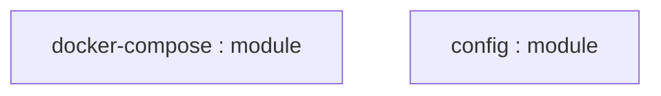
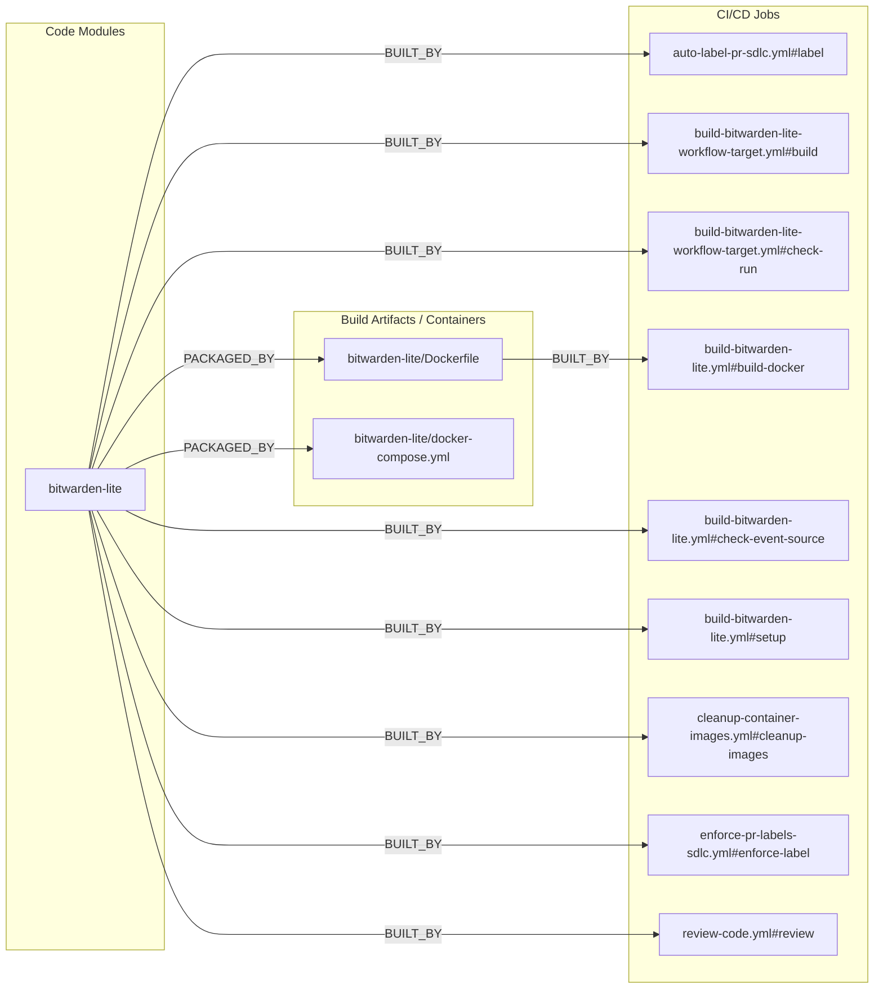
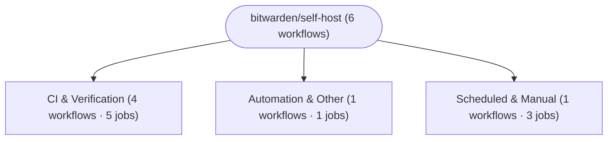

# Repository Architecture Analysis: bitwarden/self-host

## Metadata
- **SHA**: `03e222b23f5fe89e8cd4036976044c859324fb44`
- **Primary Ecosystem**: Container / Helm / IaC

## Quality Metrics
- **ast_engine**: fallback
- **avg_cognitive_complexity**: 0.0
- **avg_cyclomatic_complexity**: 0.0
- **component_count**: 2
- **dead_code_count**: 0
- **dead_code_symbols**: 0 entry(ies)
- **duplication_pct**: 0.0
- **file_complexities**: 0 entry(ies)
- **files_analyzed**: 2
- **fitness_passed**: True
- **fitness_violation_count**: 0
- **framework**: Docker Compose
- **import_edges**: 0 entry(ies)
- **loc**: 98
- **max_cognitive_complexity**: 0
- **max_cyclomatic_complexity**: 0
- **sloc**: 40

# Architecture: bitwarden/self-host

## Context
- **Repository**: `bitwarden/self-host`
- **SHA**: `03e222b23f5fe89e8cd4036976044c859324fb44`
- **Ecosystem**: Container / Helm / IaC
- **Framework**: Docker Compose

## Building Block View

## Component Details
- **docker-compose** (`bitwarden-lite/docker-compose.yml`): module
- **config** (`bitwarden-lite/hbs/config.yaml`): module

## 6-Dimension Repository Scorecard

- **Overall Grade**: `B` (80.35/100)
- **Technical Debt Score**: 19.65
- **Estimated Remediation Effort**: 15.41h

| Dimension | Grade | Score | Weight | Details |
| :--- | :---: | :---: | :---: | :--- |
| Code Quality | `A` | 100.00 | 0.20 | avg_cc=0.00, max_cc=0, duplication=0.00%, dead_code=0 |
| Dependency Health | `A` | 90.00 | 0.15 | dependencies=0 (no manifests parsed) |
| Maintainability | `A` | 100.00 | 0.15 | avg_cognitive=0.00, max_cognitive=0, fitness_violations=0, oversized_files=0 |
| Pipeline Health | `C` | 73.00 | 0.15 | workflows=6, operational_antipatterns=9, parallel_branches=False |
| Security | `F` | 52.00 | 0.20 | vulnerabilities=0, secrets=0, pipeline_security_findings=4 |
| Test Coverage | `C` | 70.00 | 0.15 | coverage=unavailable, ci_test_job=True, test_files_detected=False |

## Section 7: Code-to-Cloud Deployment Traceability

- `bitwarden-lite` (code_module) --[BUILT_BY]--> `auto-label-pr-sdlc.yml#label` (ci_job)
- `bitwarden-lite` (code_module) --[BUILT_BY]--> `build-bitwarden-lite-workflow-target.yml#build` (ci_job)
- `bitwarden-lite` (code_module) --[BUILT_BY]--> `build-bitwarden-lite-workflow-target.yml#check-run` (ci_job)
- `bitwarden-lite` (code_module) --[BUILT_BY]--> `build-bitwarden-lite.yml#check-event-source` (ci_job)
- `bitwarden-lite` (code_module) --[BUILT_BY]--> `build-bitwarden-lite.yml#setup` (ci_job)
- `bitwarden-lite` (code_module) --[BUILT_BY]--> `cleanup-container-images.yml#cleanup-images` (ci_job)
- `bitwarden-lite` (code_module) --[BUILT_BY]--> `enforce-pr-labels-sdlc.yml#enforce-label` (ci_job)
- `bitwarden-lite` (code_module) --[BUILT_BY]--> `review-code.yml#review` (ci_job)
- `bitwarden-lite` (code_module) --[PACKAGED_BY]--> `bitwarden-lite/Dockerfile` (container)
- `bitwarden-lite` (code_module) --[PACKAGED_BY]--> `bitwarden-lite/docker-compose.yml` (container)
- `bitwarden-lite/Dockerfile` (container) --[BUILT_BY]--> `build-bitwarden-lite.yml#build-docker` (ci_job)

## CI/CD Pipeline Topology

