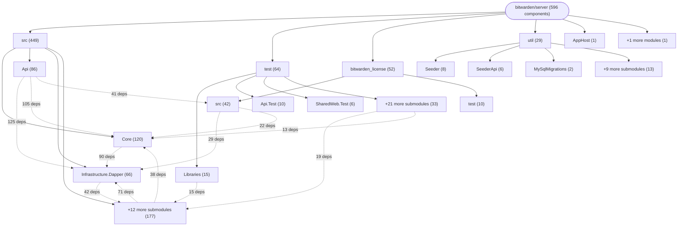

# Repository Architecture Analysis: bitwarden/server

## Metadata
- **SHA**: `341acc9d3d8988cec8fe05debfa6d557cf5ab749`
- **Primary Ecosystem**: .NET

## Quality Metrics
- **avg_cyclomatic_complexity**: 4.3
- **component_count**: 596
- **files_analyzed**: 12611
- **framework**: ASP.NET Core
- **loc**: 4308535
- **max_cyclomatic_complexity**: 175
- **sloc**: 3159785

# Architecture: bitwarden/server

## Context
- **Repository**: `bitwarden/server`
- **SHA**: `341acc9d3d8988cec8fe05debfa6d557cf5ab749`
- **Ecosystem**: .NET
- **Framework**: Unknown

## Building Block View

## Component Details

Showing top 60 representative components out of 596 across 6 module group(s):

- **Module `src`** (449 components — SERVICE: 170, DATA_ACCESS_LAYER: 139, API_ROUTE: 111)
- **Module `test`** (64 components — MODULE: 35, SERVICE: 13, API_ROUTE: 13)
- **Module `bitwarden_license`** (52 components — SERVICE: 27, MODULE: 12, API_ROUTE: 8)
- **Module `util`** (29 components — MODULE: 12, SERVICE: 10, DATA_ACCESS_LAYER: 4)
- **Module `AppHost`** (1 components — MODULE: 1)
- **Module `perf`** (1 components — MODULE: 1)

- **OrganizationsController** (`src/Admin/AdminConsole/Controllers/OrganizationsController.cs`): API_ROUTE (deps: AccessControlService, AutomaticUserConfirmationOrganizationPolicyComplianceHandler, CipherRepository, CollectionRepository, EventService, GroupRepository (+15 more))
- **Api** (`src/Api/Api.csproj`): MODULE (deps: Commercial.Core, Commercial.Infrastructure.EntityFramework, Core, CurrentUser, HttpExtensions, OrganizationAuthorization (+5 more))
- **SubscriptionUpdatedHandler** (`src/Billing/Services/Implementations/SubscriptionUpdatedHandler.cs`): SERVICE (deps: OrganizationPlanMigrationCohortAssignmentRepository, OrganizationPlanMigrationCohortRepository, OrganizationRepository, OrganizationService, ProviderRepository, ProviderService (+5 more))
- **UserService** (`src/Core/Services/Implementations/UserService.cs`): SERVICE (deps: EventService, LicensingService, MasterPasswordService, OrganizationDomainRepository, OrganizationRepository, OrganizationUserRepository (+5 more))
- **AccountController** (`bitwarden_license/src/Sso/Controllers/AccountController.cs`): API_ROUTE (deps: EventService, I18nService, OrganizationDomainRepository, OrganizationRepository, OrganizationService, OrganizationUserRepository (+4 more))
- **AppHost** (`AppHost/AppHost.csproj`): MODULE (deps: Admin, Api, Billing, Events, EventsProcessor, Icons (+4 more))
- **CipherService** (`src/Core/Vault/Services/Implementations/CipherService.cs`): SERVICE (deps: CipherRepository, CipherSyncPushService, CollectionCipherRepository, CollectionRepository, EventService, FolderRepository (+4 more))
- **SyncController** (`src/Api/Vault/Controllers/SyncController.cs`): API_ROUTE (deps: CipherRepository, CollectionCipherRepository, CollectionRepository, FolderRepository, OrganizationUserRepository, PolicyRepository (+4 more))
- **Admin** (`src/Admin/Admin.csproj`): MODULE (deps: Commercial.Core, Commercial.Infrastructure.EntityFramework, Core, Migrator, MySqlMigrations, PostgresMigrations (+3 more))
- **OrganizationsController** (`src/Api/AdminConsole/Controllers/OrganizationsController.cs`): API_ROUTE (deps: OrganizationApiKeyRepository, OrganizationRepository, OrganizationService, OrganizationUserRepository, ProviderBillingService, ProviderRepository (+3 more))
- **ProviderService** (`bitwarden_license/src/Commercial.Core/Providers/Services/ProviderService.cs`): SERVICE (deps: EventService, OrganizationRepository, OrganizationService, ProviderBillingService, ProviderOrganizationRepository, ProviderRepository (+3 more))
- **ProvidersController** (`src/Admin/Providers/Controllers/ProvidersController.cs`): API_ROUTE (deps: AccessControlService, OrganizationRepository, ProviderBillingService, ProviderOrganizationRepository, ProviderPlanRepository, ProviderRepository (+3 more))
- **RecordingOrganizationStripeBillingService** (`test/SeederApi.IntegrationTest/Pipeline/RecipeOrchestratorIntegrationTests.cs`): SERVICE (deps: DatabaseContext, LicensingService, ManglerService, NoOpManglerService, NoopAttachmentStorageService, OrganizationStripeBillingService (+3 more))
- **RecordingUserStripeBillingService** (`test/SeederApi.IntegrationTest/Pipeline/RecipeOrchestratorIntegrationTests.cs`): SERVICE (deps: DatabaseContext, LicensingService, ManglerService, NoOpManglerService, NoopAttachmentStorageService, OrganizationStripeBillingService (+3 more))
- **EmergencyAccessService** (`src/Core/Auth/UserFeatures/EmergencyAccess/EmergencyAccessService.cs`): SERVICE (deps: CipherRepository, CipherService, EmergencyAccessRepository, MasterPasswordService, OrganizationUserRepository, PolicyRepository (+2 more))
- **EventsController** (`src/Api/Dirt/Controllers/EventsController.cs`): API_ROUTE (deps: CipherRepository, EventRepository, OrganizationUserRepository, ProjectRepository, ProviderUserRepository, SecretRepository (+2 more))
- **OrganizationService** (`src/Core/AdminConsole/Services/Implementations/OrganizationService.cs`): SERVICE (deps: EventService, OrganizationRepository, OrganizationUserRepository, ProviderOrganizationRepository, ProviderRepository, ProviderUserRepository (+2 more))
- **OrganizationUsersController** (`src/Api/AdminConsole/Controllers/OrganizationUsersController.cs`): API_ROUTE (deps: BaseAdminConsoleController, CollectionRepository, GroupRepository, OrganizationRepository, OrganizationService, OrganizationUserRepository (+2 more))
- **OrganizationsController** (`src/Api/Billing/Controllers/OrganizationsController.cs`): API_ROUTE (deps: LicensingService, OrganizationInstallationRepository, OrganizationRepository, OrganizationService, OrganizationUserRepository, StripePaymentService (+2 more))
- **ProviderBillingService** (`bitwarden_license/src/Commercial.Core/Billing/Providers/Services/ProviderBillingService.cs`): SERVICE (deps: EventService, OrganizationRepository, ProviderInvoiceItemRepository, ProviderOrganizationRepository, ProviderPlanRepository, ProviderUserRepository (+2 more))
- **CiphersController** (`src/Api/Vault/Controllers/CiphersController.cs`): API_ROUTE (deps: AzureAttachmentStorageService, BulkCollectionAuthorizationHandler, CipherRepository, CipherService, CollectionCipherRepository, CollectionRepository (+1 more))
- **Core** (`src/Core/Core.csproj`): MODULE (deps: Clients, Data, ExceptionHandling, MailDelivery, Push.Infrastructure, SerilogFileLogging (+1 more))
- **PaymentSucceededHandler** (`src/Billing/Services/Implementations/PaymentSucceededHandler.cs`): SERVICE (deps: OrganizationRepository, ProviderRepository, StripeEventService, StripeEventUtilityService, UpcomingInvoiceHandler, UserRepository (+1 more))
- **ProviderBillingController** (`src/Api/Billing/Controllers/ProviderBillingController.cs`): API_ROUTE (deps: BaseProviderController, ProviderBillingService, ProviderBillingVNextController, ProviderPlanRepository, ProviderRepository, SubscriberService (+1 more))
- **ProviderClientsController** (`src/Api/Providers/Controllers/ProviderClientsController.cs`): API_ROUTE (deps: BaseAdminConsoleController, OrganizationRepository, ProviderBillingService, ProviderOrganizationRepository, ProviderRepository, ProviderService (+1 more))
- **UsersController** (`src/Admin/Controllers/UsersController.cs`): API_ROUTE (deps: AccessControlService, CipherRepository, OrganizationUserRepository, StripePaymentService, SubscriberService, UserRepository (+1 more))
- **AccessPoliciesController** (`src/Api/SecretsManager/Controllers/AccessPoliciesController.cs`): API_ROUTE (deps: AccessPolicyRepository, EventService, ProjectRepository, SecretRepository, ServiceAccountRepository, UserService)
- **AccountsController** (`src/Api/Auth/Controllers/AccountsController.cs`): API_ROUTE (deps: OrganizationService, OrganizationUserRepository, ProviderUserRepository, TwoFactorEmailService, UserRepository, UserService)
- **BitPayController** (`src/Billing/Controllers/BitPayController.cs`): API_ROUTE (deps: OrganizationRepository, PremiumUserBillingService, ProviderRepository, StripePaymentService, TransactionRepository, UserRepository)
- **GroupsController** (`src/Api/AdminConsole/Controllers/GroupsController.cs`): API_ROUTE (deps: CollectionRepository, GroupRepository, GroupService, OrganizationRepository, OrganizationUserRepository, UserService)
- **Infrastructure.IntegrationTest** (`test/Infrastructure.IntegrationTest/Infrastructure.IntegrationTest.csproj`): MODULE (deps: Infrastructure.Dapper, Infrastructure.EntityFramework, Migrator, MySqlMigrations, PostgresMigrations, SqliteMigrations)
- **OrganizationBillingController** (`src/Api/Billing/Controllers/OrganizationBillingController.cs`): API_ROUTE (deps: BaseBillingController, OrganizationBillingService, OrganizationBillingVNextController, OrganizationRepository, PaymentHistoryService, StripePaymentService)
- **PayPalController** (`src/Billing/Controllers/PayPalController.cs`): API_ROUTE (deps: OrganizationRepository, PremiumUserBillingService, ProviderRepository, StripePaymentService, TransactionRepository, UserRepository)
- **SubscriptionDeletedHandler** (`src/Billing/Services/Implementations/SubscriptionDeletedHandler.cs`): SERVICE (deps: ProviderRepository, ProviderService, StripeEventService, StripeEventUtilityService, UserRepository, UserService)
- **ToolsController** (`src/Admin/Controllers/ToolsController.cs`): API_ROUTE (deps: InstallationRepository, OrganizationRepository, OrganizationUserRepository, ProviderUserRepository, TransactionRepository, UserService)
- **TwoFactorController** (`src/Api/Auth/Controllers/TwoFactorController.cs`): API_ROUTE (deps: AuthRequestRepository, DuoUniversalTokenService, OrganizationRepository, OrganizationService, TwoFactorEmailService, UserService)
- **AuthRequestService** (`src/Core/Auth/Services/Implementations/AuthRequestService.cs`): SERVICE (deps: AuthRequestRepository, DeviceRepository, EventService, OrganizationUserRepository, UserRepository)
- **ControllerWithAllowAnonymous** (`test/Api.Test/Utilities/ControllerAuthorizationTestHelpersTests.cs`): API_ROUTE (deps: ControllerWithNoHttpMethods, ControllerWithNoopAuthorize, ControllerWithProperAuthorization, ControllerWithUnauthorizedMethod, ControllerWithoutClassAuthorize)
- **ControllerWithNoHttpMethods** (`test/Api.Test/Utilities/ControllerAuthorizationTestHelpersTests.cs`): API_ROUTE (deps: ControllerWithAllowAnonymous, ControllerWithNoopAuthorize, ControllerWithProperAuthorization, ControllerWithUnauthorizedMethod, ControllerWithoutClassAuthorize)
- **ControllerWithNoopAuthorize** (`test/Api.Test/Utilities/ControllerAuthorizationTestHelpersTests.cs`): API_ROUTE (deps: ControllerWithAllowAnonymous, ControllerWithNoHttpMethods, ControllerWithProperAuthorization, ControllerWithUnauthorizedMethod, ControllerWithoutClassAuthorize)
- **ControllerWithProperAuthorization** (`test/Api.Test/Utilities/ControllerAuthorizationTestHelpersTests.cs`): API_ROUTE (deps: ControllerWithAllowAnonymous, ControllerWithNoHttpMethods, ControllerWithNoopAuthorize, ControllerWithUnauthorizedMethod, ControllerWithoutClassAuthorize)
- **ControllerWithUnauthorizedMethod** (`test/Api.Test/Utilities/ControllerAuthorizationTestHelpersTests.cs`): API_ROUTE (deps: ControllerWithAllowAnonymous, ControllerWithNoHttpMethods, ControllerWithNoopAuthorize, ControllerWithProperAuthorization, ControllerWithoutClassAuthorize)
- **ControllerWithoutClassAuthorize** (`test/Api.Test/Utilities/ControllerAuthorizationTestHelpersTests.cs`): API_ROUTE (deps: ControllerWithAllowAnonymous, ControllerWithNoHttpMethods, ControllerWithNoopAuthorize, ControllerWithProperAuthorization, ControllerWithUnauthorizedMethod)
- **EventIntegrationHandler** (`src/Core/Dirt/Services/Implementations/EventIntegrationHandler.cs`): SERVICE (deps: GroupRepository, IntegrationFilterService, OrganizationIntegrationConfigurationRepository, OrganizationRepository, OrganizationUserRepository)
- **EventsController** (`src/Api/Dirt/Public/Controllers/EventsController.cs`): API_ROUTE (deps: CipherRepository, EventRepository, ProjectRepository, SecretRepository, UserService)
- **MembersController** (`src/Api/AdminConsole/Public/Controllers/MembersController.cs`): API_ROUTE (deps: BaseAdminConsoleController, GroupRepository, OrganizationRepository, OrganizationUserRepository, StripePaymentService)
- **ProfileService** (`src/Identity/IdentityServer/ProfileService.cs`): SERVICE (deps: LicensingService, OrganizationUserRepository, ProviderOrganizationRepository, ProviderUserRepository, UserService)
- **ProviderEventService** (`src/Billing/Services/Implementations/ProviderEventService.cs`): SERVICE (deps: OrganizationRepository, ProviderInvoiceItemRepository, ProviderOrganizationRepository, ProviderPlanRepository, StripeEventService)
- **ProviderOrganizationsController** (`src/Api/Providers/Controllers/ProviderOrganizationsController.cs`): API_ROUTE (deps: OrganizationRepository, ProviderOrganizationRepository, ProviderRepository, ProviderService, UserService)
- **SendValidationService** (`src/Core/Tools/SendFeatures/Services/SendValidationService.cs`): SERVICE (deps: CipherRepository, OrganizationRepository, SendRepository, UserRepository, UserService)
- **SendsController** (`src/Api/Tools/Controllers/SendsController.cs`): API_ROUTE (deps: AzureSendFileStorageService, EventService, SendAuthorizationService, SendRepository, UserService)
- **ServiceAccountsController** (`src/Api/SecretsManager/Controllers/ServiceAccountsController.cs`): API_ROUTE (deps: ApiKeyRepository, EventService, OrganizationRepository, ServiceAccountRepository, UserService)
- **StaleFirstReadDapperRepository** (`test/Infrastructure.IntegrationTest/Auth/Repositories/TwoFactorRememberTokenRepositoryTests.cs`): DATA_ACCESS_LAYER (deps: DatabaseContext, DeviceRepository, StaleFirstReadEfRepository, TwoFactorRememberTokenRepository, UserRepository)
- **StaleFirstReadEfRepository** (`test/Infrastructure.IntegrationTest/Auth/Repositories/TwoFactorRememberTokenRepositoryTests.cs`): DATA_ACCESS_LAYER (deps: DatabaseContext, DeviceRepository, StaleFirstReadDapperRepository, TwoFactorRememberTokenRepository, UserRepository)
- **UpcomingInvoiceHandler** (`src/Billing/Services/Implementations/UpcomingInvoiceHandler.cs`): SERVICE (deps: OrganizationRepository, ProviderRepository, StripeEventService, StripeEventUtilityService, UserRepository)
- **AccountsBillingController** (`src/Api/Billing/Controllers/AccountsBillingController.cs`): API_ROUTE (deps: AccountBillingVNextController, PaymentHistoryService, StripePaymentService, UserService)
- **Api.Test** (`test/Api.Test/Api.Test.csproj`): MODULE (deps: Api, Common, Core, Core.Test)
- **Billing** (`src/Billing/Billing.csproj`): MODULE (deps: Commercial.Core, Core, SharedWeb, Subscriptions.Organization)
- **Billing.IntegrationTest** (`test/Billing.IntegrationTest/Billing.IntegrationTest.csproj`): MODULE (deps: Admin, Api.IntegrationTest, Billing, Common)
- **CollectController** (`src/Events/Controllers/CollectController.cs`): API_ROUTE (deps: CipherRepository, EventService, OrganizationRepository, OrganizationUserRepository)

## CI/CD Pipeline Topology

