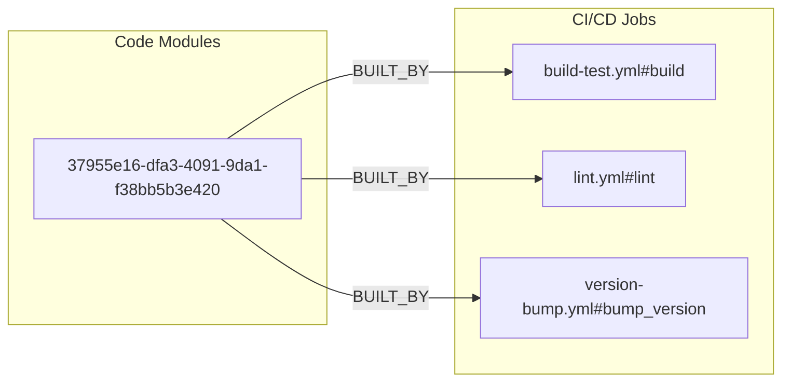
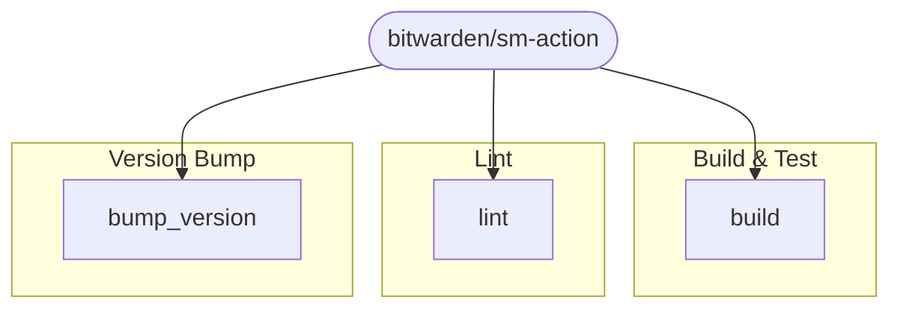

# Repository Architecture Analysis: bitwarden/sm-action

## Metadata
- **SHA**: `5026bec09eec497aeda6b1c23dbe3e37055791cb`
- **Primary Ecosystem**: Rust

## Quality Metrics
- **ast_engine**: fallback
- **avg_cognitive_complexity**: 0.0
- **avg_cyclomatic_complexity**: 0.0
- **component_count**: 3
- **dead_code_count**: 0
- **dead_code_symbols**: 0 entry(ies)
- **duplication_pct**: 0.0
- **file_complexities**: 0 entry(ies)
- **files_analyzed**: 3
- **fitness_passed**: True
- **fitness_violation_count**: 0
- **framework**: Rust Cargo
- **import_edges**: 0 entry(ies)
- **loc**: 927
- **max_cognitive_complexity**: 0
- **max_cyclomatic_complexity**: 0
- **sloc**: 716

# Architecture: bitwarden/sm-action

## Context
- **Repository**: `bitwarden/sm-action`
- **SHA**: `5026bec09eec497aeda6b1c23dbe3e37055791cb`
- **Ecosystem**: Rust
- **Framework**: Rust Cargo

## Building Block View

## Component Details
- **ci** (`src/ci.rs`): module
- **config** (`src/config.rs`): module
- **main** (`src/main.rs`): module

## 6-Dimension Repository Scorecard

- **Overall Grade**: `C` (74.15/100)
- **Technical Debt Score**: 25.85
- **Estimated Remediation Effort**: 21.46h

| Dimension | Grade | Score | Weight | Details |
| :--- | :---: | :---: | :---: | :--- |
| Code Quality | `A` | 100.00 | 0.20 | avg_cc=0.00, max_cc=0, duplication=0.00%, dead_code=0 |
| Dependency Health | `A` | 100.00 | 0.15 | dependencies=374, outdated=0, vulnerable=0, has_lockfile=True |
| Maintainability | `A` | 100.00 | 0.15 | avg_cognitive=0.00, max_cognitive=0, fitness_violations=0, oversized_files=0 |
| Pipeline Health | `A` | 91.00 | 0.15 | workflows=3, operational_antipatterns=3, parallel_branches=False |
| Security | `F` | 0.00 | 0.20 | vulnerabilities=0, secrets=0, pipeline_security_findings=9 |
| Test Coverage | `C` | 70.00 | 0.15 | coverage=unavailable, ci_test_job=True, test_files_detected=False |

## Supply Chain Dependencies, Vulnerabilities & Secrets

- **Dependencies Parsed**: 374 | **Vulnerabilities**: 0 | **Secrets**: 0

### Inventory Sample
- `anyhow` `1.0.102` (cargo, `Cargo.toml`)
- `bitwarden` `2.1.0` (cargo, `Cargo.toml`)
- `tokio` `1.50.0` (cargo, `Cargo.toml`)
- `uuid` `1.24.1` (cargo, `Cargo.toml`)
- `aead` `0.6.1` (cargo, `Cargo.lock`)
- `aes` `0.9.3` (cargo, `Cargo.lock`)
- `aho-corasick` `1.1.5` (cargo, `Cargo.lock`)
- `android_system_properties` `0.1.6` (cargo, `Cargo.lock`)
- `anstyle` `1.0.14` (cargo, `Cargo.lock`)
- `anyhow` `1.0.102` (cargo, `Cargo.lock`)
- `argon2` `0.6.0-rc.8` (cargo, `Cargo.lock`)
- `async-trait` `0.1.92` (cargo, `Cargo.lock`)
- `atomic-waker` `1.1.2` (cargo, `Cargo.lock`)
- `autocfg` `1.5.1` (cargo, `Cargo.lock`)
- `base16ct` `1.0.0` (cargo, `Cargo.lock`)
- `base64` `0.22.1` (cargo, `Cargo.lock`)
- `base64ct` `1.8.3` (cargo, `Cargo.lock`)
- `bit-set` `0.8.0` (cargo, `Cargo.lock`)
- `bit-vec` `0.8.0` (cargo, `Cargo.lock`)
- `bitflags` `1.3.2` (cargo, `Cargo.lock`)
- `bitflags` `2.13.1` (cargo, `Cargo.lock`)
- `bitwarden` `2.1.0` (cargo, `Cargo.lock`)
- `bitwarden-api-api` `3.0.0` (cargo, `Cargo.lock`)
- `bitwarden-api-base` `3.0.0` (cargo, `Cargo.lock`)
- `bitwarden-api-identity` `3.0.0` (cargo, `Cargo.lock`)
- `bitwarden-api-key-connector` `3.0.0` (cargo, `Cargo.lock`)
- `bitwarden-auth` `3.0.0` (cargo, `Cargo.lock`)
- `bitwarden-core` `3.0.0` (cargo, `Cargo.lock`)
- `bitwarden-core-macro` `3.0.0` (cargo, `Cargo.lock`)
- `bitwarden-crypto` `3.0.0` (cargo, `Cargo.lock`)
- ... (+344 more dependencies)

## Section 7: Code-to-Cloud Deployment Traceability

- `37955e16-dfa3-4091-9da1-f38bb5b3e420` (code_module) --[BUILT_BY]--> `build-test.yml#build` (ci_job)
- `37955e16-dfa3-4091-9da1-f38bb5b3e420` (code_module) --[BUILT_BY]--> `lint.yml#lint` (ci_job)
- `37955e16-dfa3-4091-9da1-f38bb5b3e420` (code_module) --[BUILT_BY]--> `version-bump.yml#bump_version` (ci_job)

## CI/CD Pipeline Topology

