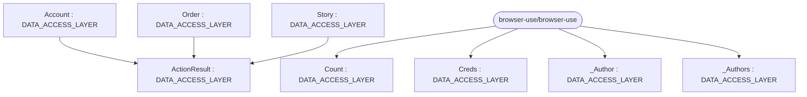

# Repository Architecture Analysis: browser-use/browser-use

## Metadata
- **SHA**: `dfb6a73d520809341c975c6a01c228327991e88b`
- **Primary Ecosystem**: Python

## Quality Metrics
- **avg_cyclomatic_complexity**: 4.6
- **component_count**: 9
- **files_analyzed**: 70
- **framework**: Unknown
- **loc**: 32616
- **max_cyclomatic_complexity**: 41
- **sloc**: 27161

# Architecture: browser-use/browser-use

## Context
- **Repository**: `browser-use/browser-use`
- **SHA**: `dfb6a73d520809341c975c6a01c228327991e88b`
- **Ecosystem**: Python
- **Framework**: Unknown

## Building Block View

## Component Details
- **ActionResult** (`browser_use/tools.py`): DATA_ACCESS_LAYER
- **Story** (`tests/ci/test_agent.py`): DATA_ACCESS_LAYER
- **Order** (`tests/ci/test_compat.py`): DATA_ACCESS_LAYER (deps: ActionResult)
- **Account** (`tests/ci/test_compat.py`): DATA_ACCESS_LAYER (deps: ActionResult)
- **Story** (`tests/ci/test_compat.py`): DATA_ACCESS_LAYER (deps: ActionResult)
- **_Author** (`tests/ci/test_loop.py`): DATA_ACCESS_LAYER
- **_Authors** (`tests/ci/test_loop.py`): DATA_ACCESS_LAYER
- **Count** (`tests/ci/test_loop.py`): DATA_ACCESS_LAYER
- **Creds** (`tests/ci/test_repl.py`): DATA_ACCESS_LAYER

## CI/CD Pipeline Topology

