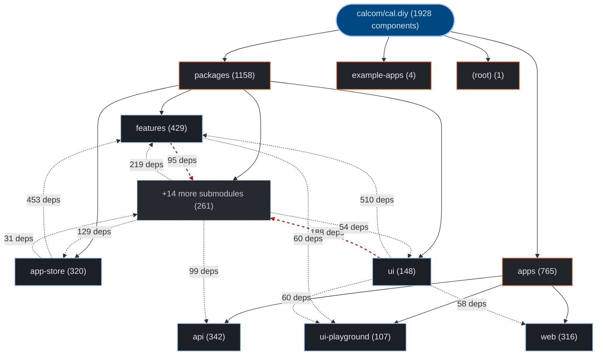

# Repository Architecture Analysis: calcom/cal.diy

## Metadata
- **SHA**: `27fc24c9063bec9442552139dd37bdc2e4a82ca8`
- **Primary Ecosystem**: JavaScript/TypeScript

## Quality Metrics
- **ast_engine**: tree-sitter
- **avg_cognitive_complexity**: 1.66
- **avg_cyclomatic_complexity**: 2.46
- **component_count**: 1928
- **dead_code_count**: 16
- **dead_code_symbols**: 16 entry(ies)
- **duplication_pct**: 91.28
- **file_complexities**: 25 entry(ies)
- **files_analyzed**: 5711
- **fitness_passed**: False
- **fitness_violation_count**: 37
- **framework**: Next.js
- **import_edges**: 100 entry(ies)
- **loc**: 581470
- **max_cognitive_complexity**: 113
- **max_cyclomatic_complexity**: 83
- **sloc**: 500335
- **test_file_count**: 446

# Architecture: calcom/cal.diy

## Context
- **Repository**: `calcom/cal.diy`
- **SHA**: `27fc24c9063bec9442552139dd37bdc2e4a82ca8`
- **Ecosystem**: JavaScript/TypeScript
- **Framework**: Next.js

## Building Block View

## Component Details

Showing top 60 representative components out of 1928 across 4 module group(s):

- **Module `packages`** (1158 components — UI_COMPONENT: 804, MODULE: 134, API_ROUTE: 109)
- **Module `apps`** (765 components — API_ROUTE: 330, UI_COMPONENT: 297, SERVICE: 83)
- **Module `example-apps`** (4 components — API_ROUTE: 2, MODULE: 1, UI_COMPONENT: 1)
- **Module `(root)`** (1 components — MODULE: 1)

- **AvailabilitySettings** (`packages/platform/atoms/availability/AvailabilitySettings.tsx`): UI_COMPONENT (deps: API_[id]_index, API_[recordingId]_index, API_[teamId]_index, API_[userId]_index, API_api-key_index, API_api-keys_index (+85 more))
- **SelectedCalendarsSettingsPlatformWrapper** (`packages/platform/atoms/selected-calendars/wrappers/SelectedCalendarsSettingsPlatformWrapper.tsx`): UI_COMPONENT (deps: API_[id]_index, API_[recordingId]_index, API_[teamId]_index, API_[userId]_index, API_api-key_index, API_api-keys_index (+70 more))
- **CalendarSettingsPlatformWrapper** (`packages/platform/atoms/calendar-settings/wrappers/CalendarSettingsPlatformWrapper.tsx`): UI_COMPONENT (deps: API_[id]_index, API_[recordingId]_index, API_[teamId]_index, API_[userId]_index, API_api-key_index, API_api-keys_index (+67 more))
- **DisconnectIntegrationComponent** (`packages/ui/components/disconnect-calendar-integration/DisconnectIntegration.tsx`): UI_COMPONENT (deps: AccountDialog, AddActionDialog, AddFilterButton, AddGuestsDialog, AppSetDefaultLinkDialog, ArrowButton (+39 more))
- **Booker** (`packages/features/bookings/Booker/Booker.tsx`): UI_COMPONENT (deps: AvailableTimeSlots, AvailableTimesHeader, Away, BookEventForm, BookEventFormWrapperComponent, BookFormAsModal (+36 more))
- **InputFieldWithSelect** (`packages/ui/components/form/inputs/InputFieldWithSelect.tsx`): UI_COMPONENT (deps: Bookings, CheckedSelect, CheckedTeamSelect, CheckedUserSelect, ChildrenEventTypeSelect, EventTypeSelect (+31 more))
- **AppListCard** (`packages/ui/components/app-list-card/AppListCard.tsx`): UI_COMPONENT (deps: AppList, Avatar, Badge, BlockedList, BookingStatusBadge, CallToActionIcon (+30 more))
- **EmailField** (`packages/ui/components/form/inputs/Input.tsx`): UI_COMPONENT (deps: Arrow, Bookings, Content, Input, InputField, Label (+30 more))
- **EmailInput** (`packages/ui/components/form/inputs/Input.tsx`): UI_COMPONENT (deps: Arrow, Bookings, Content, Input, InputField, Label (+30 more))
- **FieldsetLegend** (`packages/ui/components/form/inputs/Input.tsx`): UI_COMPONENT (deps: Arrow, Bookings, Content, Input, InputField, Label (+30 more))
- **FilterSearchField** (`packages/ui/components/form/inputs/Input.tsx`): UI_COMPONENT (deps: Arrow, Bookings, Content, Input, InputField, Label (+30 more))
- **InputGroupBox** (`packages/ui/components/form/inputs/Input.tsx`): UI_COMPONENT (deps: Arrow, Bookings, Content, Input, InputField, Label (+30 more))
- **InputLeading** (`packages/ui/components/form/inputs/Input.tsx`): UI_COMPONENT (deps: Arrow, Bookings, Content, Input, InputField, Label (+30 more))
- **NumberInput** (`packages/ui/components/form/inputs/Input.tsx`): UI_COMPONENT (deps: Arrow, Bookings, Content, Input, InputField, Label (+30 more))
- **PasswordField** (`packages/ui/components/form/inputs/Input.tsx`): UI_COMPONENT (deps: Arrow, Bookings, Content, Input, InputField, Label (+30 more))
- **TextArea** (`packages/ui/components/form/inputs/Input.tsx`): UI_COMPONENT (deps: Arrow, Bookings, Content, Input, InputField, Label (+30 more))
- **TextAreaField** (`packages/ui/components/form/inputs/Input.tsx`): UI_COMPONENT (deps: Arrow, Bookings, Content, Input, InputField, Label (+30 more))
- **FilterSelect** (`packages/ui/components/filter-select/index.tsx`): UI_COMPONENT (deps: AddFilterButton, AnimatedPopover, ArrowButton, Badge, BookingStatusBadge, Button (+29 more))
- **UserListTable** (`packages/features/users/components/UserTable/UserListTable.tsx`): UI_COMPONENT (deps: Bookings, ChangeUserRoleModal, DeleteBulkUsers, DeleteMemberModal, DynamicLink, EditUserSheet (+25 more))
- **WizardLayout** (`packages/ui/components/layout/WizardLayout.tsx`): UI_COMPONENT (deps: AccountsStepCard, AddFilterButton, ArrowButton, BillingCreditsSkeleton, Button, ClearFiltersButton (+25 more))
- **RangeSliderPopover** (`packages/ui/components/form/slider/RangeSliderPopover.tsx`): UI_COMPONENT (deps: AddFilterButton, ArrowButton, Badge, BookingStatusBadge, Button, ClearFiltersButton (+22 more))
- **SingleFormWrapper** (`packages/app-store/routing-forms/components/SingleForm.tsx`): UI_COMPONENT (deps: AvailableTimesHeader, Bookings, ENDPOINTS, FormAction, FormActionsDropdown, FormActionsProvider (+22 more))
- **ConfirmationContent** (`packages/ui/components/dialog/ConfirmationDialogContent.tsx`): UI_COMPONENT (deps: AccountDialog, AddActionDialog, AddGuestsDialog, AppSetDefaultLinkDialog, ChargeCardDialog, ConfirmDialog (+21 more))
- **ConfirmationDialogContent** (`packages/ui/components/dialog/ConfirmationDialogContent.tsx`): UI_COMPONENT (deps: AccountDialog, AddActionDialog, AddGuestsDialog, AppSetDefaultLinkDialog, ChargeCardDialog, ConfirmDialog (+21 more))
- **TableExampleComponent** (`packages/ui/components/table/TableExamples.tsx`): UI_COMPONENT (deps: AvailabilitySliderTable, BorderRadiusTable, CallToActionTable, DataTable, DropdownActions, FeedbackTable (+19 more))
- **TableNewExampleComponent** (`packages/ui/components/table/TableExamples.tsx`): UI_COMPONENT (deps: AvailabilitySliderTable, BorderRadiusTable, CallToActionTable, DataTable, DropdownActions, FeedbackTable (+19 more))
- **TestForm** (`packages/app-store/routing-forms/components/_components/TestForm.tsx`): UI_COMPONENT (deps: Bookings, ENDPOINTS, FormInputFields, FormInputFieldsSkeleton, ResultsSection, ResultsView (+19 more))
- **TestFormRenderer** (`packages/app-store/routing-forms/components/_components/TestForm.tsx`): UI_COMPONENT (deps: Bookings, ENDPOINTS, FormInputFields, FormInputFieldsSkeleton, ResultsSection, ResultsView (+19 more))
- **API_slots__get.test** (`apps/api/v1/pages/api/slots/_get.test.ts`): API_ROUTE (deps: API_[id]__get, API_[recordingId]__get, API_[teamId]__get, API_[userId]__get, API_api-keys__get, API_attendees__get (+18 more))
- **FilterPopover** (`packages/features/data-table/components/filters/FilterPopover.tsx`): UI_COMPONENT (deps: BaseSelectFilterOptions, Bookings, FilterOptions, MultiSelectFilterOptions, NumberFilterOptions, SingleSelectFilterOptions (+18 more))
- **EditUserSheet** (`packages/features/users/components/UserTable/EditSheet/EditUserSheet.tsx`): UI_COMPONENT (deps: Bookings, DisplayInfo, EditForm, OrganizationBanner, SheetFooterControls, TBContext (+17 more))
- **Editor** (`packages/ui/components/editor/Editor.tsx`): UI_COMPONENT (deps: AddVariablesPlugin, Bookings, EditablePlugin, PlainTextPlugin, PlaygroundAutoLinkPlugin, ToolbarPlugin (+17 more))
- **Select** (`packages/ui/components/form/select/Select.tsx`): UI_COMPONENT (deps: Bookings, Input, InputField, Label, TextField, ThemeLabel (+17 more))
- **SelectField** (`packages/ui/components/form/select/Select.tsx`): UI_COMPONENT (deps: Bookings, Input, InputField, Label, TextField, ThemeLabel (+17 more))
- **SelectWithValidation** (`packages/ui/components/form/select/Select.tsx`): UI_COMPONENT (deps: Bookings, Input, InputField, Label, TextField, ThemeLabel (+17 more))
- **AppDependencyComponent** (`packages/app-store/components.tsx`): UI_COMPONENT (deps: AppSettingsComponentsMap, Bookings, EventTypeAddonMap, EventTypeSettingsMap, InstallAppButtonMap, TypesExample (+16 more))
- **CreateANewTeamForm** (`packages/features/ee/teams/components/CreateANewTeamForm.tsx`): UI_COMPONENT (deps: Bookings, FeatureProvider, OrgBrandingProvider, TrpcProvider, TypesExample, YourPage (+16 more))
- **EventDetails** (`packages/features/bookings/components/event-meta/Details.tsx`): UI_COMPONENT (deps: AvailableEventLocations, Bookings, EventDuration, EventOccurences, Price, TypesExample (+16 more))
- **EventMetaBlock** (`packages/features/bookings/components/event-meta/Details.tsx`): UI_COMPONENT (deps: AvailableEventLocations, Bookings, EventDuration, EventOccurences, Price, TypesExample (+16 more))
- **FilterOptions** (`packages/features/data-table/components/filters/FilterOptions.tsx`): UI_COMPONENT (deps: Bookings, MultiSelectFilterOptions, NumberFilterOptions, SingleSelectFilterOptions, TextFilterOptions, TypesExample (+16 more))
- **InstallAppButton** (`packages/app-store/components.tsx`): UI_COMPONENT (deps: AppSettingsComponentsMap, Bookings, EventTypeAddonMap, EventTypeSettingsMap, InstallAppButtonMap, TypesExample (+16 more))
- **InstallAppButtonWithoutPlanCheck** (`packages/app-store/components.tsx`): UI_COMPONENT (deps: AppSettingsComponentsMap, Bookings, EventTypeAddonMap, EventTypeSettingsMap, InstallAppButtonMap, TypesExample (+16 more))
- **RouteBuilder** (`packages/app-store/routing-forms/pages/route-builder/[...appPages].tsx`): UI_COMPONENT (deps: Bookings, DynamicAppComponent, EmptyState, RoutingSkeleton, SingleFormWrapper, TypesExample (+16 more))
- **Troubleshooter** (`packages/features/troubleshooter/Troubleshooter.tsx`): UI_COMPONENT (deps: Bookings, LargeCalendar, TBContext, TroubleshooterHeader, TroubleshooterSidebar, TypesExample (+16 more))
- **AvailabilitySettingsPlatformWrapper** (`packages/platform/atoms/availability/wrappers/AvailabilitySettingsPlatformWrapper.tsx`): UI_COMPONENT (deps: AtomsWrapper, AvailabilitySettings, Bookings, QUERY_KEY, TypesExample, ZActiveFilter (+15 more))
- **BookerEmbed** (`packages/platform/atoms/booker-embed/BookerEmbed.tsx`): UI_COMPONENT (deps: BaseCalProvider, BookerPlatformWrapper, Bookings, CalProvider, TypesExample, ZActiveFilter (+15 more))
- **BookerPlatformWrapper** (`packages/platform/atoms/booker/BookerPlatformWrapper.tsx`): UI_COMPONENT (deps: AtomsContext, AtomsWrapper, Bookings, QUERY_KEY, TypesExample, ZActiveFilter (+15 more))
- **CreditsBadge** (`packages/ui/components/badge/CreditsBadge.tsx`): UI_COMPONENT (deps: Arrow, Badge, BookingStatusBadge, Content, InfoBadge, Portal (+15 more))
- **EventTypePlatformWrapper** (`packages/platform/atoms/event-types/wrappers/EventTypePlatformWrapper.tsx`): UI_COMPONENT (deps: AtomsContext, AtomsWrapper, Bookings, QUERY_KEY, TypesExample, ZActiveFilter (+15 more))
- **FilterSegmentSelect** (`packages/features/data-table/components/segment/FilterSegmentSelect.tsx`): UI_COMPONENT (deps: Bookings, DeleteSegmentDialog, DuplicateSegmentDialog, RenameSegmentDialog, TypesExample, ZActiveFilter (+15 more))
- **Input** (`packages/ui/components/form/inputs/TextField.tsx`): UI_COMPONENT (deps: Bookings, HintsOrErrors, Label, ThemeLabel, TypesExample, ZActiveFilter (+15 more))
- **InputField** (`packages/ui/components/form/inputs/TextField.tsx`): UI_COMPONENT (deps: Bookings, HintsOrErrors, Label, ThemeLabel, TypesExample, ZActiveFilter (+15 more))
- **RoutingFormResponsesTable** (`packages/features/insights/components/RoutingFormResponsesTable.tsx`): UI_COMPONENT (deps: Bookings, OrgTeamsFilter, RoutingFormResponsesDownload, RoutingKPICards, TypesExample, ZActiveFilter (+15 more))
- **RoutingForms** (`packages/app-store/routing-forms/pages/forms/[...appPages].tsx`): UI_COMPONENT (deps: Bookings, FormAction, FormActionsDropdown, FormActionsProvider, TypesExample, ZActiveFilter (+15 more))
- **RoutingLink** (`packages/app-store/routing-forms/pages/routing-link/[...appPages].tsx`): UI_COMPONENT (deps: AppSetupPageMap, Bookings, FormInputFields, FormInputFieldsSkeleton, TypesExample, ZActiveFilter (+15 more))
- **TextField** (`packages/ui/components/form/inputs/TextField.tsx`): UI_COMPONENT (deps: Bookings, HintsOrErrors, Label, ThemeLabel, TypesExample, ZActiveFilter (+15 more))
- **UpgradeOrgsBadge** (`packages/ui/components/badge/UpgradeOrgsBadge.tsx`): UI_COMPONENT (deps: Arrow, Badge, BookingStatusBadge, Content, CreditsBadge, InfoBadge (+15 more))
- **UpgradeTeamsBadge** (`packages/ui/components/badge/UpgradeTeamsBadge.tsx`): UI_COMPONENT (deps: Arrow, Badge, BookingStatusBadge, Content, CreditsBadge, InfoBadge (+15 more))
- **ActiveFilters** (`packages/features/data-table/components/filters/ActiveFilters.tsx`): UI_COMPONENT (deps: Bookings, DateRangeFilter, FilterPopover, TypesExample, ZActiveFilter, ZActiveFilters (+14 more))
- **AvailableTimes** (`packages/features/bookings/components/AvailableTimes.tsx`): UI_COMPONENT (deps: Bookings, SeatsAvailabilityText, TBContext, TypesExample, ZActiveFilter, ZActiveFilters (+14 more))

## 6-Dimension Repository Scorecard

- **Overall Grade**: `F` (29.25/100)
- **Technical Debt Score**: 70.75
- **Estimated Remediation Effort**: 281.94h

| Dimension | Grade | Score | Weight | Details |
| :--- | :---: | :---: | :---: | :--- |
| Code Quality | `F` | 30.00 | 0.20 | avg_cc=2.46, max_cc=83, duplication=91.28%, dead_code=16 |
| Dependency Health | `B` | 85.00 | 0.15 | dependencies=903, outdated=0, vulnerable=0, has_lockfile=False |
| Maintainability | `F` | 0.00 | 0.15 | avg_cognitive=1.66, max_cognitive=113, fitness_violations=37, oversized_files=7 |
| Pipeline Health | `F` | 0.00 | 0.15 | workflows=45, operational_antipatterns=77, parallel_branches=True |
| Security | `F` | 0.00 | 0.20 | vulnerabilities=0, secrets=7, pipeline_security_findings=54 |
| Test Coverage | `C` | 70.00 | 0.15 | coverage=unavailable, ci_test_job=True, test_files_detected=True |

## Architecture Fitness & Workspace Boundaries

- **[HIGH] `ATRUSS-ARCH-002` (LAYER_VIOLATION)**: UI_COMPONENT cannot directly import DATA_ACCESS_LAYER. (AvailableTimeSlots -> EventRepository)
- **[HIGH] `ATRUSS-ARCH-002` (LAYER_VIOLATION)**: UI_COMPONENT cannot directly import DATA_ACCESS_LAYER. (BookEventFormWrapperComponent -> EventRepository)
- **[HIGH] `ATRUSS-ARCH-002` (LAYER_VIOLATION)**: UI_COMPONENT cannot directly import DATA_ACCESS_LAYER. (BookFormAsModal -> EventRepository)
- **[HIGH] `ATRUSS-ARCH-002` (LAYER_VIOLATION)**: UI_COMPONENT cannot directly import DATA_ACCESS_LAYER. (DatePickerWithRange -> DestinationCalendarRepository)
- **[HIGH] `ATRUSS-ARCH-002` (LAYER_VIOLATION)**: UI_COMPONENT cannot directly import DATA_ACCESS_LAYER. (DatePickerWithRange -> SelectedCalendarRepository)
- **[HIGH] `ATRUSS-ARCH-002` (LAYER_VIOLATION)**: UI_COMPONENT cannot directly import DATA_ACCESS_LAYER. (FileUploader -> WorkspacePlatformRepository)
- **[HIGH] `ATRUSS-ARCH-002` (LAYER_VIOLATION)**: UI_COMPONENT cannot directly import DATA_ACCESS_LAYER. (LargeCalendar -> EventRepository)
- **[HIGH] `ATRUSS-ARCH-002` (LAYER_VIOLATION)**: UI_COMPONENT cannot directly import DATA_ACCESS_LAYER. (WorkflowDetailsPage -> WorkflowRepository)
- **[HIGH] `ATRUSS-ARCH-002` (LAYER_VIOLATION)**: UI_COMPONENT cannot directly import DATA_ACCESS_LAYER. (WorkflowStepContainer -> WorkflowRepository)
- **[HIGH] `ATRUSS-ARCH-004` (CIRCULAR_DEPENDENCY)**: Circular dependency detected between architectural components. (AvailabilityEditSheet -> AvailabilitySliderTable -> AvailabilityEditSheet)
- **[HIGH] `ATRUSS-ARCH-004` (CIRCULAR_DEPENDENCY)**: Circular dependency detected between architectural components. (AvailabilityEditSheetForm -> AvailabilitySliderTable -> AvailabilityEditSheetForm)
- **[HIGH] `ATRUSS-ARCH-004` (CIRCULAR_DEPENDENCY)**: Circular dependency detected between architectural components. (CheckedTeamSelect -> PriorityDialog -> CheckedTeamSelect)
- **[HIGH] `ATRUSS-ARCH-004` (CIRCULAR_DEPENDENCY)**: Circular dependency detected between architectural components. (CheckedTeamSelect -> WeightDialog -> CheckedTeamSelect)
- **[HIGH] `ATRUSS-ARCH-004` (CIRCULAR_DEPENDENCY)**: Circular dependency detected between architectural components. (ComponentForField -> Components -> ComponentForField)
- **[HIGH] `ATRUSS-ARCH-004` (CIRCULAR_DEPENDENCY)**: Circular dependency detected between architectural components. (Components -> FormBuilderField -> Components)
- **[HIGH] `ATRUSS-ARCH-004` (CIRCULAR_DEPENDENCY)**: Circular dependency detected between architectural components. (CreditsBadge -> UpgradeOrgsBadge -> CreditsBadge)
- **[HIGH] `ATRUSS-ARCH-004` (CIRCULAR_DEPENDENCY)**: Circular dependency detected between architectural components. (CreditsBadge -> UpgradeOrgsBadge -> UpgradeTeamsBadge -> CreditsBadge)
- **[HIGH] `ATRUSS-ARCH-004` (CIRCULAR_DEPENDENCY)**: Circular dependency detected between architectural components. (CreditsBadge -> UpgradeTeamsBadge -> CreditsBadge)
- **[HIGH] `ATRUSS-ARCH-004` (CIRCULAR_DEPENDENCY)**: Circular dependency detected between architectural components. (CreditsBadge -> UpgradeTeamsBadge -> UpgradeOrgsBadge -> CreditsBadge)
- **[HIGH] `ATRUSS-ARCH-004` (CIRCULAR_DEPENDENCY)**: Circular dependency detected between architectural components. (EditMemberSheet -> MemberList -> EditMemberSheet)
- **[HIGH] `ATRUSS-ARCH-004` (CIRCULAR_DEPENDENCY)**: Circular dependency detected between architectural components. (EventTypesList -> MemberList -> EventTypesList)
- **[HIGH] `ATRUSS-ARCH-004` (CIRCULAR_DEPENDENCY)**: Circular dependency detected between architectural components. (LocationInfo -> PersonInfo -> LocationInfo)
- **[HIGH] `ATRUSS-ARCH-004` (CIRCULAR_DEPENDENCY)**: Circular dependency detected between architectural components. (LocationInfo -> PersonInfo -> WhenInfo -> LocationInfo)
- **[HIGH] `ATRUSS-ARCH-004` (CIRCULAR_DEPENDENCY)**: Circular dependency detected between architectural components. (LocationInfo -> PersonInfo -> WhenInfo -> WhoInfo -> LocationInfo)
- **[HIGH] `ATRUSS-ARCH-004` (CIRCULAR_DEPENDENCY)**: Circular dependency detected between architectural components. (LocationInfo -> WhenInfo -> LocationInfo)
- **[HIGH] `ATRUSS-ARCH-004` (CIRCULAR_DEPENDENCY)**: Circular dependency detected between architectural components. (LocationInfo -> WhenInfo -> PersonInfo -> LocationInfo)
- **[HIGH] `ATRUSS-ARCH-004` (CIRCULAR_DEPENDENCY)**: Circular dependency detected between architectural components. (LocationInfo -> WhenInfo -> WhoInfo -> LocationInfo)
- **[HIGH] `ATRUSS-ARCH-004` (CIRCULAR_DEPENDENCY)**: Circular dependency detected between architectural components. (LocationInfo -> WhoInfo -> LocationInfo)
- **[HIGH] `ATRUSS-ARCH-004` (CIRCULAR_DEPENDENCY)**: Circular dependency detected between architectural components. (LocationInfo -> WhoInfo -> WhenInfo -> LocationInfo)
- **[HIGH] `ATRUSS-ARCH-004` (CIRCULAR_DEPENDENCY)**: Circular dependency detected between architectural components. (LocationInfo -> WhoInfo -> WhenInfo -> PersonInfo -> LocationInfo)
- **[HIGH] `ATRUSS-ARCH-004` (CIRCULAR_DEPENDENCY)**: Circular dependency detected between architectural components. (PersonInfo -> WhenInfo -> PersonInfo)
- **[HIGH] `ATRUSS-ARCH-004` (CIRCULAR_DEPENDENCY)**: Circular dependency detected between architectural components. (PopularAppsSlider -> RecentAppsSlider -> PopularAppsSlider)
- **[HIGH] `ATRUSS-ARCH-004` (CIRCULAR_DEPENDENCY)**: Circular dependency detected between architectural components. (UpgradeOrgsBadge -> UpgradeTeamsBadge -> UpgradeOrgsBadge)
- **[HIGH] `ATRUSS-ARCH-004` (CIRCULAR_DEPENDENCY)**: Circular dependency detected between architectural components. (WhenInfo -> WhoInfo -> WhenInfo)
- **[MEDIUM] `ATRUSS-ARCH-005` (COMPLEXITY_THRESHOLD)**: Repository duplication_pct (91.28) exceeds policy threshold (15.0).
- **[MEDIUM] `ATRUSS-ARCH-005` (COMPLEXITY_THRESHOLD)**: Repository max_cognitive_complexity (113.0) exceeds policy threshold (25.0).
- **[MEDIUM] `ATRUSS-ARCH-005` (COMPLEXITY_THRESHOLD)**: Repository max_cyclomatic_complexity (83.0) exceeds policy threshold (20.0).

### Workspace Packages
- **@calcom/api-proxy** (`apps/api`, react_ts_js, yarn)
- **@calcom/api** (`apps/api/v1`, react_ts_js, yarn) -> internal deps: `@calcom/app-store, @calcom/dayjs, @calcom/emails, @calcom/features, @calcom/lib, @calcom/prisma, @calcom/trpc, @calcom/tsconfig, @calcom/types`
- **@calcom/api-v2** (`apps/api/v2`, react_ts_js, yarn) -> internal deps: `@calcom/platform-constants, @calcom/platform-enums, @calcom/platform-libraries, @calcom/platform-types, @calcom/platform-utils, @calcom/prisma`
- **@calcom/timeless-ui-docs** (`apps/ui-playground`, react_ts_js, yarn) -> internal deps: `@calcom/config, @calcom/lib, @calcom/tsconfig, @calcom/ui`
- **@calcom/web** (`apps/web`, react_ts_js, yarn) -> internal deps: `@calcom/app-store, @calcom/app-store-cli, @calcom/config, @calcom/dayjs, @calcom/embed-core, @calcom/embed-react, @calcom/embed-snippet, @calcom/features, @calcom/lib, @calcom/platform-enums, @calcom/platform-types, @calcom/prisma, @calcom/trpc, @calcom/tsconfig, @calcom/types, @calcom/ui`
- **@calcom/example-app-credential-sync** (`example-apps/credential-sync`, react_ts_js, yarn) -> internal deps: `@calcom/atoms`
- **@calcom/app-store** (`packages/app-store`, react_ts_js, yarn) -> internal deps: `@calcom/dailyvideo, @calcom/dayjs, @calcom/features, @calcom/lib, @calcom/office365video, @calcom/trpc, @calcom/types, @calcom/ui, @calcom/zoomvideo`
- **@calcom/app-store-cli** (`packages/app-store-cli`, react_ts_js, yarn) -> internal deps: `@calcom/lib`
- **@calcom/alby** (`packages/app-store/alby`, react_ts_js, yarn) -> internal deps: `@calcom/lib, @calcom/types`
- **@calcom/amie** (`packages/app-store/amie`, react_ts_js, yarn) -> internal deps: `@calcom/lib, @calcom/types`
- **@calcom/applecalendar** (`packages/app-store/applecalendar`, react_ts_js, yarn) -> internal deps: `@calcom/prisma, @calcom/types`
- **@calcom/attio** (`packages/app-store/attio`, react_ts_js, yarn) -> internal deps: `@calcom/lib, @calcom/types`
- **@calcom/autocheckin** (`packages/app-store/autocheckin`, react_ts_js, yarn) -> internal deps: `@calcom/lib, @calcom/types`
- **@calcom/baa-for-hipaa** (`packages/app-store/baa-for-hipaa`, react_ts_js, yarn) -> internal deps: `@calcom/lib, @calcom/types`
- **@calcom/basecamp3** (`packages/app-store/basecamp3`, react_ts_js, yarn) -> internal deps: `@calcom/lib, @calcom/types`
- **@calcom/bolna** (`packages/app-store/bolna`, react_ts_js, yarn) -> internal deps: `@calcom/lib, @calcom/types`
- **@calcom/btcpayserver** (`packages/app-store/btcpayserver`, react_ts_js, yarn) -> internal deps: `@calcom/lib, @calcom/types`
- **@calcom/caldavcalendar** (`packages/app-store/caldavcalendar`, react_ts_js, yarn) -> internal deps: `@calcom/lib, @calcom/prisma, @calcom/types, @calcom/ui`
- **@calcom/campfire** (`packages/app-store/campfire`, react_ts_js, yarn) -> internal deps: `@calcom/lib, @calcom/types`
- **@calcom/chatbase** (`packages/app-store/chatbase`, react_ts_js, yarn) -> internal deps: `@calcom/lib, @calcom/types`
- **@calcom/clic** (`packages/app-store/clic`, react_ts_js, yarn) -> internal deps: `@calcom/lib, @calcom/types`
- **@calcom/closecom** (`packages/app-store/closecom`, react_ts_js, yarn) -> internal deps: `@calcom/lib, @calcom/prisma, @calcom/types`
- **@calcom/cron** (`packages/app-store/cron`, react_ts_js, yarn) -> internal deps: `@calcom/lib, @calcom/types`
- **@calcom/dailyvideo** (`packages/app-store/dailyvideo`, react_ts_js, yarn) -> internal deps: `@calcom/lib, @calcom/prisma, @calcom/types`
- **@calcom/deel** (`packages/app-store/deel`, react_ts_js, yarn) -> internal deps: `@calcom/lib, @calcom/types`
- **@calcom/demodesk** (`packages/app-store/demodesk`, react_ts_js, yarn) -> internal deps: `@calcom/lib, @calcom/types`
- **@calcom/dialpad** (`packages/app-store/dialpad`, react_ts_js, yarn) -> internal deps: `@calcom/lib, @calcom/types`
- **@calcom/discord** (`packages/app-store/discord`, react_ts_js, yarn) -> internal deps: `@calcom/lib, @calcom/types`
- **@calcom/dub** (`packages/app-store/dub`, react_ts_js, yarn) -> internal deps: `@calcom/lib, @calcom/types`
- **@calcom/eightxeight** (`packages/app-store/eightxeight`, react_ts_js, yarn) -> internal deps: `@calcom/lib, @calcom/types`
- **@calcom/element-call** (`packages/app-store/element-call`, react_ts_js, yarn) -> internal deps: `@calcom/lib, @calcom/types`
- **@calcom/elevenlabs** (`packages/app-store/elevenlabs`, react_ts_js, yarn) -> internal deps: `@calcom/lib, @calcom/types`
- **@calcom/exchange2013calendar** (`packages/app-store/exchange2013calendar`, react_ts_js, yarn) -> internal deps: `@calcom/lib, @calcom/prisma, @calcom/types, @calcom/ui`
- **@calcom/exchange2016calendar** (`packages/app-store/exchange2016calendar`, react_ts_js, yarn) -> internal deps: `@calcom/lib, @calcom/prisma, @calcom/types, @calcom/ui`
- **@calcom/exchangecalendar** (`packages/app-store/exchangecalendar`, react_ts_js, yarn) -> internal deps: `@calcom/lib, @calcom/prisma, @calcom/types`
- **@calcom/facetime** (`packages/app-store/facetime`, react_ts_js, yarn) -> internal deps: `@calcom/lib, @calcom/types`
- **@calcom/fathom** (`packages/app-store/fathom`, react_ts_js, yarn) -> internal deps: `@calcom/lib, @calcom/types`
- **@calcom/feishucalendar** (`packages/app-store/feishucalendar`, react_ts_js, yarn) -> internal deps: `@calcom/lib, @calcom/prisma, @calcom/types`
- **@calcom/ga4** (`packages/app-store/ga4`, react_ts_js, yarn) -> internal deps: `@calcom/lib, @calcom/types`
- **@calcom/giphy** (`packages/app-store/giphy`, react_ts_js, yarn) -> internal deps: `@calcom/prisma, @calcom/types`

## Supply Chain Dependencies, Vulnerabilities & Secrets

- **Dependencies Parsed**: 903 | **Vulnerabilities**: 0 | **Secrets**: 7

### Secret Findings (Redacted)
- **[HIGH] `ATRUSS-SEC-005`** at `apps/api/v2/src/modules/oauth-clients/controllers/oauth-clients/responses/CreateOAuthClientResponse.dto.ts:16` (`clientSecret: "eyJh***REDACTED***",`)
- **[HIGH] `ATRUSS-SEC-005`** at `apps/api/v2/swagger/documentation.json:14258` (`"clientSecret": "eyJh***REDACTED***"`)
- **[HIGH] `ATRUSS-SEC-005`** at `apps/api/v2/test/setEnvVars.ts:10` (`NEXTAUTH_SECRET: "XF+H***REDACTED***",`)
- **[HIGH] `ATRUSS-SEC-005`** at `apps/api/v2/test/setEnvVars.ts:11` (`JWT_SECRET: "XF+H***REDACTED***",`)
- **[HIGH] `ATRUSS-SEC-005`** at `apps/api/v2/test/setEnvVars.ts:35` (`VAPID_PRIVATE_KEY: "6cJt***REDACTED***",`)
- **[HIGH] `ATRUSS-SEC-005`** at `apps/web/calendso.yaml:349` (`access_token: ya29***REDACTED***`)
- **[HIGH] `ATRUSS-SEC-005`** at `apps/web/calendso.yaml:350` (`refresh_token: 1//0***REDACTED***`)

### Inventory Sample
- `@axiomhq/winston` `1.2.0` (npm, `apps/api/v2/package.json`)
- `@babel/core` `7.19.6` (npm, `apps/web/package.json`)
- `@boxyhq/saml-jackson` `1.42.0` (npm, `apps/web/package.json`)
- `@calcom/app-store` `*` (npm, `apps/api/v1/package.json`)
- `@calcom/app-store` `*` (npm, `apps/web/package.json`)
- `@calcom/app-store` `*` (npm, `packages/app-store/stripepayment/package.json`)
- `@calcom/app-store-cli` `*` (npm, `apps/web/package.json`)
- `@calcom/atoms` `*` (npm, `example-apps/credential-sync/package.json`)
- `@calcom/atoms` `*` (npm, `packages/features/package.json`)
- `@calcom/atoms` `*` (npm, `packages/platform/examples/base/package.json`)
- `@calcom/config` `*` (npm, `apps/ui-playground/package.json`)
- `@calcom/config` `*` (npm, `apps/web/package.json`)
- `@calcom/config` `*` (npm, `packages/lib/package.json`)
- `@calcom/config` `*` (npm, `packages/ui/package.json`)
- `@calcom/dailyvideo` `*` (npm, `packages/app-store/package.json`)
- `@calcom/dayjs` `*` (npm, `apps/api/v1/package.json`)
- `@calcom/dayjs` `*` (npm, `apps/web/package.json`)
- `@calcom/dayjs` `*` (npm, `packages/app-store/package.json`)
- `@calcom/dayjs` `*` (npm, `packages/app-store/stripepayment/package.json`)
- `@calcom/dayjs` `*` (npm, `packages/emails/package.json`)
- `@calcom/dayjs` `*` (npm, `packages/features/auth/package.json`)
- `@calcom/dayjs` `*` (npm, `packages/features/package.json`)
- `@calcom/dayjs` `*` (npm, `packages/lib/package.json`)
- `@calcom/emails` `*` (npm, `apps/api/v1/package.json`)
- `@calcom/emails` `*` (npm, `packages/app-store/stripepayment/package.json`)
- `@calcom/embed-core` `*` (npm, `apps/web/package.json`)
- `@calcom/embed-core` `*` (npm, `packages/embeds/embed-react/package.json`)
- `@calcom/embed-core` `*` (npm, `packages/embeds/embed-snippet/package.json`)
- `@calcom/embed-react` `*` (npm, `apps/web/package.json`)
- `@calcom/embed-snippet` `*` (npm, `apps/web/package.json`)
- ... (+873 more dependencies)

## Section 7: Code-to-Cloud Deployment Traceability

```mermaid
flowchart LR
    classDef atlasCategory fill:#212428,stroke:#E87A48,stroke-width:1.5px,color:#dfe3eb
    classDef atlasWorkflow fill:#1b2026,stroke:#a3c9ff,stroke-width:1.5px,color:#dfe3eb
    classDef atlasJob fill:#171c22,stroke:#8d9199,stroke-width:1px,color:#dfe3eb
    classDef atlasTarget fill:#005227,stroke:#8bd99b,stroke-width:1.5px,color:#a7f6b6
    subgraph code_modules["Code Modules"]
        mod_apps_api["apps/api"]:::atlasCategory
        mod_apps_api_v1["apps/api/v1"]:::atlasCategory
        mod_apps_api_v1_test["apps/api/v1/test"]:::atlasCategory
        mod_apps_api_v2["apps/api/v2"]:::atlasCategory
        mod_apps_web["apps/web"]:::atlasCategory
        mod_apps_web_test["apps/web/test"]:::atlasCategory
        mod_infra_docker_api["infra/docker/api"]:::atlasCategory
        mod_packages_config["packages/config"]:::atlasCategory
        mod_packages_emails["packages/emails"]:::atlasCategory
        mod_packages_platform_atoms["packages/platform/atoms"]:::atlasCategory
        mod_packages_prisma["packages/prisma"]:::atlasCategory
        mod_packages_tsconfig["packages/tsconfig"]:::atlasCategory
        mod_packages_types["packages/types"]:::atlasCategory
    end
    subgraph build_artifacts["Build Artifacts / Containers"]
        art_apps_api_v1_test_docker_compose_yml["apps/api/v1/test/docker-compose.yml"]:::atlasWorkflow
        art_apps_api_v2_Dockerfile["apps/api/v2/Dockerfile"]:::atlasWorkflow
        art_apps_api_v2_docker_compose_yaml["apps/api/v2/docker-compose.yaml"]:::atlasWorkflow
        art_apps_web_test_docker_compose_yml["apps/web/test/docker-compose.yml"]:::atlasWorkflow
        art_infra_docker_api_Dockerfile["infra/docker/api/Dockerfile"]:::atlasWorkflow
        art_packages_emails_docker_compose_yml["packages/emails/docker-compose.yml"]:::atlasWorkflow
        art_packages_prisma_docker_compose_yml["packages/prisma/docker-compose.yml"]:::atlasWorkflow
    end
    subgraph ci_jobs["CI/CD Jobs"]
        job_api_v2_production_build_yml_build["api-v2-production-build.yml#build"]:::atlasJob
        job_atoms_production_build_yml_build["atoms-production-build.yml#build"]:::atlasJob
        job_draft_release_yml_draft_release["draft-release.yml#draft_release"]:::atlasJob
        job_e2e_api_v2_yml_e2e["e2e-api-v2.yml#e2e"]:::atlasJob
        job_nextjs_bundle_analysis_annotation_yml_annotate["nextjs-bundle-analysis-annotation.yml#annotate"]:::atlasJob
        job_nextjs_bundle_analysis_yml_analyze["nextjs-bundle-analysis.yml#analyze"]:::atlasJob
        job_unit_tests_yml_test["unit-tests.yml#test"]:::atlasJob
    end
    mod_apps_api -->|BUILT_BY| job_api_v2_production_build_yml_build
    mod_apps_api -->|PACKAGED_BY| art_apps_api_v2_Dockerfile
    mod_apps_api -->|PACKAGED_BY| art_infra_docker_api_Dockerfile
    mod_apps_api_v1 -->|PACKAGED_BY| art_apps_api_v2_Dockerfile
    mod_apps_api_v1 -->|PACKAGED_BY| art_infra_docker_api_Dockerfile
    mod_apps_api_v1_test -->|PACKAGED_BY| art_apps_api_v1_test_docker_compose_yml
    mod_apps_api_v1_test -->|PACKAGED_BY| art_apps_api_v2_docker_compose_yaml
    mod_apps_api_v1_test -->|PACKAGED_BY| art_apps_web_test_docker_compose_yml
    mod_apps_api_v1_test -->|PACKAGED_BY| art_infra_docker_api_Dockerfile
    mod_apps_api_v1_test -->|PACKAGED_BY| art_packages_emails_docker_compose_yml
    mod_apps_api_v1_test -->|PACKAGED_BY| art_packages_prisma_docker_compose_yml
    mod_apps_api_v2 -->|BUILT_BY| job_api_v2_production_build_yml_build
    mod_apps_api_v2 -->|BUILT_BY| job_e2e_api_v2_yml_e2e
    mod_apps_api_v2 -->|BUILT_BY| job_unit_tests_yml_test
    mod_apps_api_v2 -->|PACKAGED_BY| art_apps_api_v2_Dockerfile
    mod_apps_api_v2 -->|PACKAGED_BY| art_apps_api_v2_docker_compose_yaml
    mod_apps_web -->|BUILT_BY| job_nextjs_bundle_analysis_annotation_yml_annotate
    mod_apps_web -->|BUILT_BY| job_nextjs_bundle_analysis_yml_analyze
    mod_apps_web -->|DEPLOYED_BY| job_draft_release_yml_draft_release
    mod_apps_web -->|PACKAGED_BY| art_infra_docker_api_Dockerfile
    mod_apps_web_test -->|PACKAGED_BY| art_apps_api_v1_test_docker_compose_yml
    mod_apps_web_test -->|PACKAGED_BY| art_apps_api_v2_docker_compose_yaml
    mod_apps_web_test -->|PACKAGED_BY| art_apps_web_test_docker_compose_yml
    mod_apps_web_test -->|PACKAGED_BY| art_infra_docker_api_Dockerfile
    mod_apps_web_test -->|PACKAGED_BY| art_packages_emails_docker_compose_yml
    mod_apps_web_test -->|PACKAGED_BY| art_packages_prisma_docker_compose_yml
    mod_infra_docker_api -->|PACKAGED_BY| art_apps_api_v2_Dockerfile
    mod_infra_docker_api -->|PACKAGED_BY| art_infra_docker_api_Dockerfile
    mod_packages_config -->|PACKAGED_BY| art_infra_docker_api_Dockerfile
    mod_packages_emails -->|PACKAGED_BY| art_packages_emails_docker_compose_yml
    mod_packages_platform_atoms -->|BUILT_BY| job_atoms_production_build_yml_build
    mod_packages_prisma -->|PACKAGED_BY| art_packages_prisma_docker_compose_yml
    mod_packages_tsconfig -->|PACKAGED_BY| art_infra_docker_api_Dockerfile
    mod_packages_types -->|PACKAGED_BY| art_infra_docker_api_Dockerfile
    art_apps_api_v2_Dockerfile -->|BUILT_BY| job_api_v2_production_build_yml_build
    art_apps_api_v2_Dockerfile -->|BUILT_BY| job_e2e_api_v2_yml_e2e
    art_apps_api_v2_Dockerfile -->|BUILT_BY| job_unit_tests_yml_test
    art_apps_api_v2_docker_compose_yaml -->|BUILT_BY| job_api_v2_production_build_yml_build
    art_apps_api_v2_docker_compose_yaml -->|BUILT_BY| job_e2e_api_v2_yml_e2e
    art_apps_api_v2_docker_compose_yaml -->|BUILT_BY| job_unit_tests_yml_test
```

- `apps/api` (code_module) --[BUILT_BY]--> `api-v2-production-build.yml#build` (ci_job)
- `apps/api` (code_module) --[PACKAGED_BY]--> `apps/api/v2/Dockerfile` (container)
- `apps/api` (code_module) --[PACKAGED_BY]--> `infra/docker/api/Dockerfile` (container)
- `apps/api/v1` (code_module) --[PACKAGED_BY]--> `apps/api/v2/Dockerfile` (container)
- `apps/api/v1` (code_module) --[PACKAGED_BY]--> `infra/docker/api/Dockerfile` (container)
- `apps/api/v1/test` (code_module) --[PACKAGED_BY]--> `apps/api/v1/test/docker-compose.yml` (container)
- `apps/api/v1/test` (code_module) --[PACKAGED_BY]--> `apps/api/v2/docker-compose.yaml` (container)
- `apps/api/v1/test` (code_module) --[PACKAGED_BY]--> `apps/web/test/docker-compose.yml` (container)
- `apps/api/v1/test` (code_module) --[PACKAGED_BY]--> `infra/docker/api/Dockerfile` (container)
- `apps/api/v1/test` (code_module) --[PACKAGED_BY]--> `packages/emails/docker-compose.yml` (container)
- `apps/api/v1/test` (code_module) --[PACKAGED_BY]--> `packages/prisma/docker-compose.yml` (container)
- `apps/api/v2` (code_module) --[BUILT_BY]--> `api-v2-production-build.yml#build` (ci_job)
- `apps/api/v2` (code_module) --[BUILT_BY]--> `e2e-api-v2.yml#e2e` (ci_job)
- `apps/api/v2` (code_module) --[BUILT_BY]--> `unit-tests.yml#test` (ci_job)
- `apps/api/v2` (code_module) --[PACKAGED_BY]--> `apps/api/v2/Dockerfile` (container)
- `apps/api/v2` (code_module) --[PACKAGED_BY]--> `apps/api/v2/docker-compose.yaml` (container)
- `apps/web` (code_module) --[BUILT_BY]--> `nextjs-bundle-analysis-annotation.yml#annotate` (ci_job)
- `apps/web` (code_module) --[BUILT_BY]--> `nextjs-bundle-analysis.yml#analyze` (ci_job)
- `apps/web` (code_module) --[DEPLOYED_BY]--> `draft-release.yml#draft_release` (ci_job)
- `apps/web` (code_module) --[PACKAGED_BY]--> `infra/docker/api/Dockerfile` (container)
- `apps/web/test` (code_module) --[PACKAGED_BY]--> `apps/api/v1/test/docker-compose.yml` (container)
- `apps/web/test` (code_module) --[PACKAGED_BY]--> `apps/api/v2/docker-compose.yaml` (container)
- `apps/web/test` (code_module) --[PACKAGED_BY]--> `apps/web/test/docker-compose.yml` (container)
- `apps/web/test` (code_module) --[PACKAGED_BY]--> `infra/docker/api/Dockerfile` (container)
- `apps/web/test` (code_module) --[PACKAGED_BY]--> `packages/emails/docker-compose.yml` (container)
- `apps/web/test` (code_module) --[PACKAGED_BY]--> `packages/prisma/docker-compose.yml` (container)
- `infra/docker/api` (code_module) --[PACKAGED_BY]--> `apps/api/v2/Dockerfile` (container)
- `infra/docker/api` (code_module) --[PACKAGED_BY]--> `infra/docker/api/Dockerfile` (container)
- `packages/config` (code_module) --[PACKAGED_BY]--> `infra/docker/api/Dockerfile` (container)
- `packages/emails` (code_module) --[PACKAGED_BY]--> `packages/emails/docker-compose.yml` (container)
- `packages/platform/atoms` (code_module) --[BUILT_BY]--> `atoms-production-build.yml#build` (ci_job)
- `packages/prisma` (code_module) --[PACKAGED_BY]--> `packages/prisma/docker-compose.yml` (container)
- `packages/tsconfig` (code_module) --[PACKAGED_BY]--> `infra/docker/api/Dockerfile` (container)
- `packages/types` (code_module) --[PACKAGED_BY]--> `infra/docker/api/Dockerfile` (container)
- `apps/api/v2/Dockerfile` (container) --[BUILT_BY]--> `api-v2-production-build.yml#build` (ci_job)
- `apps/api/v2/Dockerfile` (container) --[BUILT_BY]--> `e2e-api-v2.yml#e2e` (ci_job)
- `apps/api/v2/Dockerfile` (container) --[BUILT_BY]--> `unit-tests.yml#test` (ci_job)
- `apps/api/v2/docker-compose.yaml` (container) --[BUILT_BY]--> `api-v2-production-build.yml#build` (ci_job)
- `apps/api/v2/docker-compose.yaml` (container) --[BUILT_BY]--> `e2e-api-v2.yml#e2e` (ci_job)
- `apps/api/v2/docker-compose.yaml` (container) --[BUILT_BY]--> `unit-tests.yml#test` (ci_job)

## CI/CD Pipeline Topology

```mermaid
graph TD;
  classDef atlasRoot fill:#004882,stroke:#a3c9ff,stroke-width:2px,color:#d3e4ff
  classDef atlasCategory fill:#212428,stroke:#E87A48,stroke-width:1.5px,color:#dfe3eb
  classDef atlasWorkflow fill:#1b2026,stroke:#a3c9ff,stroke-width:1.5px,color:#dfe3eb
  classDef atlasJob fill:#171c22,stroke:#8d9199,stroke-width:1px,color:#dfe3eb
  classDef atlasTarget fill:#005227,stroke:#8bd99b,stroke-width:1.5px,color:#a7f6b6
  classDef atlasAlert fill:#93000a,stroke:#ffb4ab,stroke-width:1.5px,color:#ffdad6
  classDef atlasMore fill:#252a31,stroke:#8d9199,stroke-dasharray:4 4,color:#c3c6cf
  pipeline_root(["calcom/cal.diy (45 workflows)"]):::atlasRoot
  grp_0_Scheduled___Manual["Scheduled & Manual (16 workflows · 51 jobs)"]:::atlasCategory
  pipeline_root --> grp_0_Scheduled___Manual
  wf_0_All_checks["All checks (13 jobs)"]:::atlasWorkflow
  grp_0_Scheduled___Manual --> wf_0_All_checks
  job_0_type_check["type-check"]:::atlasJob
  job_0_lint["lint"]:::atlasJob
  job_0_unit_test["unit-test"]:::atlasJob
  wf_0_All_checks --> job_0_type_check
  wf_0_All_checks --> job_0_lint
  wf_0_All_checks --> job_0_unit_test
  wf_30_Pull_Request_Labeler["Pull Request Labeler (3 jobs)"]:::atlasWorkflow
  grp_0_Scheduled___Manual --> wf_30_Pull_Request_Labeler
  job_30_labeler["labeler"]:::atlasJob
  job_30_team_labels["team-labels"]:::atlasJob
  job_30_apply_labels_from_issue["apply-labels-from-issue"]:::atlasJob
  wf_30_Pull_Request_Labeler --> job_30_labeler
  wf_30_Pull_Request_Labeler --> job_30_team_labels
  wf_30_Pull_Request_Labeler --> job_30_apply_labels_from_issue
  wf_37_PR_Update["PR Update (22 jobs)"]:::atlasWorkflow
  grp_0_Scheduled___Manual --> wf_37_PR_Update
  job_37_changes["changes"]:::atlasJob
  job_37_check_label["check-label"]:::atlasJob
  job_37_deps["deps"]:::atlasJob
  wf_37_PR_Update --> job_37_changes
  job_37_changes --> job_37_check_label
  job_37_changes --> job_37_deps
  job_37_check_label --> job_37_deps
  grp_1_CI___Verification["CI & Verification (15 workflows · 15 jobs)"]:::atlasCategory
  pipeline_root --> grp_1_CI___Verification
  wf_3_Atoms_production_Build["Atoms production Build (1 jobs)"]:::atlasWorkflow
  grp_1_CI___Verification --> wf_3_Atoms_production_Build
  job_3_build["build"]:::atlasJob
  wf_3_Atoms_production_Build --> job_3_build
  wf_21_Build["Build (1 jobs)"]:::atlasWorkflow
  grp_1_CI___Verification --> wf_21_Build
  job_21_build["build"]:::atlasJob
  wf_21_Build --> job_21_build
  grp_2_Automation___Other["Automation & Other (8 workflows · 9 jobs)"]:::atlasCategory
  pipeline_root --> grp_2_Automation___Other
  wf_8_Delete["Delete (1 jobs)"]:::atlasWorkflow
  grp_2_Automation___Other --> wf_8_Delete
  job_8_delete_reports["delete_reports"]:::atlasJob
  wf_8_Delete --> job_8_delete_reports
  wf_40_Re_draft["Re-draft (2 jobs)"]:::atlasWorkflow
  grp_2_Automation___Other --> wf_40_Re_draft
  job_40_download_context["download-context"]:::atlasJob
  job_40_re_draft["re-draft"]:::atlasJob
  wf_40_Re_draft --> job_40_download_context
  job_40_download_context --> job_40_re_draft
  grp_3_Release___Deploy["Release & Deploy (5 workflows · 5 jobs)"]:::atlasCategory
  pipeline_root --> grp_3_Release___Deploy
  wf_5_Create_PR_containing_updated_CHANGELOG_md_and_release_packages_to_NPM_once_PR_is_merged["Create PR containing updated CHANGELOG.md and release packages to NPM once PR is merged (1 jobs)"]:::atlasWorkflow
  grp_3_Release___Deploy --> wf_5_Create_PR_containing_updated_CHANGELOG_md_and_release_packages_to_NPM_once_PR_is_merged
  job_5_release["release"]:::atlasJob
  wf_5_Create_PR_containing_updated_CHANGELOG_md_and_release_packages_to_NPM_once_PR_is_merged --> job_5_release
  wf_22_Draft_release["Draft release (1 jobs)"]:::atlasWorkflow
  grp_3_Release___Deploy --> wf_22_Draft_release
  job_22_draft_release["draft_release"]:::atlasJob
  wf_22_Draft_release --> job_22_draft_release
  grp_4_Security___Governance["Security & Governance (1 workflows · 1 jobs)"]:::atlasCategory
  pipeline_root --> grp_4_Security___Governance
  wf_17_Cron___mark_stale_for_inactive_issues["Cron - mark stale for inactive issues (1 jobs)"]:::atlasWorkflow
  grp_4_Security___Governance --> wf_17_Cron___mark_stale_for_inactive_issues
  wf_more["+35 more workflows"]:::atlasMore
  pipeline_root --> wf_more
```

