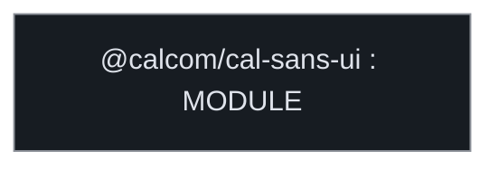

# Repository Architecture Analysis: calcom/sans-ui

## Metadata
- **SHA**: `d7051f40a2a2fb9883f793e9780eadd709d6d04d`
- **Primary Ecosystem**: JavaScript/TypeScript

## Quality Metrics
- **ast_engine**: tree-sitter
- **avg_cognitive_complexity**: 8.0
- **avg_cyclomatic_complexity**: 6.0
- **component_count**: 1
- **dead_code_count**: 0
- **dead_code_symbols**: 0 entry(ies)
- **duplication_pct**: 73.42
- **file_complexities**: 1 entry(ies)
- **files_analyzed**: 1
- **fitness_passed**: False
- **fitness_violation_count**: 1
- **framework**: Next.js
- **import_edges**: 6 entry(ies)
- **loc**: 54
- **max_cognitive_complexity**: 8
- **max_cyclomatic_complexity**: 6
- **sloc**: 50

# Architecture: calcom/sans-ui

## Context
- **Repository**: `calcom/sans-ui`
- **SHA**: `d7051f40a2a2fb9883f793e9780eadd709d6d04d`
- **Ecosystem**: JavaScript/TypeScript
- **Framework**: Next.js

## Building Block View

## Component Details
- **@calcom/cal-sans-ui** (`packages/npm/package.json`): MODULE

## 6-Dimension Repository Scorecard

- **Overall Grade**: `C` (70.10/100)
- **Technical Debt Score**: 29.90
- **Estimated Remediation Effort**: 23.66h

| Dimension | Grade | Score | Weight | Details |
| :--- | :---: | :---: | :---: | :--- |
| Code Quality | `D` | 63.00 | 0.20 | avg_cc=6.00, max_cc=6, duplication=73.42%, dead_code=0 |
| Dependency Health | `B` | 85.00 | 0.15 | dependencies=5, outdated=0, vulnerable=0, has_lockfile=False |
| Maintainability | `B` | 85.00 | 0.15 | avg_cognitive=8.00, max_cognitive=8, fitness_violations=1, oversized_files=0 |
| Pipeline Health | `F` | 40.00 | 0.15 | workflows=0 |
| Security | `A` | 100.00 | 0.20 | vulnerabilities=0, secrets=0, pipeline_security_findings=0 |
| Test Coverage | `F` | 40.00 | 0.15 | coverage=unavailable, ci_test_job=False, test_files_detected=False |

## Architecture Fitness & Workspace Boundaries

- **[MEDIUM] `ATRUSS-ARCH-005` (COMPLEXITY_THRESHOLD)**: Repository duplication_pct (73.42) exceeds policy threshold (15.0).

## Supply Chain Dependencies, Vulnerabilities & Secrets

- **Dependencies Parsed**: 5 | **Vulnerabilities**: 0 | **Secrets**: 0

### Inventory Sample
- `fontbakery` `*` (PyPI, `archive/requirements.txt`)
- `fontmake` `*` (PyPI, `archive/requirements.txt`)
- `fonttools` `*` (PyPI, `archive/requirements.txt`)
- `gftools` `*` (PyPI, `archive/requirements.txt`)
- `ufo2ft` `*` (PyPI, `archive/requirements.txt`)

## CI/CD Pipeline Topology

