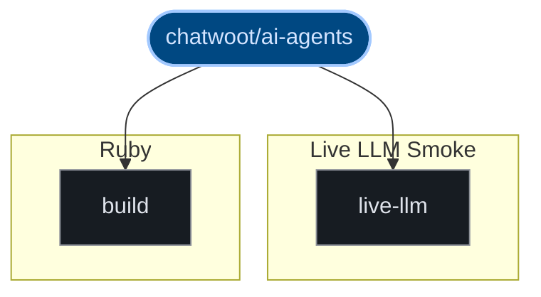

# Repository Architecture Analysis: chatwoot/ai-agents

## Metadata
- **SHA**: `aaf549cf6c1b04521e2e51dfd7f5b5d77287fd39`
- **Primary Ecosystem**: Ruby

## Quality Metrics
- **ast_engine**: fallback
- **avg_cognitive_complexity**: 0.0
- **avg_cyclomatic_complexity**: 0.0
- **component_count**: 79
- **dead_code_count**: 0
- **dead_code_symbols**: 0 entry(ies)
- **duplication_pct**: 0.0
- **file_complexities**: 0 entry(ies)
- **files_analyzed**: 79
- **fitness_passed**: True
- **fitness_violation_count**: 0
- **framework**: Ruby
- **import_edges**: 0 entry(ies)
- **loc**: 12381
- **max_cognitive_complexity**: 0
- **max_cyclomatic_complexity**: 0
- **sloc**: 8947

# Architecture: chatwoot/ai-agents

## Context
- **Repository**: `chatwoot/ai-agents`
- **SHA**: `aaf549cf6c1b04521e2e51dfd7f5b5d77287fd39`
- **Ecosystem**: Ruby
- **Framework**: Ruby

## Building Block View

```mermaid
graph TD;
  classDef atlasRoot fill:#004882,stroke:#a3c9ff,stroke-width:2px,color:#d3e4ff
  classDef atlasCategory fill:#212428,stroke:#E87A48,stroke-width:1.5px,color:#dfe3eb
  classDef atlasWorkflow fill:#1b2026,stroke:#a3c9ff,stroke-width:1.5px,color:#dfe3eb
  classDef atlasJob fill:#171c22,stroke:#8d9199,stroke-width:1px,color:#dfe3eb
  classDef atlasTarget fill:#005227,stroke:#8bd99b,stroke-width:1.5px,color:#a7f6b6
  classDef atlasAlert fill:#93000a,stroke:#ffb4ab,stroke-width:1.5px,color:#ffdad6
  classDef atlasMore fill:#252a31,stroke:#8d9199,stroke-dasharray:4 4,color:#c3c6cf
    repo_root(["chatwoot/ai-agents (79 components)"]):::atlasRoot
    subgraph sg_dir_0_spec["spec (37)"]
      direction TB
      dir_0_spec["spec (37)"]:::atlasCategory
      sub_0_0_agents["agents (17)"]:::atlasWorkflow
      dir_0_spec --> sub_0_0_agents
      sub_0_1_integration["integration (15)"]:::atlasWorkflow
      dir_0_spec --> sub_0_1_integration
      sub_0_2_support["support (3)"]:::atlasWorkflow
      dir_0_spec --> sub_0_2_support
      sub_0_more["+1 more submodules (2)"]:::atlasMore
      dir_0_spec --> sub_0_more
    end
    repo_root --> dir_0_spec
    subgraph sg_dir_1_examples["examples (22)"]
      direction TB
      dir_1_examples["examples (22)"]:::atlasCategory
      sub_1_0_collaborative_copilot["collaborative-copilot (15)"]:::atlasWorkflow
      dir_1_examples --> sub_1_0_collaborative_copilot
      sub_1_1_isp_support["isp-support (7)"]:::atlasWorkflow
      dir_1_examples --> sub_1_1_isp_support
    end
    repo_root --> dir_1_examples
    subgraph sg_dir_2_lib["lib (20)"]
      direction TB
      dir_2_lib["lib (20)"]:::atlasCategory
      sub_2_0_agents["agents (19)"]:::atlasWorkflow
      dir_2_lib --> sub_2_0_agents
      sub_2_1__module_root_["(module root) (1)"]:::atlasWorkflow
      dir_2_lib --> sub_2_1__module_root_
    end
    repo_root --> dir_2_lib
```

## Component Details

Showing top 60 representative components out of 79 across 3 module group(s):

- **Module `spec`** (37 components — module: 37)
- **Module `examples`** (22 components — module: 22)
- **Module `lib`** (20 components — module: 20)

- **agent** (`lib/agents/agent.rb`): module
- **agent_runner** (`lib/agents/agent_runner.rb`): module
- **agent_runner_spec** (`spec/agents/agent_runner_spec.rb`): module
- **agent_spec** (`spec/agents/agent_spec.rb`): module
- **agent_tool** (`lib/agents/agent_tool.rb`): module
- **agent_tool_spec** (`spec/agents/agent_tool_spec.rb`): module
- **agents** (`lib/agents.rb`): module
- **agents_factory** (`examples/isp-support/agents_factory.rb`): module
- **agents_spec** (`spec/agents_spec.rb`): module
- **analysis_agent** (`examples/collaborative-copilot/agents/analysis_agent.rb`): module
- **answer_suggestion_agent** (`examples/collaborative-copilot/agents/answer_suggestion_agent.rb`): module
- **callback_manager** (`lib/agents/callback_manager.rb`): module
- **callback_manager_spec** (`spec/agents/callback_manager_spec.rb`): module
- **chatwoot_custom_tool_contract_spec** (`spec/integration/chatwoot_custom_tool_contract_spec.rb`): module
- **chatwoot_live_helper** (`spec/support/chatwoot_live_helper.rb`): module
- **constants** (`lib/agents/instrumentation/constants.rb`): module
- **copilot_orchestrator** (`examples/collaborative-copilot/agents/copilot_orchestrator.rb`): module
- **create_checkout_tool** (`examples/isp-support/tools/create_checkout_tool.rb`): module
- **create_lead_tool** (`examples/isp-support/tools/create_lead_tool.rb`): module
- **create_linear_ticket_tool** (`examples/collaborative-copilot/tools/create_linear_ticket_tool.rb`): module
- **crm_lookup_tool** (`examples/isp-support/tools/crm_lookup_tool.rb`): module
- **escalate_to_human_tool** (`examples/isp-support/tools/escalate_to_human_tool.rb`): module
- **get_article_tool** (`examples/collaborative-copilot/tools/get_article_tool.rb`): module
- **get_contact_tool** (`examples/collaborative-copilot/tools/get_contact_tool.rb`): module
- **get_conversation_tool** (`examples/collaborative-copilot/tools/get_conversation_tool.rb`): module
- **get_stripe_billing_tool** (`examples/collaborative-copilot/tools/get_stripe_billing_tool.rb`): module
- **handoff** (`lib/agents/handoff.rb`): module
- **handoff_spec** (`spec/agents/handoff_spec.rb`): module
- **hash_normalizer** (`lib/agents/helpers/hash_normalizer.rb`): module
- **hash_normalizer_spec** (`spec/agents/helpers/hash_normalizer_spec.rb`): module
- **helpers** (`lib/agents/helpers.rb`): module
- **instrumentation** (`lib/agents/instrumentation.rb`): module
- **instrumentation_spec** (`spec/agents/instrumentation_spec.rb`): module
- **integrations_agent** (`examples/collaborative-copilot/agents/integrations_agent.rb`): module
- **interactive** (`examples/collaborative-copilot/interactive.rb`): module
- **interactive** (`examples/isp-support/interactive.rb`): module
- **langfuse_e2e_spec** (`spec/integration/langfuse_e2e_spec.rb`): module
- **live_agent_as_tool_spec** (`spec/integration/live_agent_as_tool_spec.rb`): module
- **live_chatwoot_spec** (`spec/integration/live_chatwoot_spec.rb`): module
- **live_handoff_spec** (`spec/integration/live_handoff_spec.rb`): module
- **live_history_input_spec** (`spec/integration/live_history_input_spec.rb`): module
- **live_instrumentation_spec** (`spec/integration/live_instrumentation_spec.rb`): module
- **live_llm_helper** (`spec/support/live_llm_helper.rb`): module
- **live_multimodal_history_spec** (`spec/integration/live_multimodal_history_spec.rb`): module
- **live_params_spec** (`spec/integration/live_params_spec.rb`): module
- **live_response_schema_spec** (`spec/integration/live_response_schema_spec.rb`): module
- **live_runner_basic_spec** (`spec/integration/live_runner_basic_spec.rb`): module
- **live_runner_tool_call_spec** (`spec/integration/live_runner_tool_call_spec.rb`): module
- **live_thinking_spec** (`spec/integration/live_thinking_spec.rb`): module
- **live_usage_spec** (`spec/integration/live_usage_spec.rb`): module
- **message_extractor** (`lib/agents/helpers/message_extractor.rb`): module
- **message_extractor_spec** (`spec/agents/helpers/message_extractor_spec.rb`): module
- **name_normalizer** (`lib/agents/helpers/name_normalizer.rb`): module
- **name_normalizer_spec** (`spec/agents/helpers/name_normalizer_spec.rb`): module
- **openai_test_helper** (`spec/support/openai_test_helper.rb`): module
- **research_agent** (`examples/collaborative-copilot/agents/research_agent.rb`): module
- **result** (`lib/agents/result.rb`): module
- **result_spec** (`spec/agents/result_spec.rb`): module
- **ruby_llm_tool_contract_spec** (`spec/integration/ruby_llm_tool_contract_spec.rb`): module
- **run_context** (`lib/agents/run_context.rb`): module

## 6-Dimension Repository Scorecard

- **Overall Grade**: `B` (87.40/100)
- **Technical Debt Score**: 12.60
- **Estimated Remediation Effort**: 8.65h

| Dimension | Grade | Score | Weight | Details |
| :--- | :---: | :---: | :---: | :--- |
| Code Quality | `A` | 100.00 | 0.20 | avg_cc=0.00, max_cc=0, duplication=0.00%, dead_code=0 |
| Dependency Health | `A` | 100.00 | 0.15 | dependencies=17, outdated=0, vulnerable=0, has_lockfile=False |
| Maintainability | `A` | 100.00 | 0.15 | avg_cognitive=0.00, max_cognitive=0, fitness_violations=0, oversized_files=0 |
| Pipeline Health | `A` | 94.00 | 0.15 | workflows=2, operational_antipatterns=2, parallel_branches=False |
| Security | `D` | 64.00 | 0.20 | vulnerabilities=0, secrets=0, pipeline_security_findings=3 |
| Test Coverage | `C` | 70.00 | 0.15 | coverage=unavailable, ci_test_job=True, test_files_detected=False |

## Supply Chain Dependencies, Vulnerabilities & Secrets

- **Dependencies Parsed**: 17 | **Vulnerabilities**: 0 | **Secrets**: 0

### Inventory Sample
- `activesupport` `7.2` (gem, `Gemfile`)
- `irb` `*` (gem, `Gemfile`)
- `jekyll` `*` (gem, `docs/Gemfile`)
- `jekyll-remote-theme` `*` (gem, `docs/Gemfile`)
- `jekyll-seo-tag` `*` (gem, `docs/Gemfile`)
- `jekyll-sitemap` `*` (gem, `docs/Gemfile`)
- `just-the-docs` `*` (gem, `docs/Gemfile`)
- `marcel` `1.2` (gem, `Gemfile`)
- `opentelemetry-exporter-otlp` `*` (gem, `Gemfile`)
- `opentelemetry-sdk` `*` (gem, `Gemfile`)
- `rake` `13.0` (gem, `Gemfile`)
- `rspec` `3.12` (gem, `Gemfile`)
- `rubocop` `1.21` (gem, `Gemfile`)
- `rubocop-rspec` `3.0` (gem, `Gemfile`)
- `simplecov` `0.22` (gem, `Gemfile`)
- `webmock` `3.18` (gem, `Gemfile`)
- `webrick` `*` (gem, `docs/Gemfile`)

## CI/CD Pipeline Topology

