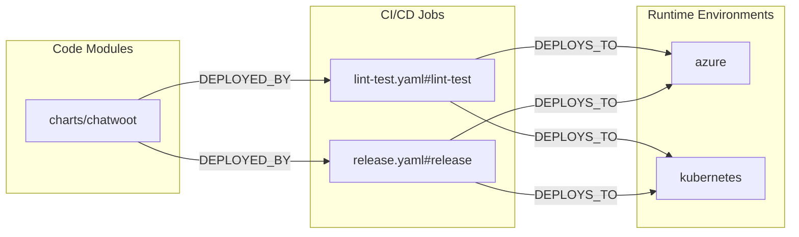
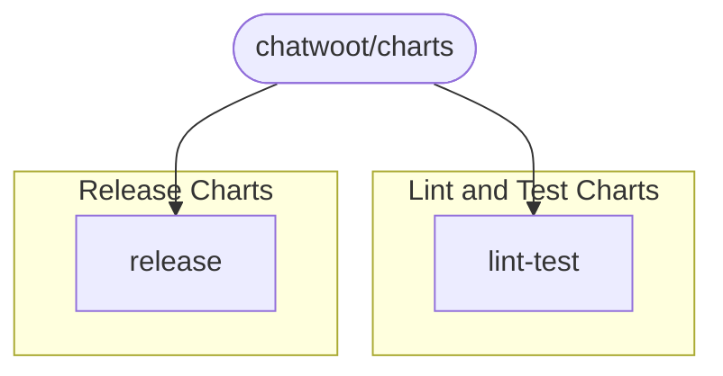

# Repository Architecture Analysis: chatwoot/charts

## Metadata
- **SHA**: `15d0e5842aa9d04a26b59dd856fe1b70c5e9a939`
- **Primary Ecosystem**: Container / Helm / IaC

## Quality Metrics
- **ast_engine**: fallback
- **avg_cognitive_complexity**: 0.0
- **avg_cyclomatic_complexity**: 0.0
- **component_count**: 11
- **dead_code_count**: 0
- **dead_code_symbols**: 0 entry(ies)
- **duplication_pct**: 0.0
- **file_complexities**: 0 entry(ies)
- **files_analyzed**: 11
- **fitness_passed**: True
- **fitness_violation_count**: 0
- **framework**: Helm Chart
- **import_edges**: 0 entry(ies)
- **loc**: 542
- **max_cognitive_complexity**: 0
- **max_cyclomatic_complexity**: 0
- **sloc**: 461
- **test_file_count**: 1

# Architecture: chatwoot/charts

## Context
- **Repository**: `chatwoot/charts`
- **SHA**: `15d0e5842aa9d04a26b59dd856fe1b70c5e9a939`
- **Ecosystem**: Container / Helm / IaC
- **Framework**: Helm Chart

## Building Block View

```mermaid
graph TD;
    Chart["Chart : module"]
    values_ci["values.ci : module"]
    values["values : module"]
    env_configmap["env-configmap : module"]
    ingress["ingress : module"]
    migrations_job["migrations-job : module"]
    serviceaccount["serviceaccount : module"]
    web_deployment["web-deployment : module"]
    web_service["web-service : module"]
    worker_deployment["worker-deployment : module"]
    test_connection["test-connection : module"]
    repo_root(["chatwoot/charts"])
    repo_root --> Chart
    repo_root --> env_configmap
    repo_root --> ingress
    repo_root --> migrations_job
    repo_root --> serviceaccount
    repo_root --> test_connection
    repo_root --> values
    repo_root --> values_ci
    repo_root --> web_deployment
    repo_root --> web_service
    repo_root --> worker_deployment
```

## Component Details
- **Chart** (`charts/chatwoot/Chart.yaml`): module
- **values.ci** (`charts/chatwoot/values.ci.yaml`): module
- **values** (`charts/chatwoot/values.yaml`): module
- **env-configmap** (`charts/chatwoot/templates/env-configmap.yaml`): module
- **ingress** (`charts/chatwoot/templates/ingress.yaml`): module
- **migrations-job** (`charts/chatwoot/templates/migrations-job.yaml`): module
- **serviceaccount** (`charts/chatwoot/templates/serviceaccount.yaml`): module
- **web-deployment** (`charts/chatwoot/templates/web-deployment.yaml`): module
- **web-service** (`charts/chatwoot/templates/web-service.yaml`): module
- **worker-deployment** (`charts/chatwoot/templates/worker-deployment.yaml`): module
- **test-connection** (`charts/chatwoot/templates/tests/test-connection.yaml`): module

## 6-Dimension Repository Scorecard

- **Overall Grade**: `C` (72.70/100)
- **Technical Debt Score**: 27.30
- **Estimated Remediation Effort**: 20.82h

| Dimension | Grade | Score | Weight | Details |
| :--- | :---: | :---: | :---: | :--- |
| Code Quality | `A` | 100.00 | 0.20 | avg_cc=0.00, max_cc=0, duplication=0.00%, dead_code=0 |
| Dependency Health | `A` | 90.00 | 0.15 | dependencies=0 (no manifests parsed) |
| Maintainability | `A` | 100.00 | 0.15 | avg_cognitive=0.00, max_cognitive=0, fitness_violations=0, oversized_files=0 |
| Pipeline Health | `F` | 54.00 | 0.15 | workflows=2, operational_antipatterns=4, parallel_branches=False |
| Security | `F` | 28.00 | 0.20 | vulnerabilities=0, secrets=0, pipeline_security_findings=6 |
| Test Coverage | `C` | 70.00 | 0.15 | coverage=unavailable, ci_test_job=True, test_files_detected=True |

## Section 7: Code-to-Cloud Deployment Traceability

- `lint-test.yaml#lint-test` (ci_job) --[DEPLOYS_TO]--> `azure` (environment)
- `lint-test.yaml#lint-test` (ci_job) --[DEPLOYS_TO]--> `kubernetes` (environment)
- `release.yaml#release` (ci_job) --[DEPLOYS_TO]--> `azure` (environment)
- `release.yaml#release` (ci_job) --[DEPLOYS_TO]--> `kubernetes` (environment)
- `charts/chatwoot` (code_module) --[DEPLOYED_BY]--> `lint-test.yaml#lint-test` (ci_job)
- `charts/chatwoot` (code_module) --[DEPLOYED_BY]--> `release.yaml#release` (ci_job)

## CI/CD Pipeline Topology

