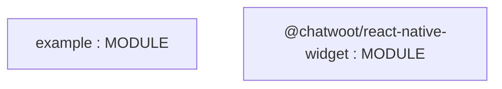
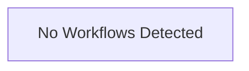

# Repository Architecture Analysis: chatwoot/chatwoot-react-native-widget

## Metadata
- **SHA**: `cd280c2642b6d054606df81d55062018f76091ae`
- **Primary Ecosystem**: JavaScript/TypeScript

## Quality Metrics
- **ast_engine**: tree-sitter
- **avg_cognitive_complexity**: 2.08
- **avg_cyclomatic_complexity**: 2.33
- **component_count**: 2
- **dead_code_count**: 0
- **dead_code_symbols**: 0 entry(ies)
- **duplication_pct**: 91.61
- **file_complexities**: 17 entry(ies)
- **files_analyzed**: 17
- **fitness_passed**: False
- **fitness_violation_count**: 1
- **framework**: React (Vite)
- **import_edges**: 83 entry(ies)
- **loc**: 884
- **max_cognitive_complexity**: 16
- **max_cyclomatic_complexity**: 10
- **sloc**: 823

# Architecture: chatwoot/chatwoot-react-native-widget

## Context
- **Repository**: `chatwoot/chatwoot-react-native-widget`
- **SHA**: `cd280c2642b6d054606df81d55062018f76091ae`
- **Ecosystem**: JavaScript/TypeScript
- **Framework**: React (Vite)

## Building Block View

## Component Details
- **example** (`Example/package.json`): MODULE
- **@chatwoot/react-native-widget** (`package.json`): MODULE

## 6-Dimension Repository Scorecard

- **Overall Grade**: `C` (76.10/100)
- **Technical Debt Score**: 23.90
- **Estimated Remediation Effort**: 25.80h

| Dimension | Grade | Score | Weight | Details |
| :--- | :---: | :---: | :---: | :--- |
| Code Quality | `C` | 75.00 | 0.20 | avg_cc=2.33, max_cc=10, duplication=91.61%, dead_code=0 |
| Dependency Health | `A` | 100.00 | 0.15 | dependencies=1225, outdated=0, vulnerable=0, has_lockfile=True |
| Maintainability | `A` | 94.00 | 0.15 | avg_cognitive=2.08, max_cognitive=16, fitness_violations=1, oversized_files=0 |
| Pipeline Health | `F` | 40.00 | 0.15 | workflows=0 |
| Security | `A` | 100.00 | 0.20 | vulnerabilities=0, secrets=0, pipeline_security_findings=0 |
| Test Coverage | `F` | 40.00 | 0.15 | coverage=unavailable, ci_test_job=False, test_files_detected=False |

## Architecture Fitness & Workspace Boundaries

- **[MEDIUM] `ATRUSS-ARCH-005` (COMPLEXITY_THRESHOLD)**: Repository duplication_pct (91.61) exceeds policy threshold (15.0).

## Supply Chain Dependencies, Vulnerabilities & Secrets

- **Dependencies Parsed**: 1225 | **Vulnerabilities**: 0 | **Secrets**: 0

### Inventory Sample
- `@babel/core` `7.20.0` (npm, `Example/package.json`)
- `@babel/core` `7.25.2` (npm, `Example/package-lock.json`)
- `@chatwoot/react-native-widget` `0.0.19` (npm, `Example/package-lock.json`)
- `@chatwoot/react-native-widget` `0.0.20` (npm, `Example/package.json`)
- `@react-native-async-storage/async-storage` `1.23.1` (npm, `Example/package-lock.json`)
- `@react-native-async-storage/async-storage` `1.23.1` (npm, `Example/package.json`)
- `@react-native-community/eslint-config` `2.0.0` (npm, `package.json`)
- `@react-native-community/eslint-plugin` `1.1.0` (npm, `package.json`)
- `eslint` `7.21.0` (npm, `package.json`)
- `eslint-plugin-prettier` `3.3.1` (npm, `package.json`)
- `expo` `51.0.28` (npm, `Example/package.json`)
- `expo` `51.0.32` (npm, `Example/package-lock.json`)
- `expo-status-bar` `1.12.1` (npm, `Example/package-lock.json`)
- `expo-status-bar` `1.12.1` (npm, `Example/package.json`)
- `husky` `5.1.3` (npm, `package.json`)
- `lint-staged` `10.5.4` (npm, `package.json`)
- `metro-react-native-babel-preset` `0.65.2` (npm, `package.json`)
- `prettier` `2.2.1` (npm, `package.json`)
- `react` `18.2.0` (npm, `Example/package-lock.json`)
- `react` `18.2.0` (npm, `Example/package.json`)
- `react-native` `0.74.5` (npm, `Example/package-lock.json`)
- `react-native` `0.74.5` (npm, `Example/package.json`)
- `react-native-modal` `13.0.1` (npm, `Example/package-lock.json`)
- `react-native-modal` `13.0.1` (npm, `Example/package.json`)
- `react-native-modal` `13.0.1` (npm, `package.json`)
- `react-native-webview` `13.8.6` (npm, `Example/package-lock.json`)
- `react-native-webview` `13.8.6` (npm, `Example/package.json`)
- `@ampproject/remapping` `2.3.0` (npm, `Example/package-lock.json`)
- `@babel/code-frame` `7.10.4` (npm, `Example/package-lock.json`)
- `@babel/code-frame` `7.10.4` (npm, `Example/package-lock.json`)
- ... (+1195 more dependencies)

## CI/CD Pipeline Topology

