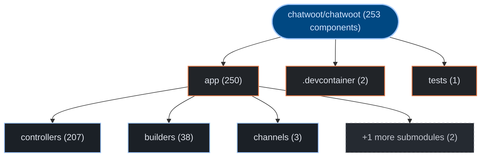
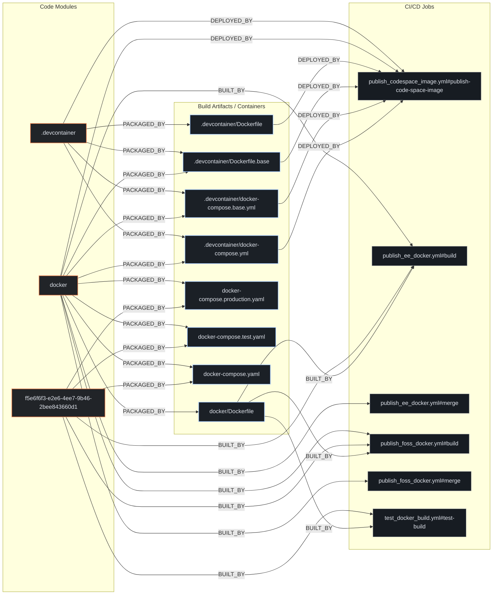

# Repository Architecture Analysis: chatwoot/chatwoot

## Metadata
- **SHA**: `1ef1d2b45ae0a17a35c5f1bd055e4ddf04dadabf`
- **Primary Ecosystem**: Ruby

## Quality Metrics
- **ast_engine**: tree-sitter
- **avg_cognitive_complexity**: 0.23
- **avg_cyclomatic_complexity**: 1.23
- **component_count**: 253
- **dead_code_count**: 0
- **dead_code_symbols**: 0 entry(ies)
- **duplication_pct**: 0.19
- **file_complexities**: 14 entry(ies)
- **files_analyzed**: 3147
- **fitness_passed**: True
- **fitness_violation_count**: 0
- **framework**: Ruby on Rails
- **import_edges**: 81 entry(ies)
- **loc**: 287822
- **max_cognitive_complexity**: 10
- **max_cyclomatic_complexity**: 11
- **sloc**: 226163
- **test_file_count**: 581

# Architecture: chatwoot/chatwoot

## Context
- **Repository**: `chatwoot/chatwoot`
- **SHA**: `1ef1d2b45ae0a17a35c5f1bd055e4ddf04dadabf`
- **Ecosystem**: Ruby
- **Framework**: Ruby on Rails

## Building Block View

## Component Details

Showing top 60 representative components out of 253 across 3 module group(s):

- **Module `app`** (250 components — module: 250)
- **Module `.devcontainer`** (2 components — module: 2)
- **Module `tests`** (1 components — MODULE: 1)

- **access_token_auth_helper** (`app/controllers/concerns/access_token_auth_helper.rb`): module
- **access_tokens_controller** (`app/controllers/super_admin/access_tokens_controller.rb`): module
- **account_builder** (`app/builders/account_builder.rb`): module
- **account_users_controller** (`app/controllers/platform/api/v1/account_users_controller.rb`): module
- **account_users_controller** (`app/controllers/super_admin/account_users_controller.rb`): module
- **accounts_controller** (`app/controllers/api/v1/accounts_controller.rb`): module
- **accounts_controller** (`app/controllers/api/v2/accounts_controller.rb`): module
- **accounts_controller** (`app/controllers/platform/api/v1/accounts_controller.rb`): module
- **accounts_controller** (`app/controllers/super_admin/accounts_controller.rb`): module
- **agent_bots_controller** (`app/controllers/api/v1/accounts/agent_bots_controller.rb`): module
- **agent_bots_controller** (`app/controllers/platform/api/v1/agent_bots_controller.rb`): module
- **agent_bots_controller** (`app/controllers/super_admin/agent_bots_controller.rb`): module
- **agent_builder** (`app/builders/agent_builder.rb`): module
- **agent_summary_builder** (`app/builders/v2/reports/agent_summary_builder.rb`): module
- **agents_controller** (`app/controllers/api/v1/accounts/agents_controller.rb`): module
- **android_app_controller** (`app/controllers/android_app_controller.rb`): module
- **api_controller** (`app/controllers/api_controller.rb`): module
- **app_configs_controller** (`app/controllers/super_admin/app_configs_controller.rb`): module
- **apple_app_controller** (`app/controllers/apple_app_controller.rb`): module
- **application_controller** (`app/controllers/application_controller.rb`): module
- **application_controller** (`app/controllers/super_admin/application_controller.rb`): module
- **apps_controller** (`app/controllers/api/v1/accounts/integrations/apps_controller.rb`): module
- **articles_controller** (`app/controllers/api/v1/accounts/articles_controller.rb`): module
- **articles_controller** (`app/controllers/public/api/v1/portals/articles_controller.rb`): module
- **assignable_agents_controller** (`app/controllers/api/v1/accounts/assignable_agents_controller.rb`): module
- **assignment_policies_controller** (`app/controllers/api/v1/accounts/assignment_policies_controller.rb`): module
- **assignment_policies_controller** (`app/controllers/api/v1/accounts/inboxes/assignment_policies_controller.rb`): module
- **assignments_controller** (`app/controllers/api/v1/accounts/conversations/assignments_controller.rb`): module
- **attachment_concern** (`app/controllers/concerns/attachment_concern.rb`): module
- **attachments_controller** (`app/controllers/api/v1/accounts/contacts/attachments_controller.rb`): module
- **auth_helper** (`app/controllers/concerns/auth_helper.rb`): module
- **authorizations_controller** (`app/controllers/api/v1/accounts/google/authorizations_controller.rb`): module
- **authorizations_controller** (`app/controllers/api/v1/accounts/instagram/authorizations_controller.rb`): module
- **authorizations_controller** (`app/controllers/api/v1/accounts/microsoft/authorizations_controller.rb`): module
- **authorizations_controller** (`app/controllers/api/v1/accounts/notion/authorizations_controller.rb`): module
- **authorizations_controller** (`app/controllers/api/v1/accounts/tiktok/authorizations_controller.rb`): module
- **authorizations_controller** (`app/controllers/api/v1/accounts/twitter/authorizations_controller.rb`): module
- **authorizations_controller** (`app/controllers/api/v1/accounts/whatsapp/authorizations_controller.rb`): module
- **automation_rules_controller** (`app/controllers/api/v1/accounts/automation_rules_controller.rb`): module
- **bandwidth_configuration** (`app/controllers/api/v1/accounts/concerns/bandwidth_configuration.rb`): module
- **base_builder** (`app/builders/email/base_builder.rb`): module
- **base_controller** (`app/controllers/api/base_controller.rb`): module
- **base_controller** (`app/controllers/api/v1/accounts/base_controller.rb`): module
- **base_controller** (`app/controllers/api/v1/accounts/companies/base_controller.rb`): module
- **base_controller** (`app/controllers/api/v1/accounts/contacts/base_controller.rb`): module
- **base_controller** (`app/controllers/api/v1/accounts/conversations/base_controller.rb`): module
- **base_controller** (`app/controllers/api/v1/accounts/integrations/base_controller.rb`): module
- **base_controller** (`app/controllers/api/v1/widget/base_controller.rb`): module
- **base_controller** (`app/controllers/public/api/v1/portals/base_controller.rb`): module
- **base_controller** (`app/controllers/twitter/base_controller.rb`): module
- **base_message_builder** (`app/builders/messages/instagram/base_message_builder.rb`): module
- **base_report_builder** (`app/builders/v2/reports/conversations/base_report_builder.rb`): module
- **base_summary_builder** (`app/builders/v2/reports/base_summary_builder.rb`): module
- **base_timeseries_builder** (`app/builders/v2/reports/timeseries/base_timeseries_builder.rb`): module
- **bot_metrics_builder** (`app/builders/v2/reports/bot_metrics_builder.rb`): module
- **branded_email_layouts_controller** (`app/controllers/api/v1/accounts/branded_email_layouts_controller.rb`): module
- **bulk_actions_controller** (`app/controllers/api/v1/accounts/articles/bulk_actions_controller.rb`): module
- **bulk_actions_controller** (`app/controllers/api/v1/accounts/bulk_actions_controller.rb`): module
- **callback_controller** (`app/controllers/twilio/callback_controller.rb`): module
- **callbacks_controller** (`app/controllers/api/v1/accounts/callbacks_controller.rb`): module

## 6-Dimension Repository Scorecard

- **Overall Grade**: `D` (60.44/100)
- **Technical Debt Score**: 39.56
- **Estimated Remediation Effort**: 91.93h

| Dimension | Grade | Score | Weight | Details |
| :--- | :---: | :---: | :---: | :--- |
| Code Quality | `A` | 99.72 | 0.20 | avg_cc=1.23, max_cc=11, duplication=0.19%, dead_code=0 |
| Dependency Health | `A` | 100.00 | 0.15 | dependencies=1558, outdated=0, vulnerable=0, has_lockfile=True |
| Maintainability | `A` | 100.00 | 0.15 | avg_cognitive=0.23, max_cognitive=10, fitness_violations=0, oversized_files=0 |
| Pipeline Health | `F` | 0.00 | 0.15 | workflows=17, operational_antipatterns=29, parallel_branches=True |
| Security | `F` | 0.00 | 0.20 | vulnerabilities=0, secrets=0, pipeline_security_findings=39 |
| Test Coverage | `C` | 70.00 | 0.15 | coverage=unavailable, ci_test_job=True, test_files_detected=True |

## Supply Chain Dependencies, Vulnerabilities & Secrets

- **Dependencies Parsed**: 1558 | **Vulnerabilities**: 0 | **Secrets**: 0

### Inventory Sample
- `active_record_query_trace` `*` (gem, `Gemfile`)
- `activerecord-import` `*` (gem, `Gemfile`)
- `acts-as-taggable-on` `*` (gem, `Gemfile`)
- `administrate` `1.0.0` (gem, `Gemfile`)
- `administrate-field-active_storage` `1.0.6` (gem, `Gemfile`)
- `ai-agents` `0.14.0` (gem, `Gemfile`)
- `annotaterb` `*` (gem, `Gemfile`)
- `apnotic` `1.8` (gem, `Gemfile`)
- `attr_extras` `*` (gem, `Gemfile`)
- `audited` `5.8` (gem, `Gemfile`)
- `aws-actionmailbox-ses` `0` (gem, `Gemfile`)
- `aws-sdk-s3` `*` (gem, `Gemfile`)
- `aws-sdk-sesv2` `*` (gem, `Gemfile`)
- `azure-blob` `*` (gem, `Gemfile`)
- `barnes` `*` (gem, `Gemfile`)
- `bootsnap` `*` (gem, `Gemfile`)
- `brakeman` `*` (gem, `Gemfile`)
- `browser` `*` (gem, `Gemfile`)
- `bullet` `*` (gem, `Gemfile`)
- `bundle-audit` `*` (gem, `Gemfile`)
- `byebug` `*` (gem, `Gemfile`)
- `cld3` `3.7` (gem, `Gemfile`)
- `climate_control` `*` (gem, `Gemfile`)
- `commonmarker` `*` (gem, `Gemfile`)
- `csv-safe` `*` (gem, `Gemfile`)
- `database_cleaner` `*` (gem, `Gemfile`)
- `datadog` `2.0` (gem, `Gemfile`)
- `debug` `1.8` (gem, `Gemfile`)
- `devise` `4.9.4` (gem, `Gemfile`)
- `devise-secure_password` `2.2.1` (gem, `Gemfile`)
- ... (+1528 more dependencies)

## Section 7: Code-to-Cloud Deployment Traceability

- `.devcontainer` (code_module) --[DEPLOYED_BY]--> `publish_codespace_image.yml#publish-code-space-image` (ci_job)
- `.devcontainer` (code_module) --[PACKAGED_BY]--> `.devcontainer/Dockerfile` (container)
- `.devcontainer` (code_module) --[PACKAGED_BY]--> `.devcontainer/Dockerfile.base` (container)
- `.devcontainer` (code_module) --[PACKAGED_BY]--> `.devcontainer/docker-compose.base.yml` (container)
- `.devcontainer` (code_module) --[PACKAGED_BY]--> `.devcontainer/docker-compose.yml` (container)
- `docker` (code_module) --[BUILT_BY]--> `publish_ee_docker.yml#build` (ci_job)
- `docker` (code_module) --[BUILT_BY]--> `publish_ee_docker.yml#merge` (ci_job)
- `docker` (code_module) --[BUILT_BY]--> `publish_foss_docker.yml#build` (ci_job)
- `docker` (code_module) --[BUILT_BY]--> `publish_foss_docker.yml#merge` (ci_job)
- `docker` (code_module) --[DEPLOYED_BY]--> `publish_codespace_image.yml#publish-code-space-image` (ci_job)
- `docker` (code_module) --[PACKAGED_BY]--> `.devcontainer/Dockerfile.base` (container)
- `docker` (code_module) --[PACKAGED_BY]--> `.devcontainer/docker-compose.base.yml` (container)
- `docker` (code_module) --[PACKAGED_BY]--> `.devcontainer/docker-compose.yml` (container)
- `docker` (code_module) --[PACKAGED_BY]--> `docker-compose.production.yaml` (container)
- `docker` (code_module) --[PACKAGED_BY]--> `docker-compose.test.yaml` (container)
- `docker` (code_module) --[PACKAGED_BY]--> `docker-compose.yaml` (container)
- `docker` (code_module) --[PACKAGED_BY]--> `docker/Dockerfile` (container)
- `f5e6f6f3-e2e6-4ee7-9b46-2bee843660d1` (code_module) --[BUILT_BY]--> `publish_ee_docker.yml#build` (ci_job)
- `f5e6f6f3-e2e6-4ee7-9b46-2bee843660d1` (code_module) --[BUILT_BY]--> `publish_foss_docker.yml#build` (ci_job)
- `f5e6f6f3-e2e6-4ee7-9b46-2bee843660d1` (code_module) --[BUILT_BY]--> `test_docker_build.yml#test-build` (ci_job)
- `f5e6f6f3-e2e6-4ee7-9b46-2bee843660d1` (code_module) --[PACKAGED_BY]--> `docker-compose.production.yaml` (container)
- `f5e6f6f3-e2e6-4ee7-9b46-2bee843660d1` (code_module) --[PACKAGED_BY]--> `docker-compose.test.yaml` (container)
- `f5e6f6f3-e2e6-4ee7-9b46-2bee843660d1` (code_module) --[PACKAGED_BY]--> `docker-compose.yaml` (container)
- `.devcontainer/Dockerfile` (container) --[DEPLOYED_BY]--> `publish_codespace_image.yml#publish-code-space-image` (ci_job)
- `.devcontainer/Dockerfile.base` (container) --[DEPLOYED_BY]--> `publish_codespace_image.yml#publish-code-space-image` (ci_job)
- `.devcontainer/docker-compose.base.yml` (container) --[DEPLOYED_BY]--> `publish_codespace_image.yml#publish-code-space-image` (ci_job)
- `.devcontainer/docker-compose.yml` (container) --[DEPLOYED_BY]--> `publish_codespace_image.yml#publish-code-space-image` (ci_job)
- `docker/Dockerfile` (container) --[BUILT_BY]--> `publish_ee_docker.yml#build` (ci_job)
- `docker/Dockerfile` (container) --[BUILT_BY]--> `publish_foss_docker.yml#build` (ci_job)
- `docker/Dockerfile` (container) --[BUILT_BY]--> `test_docker_build.yml#test-build` (ci_job)

## CI/CD Pipeline Topology

```mermaid
graph TD;
  classDef atlasRoot fill:#004882,stroke:#a3c9ff,stroke-width:2px,color:#d3e4ff
  classDef atlasCategory fill:#212428,stroke:#E87A48,stroke-width:1.5px,color:#dfe3eb
  classDef atlasWorkflow fill:#1b2026,stroke:#a3c9ff,stroke-width:1.5px,color:#dfe3eb
  classDef atlasJob fill:#171c22,stroke:#8d9199,stroke-width:1px,color:#dfe3eb
  classDef atlasTarget fill:#005227,stroke:#8bd99b,stroke-width:1.5px,color:#a7f6b6
  classDef atlasAlert fill:#93000a,stroke:#ffb4ab,stroke-width:1.5px,color:#ffdad6
  classDef atlasMore fill:#252a31,stroke:#8d9199,stroke-dasharray:4 4,color:#c3c6cf
  pipeline_root(["chatwoot/chatwoot (17 workflows)"]):::atlasRoot
  subgraph sg_grp_0_CI___Verification["CI & Verification (6 workflows · 6 jobs)"]
    direction TB
    subgraph sg_wf_0_Auto_assign_PR_to_Author["Auto-assign PR to Author (1 jobs)"]
      direction TB
      wf_0_Auto_assign_PR_to_Author(["Trigger: Auto-assign PR to Author"]):::atlasWorkflow
      job_0_auto_assign["auto-assign"]:::atlasJob
      wf_0_Auto_assign_PR_to_Author --> job_0_auto_assign
    end
    pipeline_root --> wf_0_Auto_assign_PR_to_Author
    subgraph sg_wf_2_Frontend_Lint___Test["Frontend Lint & Test (1 jobs)"]
      direction TB
      wf_2_Frontend_Lint___Test(["Trigger: Frontend Lint & Test"]):::atlasWorkflow
      job_2_test["test"]:::atlasJob
      wf_2_Frontend_Lint___Test --> job_2_test
    end
    pipeline_root --> wf_2_Frontend_Lint___Test
    subgraph sg_wf_4_Lint_PR["Lint PR (1 jobs)"]
      direction TB
      wf_4_Lint_PR(["Trigger: Lint PR"]):::atlasWorkflow
      job_4_main["main"]:::atlasJob
      wf_4_Lint_PR --> job_4_main
    end
    pipeline_root --> wf_4_Lint_PR
  end
  subgraph sg_grp_1_Release___Deploy["Release & Deploy (5 workflows · 7 jobs)"]
    direction TB
    subgraph sg_wf_1_Deploy_Check["Deploy Check (1 jobs)"]
      direction TB
      wf_1_Deploy_Check(["Trigger: Deploy Check"]):::atlasWorkflow
      job_1_deployment_check["deployment_check"]:::atlasJob
      wf_1_Deploy_Check --> job_1_deployment_check
    end
    pipeline_root --> wf_1_Deploy_Check
    subgraph sg_wf_10_Publish_Chatwoot_EE_docker_images["Publish Chatwoot EE docker images (2 jobs)"]
      direction TB
      wf_10_Publish_Chatwoot_EE_docker_images(["Trigger: Publish Chatwoot EE docker images"]):::atlasWorkflow
      job_10_build["build"]:::atlasJob
      job_10_merge["merge"]:::atlasJob
      wf_10_Publish_Chatwoot_EE_docker_images --> job_10_build
      job_10_build --> job_10_merge
    end
    pipeline_root --> wf_10_Publish_Chatwoot_EE_docker_images
    subgraph sg_wf_11_Publish_Chatwoot_CE_docker_images["Publish Chatwoot CE docker images (2 jobs)"]
      direction TB
      wf_11_Publish_Chatwoot_CE_docker_images(["Trigger: Publish Chatwoot CE docker images"]):::atlasWorkflow
      job_11_build["build"]:::atlasJob
      job_11_merge["merge"]:::atlasJob
      wf_11_Publish_Chatwoot_CE_docker_images --> job_11_build
      job_11_build --> job_11_merge
    end
    pipeline_root --> wf_11_Publish_Chatwoot_CE_docker_images
  end
  subgraph sg_grp_2_Scheduled___Manual["Scheduled & Manual (4 workflows · 8 jobs)"]
    direction TB
    subgraph sg_wf_8_Run_Linux_nightly_installer["Run Linux nightly installer (1 jobs)"]
      direction TB
      wf_8_Run_Linux_nightly_installer(["Trigger: Run Linux nightly installer"]):::atlasWorkflow
      job_8_nightly["nightly"]:::atlasJob
      wf_8_Run_Linux_nightly_installer --> job_8_nightly
    end
    pipeline_root --> wf_8_Run_Linux_nightly_installer
    subgraph sg_wf_12_Run_Chatwoot_CE_spec["Run Chatwoot CE spec (5 jobs)"]
      direction TB
      wf_12_Run_Chatwoot_CE_spec(["Trigger: Run Chatwoot CE spec"]):::atlasWorkflow
      job_12_lint_backend["lint-backend"]:::atlasJob
      job_12_security_scan["security-scan"]:::atlasJob
      job_12_lint_frontend["lint-frontend"]:::atlasJob
      wf_12_Run_Chatwoot_CE_spec --> job_12_lint_backend
      wf_12_Run_Chatwoot_CE_spec --> job_12_security_scan
      wf_12_Run_Chatwoot_CE_spec --> job_12_lint_frontend
    end
    pipeline_root --> wf_12_Run_Chatwoot_CE_spec
  end
  subgraph sg_grp_3_Security___Governance["Security & Governance (2 workflows · 2 jobs)"]
    direction TB
    subgraph sg_wf_5_Lock_Threads["Lock Threads (1 jobs)"]
      direction TB
      wf_5_Lock_Threads(["Trigger: Lock Threads"]):::atlasWorkflow
      job_5_action["action"]:::atlasJob
      wf_5_Lock_Threads --> job_5_action
    end
    pipeline_root --> wf_5_Lock_Threads
    subgraph sg_wf_15_Mark_stale_issues_and_pull_requests["Mark stale issues and pull requests (1 jobs)"]
      direction TB
      wf_15_Mark_stale_issues_and_pull_requests(["Trigger: Mark stale issues and pull requests"]):::atlasWorkflow
      job_15_stale["stale"]:::atlasJob
      wf_15_Mark_stale_issues_and_pull_requests --> job_15_stale
    end
    pipeline_root --> wf_15_Mark_stale_issues_and_pull_requests
  end
  wf_more["+7 more workflows"]:::atlasMore
  pipeline_root --> wf_more
```

