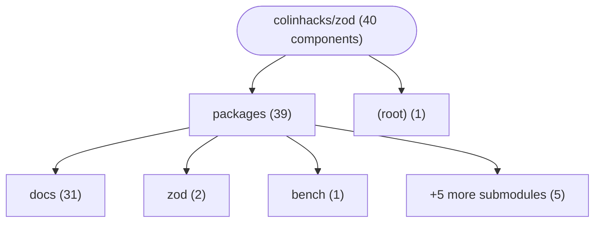
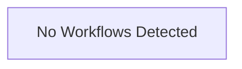

# Repository Architecture Analysis: colinhacks/zod

## Metadata
- **SHA**: `19c40d2072288b4cafec851e9d056a72a88e5973`
- **Primary Ecosystem**: JavaScript/TypeScript

## Quality Metrics
- **avg_cyclomatic_complexity**: 6.39
- **component_count**: 40
- **files_analyzed**: 1023
- **framework**: Next.js
- **loc**: 205660
- **max_cyclomatic_complexity**: 518
- **sloc**: 167029

# Architecture: colinhacks/zod

## Context
- **Repository**: `colinhacks/zod`
- **SHA**: `19c40d2072288b4cafec851e9d056a72a88e5973`
- **Ecosystem**: JavaScript/TypeScript
- **Framework**: Unknown

## Building Block View

## Component Details
- **2f2f7d18-f703-4841-812f-f48d464702b7** (`package.json`): MODULE
- **@zod/benchmarks** (`packages/bench/package.json`): MODULE
- **@zod/docs** (`packages/docs/package.json`): MODULE
- **@zod/integration** (`packages/integration/package.json`): MODULE
- **@zod/mini** (`packages/mini/package.json`): MODULE
- **@zod/resolution** (`packages/resolution/package.json`): MODULE
- **@zod/treeshaking** (`packages/treeshake/package.json`): MODULE
- **@zod/tsc-perftest** (`packages/tsc/package.json`): MODULE
- **zod** (`packages/zod/package.json`): MODULE
- **Layout** (`packages/docs/app/(doc)/layout.tsx`): UI_COMPONENT
- **NotFound** (`packages/docs/app/(doc)/not-found.tsx`): UI_COMPONENT
- **API_search_route** (`packages/docs/app/api/search/route.ts`): API_ROUTE
- **BlogLayout** (`packages/docs/app/blog/layout.tsx`): UI_COMPONENT
- **BlogIndexPage** (`packages/docs/app/blog/page.tsx`): UI_COMPONENT
- **Layout** (`packages/docs/app/layout.tsx`): UI_COMPONENT
- **NotFound** (`packages/docs/app/not-found.tsx`): UI_COMPONENT
- **Accordion** (`packages/docs/components/accordion.tsx`): UI_COMPONENT
- **BlogPill** (`packages/docs/components/blog-feed.tsx`): UI_COMPONENT
- **BlogToc** (`packages/docs/components/blog-toc.tsx`): UI_COMPONENT
- **Bronze** (`packages/docs/components/bronze.tsx`): UI_COMPONENT
- **ThemedImage** (`packages/docs/components/codec-image.tsx`): UI_COMPONENT
- **CopyMarkdownButton** (`packages/docs/components/copy-markdown-button.tsx`): UI_COMPONENT
- **Table** (`packages/docs/components/ecosystem.tsx`): UI_COMPONENT
- **Featured** (`packages/docs/components/featured.tsx`): UI_COMPONENT
- **Gold** (`packages/docs/components/gold.tsx`): UI_COMPONENT
- **Heading** (`packages/docs/components/heading.tsx`): UI_COMPONENT
- **HeroLogo** (`packages/docs/components/hero-logo.tsx`): UI_COMPONENT
- **If** (`packages/docs/components/if.tsx`): UI_COMPONENT
- **InkeepBubble** (`packages/docs/components/inkeep-bubble.tsx`): UI_COMPONENT
- **InkeepSearchBox** (`packages/docs/components/inkeep-search.tsx`): UI_COMPONENT
- **InlineCodeTitle** (`packages/docs/components/inline-code-title.tsx`): UI_COMPONENT
- **Platinum** (`packages/docs/components/platinum.tsx`): UI_COMPONENT
- **Scroller** (`packages/docs/components/scroller.tsx`): UI_COMPONENT
- **SidebarItem** (`packages/docs/components/sidebar-item.tsx`): UI_COMPONENT
- **SidebarSeparator** (`packages/docs/components/sidebar-item.tsx`): UI_COMPONENT
- **SidebarLogo** (`packages/docs/components/sidebar-logo.tsx`): UI_COMPONENT
- **Silver** (`packages/docs/components/silver.tsx`): UI_COMPONENT
- **ThemedImage** (`packages/docs/components/themed-image.tsx`): UI_COMPONENT
- **API_api__og** (`packages/docs/pages/api/_og.tsx`): API_ROUTE
- **StringSchema** (`packages/zod/src/v4/classic/tests/from-json-schema.test.ts`): DATA_ACCESS_LAYER

## CI/CD Pipeline Topology

