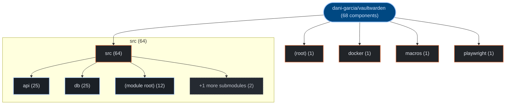
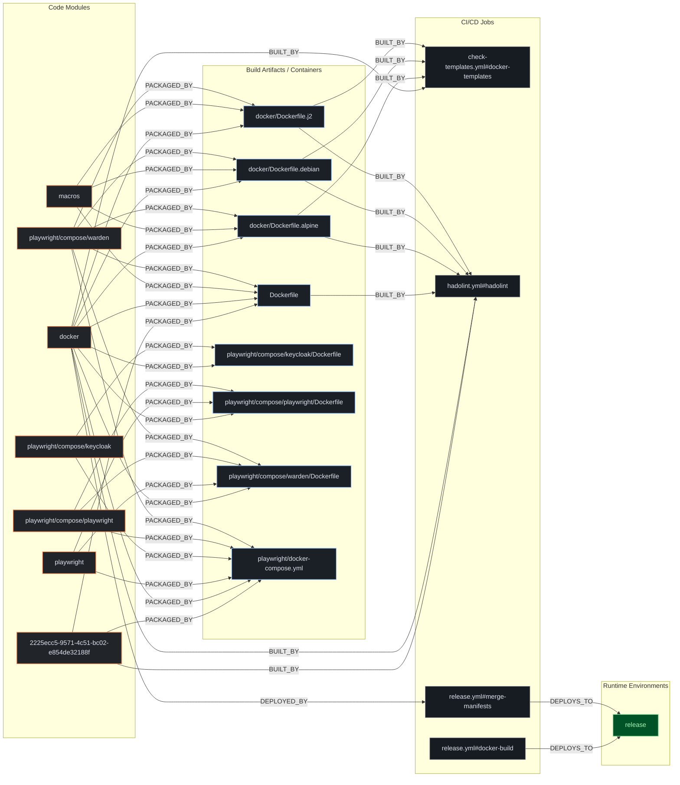

# Repository Architecture Analysis: dani-garcia/vaultwarden

## Metadata
- **SHA**: `dbd7829ed140ae3458abc97dedec9a4421ddff42`
- **Primary Ecosystem**: Rust

## Quality Metrics
- **ast_engine**: tree-sitter
- **avg_cognitive_complexity**: 1.2
- **avg_cyclomatic_complexity**: 1.98
- **component_count**: 68
- **dead_code_count**: 0
- **dead_code_symbols**: 0 entry(ies)
- **duplication_pct**: 4.58
- **file_complexities**: 25 entry(ies)
- **files_analyzed**: 93
- **fitness_passed**: True
- **fitness_violation_count**: 0
- **framework**: Axum / Actix / Rocket
- **import_edges**: 100 entry(ies)
- **loc**: 42870
- **max_cognitive_complexity**: 11
- **max_cyclomatic_complexity**: 10
- **sloc**: 33466
- **test_file_count**: 26

# Architecture: dani-garcia/vaultwarden

## Context
- **Repository**: `dani-garcia/vaultwarden`
- **SHA**: `dbd7829ed140ae3458abc97dedec9a4421ddff42`
- **Ecosystem**: Rust
- **Framework**: Axum / Actix / Rocket

## Building Block View

## Component Details

Showing top 60 representative components out of 68 across 5 module group(s):

- **Module `src`** (64 components — module: 64)
- **Module `(root)`** (1 components — module: 1)
- **Module `docker`** (1 components — module: 1)
- **Module `macros`** (1 components — module: 1)
- **Module `playwright`** (1 components — MODULE: 1)

- **DockerSettings** (`docker/DockerSettings.yaml`): module
- **accounts** (`src/api/core/accounts.rs`): module
- **admin** (`src/api/admin.rs`): module
- **archive** (`src/db/models/archive.rs`): module
- **attachment** (`src/db/models/attachment.rs`): module
- **auth** (`src/auth.rs`): module
- **auth_request** (`src/db/models/auth_request.rs`): module
- **authenticator** (`src/api/core/two_factor/authenticator.rs`): module
- **build** (`build.rs`): module
- **cipher** (`src/db/models/cipher.rs`): module
- **ciphers** (`src/api/core/ciphers.rs`): module
- **collection** (`src/db/models/collection.rs`): module
- **config** (`src/config.rs`): module
- **crypto** (`src/crypto.rs`): module
- **device** (`src/db/models/device.rs`): module
- **duo** (`src/api/core/two_factor/duo.rs`): module
- **duo_oidc** (`src/api/core/two_factor/duo_oidc.rs`): module
- **email** (`src/api/core/two_factor/email.rs`): module
- **emergency_access** (`src/api/core/emergency_access.rs`): module
- **emergency_access** (`src/db/models/emergency_access.rs`): module
- **error** (`src/error.rs`): module
- **event** (`src/db/models/event.rs`): module
- **events** (`src/api/core/events.rs`): module
- **favorite** (`src/db/models/favorite.rs`): module
- **folder** (`src/db/models/folder.rs`): module
- **folders** (`src/api/core/folders.rs`): module
- **group** (`src/db/models/group.rs`): module
- **http_client** (`src/http_client.rs`): module
- **icons** (`src/api/icons.rs`): module
- **identity** (`src/api/identity.rs`): module
- **lib** (`macros/src/lib.rs`): module
- **mail** (`src/mail.rs`): module
- **main** (`src/main.rs`): module
- **mod** (`src/api/core/mod.rs`): module
- **mod** (`src/api/core/two_factor/mod.rs`): module
- **mod** (`src/api/mod.rs`): module
- **mod** (`src/db/mod.rs`): module
- **mod** (`src/db/models/mod.rs`): module
- **notifications** (`src/api/notifications.rs`): module
- **org_policy** (`src/db/models/org_policy.rs`): module
- **organization** (`src/db/models/organization.rs`): module
- **organizations** (`src/api/core/organizations.rs`): module
- **protected_actions** (`src/api/core/two_factor/protected_actions.rs`): module
- **public** (`src/api/core/public.rs`): module
- **push** (`src/api/push.rs`): module
- **query_logger** (`src/db/query_logger.rs`): module
- **ratelimit** (`src/ratelimit.rs`): module
- **scenarios** (`playwright/package.json`): MODULE
- **schema** (`src/db/schema.rs`): module
- **send** (`src/auth/send.rs`): module
- **send** (`src/db/models/send.rs`): module
- **send_controls** (`src/db/models/org_policy/send_controls.rs`): module
- **sends** (`src/api/core/sends.rs`): module
- **sso** (`src/sso.rs`): module
- **sso_auth** (`src/db/models/sso_auth.rs`): module
- **sso_client** (`src/sso_client.rs`): module
- **storage** (`src/storage.rs`): module
- **test_seeder** (`src/api/test_seeder.rs`): module
- **two_factor** (`src/auth/two_factor.rs`): module
- **two_factor** (`src/db/models/two_factor.rs`): module

## 6-Dimension Repository Scorecard

- **Overall Grade**: `D` (65.35/100)
- **Technical Debt Score**: 34.65
- **Estimated Remediation Effort**: 60.08h

| Dimension | Grade | Score | Weight | Details |
| :--- | :---: | :---: | :---: | :--- |
| Code Quality | `A` | 93.13 | 0.20 | avg_cc=1.98, max_cc=10, duplication=4.58%, dead_code=0 |
| Dependency Health | `A` | 99.52 | 0.15 | dependencies=929, outdated=0, vulnerable=9, has_lockfile=True |
| Maintainability | `A` | 100.00 | 0.15 | avg_cognitive=1.20, max_cognitive=11, fitness_violations=0, oversized_files=0 |
| Pipeline Health | `F` | 42.00 | 0.15 | workflows=9, operational_antipatterns=5, parallel_branches=False |
| Security | `F` | 0.00 | 0.20 | vulnerabilities=14, secrets=2, pipeline_security_findings=13 |
| Test Coverage | `C` | 70.00 | 0.15 | coverage=unavailable, ci_test_job=True, test_files_detected=True |

## Architecture Fitness & Workspace Boundaries

### Workspace Packages
- **macros** (`macros`, rust, cargo)

## Supply Chain Dependencies, Vulnerabilities & Secrets

- **Dependencies Parsed**: 929 | **Vulnerabilities**: 14 | **Secrets**: 2

### Known Vulnerabilities (OSV)
- **[MEDIUM] `GHSA-g5x8-v2ch-gj2g`** `vaultwarden` `1.0.0` (fixed: `none`, REACHABLE_FROM_CI)
- **[MEDIUM] `GHSA-h4hq-rgvh-wh27`** `vaultwarden` `1.0.0` (fixed: `none`, REACHABLE_FROM_CI)
- **[MEDIUM] `GHSA-r32r-j5jq-3w4m`** `vaultwarden` `1.0.0` (fixed: `none`, REACHABLE_FROM_CI)
- **[MEDIUM] `GHSA-v6pg-v89r-w8wr`** `vaultwarden` `1.0.0` (fixed: `none`, REACHABLE_FROM_CI)
- **[MEDIUM] `GHSA-vprm-27pv-jp3w`** `vaultwarden` `1.0.0` (fixed: `none`, REACHABLE_FROM_CI)
- **[MEDIUM] `GHSA-w9f8-m526-h7fh`** `vaultwarden` `1.0.0` (fixed: `none`, REACHABLE_FROM_CI)
- **[MEDIUM] `GHSA-x7m9-mv49-fv73`** `vaultwarden` `1.0.0` (fixed: `none`, REACHABLE_FROM_CI)
- **[MEDIUM] `RUSTSEC-2023-0071`** `rsa` `0.9.10` (fixed: `none`, UNREACHABLE_DORMANT)
- **[MEDIUM] `RUSTSEC-2025-0052`** `async-std` `1.13.2` (fixed: `none`, UNREACHABLE_DORMANT)
- **[MEDIUM] `RUSTSEC-2026-0441`** `pin-utils` `0.1.1` (fixed: `none`, UNREACHABLE_DORMANT)
- **[MEDIUM] `RUSTSEC-2026-0543`** `chrono` `0.4.45` (fixed: `none`, UNREACHABLE_DORMANT)
- **[MEDIUM] `RUSTSEC-2026-0543`** `chrono` `0.4.45` (fixed: `none`, UNREACHABLE_DORMANT)
- **[MEDIUM] `RUSTSEC-2026-0555`** `chrono-tz` `0.10.4` (fixed: `none`, UNREACHABLE_DORMANT)
- **[MEDIUM] `RUSTSEC-2026-0555`** `chrono-tz` `0.10.4` (fixed: `none`, UNREACHABLE_DORMANT)

### Secret Findings (Redacted)
- **[HIGH] `ATRUSS-SEC-005`** at `.env.template:460` (`# ADMIN_TOKEN='$arg***REDACTED***'`)
- **[HIGH] `ATRUSS-SEC-005`** at `src/static/scripts/datatables.js:11338` (`const _publicKey = 'BE1A***REDACTED***';`)

### Inventory Sample
- `argon2` `0.6.0` (cargo, `Cargo.toml`)
- `aws-config` `1.13.3` (cargo, `Cargo.toml`)
- `aws-credential-types` `1.3.1` (cargo, `Cargo.toml`)
- `aws-smithy-runtime-api` `1.22.0` (cargo, `Cargo.toml`)
- `bigdecimal` `0.4.11` (cargo, `Cargo.toml`)
- `bytes` `1.12.2` (cargo, `Cargo.toml`)
- `chrono` `0.4.45` (cargo, `Cargo.toml`)
- `chrono-tz` `0.10.4` (cargo, `Cargo.toml`)
- `cookie` `0.18.3` (cargo, `Cargo.toml`)
- `cookie_store` `0.22.1` (cargo, `Cargo.toml`)
- `dashmap` `6.2.1` (cargo, `Cargo.toml`)
- `data-encoding` `2.11.1` (cargo, `Cargo.toml`)
- `data-url` `0.3.2` (cargo, `Cargo.toml`)
- `derive_more` `2.1.1` (cargo, `Cargo.toml`)
- `diesel` `2.4.0` (cargo, `Cargo.toml`)
- `diesel-derive-newtype` `2.1.3` (cargo, `Cargo.toml`)
- `diesel_migrations` `2.4.0` (cargo, `Cargo.toml`)
- `dotenvy` `0.15.7` (cargo, `Cargo.toml`)
- `email_address` `0.2.10` (cargo, `Cargo.toml`)
- `fern` `0.7.1` (cargo, `Cargo.toml`)
- `futures` `0.3.34` (cargo, `Cargo.toml`)
- `governor` `0.10.4` (cargo, `Cargo.toml`)
- `grass_compiler` `0.13.4` (cargo, `Cargo.toml`)
- `handlebars` `6.4.4` (cargo, `Cargo.toml`)
- `hickory-resolver` `0.26.3` (cargo, `Cargo.toml`)
- `html5gum` `0.9.2` (cargo, `Cargo.toml`)
- `ipnet` `2.12.2` (cargo, `Cargo.toml`)
- `job_scheduler_ng` `2.5.0` (cargo, `Cargo.toml`)
- `jsonwebtoken` `12.0.0` (cargo, `Cargo.toml`)
- `lettre` `0.11.24` (cargo, `Cargo.toml`)
- ... (+899 more dependencies)

## Section 7: Code-to-Cloud Deployment Traceability

- `release.yml#docker-build` (ci_job) --[DEPLOYS_TO]--> `release` (environment)
- `release.yml#merge-manifests` (ci_job) --[DEPLOYS_TO]--> `release` (environment)
- `2225ecc5-9571-4c51-bc02-e854de32188f` (code_module) --[BUILT_BY]--> `hadolint.yml#hadolint` (ci_job)
- `2225ecc5-9571-4c51-bc02-e854de32188f` (code_module) --[PACKAGED_BY]--> `Dockerfile` (container)
- `2225ecc5-9571-4c51-bc02-e854de32188f` (code_module) --[PACKAGED_BY]--> `playwright/docker-compose.yml` (container)
- `docker` (code_module) --[BUILT_BY]--> `check-templates.yml#docker-templates` (ci_job)
- `docker` (code_module) --[BUILT_BY]--> `hadolint.yml#hadolint` (ci_job)
- `docker` (code_module) --[DEPLOYED_BY]--> `release.yml#merge-manifests` (ci_job)
- `docker` (code_module) --[PACKAGED_BY]--> `Dockerfile` (container)
- `docker` (code_module) --[PACKAGED_BY]--> `docker/Dockerfile.alpine` (container)
- `docker` (code_module) --[PACKAGED_BY]--> `docker/Dockerfile.debian` (container)
- `docker` (code_module) --[PACKAGED_BY]--> `docker/Dockerfile.j2` (container)
- `docker` (code_module) --[PACKAGED_BY]--> `playwright/compose/keycloak/Dockerfile` (container)
- `docker` (code_module) --[PACKAGED_BY]--> `playwright/compose/playwright/Dockerfile` (container)
- `docker` (code_module) --[PACKAGED_BY]--> `playwright/compose/warden/Dockerfile` (container)
- `docker` (code_module) --[PACKAGED_BY]--> `playwright/docker-compose.yml` (container)
- `macros` (code_module) --[PACKAGED_BY]--> `Dockerfile` (container)
- `macros` (code_module) --[PACKAGED_BY]--> `docker/Dockerfile.alpine` (container)
- `macros` (code_module) --[PACKAGED_BY]--> `docker/Dockerfile.debian` (container)
- `macros` (code_module) --[PACKAGED_BY]--> `docker/Dockerfile.j2` (container)
- `playwright` (code_module) --[PACKAGED_BY]--> `playwright/compose/playwright/Dockerfile` (container)
- `playwright` (code_module) --[PACKAGED_BY]--> `playwright/compose/warden/Dockerfile` (container)
- `playwright` (code_module) --[PACKAGED_BY]--> `playwright/docker-compose.yml` (container)
- `playwright/compose/keycloak` (code_module) --[PACKAGED_BY]--> `playwright/compose/keycloak/Dockerfile` (container)
- `playwright/compose/keycloak` (code_module) --[PACKAGED_BY]--> `playwright/docker-compose.yml` (container)
- `playwright/compose/playwright` (code_module) --[PACKAGED_BY]--> `playwright/compose/playwright/Dockerfile` (container)
- `playwright/compose/playwright` (code_module) --[PACKAGED_BY]--> `playwright/compose/warden/Dockerfile` (container)
- `playwright/compose/playwright` (code_module) --[PACKAGED_BY]--> `playwright/docker-compose.yml` (container)
- `playwright/compose/warden` (code_module) --[PACKAGED_BY]--> `Dockerfile` (container)
- `playwright/compose/warden` (code_module) --[PACKAGED_BY]--> `docker/Dockerfile.alpine` (container)
- `playwright/compose/warden` (code_module) --[PACKAGED_BY]--> `docker/Dockerfile.debian` (container)
- `playwright/compose/warden` (code_module) --[PACKAGED_BY]--> `docker/Dockerfile.j2` (container)
- `playwright/compose/warden` (code_module) --[PACKAGED_BY]--> `playwright/compose/warden/Dockerfile` (container)
- `playwright/compose/warden` (code_module) --[PACKAGED_BY]--> `playwright/docker-compose.yml` (container)
- `Dockerfile` (container) --[BUILT_BY]--> `hadolint.yml#hadolint` (ci_job)
- `docker/Dockerfile.alpine` (container) --[BUILT_BY]--> `check-templates.yml#docker-templates` (ci_job)
- `docker/Dockerfile.alpine` (container) --[BUILT_BY]--> `hadolint.yml#hadolint` (ci_job)
- `docker/Dockerfile.debian` (container) --[BUILT_BY]--> `check-templates.yml#docker-templates` (ci_job)
- `docker/Dockerfile.debian` (container) --[BUILT_BY]--> `hadolint.yml#hadolint` (ci_job)
- `docker/Dockerfile.j2` (container) --[BUILT_BY]--> `check-templates.yml#docker-templates` (ci_job)

## CI/CD Pipeline Topology

```mermaid
graph TD;
  %% title: CI/CD Pipeline Topology — dani-garcia/vaultwarden
  classDef atlasRoot fill:#004882,stroke:#a3c9ff,stroke-width:2px,color:#d3e4ff
  classDef atlasCategory fill:#212428,stroke:#E87A48,stroke-width:1.5px,color:#dfe3eb
  classDef atlasWorkflow fill:#1b2026,stroke:#a3c9ff,stroke-width:1.5px,color:#dfe3eb
  classDef atlasJob fill:#171c22,stroke:#8d9199,stroke-width:1px,color:#dfe3eb
  classDef atlasTarget fill:#005227,stroke:#8bd99b,stroke-width:1.5px,color:#a7f6b6
  classDef atlasAlert fill:#93000a,stroke:#ffb4ab,stroke-width:1.5px,color:#ffdad6
  classDef atlasMore fill:#252a31,stroke:#8d9199,stroke-dasharray:4 4,color:#c3c6cf
  pipeline_root(["dani-garcia/vaultwarden (9 workflows)"]):::atlasRoot
  subgraph sg_grp_0_CI___Verification["CI & Verification (4 workflows · 4 jobs)"]
    direction TB
    subgraph sg_wf_0_Build["Build (1 jobs)"]
      direction TB
      wf_0_Build(["Trigger: Build"]):::atlasWorkflow
      job_0_build["build"]:::atlasJob
      wf_0_Build --> job_0_build
    end
    pipeline_root --> wf_0_Build
    subgraph sg_wf_1_Check_templates["Check templates (1 jobs)"]
      direction TB
      wf_1_Check_templates(["Trigger: Check templates"]):::atlasWorkflow
      job_1_docker_templates["docker-templates"]:::atlasJob
      wf_1_Check_templates --> job_1_docker_templates
    end
    pipeline_root --> wf_1_Check_templates
    subgraph sg_wf_2_Hadolint["Hadolint (1 jobs)"]
      direction TB
      wf_2_Hadolint(["Trigger: Hadolint"]):::atlasWorkflow
      job_2_hadolint["hadolint"]:::atlasJob
      wf_2_Hadolint --> job_2_hadolint
    end
    pipeline_root --> wf_2_Hadolint
    subgraph sg_wf_7_Code_Spell_Checking["Code Spell Checking (1 jobs)"]
      direction TB
      wf_7_Code_Spell_Checking(["Trigger: Code Spell Checking"]):::atlasWorkflow
      job_7_typos["typos"]:::atlasJob
      wf_7_Code_Spell_Checking --> job_7_typos
    end
    pipeline_root --> wf_7_Code_Spell_Checking
  end
  subgraph sg_grp_1_Scheduled___Manual["Scheduled & Manual (3 workflows · 3 jobs)"]
    direction TB
    subgraph sg_wf_4_Cleanup["Cleanup (1 jobs)"]
      direction TB
      wf_4_Cleanup(["Trigger: Cleanup"]):::atlasWorkflow
      job_4_releasecache_cleanup["releasecache-cleanup"]:::atlasJob
      wf_4_Cleanup --> job_4_releasecache_cleanup
    end
    pipeline_root --> wf_4_Cleanup
    subgraph sg_wf_5_SDK_live_tests["SDK live tests (1 jobs)"]
      direction TB
      wf_5_SDK_live_tests(["Trigger: SDK live tests"]):::atlasWorkflow
      job_5_sdk_live_tests["sdk-live-tests"]:::atlasJob
      wf_5_SDK_live_tests --> job_5_sdk_live_tests
    end
    pipeline_root --> wf_5_SDK_live_tests
    subgraph sg_wf_6_Trivy["Trivy (1 jobs)"]
      direction TB
      wf_6_Trivy(["Trigger: Trivy"]):::atlasWorkflow
      job_6_trivy_scan["trivy-scan"]:::atlasJob
      wf_6_Trivy --> job_6_trivy_scan
    end
    pipeline_root --> wf_6_Trivy
  end
  subgraph sg_grp_2_Release___Deploy["Release & Deploy (1 workflows · 2 jobs)"]
    direction TB
    subgraph sg_wf_3_Release["Release (2 jobs)"]
      direction TB
      wf_3_Release(["Trigger: Release"]):::atlasWorkflow
      job_3_docker_build["docker-build"]:::atlasJob
      job_3_merge_manifests["merge-manifests"]:::atlasJob
      wf_3_Release --> job_3_docker_build
      job_3_docker_build --> job_3_merge_manifests
    end
    pipeline_root --> wf_3_Release
  end
  subgraph sg_grp_3_Security___Governance["Security & Governance (1 workflows · 1 jobs)"]
    direction TB
    subgraph sg_wf_8_Security_Analysis_with_zizmor["Security Analysis with zizmor (1 jobs)"]
      direction TB
      wf_8_Security_Analysis_with_zizmor(["Trigger: Security Analysis with zizmor"]):::atlasWorkflow
      job_8_zizmor["zizmor"]:::atlasJob
      wf_8_Security_Analysis_with_zizmor --> job_8_zizmor
    end
    pipeline_root --> wf_8_Security_Analysis_with_zizmor
  end
```

