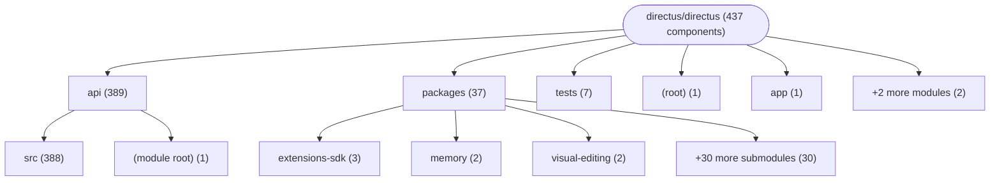
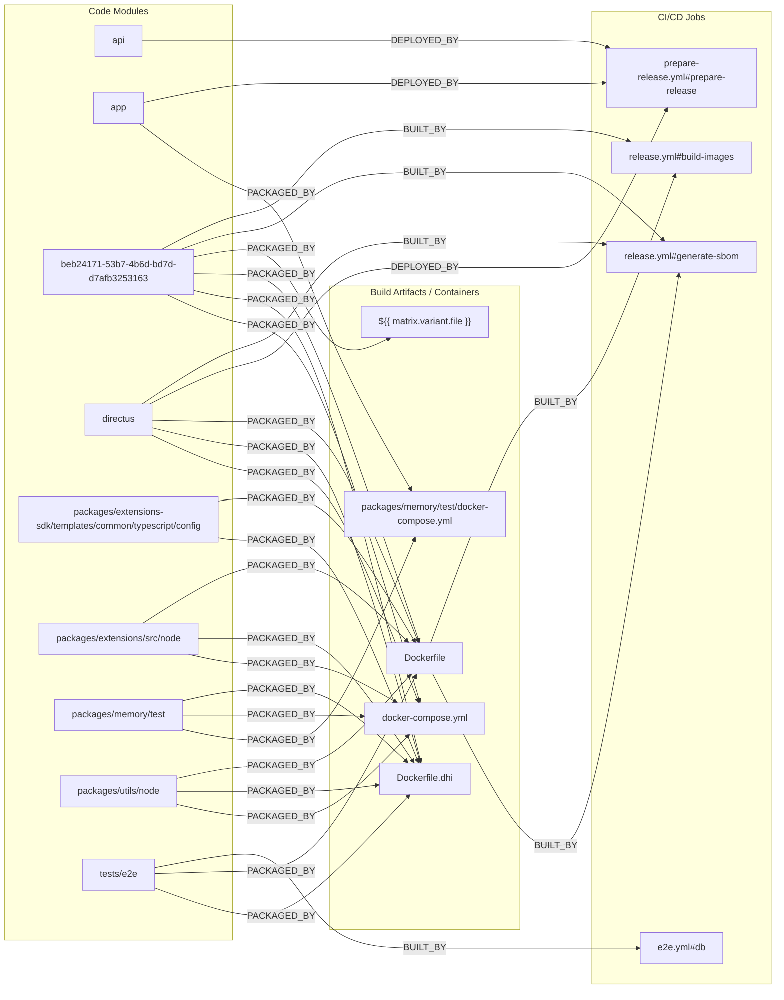
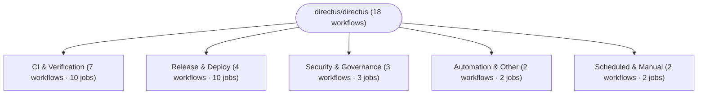

# Repository Architecture Analysis: directus/directus

## Metadata
- **SHA**: `ed30e578b2c29b5b64159ef54e0a4739628144fd`
- **Primary Ecosystem**: JavaScript/TypeScript

## Quality Metrics
- **ast_engine**: tree-sitter
- **avg_cognitive_complexity**: 5.26
- **avg_cyclomatic_complexity**: 4.28
- **component_count**: 437
- **dead_code_count**: 65
- **dead_code_symbols**: 50 entry(ies)
- **duplication_pct**: 87.72
- **file_complexities**: 25 entry(ies)
- **files_analyzed**: 3435
- **fitness_passed**: False
- **fitness_violation_count**: 3
- **framework**: React (Vite)
- **import_edges**: 100 entry(ies)
- **loc**: 416820
- **max_cognitive_complexity**: 348
- **max_cyclomatic_complexity**: 81
- **sloc**: 329890
- **test_file_count**: 1348

# Architecture: directus/directus

## Context
- **Repository**: `directus/directus`
- **SHA**: `ed30e578b2c29b5b64159ef54e0a4739628144fd`
- **Ecosystem**: JavaScript/TypeScript
- **Framework**: React (Vite)

## Building Block View

## Component Details

Showing top 60 representative components out of 437 across 7 module group(s):

- **Module `api`** (389 components — API_ROUTE: 342, SERVICE: 46, MODULE: 1)
- **Module `packages`** (37 components — MODULE: 33, API_ROUTE: 2, SERVICE: 1)
- **Module `tests`** (7 components — MODULE: 5, API_ROUTE: 2)
- **Module `(root)`** (1 components — MODULE: 1)
- **Module `app`** (1 components — MODULE: 1)
- **Module `directus`** (1 components — MODULE: 1)
- **Module `sdk`** (1 components — MODULE: 1)

- **@directus/ai** (`packages/ai/package.json`): MODULE
- **@directus/api** (`api/package.json`): MODULE
- **@directus/app** (`app/package.json`): MODULE
- **@directus/cli** (`packages/cli/package.json`): MODULE
- **@directus/composables** (`packages/composables/package.json`): MODULE
- **@directus/constants** (`packages/constants/package.json`): MODULE
- **@directus/env** (`packages/env/package.json`): MODULE
- **@directus/errors** (`packages/errors/package.json`): MODULE
- **@directus/extensions** (`packages/extensions/package.json`): MODULE
- **@directus/extensions-registry** (`packages/extensions-registry/package.json`): MODULE
- **@directus/extensions-sdk** (`packages/extensions-sdk/package.json`): MODULE
- **@directus/format-title** (`packages/format-title/package.json`): MODULE
- **@directus/memory** (`packages/memory/package.json`): MODULE
- **@directus/pressure** (`packages/pressure/package.json`): MODULE
- **@directus/release-notes-generator** (`packages/release-notes-generator/package.json`): MODULE
- **@directus/sandbox** (`tests/sandbox/package.json`): MODULE
- **@directus/schema** (`packages/schema/package.json`): MODULE
- **@directus/schema-builder** (`packages/schema-builder/package.json`): MODULE
- **@directus/sdk** (`sdk/package.json`): MODULE
- **@directus/specs** (`packages/specs/package.json`): MODULE
- **@directus/storage** (`packages/storage/package.json`): MODULE
- **@directus/storage-driver-azure** (`packages/storage-driver-azure/package.json`): MODULE
- **@directus/storage-driver-cloudinary** (`packages/storage-driver-cloudinary/package.json`): MODULE
- **@directus/storage-driver-gcs** (`packages/storage-driver-gcs/package.json`): MODULE
- **@directus/storage-driver-local** (`packages/storage-driver-local/package.json`): MODULE
- **@directus/storage-driver-s3** (`packages/storage-driver-s3/package.json`): MODULE
- **@directus/storage-driver-supabase** (`packages/storage-driver-supabase/package.json`): MODULE
- **@directus/stores** (`packages/stores/package.json`): MODULE
- **@directus/system-data** (`packages/system-data/package.json`): MODULE
- **@directus/themes** (`packages/themes/package.json`): MODULE
- **@directus/types** (`packages/types/package.json`): MODULE
- **@directus/update-check** (`packages/update-check/package.json`): MODULE
- **@directus/utils** (`packages/utils/package.json`): MODULE
- **@directus/validation** (`packages/validation/package.json`): MODULE
- **@directus/visual-editing** (`packages/visual-editing/package.json`): MODULE
- **API_adapters_index** (`api/src/ai/files/adapters/index.ts`): API_ROUTE
- **API_ai-image_index** (`api/src/operations/ai-image/index.ts`): API_ROUTE
- **API_ai-text_index** (`api/src/operations/ai-text/index.ts`): API_ROUTE
- **API_apply-query_index** (`api/src/database/run-ast/lib/apply-query/index.ts`): API_ROUTE
- **API_assets_index** (`api/src/ai/tools/assets/index.ts`): API_ROUTE
- **API_bootstrap_index** (`api/src/cli/commands/bootstrap/index.ts`): API_ROUTE
- **API_bus_index** (`api/src/bus/index.ts`): API_ROUTE
- **API_capabilities_index** (`api/src/database/helpers/capabilities/index.ts`): API_ROUTE
- **API_cli_index** (`api/src/cli/index.ts`): API_ROUTE
- **API_collections_index** (`api/src/ai/tools/collections/index.ts`): API_ROUTE
- **API_condition_index** (`api/src/operations/condition/index.ts`): API_ROUTE
- **API_controllers_index** (`api/src/websocket/controllers/index.ts`): API_ROUTE
- **API_count_index** (`api/src/cli/commands/count/index.ts`): API_ROUTE
- **API_create-env_index** (`api/src/cli/utils/create-env/index.ts`): API_ROUTE
- **API_database_index** (`api/src/database/index.ts`): API_ROUTE
- **API_date_index** (`api/src/database/helpers/date/index.ts`): API_ROUTE
- **API_deployment_index** (`api/src/deployment/index.ts`): API_ROUTE
- **API_devtools_index** (`api/src/ai/devtools/index.ts`): API_ROUTE
- **API_drivers_index** (`api/src/auth/drivers/index.ts`): API_ROUTE
- **API_drivers_index** (`api/src/deployment/drivers/index.ts`): API_ROUTE
- **API_errors_index** (`api/src/services/graphql/errors/index.ts`): API_ROUTE
- **API_exec_index** (`api/src/operations/exec/index.ts`): API_ROUTE
- **API_extensions_index** (`api/src/extensions/index.ts`): API_ROUTE
- **API_fields_index** (`api/src/ai/tools/fields/index.ts`): API_ROUTE
- **API_files_index** (`api/src/ai/tools/files/index.ts`): API_ROUTE

## 6-Dimension Repository Scorecard

- **Overall Grade**: `F` (35.61/100)
- **Technical Debt Score**: 64.39
- **Estimated Remediation Effort**: 146.89h

| Dimension | Grade | Score | Weight | Details |
| :--- | :---: | :---: | :---: | :--- |
| Code Quality | `F` | 24.88 | 0.20 | avg_cc=4.28, max_cc=81, duplication=87.72%, dead_code=65 |
| Dependency Health | `B` | 85.00 | 0.15 | dependencies=747, outdated=0, vulnerable=0, has_lockfile=False |
| Maintainability | `F` | 36.22 | 0.15 | avg_cognitive=5.26, max_cognitive=348, fitness_violations=3, oversized_files=17 |
| Pipeline Health | `F` | 13.00 | 0.15 | workflows=18, operational_antipatterns=25, parallel_branches=True |
| Security | `F` | 0.00 | 0.20 | vulnerabilities=0, secrets=0, pipeline_security_findings=36 |
| Test Coverage | `C` | 70.00 | 0.15 | coverage=unavailable, ci_test_job=True, test_files_detected=True |

## Architecture Fitness & Workspace Boundaries

- **[MEDIUM] `ATRUSS-ARCH-005` (COMPLEXITY_THRESHOLD)**: Repository duplication_pct (87.72) exceeds policy threshold (15.0).
- **[MEDIUM] `ATRUSS-ARCH-005` (COMPLEXITY_THRESHOLD)**: Repository max_cognitive_complexity (348.0) exceeds policy threshold (25.0).
- **[MEDIUM] `ATRUSS-ARCH-005` (COMPLEXITY_THRESHOLD)**: Repository max_cyclomatic_complexity (81.0) exceeds policy threshold (20.0).

### Workspace Packages
- **@directus/api** (`api`, react_ts_js, pnpm) -> internal deps: `@directus/ai, @directus/app, @directus/constants, @directus/env, @directus/errors, @directus/extensions, @directus/extensions-registry, @directus/format-title, @directus/memory, @directus/pressure, @directus/schema, @directus/schema-builder, @directus/specs, @directus/storage, @directus/storage-driver-azure, @directus/storage-driver-cloudinary, @directus/storage-driver-gcs, @directus/storage-driver-local, @directus/storage-driver-s3, @directus/storage-driver-supabase, @directus/system-data, @directus/types, @directus/utils, @directus/validation, directus`
- **@directus/app** (`app`, react_ts_js, pnpm) -> internal deps: `@directus/ai, @directus/composables, @directus/constants, @directus/errors, @directus/extensions, @directus/extensions-registry, @directus/extensions-sdk, @directus/format-title, @directus/sdk, @directus/stores, @directus/system-data, @directus/themes, @directus/types, @directus/utils, @directus/validation, @directus/visual-editing`
- **directus** (`directus`, react_ts_js, pnpm) -> internal deps: `@directus/api, @directus/update-check`
- **@directus/ai** (`packages/ai`, react_ts_js, pnpm)
- **@directus/cli** (`packages/cli`, react_ts_js, pnpm) -> internal deps: `@directus/sdk, @directus/system-data, @directus/types`
- **@directus/composables** (`packages/composables`, react_ts_js, pnpm) -> internal deps: `@directus/constants, @directus/sdk, @directus/types, @directus/utils`
- **@directus/constants** (`packages/constants`, react_ts_js, pnpm)
- **create-directus-extension** (`packages/create-directus-extension`, react_ts_js, pnpm) -> internal deps: `@directus/extensions, @directus/extensions-sdk`
- **create-directus-project** (`packages/create-directus-project`, react_ts_js, pnpm)
- **@directus/env** (`packages/env`, react_ts_js, pnpm) -> internal deps: `@directus/constants, @directus/utils`
- **@directus/errors** (`packages/errors`, react_ts_js, pnpm) -> internal deps: `@directus/types`
- **@directus/extensions** (`packages/extensions`, react_ts_js, pnpm) -> internal deps: `@directus/constants, @directus/types, @directus/utils`
- **@directus/extensions-registry** (`packages/extensions-registry`, react_ts_js, pnpm) -> internal deps: `@directus/constants, @directus/errors, @directus/types`
- **@directus/extensions-sdk** (`packages/extensions-sdk`, react_ts_js, pnpm) -> internal deps: `@directus/composables, @directus/constants, @directus/extensions, @directus/themes, @directus/types, @directus/utils`
- **@directus/format-title** (`packages/format-title`, react_ts_js, pnpm)
- **@directus/memory** (`packages/memory`, react_ts_js, pnpm) -> internal deps: `@directus/errors, @directus/utils`
- **@directus/pressure** (`packages/pressure`, react_ts_js, pnpm) -> internal deps: `@directus/utils`
- **@directus/release-notes-generator** (`packages/release-notes-generator`, react_ts_js, pnpm)
- **@directus/schema** (`packages/schema`, react_ts_js, pnpm)
- **@directus/schema-builder** (`packages/schema-builder`, react_ts_js, pnpm) -> internal deps: `@directus/types`
- **@directus/specs** (`packages/specs`, react_ts_js, pnpm)
- **@directus/storage** (`packages/storage`, react_ts_js, pnpm) -> internal deps: `@directus/types`
- **@directus/storage-driver-azure** (`packages/storage-driver-azure`, react_ts_js, pnpm) -> internal deps: `@directus/storage, @directus/types, @directus/utils`
- **@directus/storage-driver-cloudinary** (`packages/storage-driver-cloudinary`, react_ts_js, pnpm) -> internal deps: `@directus/storage, @directus/types, @directus/utils`
- **@directus/storage-driver-gcs** (`packages/storage-driver-gcs`, react_ts_js, pnpm) -> internal deps: `@directus/constants, @directus/storage, @directus/types, @directus/utils`
- **@directus/storage-driver-local** (`packages/storage-driver-local`, react_ts_js, pnpm) -> internal deps: `@directus/storage, @directus/types`
- **@directus/storage-driver-s3** (`packages/storage-driver-s3`, react_ts_js, pnpm) -> internal deps: `@directus/storage, @directus/types, @directus/utils`
- **@directus/storage-driver-supabase** (`packages/storage-driver-supabase`, react_ts_js, pnpm) -> internal deps: `@directus/constants, @directus/storage, @directus/types, @directus/utils`
- **@directus/stores** (`packages/stores`, react_ts_js, pnpm)
- **@directus/system-data** (`packages/system-data`, react_ts_js, pnpm)
- **@directus/themes** (`packages/themes`, react_ts_js, pnpm) -> internal deps: `@directus/types, @directus/utils`
- **@directus/types** (`packages/types`, react_ts_js, pnpm) -> internal deps: `@directus/ai, @directus/constants, @directus/schema`
- **@directus/update-check** (`packages/update-check`, react_ts_js, pnpm)
- **@directus/utils** (`packages/utils`, react_ts_js, pnpm) -> internal deps: `@directus/constants, @directus/errors, @directus/schema-builder, @directus/system-data, @directus/types`
- **@directus/validation** (`packages/validation`, react_ts_js, pnpm) -> internal deps: `@directus/errors, @directus/types, @directus/utils`
- **@directus/visual-editing** (`packages/visual-editing`, react_ts_js, pnpm) -> internal deps: `@directus/types, @directus/utils`
- **@directus/sdk** (`sdk`, react_ts_js, pnpm) -> internal deps: `@directus/system-data`
- **e2e** (`tests/e2e`, react_ts_js, pnpm) -> internal deps: `@directus/sandbox, @directus/schema-builder, @directus/sdk, @directus/system-data, @directus/types`
- **@directus/sandbox** (`tests/sandbox`, react_ts_js, pnpm) -> internal deps: `@directus/types, @directus/utils`

## Supply Chain Dependencies, Vulnerabilities & Secrets

- **Dependencies Parsed**: 747 | **Vulnerabilities**: 0 | **Secrets**: 0

### Inventory Sample
- `@ai-sdk/anthropic` `*` (npm, `api/package.json`)
- `@ai-sdk/devtools` `*` (npm, `api/package.json`)
- `@ai-sdk/google` `*` (npm, `api/package.json`)
- `@ai-sdk/openai` `*` (npm, `api/package.json`)
- `@ai-sdk/openai-compatible` `*` (npm, `api/package.json`)
- `@ai-sdk/vue` `*` (npm, `app/package.json`)
- `@authenio/samlify-node-xmllint` `*` (npm, `api/package.json`)
- `@aws-sdk/client-s3` `*` (npm, `packages/storage-driver-s3/package.json`)
- `@aws-sdk/client-sesv2` `*` (npm, `api/package.json`)
- `@aws-sdk/lib-storage` `*` (npm, `packages/storage-driver-s3/package.json`)
- `@azure/storage-blob` `*` (npm, `packages/storage-driver-azure/package.json`)
- `@braintrust/otel` `*` (npm, `api/package.json`)
- `@changesets/cli` `*` (npm, `package.json`)
- `@changesets/get-github-info` `*` (npm, `packages/release-notes-generator/package.json`)
- `@changesets/types` `*` (npm, `packages/release-notes-generator/package.json`)
- `@clack/prompts` `*` (npm, `packages/cli/package.json`)
- `@directus/ai` `*` (npm, `api/package.json`)
- `@directus/ai` `*` (npm, `app/package.json`)
- `@directus/ai` `*` (npm, `packages/types/package.json`)
- `@directus/api` `*` (npm, `directus/package.json`)
- `@directus/app` `*` (npm, `api/package.json`)
- `@directus/composables` `*` (npm, `app/package.json`)
- `@directus/composables` `*` (npm, `packages/extensions-sdk/package.json`)
- `@directus/constants` `*` (npm, `api/package.json`)
- `@directus/constants` `*` (npm, `app/package.json`)
- `@directus/constants` `*` (npm, `packages/composables/package.json`)
- `@directus/constants` `*` (npm, `packages/env/package.json`)
- `@directus/constants` `*` (npm, `packages/extensions-registry/package.json`)
- `@directus/constants` `*` (npm, `packages/extensions-sdk/package.json`)
- `@directus/constants` `*` (npm, `packages/extensions/package.json`)
- ... (+717 more dependencies)

## Section 7: Code-to-Cloud Deployment Traceability

- `api` (code_module) --[DEPLOYED_BY]--> `prepare-release.yml#prepare-release` (ci_job)
- `app` (code_module) --[DEPLOYED_BY]--> `prepare-release.yml#prepare-release` (ci_job)
- `app` (code_module) --[PACKAGED_BY]--> `packages/memory/test/docker-compose.yml` (container)
- `beb24171-53b7-4b6d-bd7d-d7afb3253163` (code_module) --[BUILT_BY]--> `release.yml#build-images` (ci_job)
- `beb24171-53b7-4b6d-bd7d-d7afb3253163` (code_module) --[BUILT_BY]--> `release.yml#generate-sbom` (ci_job)
- `beb24171-53b7-4b6d-bd7d-d7afb3253163` (code_module) --[PACKAGED_BY]--> `${{ matrix.variant.file }}` (container)
- `beb24171-53b7-4b6d-bd7d-d7afb3253163` (code_module) --[PACKAGED_BY]--> `Dockerfile` (container)
- `beb24171-53b7-4b6d-bd7d-d7afb3253163` (code_module) --[PACKAGED_BY]--> `Dockerfile.dhi` (container)
- `beb24171-53b7-4b6d-bd7d-d7afb3253163` (code_module) --[PACKAGED_BY]--> `docker-compose.yml` (container)
- `directus` (code_module) --[BUILT_BY]--> `release.yml#generate-sbom` (ci_job)
- `directus` (code_module) --[DEPLOYED_BY]--> `prepare-release.yml#prepare-release` (ci_job)
- `directus` (code_module) --[PACKAGED_BY]--> `Dockerfile` (container)
- `directus` (code_module) --[PACKAGED_BY]--> `Dockerfile.dhi` (container)
- `directus` (code_module) --[PACKAGED_BY]--> `docker-compose.yml` (container)
- `packages/extensions-sdk/templates/common/typescript/config` (code_module) --[PACKAGED_BY]--> `Dockerfile` (container)
- `packages/extensions-sdk/templates/common/typescript/config` (code_module) --[PACKAGED_BY]--> `Dockerfile.dhi` (container)
- `packages/extensions/src/node` (code_module) --[PACKAGED_BY]--> `Dockerfile` (container)
- `packages/extensions/src/node` (code_module) --[PACKAGED_BY]--> `Dockerfile.dhi` (container)
- `packages/extensions/src/node` (code_module) --[PACKAGED_BY]--> `docker-compose.yml` (container)
- `packages/memory/test` (code_module) --[PACKAGED_BY]--> `Dockerfile.dhi` (container)
- `packages/memory/test` (code_module) --[PACKAGED_BY]--> `docker-compose.yml` (container)
- `packages/memory/test` (code_module) --[PACKAGED_BY]--> `packages/memory/test/docker-compose.yml` (container)
- `packages/utils/node` (code_module) --[PACKAGED_BY]--> `Dockerfile` (container)
- `packages/utils/node` (code_module) --[PACKAGED_BY]--> `Dockerfile.dhi` (container)
- `packages/utils/node` (code_module) --[PACKAGED_BY]--> `docker-compose.yml` (container)
- `tests/e2e` (code_module) --[BUILT_BY]--> `e2e.yml#db` (ci_job)
- `tests/e2e` (code_module) --[PACKAGED_BY]--> `Dockerfile` (container)
- `tests/e2e` (code_module) --[PACKAGED_BY]--> `Dockerfile.dhi` (container)
- `Dockerfile` (container) --[BUILT_BY]--> `release.yml#build-images` (ci_job)
- `Dockerfile` (container) --[BUILT_BY]--> `release.yml#generate-sbom` (ci_job)

## CI/CD Pipeline Topology

