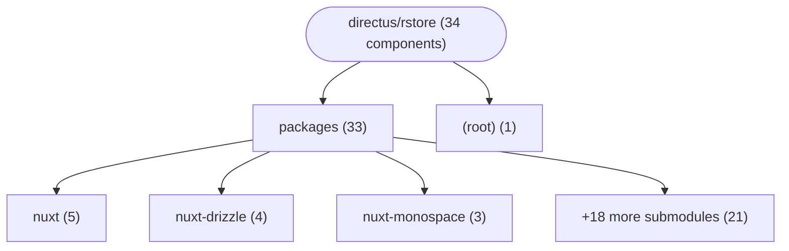
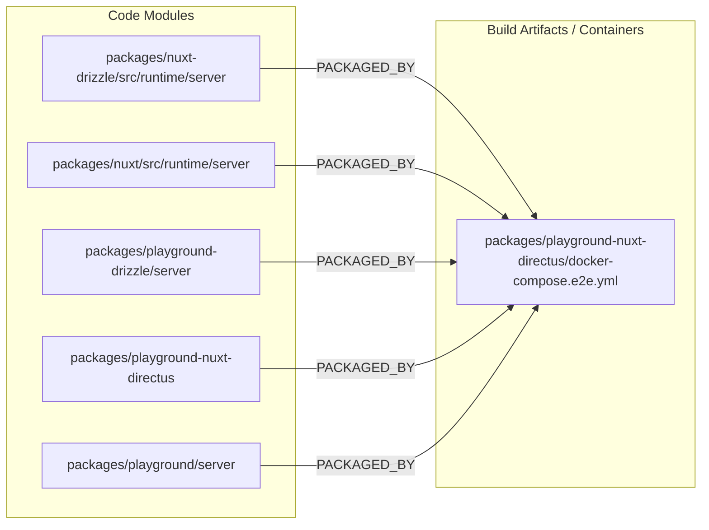
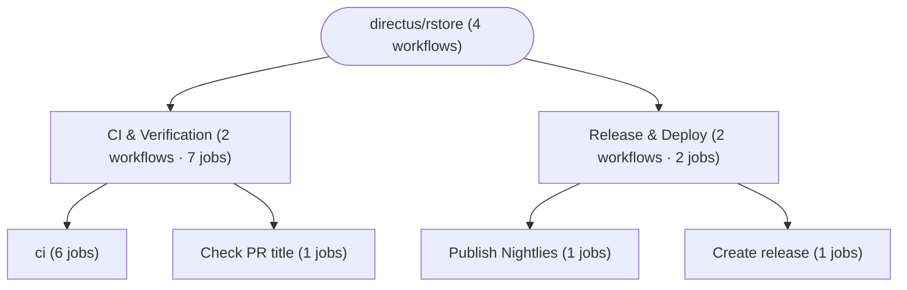

# Repository Architecture Analysis: directus/rstore

## Metadata
- **SHA**: `548e588cc99002633e07b48d45254ff4eb5949f4`
- **Primary Ecosystem**: JavaScript/TypeScript

## Quality Metrics
- **ast_engine**: tree-sitter
- **avg_cognitive_complexity**: 3.55
- **avg_cyclomatic_complexity**: 3.23
- **component_count**: 34
- **dead_code_count**: 10
- **dead_code_symbols**: 10 entry(ies)
- **duplication_pct**: 79.81
- **file_complexities**: 25 entry(ies)
- **files_analyzed**: 1023
- **fitness_passed**: False
- **fitness_violation_count**: 3
- **framework**: React (Vite)
- **import_edges**: 100 entry(ies)
- **loc**: 101476
- **max_cognitive_complexity**: 143
- **max_cyclomatic_complexity**: 46
- **sloc**: 78885
- **test_file_count**: 485

# Architecture: directus/rstore

## Context
- **Repository**: `directus/rstore`
- **SHA**: `548e588cc99002633e07b48d45254ff4eb5949f4`
- **Ecosystem**: JavaScript/TypeScript
- **Framework**: React (Vite)

## Building Block View

## Component Details
- **datastore-monorepo** (`package.json`): MODULE
- **@rstore/connector-toolkit** (`packages/connector-toolkit/package.json`): MODULE
- **@rstore/core** (`packages/core/package.json`): MODULE
- **@rstore/devtools** (`packages/devtools/package.json`): MODULE
- **@rstore/directus** (`packages/directus/package.json`): MODULE
- **@rstore/monospace** (`packages/monospace/package.json`): MODULE
- **@rstore/nuxt** (`packages/nuxt/package.json`): MODULE
- **basic** (`packages/nuxt/test/fixtures/basic/package.json`): MODULE
- **rstore-devtools-nuxt-fixture** (`packages/nuxt/test/fixtures/devtools/package.json`): MODULE
- **rstore-devtools-disabled-fixture** (`packages/nuxt/test/fixtures/devtools-disabled/package.json`): MODULE
- **rstore-devtools-exclusion-fixture** (`packages/nuxt/test/fixtures/devtools-exclusion/package.json`): MODULE
- **@rstore/nuxt-directus** (`packages/nuxt-directus/package.json`): MODULE
- **basic** (`packages/nuxt-directus/test/fixtures/basic/package.json`): MODULE
- **@rstore/nuxt-drizzle** (`packages/nuxt-drizzle/package.json`): MODULE
- **basic** (`packages/nuxt-drizzle/test/fixtures/basic/package.json`): MODULE
- **@rstore/nuxt-monospace** (`packages/nuxt-monospace/package.json`): MODULE
- **nuxt-monospace-playground** (`packages/nuxt-monospace/playground/package.json`): MODULE
- **basic** (`packages/nuxt-monospace/test/fixtures/basic/package.json`): MODULE
- **@rstore/nuxt-multiplayer** (`packages/nuxt-multiplayer/package.json`): MODULE
- **@rstore/nuxt-multiplayer-server** (`packages/nuxt-multiplayer-server/package.json`): MODULE
- **@rstore/offline** (`packages/offline/package.json`): MODULE
- **rstore-playground** (`packages/playground/package.json`): MODULE
- **rstore-drizzle-playground** (`packages/playground-drizzle/package.json`): MODULE
- **rstore-playground-drizzle-2** (`packages/playground-drizzle-2/package.json`): MODULE
- **rstore-nuxt-directus-playground** (`packages/playground-nuxt-directus/package.json`): MODULE
- **rstore-playground-ws-server** (`packages/playground-ws-server/package.json`): MODULE
- **@rstore/shared** (`packages/shared/package.json`): MODULE
- **@rstore/vite-directus** (`packages/vite-directus/package.json`): MODULE
- **@rstore/vite-monospace** (`packages/vite-monospace/package.json`): MODULE
- **@rstore/vue** (`packages/vue/package.json`): MODULE
- **GET_api_rstore_:collection** (`packages/nuxt-drizzle/test/search-query.test.ts`): API_ROUTE
- **GET_api_rstore_:collection_:key** (`packages/nuxt-drizzle/test/search-query.test.ts`): API_ROUTE
- **PeerIdentityStore** (`packages/nuxt-multiplayer-server/src/runtime/server/identity.ts`): SERVICE
- **API_api_index** (`packages/vue/src/api/index.ts`): API_ROUTE

## 6-Dimension Repository Scorecard

- **Overall Grade**: `F` (48.57/100)
- **Technical Debt Score**: 51.43
- **Estimated Remediation Effort**: 61.32h

| Dimension | Grade | Score | Weight | Details |
| :--- | :---: | :---: | :---: | :--- |
| Code Quality | `F` | 29.08 | 0.20 | avg_cc=3.23, max_cc=46, duplication=79.81%, dead_code=10 |
| Dependency Health | `A` | 100.00 | 0.15 | dependencies=1945, outdated=0, vulnerable=0, has_lockfile=True |
| Maintainability | `F` | 57.00 | 0.15 | avg_cognitive=3.55, max_cognitive=143, fitness_violations=3, oversized_files=0 |
| Pipeline Health | `F` | 58.00 | 0.15 | workflows=4, operational_antipatterns=10, parallel_branches=True |
| Security | `F` | 0.00 | 0.20 | vulnerabilities=0, secrets=0, pipeline_security_findings=13 |
| Test Coverage | `C` | 70.00 | 0.15 | coverage=unavailable, ci_test_job=True, test_files_detected=True |

## Architecture Fitness & Workspace Boundaries

- **[MEDIUM] `ATRUSS-ARCH-005` (COMPLEXITY_THRESHOLD)**: Repository duplication_pct (79.81) exceeds policy threshold (15.0).
- **[MEDIUM] `ATRUSS-ARCH-005` (COMPLEXITY_THRESHOLD)**: Repository max_cognitive_complexity (143.0) exceeds policy threshold (25.0).
- **[MEDIUM] `ATRUSS-ARCH-005` (COMPLEXITY_THRESHOLD)**: Repository max_cyclomatic_complexity (46.0) exceeds policy threshold (20.0).

### Workspace Packages
- **@rstore/connector-toolkit** (`packages/connector-toolkit`, react_ts_js, pnpm)
- **@rstore/core** (`packages/core`, react_ts_js, pnpm) -> internal deps: `@rstore/shared`
- **@rstore/devtools** (`packages/devtools`, react_ts_js, pnpm) -> internal deps: `@rstore/core, @rstore/shared, @rstore/vue`
- **@rstore/directus** (`packages/directus`, react_ts_js, pnpm) -> internal deps: `@rstore/connector-toolkit, @rstore/core, @rstore/shared`
- **@rstore/monospace** (`packages/monospace`, react_ts_js, pnpm) -> internal deps: `@rstore/connector-toolkit, @rstore/core, @rstore/shared`
- **@rstore/nuxt** (`packages/nuxt`, react_ts_js, pnpm) -> internal deps: `@rstore/devtools, @rstore/shared, @rstore/vue`
- **@rstore/nuxt-directus** (`packages/nuxt-directus`, react_ts_js, pnpm) -> internal deps: `@rstore/directus, @rstore/nuxt, @rstore/shared, @rstore/vue`
- **@rstore/nuxt-drizzle** (`packages/nuxt-drizzle`, react_ts_js, pnpm) -> internal deps: `@rstore/nuxt, @rstore/offline, @rstore/shared, @rstore/vue`
- **@rstore/nuxt-monospace** (`packages/nuxt-monospace`, react_ts_js, pnpm) -> internal deps: `@rstore/monospace, @rstore/nuxt, @rstore/shared, @rstore/vue`
- **@rstore/nuxt-multiplayer** (`packages/nuxt-multiplayer`, react_ts_js, pnpm) -> internal deps: `@rstore/core, @rstore/shared`
- **@rstore/nuxt-multiplayer-server** (`packages/nuxt-multiplayer-server`, react_ts_js, pnpm) -> internal deps: `@rstore/shared`
- **@rstore/offline** (`packages/offline`, react_ts_js, pnpm) -> internal deps: `@rstore/core, @rstore/shared`
- **rstore-playground** (`packages/playground`, react_ts_js, pnpm) -> internal deps: `@rstore/devtools, @rstore/nuxt, @rstore/nuxt-multiplayer, @rstore/shared, @rstore/vue`
- **rstore-drizzle-playground** (`packages/playground-drizzle`, react_ts_js, pnpm) -> internal deps: `@rstore/nuxt-drizzle`
- **rstore-playground-drizzle-2** (`packages/playground-drizzle-2`, react_ts_js, pnpm) -> internal deps: `@rstore/nuxt, @rstore/nuxt-drizzle`
- **rstore-nuxt-directus-playground** (`packages/playground-nuxt-directus`, react_ts_js, pnpm) -> internal deps: `@rstore/nuxt-directus`
- **rstore-playground-ws-server** (`packages/playground-ws-server`, react_ts_js, pnpm)
- **@rstore/shared** (`packages/shared`, react_ts_js, pnpm)
- **@rstore/vite-directus** (`packages/vite-directus`, react_ts_js, pnpm) -> internal deps: `@rstore/connector-toolkit, @rstore/directus`
- **@rstore/vite-monospace** (`packages/vite-monospace`, react_ts_js, pnpm) -> internal deps: `@rstore/connector-toolkit, @rstore/monospace`
- **@rstore/vue** (`packages/vue`, react_ts_js, pnpm) -> internal deps: `@rstore/core, @rstore/shared`

## Supply Chain Dependencies, Vulnerabilities & Secrets

- **Dependencies Parsed**: 1945 | **Vulnerabilities**: 0 | **Secrets**: 0

### Inventory Sample
- `@akryum/sheep` `*` (npm, `package.json`)
- `@akryum/sheep` `0.5.2` (npm, `pnpm-lock.yaml`)
- `@antfu/eslint-config` `*` (npm, `package.json`)
- `@antfu/eslint-config` `6.7.3` (npm, `pnpm-lock.yaml`)
- `@arethetypeswrong/cli` `*` (npm, `package.json`)
- `@arethetypeswrong/cli` `0.18.5` (npm, `pnpm-lock.yaml`)
- `@devframes/agentic` `*` (npm, `packages/devtools/package.json`)
- `@devframes/agentic` `1.2.2` (npm, `pnpm-lock.yaml`)
- `@directus/sdk` `19.0.1` (npm, `packages/directus/package.json`)
- `@directus/sdk` `19.0.1` (npm, `packages/playground-nuxt-directus/package.json`)
- `@directus/sdk` `19.1.0` (npm, `pnpm-lock.yaml`)
- `@faker-js/faker` `*` (npm, `packages/playground-drizzle-2/package.json`)
- `@faker-js/faker` `*` (npm, `packages/playground/package.json`)
- `@faker-js/faker` `9.9.0` (npm, `pnpm-lock.yaml`)
- `@iconify-json/lucide` `*` (npm, `package.json`)
- `@iconify-json/lucide` `*` (npm, `packages/nuxt/package.json`)
- `@iconify-json/lucide` `*` (npm, `packages/playground-drizzle/package.json`)
- `@iconify-json/lucide` `*` (npm, `packages/playground-nuxt-directus/package.json`)
- `@iconify-json/lucide` `1.2.130` (npm, `pnpm-lock.yaml`)
- `@iconify-json/simple-icons` `*` (npm, `packages/playground-drizzle/package.json`)
- `@iconify-json/simple-icons` `*` (npm, `packages/playground-nuxt-directus/package.json`)
- `@iconify-json/simple-icons` `1.2.95` (npm, `pnpm-lock.yaml`)
- `@iconify/vue` `*` (npm, `package.json`)
- `@iconify/vue` `5.0.1` (npm, `pnpm-lock.yaml`)
- `@libsql/client` `*` (npm, `packages/playground-drizzle-2/package.json`)
- `@libsql/client` `*` (npm, `packages/playground-drizzle/package.json`)
- `@libsql/client` `0.14.0` (npm, `pnpm-lock.yaml`)
- `@lucia-auth/adapter-sqlite` `*` (npm, `packages/playground-drizzle-2/package.json`)
- `@lucia-auth/adapter-sqlite` `3.0.2` (npm, `pnpm-lock.yaml`)
- `@modelcontextprotocol/sdk` `*` (npm, `packages/devtools/package.json`)
- ... (+1915 more dependencies)

## Section 7: Code-to-Cloud Deployment Traceability

- `packages/nuxt-drizzle/src/runtime/server` (code_module) --[PACKAGED_BY]--> `packages/playground-nuxt-directus/docker-compose.e2e.yml` (container)
- `packages/nuxt/src/runtime/server` (code_module) --[PACKAGED_BY]--> `packages/playground-nuxt-directus/docker-compose.e2e.yml` (container)
- `packages/playground-drizzle/server` (code_module) --[PACKAGED_BY]--> `packages/playground-nuxt-directus/docker-compose.e2e.yml` (container)
- `packages/playground-nuxt-directus` (code_module) --[PACKAGED_BY]--> `packages/playground-nuxt-directus/docker-compose.e2e.yml` (container)
- `packages/playground/server` (code_module) --[PACKAGED_BY]--> `packages/playground-nuxt-directus/docker-compose.e2e.yml` (container)

## CI/CD Pipeline Topology

