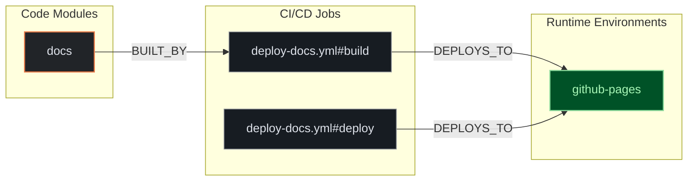
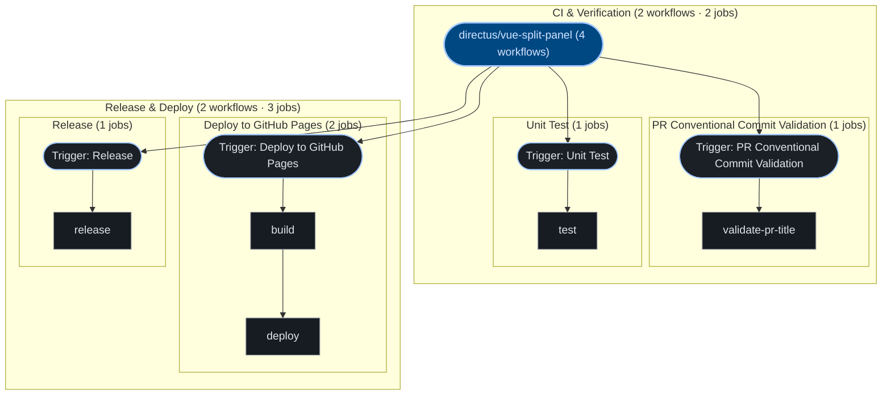

# Repository Architecture Analysis: directus/vue-split-panel

## Metadata
- **SHA**: `4dc730063ce44319a9bbba7e356aff4329b6fe9d`
- **Primary Ecosystem**: JavaScript/TypeScript

## Quality Metrics
- **ast_engine**: tree-sitter
- **avg_cognitive_complexity**: 4.21
- **avg_cyclomatic_complexity**: 3.49
- **component_count**: 1
- **dead_code_count**: 0
- **dead_code_symbols**: 0 entry(ies)
- **duplication_pct**: 84.27
- **file_complexities**: 25 entry(ies)
- **files_analyzed**: 29
- **fitness_passed**: False
- **fitness_violation_count**: 3
- **framework**: React (Vite)
- **import_edges**: 100 entry(ies)
- **loc**: 2410
- **max_cognitive_complexity**: 40
- **max_cyclomatic_complexity**: 24
- **sloc**: 1826
- **test_file_count**: 11

# Architecture: directus/vue-split-panel

## Context
- **Repository**: `directus/vue-split-panel`
- **SHA**: `4dc730063ce44319a9bbba7e356aff4329b6fe9d`
- **Ecosystem**: JavaScript/TypeScript
- **Framework**: React (Vite)

## Building Block View

## Component Details
- **@directus/vue-split-panel** (`package.json`): MODULE

## 6-Dimension Repository Scorecard

- **Overall Grade**: `F` (55.51/100)
- **Technical Debt Score**: 44.49
- **Estimated Remediation Effort**: 49.48h

| Dimension | Grade | Score | Weight | Details |
| :--- | :---: | :---: | :---: | :--- |
| Code Quality | `F` | 59.54 | 0.20 | avg_cc=3.49, max_cc=24, duplication=84.27%, dead_code=0 |
| Dependency Health | `A` | 100.00 | 0.15 | dependencies=1634, outdated=0, vulnerable=0, has_lockfile=True |
| Maintainability | `F` | 57.00 | 0.15 | avg_cognitive=4.21, max_cognitive=40, fitness_violations=3, oversized_files=0 |
| Pipeline Health | `F` | 53.00 | 0.15 | workflows=4, operational_antipatterns=7, parallel_branches=False |
| Security | `F` | 8.00 | 0.20 | vulnerabilities=0, secrets=0, pipeline_security_findings=7 |
| Test Coverage | `C` | 70.00 | 0.15 | coverage=unavailable, ci_test_job=True, test_files_detected=True |

## Architecture Fitness & Workspace Boundaries

- **[MEDIUM] `ATRUSS-ARCH-005` (COMPLEXITY_THRESHOLD)**: Repository duplication_pct (84.27) exceeds policy threshold (15.0).
- **[MEDIUM] `ATRUSS-ARCH-005` (COMPLEXITY_THRESHOLD)**: Repository max_cognitive_complexity (40.0) exceeds policy threshold (25.0).
- **[MEDIUM] `ATRUSS-ARCH-005` (COMPLEXITY_THRESHOLD)**: Repository max_cyclomatic_complexity (24.0) exceeds policy threshold (20.0).

## Supply Chain Dependencies, Vulnerabilities & Secrets

- **Dependencies Parsed**: 1634 | **Vulnerabilities**: 0 | **Secrets**: 0

### Inventory Sample
- `@iconify-json/lucide` `1.2.110` (npm, `package.json`)
- `@iconify-json/lucide` `1.2.110` (npm, `pnpm-lock.yaml`)
- `@iconify-json/simple-icons` `1.2.84` (npm, `package.json`)
- `@iconify-json/simple-icons` `1.2.84` (npm, `pnpm-lock.yaml`)
- `@iconify-json/vscode-icons` `1.2.52` (npm, `package.json`)
- `@iconify-json/vscode-icons` `1.2.52` (npm, `pnpm-lock.yaml`)
- `@nuxt/kit` `3.21.6` (npm, `pnpm-lock.yaml`)
- `@nuxt/kit` `4.3.0` (npm, `package.json`)
- `@nuxt/kit` `4.3.0` (npm, `pnpm-lock.yaml`)
- `@nuxt/kit` `4.4.6` (npm, `pnpm-lock.yaml`)
- `@nuxtjs/mdc` `0.20.0` (npm, `package.json`)
- `@nuxtjs/mdc` `0.20.0` (npm, `pnpm-lock.yaml`)
- `@nuxtjs/mdc` `0.22.0` (npm, `pnpm-lock.yaml`)
- `@tsdown/css` `0.22.0` (npm, `package.json`)
- `@tsdown/css` `0.22.0` (npm, `pnpm-lock.yaml`)
- `@types/node` `25.9.1` (npm, `package.json`)
- `@types/node` `25.9.1` (npm, `pnpm-lock.yaml`)
- `@vitejs/plugin-vue` `6.0.7` (npm, `package.json`)
- `@vitejs/plugin-vue` `6.0.7` (npm, `pnpm-lock.yaml`)
- `@vitest/coverage-v8` `4.1.7` (npm, `package.json`)
- `@vitest/coverage-v8` `4.1.7` (npm, `pnpm-lock.yaml`)
- `@vue/test-utils` `2.4.10` (npm, `package.json`)
- `@vue/test-utils` `2.4.10` (npm, `pnpm-lock.yaml`)
- `@vueuse/core` `10.11.1` (npm, `pnpm-lock.yaml`)
- `@vueuse/core` `14.3.0` (npm, `package.json`)
- `@vueuse/core` `14.3.0` (npm, `pnpm-lock.yaml`)
- `better-sqlite3` `12.6.2` (npm, `package.json`)
- `better-sqlite3` `12.6.2` (npm, `pnpm-lock.yaml`)
- `bumpp` `11.1.0` (npm, `package.json`)
- `bumpp` `11.1.0` (npm, `pnpm-lock.yaml`)
- ... (+1604 more dependencies)

## Section 7: Code-to-Cloud Deployment Traceability

- `deploy-docs.yml#build` (ci_job) --[DEPLOYS_TO]--> `github-pages` (environment)
- `deploy-docs.yml#deploy` (ci_job) --[DEPLOYS_TO]--> `github-pages` (environment)
- `docs` (code_module) --[BUILT_BY]--> `deploy-docs.yml#build` (ci_job)

## CI/CD Pipeline Topology

