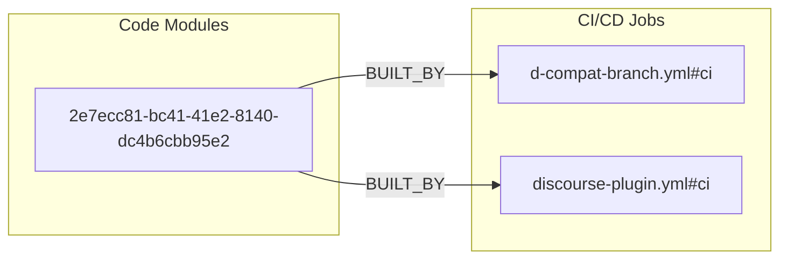
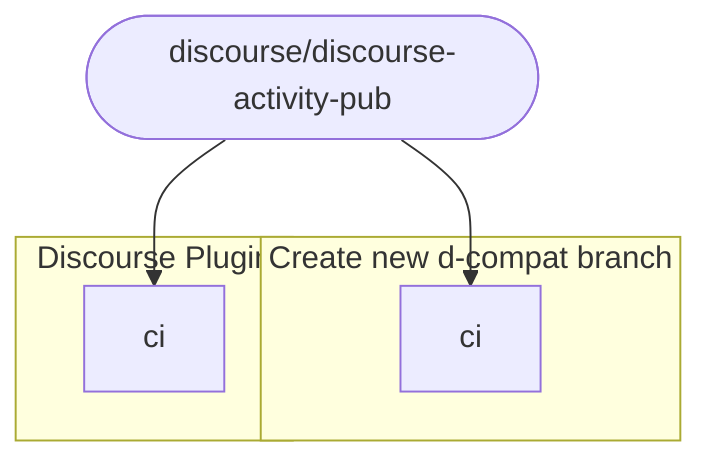

# Repository Architecture Analysis: discourse/discourse-activity-pub

## Metadata
- **SHA**: `d89d1b0131bbce4dc4102b1409f797be39b41961`
- **Primary Ecosystem**: Ruby

## Quality Metrics
- **ast_engine**: fallback
- **avg_cognitive_complexity**: 0.0
- **avg_cyclomatic_complexity**: 0.0
- **component_count**: 250
- **dead_code_count**: 0
- **dead_code_symbols**: 0 entry(ies)
- **duplication_pct**: 0.0
- **file_complexities**: 0 entry(ies)
- **files_analyzed**: 256
- **fitness_passed**: True
- **fitness_violation_count**: 0
- **framework**: Ruby on Rails
- **import_edges**: 0 entry(ies)
- **loc**: 29942
- **max_cognitive_complexity**: 0
- **max_cyclomatic_complexity**: 0
- **sloc**: 25094
- **test_file_count**: 19

# Architecture: discourse/discourse-activity-pub

## Context
- **Repository**: `discourse/discourse-activity-pub`
- **SHA**: `d89d1b0131bbce4dc4102b1409f797be39b41961`
- **Ecosystem**: Ruby
- **Framework**: Ruby on Rails

## Building Block View

```mermaid
graph TD;
    repo_root(["discourse/discourse-activity-pub (250 components)"])
    dir_0_spec["spec (87)"]
    repo_root --> dir_0_spec
    sub_0_0_lib["lib (41)"]
    dir_0_spec --> sub_0_0_lib
    sub_0_1_requests["requests (22)"]
    dir_0_spec --> sub_0_1_requests
    sub_0_2_fabricators["fabricators (9)"]
    dir_0_spec --> sub_0_2_fabricators
    sub_0_more["+6 more submodules (15)"]
    dir_0_spec --> sub_0_more
    dir_1_app["app (80)"]
    repo_root --> dir_1_app
    sub_1_0_serializers["serializers (33)"]
    dir_1_app --> sub_1_0_serializers
    sub_1_1_models["models (22)"]
    dir_1_app --> sub_1_1_models
    sub_1_2_controllers["controllers (20)"]
    dir_1_app --> sub_1_2_controllers
    sub_1_more["+1 more submodules (5)"]
    dir_1_app --> sub_1_more
    dir_2_lib["lib (57)"]
    repo_root --> dir_2_lib
    sub_2_0_discourse_activity_pub_a_p["discourse_activity_pub/a_p (30)"]
    dir_2_lib --> sub_2_0_discourse_activity_pub_a_p
    sub_2_1_discourse_activity_pub["discourse_activity_pub (20)"]
    dir_2_lib --> sub_2_1_discourse_activity_pub
    sub_2_2_discourse_activity_pub_bulk["discourse_activity_pub/bulk (4)"]
    dir_2_lib --> sub_2_2_discourse_activity_pub_bulk
    sub_2_more["+3 more submodules (3)"]
    dir_2_lib --> sub_2_more
    dir_3_db["db (24)"]
    repo_root --> dir_3_db
    dir_4__root_["(root) (1)"]
    repo_root --> dir_4__root_
    dir_other_modules["+1 more modules (1)"]
    repo_root --> dir_other_modules
```

## Component Details

Showing top 60 representative components out of 250 across 6 module group(s):

- **Module `spec`** (87 components — module: 87)
- **Module `app`** (80 components — module: 80)
- **Module `lib`** (57 components — module: 57)
- **Module `db`** (24 components — module: 24)
- **Module `(root)`** (1 components — module: 1)
- **Module `config`** (1 components — module: 1)

- **20230227144934_create_discourse_activity_pub_actors** (`db/migrate/20230227144934_create_discourse_activity_pub_actors.rb`): module
- **20230303134743_create_discourse_activity_pub_activities** (`db/migrate/20230303134743_create_discourse_activity_pub_activities.rb`): module
- **20230307102318_create_discourse_activity_pub_follows** (`db/migrate/20230307102318_create_discourse_activity_pub_follows.rb`): module
- **20230316073856_create_discourse_activity_pub_objects** (`db/migrate/20230316073856_create_discourse_activity_pub_objects.rb`): module
- **20230713131335_add_visibility_to_discourse_activity_pub_activities** (`db/migrate/20230713131335_add_visibility_to_discourse_activity_pub_activities.rb`): module
- **20230720101019_add_icon_to_discourse_activity_pub_actors** (`db/migrate/20230720101019_add_icon_to_discourse_activity_pub_actors.rb`): module
- **20230726115815_add_full_topic_support_to_discourse_activity_pub_object** (`db/migrate/20230726115815_add_full_topic_support_to_discourse_activity_pub_object.rb`): module
- **20230803082740_cast_discourse_activity_pub_activity_object_id_to_integer** (`db/migrate/20230803082740_cast_discourse_activity_pub_activity_object_id_to_integer.rb`): module
- **20230807055430_create_discourse_activity_pub_collections** (`db/migrate/20230807055430_create_discourse_activity_pub_collections.rb`): module
- **20231118142617_add_name_to_discourse_activity_pub_objects** (`db/migrate/20231118142617_add_name_to_discourse_activity_pub_objects.rb`): module
- **20231122103419_add_shared_inbox_to_discourse_activity_pub_actors** (`db/migrate/20231122103419_add_shared_inbox_to_discourse_activity_pub_actors.rb`): module
- **20231128200910_add_addressing_to_discourse_activity_pub** (`db/migrate/20231128200910_add_addressing_to_discourse_activity_pub.rb`): module
- **20231213105108_add_attributed_to_to_discourse_activity_pub_objects** (`db/migrate/20231213105108_add_attributed_to_to_discourse_activity_pub_objects.rb`): module
- **20240222124517_add_uniqueness_to_discourse_activity_pub_model_associations** (`db/migrate/20240222124517_add_uniqueness_to_discourse_activity_pub_model_associations.rb`): module
- **20240408094914_add_model_custom_fields_to_discourse_activity_pub_actor** (`db/migrate/20240408094914_add_model_custom_fields_to_discourse_activity_pub_actor.rb`): module
- **20241014115600_alter_activity_pub_ids_to_bigint** (`db/migrate/20241014115600_alter_activity_pub_ids_to_bigint.rb`): module
- **20241111133654_create_discourse_activity_pub_clients** (`db/migrate/20241111133654_create_discourse_activity_pub_clients.rb`): module
- **20241111134510_create_discourse_activity_pub_authorizations** (`db/migrate/20241111134510_create_discourse_activity_pub_authorizations.rb`): module
- **20250109115337_create_discourse_activity_pub_logs** (`db/migrate/20250109115337_create_discourse_activity_pub_logs.rb`): module
- **20250319134150_create_discourse_activity_pub_attachments** (`db/migrate/20250319134150_create_discourse_activity_pub_attachments.rb`): module
- **20250412144302_add_deleted_attributes_to_activity_pub_models** (`db/migrate/20250412144302_add_deleted_attributes_to_activity_pub_models.rb`): module
- **20250415114125_add_attributed_to_to_discourse_activity_pub_collections** (`db/migrate/20250415114125_add_attributed_to_to_discourse_activity_pub_collections.rb`): module
- **20251203000001_add_index_to_discourse_activity_pub_actors_ap_key** (`db/migrate/20251203000001_add_index_to_discourse_activity_pub_actors_ap_key.rb`): module
- **20260708175639_add_unique_index_to_discourse_activity_pub_follows** (`db/migrate/20260708175639_add_unique_index_to_discourse_activity_pub_follows.rb`): module
- **a_p** (`lib/discourse_activity_pub/a_p.rb`): module
- **about** (`lib/discourse_activity_pub/about.rb`): module
- **about_controller** (`app/controllers/discourse_activity_pub/about_controller.rb`): module
- **about_controller_spec** (`spec/requests/discourse_activity_pub/about_controller_spec.rb`): module
- **about_serializer** (`app/serializers/discourse_activity_pub/about_serializer.rb`): module
- **accept** (`lib/discourse_activity_pub/a_p/activity/accept.rb`): module
- **accept_serializer** (`app/serializers/discourse_activity_pub/a_p/activity/accept_serializer.rb`): module
- **accept_spec** (`spec/lib/discourse_activity_pub/ap/activity/accept_spec.rb`): module
- **activities_controller** (`app/controllers/discourse_activity_pub/a_p/activities_controller.rb`): module
- **activities_controller_spec** (`spec/requests/discourse_activity_pub/ap/activities_controller_spec.rb`): module
- **activity** (`lib/discourse_activity_pub/a_p/activity.rb`): module
- **activity_forwarder** (`lib/discourse_activity_pub/activity_forwarder.rb`): module
- **activity_forwarder_spec** (`spec/lib/discourse_activity_pub/activity_forwarder_spec.rb`): module
- **activity_pub_multisite_spec** (`spec/multisite/activity_pub_multisite_spec.rb`): module
- **activity_serializer** (`app/serializers/discourse_activity_pub/a_p/activity_serializer.rb`): module
- **activity_spec** (`spec/lib/discourse_activity_pub/ap/activity_spec.rb`): module
- **actor** (`lib/discourse_activity_pub/a_p/actor.rb`): module
- **actor_controller** (`app/controllers/admin/discourse_activity_pub/actor_controller.rb`): module
- **actor_controller** (`app/controllers/discourse_activity_pub/actor_controller.rb`): module
- **actor_controller_spec** (`spec/requests/admin/discourse_activity_pub/actor_controller_spec.rb`): module
- **actor_controller_spec** (`spec/requests/discourse_activity_pub/actor_controller_spec.rb`): module
- **actor_handler** (`lib/discourse_activity_pub/actor_handler.rb`): module
- **actor_handler_spec** (`spec/lib/discourse_activity_pub/actor_handler_spec.rb`): module
- **actor_serializer** (`app/serializers/discourse_activity_pub/a_p/actor_serializer.rb`): module
- **actor_serializer** (`app/serializers/discourse_activity_pub/actor_serializer.rb`): module
- **actor_spec** (`spec/lib/discourse_activity_pub/ap/actor_spec.rb`): module
- **actors_controller** (`app/controllers/discourse_activity_pub/a_p/actors_controller.rb`): module
- **actors_controller_spec** (`spec/requests/discourse_activity_pub/ap/actors_controller_spec.rb`): module
- **announce** (`lib/discourse_activity_pub/a_p/activity/announce.rb`): module
- **announce_serializer** (`app/serializers/discourse_activity_pub/a_p/activity/announce_serializer.rb`): module
- **announce_spec** (`spec/lib/discourse_activity_pub/ap/activity/announce_spec.rb`): module
- **application** (`lib/discourse_activity_pub/a_p/actor/application.rb`): module
- **application_serializer** (`app/serializers/discourse_activity_pub/a_p/actor/application_serializer.rb`): module
- **article** (`lib/discourse_activity_pub/a_p/object/article.rb`): module
- **article_serializer** (`app/serializers/discourse_activity_pub/a_p/object/article_serializer.rb`): module
- **auth** (`lib/discourse_activity_pub/auth.rb`): module

## 6-Dimension Repository Scorecard

- **Overall Grade**: `B` (89.80/100)
- **Technical Debt Score**: 10.20
- **Estimated Remediation Effort**: 6.55h

| Dimension | Grade | Score | Weight | Details |
| :--- | :---: | :---: | :---: | :--- |
| Code Quality | `A` | 100.00 | 0.20 | avg_cc=0.00, max_cc=0, duplication=0.00%, dead_code=0 |
| Dependency Health | `A` | 100.00 | 0.15 | dependencies=477, outdated=0, vulnerable=0, has_lockfile=True |
| Maintainability | `A` | 100.00 | 0.15 | avg_cognitive=0.00, max_cognitive=0, fitness_violations=0, oversized_files=0 |
| Pipeline Health | `A` | 94.00 | 0.15 | workflows=2, operational_antipatterns=2, parallel_branches=False |
| Security | `C` | 76.00 | 0.20 | vulnerabilities=0, secrets=0, pipeline_security_findings=2 |
| Test Coverage | `C` | 70.00 | 0.15 | coverage=unavailable, ci_test_job=False, test_files_detected=True |

## Supply Chain Dependencies, Vulnerabilities & Secrets

- **Dependencies Parsed**: 477 | **Vulnerabilities**: 0 | **Secrets**: 0

### Inventory Sample
- `rubocop-discourse` `*` (gem, `Gemfile`)
- `syntax_tree` `*` (gem, `Gemfile`)
- `@discourse/lint-configs` `2.44.1` (npm, `package.json`)
- `@discourse/lint-configs` `2.44.1` (npm, `pnpm-lock.yaml`)
- `@glint/ember-tsc` `1.1.1` (npm, `package.json`)
- `@glint/ember-tsc` `1.1.1` (npm, `pnpm-lock.yaml`)
- `concurrently` `9.2.1` (npm, `package.json`)
- `concurrently` `9.2.1` (npm, `pnpm-lock.yaml`)
- `discourse` `2026.3.0-d02b2966` (npm, `package.json`)
- `ember-template-lint` `7.9.3` (npm, `package.json`)
- `ember-template-lint` `7.9.3` (npm, `pnpm-lock.yaml`)
- `eslint` `9.39.2` (npm, `package.json`)
- `eslint` `9.39.2` (npm, `pnpm-lock.yaml`)
- `lint-to-the-future` `2.6.4` (npm, `package.json`)
- `lint-to-the-future` `2.6.4` (npm, `pnpm-lock.yaml`)
- `lint-to-the-future-eslint` `3.3.0` (npm, `package.json`)
- `lint-to-the-future-eslint` `3.3.0` (npm, `pnpm-lock.yaml`)
- `prettier` `3.8.1` (npm, `package.json`)
- `prettier` `3.8.1` (npm, `pnpm-lock.yaml`)
- `stylelint` `17.5.0` (npm, `package.json`)
- `stylelint` `17.5.0` (npm, `pnpm-lock.yaml`)
- `@babel/code-frame` `7.29.0` (npm, `pnpm-lock.yaml`)
- `@babel/compat-data` `7.29.0` (npm, `pnpm-lock.yaml`)
- `@babel/core` `7.29.0` (npm, `pnpm-lock.yaml`)
- `@babel/eslint-parser` `7.28.6` (npm, `pnpm-lock.yaml`)
- `@babel/generator` `7.29.1` (npm, `pnpm-lock.yaml`)
- `@babel/helper-annotate-as-pure` `7.27.3` (npm, `pnpm-lock.yaml`)
- `@babel/helper-compilation-targets` `7.28.6` (npm, `pnpm-lock.yaml`)
- `@babel/helper-create-class-features-plugin` `7.28.6` (npm, `pnpm-lock.yaml`)
- `@babel/helper-globals` `7.28.0` (npm, `pnpm-lock.yaml`)
- ... (+447 more dependencies)

## Section 7: Code-to-Cloud Deployment Traceability

- `2e7ecc81-bc41-41e2-8140-dc4b6cbb95e2` (code_module) --[BUILT_BY]--> `d-compat-branch.yml#ci` (ci_job)
- `2e7ecc81-bc41-41e2-8140-dc4b6cbb95e2` (code_module) --[BUILT_BY]--> `discourse-plugin.yml#ci` (ci_job)

## CI/CD Pipeline Topology

