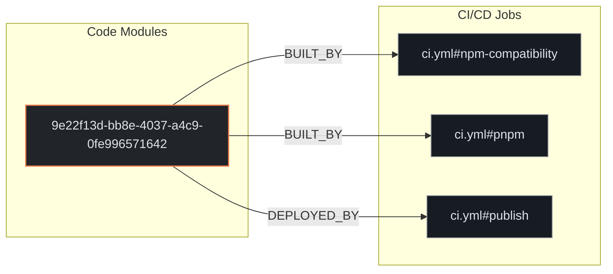
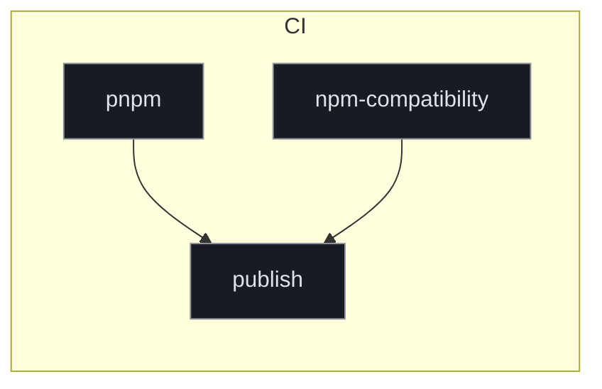

# Repository Architecture Analysis: discourse/discourse-mcp

## Metadata
- **SHA**: `48d59e596acf908e57f3ad833e3c912f83a8c64c`
- **Primary Ecosystem**: JavaScript/TypeScript

## Quality Metrics
- **ast_engine**: tree-sitter
- **avg_cognitive_complexity**: 4.93
- **avg_cyclomatic_complexity**: 5.62
- **component_count**: 2
- **dead_code_count**: 0
- **dead_code_symbols**: 0 entry(ies)
- **duplication_pct**: 82.6
- **file_complexities**: 25 entry(ies)
- **files_analyzed**: 193
- **fitness_passed**: False
- **fitness_violation_count**: 3
- **framework**: TypeScript
- **import_edges**: 100 entry(ies)
- **loc**: 19572
- **max_cognitive_complexity**: 126
- **max_cyclomatic_complexity**: 53
- **sloc**: 17433
- **test_file_count**: 26

# Architecture: discourse/discourse-mcp

## Context
- **Repository**: `discourse/discourse-mcp`
- **SHA**: `48d59e596acf908e57f3ad833e3c912f83a8c64c`
- **Ecosystem**: JavaScript/TypeScript
- **Framework**: TypeScript

## Building Block View

## Component Details
- **@discourse/mcp** (`package.json`): MODULE
- **HttpClient** (`src/http/client.ts`): SERVICE

## 6-Dimension Repository Scorecard

- **Overall Grade**: `F` (59.35/100)
- **Technical Debt Score**: 40.65
- **Estimated Remediation Effort**: 44.68h

| Dimension | Grade | Score | Weight | Details |
| :--- | :---: | :---: | :---: | :--- |
| Code Quality | `F` | 39.52 | 0.20 | avg_cc=5.62, max_cc=53, duplication=82.60%, dead_code=0 |
| Dependency Health | `A` | 100.00 | 0.15 | dependencies=397, outdated=0, vulnerable=0, has_lockfile=True |
| Maintainability | `F` | 47.00 | 0.15 | avg_cognitive=4.93, max_cognitive=126, fitness_violations=3, oversized_files=2 |
| Pipeline Health | `A` | 90.00 | 0.15 | workflows=1, operational_antipatterns=4, parallel_branches=True |
| Security | `F` | 27.00 | 0.20 | vulnerabilities=0, secrets=1, pipeline_security_findings=4 |
| Test Coverage | `C` | 70.00 | 0.15 | coverage=unavailable, ci_test_job=True, test_files_detected=True |

## Architecture Fitness & Workspace Boundaries

- **[MEDIUM] `ATRUSS-ARCH-005` (COMPLEXITY_THRESHOLD)**: Repository duplication_pct (82.6) exceeds policy threshold (15.0).
- **[MEDIUM] `ATRUSS-ARCH-005` (COMPLEXITY_THRESHOLD)**: Repository max_cognitive_complexity (126.0) exceeds policy threshold (25.0).
- **[MEDIUM] `ATRUSS-ARCH-005` (COMPLEXITY_THRESHOLD)**: Repository max_cyclomatic_complexity (53.0) exceeds policy threshold (20.0).

## Supply Chain Dependencies, Vulnerabilities & Secrets

- **Dependencies Parsed**: 397 | **Vulnerabilities**: 0 | **Secrets**: 1

### Secret Findings (Redacted)
- **[CRITICAL] `ATRUSS-SEC-004`** at `src/test/webhooks.test.ts:45` (`-----BEGIN ... PRIVATE KEY----- [REDACTED]`)

### Inventory Sample
- `@eslint/js` `9.39.5` (npm, `package-lock.json`)
- `@eslint/js` `9.39.5` (npm, `package.json`)
- `@eslint/js` `9.39.5` (npm, `pnpm-lock.yaml`)
- `@modelcontextprotocol/sdk` `1.32.2` (npm, `package-lock.json`)
- `@modelcontextprotocol/sdk` `1.32.2` (npm, `package.json`)
- `@modelcontextprotocol/sdk` `1.32.2` (npm, `pnpm-lock.yaml`)
- `@types/node` `20.19.43` (npm, `package-lock.json`)
- `@types/node` `20.19.43` (npm, `package.json`)
- `@types/node` `20.19.43` (npm, `pnpm-lock.yaml`)
- `eslint` `9.39.5` (npm, `package-lock.json`)
- `eslint` `9.39.5` (npm, `package.json`)
- `eslint` `9.39.5` (npm, `pnpm-lock.yaml`)
- `typescript` `5.9.3` (npm, `package-lock.json`)
- `typescript` `5.9.3` (npm, `package.json`)
- `typescript` `5.9.3` (npm, `pnpm-lock.yaml`)
- `typescript-eslint` `8.67.0` (npm, `package.json`)
- `typescript-eslint` `8.67.0` (npm, `pnpm-lock.yaml`)
- `typescript-eslint` `8.72.1` (npm, `package-lock.json`)
- `zod` `4.6.7` (npm, `package-lock.json`)
- `zod` `4.6.7` (npm, `package.json`)
- `zod` `4.6.7` (npm, `pnpm-lock.yaml`)
- `@eslint-community/eslint-utils` `4.10.1` (npm, `package-lock.json`)
- `@eslint-community/eslint-utils` `4.10.1` (npm, `pnpm-lock.yaml`)
- `@eslint-community/regexpp` `4.12.2` (npm, `package-lock.json`)
- `@eslint-community/regexpp` `4.12.2` (npm, `pnpm-lock.yaml`)
- `@eslint/config-array` `0.21.2` (npm, `package-lock.json`)
- `@eslint/config-array` `0.21.2` (npm, `pnpm-lock.yaml`)
- `@eslint/config-helpers` `0.4.2` (npm, `package-lock.json`)
- `@eslint/config-helpers` `0.4.2` (npm, `pnpm-lock.yaml`)
- `@eslint/core` `0.17.0` (npm, `package-lock.json`)
- ... (+367 more dependencies)

## Section 7: Code-to-Cloud Deployment Traceability

- `9e22f13d-bb8e-4037-a4c9-0fe996571642` (code_module) --[BUILT_BY]--> `ci.yml#npm-compatibility` (ci_job)
- `9e22f13d-bb8e-4037-a4c9-0fe996571642` (code_module) --[BUILT_BY]--> `ci.yml#pnpm` (ci_job)
- `9e22f13d-bb8e-4037-a4c9-0fe996571642` (code_module) --[DEPLOYED_BY]--> `ci.yml#publish` (ci_job)

## CI/CD Pipeline Topology

