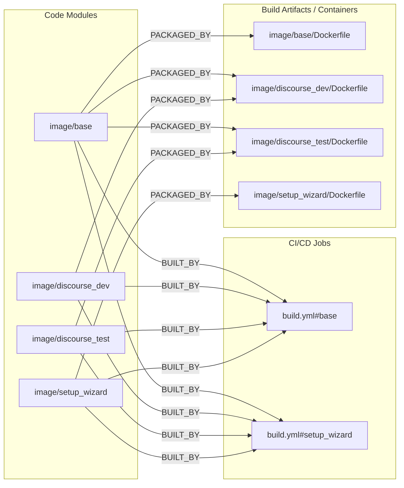
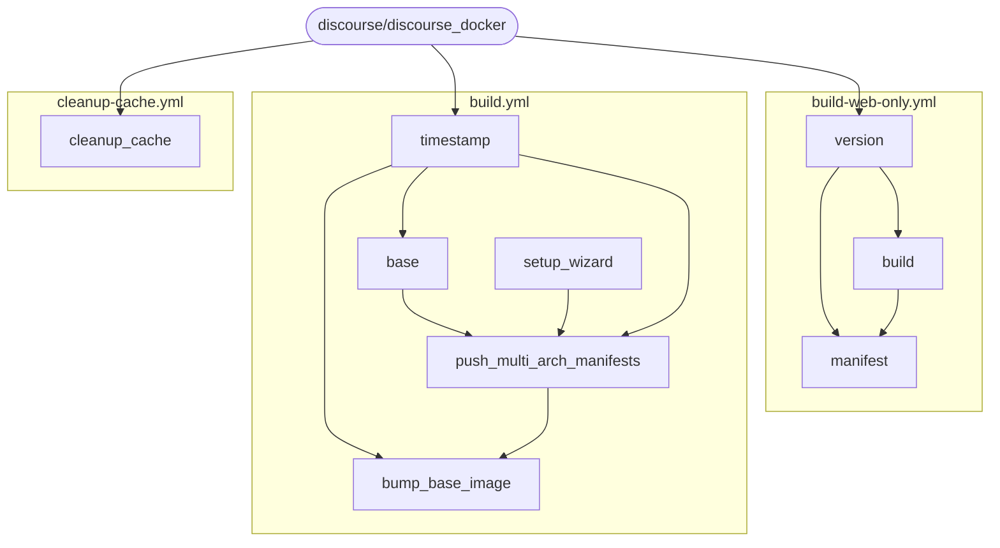

# Repository Architecture Analysis: discourse/discourse_docker

## Metadata
- **SHA**: `0ba1841d589e77df3bc923774abca2720a320ec2`
- **Primary Ecosystem**: Ruby

## Quality Metrics
- **ast_engine**: fallback
- **avg_cognitive_complexity**: 0.0
- **avg_cyclomatic_complexity**: 0.0
- **component_count**: 12
- **dead_code_count**: 0
- **dead_code_symbols**: 0 entry(ies)
- **duplication_pct**: 0.0
- **file_complexities**: 0 entry(ies)
- **files_analyzed**: 12
- **fitness_passed**: True
- **fitness_violation_count**: 0
- **framework**: Ruby
- **import_edges**: 0 entry(ies)
- **loc**: 1708
- **max_cognitive_complexity**: 0
- **max_cyclomatic_complexity**: 0
- **sloc**: 1303

# Architecture: discourse/discourse_docker

## Context
- **Repository**: `discourse/discourse_docker`
- **SHA**: `0ba1841d589e77df3bc923774abca2720a320ec2`
- **Ecosystem**: Ruby
- **Framework**: Ruby

## Building Block View

```mermaid
graph TD;
    postgres_dev_template["postgres_dev.template : module"]
    wizard["wizard : module"]
    cli["cli : module"]
    config_generator["config_generator : module"]
    constants["constants : module"]
    launcher["launcher : module"]
    network_checks["network_checks : module"]
    prompts["prompts : module"]
    resource_scaler["resource_scaler : module"]
    system_checks["system_checks : module"]
    tui_components["tui_components : module"]
    ui["ui : module"]
    repo_root(["discourse/discourse_docker"])
    repo_root --> cli
    repo_root --> config_generator
    repo_root --> constants
    repo_root --> launcher
    repo_root --> network_checks
    repo_root --> postgres_dev_template
    repo_root --> prompts
    repo_root --> resource_scaler
    repo_root --> system_checks
    repo_root --> tui_components
    repo_root --> ui
    repo_root --> wizard
```

## Component Details
- **postgres_dev.template** (`image/discourse_dev/postgres_dev.template.yml`): module
- **wizard** (`image/setup_wizard/wizard.rb`): module
- **cli** (`image/setup_wizard/lib/discourse_setup/cli.rb`): module
- **config_generator** (`image/setup_wizard/lib/discourse_setup/config_generator.rb`): module
- **constants** (`image/setup_wizard/lib/discourse_setup/constants.rb`): module
- **launcher** (`image/setup_wizard/lib/discourse_setup/launcher.rb`): module
- **network_checks** (`image/setup_wizard/lib/discourse_setup/network_checks.rb`): module
- **prompts** (`image/setup_wizard/lib/discourse_setup/prompts.rb`): module
- **resource_scaler** (`image/setup_wizard/lib/discourse_setup/resource_scaler.rb`): module
- **system_checks** (`image/setup_wizard/lib/discourse_setup/system_checks.rb`): module
- **tui_components** (`image/setup_wizard/lib/discourse_setup/tui_components.rb`): module
- **ui** (`image/setup_wizard/lib/discourse_setup/ui.rb`): module

## 6-Dimension Repository Scorecard

- **Overall Grade**: `D` (68.60/100)
- **Technical Debt Score**: 31.40
- **Estimated Remediation Effort**: 38.35h

| Dimension | Grade | Score | Weight | Details |
| :--- | :---: | :---: | :---: | :--- |
| Code Quality | `A` | 100.00 | 0.20 | avg_cc=0.00, max_cc=0, duplication=0.00%, dead_code=0 |
| Dependency Health | `A` | 100.00 | 0.15 | dependencies=3, outdated=0, vulnerable=0, has_lockfile=False |
| Maintainability | `A` | 100.00 | 0.15 | avg_cognitive=0.00, max_cognitive=0, fitness_violations=0, oversized_files=0 |
| Pipeline Health | `B` | 84.00 | 0.15 | workflows=3, operational_antipatterns=7, parallel_branches=True |
| Security | `F` | 0.00 | 0.20 | vulnerabilities=0, secrets=0, pipeline_security_findings=18 |
| Test Coverage | `F` | 40.00 | 0.15 | coverage=unavailable, ci_test_job=False, test_files_detected=False |

## Supply Chain Dependencies, Vulnerabilities & Secrets

- **Dependencies Parsed**: 3 | **Vulnerabilities**: 0 | **Secrets**: 0

### Inventory Sample
- `base64` `*` (gem, `image/setup_wizard/Gemfile`)
- `docker-api` `*` (gem, `image/setup_wizard/Gemfile`)
- `ratatui_ruby` `*` (gem, `image/setup_wizard/Gemfile`)

## Section 7: Code-to-Cloud Deployment Traceability

- `image/base` (code_module) --[BUILT_BY]--> `build.yml#base` (ci_job)
- `image/base` (code_module) --[BUILT_BY]--> `build.yml#setup_wizard` (ci_job)
- `image/base` (code_module) --[PACKAGED_BY]--> `image/base/Dockerfile` (container)
- `image/base` (code_module) --[PACKAGED_BY]--> `image/discourse_dev/Dockerfile` (container)
- `image/base` (code_module) --[PACKAGED_BY]--> `image/discourse_test/Dockerfile` (container)
- `image/discourse_dev` (code_module) --[BUILT_BY]--> `build.yml#base` (ci_job)
- `image/discourse_dev` (code_module) --[BUILT_BY]--> `build.yml#setup_wizard` (ci_job)
- `image/discourse_dev` (code_module) --[PACKAGED_BY]--> `image/discourse_dev/Dockerfile` (container)
- `image/discourse_test` (code_module) --[BUILT_BY]--> `build.yml#base` (ci_job)
- `image/discourse_test` (code_module) --[BUILT_BY]--> `build.yml#setup_wizard` (ci_job)
- `image/discourse_test` (code_module) --[PACKAGED_BY]--> `image/discourse_test/Dockerfile` (container)
- `image/setup_wizard` (code_module) --[BUILT_BY]--> `build.yml#base` (ci_job)
- `image/setup_wizard` (code_module) --[BUILT_BY]--> `build.yml#setup_wizard` (ci_job)
- `image/setup_wizard` (code_module) --[PACKAGED_BY]--> `image/setup_wizard/Dockerfile` (container)

## CI/CD Pipeline Topology

