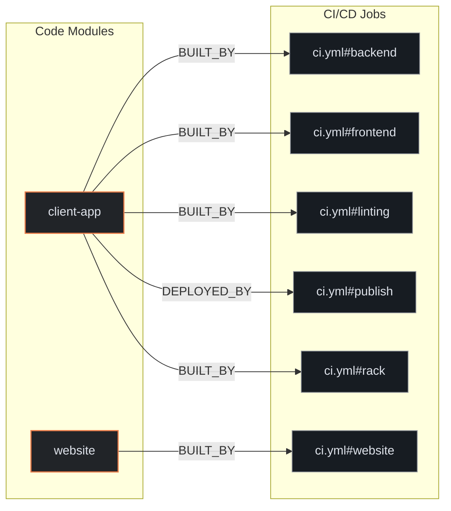
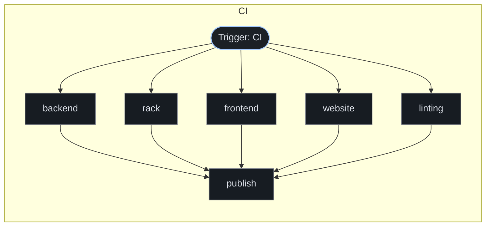

# Repository Architecture Analysis: discourse/logster

## Metadata
- **SHA**: `c344dea12478caac2109b1cdeae9d95e31bfb2d3`
- **Primary Ecosystem**: Ruby

## Quality Metrics
- **ast_engine**: tree-sitter
- **avg_cognitive_complexity**: 1.79
- **avg_cyclomatic_complexity**: 2.3
- **component_count**: 55
- **dead_code_count**: 0
- **dead_code_symbols**: 0 entry(ies)
- **duplication_pct**: 16.31
- **file_complexities**: 25 entry(ies)
- **files_analyzed**: 93
- **fitness_passed**: False
- **fitness_violation_count**: 2
- **framework**: Ruby on Rails
- **import_edges**: 100 entry(ies)
- **loc**: 10694
- **max_cognitive_complexity**: 34
- **max_cyclomatic_complexity**: 16
- **sloc**: 8802
- **test_file_count**: 43

# Architecture: discourse/logster

## Context
- **Repository**: `discourse/logster`
- **SHA**: `c344dea12478caac2109b1cdeae9d95e31bfb2d3`
- **Ecosystem**: Ruby
- **Framework**: Ruby on Rails

## Building Block View

```mermaid
graph TD;
  classDef atlasRoot fill:#004882,stroke:#a3c9ff,stroke-width:2px,color:#d3e4ff
  classDef atlasCategory fill:#212428,stroke:#E87A48,stroke-width:1.5px,color:#dfe3eb
  classDef atlasWorkflow fill:#1b2026,stroke:#a3c9ff,stroke-width:1.5px,color:#dfe3eb
  classDef atlasJob fill:#171c22,stroke:#8d9199,stroke-width:1px,color:#dfe3eb
  classDef atlasTarget fill:#005227,stroke:#8bd99b,stroke-width:1.5px,color:#a7f6b6
  classDef atlasAlert fill:#93000a,stroke:#ffb4ab,stroke-width:1.5px,color:#ffdad6
  classDef atlasMore fill:#252a31,stroke:#8d9199,stroke-dasharray:4 4,color:#c3c6cf
    repo_root(["discourse/logster (55 components)"]):::atlasRoot
    subgraph sg_dir_0_lib["lib (22)"]
      direction TB
      dir_0_lib["lib (22)"]:::atlasCategory
      sub_0_0_logster["logster (20)"]:::atlasWorkflow
      dir_0_lib --> sub_0_0_logster
      sub_0_1__module_root_["(module root) (1)"]:::atlasWorkflow
      dir_0_lib --> sub_0_1__module_root_
      sub_0_2_examples["examples (1)"]:::atlasWorkflow
      dir_0_lib --> sub_0_2_examples
    end
    repo_root --> dir_0_lib
    subgraph sg_dir_1_test["test (22)"]
      direction TB
      dir_1_test["test (22)"]:::atlasCategory
      sub_1_0_logster["logster (13)"]:::atlasWorkflow
      dir_1_test --> sub_1_0_logster
      sub_1_1__module_root_["(module root) (4)"]:::atlasWorkflow
      dir_1_test --> sub_1_1__module_root_
      sub_1_2_dummy["dummy (3)"]:::atlasWorkflow
      dir_1_test --> sub_1_2_dummy
      sub_1_more["+2 more submodules (2)"]:::atlasMore
      dir_1_test --> sub_1_more
    end
    repo_root --> dir_1_test
    dir_2_website["website (5)"]:::atlasCategory
    repo_root --> dir_2_website
    dir_3_client_app["client-app (4)"]:::atlasCategory
    repo_root --> dir_3_client_app
    dir_4__root_["(root) (2)"]:::atlasCategory
    repo_root --> dir_4__root_
```

## Component Details
- **dev_server_process** (`dev_server_process.rb`): module
- **frontend_assets** (`frontend_assets.rb`): module
- **preload-json-manager** (`client-app/preload-json-manager.rb`): module
- **logster** (`lib/logster.rb`): module
- **sidekiq_logster_reporter** (`lib/examples/sidekiq_logster_reporter.rb`): module
- **base_store** (`lib/logster/base_store.rb`): module
- **cache** (`lib/logster/cache.rb`): module
- **configuration** (`lib/logster/configuration.rb`): module
- **defer_logger** (`lib/logster/defer_logger.rb`): module
- **group** (`lib/logster/group.rb`): module
- **grouping_pattern** (`lib/logster/grouping_pattern.rb`): module
- **ignore_pattern** (`lib/logster/ignore_pattern.rb`): module
- **logger** (`lib/logster/logger.rb`): module
- **message** (`lib/logster/message.rb`): module
- **pattern** (`lib/logster/pattern.rb`): module
- **redis_rate_limiter** (`lib/logster/redis_rate_limiter.rb`): module
- **redis_store** (`lib/logster/redis_store.rb`): module
- **scheduler** (`lib/logster/scheduler.rb`): module
- **suppression_pattern** (`lib/logster/suppression_pattern.rb`): module
- **version** (`lib/logster/version.rb`): module
- **web** (`lib/logster/web.rb`): module
- **debug_exceptions** (`lib/logster/middleware/debug_exceptions.rb`): module
- **reporter** (`lib/logster/middleware/reporter.rb`): module
- **viewer** (`lib/logster/middleware/viewer.rb`): module
- **railtie** (`lib/logster/rails/railtie.rb`): module
- **test_dev_server** (`test/test_dev_server.rb`): module
- **test_frontend_assets** (`test/test_frontend_assets.rb`): module
- **test_gemspec** (`test/test_gemspec.rb`): module
- **test_helper** (`test/test_helper.rb`): module
- **application** (`test/dummy/config/application.rb`): module
- **boot** (`test/dummy/config/boot.rb`): module
- **environment** (`test/dummy/config/environment.rb`): module
- **test_sidekiq_reporter_example** (`test/examples/test_sidekiq_reporter_example.rb`): module
- **generate** (`test/fake_data/generate.rb`): module
- **test_base_store** (`test/logster/test_base_store.rb`): module
- **test_cache** (`test/logster/test_cache.rb`): module
- **test_defer_logger** (`test/logster/test_defer_logger.rb`): module
- **test_group** (`test/logster/test_group.rb`): module
- **test_ignore_pattern** (`test/logster/test_ignore_pattern.rb`): module
- **test_logger** (`test/logster/test_logger.rb`): module
- **test_message** (`test/logster/test_message.rb`): module
- **test_pattern** (`test/logster/test_pattern.rb`): module
- **test_railtie** (`test/logster/test_railtie.rb`): module
- **test_redis_rate_limiter** (`test/logster/test_redis_rate_limiter.rb`): module
- **test_redis_store** (`test/logster/test_redis_store.rb`): module
- **test_reporter** (`test/logster/middleware/test_reporter.rb`): module
- **test_viewer** (`test/logster/middleware/test_viewer.rb`): module
- **sample** (`website/sample.rb`): module
- **sample_loader** (`website/sample_loader.rb`): module
- **persist_logs** (`website/scripts/persist_logs.rb`): module
- **sample_app_test** (`website/test/sample_app_test.rb`): module
- **sample_loader_test** (`website/test/sample_loader_test.rb`): module
- **client-app** (`client-app/package.json`): MODULE
- **IndexController** (`client-app/app/controllers/index.js`): API_ROUTE
- **ShowController** (`client-app/app/controllers/show.js`): API_ROUTE

## 6-Dimension Repository Scorecard

- **Overall Grade**: `D` (60.71/100)
- **Technical Debt Score**: 39.29
- **Estimated Remediation Effort**: 38.08h

| Dimension | Grade | Score | Weight | Details |
| :--- | :---: | :---: | :---: | :--- |
| Code Quality | `C` | 74.03 | 0.20 | avg_cc=2.30, max_cc=16, duplication=16.31%, dead_code=0 |
| Dependency Health | `A` | 100.00 | 0.15 | dependencies=1182, outdated=0, vulnerable=0, has_lockfile=True |
| Maintainability | `D` | 67.00 | 0.15 | avg_cognitive=1.79, max_cognitive=34, fitness_violations=2, oversized_files=0 |
| Pipeline Health | `D` | 69.00 | 0.15 | workflows=1, operational_antipatterns=8, parallel_branches=True |
| Security | `F` | 0.00 | 0.20 | vulnerabilities=0, secrets=0, pipeline_security_findings=11 |
| Test Coverage | `C` | 70.00 | 0.15 | coverage=unavailable, ci_test_job=False, test_files_detected=True |

## Architecture Fitness & Workspace Boundaries

- **[MEDIUM] `ATRUSS-ARCH-005` (COMPLEXITY_THRESHOLD)**: Repository duplication_pct (16.31) exceeds policy threshold (15.0).
- **[MEDIUM] `ATRUSS-ARCH-005` (COMPLEXITY_THRESHOLD)**: Repository max_cognitive_complexity (34.0) exceeds policy threshold (25.0).

## Supply Chain Dependencies, Vulnerabilities & Secrets

- **Dependencies Parsed**: 1182 | **Vulnerabilities**: 0 | **Secrets**: 0

### Inventory Sample
- `logster` `*` (gem, `test/fake_data/Gemfile`)
- `logster` `*` (gem, `website/Gemfile`)
- `minitest` `*` (gem, `website/Gemfile`)
- `puma` `*` (gem, `website/Gemfile`)
- `rack` `3.2.0` (gem, `Gemfile`)
- `rails` `8.1.0` (gem, `Gemfile`)
- `rake` `*` (gem, `website/Gemfile`)
- `redis` `*` (gem, `test/fake_data/Gemfile`)
- `redis` `*` (gem, `website/Gemfile`)
- `sinatra` `*` (gem, `website/Gemfile`)
- `@babel/core` `7.29.0` (npm, `client-app/package.json`)
- `@babel/core` `7.29.7` (npm, `client-app/pnpm-lock.yaml`)
- `@babel/eslint-parser` `7.28.6` (npm, `client-app/package.json`)
- `@babel/eslint-parser` `7.29.7` (npm, `client-app/pnpm-lock.yaml`)
- `@babel/plugin-proposal-decorators` `7.29.0` (npm, `client-app/package.json`)
- `@babel/plugin-proposal-decorators` `7.29.7` (npm, `client-app/pnpm-lock.yaml`)
- `@babel/plugin-transform-runtime` `7.29.0` (npm, `client-app/package.json`)
- `@babel/plugin-transform-runtime` `7.29.7` (npm, `client-app/pnpm-lock.yaml`)
- `@babel/runtime` `7.29.7` (npm, `client-app/package.json`)
- `@babel/runtime` `7.29.7` (npm, `client-app/pnpm-lock.yaml`)
- `@ember/optional-features` `3.0.0` (npm, `client-app/package.json`)
- `@ember/optional-features` `3.0.0` (npm, `client-app/pnpm-lock.yaml`)
- `@ember/string` `4.0.1` (npm, `client-app/package.json`)
- `@ember/string` `4.0.1` (npm, `client-app/pnpm-lock.yaml`)
- `@ember/test-helpers` `5.4.1` (npm, `client-app/package.json`)
- `@ember/test-helpers` `5.4.3` (npm, `client-app/pnpm-lock.yaml`)
- `@embroider/compat` `4.1.17` (npm, `client-app/package.json`)
- `@embroider/compat` `4.1.22` (npm, `client-app/pnpm-lock.yaml`)
- `@embroider/config-meta-loader` `1.0.0` (npm, `client-app/package.json`)
- `@embroider/config-meta-loader` `1.0.0` (npm, `client-app/pnpm-lock.yaml`)
- ... (+1152 more dependencies)

## Section 7: Code-to-Cloud Deployment Traceability

- `client-app` (code_module) --[BUILT_BY]--> `ci.yml#backend` (ci_job)
- `client-app` (code_module) --[BUILT_BY]--> `ci.yml#frontend` (ci_job)
- `client-app` (code_module) --[BUILT_BY]--> `ci.yml#linting` (ci_job)
- `client-app` (code_module) --[BUILT_BY]--> `ci.yml#rack` (ci_job)
- `client-app` (code_module) --[DEPLOYED_BY]--> `ci.yml#publish` (ci_job)
- `website` (code_module) --[BUILT_BY]--> `ci.yml#website` (ci_job)

## CI/CD Pipeline Topology

