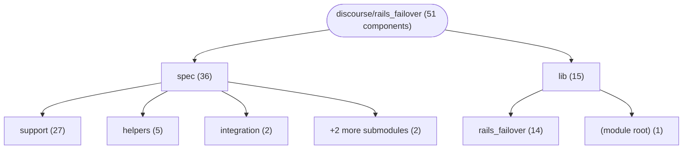
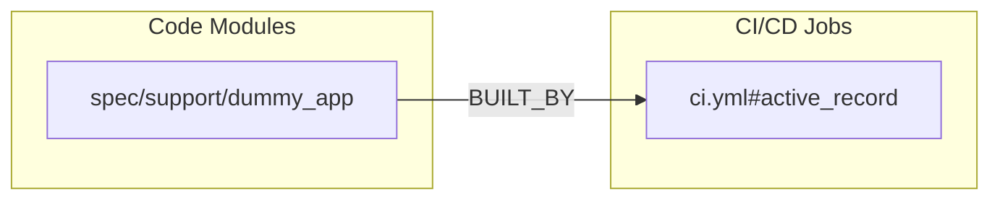
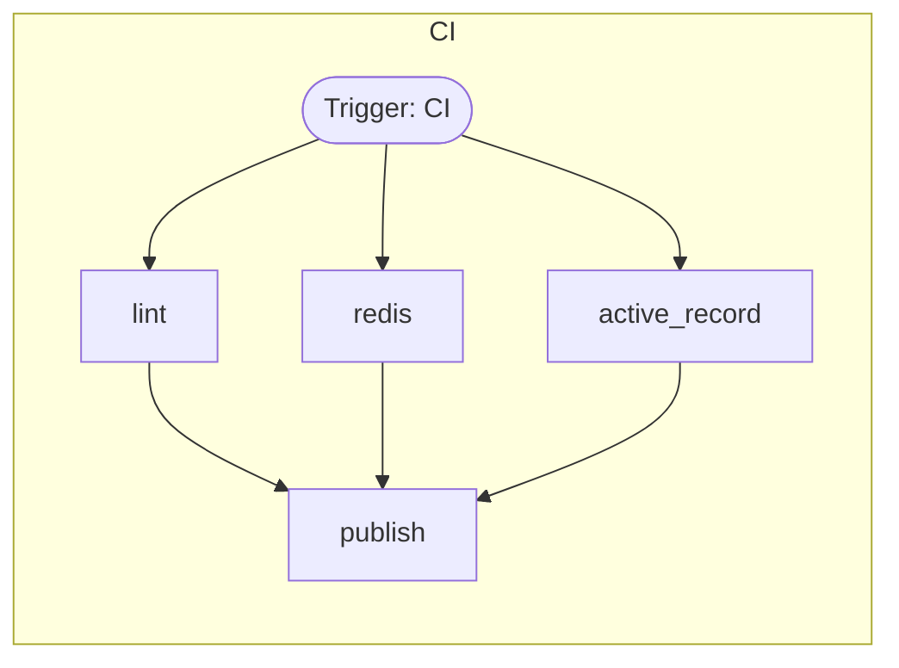

# Repository Architecture Analysis: discourse/rails_failover

## Metadata
- **SHA**: `c7d03a474d6198c921dcf27d8006f9d4a6bc92a3`
- **Primary Ecosystem**: Ruby

## Quality Metrics
- **ast_engine**: fallback
- **avg_cognitive_complexity**: 0.0
- **avg_cyclomatic_complexity**: 0.0
- **component_count**: 51
- **dead_code_count**: 0
- **dead_code_symbols**: 0 entry(ies)
- **duplication_pct**: 0.0
- **file_complexities**: 0 entry(ies)
- **files_analyzed**: 51
- **fitness_passed**: True
- **fitness_violation_count**: 0
- **framework**: Ruby on Rails
- **import_edges**: 0 entry(ies)
- **loc**: 2193
- **max_cognitive_complexity**: 0
- **max_cyclomatic_complexity**: 0
- **sloc**: 1471

# Architecture: discourse/rails_failover

## Context
- **Repository**: `discourse/rails_failover`
- **SHA**: `c7d03a474d6198c921dcf27d8006f9d4a6bc92a3`
- **Ecosystem**: Ruby
- **Framework**: Ruby on Rails

## Building Block View

## Component Details
- **rails_failover** (`lib/rails_failover.rb`): module
- **active_record** (`lib/rails_failover/active_record.rb`): module
- **redis** (`lib/rails_failover/redis.rb`): module
- **version** (`lib/rails_failover/version.rb`): module
- **handler** (`lib/rails_failover/active_record/handler.rb`): module
- **middleware** (`lib/rails_failover/active_record/middleware.rb`): module
- **railtie** (`lib/rails_failover/active_record/railtie.rb`): module
- **handler_base** (`lib/rails_failover/redis/handler_base.rb`): module
- **connector** (`lib/rails_failover/redis/compat_4x/connector.rb`): module
- **handler** (`lib/rails_failover/redis/compat_4x/handler.rb`): module
- **client** (`lib/rails_failover/redis/compat_4x/patches/client.rb`): module
- **client** (`lib/rails_failover/redis/compat_5x/client.rb`): module
- **config** (`lib/rails_failover/redis/compat_5x/config.rb`): module
- **handler** (`lib/rails_failover/redis/compat_5x/handler.rb`): module
- **client** (`lib/rails_failover/redis/compat_5x/patches/client.rb`): module
- **spec_helper** (`spec/spec_helper.rb`): module
- **generic_helper** (`spec/helpers/generic_helper.rb`): module
- **postgres_helper** (`spec/helpers/postgres_helper.rb`): module
- **rails_server_helper** (`spec/helpers/rails_server_helper.rb`): module
- **redis_helper** (`spec/helpers/redis_helper.rb`): module
- **url_helper** (`spec/helpers/url_helper.rb`): module
- **active_record_spec** (`spec/integration/active_record_spec.rb`): module
- **redis_spec** (`spec/integration/redis_spec.rb`): module
- **middleware_spec** (`spec/rails_failover/middleware_spec.rb`): module
- **application_controller** (`spec/support/dummy_app/app/controllers/application_controller.rb`): module
- **posts_controller** (`spec/support/dummy_app/app/controllers/posts_controller.rb`): module
- **application_helper** (`spec/support/dummy_app/app/helpers/application_helper.rb`): module
- **posts_helper** (`spec/support/dummy_app/app/helpers/posts_helper.rb`): module
- **application_record** (`spec/support/dummy_app/app/models/application_record.rb`): module
- **post** (`spec/support/dummy_app/app/models/post.rb`): module
- **application** (`spec/support/dummy_app/config/application.rb`): module
- **boot** (`spec/support/dummy_app/config/boot.rb`): module
- **environment** (`spec/support/dummy_app/config/environment.rb`): module
- **routes** (`spec/support/dummy_app/config/routes.rb`): module
- **unicorn.conf** (`spec/support/dummy_app/config/unicorn.conf.rb`): module
- **development** (`spec/support/dummy_app/config/environments/development.rb`): module
- **production** (`spec/support/dummy_app/config/environments/production.rb`): module
- **test** (`spec/support/dummy_app/config/environments/test.rb`): module
- **application_controller_renderer** (`spec/support/dummy_app/config/initializers/application_controller_renderer.rb`): module
- **assets** (`spec/support/dummy_app/config/initializers/assets.rb`): module
- **backtrace_silencers** (`spec/support/dummy_app/config/initializers/backtrace_silencers.rb`): module
- **content_security_policy** (`spec/support/dummy_app/config/initializers/content_security_policy.rb`): module
- **cookies_serializer** (`spec/support/dummy_app/config/initializers/cookies_serializer.rb`): module
- **filter_parameter_logging** (`spec/support/dummy_app/config/initializers/filter_parameter_logging.rb`): module
- **inflections** (`spec/support/dummy_app/config/initializers/inflections.rb`): module
- **mime_types** (`spec/support/dummy_app/config/initializers/mime_types.rb`): module
- **role_switcher_middleware** (`spec/support/dummy_app/config/initializers/role_switcher_middleware.rb`): module
- **trigger_pg_exception_middleware** (`spec/support/dummy_app/config/initializers/trigger_pg_exception_middleware.rb`): module
- **wrap_parameters** (`spec/support/dummy_app/config/initializers/wrap_parameters.rb`): module
- **seeds** (`spec/support/dummy_app/db/seeds.rb`): module
- **20200528020608_create_posts** (`spec/support/dummy_app/db/migrate/20200528020608_create_posts.rb`): module

## 6-Dimension Repository Scorecard

- **Overall Grade**: `C` (79.75/100)
- **Technical Debt Score**: 20.25
- **Estimated Remediation Effort**: 17.06h

| Dimension | Grade | Score | Weight | Details |
| :--- | :---: | :---: | :---: | :--- |
| Code Quality | `A` | 100.00 | 0.20 | avg_cc=0.00, max_cc=0, duplication=0.00%, dead_code=0 |
| Dependency Health | `A` | 100.00 | 0.15 | dependencies=11, outdated=0, vulnerable=0, has_lockfile=False |
| Maintainability | `A` | 100.00 | 0.15 | avg_cognitive=0.00, max_cognitive=0, fitness_violations=0, oversized_files=0 |
| Pipeline Health | `C` | 75.00 | 0.15 | workflows=1, operational_antipatterns=6, parallel_branches=True |
| Security | `F` | 40.00 | 0.20 | vulnerabilities=0, secrets=0, pipeline_security_findings=5 |
| Test Coverage | `C` | 70.00 | 0.15 | coverage=unavailable, ci_test_job=False, test_files_detected=True |

## Supply Chain Dependencies, Vulnerabilities & Secrets

- **Dependencies Parsed**: 11 | **Vulnerabilities**: 0 | **Secrets**: 0

### Inventory Sample
- `byebug` `*` (gem, `spec/support/dummy_app/Gemfile`)
- `concurrent-ruby` `1.3.4` (gem, `spec/support/dummy_app/Gemfile`)
- `listen` `*` (gem, `spec/support/dummy_app/Gemfile`)
- `pg` `1.3.0` (gem, `spec/support/dummy_app/Gemfile`)
- `psych` `3.0` (gem, `spec/support/dummy_app/Gemfile`)
- `rails` `*` (gem, `spec/support/dummy_app/Gemfile`)
- `rails` `*` (gem, `spec/support/dummy_app/Gemfile`)
- `rails_failover` `*` (gem, `spec/support/dummy_app/Gemfile`)
- `redis` `*` (gem, `Gemfile`)
- `sass-rails` `6` (gem, `spec/support/dummy_app/Gemfile`)
- `unicorn` `*` (gem, `spec/support/dummy_app/Gemfile`)

## Section 7: Code-to-Cloud Deployment Traceability

- `spec/support/dummy_app` (code_module) --[BUILT_BY]--> `ci.yml#active_record` (ci_job)

## CI/CD Pipeline Topology

