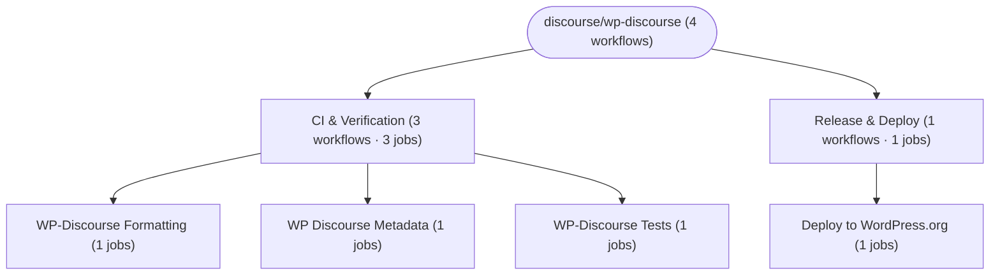

# Repository Architecture Analysis: discourse/wp-discourse

## Metadata
- **SHA**: `d89c4839c3aae0680df4fb191460fb2754120566`
- **Primary Ecosystem**: PHP

## Quality Metrics
- **ast_engine**: tree-sitter
- **avg_cognitive_complexity**: 1.16
- **avg_cyclomatic_complexity**: 1.8
- **component_count**: 95
- **dead_code_count**: 10
- **dead_code_symbols**: 10 entry(ies)
- **duplication_pct**: 4.76
- **file_complexities**: 5 entry(ies)
- **files_analyzed**: 97
- **fitness_passed**: True
- **fitness_violation_count**: 0
- **framework**: PHP Composer
- **import_edges**: 13 entry(ies)
- **loc**: 22888
- **max_cognitive_complexity**: 10
- **max_cyclomatic_complexity**: 9
- **sloc**: 13866
- **test_file_count**: 36

# Architecture: discourse/wp-discourse

## Context
- **Repository**: `discourse/wp-discourse`
- **SHA**: `d89c4839c3aae0680df4fb191460fb2754120566`
- **Ecosystem**: PHP
- **Framework**: PHP Composer

## Building Block View

```mermaid
graph TD;
    repo_root(["discourse/wp-discourse (95 components)"])
    dir_0_lib["lib (27)"]
    repo_root --> dir_0_lib
    sub_0_0__module_root_["(module root) (13)"]
    dir_0_lib --> sub_0_0__module_root_
    sub_0_1_logs["logs (5)"]
    dir_0_lib --> sub_0_1_logs
    sub_0_2_sso_client["sso-client (4)"]
    dir_0_lib --> sub_0_2_sso_client
    sub_0_more["+3 more submodules (5)"]
    dir_0_lib --> sub_0_more
    dir_1_tests["tests (21)"]
    repo_root --> dir_1_tests
    sub_1_0_phpunit["phpunit (16)"]
    dir_1_tests --> sub_1_0_phpunit
    sub_1_1_phpunit_helpers["phpunit/helpers (3)"]
    dir_1_tests --> sub_1_1_phpunit_helpers
    sub_1_2_phpunit_multisite["phpunit/multisite (2)"]
    dir_1_tests --> sub_1_2_phpunit_multisite
    dir_2_vendor_namespaced["vendor_namespaced (20)"]
    repo_root --> dir_2_vendor_namespaced
    sub_2_0_monolog["monolog (11)"]
    dir_2_vendor_namespaced --> sub_2_0_monolog
    sub_2_1_psr["psr (8)"]
    dir_2_vendor_namespaced --> sub_2_1_psr
    sub_2_2__module_root_["(module root) (1)"]
    dir_2_vendor_namespaced --> sub_2_2__module_root_
    dir_3_admin["admin (18)"]
    repo_root --> dir_3_admin
    sub_3_0__module_root_["(module root) (16)"]
    dir_3_admin --> sub_3_0__module_root_
    sub_3_1_discourse_sidebar["discourse-sidebar (2)"]
    dir_3_admin --> sub_3_1_discourse_sidebar
    dir_4__root_["(root) (3)"]
    repo_root --> dir_4__root_
    dir_other_modules["+2 more modules (6)"]
    repo_root --> dir_other_modules
```

## Component Details

Showing top 60 representative components out of 95 across 7 module group(s):

- **Module `lib`** (27 components — module: 27)
- **Module `tests`** (21 components — module: 21)
- **Module `vendor_namespaced`** (20 components — module: 20)
- **Module `admin`** (18 components — module: 17, MODULE: 1)
- **Module `(root)`** (3 components — module: 3)
- **Module `blocks`** (3 components — module: 1, MODULE: 1, UI_COMPONENT: 1)
- **Module `templates`** (3 components — module: 3)

- **AbstractHandler** (`vendor_namespaced/monolog/monolog/src/Monolog/Handler/AbstractHandler.php`): module
- **AbstractLogger** (`vendor_namespaced/psr/log/Psr/Log/AbstractLogger.php`): module
- **AbstractProcessingHandler** (`vendor_namespaced/monolog/monolog/src/Monolog/Handler/AbstractProcessingHandler.php`): module
- **FormatterInterface** (`vendor_namespaced/monolog/monolog/src/Monolog/Formatter/FormatterInterface.php`): module
- **HandlerInterface** (`vendor_namespaced/monolog/monolog/src/Monolog/Handler/HandlerInterface.php`): module
- **InvalidArgumentException** (`vendor_namespaced/psr/log/Psr/Log/InvalidArgumentException.php`): module
- **LineFormatter** (`vendor_namespaced/monolog/monolog/src/Monolog/Formatter/LineFormatter.php`): module
- **LogLevel** (`vendor_namespaced/psr/log/Psr/Log/LogLevel.php`): module
- **Logger** (`vendor_namespaced/monolog/monolog/src/Monolog/Logger.php`): module
- **LoggerAwareInterface** (`vendor_namespaced/psr/log/Psr/Log/LoggerAwareInterface.php`): module
- **LoggerAwareTrait** (`vendor_namespaced/psr/log/Psr/Log/LoggerAwareTrait.php`): module
- **LoggerInterface** (`vendor_namespaced/psr/log/Psr/Log/LoggerInterface.php`): module
- **LoggerTrait** (`vendor_namespaced/psr/log/Psr/Log/LoggerTrait.php`): module
- **NormalizerFormatter** (`vendor_namespaced/monolog/monolog/src/Monolog/Formatter/NormalizerFormatter.php`): module
- **NullHandler** (`vendor_namespaced/monolog/monolog/src/Monolog/Handler/NullHandler.php`): module
- **NullLogger** (`vendor_namespaced/psr/log/Psr/Log/NullLogger.php`): module
- **ResettableInterface** (`vendor_namespaced/monolog/monolog/src/Monolog/ResettableInterface.php`): module
- **StreamHandler** (`vendor_namespaced/monolog/monolog/src/Monolog/Handler/StreamHandler.php`): module
- **Utils** (`vendor_namespaced/monolog/monolog/src/Monolog/Utils.php`): module
- **WPDiscourseCommentsPlaceholder** (`blocks/comments/src/edit/placeholder.js`): UI_COMPONENT
- **admin** (`admin/admin.php`): module
- **admin-menu** (`admin/admin-menu.php`): module
- **admin-notice** (`admin/admin-notice.php`): module
- **ajax-comments** (`templates/ajax-comments.php`): module
- **autoload** (`vendor_namespaced/autoload.php`): module
- **blank** (`templates/blank.php`): module
- **bootstrap** (`tests/phpunit/bootstrap.php`): module
- **client** (`lib/sso-client/client.php`): module
- **comment-settings** (`admin/comment-settings.php`): module
- **comments** (`blocks/comments/comments.php`): module
- **configurable-text-settings** (`admin/configurable-text-settings.php`): module
- **connection-settings** (`admin/connection-settings.php`): module
- **discourse** (`lib/discourse.php`): module
- **discourse-base** (`lib/discourse-base.php`): module
- **discourse-comment** (`lib/discourse-comment.php`): module
- **discourse-comment-formatter** (`lib/discourse-comment-formatter.php`): module
- **discourse-publish** (`lib/discourse-publish.php`): module
- **discourse-sidebar** (`admin/discourse-sidebar/discourse-sidebar.php`): module
- **discourse-sidebar** (`admin/discourse-sidebar/package.json`): MODULE
- **discourse-sso** (`lib/sso-provider/discourse-sso.php`): module
- **email-notification** (`lib/email-notification.php`): module
- **file-handler** (`lib/logs/handlers/file-handler.php`): module
- **file-manager** (`lib/logs/managers/file-manager.php`): module
- **form-helper** (`admin/form-helper.php`): module
- **html-templates** (`templates/html-templates.php`): module
- **line-formatter** (`lib/logs/formatters/line-formatter.php`): module
- **log-viewer** (`admin/log-viewer.php`): module
- **logger** (`lib/logs/logger.php`): module
- **logging** (`tests/phpunit/helpers/logging.php`): module
- **meta-box** (`admin/meta-box.php`): module
- **multisite** (`tests/phpunit/helpers/multisite.php`): module
- **network-options** (`admin/network-options.php`): module
- **nonce** (`lib/sso-client/nonce.php`): module
- **null-handler** (`lib/logs/handlers/null-handler.php`): module
- **options-page** (`admin/options-page.php`): module
- **plugin-utilities** (`lib/plugin-utilities.php`): module
- **public-utilities** (`lib/utilities/public-utilities.php`): module
- **publish-settings** (`admin/publish-settings.php`): module
- **query-redirect** (`lib/sso-client/query-redirect.php`): module
- **remote-post** (`tests/phpunit/helpers/remote-post.php`): module

## 6-Dimension Repository Scorecard

- **Overall Grade**: `D` (66.62/100)
- **Technical Debt Score**: 33.38
- **Estimated Remediation Effort**: 33.80h

| Dimension | Grade | Score | Weight | Details |
| :--- | :---: | :---: | :---: | :--- |
| Code Quality | `C` | 72.86 | 0.20 | avg_cc=1.80, max_cc=9, duplication=4.76%, dead_code=10 |
| Dependency Health | `A` | 100.00 | 0.15 | dependencies=2660, outdated=0, vulnerable=0, has_lockfile=True |
| Maintainability | `A` | 95.00 | 0.15 | avg_cognitive=1.16, max_cognitive=10, fitness_violations=0, oversized_files=1 |
| Pipeline Health | `B` | 82.00 | 0.15 | workflows=4, operational_antipatterns=5, parallel_branches=False |
| Security | `F` | 0.00 | 0.20 | vulnerabilities=0, secrets=0, pipeline_security_findings=11 |
| Test Coverage | `C` | 70.00 | 0.15 | coverage=unavailable, ci_test_job=True, test_files_detected=True |

## Supply Chain Dependencies, Vulnerabilities & Secrets

- **Dependencies Parsed**: 2660 | **Vulnerabilities**: 0 | **Secrets**: 0

### Inventory Sample
- `composer/installers` `1.0` (composer, `composer.json`)
- `@wordpress/scripts` `37.1.0` (npm, `admin/discourse-sidebar/package-lock.json`)
- `@wordpress/scripts` `37.1.0` (npm, `admin/discourse-sidebar/package.json`)
- `@wordpress/scripts` `37.1.0` (npm, `blocks/comments/package-lock.json`)
- `@wordpress/scripts` `37.1.0` (npm, `blocks/comments/package.json`)
- `date-fns` `4.1.0` (npm, `blocks/comments/package.json`)
- `date-fns` `4.2.1` (npm, `blocks/comments/package-lock.json`)
- `html-react-parser` `5.2.17` (npm, `blocks/comments/package-lock.json`)
- `html-react-parser` `5.2.5` (npm, `blocks/comments/package.json`)
- `nodemon` `3.1.10` (npm, `admin/discourse-sidebar/package-lock.json`)
- `nodemon` `3.1.10` (npm, `admin/discourse-sidebar/package.json`)
- `nodemon` `3.1.10` (npm, `blocks/comments/package-lock.json`)
- `nodemon` `3.1.10` (npm, `blocks/comments/package.json`)
- `react-inlinesvg` `4.2.0` (npm, `blocks/comments/package.json`)
- `react-inlinesvg` `4.4.1` (npm, `blocks/comments/package-lock.json`)
- `semver` `7.5.2` (npm, `package.json`)
- `semver` `7.8.6` (npm, `package-lock.json`)
- `10up/wp_mock` `0.4.2` (composer, `composer.json`)
- `dealerdirect/phpcodesniffer-composer-installer` `1.0.0` (composer, `composer.json`)
- `dms/phpunit-arraysubset-asserts` `0.5.0` (composer, `composer.json`)
- `monolog/monolog` `1.25` (composer, `composer.json`)
- `phpcompatibility/php-compatibility` `*` (composer, `composer.json`)
- `phpunit/php-code-coverage` `9.2.13` (composer, `composer.json`)
- `phpunit/phpunit` `9.6.33` (composer, `composer.json`)
- `squizlabs/php_codesniffer` `*` (composer, `composer.json`)
- `wp-coding-standards/wpcs` `3.4.1` (composer, `composer.json`)
- `yoast/phpunit-polyfills` `1.0.1` (composer, `composer.json`)
- `@babel/code-frame` `7.29.7` (npm, `admin/discourse-sidebar/package-lock.json`)
- `@babel/code-frame` `7.29.7` (npm, `blocks/comments/package-lock.json`)
- `@babel/compat-data` `7.29.7` (npm, `admin/discourse-sidebar/package-lock.json`)
- ... (+2630 more dependencies)

## CI/CD Pipeline Topology

