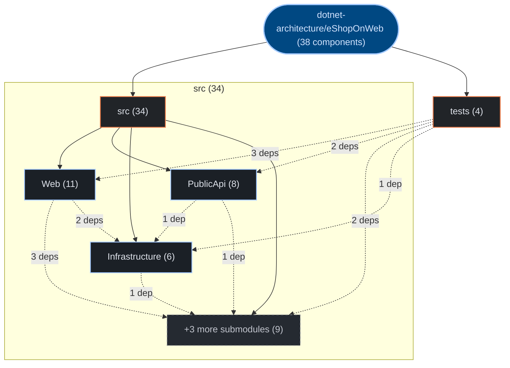
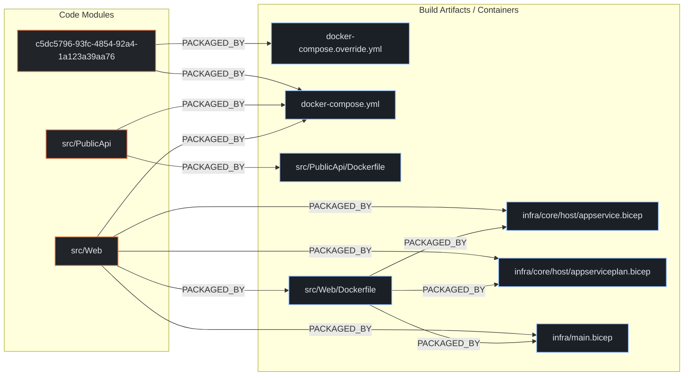
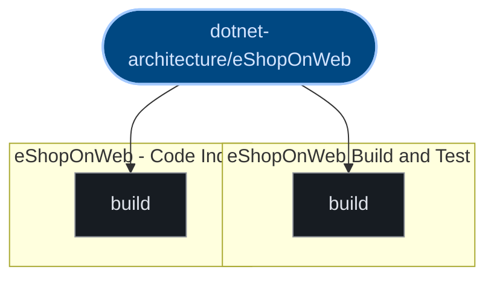

# Repository Architecture Analysis: dotnet-architecture/eShopOnWeb

## Metadata
- **SHA**: `4da8212117e87d808d4bbc7da6286fd2147ce606`
- **Primary Ecosystem**: .NET

## Quality Metrics
- **ast_engine**: tree-sitter
- **avg_cognitive_complexity**: 0.45
- **avg_cyclomatic_complexity**: 1.43
- **component_count**: 38
- **dead_code_count**: 17
- **dead_code_symbols**: 17 entry(ies)
- **duplication_pct**: 85.03
- **file_complexities**: 25 entry(ies)
- **files_analyzed**: 254
- **fitness_passed**: False
- **fitness_violation_count**: 1
- **framework**: ASP.NET Core
- **import_edges**: 100 entry(ies)
- **loc**: 10733
- **max_cognitive_complexity**: 9
- **max_cyclomatic_complexity**: 10
- **sloc**: 8663
- **test_file_count**: 50

# Architecture: dotnet-architecture/eShopOnWeb

## Context
- **Repository**: `dotnet-architecture/eShopOnWeb`
- **SHA**: `4da8212117e87d808d4bbc7da6286fd2147ce606`
- **Ecosystem**: .NET
- **Framework**: ASP.NET Core

## Building Block View

## Component Details
- **ApplicationCore** (`src/ApplicationCore/ApplicationCore.csproj`): MODULE (deps: BlazorShared)
- **BlazorAdmin** (`src/BlazorAdmin/BlazorAdmin.csproj`): MODULE (deps: BlazorShared)
- **BlazorShared** (`src/BlazorShared/BlazorShared.csproj`): MODULE
- **Infrastructure** (`src/Infrastructure/Infrastructure.csproj`): MODULE (deps: ApplicationCore)
- **PublicApi** (`src/PublicApi/PublicApi.csproj`): MODULE (deps: ApplicationCore, Infrastructure)
- **Web** (`src/Web/Web.csproj`): MODULE (deps: ApplicationCore, BlazorAdmin, BlazorShared, Infrastructure)
- **FunctionalTests** (`tests/FunctionalTests/FunctionalTests.csproj`): MODULE (deps: ApplicationCore, PublicApi, Web)
- **IntegrationTests** (`tests/IntegrationTests/IntegrationTests.csproj`): MODULE (deps: Infrastructure, UnitTests)
- **PublicApiIntegrationTests** (`tests/PublicApiIntegrationTests/PublicApiIntegrationTests.csproj`): MODULE (deps: PublicApi, Web)
- **UnitTests** (`tests/UnitTests/UnitTests.csproj`): MODULE (deps: ApplicationCore, Web)
- **BasketService** (`src/ApplicationCore/Services/BasketService.cs`): SERVICE
- **OrderService** (`src/ApplicationCore/Services/OrderService.cs`): SERVICE
- **CatalogItemService** (`src/BlazorAdmin/Services/CatalogItemService.cs`): SERVICE (deps: CatalogLookupDataService, HttpService)
- **CatalogLookupDataService** (`src/BlazorAdmin/Services/CatalogLookupDataService.cs`): SERVICE
- **HttpService** (`src/BlazorAdmin/Services/HttpService.cs`): SERVICE (deps: ToastService)
- **ToastService** (`src/BlazorAdmin/Services/ToastService.cs`): SERVICE
- **CatalogContext** (`src/Infrastructure/Data/CatalogContext.cs`): DATA_ACCESS_LAYER
- **EfRepository** (`src/Infrastructure/Data/EfRepository.cs`): DATA_ACCESS_LAYER (deps: CatalogContext)
- **BasketQueryService** (`src/Infrastructure/Data/Queries/BasketQueryService.cs`): SERVICE (deps: CatalogContext)
- **AppIdentityDbContext** (`src/Infrastructure/Identity/AppIdentityDbContext.cs`): DATA_ACCESS_LAYER
- **IdentityTokenClaimService** (`src/Infrastructure/Identity/IdentityTokenClaimService.cs`): SERVICE
- **GET_api_catalog-brands** (`src/PublicApi/CatalogBrandEndpoints/CatalogBrandListEndpoint.cs`): API_ROUTE
- **GET_api_catalog-items_{catalogItemId}** (`src/PublicApi/CatalogItemEndpoints/CatalogItemGetByIdEndpoint.cs`): API_ROUTE
- **GET_api_catalog-items** (`src/PublicApi/CatalogItemEndpoints/CatalogItemListPagedEndpoint.cs`): API_ROUTE
- **POST_api_catalog-items** (`src/PublicApi/CatalogItemEndpoints/CreateCatalogItemEndpoint.cs`): API_ROUTE
- **DELETE_api_catalog-items_{catalogItemId}** (`src/PublicApi/CatalogItemEndpoints/DeleteCatalogItemEndpoint.cs`): API_ROUTE
- **PUT_api_catalog-items** (`src/PublicApi/CatalogItemEndpoints/UpdateCatalogItemEndpoint.cs`): API_ROUTE
- **GET_api_catalog-types** (`src/PublicApi/CatalogTypeEndpoints/CatalogTypeListEndpoint.cs`): API_ROUTE
- **ManageController** (`src/Web/Controllers/ManageController.cs`): API_ROUTE
- **OrderController** (`src/Web/Controllers/OrderController.cs`): API_ROUTE
- **UserController** (`src/Web/Controllers/UserController.cs`): API_ROUTE
- **BaseApiController** (`src/Web/Controllers/Api/BaseApiController.cs`): API_ROUTE
- **GetMyOrdersHandler** (`src/Web/Features/MyOrders/GetMyOrdersHandler.cs`): SERVICE
- **GetOrderDetailsHandler** (`src/Web/Features/OrderDetails/GetOrderDetailsHandler.cs`): SERVICE
- **BasketViewModelService** (`src/Web/Services/BasketViewModelService.cs`): SERVICE (deps: BasketQueryService)
- **CachedCatalogViewModelService** (`src/Web/Services/CachedCatalogViewModelService.cs`): SERVICE (deps: CatalogViewModelService)
- **CatalogItemViewModelService** (`src/Web/Services/CatalogItemViewModelService.cs`): SERVICE
- **CatalogViewModelService** (`src/Web/Services/CatalogViewModelService.cs`): SERVICE

## 6-Dimension Repository Scorecard

- **Overall Grade**: `F` (59.02/100)
- **Technical Debt Score**: 40.98
- **Estimated Remediation Effort**: 56.00h

| Dimension | Grade | Score | Weight | Details |
| :--- | :---: | :---: | :---: | :--- |
| Code Quality | `F` | 55.00 | 0.20 | avg_cc=1.43, max_cc=10, duplication=85.03%, dead_code=17 |
| Dependency Health | `C` | 79.16 | 0.15 | dependencies=77, outdated=0, vulnerable=9, has_lockfile=False |
| Maintainability | `B` | 89.00 | 0.15 | avg_cognitive=0.45, max_cognitive=9, fitness_violations=1, oversized_files=1 |
| Pipeline Health | `B` | 82.00 | 0.15 | workflows=2, operational_antipatterns=4, parallel_branches=False |
| Security | `F` | 0.00 | 0.20 | vulnerabilities=14, secrets=0, pipeline_security_findings=3 |
| Test Coverage | `C` | 70.00 | 0.15 | coverage=unavailable, ci_test_job=True, test_files_detected=True |

## Architecture Fitness & Workspace Boundaries

- **[MEDIUM] `ATRUSS-ARCH-005` (COMPLEXITY_THRESHOLD)**: Repository duplication_pct (85.03) exceeds policy threshold (15.0).

## Supply Chain Dependencies, Vulnerabilities & Secrets

- **Dependencies Parsed**: 77 | **Vulnerabilities**: 14 | **Secrets**: 0

### Known Vulnerabilities (OSV)
- **[MEDIUM] `GHSA-59j7-ghrg-fj52`** `System.IdentityModel.Tokens.Jwt` `` (fixed: `none`, REACHABLE_FROM_RUNTIME)
- **[MEDIUM] `GHSA-59j7-ghrg-fj52`** `System.IdentityModel.Tokens.Jwt` `` (fixed: `none`, REACHABLE_FROM_RUNTIME)
- **[MEDIUM] `GHSA-59j7-ghrg-fj52`** `System.IdentityModel.Tokens.Jwt` `` (fixed: `none`, REACHABLE_FROM_RUNTIME)
- **[MEDIUM] `GHSA-5mfx-4wcx-rv27`** `Azure.Identity` `` (fixed: `none`, REACHABLE_FROM_RUNTIME)
- **[MEDIUM] `GHSA-8g4q-xg66-9fp4`** `System.Text.Json` `` (fixed: `none`, REACHABLE_FROM_RUNTIME)
- **[MEDIUM] `GHSA-cpw3-h88j-9f6x`** `System.Text.Json` `` (fixed: `none`, REACHABLE_FROM_RUNTIME)
- **[MEDIUM] `GHSA-g27p-qf6j-c96c`** `Microsoft.AspNetCore.Components.WebAssembly.Server` `` (fixed: `none`, UNREACHABLE_DORMANT)
- **[MEDIUM] `GHSA-hh2w-p6rv-4g7w`** `System.Text.Json` `` (fixed: `none`, REACHABLE_FROM_RUNTIME)
- **[MEDIUM] `GHSA-m5vv-6r4h-3vj9`** `Azure.Identity` `` (fixed: `none`, REACHABLE_FROM_RUNTIME)
- **[MEDIUM] `GHSA-q7cg-43mg-qp69`** `Microsoft.AspNetCore.Authentication.JwtBearer` `` (fixed: `none`, REACHABLE_FROM_RUNTIME)
- **[MEDIUM] `GHSA-q7cg-43mg-qp69`** `Microsoft.AspNetCore.Authentication.JwtBearer` `` (fixed: `none`, REACHABLE_FROM_RUNTIME)
- **[MEDIUM] `GHSA-qjpx-jqm5-h2c4`** `Microsoft.AspNetCore.Components.WebAssembly.Server` `` (fixed: `none`, UNREACHABLE_DORMANT)
- **[MEDIUM] `GHSA-qrmm-w75w-3wpx`** `Swashbuckle.AspNetCore.SwaggerUI` `` (fixed: `none`, UNREACHABLE_DORMANT)
- **[MEDIUM] `GHSA-wvxc-855f-jvrv`** `Azure.Identity` `` (fixed: `none`, REACHABLE_FROM_RUNTIME)

### Inventory Sample
- `Ardalis.ApiEndpoints` `*` (NuGet, `src/PublicApi/PublicApi.csproj`)
- `Ardalis.GuardClauses` `*` (NuGet, `src/ApplicationCore/ApplicationCore.csproj`)
- `Ardalis.ListStartupServices` `*` (NuGet, `src/Web/Web.csproj`)
- `Ardalis.Result` `*` (NuGet, `src/ApplicationCore/ApplicationCore.csproj`)
- `Ardalis.Specification` `*` (NuGet, `src/ApplicationCore/ApplicationCore.csproj`)
- `Ardalis.Specification` `*` (NuGet, `src/Web/Web.csproj`)
- `Ardalis.Specification.EntityFrameworkCore` `*` (NuGet, `src/Infrastructure/Infrastructure.csproj`)
- `AutoMapper.Extensions.Microsoft.DependencyInjection` `*` (NuGet, `src/PublicApi/PublicApi.csproj`)
- `AutoMapper.Extensions.Microsoft.DependencyInjection` `*` (NuGet, `src/Web/Web.csproj`)
- `Azure.Extensions.AspNetCore.Configuration.Secrets` `*` (NuGet, `src/Web/Web.csproj`)
- `Azure.Identity` `*` (NuGet, `src/Web/Web.csproj`)
- `BlazorInputFile` `*` (NuGet, `src/BlazorAdmin/BlazorAdmin.csproj`)
- `BlazorInputFile` `*` (NuGet, `src/BlazorShared/BlazorShared.csproj`)
- `Blazored.LocalStorage` `*` (NuGet, `src/BlazorAdmin/BlazorAdmin.csproj`)
- `BuildBundlerMinifier` `*` (NuGet, `src/Web/Web.csproj`)
- `FluentValidation` `*` (NuGet, `src/BlazorShared/BlazorShared.csproj`)
- `MSTest.TestAdapter` `*` (NuGet, `tests/PublicApiIntegrationTests/PublicApiIntegrationTests.csproj`)
- `MSTest.TestFramework` `*` (NuGet, `tests/PublicApiIntegrationTests/PublicApiIntegrationTests.csproj`)
- `MediatR` `*` (NuGet, `src/Web/Web.csproj`)
- `Microsoft.AspNetCore.Authentication.JwtBearer` `*` (NuGet, `src/PublicApi/PublicApi.csproj`)
- `Microsoft.AspNetCore.Authentication.JwtBearer` `*` (NuGet, `src/Web/Web.csproj`)
- `Microsoft.AspNetCore.Components.Authorization` `*` (NuGet, `src/BlazorAdmin/BlazorAdmin.csproj`)
- `Microsoft.AspNetCore.Components.WebAssembly` `*` (NuGet, `src/BlazorAdmin/BlazorAdmin.csproj`)
- `Microsoft.AspNetCore.Components.WebAssembly.Authentication` `*` (NuGet, `src/BlazorAdmin/BlazorAdmin.csproj`)
- `Microsoft.AspNetCore.Components.WebAssembly.DevServer` `*` (NuGet, `src/BlazorAdmin/BlazorAdmin.csproj`)
- `Microsoft.AspNetCore.Components.WebAssembly.Server` `*` (NuGet, `src/Web/Web.csproj`)
- `Microsoft.AspNetCore.Diagnostics.EntityFrameworkCore` `*` (NuGet, `src/PublicApi/PublicApi.csproj`)
- `Microsoft.AspNetCore.Diagnostics.EntityFrameworkCore` `*` (NuGet, `src/Web/Web.csproj`)
- `Microsoft.AspNetCore.Identity.EntityFrameworkCore` `*` (NuGet, `src/Infrastructure/Infrastructure.csproj`)
- `Microsoft.AspNetCore.Identity.EntityFrameworkCore` `*` (NuGet, `src/PublicApi/PublicApi.csproj`)
- ... (+47 more dependencies)

## Section 7: Code-to-Cloud Deployment Traceability

- `c5dc5796-93fc-4854-92a4-1a123a39aa76` (code_module) --[PACKAGED_BY]--> `docker-compose.override.yml` (container)
- `c5dc5796-93fc-4854-92a4-1a123a39aa76` (code_module) --[PACKAGED_BY]--> `docker-compose.yml` (container)
- `src/PublicApi` (code_module) --[PACKAGED_BY]--> `docker-compose.yml` (container)
- `src/PublicApi` (code_module) --[PACKAGED_BY]--> `src/PublicApi/Dockerfile` (container)
- `src/Web` (code_module) --[PACKAGED_BY]--> `docker-compose.yml` (container)
- `src/Web` (code_module) --[PACKAGED_BY]--> `src/Web/Dockerfile` (container)
- `src/Web` (code_module) --[PACKAGED_BY]--> `infra/core/host/appservice.bicep` (iac)
- `src/Web` (code_module) --[PACKAGED_BY]--> `infra/core/host/appserviceplan.bicep` (iac)
- `src/Web` (code_module) --[PACKAGED_BY]--> `infra/main.bicep` (iac)
- `src/Web/Dockerfile` (container) --[PACKAGED_BY]--> `infra/core/host/appservice.bicep` (iac)
- `src/Web/Dockerfile` (container) --[PACKAGED_BY]--> `infra/core/host/appserviceplan.bicep` (iac)
- `src/Web/Dockerfile` (container) --[PACKAGED_BY]--> `infra/main.bicep` (iac)

## CI/CD Pipeline Topology

