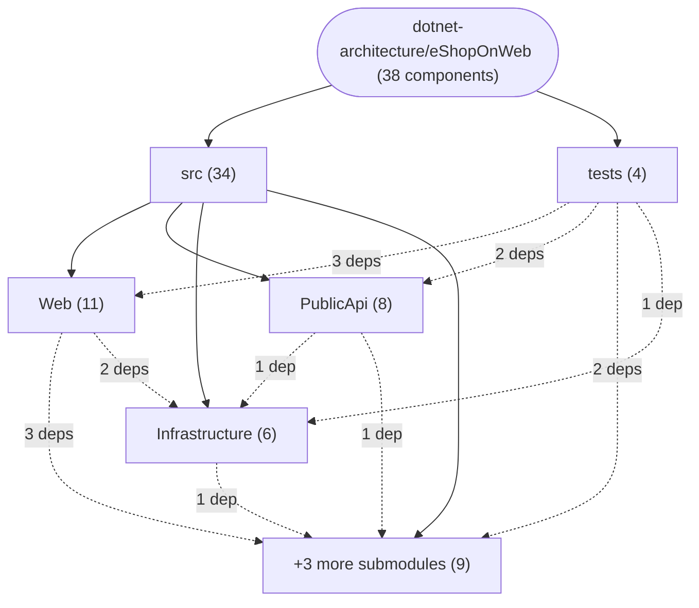

# Repository Architecture Analysis: dotnet-architecture/eShopOnWeb

## Metadata
- **SHA**: `4da8212117e87d808d4bbc7da6286fd2147ce606`
- **Primary Ecosystem**: .NET

## Quality Metrics
- **avg_cyclomatic_complexity**: 1.61
- **component_count**: 38
- **files_analyzed**: 508
- **framework**: ASP.NET Core
- **loc**: 21466
- **max_cyclomatic_complexity**: 57
- **sloc**: 17326

# Architecture: dotnet-architecture/eShopOnWeb

## Context
- **Repository**: `dotnet-architecture/eShopOnWeb`
- **SHA**: `4da8212117e87d808d4bbc7da6286fd2147ce606`
- **Ecosystem**: .NET
- **Framework**: Unknown

## Building Block View

## Component Details
- **ApplicationCore** (`src/ApplicationCore/ApplicationCore.csproj`): MODULE (deps: BlazorShared)
- **BlazorAdmin** (`src/BlazorAdmin/BlazorAdmin.csproj`): MODULE (deps: BlazorShared)
- **BlazorShared** (`src/BlazorShared/BlazorShared.csproj`): MODULE
- **Infrastructure** (`src/Infrastructure/Infrastructure.csproj`): MODULE (deps: ApplicationCore)
- **PublicApi** (`src/PublicApi/PublicApi.csproj`): MODULE (deps: ApplicationCore, Infrastructure)
- **Web** (`src/Web/Web.csproj`): MODULE (deps: ApplicationCore, BlazorAdmin, BlazorShared, Infrastructure)
- **FunctionalTests** (`tests/FunctionalTests/FunctionalTests.csproj`): MODULE (deps: ApplicationCore, PublicApi, Web)
- **IntegrationTests** (`tests/IntegrationTests/IntegrationTests.csproj`): MODULE (deps: Infrastructure, UnitTests)
- **PublicApiIntegrationTests** (`tests/PublicApiIntegrationTests/PublicApiIntegrationTests.csproj`): MODULE (deps: PublicApi, Web)
- **UnitTests** (`tests/UnitTests/UnitTests.csproj`): MODULE (deps: ApplicationCore, Web)
- **BasketService** (`src/ApplicationCore/Services/BasketService.cs`): SERVICE
- **OrderService** (`src/ApplicationCore/Services/OrderService.cs`): SERVICE
- **CatalogItemService** (`src/BlazorAdmin/Services/CatalogItemService.cs`): SERVICE (deps: CatalogLookupDataService, HttpService)
- **CatalogLookupDataService** (`src/BlazorAdmin/Services/CatalogLookupDataService.cs`): SERVICE
- **HttpService** (`src/BlazorAdmin/Services/HttpService.cs`): SERVICE (deps: ToastService)
- **ToastService** (`src/BlazorAdmin/Services/ToastService.cs`): SERVICE
- **CatalogContext** (`src/Infrastructure/Data/CatalogContext.cs`): DATA_ACCESS_LAYER
- **EfRepository** (`src/Infrastructure/Data/EfRepository.cs`): DATA_ACCESS_LAYER (deps: CatalogContext)
- **BasketQueryService** (`src/Infrastructure/Data/Queries/BasketQueryService.cs`): SERVICE (deps: CatalogContext)
- **AppIdentityDbContext** (`src/Infrastructure/Identity/AppIdentityDbContext.cs`): DATA_ACCESS_LAYER
- **IdentityTokenClaimService** (`src/Infrastructure/Identity/IdentityTokenClaimService.cs`): SERVICE
- **GET_api_catalog-brands** (`src/PublicApi/CatalogBrandEndpoints/CatalogBrandListEndpoint.cs`): API_ROUTE
- **GET_api_catalog-items_{catalogItemId}** (`src/PublicApi/CatalogItemEndpoints/CatalogItemGetByIdEndpoint.cs`): API_ROUTE
- **GET_api_catalog-items** (`src/PublicApi/CatalogItemEndpoints/CatalogItemListPagedEndpoint.cs`): API_ROUTE
- **POST_api_catalog-items** (`src/PublicApi/CatalogItemEndpoints/CreateCatalogItemEndpoint.cs`): API_ROUTE
- **DELETE_api_catalog-items_{catalogItemId}** (`src/PublicApi/CatalogItemEndpoints/DeleteCatalogItemEndpoint.cs`): API_ROUTE
- **PUT_api_catalog-items** (`src/PublicApi/CatalogItemEndpoints/UpdateCatalogItemEndpoint.cs`): API_ROUTE
- **GET_api_catalog-types** (`src/PublicApi/CatalogTypeEndpoints/CatalogTypeListEndpoint.cs`): API_ROUTE
- **BaseApiController** (`src/Web/Controllers/Api/BaseApiController.cs`): API_ROUTE
- **ManageController** (`src/Web/Controllers/ManageController.cs`): API_ROUTE
- **OrderController** (`src/Web/Controllers/OrderController.cs`): API_ROUTE
- **UserController** (`src/Web/Controllers/UserController.cs`): API_ROUTE
- **GetMyOrdersHandler** (`src/Web/Features/MyOrders/GetMyOrdersHandler.cs`): SERVICE
- **GetOrderDetailsHandler** (`src/Web/Features/OrderDetails/GetOrderDetailsHandler.cs`): SERVICE
- **BasketViewModelService** (`src/Web/Services/BasketViewModelService.cs`): SERVICE (deps: BasketQueryService)
- **CachedCatalogViewModelService** (`src/Web/Services/CachedCatalogViewModelService.cs`): SERVICE (deps: CatalogViewModelService)
- **CatalogItemViewModelService** (`src/Web/Services/CatalogItemViewModelService.cs`): SERVICE
- **CatalogViewModelService** (`src/Web/Services/CatalogViewModelService.cs`): SERVICE

## CI/CD Pipeline Topology

