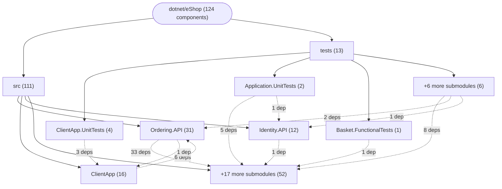
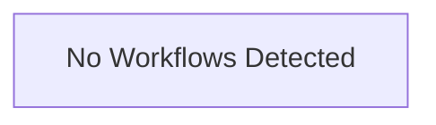

# Repository Architecture Analysis: dotnet/eShop

## Metadata
- **SHA**: `913acea66708a59595351174cee9b29f37179d29`
- **Primary Ecosystem**: .NET

## Quality Metrics
- **avg_cyclomatic_complexity**: 2.51
- **component_count**: 124
- **files_analyzed**: 1092
- **framework**: ASP.NET Core
- **loc**: 52597
- **max_cyclomatic_complexity**: 137
- **sloc**: 41333

# Architecture: dotnet/eShop

## Context
- **Repository**: `dotnet/eShop`
- **SHA**: `913acea66708a59595351174cee9b29f37179d29`
- **Ecosystem**: .NET
- **Framework**: Unknown

## Building Block View

## Component Details

Showing top 60 representative components out of 124 across 2 module group(s):

- **Module `src`** (111 components — SERVICE: 74, MODULE: 19, API_ROUTE: 10)
- **Module `tests`** (13 components — MODULE: 9, SERVICE: 4)

- **Application.UnitTests** (`tests/Application.UnitTests/Application.UnitTests.csproj`): MODULE (deps: Catalog.API, Identity.API, OrderProcessor, PaymentProcessor, WebhookClient, Webhooks.API)
- **CreateOrderCommandHandler** (`src/Ordering.API/Application/Commands/CreateOrderCommandHandler.cs`): SERVICE (deps: CreateOrderIdentifiedCommandHandler, IdentifiedCommandHandler, IdentityService, OrderRepository, OrderingIntegrationEventService)
- **CreateOrderIdentifiedCommandHandler** (`src/Ordering.API/Application/Commands/CreateOrderCommandHandler.cs`): SERVICE (deps: CreateOrderCommandHandler, IdentifiedCommandHandler, IdentityService, OrderRepository, OrderingIntegrationEventService)
- **Ordering.API** (`src/Ordering.API/Ordering.API.csproj`): MODULE (deps: EventBusRabbitMQ, IntegrationEventLogEF, Ordering.Domain, Ordering.Infrastructure, eShop.ServiceDefaults)
- **AppEnvironmentService** (`src/ClientApp/Services/AppEnvironment/AppEnvironmentService.cs`): SERVICE (deps: BasketService, CatalogService, IdentityService, OrderService)
- **Ordering.FunctionalTests** (`tests/Ordering.FunctionalTests/Ordering.FunctionalTests.csproj`): MODULE (deps: Identity.API, Ordering.API, Ordering.Domain, Ordering.Infrastructure)
- **BasketService** (`src/ClientApp/Services/Basket/BasketService.cs`): SERVICE (deps: FixUriService, IdentityService, SettingsService)
- **CancelOrderCommandHandler** (`src/Ordering.API/Application/Commands/CancelOrderCommandHandler.cs`): SERVICE (deps: CancelOrderIdentifiedCommandHandler, IdentifiedCommandHandler, OrderRepository)
- **CancelOrderIdentifiedCommandHandler** (`src/Ordering.API/Application/Commands/CancelOrderCommandHandler.cs`): SERVICE (deps: CancelOrderCommandHandler, IdentifiedCommandHandler, OrderRepository)
- **Catalog.API** (`src/Catalog.API/Catalog.API.csproj`): MODULE (deps: EventBusRabbitMQ, IntegrationEventLogEF, eShop.ServiceDefaults)
- **OrderCancelledDomainEventHandler** (`src/Ordering.API/Application/DomainEventHandlers/OrderCancelledDomainEventHandler.cs`): SERVICE (deps: BuyerRepository, OrderRepository, OrderingIntegrationEventService)
- **OrderShippedDomainEventHandler** (`src/Ordering.API/Application/DomainEventHandlers/OrderShippedDomainEventHandler.cs`): SERVICE (deps: BuyerRepository, OrderRepository, OrderingIntegrationEventService)
- **OrderStatusChangedToAwaitingValidationDomainEventHandler** (`src/Ordering.API/Application/DomainEventHandlers/OrderStatusChangedToAwaitingValidationDomainEventHandler.cs`): SERVICE (deps: BuyerRepository, OrderRepository, OrderingIntegrationEventService)
- **OrderStatusChangedToPaidDomainEventHandler** (`src/Ordering.API/Application/DomainEventHandlers/OrderStatusChangedToPaidDomainEventHandler.cs`): SERVICE (deps: BuyerRepository, OrderRepository, OrderingIntegrationEventService)
- **OrderStatusChangedToStockConfirmedDomainEventHandler** (`src/Ordering.API/Application/DomainEventHandlers/OrderStatusChangedToStockConfirmedDomainEventHandler.cs`): SERVICE (deps: BuyerRepository, OrderRepository, OrderingIntegrationEventService)
- **Ordering.UnitTests** (`tests/Ordering.UnitTests/Ordering.UnitTests.csproj`): MODULE (deps: Ordering.API, Ordering.Domain, Ordering.Infrastructure)
- **SetAwaitingValidationIdentifiedOrderStatusCommandHandler** (`src/Ordering.API/Application/Commands/SetAwaitingValidationOrderStatusCommandHandler.cs`): SERVICE (deps: IdentifiedCommandHandler, OrderRepository, SetAwaitingValidationOrderStatusCommandHandler)
- **SetAwaitingValidationOrderStatusCommandHandler** (`src/Ordering.API/Application/Commands/SetAwaitingValidationOrderStatusCommandHandler.cs`): SERVICE (deps: IdentifiedCommandHandler, OrderRepository, SetAwaitingValidationIdentifiedOrderStatusCommandHandler)
- **SetPaidIdentifiedOrderStatusCommandHandler** (`src/Ordering.API/Application/Commands/SetPaidOrderStatusCommandHandler.cs`): SERVICE (deps: IdentifiedCommandHandler, OrderRepository, SetPaidOrderStatusCommandHandler)
- **SetPaidOrderStatusCommandHandler** (`src/Ordering.API/Application/Commands/SetPaidOrderStatusCommandHandler.cs`): SERVICE (deps: IdentifiedCommandHandler, OrderRepository, SetPaidIdentifiedOrderStatusCommandHandler)
- **SetStockConfirmedOrderStatusCommandHandler** (`src/Ordering.API/Application/Commands/SetStockConfirmedOrderStatusCommandHandler.cs`): SERVICE (deps: IdentifiedCommandHandler, OrderRepository, SetStockConfirmedOrderStatusIdentifiedCommandHandler)
- **SetStockConfirmedOrderStatusIdentifiedCommandHandler** (`src/Ordering.API/Application/Commands/SetStockConfirmedOrderStatusCommandHandler.cs`): SERVICE (deps: IdentifiedCommandHandler, OrderRepository, SetStockConfirmedOrderStatusCommandHandler)
- **SetStockRejectedOrderStatusCommandHandler** (`src/Ordering.API/Application/Commands/SetStockRejectedOrderStatusCommandHandler.cs`): SERVICE (deps: IdentifiedCommandHandler, OrderRepository, SetStockRejectedOrderStatusIdentifiedCommandHandler)
- **SetStockRejectedOrderStatusIdentifiedCommandHandler** (`src/Ordering.API/Application/Commands/SetStockRejectedOrderStatusCommandHandler.cs`): SERVICE (deps: IdentifiedCommandHandler, OrderRepository, SetStockRejectedOrderStatusCommandHandler)
- **ShipOrderCommandHandler** (`src/Ordering.API/Application/Commands/ShipOrderCommandHandler.cs`): SERVICE (deps: IdentifiedCommandHandler, OrderRepository, ShipOrderIdentifiedCommandHandler)
- **ShipOrderIdentifiedCommandHandler** (`src/Ordering.API/Application/Commands/ShipOrderCommandHandler.cs`): SERVICE (deps: IdentifiedCommandHandler, OrderRepository, ShipOrderCommandHandler)
- **WebApp** (`src/WebApp/WebApp.csproj`): MODULE (deps: EventBusRabbitMQ, WebAppComponents, eShop.ServiceDefaults)
- **Webhooks.API** (`src/Webhooks.API/Webhooks.API.csproj`): MODULE (deps: EventBusRabbitMQ, IntegrationEventLogEF, eShop.ServiceDefaults)
- **Basket.API** (`src/Basket.API/Basket.API.csproj`): MODULE (deps: EventBusRabbitMQ, eShop.ServiceDefaults)
- **CatalogIntegrationEventService** (`src/Catalog.API/IntegrationEvents/CatalogIntegrationEventService.cs`): SERVICE (deps: CatalogContext, IntegrationEventLogService)
- **CatalogService** (`src/ClientApp/Services/Catalog/CatalogService.cs`): SERVICE (deps: FixUriService, SettingsService)
- **MauiNavigationService** (`src/ClientApp/Services/Navigation/MauiNavigationService.cs`): SERVICE (deps: AppEnvironmentService, IdentityService)
- **OrderProcessor** (`src/OrderProcessor/OrderProcessor.csproj`): MODULE (deps: EventBusRabbitMQ, eShop.ServiceDefaults)
- **OrderService** (`src/ClientApp/Services/Order/OrderService.cs`): SERVICE (deps: IdentityService, SettingsService)
- **OrderStatusChangedToAwaitingValidationIntegrationEventHandler** (`src/Catalog.API/IntegrationEvents/EventHandling/OrderStatusChangedToAwaitingValidationIntegrationEventHandler.cs`): SERVICE (deps: CatalogContext, CatalogIntegrationEventService)
- **Ordering.Infrastructure** (`src/Ordering.Infrastructure/Ordering.Infrastructure.csproj`): MODULE (deps: IntegrationEventLogEF, Ordering.Domain)
- **OrderingIntegrationEventService** (`src/Ordering.API/Application/IntegrationEvents/OrderingIntegrationEventService.cs`): SERVICE (deps: IntegrationEventLogService, OrderingContext)
- **PaymentProcessor** (`src/PaymentProcessor/PaymentProcessor.csproj`): MODULE (deps: EventBusRabbitMQ, eShop.ServiceDefaults)
- **ValidateOrAddBuyerAggregateWhenOrderStartedDomainEventHandler** (`src/Ordering.API/Application/DomainEventHandlers/ValidateOrAddBuyerAggregateWhenOrderStartedDomainEventHandler.cs`): SERVICE (deps: BuyerRepository, OrderingIntegrationEventService)
- **Basket.FunctionalTests** (`tests/Basket.FunctionalTests/Basket.FunctionalTests.csproj`): MODULE (deps: Basket.API)
- **Basket.UnitTests** (`tests/Basket.UnitTests/Basket.UnitTests.csproj`): MODULE (deps: Basket.API)
- **BasketMockService** (`src/ClientApp/Services/Basket/BasketMockService.cs`): SERVICE (deps: BasketService)
- **BuyerRepository** (`src/Ordering.Infrastructure/Repositories/BuyerRepository.cs`): DATA_ACCESS_LAYER (deps: OrderingContext)
- **Catalog.FunctionalTests** (`tests/Catalog.FunctionalTests/Catalog.FunctionalTests.csproj`): MODULE (deps: Catalog.API)
- **CatalogMockService** (`src/ClientApp/Services/Catalog/CatalogMockService.cs`): SERVICE (deps: CatalogService)
- **ClientApp.UnitTests** (`tests/ClientApp.UnitTests/ClientApp.UnitTests.csproj`): MODULE (deps: ClientApp)
- **EventBusRabbitMQ** (`src/EventBusRabbitMQ/EventBusRabbitMQ.csproj`): MODULE (deps: EventBus)
- **FixUriService** (`src/ClientApp/Services/FixUri/FixUriService.cs`): SERVICE (deps: SettingsService)
- **GracePeriodManagerService** (`src/OrderProcessor/Services/GracePeriodManagerService.cs`): SERVICE (deps: GracePeriodOrdersRepository)
- **HybridApp** (`src/HybridApp/HybridApp.csproj`): MODULE (deps: WebAppComponents)
- **Identity.API** (`src/Identity.API/Identity.API.csproj`): MODULE (deps: eShop.ServiceDefaults)
- **IdentityMockService** (`src/ClientApp/Services/Identity/IdentityMockService.cs`): SERVICE (deps: IdentityService)
- **IdentityService** (`src/ClientApp/Services/Identity/IdentityService.cs`): SERVICE (deps: SettingsService)
- **IntegrationEventLogEF** (`src/IntegrationEventLogEF/IntegrationEventLogEF.csproj`): MODULE (deps: EventBus)
- **LocationService** (`src/ClientApp/Services/Location/LocationService.cs`): SERVICE (deps: IdentityService)
- **MockDialogService** (`tests/ClientApp.UnitTests/Mocks/MockDialogService.cs`): SERVICE (deps: DialogService)
- **MockSettingsService** (`tests/ClientApp.UnitTests/Mocks/MockSettingsService.cs`): SERVICE (deps: SettingsService)
- **OrderMockService** (`src/ClientApp/Services/Order/OrderMockService.cs`): SERVICE (deps: OrderService)
- **OrderRepository** (`src/Ordering.Infrastructure/Repositories/OrderRepository.cs`): DATA_ACCESS_LAYER (deps: OrderingContext)
- **OrderStatusChangedToAwaitingValidationIntegrationEventHandler** (`src/WebApp/Services/OrderStatus/IntegrationEvents/EventHandling/OrderStatusChangedToAwaitingValidationIntegrationEventHandler.cs`): SERVICE (deps: OrderStatusNotificationService)

## CI/CD Pipeline Topology

