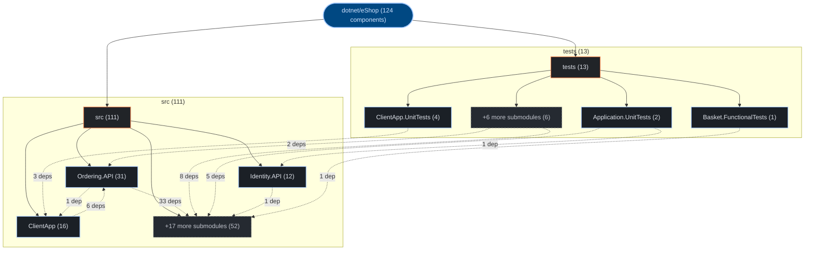
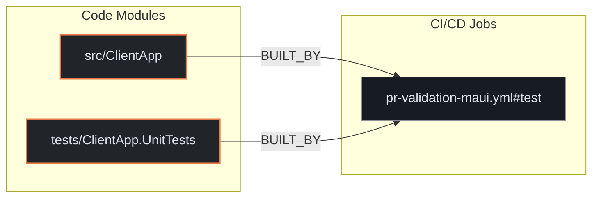
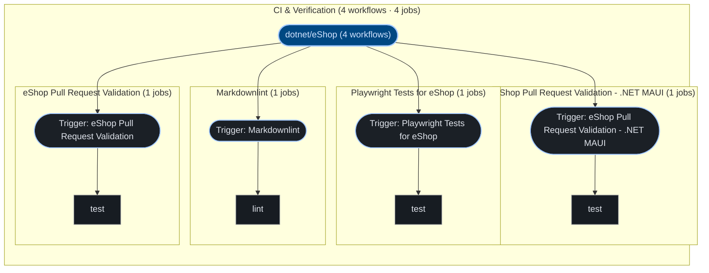

# Repository Architecture Analysis: dotnet/eShop

## Metadata
- **SHA**: `ab10e4c68fd26369578ebfb3fd1ccf3b867d0444`
- **Primary Ecosystem**: .NET

## Quality Metrics
- **ast_engine**: tree-sitter
- **avg_cognitive_complexity**: 0.76
- **avg_cyclomatic_complexity**: 1.65
- **component_count**: 124
- **dead_code_count**: 82
- **dead_code_symbols**: 50 entry(ies)
- **duplication_pct**: 83.61
- **file_complexities**: 25 entry(ies)
- **files_analyzed**: 547
- **fitness_passed**: False
- **fitness_violation_count**: 11
- **framework**: ASP.NET Core
- **import_edges**: 100 entry(ies)
- **loc**: 26398
- **max_cognitive_complexity**: 28
- **max_cyclomatic_complexity**: 25
- **sloc**: 20752
- **test_file_count**: 65

# Architecture: dotnet/eShop

## Context
- **Repository**: `dotnet/eShop`
- **SHA**: `ab10e4c68fd26369578ebfb3fd1ccf3b867d0444`
- **Ecosystem**: .NET
- **Framework**: ASP.NET Core

## Building Block View

## Component Details

Showing top 60 representative components out of 124 across 2 module group(s):

- **Module `src`** (111 components — SERVICE: 74, MODULE: 19, API_ROUTE: 10)
- **Module `tests`** (13 components — MODULE: 9, SERVICE: 4)

- **Application.UnitTests** (`tests/Application.UnitTests/Application.UnitTests.csproj`): MODULE (deps: Catalog.API, Identity.API, OrderProcessor, PaymentProcessor, WebhookClient, Webhooks.API)
- **CreateOrderCommandHandler** (`src/Ordering.API/Application/Commands/CreateOrderCommandHandler.cs`): SERVICE (deps: CreateOrderIdentifiedCommandHandler, IdentifiedCommandHandler, IdentityService, OrderRepository, OrderingIntegrationEventService)
- **CreateOrderIdentifiedCommandHandler** (`src/Ordering.API/Application/Commands/CreateOrderCommandHandler.cs`): SERVICE (deps: CreateOrderCommandHandler, IdentifiedCommandHandler, IdentityService, OrderRepository, OrderingIntegrationEventService)
- **Ordering.API** (`src/Ordering.API/Ordering.API.csproj`): MODULE (deps: EventBusRabbitMQ, IntegrationEventLogEF, Ordering.Domain, Ordering.Infrastructure, eShop.ServiceDefaults)
- **AppEnvironmentService** (`src/ClientApp/Services/AppEnvironment/AppEnvironmentService.cs`): SERVICE (deps: BasketService, CatalogService, IdentityService, OrderService)
- **BasketService** (`src/ClientApp/Services/Basket/BasketService.cs`): SERVICE (deps: FixUriService, IdentityService, SettingsService)
- **CancelOrderCommandHandler** (`src/Ordering.API/Application/Commands/CancelOrderCommandHandler.cs`): SERVICE (deps: CancelOrderIdentifiedCommandHandler, IdentifiedCommandHandler, OrderRepository)
- **CancelOrderIdentifiedCommandHandler** (`src/Ordering.API/Application/Commands/CancelOrderCommandHandler.cs`): SERVICE (deps: CancelOrderCommandHandler, IdentifiedCommandHandler, OrderRepository)
- **Catalog.API** (`src/Catalog.API/Catalog.API.csproj`): MODULE (deps: EventBusRabbitMQ, IntegrationEventLogEF, eShop.ServiceDefaults)
- **OrderCancelledDomainEventHandler** (`src/Ordering.API/Application/DomainEventHandlers/OrderCancelledDomainEventHandler.cs`): SERVICE (deps: BuyerRepository, OrderRepository, OrderingIntegrationEventService)
- **OrderShippedDomainEventHandler** (`src/Ordering.API/Application/DomainEventHandlers/OrderShippedDomainEventHandler.cs`): SERVICE (deps: BuyerRepository, OrderRepository, OrderingIntegrationEventService)
- **OrderStatusChangedToAwaitingValidationDomainEventHandler** (`src/Ordering.API/Application/DomainEventHandlers/OrderStatusChangedToAwaitingValidationDomainEventHandler.cs`): SERVICE (deps: BuyerRepository, OrderRepository, OrderingIntegrationEventService)
- **OrderStatusChangedToPaidDomainEventHandler** (`src/Ordering.API/Application/DomainEventHandlers/OrderStatusChangedToPaidDomainEventHandler.cs`): SERVICE (deps: BuyerRepository, OrderRepository, OrderingIntegrationEventService)
- **OrderStatusChangedToStockConfirmedDomainEventHandler** (`src/Ordering.API/Application/DomainEventHandlers/OrderStatusChangedToStockConfirmedDomainEventHandler.cs`): SERVICE (deps: BuyerRepository, OrderRepository, OrderingIntegrationEventService)
- **Ordering.FunctionalTests** (`tests/Ordering.FunctionalTests/Ordering.FunctionalTests.csproj`): MODULE (deps: Ordering.API, Ordering.Domain, Ordering.Infrastructure)
- **Ordering.UnitTests** (`tests/Ordering.UnitTests/Ordering.UnitTests.csproj`): MODULE (deps: Ordering.API, Ordering.Domain, Ordering.Infrastructure)
- **SetAwaitingValidationIdentifiedOrderStatusCommandHandler** (`src/Ordering.API/Application/Commands/SetAwaitingValidationOrderStatusCommandHandler.cs`): SERVICE (deps: IdentifiedCommandHandler, OrderRepository, SetAwaitingValidationOrderStatusCommandHandler)
- **SetAwaitingValidationOrderStatusCommandHandler** (`src/Ordering.API/Application/Commands/SetAwaitingValidationOrderStatusCommandHandler.cs`): SERVICE (deps: IdentifiedCommandHandler, OrderRepository, SetAwaitingValidationIdentifiedOrderStatusCommandHandler)
- **SetPaidIdentifiedOrderStatusCommandHandler** (`src/Ordering.API/Application/Commands/SetPaidOrderStatusCommandHandler.cs`): SERVICE (deps: IdentifiedCommandHandler, OrderRepository, SetPaidOrderStatusCommandHandler)
- **SetPaidOrderStatusCommandHandler** (`src/Ordering.API/Application/Commands/SetPaidOrderStatusCommandHandler.cs`): SERVICE (deps: IdentifiedCommandHandler, OrderRepository, SetPaidIdentifiedOrderStatusCommandHandler)
- **SetStockConfirmedOrderStatusCommandHandler** (`src/Ordering.API/Application/Commands/SetStockConfirmedOrderStatusCommandHandler.cs`): SERVICE (deps: IdentifiedCommandHandler, OrderRepository, SetStockConfirmedOrderStatusIdentifiedCommandHandler)
- **SetStockConfirmedOrderStatusIdentifiedCommandHandler** (`src/Ordering.API/Application/Commands/SetStockConfirmedOrderStatusCommandHandler.cs`): SERVICE (deps: IdentifiedCommandHandler, OrderRepository, SetStockConfirmedOrderStatusCommandHandler)
- **SetStockRejectedOrderStatusCommandHandler** (`src/Ordering.API/Application/Commands/SetStockRejectedOrderStatusCommandHandler.cs`): SERVICE (deps: IdentifiedCommandHandler, OrderRepository, SetStockRejectedOrderStatusIdentifiedCommandHandler)
- **SetStockRejectedOrderStatusIdentifiedCommandHandler** (`src/Ordering.API/Application/Commands/SetStockRejectedOrderStatusCommandHandler.cs`): SERVICE (deps: IdentifiedCommandHandler, OrderRepository, SetStockRejectedOrderStatusCommandHandler)
- **ShipOrderCommandHandler** (`src/Ordering.API/Application/Commands/ShipOrderCommandHandler.cs`): SERVICE (deps: IdentifiedCommandHandler, OrderRepository, ShipOrderIdentifiedCommandHandler)
- **ShipOrderIdentifiedCommandHandler** (`src/Ordering.API/Application/Commands/ShipOrderCommandHandler.cs`): SERVICE (deps: IdentifiedCommandHandler, OrderRepository, ShipOrderCommandHandler)
- **WebApp** (`src/WebApp/WebApp.csproj`): MODULE (deps: EventBusRabbitMQ, WebAppComponents, eShop.ServiceDefaults)
- **Webhooks.API** (`src/Webhooks.API/Webhooks.API.csproj`): MODULE (deps: EventBusRabbitMQ, IntegrationEventLogEF, eShop.ServiceDefaults)
- **Basket.API** (`src/Basket.API/Basket.API.csproj`): MODULE (deps: EventBusRabbitMQ, eShop.ServiceDefaults)
- **CatalogIntegrationEventService** (`src/Catalog.API/IntegrationEvents/CatalogIntegrationEventService.cs`): SERVICE (deps: CatalogContext, IntegrationEventLogService)
- **CatalogService** (`src/ClientApp/Services/Catalog/CatalogService.cs`): SERVICE (deps: FixUriService, SettingsService)
- **MauiNavigationService** (`src/ClientApp/Services/Navigation/MauiNavigationService.cs`): SERVICE (deps: AppEnvironmentService, IdentityService)
- **OrderProcessor** (`src/OrderProcessor/OrderProcessor.csproj`): MODULE (deps: EventBusRabbitMQ, eShop.ServiceDefaults)
- **OrderService** (`src/ClientApp/Services/Order/OrderService.cs`): SERVICE (deps: IdentityService, SettingsService)
- **OrderStatusChangedToAwaitingValidationIntegrationEventHandler** (`src/Catalog.API/IntegrationEvents/EventHandling/OrderStatusChangedToAwaitingValidationIntegrationEventHandler.cs`): SERVICE (deps: CatalogContext, CatalogIntegrationEventService)
- **Ordering.Infrastructure** (`src/Ordering.Infrastructure/Ordering.Infrastructure.csproj`): MODULE (deps: IntegrationEventLogEF, Ordering.Domain)
- **OrderingIntegrationEventService** (`src/Ordering.API/Application/IntegrationEvents/OrderingIntegrationEventService.cs`): SERVICE (deps: IntegrationEventLogService, OrderingContext)
- **PaymentProcessor** (`src/PaymentProcessor/PaymentProcessor.csproj`): MODULE (deps: EventBusRabbitMQ, eShop.ServiceDefaults)
- **ValidateOrAddBuyerAggregateWhenOrderStartedDomainEventHandler** (`src/Ordering.API/Application/DomainEventHandlers/ValidateOrAddBuyerAggregateWhenOrderStartedDomainEventHandler.cs`): SERVICE (deps: BuyerRepository, OrderingIntegrationEventService)
- **Basket.FunctionalTests** (`tests/Basket.FunctionalTests/Basket.FunctionalTests.csproj`): MODULE (deps: Basket.API)
- **Basket.UnitTests** (`tests/Basket.UnitTests/Basket.UnitTests.csproj`): MODULE (deps: Basket.API)
- **BasketMockService** (`src/ClientApp/Services/Basket/BasketMockService.cs`): SERVICE (deps: BasketService)
- **BuyerRepository** (`src/Ordering.Infrastructure/Repositories/BuyerRepository.cs`): DATA_ACCESS_LAYER (deps: OrderingContext)
- **Catalog.FunctionalTests** (`tests/Catalog.FunctionalTests/Catalog.FunctionalTests.csproj`): MODULE (deps: Catalog.API)
- **CatalogMockService** (`src/ClientApp/Services/Catalog/CatalogMockService.cs`): SERVICE (deps: CatalogService)
- **ClientApp.UnitTests** (`tests/ClientApp.UnitTests/ClientApp.UnitTests.csproj`): MODULE (deps: ClientApp)
- **EventBusRabbitMQ** (`src/EventBusRabbitMQ/EventBusRabbitMQ.csproj`): MODULE (deps: EventBus)
- **FixUriService** (`src/ClientApp/Services/FixUri/FixUriService.cs`): SERVICE (deps: SettingsService)
- **GracePeriodManagerService** (`src/OrderProcessor/Services/GracePeriodManagerService.cs`): SERVICE (deps: GracePeriodOrdersRepository)
- **HybridApp** (`src/HybridApp/HybridApp.csproj`): MODULE (deps: WebAppComponents)
- **Identity.API** (`src/Identity.API/Identity.API.csproj`): MODULE (deps: eShop.ServiceDefaults)
- **IdentityMockService** (`src/ClientApp/Services/Identity/IdentityMockService.cs`): SERVICE (deps: IdentityService)
- **IdentityService** (`src/ClientApp/Services/Identity/IdentityService.cs`): SERVICE (deps: SettingsService)
- **IntegrationEventLogEF** (`src/IntegrationEventLogEF/IntegrationEventLogEF.csproj`): MODULE (deps: EventBus)
- **LocationService** (`src/ClientApp/Services/Location/LocationService.cs`): SERVICE (deps: IdentityService)
- **MockDialogService** (`tests/ClientApp.UnitTests/Mocks/MockDialogService.cs`): SERVICE (deps: DialogService)
- **MockSettingsService** (`tests/ClientApp.UnitTests/Mocks/MockSettingsService.cs`): SERVICE (deps: SettingsService)
- **OrderMockService** (`src/ClientApp/Services/Order/OrderMockService.cs`): SERVICE (deps: OrderService)
- **OrderRepository** (`src/Ordering.Infrastructure/Repositories/OrderRepository.cs`): DATA_ACCESS_LAYER (deps: OrderingContext)
- **OrderStatusChangedToAwaitingValidationIntegrationEventHandler** (`src/WebApp/Services/OrderStatus/IntegrationEvents/EventHandling/OrderStatusChangedToAwaitingValidationIntegrationEventHandler.cs`): SERVICE (deps: OrderStatusNotificationService)

## 6-Dimension Repository Scorecard

- **Overall Grade**: `F` (43.67/100)
- **Technical Debt Score**: 56.33
- **Estimated Remediation Effort**: 104.30h

| Dimension | Grade | Score | Weight | Details |
| :--- | :---: | :---: | :---: | :--- |
| Code Quality | `F` | 40.00 | 0.20 | avg_cc=1.65, max_cc=25, duplication=83.61%, dead_code=82 |
| Dependency Health | `A` | 94.80 | 0.15 | dependencies=125, outdated=0, vulnerable=13, has_lockfile=True |
| Maintainability | `F` | 0.00 | 0.15 | avg_cognitive=0.76, max_cognitive=28, fitness_violations=11, oversized_files=1 |
| Pipeline Health | `C` | 73.00 | 0.15 | workflows=4, operational_antipatterns=6, parallel_branches=False |
| Security | `F` | 0.00 | 0.20 | vulnerabilities=15, secrets=0, pipeline_security_findings=5 |
| Test Coverage | `C` | 70.00 | 0.15 | coverage=unavailable, ci_test_job=True, test_files_detected=True |

## Architecture Fitness & Workspace Boundaries

- **[HIGH] `ATRUSS-ARCH-001` (LAYER_VIOLATION)**: API_ROUTE cannot directly import DATA_ACCESS_LAYER when SERVICE components exist. (POST_webhook-received -> HooksRepository)
- **[HIGH] `ATRUSS-ARCH-004` (CIRCULAR_DEPENDENCY)**: Circular dependency detected between architectural components. (CancelOrderCommandHandler -> CancelOrderIdentifiedCommandHandler -> CancelOrderCommandHandler)
- **[HIGH] `ATRUSS-ARCH-004` (CIRCULAR_DEPENDENCY)**: Circular dependency detected between architectural components. (CreateOrderCommandHandler -> CreateOrderIdentifiedCommandHandler -> CreateOrderCommandHandler)
- **[HIGH] `ATRUSS-ARCH-004` (CIRCULAR_DEPENDENCY)**: Circular dependency detected between architectural components. (SetAwaitingValidationIdentifiedOrderStatusCommandHandler -> SetAwaitingValidationOrderStatusCommandHandler -> SetAwaitingValidationIdentifiedOrderStatusCommandHandler)
- **[HIGH] `ATRUSS-ARCH-004` (CIRCULAR_DEPENDENCY)**: Circular dependency detected between architectural components. (SetPaidIdentifiedOrderStatusCommandHandler -> SetPaidOrderStatusCommandHandler -> SetPaidIdentifiedOrderStatusCommandHandler)
- **[HIGH] `ATRUSS-ARCH-004` (CIRCULAR_DEPENDENCY)**: Circular dependency detected between architectural components. (SetStockConfirmedOrderStatusCommandHandler -> SetStockConfirmedOrderStatusIdentifiedCommandHandler -> SetStockConfirmedOrderStatusCommandHandler)
- **[HIGH] `ATRUSS-ARCH-004` (CIRCULAR_DEPENDENCY)**: Circular dependency detected between architectural components. (SetStockRejectedOrderStatusCommandHandler -> SetStockRejectedOrderStatusIdentifiedCommandHandler -> SetStockRejectedOrderStatusCommandHandler)
- **[HIGH] `ATRUSS-ARCH-004` (CIRCULAR_DEPENDENCY)**: Circular dependency detected between architectural components. (ShipOrderCommandHandler -> ShipOrderIdentifiedCommandHandler -> ShipOrderCommandHandler)
- **[MEDIUM] `ATRUSS-ARCH-005` (COMPLEXITY_THRESHOLD)**: Repository duplication_pct (83.61) exceeds policy threshold (15.0).
- **[MEDIUM] `ATRUSS-ARCH-005` (COMPLEXITY_THRESHOLD)**: Repository max_cognitive_complexity (28.0) exceeds policy threshold (25.0).
- **[MEDIUM] `ATRUSS-ARCH-005` (COMPLEXITY_THRESHOLD)**: Repository max_cyclomatic_complexity (25.0) exceeds policy threshold (20.0).

## Supply Chain Dependencies, Vulnerabilities & Secrets

- **Dependencies Parsed**: 125 | **Vulnerabilities**: 15 | **Secrets**: 0

### Known Vulnerabilities (OSV)
- **[MEDIUM] `GHSA-4625-4j76-fww9`** `OpenTelemetry.Exporter.OpenTelemetryProtocol` `` (fixed: `none`, UNREACHABLE_DORMANT)
- **[MEDIUM] `GHSA-f7vh-h5g3-7jrh`** `Aspire.Hosting.AppHost` `` (fixed: `none`, UNREACHABLE_DORMANT)
- **[MEDIUM] `GHSA-f7vh-h5g3-7jrh`** `Aspire.Hosting.AppHost` `` (fixed: `none`, UNREACHABLE_DORMANT)
- **[MEDIUM] `GHSA-f7vh-h5g3-7jrh`** `Aspire.Hosting.AppHost` `` (fixed: `none`, UNREACHABLE_DORMANT)
- **[MEDIUM] `GHSA-f7vh-h5g3-7jrh`** `Aspire.Hosting.AppHost` `` (fixed: `none`, UNREACHABLE_DORMANT)
- **[MEDIUM] `GHSA-f7vh-h5g3-7jrh`** `Aspire.Hosting.AppHost` `` (fixed: `none`, UNREACHABLE_DORMANT)
- **[MEDIUM] `GHSA-ff4q-64jc-gx98`** `Duende.IdentityServer` `` (fixed: `none`, REACHABLE_FROM_RUNTIME)
- **[MEDIUM] `GHSA-jwvw-v7c5-m82h`** `Google.Protobuf` `` (fixed: `none`, REACHABLE_FROM_RUNTIME)
- **[MEDIUM] `GHSA-mr8r-92fq-pj8p`** `OpenTelemetry.Exporter.OpenTelemetryProtocol` `` (fixed: `none`, UNREACHABLE_DORMANT)
- **[MEDIUM] `GHSA-q7cg-43mg-qp69`** `Microsoft.AspNetCore.Authentication.JwtBearer` `` (fixed: `none`, UNREACHABLE_DORMANT)
- **[MEDIUM] `GHSA-q834-8qmm-v933`** `OpenTelemetry.Exporter.OpenTelemetryProtocol` `` (fixed: `none`, UNREACHABLE_DORMANT)
- **[MEDIUM] `GHSA-v5pm-xwqc-g5wc`** `Microsoft.OpenApi` `` (fixed: `none`, REACHABLE_FROM_RUNTIME)
- **[MEDIUM] `GHSA-v9xq-2mvm-x8xc`** `Duende.IdentityServer` `` (fixed: `none`, REACHABLE_FROM_RUNTIME)
- **[MEDIUM] `GHSA-vh2m-22xx-q94f`** `OpenTelemetry.Instrumentation.AspNetCore` `` (fixed: `none`, UNREACHABLE_DORMANT)
- **[MEDIUM] `GHSA-vh2m-22xx-q94f`** `OpenTelemetry.Instrumentation.Http` `` (fixed: `none`, UNREACHABLE_DORMANT)

### Inventory Sample
- `Asp.Versioning.Http` `*` (NuGet, `src/Catalog.API/Catalog.API.csproj`)
- `Asp.Versioning.Http` `*` (NuGet, `src/Ordering.API/Ordering.API.csproj`)
- `Asp.Versioning.Http` `*` (NuGet, `src/Webhooks.API/Webhooks.API.csproj`)
- `Asp.Versioning.Http.Client` `*` (NuGet, `src/WebApp/WebApp.csproj`)
- `Asp.Versioning.Http.Client` `*` (NuGet, `src/WebhookClient/WebhookClient.csproj`)
- `Asp.Versioning.Http.Client` `*` (NuGet, `tests/Catalog.FunctionalTests/Catalog.FunctionalTests.csproj`)
- `Asp.Versioning.Http.Client` `*` (NuGet, `tests/Ordering.FunctionalTests/Ordering.FunctionalTests.csproj`)
- `Asp.Versioning.Http.Client` `*` (NuGet, `tests/Webhooks.FunctionalTests/Webhooks.FunctionalTests.csproj`)
- `Asp.Versioning.Mvc.ApiExplorer` `*` (NuGet, `src/eShop.ServiceDefaults/eShop.ServiceDefaults.csproj`)
- `Asp.Versioning.OpenApi` `*` (NuGet, `src/eShop.ServiceDefaults/eShop.ServiceDefaults.csproj`)
- `Aspire.Azure.AI.Extensions.OpenAI` `*` (NuGet, `src/Catalog.API/Catalog.API.csproj`)
- `Aspire.Azure.AI.Extensions.OpenAI` `*` (NuGet, `src/WebApp/WebApp.csproj`)
- `Aspire.Hosting.AppHost` `*` (NuGet, `src/eShop.AppHost/eShop.AppHost.csproj`)
- `Aspire.Hosting.AppHost` `*` (NuGet, `tests/Basket.FunctionalTests/Basket.FunctionalTests.csproj`)
- `Aspire.Hosting.AppHost` `*` (NuGet, `tests/Catalog.FunctionalTests/Catalog.FunctionalTests.csproj`)
- `Aspire.Hosting.AppHost` `*` (NuGet, `tests/Ordering.FunctionalTests/Ordering.FunctionalTests.csproj`)
- `Aspire.Hosting.AppHost` `*` (NuGet, `tests/Webhooks.FunctionalTests/Webhooks.FunctionalTests.csproj`)
- `Aspire.Hosting.Azure.AppContainers` `*` (NuGet, `src/eShop.AppHost/eShop.AppHost.csproj`)
- `Aspire.Hosting.Dotnet` `*` (NuGet, `src/eShop.AppHost/eShop.AppHost.csproj`)
- `Aspire.Hosting.Dotnet` `*` (NuGet, `tests/Ordering.FunctionalTests/Ordering.FunctionalTests.csproj`)
- `Aspire.Hosting.Foundry` `*` (NuGet, `src/eShop.AppHost/eShop.AppHost.csproj`)
- `Aspire.Hosting.PostgreSQL` `*` (NuGet, `src/eShop.AppHost/eShop.AppHost.csproj`)
- `Aspire.Hosting.PostgreSQL` `*` (NuGet, `tests/Catalog.FunctionalTests/Catalog.FunctionalTests.csproj`)
- `Aspire.Hosting.PostgreSQL` `*` (NuGet, `tests/Ordering.FunctionalTests/Ordering.FunctionalTests.csproj`)
- `Aspire.Hosting.PostgreSQL` `*` (NuGet, `tests/Webhooks.FunctionalTests/Webhooks.FunctionalTests.csproj`)
- `Aspire.Hosting.RabbitMQ` `*` (NuGet, `src/eShop.AppHost/eShop.AppHost.csproj`)
- `Aspire.Hosting.RabbitMQ` `*` (NuGet, `tests/Webhooks.FunctionalTests/Webhooks.FunctionalTests.csproj`)
- `Aspire.Hosting.Redis` `*` (NuGet, `src/eShop.AppHost/eShop.AppHost.csproj`)
- `Aspire.Hosting.Redis` `*` (NuGet, `tests/Basket.FunctionalTests/Basket.FunctionalTests.csproj`)
- `Aspire.Hosting.Yarp` `*` (NuGet, `src/eShop.AppHost/eShop.AppHost.csproj`)
- ... (+95 more dependencies)

## Section 7: Code-to-Cloud Deployment Traceability

- `src/ClientApp` (code_module) --[BUILT_BY]--> `pr-validation-maui.yml#test` (ci_job)
- `tests/ClientApp.UnitTests` (code_module) --[BUILT_BY]--> `pr-validation-maui.yml#test` (ci_job)

## CI/CD Pipeline Topology

