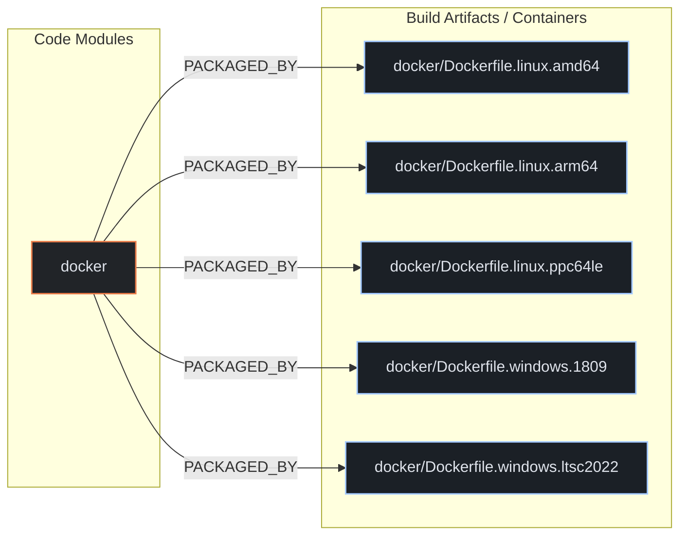

# Repository Architecture Analysis: drone-runners/drone-runner-docker

## Metadata
- **SHA**: `58f896ddd9292ecc8eb03ed93d1e1cdb23002c25`
- **Primary Ecosystem**: Go

## Quality Metrics
- **ast_engine**: fallback
- **avg_cognitive_complexity**: 0.0
- **avg_cyclomatic_complexity**: 0.0
- **component_count**: 52
- **dead_code_count**: 0
- **dead_code_symbols**: 0 entry(ies)
- **duplication_pct**: 0.0
- **file_complexities**: 0 entry(ies)
- **files_analyzed**: 52
- **fitness_passed**: True
- **fitness_violation_count**: 0
- **framework**: Go Service
- **import_edges**: 0 entry(ies)
- **loc**: 6694
- **max_cognitive_complexity**: 0
- **max_cyclomatic_complexity**: 0
- **sloc**: 5172
- **test_file_count**: 17

# Architecture: drone-runners/drone-runner-docker

## Context
- **Repository**: `drone-runners/drone-runner-docker`
- **SHA**: `58f896ddd9292ecc8eb03ed93d1e1cdb23002c25`
- **Ecosystem**: Go
- **Framework**: Go Service

## Building Block View

```mermaid
graph TD;
  classDef atlasRoot fill:#004882,stroke:#a3c9ff,stroke-width:2px,color:#d3e4ff
  classDef atlasCategory fill:#212428,stroke:#E87A48,stroke-width:1.5px,color:#dfe3eb
  classDef atlasWorkflow fill:#1b2026,stroke:#a3c9ff,stroke-width:1.5px,color:#dfe3eb
  classDef atlasJob fill:#171c22,stroke:#8d9199,stroke-width:1px,color:#dfe3eb
  classDef atlasTarget fill:#005227,stroke:#8bd99b,stroke-width:1.5px,color:#a7f6b6
  classDef atlasAlert fill:#93000a,stroke:#ffb4ab,stroke-width:1.5px,color:#ffdad6
  classDef atlasMore fill:#252a31,stroke:#8d9199,stroke-dasharray:4 4,color:#c3c6cf
    repo_root(["drone-runners/drone-runner-docker (52 components)"]):::atlasRoot
    subgraph sg_dir_0_engine["engine (31)"]
      direction TB
      dir_0_engine["engine (31)"]:::atlasCategory
      sub_0_0_compiler["compiler (15)"]:::atlasWorkflow
      dir_0_engine --> sub_0_0_compiler
      sub_0_1__module_root_["(module root) (7)"]:::atlasWorkflow
      dir_0_engine --> sub_0_1__module_root_
      sub_0_2_resource["resource (7)"]:::atlasWorkflow
      dir_0_engine --> sub_0_2_resource
      sub_0_more["+1 more submodules (2)"]:::atlasMore
      dir_0_engine --> sub_0_more
    end
    repo_root --> dir_0_engine
    subgraph sg_dir_1_internal["internal (12)"]
      direction TB
      dir_1_internal["internal (12)"]:::atlasCategory
      sub_1_0_docker["docker (7)"]:::atlasWorkflow
      dir_1_internal --> sub_1_0_docker
      sub_1_1_encoder["encoder (2)"]:::atlasWorkflow
      dir_1_internal --> sub_1_1_encoder
      sub_1_2_match["match (2)"]:::atlasWorkflow
      dir_1_internal --> sub_1_2_match
      sub_1_more["+1 more submodules (1)"]:::atlasMore
      dir_1_internal --> sub_1_more
    end
    repo_root --> dir_1_internal
    dir_2_command["command (8)"]:::atlasCategory
    repo_root --> dir_2_command
    dir_3__root_["(root) (1)"]:::atlasCategory
    repo_root --> dir_3__root_
```

## Component Details
- **main** (`main.go`): module
- **command** (`command/command.go`): module
- **compile** (`command/compile.go`): module
- **copy** (`command/copy.go`): module
- **exec** (`command/exec.go`): module
- **config** (`command/daemon/config.go`): module
- **daemon** (`command/daemon/daemon.go`): module
- **process** (`command/daemon/process.go`): module
- **flags** (`command/internal/flags.go`): module
- **const** (`engine/const.go`): module
- **const_test** (`engine/const_test.go`): module
- **convert** (`engine/convert.go`): module
- **engine** (`engine/engine.go`): module
- **spec** (`engine/spec.go`): module
- **util** (`engine/util.go`): module
- **util_test** (`engine/util_test.go`): module
- **clone** (`engine/compiler/clone.go`): module
- **clone_test** (`engine/compiler/clone_test.go`): module
- **compiler** (`engine/compiler/compiler.go`): module
- **compiler_test** (`engine/compiler/compiler_test.go`): module
- **script** (`engine/compiler/script.go`): module
- **script_test** (`engine/compiler/script_test.go`): module
- **step** (`engine/compiler/step.go`): module
- **util** (`engine/compiler/util.go`): module
- **util_test** (`engine/compiler/util_test.go`): module
- **workspace** (`engine/compiler/workspace.go`): module
- **workspace_test** (`engine/compiler/workspace_test.go`): module
- **shell** (`engine/compiler/shell/shell.go`): module
- **shell_test** (`engine/compiler/shell/shell_test.go`): module
- **powershell** (`engine/compiler/shell/powershell/powershell.go`): module
- **powershell_test** (`engine/compiler/shell/powershell/powershell_test.go`): module
- **linter** (`engine/linter/linter.go`): module
- **linter_test** (`engine/linter/linter_test.go`): module
- **linter** (`engine/resource/linter.go`): module
- **lookup** (`engine/resource/lookup.go`): module
- **lookup_test** (`engine/resource/lookup_test.go`): module
- **parser** (`engine/resource/parser.go`): module
- **parser_test** (`engine/resource/parser_test.go`): module
- **pipeline** (`engine/resource/pipeline.go`): module
- **pipeline_test** (`engine/resource/pipeline_test.go`): module
- **internal** (`internal/internal.go`): module
- **docker** (`internal/docker/docker.go`): module
- **errors** (`internal/docker/errors/errors.go`): module
- **errors_test** (`internal/docker/errors/errors_test.go`): module
- **image** (`internal/docker/image/image.go`): module
- **image_test** (`internal/docker/image/image_test.go`): module
- **jsonmessage** (`internal/docker/jsonmessage/jsonmessage.go`): module
- **stdcopy** (`internal/docker/stdcopy/stdcopy.go`): module
- **encoder** (`internal/encoder/encoder.go`): module
- **encoder_test** (`internal/encoder/encoder_test.go`): module
- **match** (`internal/match/match.go`): module
- **match_test** (`internal/match/match_test.go`): module

## 6-Dimension Repository Scorecard

- **Overall Grade**: `B` (84.25/100)
- **Technical Debt Score**: 15.75
- **Estimated Remediation Effort**: 3.94h

| Dimension | Grade | Score | Weight | Details |
| :--- | :---: | :---: | :---: | :--- |
| Code Quality | `A` | 100.00 | 0.20 | avg_cc=0.00, max_cc=0, duplication=0.00%, dead_code=0 |
| Dependency Health | `B` | 85.00 | 0.15 | dependencies=55, outdated=0, vulnerable=0, has_lockfile=False |
| Maintainability | `A` | 100.00 | 0.15 | avg_cognitive=0.00, max_cognitive=0, fitness_violations=0, oversized_files=0 |
| Pipeline Health | `F` | 40.00 | 0.15 | workflows=0 |
| Security | `A` | 100.00 | 0.20 | vulnerabilities=0, secrets=0, pipeline_security_findings=0 |
| Test Coverage | `C` | 70.00 | 0.15 | coverage=unavailable, ci_test_job=False, test_files_detected=True |

## Supply Chain Dependencies, Vulnerabilities & Secrets

- **Dependencies Parsed**: 55 | **Vulnerabilities**: 0 | **Secrets**: 0

### Inventory Sample
- `github.com/buildkite/yaml` `2.1.0+incompatible` (golang, `go.mod`)
- `github.com/dchest/uniuri` `0.0.0-20160212164326-8902c56451e9` (golang, `go.mod`)
- `github.com/docker/distribution` `2.7.1+incompatible` (golang, `go.mod`)
- `github.com/docker/docker` `25.0.6+incompatible` (golang, `go.mod`)
- `github.com/drone/drone-go` `1.7.1` (golang, `go.mod`)
- `github.com/drone/envsubst` `1.0.3` (golang, `go.mod`)
- `github.com/drone/runner-go` `1.12.0` (golang, `go.mod`)
- `github.com/drone/signal` `1.0.0` (golang, `go.mod`)
- `github.com/ghodss/yaml` `1.0.0` (golang, `go.mod`)
- `github.com/google/go-cmp` `0.7.0` (golang, `go.mod`)
- `github.com/joho/godotenv` `1.3.0` (golang, `go.mod`)
- `github.com/kelseyhightower/envconfig` `1.4.0` (golang, `go.mod`)
- `github.com/mattn/go-isatty` `0.0.8` (golang, `go.mod`)
- `github.com/sirupsen/logrus` `1.9.3` (golang, `go.mod`)
- `golang.org/x/sync` `0.0.0-20201020160332-67f06af15bc9` (golang, `go.mod`)
- `gopkg.in/alecthomas/kingpin.v2` `2.2.6` (golang, `go.mod`)
- `github.com/99designs/basicauth-go` `0.0.0-20160802081356-2a93ba0f464d` (golang, `go.mod`)
- `github.com/99designs/httpsignatures-go` `0.0.0-20170731043157-88528bf4ca7e` (golang, `go.mod`)
- `github.com/Microsoft/go-winio` `0.4.14` (golang, `go.mod`)
- `github.com/alecthomas/template` `0.0.0-20160405071501-a0175ee3bccc` (golang, `go.mod`)
- `github.com/alecthomas/units` `0.0.0-20151022065526-2efee857e7cf` (golang, `go.mod`)
- `github.com/bmatcuk/doublestar` `1.1.1` (golang, `go.mod`)
- `github.com/containerd/log` `0.1.0` (golang, `go.mod`)
- `github.com/coreos/go-semver` `0.3.0` (golang, `go.mod`)
- `github.com/distribution/reference` `0.6.0` (golang, `go.mod`)
- `github.com/docker/go-connections` `0.5.0` (golang, `go.mod`)
- `github.com/docker/go-units` `0.4.0` (golang, `go.mod`)
- `github.com/felixge/httpsnoop` `1.0.4` (golang, `go.mod`)
- `github.com/go-logr/logr` `1.3.0` (golang, `go.mod`)
- `github.com/go-logr/stdr` `1.2.2` (golang, `go.mod`)
- ... (+25 more dependencies)

## Section 7: Code-to-Cloud Deployment Traceability

- `docker` (code_module) --[PACKAGED_BY]--> `docker/Dockerfile.linux.amd64` (container)
- `docker` (code_module) --[PACKAGED_BY]--> `docker/Dockerfile.linux.arm64` (container)
- `docker` (code_module) --[PACKAGED_BY]--> `docker/Dockerfile.linux.ppc64le` (container)
- `docker` (code_module) --[PACKAGED_BY]--> `docker/Dockerfile.windows.1809` (container)
- `docker` (code_module) --[PACKAGED_BY]--> `docker/Dockerfile.windows.ltsc2022` (container)

## CI/CD Pipeline Topology

