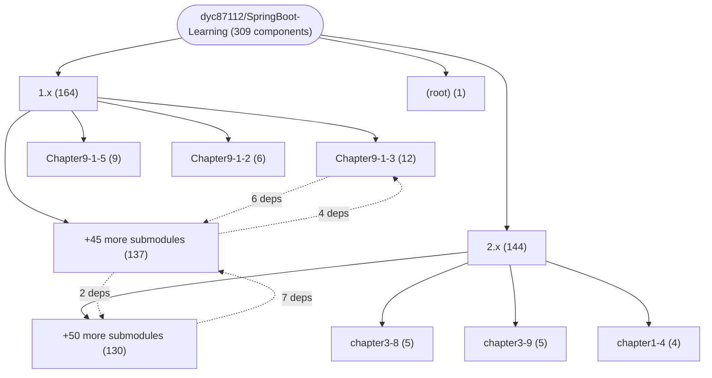

# Repository Architecture Analysis: dyc87112/SpringBoot-Learning

## Metadata
- **SHA**: `4212d163da816c6fa5b28d59130318dac2379a73`
- **Primary Ecosystem**: Java

## Quality Metrics
- **avg_cyclomatic_complexity**: 1.06
- **component_count**: 309
- **files_analyzed**: 920
- **framework**: Spring Boot
- **loc**: 27567
- **max_cyclomatic_complexity**: 5
- **sloc**: 18773

# Architecture: dyc87112/SpringBoot-Learning

## Context
- **Repository**: `dyc87112/SpringBoot-Learning`
- **SHA**: `4212d163da816c6fa5b28d59130318dac2379a73`
- **Ecosystem**: Java
- **Framework**: Unknown

## Building Block View

## Component Details

Showing top 60 representative components out of 309 across 3 module group(s):

- **Module `1.x`** (164 components — CONFIG: 69, MODULE: 61, API_ROUTE: 25)
- **Module `2.x`** (144 components — CONFIG: 62, MODULE: 53, API_ROUTE: 11)
- **Module `(root)`** (1 components — MODULE: 1)

- **Application** (`1.x/Chapter2-2-1/src/main/java/com/didispace/Application.java`): CONFIG (deps: FooProperties, PostInfo)
- **Chapter53Application** (`2.x/chapter5-3/src/main/java/com/didispace/chapter53/Chapter53Application.java`): CONFIG (deps: HelloController, User)
- **Application** (`1.x/Chapter3-1-7/src/main/java/com/didispace/Application.java`): CONFIG (deps: HelloController)
- **Application** (`1.x/Chapter4-1-3/src/main/java/com/didispace/Application.java`): CONFIG (deps: TaskPoolConfig)
- **Application** (`1.x/Chapter4-1-4/src/main/java/com/didispace/Application.java`): CONFIG (deps: TaskPoolConfig)
- **Application** (`1.x/Chapter4-1-5/src/main/java/com/didispace/Application.java`): CONFIG (deps: TaskPoolConfig)
- **Chapter12Application** (`2.x/chapter1-2/src/main/java/com/didispace/chapter12/Chapter12Application.java`): CONFIG (deps: HelloController)
- **Chapter13Application** (`2.x/chapter1-3/src/main/java/com/didispace/chapter13/Chapter13Application.java`): CONFIG (deps: HelloController)
- **Chapter55Application** (`2.x/chapter5-5/src/main/java/com/didispace/chapter55/Chapter55Application.java`): CONFIG (deps: Message)
- **Chapter77Application** (`2.x/chapter7-7/src/main/java/com/didispace/chapter77/Chapter77Application.java`): CONFIG (deps: TaskPoolConfig)
- **Chapter78Application** (`2.x/chapter7-8/src/main/java/com/didispace/chapter78/Chapter78Application.java`): CONFIG (deps: TaskPoolConfig)
- **ConsumerController** (`1.x/Chapter9-1-3/eureka-ribbon/src/main/java/com/didispace/web/ConsumerController.java`): API_ROUTE (deps: ComputeService)
- **HelloController** (`1.x/Chapter3-1-7/src/main/java/com/didispace/Application.java`): API_ROUTE (deps: Application)
- **RedisConfig** (`1.x/Chapter3-2-5/src/main/java/com/didispace/RedisConfig.java`): CONFIG (deps: User)
- **TaskPoolConfig** (`1.x/Chapter4-1-3/src/main/java/com/didispace/Application.java`): CONFIG (deps: Application)
- **TaskPoolConfig** (`1.x/Chapter4-1-4/src/main/java/com/didispace/Application.java`): CONFIG (deps: Application)
- **TaskPoolConfig** (`1.x/Chapter4-1-5/src/main/java/com/didispace/Application.java`): CONFIG (deps: Application)
- **TaskPoolConfig** (`2.x/chapter7-7/src/main/java/com/didispace/chapter77/Chapter77Application.java`): CONFIG (deps: Chapter77Application)
- **TaskPoolConfig** (`2.x/chapter7-8/src/main/java/com/didispace/chapter78/Chapter78Application.java`): CONFIG (deps: Chapter78Application)
- **UserController** (`1.x/Chapter3-1-8/src/main/java/com/didispace/web/UserController.java`): API_ROUTE (deps: User)
- **UserController** (`2.x/chapter2-7/src/main/java/com/didispace/chapter27/UserController.java`): API_ROUTE (deps: User)
- **UserController** (`2.x/chapter2-8/src/main/java/com/didispace/chapter28/UserController.java`): API_ROUTE (deps: User)
- **UserController** (`2.x/chapter2-9/src/main/java/com/didispace/chapter29/UserController.java`): API_ROUTE (deps: User)
- **UserController** (`2.x/chapter3-3/src/main/java/com/didispace/chapter33/UserController.java`): API_ROUTE (deps: User)
- **UserServiceImpl** (`2.x/chapter3-1/src/main/java/com/didispace/chapter31/UserServiceImpl.java`): SERVICE (deps: User)
- **UserServiceImpl** (`2.x/chapter3-11/src/main/java/com/didispace/chapter311/UserServiceImpl.java`): SERVICE (deps: User)
- **UserServiceImpl** (`2.x/chapter3-2/src/main/java/com/didispace/chapter32/UserServiceImpl.java`): SERVICE (deps: User)
- **UserServiceImpl** (`2.x/chapter3-3/src/main/java/com/didispace/chapter33/UserServiceImpl.java`): SERVICE (deps: User)
- **2.x** (`2.x/pom.xml`): MODULE
- **Application** (`1.x/Chapter2-1-1/src/main/java/com/didispace/Application.java`): CONFIG
- **Application** (`1.x/Chapter2-1-2/src/main/java/com/didispace/Application.java`): CONFIG
- **Application** (`1.x/Chapter3-1-1/src/main/java/com/didispace/Application.java`): CONFIG
- **Application** (`1.x/Chapter3-1-2/src/main/java/com/didispace/Application.java`): CONFIG
- **Application** (`1.x/Chapter3-1-3/src/main/java/com/didispace/Application.java`): CONFIG
- **Application** (`1.x/Chapter3-1-4/src/main/java/com/didispace/Application.java`): CONFIG
- **Application** (`1.x/Chapter3-1-5/src/main/java/com/didispace/Application.java`): CONFIG
- **Application** (`1.x/Chapter3-1-6/src/main/java/com/didispace/Application.java`): CONFIG
- **Application** (`1.x/Chapter3-1-8/src/main/java/com/didispace/Application.java`): CONFIG
- **Application** (`1.x/Chapter3-2-1/src/main/java/com/didispace/Application.java`): CONFIG
- **Application** (`1.x/Chapter3-2-10/src/main/java/com/didispace/Application.java`): CONFIG
- **Application** (`1.x/Chapter3-2-11/src/main/java/com/didispace/Application.java`): CONFIG
- **Application** (`1.x/Chapter3-2-2/src/main/java/com/didispace/Application.java`): CONFIG
- **Application** (`1.x/Chapter3-2-3/src/main/java/com/didispace/Application.java`): CONFIG
- **Application** (`1.x/Chapter3-2-4/src/main/java/com/didispace/Application.java`): CONFIG
- **Application** (`1.x/Chapter3-2-5/src/main/java/com/didispace/Application.java`): CONFIG
- **Application** (`1.x/Chapter3-2-6/src/main/java/com/didispace/Application.java`): CONFIG
- **Application** (`1.x/Chapter3-2-7/src/main/java/com/didispace/Application.java`): CONFIG
- **Application** (`1.x/Chapter3-2-8/src/main/java/com/didispace/Application.java`): CONFIG
- **Application** (`1.x/Chapter3-2-9/src/main/java/com/didispace/Application.java`): CONFIG
- **Application** (`1.x/Chapter3-3-1/src/main/java/com/didispace/Application.java`): CONFIG
- **Application** (`1.x/Chapter4-1-1/src/main/java/com/didispace/Application.java`): CONFIG
- **Application** (`1.x/Chapter4-1-2/src/main/java/com/didispace/Application.java`): CONFIG
- **Application** (`1.x/Chapter4-2-2/src/main/java/com/didispace/Application.java`): CONFIG
- **Application** (`1.x/Chapter4-2-3/src/main/java/com/didispace/Application.java`): CONFIG
- **Application** (`1.x/Chapter4-2-4/src/main/java/com/didispace/Application.java`): CONFIG
- **Application** (`1.x/Chapter4-2-5/src/main/java/com/didispace/Application.java`): CONFIG
- **Application** (`1.x/Chapter4-3-1/src/main/java/com/didispace/Application.java`): CONFIG
- **Application** (`1.x/Chapter4-4-1/src/main/java/com/didispace/Application.java`): CONFIG
- **Application** (`1.x/Chapter4-4-2/src/main/java/com/didispace/Application.java`): CONFIG
- **Application** (`1.x/Chapter4-5-1/src/main/java/com/didispace/Application.java`): CONFIG

## CI/CD Pipeline Topology

