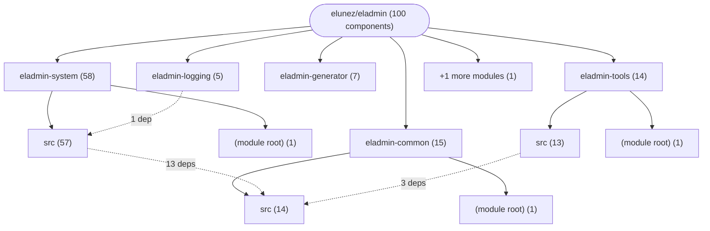

# Repository Architecture Analysis: elunez/eladmin

## Metadata
- **SHA**: `646c58c30f2e9aecf998b054f05f4d9ba0008995`
- **Primary Ecosystem**: Java

## Quality Metrics
- **avg_cyclomatic_complexity**: 4.67
- **component_count**: 100
- **files_analyzed**: 548
- **framework**: Spring Boot
- **loc**: 46534
- **max_cyclomatic_complexity**: 57
- **sloc**: 25484

# Architecture: elunez/eladmin

## Context
- **Repository**: `elunez/eladmin`
- **SHA**: `646c58c30f2e9aecf998b054f05f4d9ba0008995`
- **Ecosystem**: Java
- **Framework**: Unknown

## Building Block View

## Component Details

Showing top 60 representative components out of 100 across 6 module group(s):

- **Module `eladmin-system`** (58 components — API_ROUTE: 19, SERVICE: 19, DATA_ACCESS_LAYER: 14)
- **Module `eladmin-common`** (15 components — CONFIG: 11, MODULE: 1, DATA_ACCESS_LAYER: 1)
- **Module `eladmin-tools`** (14 components — DATA_ACCESS_LAYER: 4, API_ROUTE: 4, SERVICE: 4)
- **Module `eladmin-generator`** (7 components — DATA_ACCESS_LAYER: 2, API_ROUTE: 2, SERVICE: 2)
- **Module `eladmin-logging`** (5 components — DATA_ACCESS_LAYER: 2, MODULE: 1, API_ROUTE: 1)
- **Module `(root)`** (1 components — MODULE: 1)

- **AuthController** (`eladmin-system/src/main/java/me/zhengjie/modules/security/rest/AuthController.java`): API_ROUTE (deps: CaptchaConfig, LoginProperties, OnlineUserService, SecurityProperties, UserDetailsServiceImpl)
- **DeployServiceImpl** (`eladmin-system/src/main/java/me/zhengjie/modules/maint/service/impl/DeployServiceImpl.java`): SERVICE (deps: App, Deploy, DeployHistory, ServerDeploy)
- **Role** (`eladmin-system/src/main/java/me/zhengjie/modules/system/domain/Role.java`): DATA_ACCESS_LAYER (deps: BaseEntity, Dept, Menu, User)
- **User** (`eladmin-system/src/main/java/me/zhengjie/modules/system/domain/User.java`): DATA_ACCESS_LAYER (deps: BaseEntity, Dept, Job, Role)
- **Deploy** (`eladmin-system/src/main/java/me/zhengjie/modules/maint/domain/Deploy.java`): DATA_ACCESS_LAYER (deps: App, BaseEntity, ServerDeploy)
- **MenuServiceImpl** (`eladmin-system/src/main/java/me/zhengjie/modules/system/service/impl/MenuServiceImpl.java`): SERVICE (deps: Menu, Role, User)
- **RoleServiceImpl** (`eladmin-system/src/main/java/me/zhengjie/modules/system/service/impl/RoleServiceImpl.java`): SERVICE (deps: Menu, Role, User)
- **SysLogServiceImpl** (`eladmin-logging/src/main/java/me/zhengjie/service/impl/SysLogServiceImpl.java`): SERVICE (deps: Dict, LogRepository, SysLog)
- **UserServiceImpl** (`eladmin-system/src/main/java/me/zhengjie/modules/system/service/impl/UserServiceImpl.java`): SERVICE (deps: FileProperties, OnlineUserService, User)
- **DeployController** (`eladmin-system/src/main/java/me/zhengjie/modules/maint/rest/DeployController.java`): API_ROUTE (deps: Deploy, DeployHistory)
- **Dept** (`eladmin-system/src/main/java/me/zhengjie/modules/system/domain/Dept.java`): DATA_ACCESS_LAYER (deps: BaseEntity, Role)
- **DeptServiceImpl** (`eladmin-system/src/main/java/me/zhengjie/modules/system/service/impl/DeptServiceImpl.java`): SERVICE (deps: Dept, User)
- **Dict** (`eladmin-system/src/main/java/me/zhengjie/modules/system/domain/Dict.java`): DATA_ACCESS_LAYER (deps: BaseEntity, DictDetail)
- **DictDetail** (`eladmin-system/src/main/java/me/zhengjie/modules/system/domain/DictDetail.java`): DATA_ACCESS_LAYER (deps: BaseEntity, Dict)
- **DictDetailServiceImpl** (`eladmin-system/src/main/java/me/zhengjie/modules/system/service/impl/DictDetailServiceImpl.java`): SERVICE (deps: Dict, DictDetail)
- **GeneratorServiceImpl** (`eladmin-generator/src/main/java/me/zhengjie/service/impl/GeneratorServiceImpl.java`): SERVICE (deps: ColumnInfo, GenConfig)
- **LocalStorageServiceImpl** (`eladmin-tools/src/main/java/me/zhengjie/service/impl/LocalStorageServiceImpl.java`): SERVICE (deps: FileProperties, LocalStorage)
- **Menu** (`eladmin-system/src/main/java/me/zhengjie/modules/system/domain/Menu.java`): DATA_ACCESS_LAYER (deps: BaseEntity, Role)
- **QuartzJobController** (`eladmin-system/src/main/java/me/zhengjie/modules/quartz/rest/QuartzJobController.java`): API_ROUTE (deps: QuartzJob, QuartzLog)
- **QuartzJobServiceImpl** (`eladmin-system/src/main/java/me/zhengjie/modules/quartz/service/impl/QuartzJobServiceImpl.java`): SERVICE (deps: QuartzJob, QuartzLog)
- **RoleController** (`eladmin-system/src/main/java/me/zhengjie/modules/system/rest/RoleController.java`): API_ROUTE (deps: Dict, Role)
- **S3StorageController** (`eladmin-tools/src/main/java/me/zhengjie/rest/S3StorageController.java`): API_ROUTE (deps: AmzS3Config, S3Storage)
- **S3StorageServiceImpl** (`eladmin-tools/src/main/java/me/zhengjie/service/impl/S3StorageServiceImpl.java`): SERVICE (deps: AmzS3Config, S3Storage)
- **SpringSecurityConfig** (`eladmin-system/src/main/java/me/zhengjie/modules/security/config/SpringSecurityConfig.java`): CONFIG (deps: OnlineUserService, SecurityProperties)
- **UserController** (`eladmin-system/src/main/java/me/zhengjie/modules/system/rest/UserController.java`): API_ROUTE (deps: Dept, User)
- **AliPayController** (`eladmin-tools/src/main/java/me/zhengjie/rest/AliPayController.java`): API_ROUTE (deps: AlipayConfig)
- **AliPayServiceImpl** (`eladmin-tools/src/main/java/me/zhengjie/service/impl/AliPayServiceImpl.java`): SERVICE (deps: AlipayConfig)
- **App** (`eladmin-system/src/main/java/me/zhengjie/modules/maint/domain/App.java`): DATA_ACCESS_LAYER (deps: BaseEntity)
- **AppController** (`eladmin-system/src/main/java/me/zhengjie/modules/maint/rest/AppController.java`): API_ROUTE (deps: App)
- **AppServiceImpl** (`eladmin-system/src/main/java/me/zhengjie/modules/maint/service/impl/AppServiceImpl.java`): SERVICE (deps: App)
- **ConfigurerAdapter** (`eladmin-common/src/main/java/me/zhengjie/config/webConfig/ConfigurerAdapter.java`): CONFIG (deps: FileProperties)
- **DataServiceImpl** (`eladmin-system/src/main/java/me/zhengjie/modules/system/service/impl/DataServiceImpl.java`): SERVICE (deps: Dept)
- **Database** (`eladmin-system/src/main/java/me/zhengjie/modules/maint/domain/Database.java`): DATA_ACCESS_LAYER (deps: BaseEntity)
- **DatabaseController** (`eladmin-system/src/main/java/me/zhengjie/modules/maint/rest/DatabaseController.java`): API_ROUTE (deps: Database)
- **DatabaseServiceImpl** (`eladmin-system/src/main/java/me/zhengjie/modules/maint/service/impl/DatabaseServiceImpl.java`): SERVICE (deps: Database)
- **DeployHistoryServiceImpl** (`eladmin-system/src/main/java/me/zhengjie/modules/maint/service/impl/DeployHistoryServiceImpl.java`): SERVICE (deps: DeployHistory)
- **DeptController** (`eladmin-system/src/main/java/me/zhengjie/modules/system/rest/DeptController.java`): API_ROUTE (deps: Dept)
- **DictController** (`eladmin-system/src/main/java/me/zhengjie/modules/system/rest/DictController.java`): API_ROUTE (deps: Dict)
- **DictDetailController** (`eladmin-system/src/main/java/me/zhengjie/modules/system/rest/DictDetailController.java`): API_ROUTE (deps: DictDetail)
- **DictServiceImpl** (`eladmin-system/src/main/java/me/zhengjie/modules/system/service/impl/DictServiceImpl.java`): SERVICE (deps: Dict)
- **EmailController** (`eladmin-tools/src/main/java/me/zhengjie/rest/EmailController.java`): API_ROUTE (deps: EmailConfig)
- **EmailServiceImpl** (`eladmin-tools/src/main/java/me/zhengjie/service/impl/EmailServiceImpl.java`): SERVICE (deps: EmailConfig)
- **GenConfigController** (`eladmin-generator/src/main/java/me/zhengjie/rest/GenConfigController.java`): API_ROUTE (deps: GenConfig)
- **GenConfigServiceImpl** (`eladmin-generator/src/main/java/me/zhengjie/service/impl/GenConfigServiceImpl.java`): SERVICE (deps: GenConfig)
- **GeneratorController** (`eladmin-generator/src/main/java/me/zhengjie/rest/GeneratorController.java`): API_ROUTE (deps: ColumnInfo)
- **Job** (`eladmin-system/src/main/java/me/zhengjie/modules/system/domain/Job.java`): DATA_ACCESS_LAYER (deps: BaseEntity)
- **JobController** (`eladmin-system/src/main/java/me/zhengjie/modules/system/rest/JobController.java`): API_ROUTE (deps: Job)
- **JobServiceImpl** (`eladmin-system/src/main/java/me/zhengjie/modules/system/service/impl/JobServiceImpl.java`): SERVICE (deps: Job)
- **LocalStorage** (`eladmin-tools/src/main/java/me/zhengjie/domain/LocalStorage.java`): DATA_ACCESS_LAYER (deps: BaseEntity)
- **LocalStorageController** (`eladmin-tools/src/main/java/me/zhengjie/rest/LocalStorageController.java`): API_ROUTE (deps: LocalStorage)
- **LogRepository** (`eladmin-logging/src/main/java/me/zhengjie/repository/LogRepository.java`): DATA_ACCESS_LAYER (deps: SysLog)
- **MenuController** (`eladmin-system/src/main/java/me/zhengjie/modules/system/rest/MenuController.java`): API_ROUTE (deps: Menu)
- **OnlineController** (`eladmin-system/src/main/java/me/zhengjie/modules/security/rest/OnlineController.java`): API_ROUTE (deps: OnlineUserService)
- **OnlineUserService** (`eladmin-system/src/main/java/me/zhengjie/modules/security/service/OnlineUserService.java`): SERVICE (deps: SecurityProperties)
- **QuartzConfig** (`eladmin-system/src/main/java/me/zhengjie/modules/quartz/config/QuartzConfig.java`): CONFIG (deps: Job)
- **QuartzJob** (`eladmin-system/src/main/java/me/zhengjie/modules/quartz/domain/QuartzJob.java`): DATA_ACCESS_LAYER (deps: BaseEntity)
- **S3Storage** (`eladmin-tools/src/main/java/me/zhengjie/domain/S3Storage.java`): DATA_ACCESS_LAYER (deps: BaseEntity)
- **ServerDeploy** (`eladmin-system/src/main/java/me/zhengjie/modules/maint/domain/ServerDeploy.java`): DATA_ACCESS_LAYER (deps: BaseEntity)
- **ServerDeployController** (`eladmin-system/src/main/java/me/zhengjie/modules/maint/rest/ServerDeployController.java`): API_ROUTE (deps: ServerDeploy)
- **ServerDeployServiceImpl** (`eladmin-system/src/main/java/me/zhengjie/modules/maint/service/impl/ServerDeployServiceImpl.java`): SERVICE (deps: ServerDeploy)

## CI/CD Pipeline Topology

