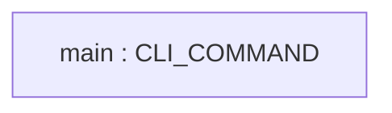
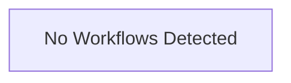

# Repository Architecture Analysis: encode/httpx

## Metadata
- **SHA**: `b5addb64f0161ff6bfe94c124ef76f6a1fba5254`
- **Primary Ecosystem**: Python

## Quality Metrics
- **avg_cyclomatic_complexity**: 3.07
- **component_count**: 1
- **files_analyzed**: 60
- **framework**: Unknown
- **loc**: 17753
- **max_cyclomatic_complexity**: 48
- **sloc**: 13800

# Architecture: encode/httpx

## Context
- **Repository**: `encode/httpx`
- **SHA**: `b5addb64f0161ff6bfe94c124ef76f6a1fba5254`
- **Ecosystem**: Python
- **Framework**: Unknown

## Building Block View

## Component Details
- **main** (`httpx/_main.py`): CLI_COMMAND

## CI/CD Pipeline Topology

