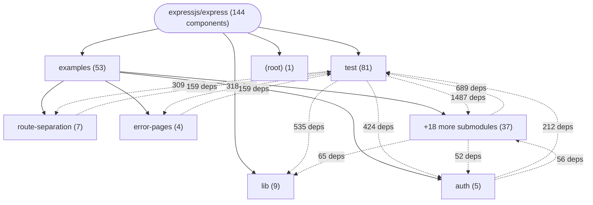

# Repository Architecture Analysis: expressjs/express

## Metadata
- **SHA**: `43fca52d28a422c8be48fd489cbd4f2d6152bab6`
- **Primary Ecosystem**: JavaScript/TypeScript

## Quality Metrics
- **avg_cyclomatic_complexity**: 6.21
- **component_count**: 144
- **files_analyzed**: 142
- **framework**: Unknown
- **loc**: 22046
- **max_cyclomatic_complexity**: 125
- **sloc**: 16272

# Architecture: expressjs/express

## Context
- **Repository**: `expressjs/express`
- **SHA**: `43fca52d28a422c8be48fd489cbd4f2d6152bab6`
- **Ecosystem**: JavaScript/TypeScript
- **Framework**: Unknown

## Building Block View

## Component Details

Showing top 60 representative components out of 144 across 4 module group(s):

- **Module `test`** (81 components — API_ROUTE: 81)
- **Module `examples`** (53 components — API_ROUTE: 53)
- **Module `lib`** (9 components — API_ROUTE: 9)
- **Module `(root)`** (1 components — MODULE: 1)

- **GET_:a** (`test/req.baseUrl.js`): API_ROUTE (deps: DELETE_root, DELETE_user_:id, GET_*path, GET_*splat, GET_403, GET_404 (+75 more))
- **GET_Readme.md** (`examples/view-constructor/index.js`): API_ROUTE (deps: DELETE_root, DELETE_user_:id, GET_*path, GET_*splat, GET_403, GET_404 (+75 more))
- **GET_bar** (`test/app.routes.error.js`): API_ROUTE (deps: DELETE_root, DELETE_user_:id, GET_*path, GET_*splat, GET_403, GET_404 (+75 more))
- **GET_env** (`test/app.js`): API_ROUTE (deps: DELETE_root, DELETE_user_:id, GET_*path, GET_*splat, GET_403, GET_404 (+75 more))
- **GET_fail** (`examples/markdown/index.js`): API_ROUTE (deps: DELETE_root, DELETE_user_:id, GET_*path, GET_*splat, GET_403, GET_404 (+75 more))
- **GET_files_*file** (`examples/downloads/index.js`): API_ROUTE (deps: DELETE_root, DELETE_user_:id, GET_*path, GET_*splat, GET_403, GET_404 (+75 more))
- **GET_forget** (`examples/cookies/index.js`): API_ROUTE (deps: DELETE_root, DELETE_user_:id, GET_*path, GET_*splat, GET_403, GET_404 (+75 more))
- **GET_json escape** (`test/res.json.js`): API_ROUTE (deps: DELETE_root, DELETE_user_:id, GET_*path, GET_*splat, GET_403, GET_404 (+75 more))
- **GET_json escape** (`test/res.jsonp.js`): API_ROUTE (deps: DELETE_root, DELETE_user_:id, GET_*path, GET_*splat, GET_403, GET_404 (+75 more))
- **GET_json spaces** (`test/res.json.js`): API_ROUTE (deps: DELETE_root, DELETE_user_:id, GET_*path, GET_*splat, GET_403, GET_404 (+75 more))
- **GET_json spaces** (`test/res.jsonp.js`): API_ROUTE (deps: DELETE_root, DELETE_user_:id, GET_*path, GET_*splat, GET_403, GET_404 (+75 more))
- **GET_next** (`examples/error/index.js`): API_ROUTE (deps: DELETE_root, DELETE_user_:id, GET_*path, GET_*splat, GET_403, GET_404 (+75 more))
- **GET_root** (`examples/content-negotiation/index.js`): API_ROUTE (deps: DELETE_root, DELETE_user_:id, GET_*path, GET_*splat, GET_403, GET_404 (+75 more))
- **GET_root** (`examples/cookie-sessions/index.js`): API_ROUTE (deps: DELETE_root, DELETE_user_:id, GET_*path, GET_*splat, GET_403, GET_404 (+75 more))
- **GET_root** (`examples/ejs/index.js`): API_ROUTE (deps: DELETE_root, DELETE_user_:id, GET_*path, GET_*splat, GET_403, GET_404 (+75 more))
- **GET_root** (`examples/hello-world/index.js`): API_ROUTE (deps: DELETE_root, DELETE_user_:id, GET_*path, GET_*splat, GET_403, GET_404 (+75 more))
- **GET_root** (`examples/multi-router/index.js`): API_ROUTE (deps: DELETE_root, DELETE_user_:id, GET_*path, GET_*splat, GET_403, GET_404 (+75 more))
- **GET_root** (`examples/online/index.js`): API_ROUTE (deps: DELETE_root, DELETE_user_:id, GET_*path, GET_*splat, GET_403, GET_404 (+75 more))
- **GET_root** (`examples/resource/index.js`): API_ROUTE (deps: DELETE_root, DELETE_user_:id, GET_*path, GET_*splat, GET_403, GET_404 (+75 more))
- **GET_root** (`examples/session/index.js`): API_ROUTE (deps: DELETE_root, DELETE_user_:id, GET_*path, GET_*splat, GET_403, GET_404 (+75 more))
- **GET_root** (`examples/session/redis.js`): API_ROUTE (deps: DELETE_root, DELETE_user_:id, GET_*path, GET_*splat, GET_403, GET_404 (+75 more))
- **GET_root** (`test/app.routes.error.js`): API_ROUTE (deps: DELETE_root, DELETE_user_:id, GET_*path, GET_*splat, GET_403, GET_404 (+75 more))
- **GET_root** (`test/regression.js`): API_ROUTE (deps: DELETE_root, DELETE_user_:id, GET_*path, GET_*splat, GET_403, GET_404 (+75 more))
- **GET_root** (`test/req.acceptsEncodings.js`): API_ROUTE (deps: DELETE_root, DELETE_user_:id, GET_*path, GET_*splat, GET_403, GET_404 (+75 more))
- **GET_root** (`test/req.acceptsLanguages.js`): API_ROUTE (deps: DELETE_root, DELETE_user_:id, GET_*path, GET_*splat, GET_403, GET_404 (+75 more))
- **GET_root** (`test/req.ip.js`): API_ROUTE (deps: DELETE_root, DELETE_user_:id, GET_*path, GET_*splat, GET_403, GET_404 (+75 more))
- **GET_root** (`test/req.secure.js`): API_ROUTE (deps: DELETE_root, DELETE_user_:id, GET_*path, GET_*splat, GET_403, GET_404 (+75 more))
- **GET_root** (`test/req.xhr.js`): API_ROUTE (deps: DELETE_root, DELETE_user_:id, GET_*path, GET_*splat, GET_403, GET_404 (+75 more))
- **GET_root** (`test/res.download.js`): API_ROUTE (deps: DELETE_root, DELETE_user_:id, GET_*path, GET_*splat, GET_403, GET_404 (+75 more))
- **GET_root** (`test/res.format.js`): API_ROUTE (deps: DELETE_root, DELETE_user_:id, GET_*path, GET_*splat, GET_403, GET_404 (+75 more))
- **GET_root** (`test/res.json.js`): API_ROUTE (deps: DELETE_root, DELETE_user_:id, GET_*path, GET_*splat, GET_403, GET_404 (+75 more))
- **GET_root** (`test/res.jsonp.js`): API_ROUTE (deps: DELETE_root, DELETE_user_:id, GET_*path, GET_*splat, GET_403, GET_404 (+75 more))
- **GET_tobi** (`test/app.head.js`): API_ROUTE (deps: DELETE_root, DELETE_user_:id, GET_*path, GET_*splat, GET_403, GET_404 (+75 more))
- **GET_user_:id{_:op}** (`test/req.route.js`): API_ROUTE (deps: DELETE_root, DELETE_user_:id, GET_*path, GET_*splat, GET_403, GET_404 (+75 more))
- **GET_users** (`examples/content-negotiation/index.js`): API_ROUTE (deps: DELETE_root, DELETE_user_:id, GET_*path, GET_*splat, GET_403, GET_404 (+75 more))
- **GET_users_:from-:to** (`examples/params/index.js`): API_ROUTE (deps: DELETE_root, DELETE_user_:id, GET_*path, GET_*splat, GET_403, GET_404 (+75 more))
- **GET_view** (`test/app.render.js`): API_ROUTE (deps: DELETE_root, DELETE_user_:id, GET_*path, GET_*splat, GET_403, GET_404 (+75 more))
- **POST_root** (`test/express.json.js`): API_ROUTE (deps: DELETE_root, DELETE_user_:id, GET_*path, GET_*splat, GET_403, GET_404 (+75 more))
- **POST_root** (`test/express.raw.js`): API_ROUTE (deps: DELETE_root, DELETE_user_:id, GET_*path, GET_*splat, GET_403, GET_404 (+75 more))
- **POST_root** (`test/express.text.js`): API_ROUTE (deps: DELETE_root, DELETE_user_:id, GET_*path, GET_*splat, GET_403, GET_404 (+75 more))
- **POST_root** (`test/express.urlencoded.js`): API_ROUTE (deps: DELETE_root, DELETE_user_:id, GET_*path, GET_*splat, GET_403, GET_404 (+75 more))
- **GET_client.js** (`examples/search/index.js`): API_ROUTE (deps: DELETE_root, DELETE_user_:id, GET_*path, GET_*splat, GET_403, GET_404 (+74 more))
- **GET_env** (`examples/error/index.js`): API_ROUTE (deps: DELETE_root, DELETE_user_:id, GET_*path, GET_*splat, GET_403, GET_404 (+74 more))
- **GET_hasOwnProperty** (`test/config.js`): API_ROUTE (deps: DELETE_root, DELETE_user_:id, GET_*path, GET_*splat, GET_403, GET_404 (+74 more))
- **GET_middleware** (`examples/view-locals/index.js`): API_ROUTE (deps: DELETE_root, DELETE_user_:id, GET_*path, GET_*splat, GET_403, GET_404 (+74 more))
- **GET_middleware-locals** (`examples/view-locals/index.js`): API_ROUTE (deps: DELETE_root, DELETE_user_:id, GET_*path, GET_*splat, GET_403, GET_404 (+74 more))
- **GET_other** (`test/app.options.js`): API_ROUTE (deps: DELETE_root, DELETE_user_:id, GET_*path, GET_*splat, GET_403, GET_404 (+74 more))
- **GET_root** (`examples/cookies/index.js`): API_ROUTE (deps: DELETE_root, DELETE_user_:id, GET_*path, GET_*splat, GET_403, GET_404 (+74 more))
- **GET_root** (`examples/downloads/index.js`): API_ROUTE (deps: DELETE_root, DELETE_user_:id, GET_*path, GET_*splat, GET_403, GET_404 (+74 more))
- **GET_root** (`examples/error/index.js`): API_ROUTE (deps: DELETE_root, DELETE_user_:id, GET_*path, GET_*splat, GET_403, GET_404 (+74 more))
- **GET_root** (`examples/markdown/index.js`): API_ROUTE (deps: DELETE_root, DELETE_user_:id, GET_*path, GET_*splat, GET_403, GET_404 (+74 more))
- **GET_root** (`examples/params/index.js`): API_ROUTE (deps: DELETE_root, DELETE_user_:id, GET_*path, GET_*splat, GET_403, GET_404 (+74 more))
- **GET_root** (`examples/view-constructor/index.js`): API_ROUTE (deps: DELETE_root, DELETE_user_:id, GET_*path, GET_*splat, GET_403, GET_404 (+74 more))
- **GET_search_{:query}** (`examples/search/index.js`): API_ROUTE (deps: DELETE_root, DELETE_user_:id, GET_*path, GET_*splat, GET_403, GET_404 (+74 more))
- **GET_trust proxy** (`test/config.js`): API_ROUTE (deps: DELETE_root, DELETE_user_:id, GET_*path, GET_*splat, GET_403, GET_404 (+74 more))
- **GET_user_:id_edit** (`test/req.route.js`): API_ROUTE (deps: DELETE_root, DELETE_user_:id, GET_*path, GET_*splat, GET_403, GET_404 (+74 more))
- **GET_user_:user** (`examples/params/index.js`): API_ROUTE (deps: DELETE_root, DELETE_user_:id, GET_*path, GET_*splat, GET_403, GET_404 (+74 more))
- **POST_root** (`examples/cookies/index.js`): API_ROUTE (deps: DELETE_root, DELETE_user_:id, GET_*path, GET_*splat, GET_403, GET_404 (+74 more))
- **PUT_users** (`test/app.options.js`): API_ROUTE (deps: DELETE_root, DELETE_user_:id, GET_*path, GET_*splat, GET_403, GET_404 (+74 more))
- **DELETE_root** (`test/app.options.js`): API_ROUTE (deps: DELETE_user_:id, GET_*path, GET_*splat, GET_403, GET_404, GET_500 (+73 more))

## CI/CD Pipeline Topology

