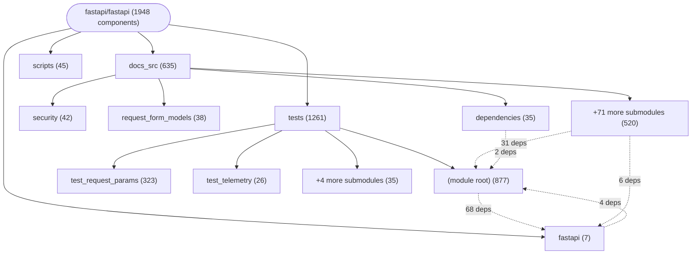

# Repository Architecture Analysis: fastapi/fastapi

## Metadata
- **SHA**: `5add7a458d629b07311d48261f696b5ac2bb9a5f`
- **Primary Ecosystem**: Python

## Quality Metrics
- **avg_cyclomatic_complexity**: 2.63
- **component_count**: 1948
- **files_analyzed**: 1221
- **framework**: FastAPI
- **loc**: 132180
- **max_cyclomatic_complexity**: 54
- **sloc**: 112819

# Architecture: fastapi/fastapi

## Context
- **Repository**: `fastapi/fastapi`
- **SHA**: `5add7a458d629b07311d48261f696b5ac2bb9a5f`
- **Ecosystem**: Python
- **Framework**: Unknown

## Building Block View

## Component Details

Showing top 60 representative components out of 1948 across 4 module group(s):

- **Module `tests`** (1261 components — API_ROUTE: 946, DATA_ACCESS_LAYER: 312, SERVICE: 3)
- **Module `docs_src`** (635 components — API_ROUTE: 459, DATA_ACCESS_LAYER: 174, SERVICE: 2)
- **Module `scripts`** (45 components — CLI_COMMAND: 35, DATA_ACCESS_LAYER: 10)
- **Module `fastapi`** (7 components — DATA_ACCESS_LAYER: 6, SERVICE: 1)

- **ConfiguredItem** (`tests/test_stream_non_finite_floats.py`): DATA_ACCESS_LAYER (deps: ServerSentEvent, sse)
- **Item** (`docs_src/server_sent_events/tutorial002.py`): DATA_ACCESS_LAYER (deps: ServerSentEvent, sse)
- **Item** (`docs_src/server_sent_events/tutorial004.py`): DATA_ACCESS_LAYER (deps: ServerSentEvent, sse)
- **Item** (`tests/test_sse.py`): DATA_ACCESS_LAYER (deps: ServerSentEvent, sse)
- **Item** (`tests/test_stream_non_finite_floats.py`): DATA_ACCESS_LAYER (deps: ServerSentEvent, sse)
- **Prompt** (`docs_src/server_sent_events/tutorial005.py`): DATA_ACCESS_LAYER (deps: ServerSentEvent, sse)
- **_AsyncLiftContextManager** (`fastapi/routing.py`): SERVICE (deps: ServerSentEvent, sse)
- **default_app_stream** (`tests/test_sse.py`): API_ROUTE (deps: ServerSentEvent, sse)
- **default_parent_stream** (`tests/test_sse.py`): API_ROUTE (deps: ServerSentEvent, sse)
- **slow_async_stream** (`tests/test_sse.py`): API_ROUTE (deps: ServerSentEvent, sse)
- **slow_sync_stream** (`tests/test_sse.py`): API_ROUTE (deps: ServerSentEvent, sse)
- **sse_items** (`tests/test_sse.py`): API_ROUTE (deps: ServerSentEvent, sse)
- **sse_items_dict** (`tests/test_sse.py`): API_ROUTE (deps: ServerSentEvent, sse)
- **sse_items_event** (`tests/test_sse.py`): API_ROUTE (deps: ServerSentEvent, sse)
- **sse_items_mixed** (`tests/test_sse.py`): API_ROUTE (deps: ServerSentEvent, sse)
- **sse_items_no_annotation** (`tests/test_sse.py`): API_ROUTE (deps: ServerSentEvent, sse)
- **sse_items_post** (`tests/test_sse.py`): API_ROUTE (deps: ServerSentEvent, sse)
- **sse_items_raw** (`tests/test_sse.py`): API_ROUTE (deps: ServerSentEvent, sse)
- **sse_items_string** (`tests/test_sse.py`): API_ROUTE (deps: ServerSentEvent, sse)
- **sse_items_sync** (`tests/test_sse.py`): API_ROUTE (deps: ServerSentEvent, sse)
- **sse_items_sync_no_annotation** (`tests/test_sse.py`): API_ROUTE (deps: ServerSentEvent, sse)
- **stream** (`tests/test_stream_non_finite_floats.py`): API_ROUTE (deps: ServerSentEvent, sse)
- **stream_chat** (`docs_src/server_sent_events/tutorial005.py`): API_ROUTE (deps: ServerSentEvent, sse)
- **stream_events** (`tests/test_sse.py`): API_ROUTE (deps: ServerSentEvent, sse)
- **stream_events** (`tests/test_stream_non_finite_floats.py`): API_ROUTE (deps: ServerSentEvent, sse)
- **stream_events_typed** (`tests/test_sse.py`): API_ROUTE (deps: ServerSentEvent, sse)
- **stream_items** (`docs_src/server_sent_events/tutorial002.py`): API_ROUTE (deps: ServerSentEvent, sse)
- **stream_items** (`docs_src/server_sent_events/tutorial004.py`): API_ROUTE (deps: ServerSentEvent, sse)
- **stream_logs** (`docs_src/server_sent_events/tutorial003.py`): API_ROUTE (deps: ServerSentEvent, sse)
- **Account** (`tests/test_forms_optional_models.py`): DATA_ACCESS_LAYER (deps: Optional)
- **AliasedForm** (`tests/test_forms_optional_unions.py`): DATA_ACCESS_LAYER (deps: Optional)
- **AliasedForm** (`tests/test_union_form_normalization.py`): DATA_ACCESS_LAYER (deps: Discriminator)
- **AliasedListForm** (`tests/test_union_form_normalization.py`): DATA_ACCESS_LAYER (deps: Discriminator)
- **AliasedTextForm** (`tests/test_union_form_normalization.py`): DATA_ACCESS_LAYER (deps: Discriminator)
- **Allowed** (`tests/test_forms_optional_unions.py`): DATA_ACCESS_LAYER (deps: Optional)
- **Attachment** (`tests/test_forms_optional_models.py`): DATA_ACCESS_LAYER (deps: Optional)
- **BaseModelWithConfig** (`fastapi/openapi/models.py`): DATA_ACCESS_LAYER (deps: Optional)
- **BlockingContextManager** (`tests/test_concurrency.py`): SERVICE (deps: Event)
- **Cat** (`tests/test_union_body_discriminator_annotated.py`): DATA_ACCESS_LAYER (deps: Discriminator)
- **Company** (`tests/test_forms_optional_unions.py`): DATA_ACCESS_LAYER (deps: Optional)
- **Contact** (`tests/test_union_form_normalization.py`): DATA_ACCESS_LAYER (deps: Discriminator)
- **Count** (`tests/test_forms_optional_unions.py`): DATA_ACCESS_LAYER (deps: Optional)
- **Credentials** (`tests/test_forms_optional_models.py`): DATA_ACCESS_LAYER (deps: Optional)
- **Defaults** (`tests/test_forms_optional_unions.py`): DATA_ACCESS_LAYER (deps: Optional)
- **DefaultsForm** (`tests/test_union_form_normalization.py`): DATA_ACCESS_LAYER (deps: Discriminator)
- **DetailedForm** (`tests/test_union_form_normalization.py`): DATA_ACCESS_LAYER (deps: Discriminator)
- **Discriminator** (`fastapi/openapi/models.py`): DATA_ACCESS_LAYER (deps: Optional)
- **Dog** (`tests/test_union_body_discriminator_annotated.py`): DATA_ACCESS_LAYER (deps: Discriminator)
- **Empty** (`tests/test_forms_optional_models.py`): DATA_ACCESS_LAYER (deps: Optional)
- **FileForm** (`tests/test_union_form_normalization.py`): DATA_ACCESS_LAYER (deps: Discriminator)
- **Filters** (`tests/test_query_optional_models.py`): DATA_ACCESS_LAYER (deps: Optional)
- **FirstForm** (`tests/test_union_form_normalization.py`): DATA_ACCESS_LAYER (deps: Discriminator)
- **Hero** (`docs_src/sql_databases/tutorial001.py`): DATA_ACCESS_LAYER (deps: Session)
- **Hero** (`docs_src/sql_databases/tutorial001_non_an.py`): DATA_ACCESS_LAYER (deps: Session)
- **HeroBase** (`docs_src/sql_databases/tutorial002.py`): DATA_ACCESS_LAYER (deps: Session)
- **HeroBase** (`docs_src/sql_databases/tutorial002_non_an.py`): DATA_ACCESS_LAYER (deps: Session)
- **Ignored** (`tests/test_forms_optional_unions.py`): DATA_ACCESS_LAYER (deps: Optional)
- **Item** (`docs_src/server_sent_events/tutorial001.py`): DATA_ACCESS_LAYER (deps: sse)
- **Label** (`tests/test_forms_optional_unions.py`): DATA_ACCESS_LAYER (deps: Optional)
- **ListData** (`tests/test_union_form_normalization.py`): DATA_ACCESS_LAYER (deps: Discriminator)

## CI/CD Pipeline Topology

