# Repository Architecture Analysis: forezp/SpringCloudLearning

## Metadata
- **SHA**: `740106e00636df1b005fe13f66f1f9ecbafd8b1b`
- **Primary Ecosystem**: Java

## Quality Metrics
- **avg_cyclomatic_complexity**: 1.49
- **component_count**: 342
- **files_analyzed**: 677
- **framework**: Spring Boot
- **loc**: 18469
- **max_cyclomatic_complexity**: 13
- **sloc**: 13117

# Architecture: forezp/SpringCloudLearning

## Context
- **Repository**: `forezp/SpringCloudLearning`
- **SHA**: `740106e00636df1b005fe13f66f1f9ecbafd8b1b`
- **Ecosystem**: Java
- **Framework**: Unknown

## Building Block View

```mermaid
graph TD;
    repo_root(["forezp/SpringCloudLearning (342 components)"])
    dir_0_springcloud_alibaba["springcloud-alibaba (22)"]
    repo_root --> dir_0_springcloud_alibaba
    sub_0_0_nacos_config["nacos-config (8)"]
    dir_0_springcloud_alibaba --> sub_0_0_nacos_config
    sub_0_1_nacos_discovery["nacos-discovery (7)"]
    dir_0_springcloud_alibaba --> sub_0_1_nacos_discovery
    sub_0_2_nacos_discovery_sentinel["nacos-discovery-sentinel (7)"]
    dir_0_springcloud_alibaba --> sub_0_2_nacos_discovery_sentinel
    dir_1_chapter5["chapter5 (14)"]
    repo_root --> dir_1_chapter5
    sub_1_0_service_ribbon["service-ribbon (4)"]
    dir_1_chapter5 --> sub_1_0_service_ribbon
    sub_1_1_service_feign["service-feign (3)"]
    dir_1_chapter5 --> sub_1_1_service_feign
    sub_1_2_eureka_server["eureka-server (2)"]
    dir_1_chapter5 --> sub_1_2_eureka_server
    sub_1_more["+3 more submodules (5)"]
    dir_1_chapter5 --> sub_1_more
    dir_2_sc_f_chapter5["sc-f-chapter5 (14)"]
    repo_root --> dir_2_sc_f_chapter5
    sub_2_0_service_ribbon["service-ribbon (4)"]
    dir_2_sc_f_chapter5 --> sub_2_0_service_ribbon
    sub_2_1_service_feign["service-feign (3)"]
    dir_2_sc_f_chapter5 --> sub_2_1_service_feign
    sub_2_2_eureka_server["eureka-server (2)"]
    dir_2_sc_f_chapter5 --> sub_2_2_eureka_server
    sub_2_more["+3 more submodules (5)"]
    dir_2_sc_f_chapter5 --> sub_2_more
    dir_3_chapter3["chapter3 (12)"]
    repo_root --> dir_3_chapter3
    sub_3_0_service_ribbon["service-ribbon (4)"]
    dir_3_chapter3 --> sub_3_0_service_ribbon
    sub_3_1_service_feign["service-feign (3)"]
    dir_3_chapter3 --> sub_3_1_service_feign
    sub_3_2_eureka_server["eureka-server (2)"]
    dir_3_chapter3 --> sub_3_2_eureka_server
    sub_3_more["+2 more submodules (3)"]
    dir_3_chapter3 --> sub_3_more
    dir_4_chapter4["chapter4 (12)"]
    repo_root --> dir_4_chapter4
    sub_4_0_service_ribbon["service-ribbon (4)"]
    dir_4_chapter4 --> sub_4_0_service_ribbon
    sub_4_1_service_feign["service-feign (3)"]
    dir_4_chapter4 --> sub_4_1_service_feign
    sub_4_2_eureka_server["eureka-server (2)"]
    dir_4_chapter4 --> sub_4_2_eureka_server
    sub_4_more["+2 more submodules (3)"]
    dir_4_chapter4 --> sub_4_more
    dir_other_modules["+40 more modules (268)"]
    repo_root --> dir_other_modules
```

## Component Details

Showing top 60 representative components out of 342 across 45 module group(s):

- **Module `springcloud-alibaba`** (22 components — MODULE: 9, API_ROUTE: 7, CONFIG: 6)
- **Module `chapter5`** (14 components — MODULE: 6, CONFIG: 4, API_ROUTE: 3)
- **Module `sc-f-chapter5`** (14 components — MODULE: 6, CONFIG: 4, API_ROUTE: 3)
- **Module `chapter3`** (12 components — MODULE: 5, CONFIG: 3, API_ROUTE: 3)
- **Module `chapter4`** (12 components — MODULE: 5, CONFIG: 3, API_ROUTE: 3)
- **Module `sc-f-chapter3`** (12 components — MODULE: 5, CONFIG: 3, API_ROUTE: 3)
- **Module `sc-f-chapter4`** (12 components — MODULE: 5, CONFIG: 3, API_ROUTE: 3)
- **Module `chapter-sleuth`** (10 components — MODULE: 5, CONFIG: 4, API_ROUTE: 1)
- **Module `chapter-sleuth-mysql`** (10 components — MODULE: 5, CONFIG: 4, API_ROUTE: 1)
- **Module `chapter-sleuth-stream`** (10 components — MODULE: 5, CONFIG: 4, API_ROUTE: 1)
- **Module `chapter-sleuth-stream-elasticsearch`** (10 components — MODULE: 5, CONFIG: 4, API_ROUTE: 1)
- **Module `chapter-sleuth-stream-mysql`** (10 components — MODULE: 5, CONFIG: 4, API_ROUTE: 1)

- **HelloControler** (`chapter2/service-ribbon/src/main/java/com/forezp/web/HelloControler.java`): API_ROUTE (deps: HelloService)
- **HelloControler** (`chapter3/service-ribbon/src/main/java/com/forezp/web/HelloControler.java`): API_ROUTE (deps: HelloService)
- **HelloControler** (`chapter4/service-ribbon/src/main/java/com/forezp/web/HelloControler.java`): API_ROUTE (deps: HelloService)
- **HelloControler** (`chapter5/service-ribbon/src/main/java/com/forezp/web/HelloControler.java`): API_ROUTE (deps: HelloService)
- **HelloControler** (`sc-f-chapter2/service-ribbon/src/main/java/com/forezp/serviceribbon/web/HelloControler.java`): API_ROUTE (deps: HelloService)
- **HelloControler** (`sc-f-chapter3/service-ribbon/src/main/java/com/forezp/serviceribbon/web/HelloControler.java`): API_ROUTE (deps: HelloService)
- **HelloControler** (`sc-f-chapter4/service-ribbon/src/main/java/com/forezp/serviceribbon/web/HelloControler.java`): API_ROUTE (deps: HelloService)
- **HelloControler** (`sc-f-chapter5/service-ribbon/src/main/java/com/forezp/serviceribbon/web/HelloControler.java`): API_ROUTE (deps: HelloService)
- **AdminClientApplication** (`sc-f-boot-admin-cloud/admin-client/src/main/java/com/forezp/servicehi/AdminClientApplication.java`): API_ROUTE
- **AdminClientApplication** (`sc-f-boot-admin/admin-client/src/main/java/com/forezp/adminclient/AdminClientApplication.java`): CONFIG
- **AdminServerApplication** (`sc-f-boot-admin-cloud/admin-server/src/main/java/com/forezp/adminserver/AdminServerApplication.java`): CONFIG
- **AdminServerApplication** (`sc-f-boot-admin/admin-server/src/main/java/com/forezp/adminserver/AdminServerApplication.java`): CONFIG
- **Application** (`sc-f-gateway-filter/src/main/java/gateway/Application.java`): API_ROUTE
- **Application** (`sc-f-gateway-first-sight/src/main/java/gateway/Application.java`): API_ROUTE
- **Application** (`sc-f-gateway-limiter/src/main/java/gateway/Application.java`): API_ROUTE
- **Application** (`sc-f-gateway-predicate/src/main/java/gateway/Application.java`): API_ROUTE
- **ConfigClientApplication** (`chapter10-5-jdbc/config-client/src/main/java/com/forezp/ConfigClientApplication.java`): API_ROUTE
- **ConfigClientApplication** (`chapter6/config-client/src/main/java/com/forezp/ConfigClientApplication.java`): API_ROUTE
- **ConfigClientApplication** (`chapter7/config-client/src/main/java/com/forezp/ConfigClientApplication.java`): API_ROUTE
- **ConfigClientApplication** (`chapter8/config-client/src/main/java/com/forezp/ConfigClientApplication.java`): API_ROUTE
- **ConfigClientApplication** (`sc-f-chapter6/config-client/src/main/java/com/forezp/ConfigClientApplication.java`): API_ROUTE
- **ConfigClientApplication** (`sc-f-chapter7/config-client/src/main/java/com/forezp/ConfigClientApplication.java`): API_ROUTE
- **ConfigClientApplication** (`sc-f-chapter8/config-client/src/main/java/com/forezp/ConfigClientApplication.java`): API_ROUTE
- **ConfigController** (`springcloud-alibaba/nacos-config/nacos-provider/src/main/java/com/forezp/web/ConfigController.java`): API_ROUTE
- **ConfigServerApplication** (`chapter10-5-jdbc/config-server/src/main/java/com/forezp/ConfigServerApplication.java`): CONFIG
- **ConfigServerApplication** (`chapter6/config-server/src/main/java/com/forezp/ConfigServerApplication.java`): CONFIG
- **ConfigServerApplication** (`chapter7/config-server/src/main/java/com/forezp/ConfigServerApplication.java`): CONFIG
- **ConfigServerApplication** (`chapter8/config-server/src/main/java/com/forezp/ConfigServerApplication.java`): CONFIG
- **ConfigServerApplication** (`sc-f-chapter6/config-server/src/main/java/com/forezp/ConfigServerApplication.java`): CONFIG
- **ConfigServerApplication** (`sc-f-chapter7/config-server/src/main/java/com/forezp/ConfigServerApplication.java`): CONFIG
- **ConfigServerApplication** (`sc-f-chapter8/config-server/src/main/java/com/forezp/ConfigServerApplication.java`): CONFIG
- **ConsulMiyaApplication** (`chapter14/consul-miya/src/main/java/com/forezp/ConsulMiyaApplication.java`): API_ROUTE
- **ConsumerApplication** (`sc-2020-chapter1/consumer/src/main/java/io/github/forezp/consumer/ConsumerApplication.java`): CONFIG
- **ConsumerApplication** (`sc-2020-chapter2/consumer/src/main/java/io/github/forezp/consumer/ConsumerApplication.java`): CONFIG
- **ConsumerApplication** (`sc-2020-chapter3/consumer/src/main/java/io/github/forezp/consumer/ConsumerApplication.java`): CONFIG
- **ConsumerApplication** (`sc-2020-chapter4/consumer/src/main/java/io/github/forezp/consumer/ConsumerApplication.java`): CONFIG
- **ConsumerController** (`sc-2020-chapter1/consumer/src/main/java/io/github/forezp/consumer/web/ConsumerController.java`): API_ROUTE
- **ConsumerController** (`sc-2020-chapter2/consumer/src/main/java/io/github/forezp/consumer/web/ConsumerController.java`): API_ROUTE
- **ConsumerController** (`sc-2020-chapter3/consumer/src/main/java/io/github/forezp/consumer/web/ConsumerController.java`): API_ROUTE
- **ConsumerController** (`sc-2020-chapter4/consumer/src/main/java/io/github/forezp/consumer/web/ConsumerController.java`): API_ROUTE
- **ConsumerController** (`springcloud-alibaba/nacos-config/nacos-consumer/src/main/java/com/forezp/web/ConsumerController.java`): API_ROUTE
- **ConsumerController** (`springcloud-alibaba/nacos-discovery-sentinel/nacos-consumer/src/main/java/com/forezp/web/ConsumerController.java`): API_ROUTE
- **ConsumerController** (`springcloud-alibaba/nacos-discovery/nacos-consumer/src/main/java/com/forezp/web/ConsumerController.java`): API_ROUTE
- **EurekaServerApplication** (`chapter-sleuth-mysql/eureka-server/src/main/java/com/forezp/EurekaServerApplication.java`): CONFIG
- **EurekaServerApplication** (`chapter-sleuth-stream-elasticsearch/eureka-server/src/main/java/com/forezp/EurekaServerApplication.java`): CONFIG
- **EurekaServerApplication** (`chapter-sleuth-stream-mysql/eureka-server/src/main/java/com/forezp/EurekaServerApplication.java`): CONFIG
- **EurekaServerApplication** (`chapter-sleuth-stream/eureka-server/src/main/java/com/forezp/EurekaServerApplication.java`): CONFIG
- **EurekaServerApplication** (`chapter-sleuth/eureka-server/src/main/java/com/forezp/EurekaServerApplication.java`): CONFIG
- **EurekaServerApplication** (`chapter1/eureka-server/src/main/java/com/forezp/EurekaServerApplication.java`): CONFIG
- **EurekaServerApplication** (`chapter10/eureka-server/src/main/java/com/forezp/EurekaServerApplication.java`): CONFIG
- **EurekaServerApplication** (`chapter11-2/eureka-server/src/main/java/com/forezp/EurekaServerApplication.java`): CONFIG
- **EurekaServerApplication** (`chapter11/eureka-server/src/main/java/com/forezp/EurekaServerApplication.java`): CONFIG
- **EurekaServerApplication** (`chapter12/eureka-server/src/main/java/com/forezp/EurekaServerApplication.java`): CONFIG
- **EurekaServerApplication** (`chapter13/eureka-server/src/main/java/com/forezp/EurekaServerApplication.java`): CONFIG
- **EurekaServerApplication** (`chapter2/eureka-server/src/main/java/com/forezp/EurekaServerApplication.java`): CONFIG
- **EurekaServerApplication** (`chapter3/eureka-server/src/main/java/com/forezp/EurekaServerApplication.java`): CONFIG
- **EurekaServerApplication** (`chapter4/eureka-server/src/main/java/com/forezp/EurekaServerApplication.java`): CONFIG
- **EurekaServerApplication** (`chapter5/eureka-server/src/main/java/com/forezp/EurekaServerApplication.java`): CONFIG
- **EurekaServerApplication** (`chapter7/eureka-server/src/main/java/com/forezp/EurekaServerApplication.java`): CONFIG
- **EurekaServerApplication** (`chapter8/eureka-server/src/main/java/com/forezp/EurekaServerApplication.java`): CONFIG

## CI/CD Pipeline Topology

