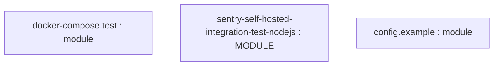
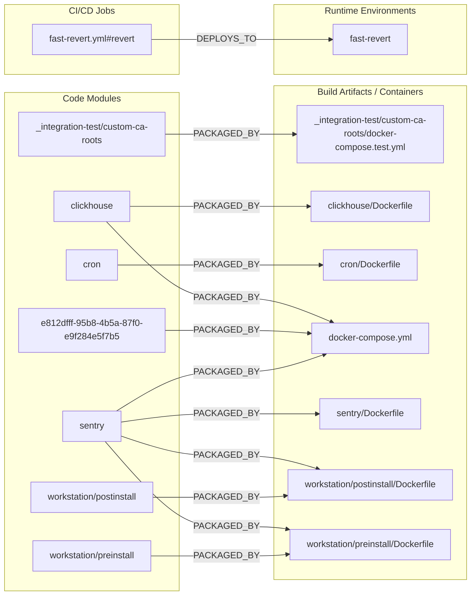
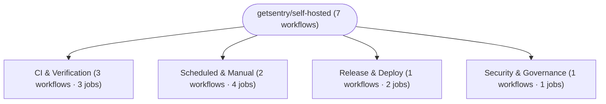

# Repository Architecture Analysis: getsentry/self-hosted

## Metadata
- **SHA**: `2c7379ea6ca9ce199d34e2c737758a0e034168b1`
- **Primary Ecosystem**: Python

## Quality Metrics
- **ast_engine**: tree-sitter
- **avg_cognitive_complexity**: 0.97
- **avg_cyclomatic_complexity**: 1.38
- **component_count**: 3
- **dead_code_count**: 1
- **dead_code_symbols**: 1 entry(ies)
- **duplication_pct**: 52.14
- **file_complexities**: 11 entry(ies)
- **files_analyzed**: 13
- **fitness_passed**: False
- **fitness_violation_count**: 1
- **framework**: Unknown
- **import_edges**: 70 entry(ies)
- **loc**: 1871
- **max_cognitive_complexity**: 12
- **max_cyclomatic_complexity**: 10
- **sloc**: 1184
- **test_file_count**: 4

# Architecture: getsentry/self-hosted

## Context
- **Repository**: `getsentry/self-hosted`
- **SHA**: `2c7379ea6ca9ce199d34e2c737758a0e034168b1`
- **Ecosystem**: Python
- **Framework**: Unknown

## Building Block View

## Component Details
- **docker-compose.test** (`_integration-test/custom-ca-roots/docker-compose.test.yml`): module
- **sentry-self-hosted-integration-test-nodejs** (`_integration-test/nodejs/package.json`): MODULE
- **config.example** (`sentry/config.example.yml`): module

## 6-Dimension Repository Scorecard

- **Overall Grade**: `F` (59.60/100)
- **Technical Debt Score**: 40.40
- **Estimated Remediation Effort**: 44.78h

| Dimension | Grade | Score | Weight | Details |
| :--- | :---: | :---: | :---: | :--- |
| Code Quality | `C` | 73.00 | 0.20 | avg_cc=1.38, max_cc=10, duplication=52.14%, dead_code=1 |
| Dependency Health | `A` | 100.00 | 0.15 | dependencies=55, outdated=0, vulnerable=0, has_lockfile=True |
| Maintainability | `B` | 84.00 | 0.15 | avg_cognitive=0.97, max_cognitive=12, fitness_violations=1, oversized_files=2 |
| Pipeline Health | `F` | 26.00 | 0.15 | workflows=7, operational_antipatterns=11, parallel_branches=True |
| Security | `F` | 15.00 | 0.20 | vulnerabilities=0, secrets=1, pipeline_security_findings=5 |
| Test Coverage | `C` | 70.00 | 0.15 | coverage=unavailable, ci_test_job=True, test_files_detected=True |

## Architecture Fitness & Workspace Boundaries

- **[MEDIUM] `ATRUSS-ARCH-005` (COMPLEXITY_THRESHOLD)**: Repository duplication_pct (52.14) exceeds policy threshold (15.0).

## Supply Chain Dependencies, Vulnerabilities & Secrets

- **Dependencies Parsed**: 55 | **Vulnerabilities**: 0 | **Secrets**: 1

### Secret Findings (Redacted)
- **[CRITICAL] `ATRUSS-SEC-004`** at `sentry/config.example.yml:135` (`-----BEGIN ... PRIVATE KEY----- [REDACTED]`)

### Inventory Sample
- `beautifulsoup4` `4.14.2` (PyPI, `uv.lock`)
- `beautifulsoup4` `4.7.1` (PyPI, `pyproject.toml`)
- `cryptography` `48.0.1` (PyPI, `pyproject.toml`)
- `cryptography` `48.0.1` (PyPI, `uv.lock`)
- `httpx` `0.25.2` (PyPI, `pyproject.toml`)
- `httpx` `0.28.1` (PyPI, `uv.lock`)
- `pytest` `9.0.3` (PyPI, `pyproject.toml`)
- `pytest` `9.0.3` (PyPI, `uv.lock`)
- `pytest-cov` `4.1.0` (PyPI, `pyproject.toml`)
- `pytest-cov` `7.0.0` (PyPI, `uv.lock`)
- `pytest-rerunfailures` `11.0` (PyPI, `pyproject.toml`)
- `pytest-rerunfailures` `16.1` (PyPI, `uv.lock`)
- `pytest-sentry` `0.1.11` (PyPI, `pyproject.toml`)
- `pytest-sentry` `0.3.3` (PyPI, `uv.lock`)
- `sentry-sdk` `2.58.0` (PyPI, `pyproject.toml`)
- `sentry-sdk` `2.58.0` (PyPI, `uv.lock`)
- `@sentry/node` `10.58.0` (npm, `_integration-test/nodejs/package-lock.json`)
- `@sentry/node` `10.58.0` (npm, `_integration-test/nodejs/package.json`)
- `anyio` `4.14.2` (PyPI, `uv.lock`)
- `certifi` `2026.10.19` (PyPI, `uv.lock`)
- `cffi` `2.0.0` (PyPI, `uv.lock`)
- `colorama` `0.4.6` (PyPI, `uv.lock`)
- `coverage` `7.12.0` (PyPI, `uv.lock`)
- `h11` `0.16.0` (PyPI, `uv.lock`)
- `httpcore` `1.0.9` (PyPI, `uv.lock`)
- `idna` `3.11` (PyPI, `uv.lock`)
- `iniconfig` `2.3.0` (PyPI, `uv.lock`)
- `packaging` `25.0` (PyPI, `uv.lock`)
- `pluggy` `1.6.0` (PyPI, `uv.lock`)
- `pycparser` `2.23` (PyPI, `uv.lock`)
- ... (+25 more dependencies)

## Section 7: Code-to-Cloud Deployment Traceability

- `fast-revert.yml#revert` (ci_job) --[DEPLOYS_TO]--> `fast-revert` (environment)
- `_integration-test/custom-ca-roots` (code_module) --[PACKAGED_BY]--> `_integration-test/custom-ca-roots/docker-compose.test.yml` (container)
- `clickhouse` (code_module) --[PACKAGED_BY]--> `clickhouse/Dockerfile` (container)
- `clickhouse` (code_module) --[PACKAGED_BY]--> `docker-compose.yml` (container)
- `cron` (code_module) --[PACKAGED_BY]--> `cron/Dockerfile` (container)
- `e812dfff-95b8-4b5a-87f0-e9f284e5f7b5` (code_module) --[PACKAGED_BY]--> `docker-compose.yml` (container)
- `sentry` (code_module) --[PACKAGED_BY]--> `docker-compose.yml` (container)
- `sentry` (code_module) --[PACKAGED_BY]--> `sentry/Dockerfile` (container)
- `sentry` (code_module) --[PACKAGED_BY]--> `workstation/postinstall/Dockerfile` (container)
- `sentry` (code_module) --[PACKAGED_BY]--> `workstation/preinstall/Dockerfile` (container)
- `workstation/postinstall` (code_module) --[PACKAGED_BY]--> `workstation/postinstall/Dockerfile` (container)
- `workstation/preinstall` (code_module) --[PACKAGED_BY]--> `workstation/preinstall/Dockerfile` (container)

## CI/CD Pipeline Topology

