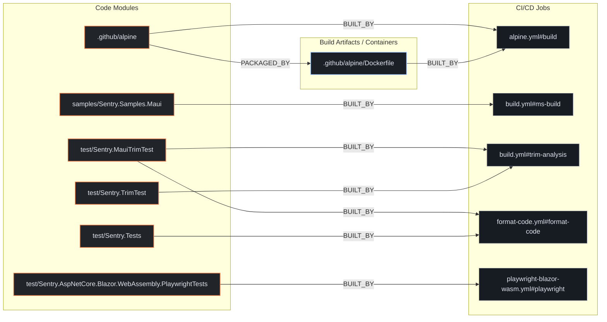

# Repository Architecture Analysis: getsentry/sentry-dotnet

## Metadata
- **SHA**: `2ea3796b744657726c6cbe369e6f4e8e9d8f7130`
- **Primary Ecosystem**: .NET

## Quality Metrics
- **ast_engine**: tree-sitter
- **avg_cognitive_complexity**: 0.66
- **avg_cyclomatic_complexity**: 1.62
- **component_count**: 156
- **dead_code_count**: 525
- **dead_code_symbols**: 50 entry(ies)
- **duplication_pct**: 88.68
- **file_complexities**: 25 entry(ies)
- **files_analyzed**: 1398
- **fitness_passed**: False
- **fitness_violation_count**: 5
- **framework**: ASP.NET Core
- **import_edges**: 100 entry(ies)
- **loc**: 159785
- **max_cognitive_complexity**: 41
- **max_cyclomatic_complexity**: 52
- **sloc**: 116262
- **test_file_count**: 841

# Architecture: getsentry/sentry-dotnet

## Context
- **Repository**: `getsentry/sentry-dotnet`
- **SHA**: `2ea3796b744657726c6cbe369e6f4e8e9d8f7130`
- **Ecosystem**: .NET
- **Framework**: ASP.NET Core

## Building Block View

```mermaid
graph TD;
  classDef atlasRoot fill:#004882,stroke:#a3c9ff,stroke-width:2px,color:#d3e4ff
  classDef atlasCategory fill:#212428,stroke:#E87A48,stroke-width:1.5px,color:#dfe3eb
  classDef atlasWorkflow fill:#1b2026,stroke:#a3c9ff,stroke-width:1.5px,color:#dfe3eb
  classDef atlasJob fill:#171c22,stroke:#8d9199,stroke-width:1px,color:#dfe3eb
  classDef atlasTarget fill:#005227,stroke:#8bd99b,stroke-width:1.5px,color:#a7f6b6
  classDef atlasAlert fill:#93000a,stroke:#ffb4ab,stroke-width:1.5px,color:#ffdad6
  classDef atlasMore fill:#252a31,stroke:#8d9199,stroke-dasharray:4 4,color:#c3c6cf
    repo_root(["getsentry/sentry-dotnet (156 components)"]):::atlasRoot
    dir_0_samples["samples (60)"]:::atlasCategory
    repo_root --> dir_0_samples
    sub_0_0_Sentry_Samples_OpenTelemetry_AspNetCore["Sentry.Samples.OpenTelemetry.AspNetCore (6)"]:::atlasWorkflow
    dir_0_samples --> sub_0_0_Sentry_Samples_OpenTelemetry_AspNetCore
    sub_0_1_Sentry_Samples_GraphQL_Server["Sentry.Samples.GraphQL.Server (4)"]:::atlasWorkflow
    dir_0_samples --> sub_0_1_Sentry_Samples_GraphQL_Server
    sub_0_2_Sentry_Samples_AspNetCore_Blazor_Server["Sentry.Samples.AspNetCore.Blazor.Server (3)"]:::atlasWorkflow
    dir_0_samples --> sub_0_2_Sentry_Samples_AspNetCore_Blazor_Server
    sub_0_more["+33 more submodules (47)"]:::atlasMore
    dir_0_samples --> sub_0_more
    dir_1_test["test (54)"]:::atlasCategory
    repo_root --> dir_1_test
    sub_1_0_Sentry_AspNetCore_Tests["Sentry.AspNetCore.Tests (6)"]:::atlasWorkflow
    dir_1_test --> sub_1_0_Sentry_AspNetCore_Tests
    sub_1_1_Sentry_Testing["Sentry.Testing (5)"]:::atlasWorkflow
    dir_1_test --> sub_1_1_Sentry_Testing
    sub_1_2_Sentry_AspNetCore_Grpc_Tests["Sentry.AspNetCore.Grpc.Tests (3)"]:::atlasWorkflow
    dir_1_test --> sub_1_2_Sentry_AspNetCore_Grpc_Tests
    sub_1_more["+34 more submodules (40)"]:::atlasMore
    dir_1_test --> sub_1_more
    dir_2_src["src (37)"]:::atlasCategory
    repo_root --> dir_2_src
    sub_2_0_Sentry["Sentry (10)"]:::atlasWorkflow
    dir_2_src --> sub_2_0_Sentry
    sub_2_1_Sentry_Extensions_Hosting["Sentry.Extensions.Hosting (2)"]:::atlasWorkflow
    dir_2_src --> sub_2_1_Sentry_Extensions_Hosting
    sub_2_2_Sentry_Analyzers["Sentry.Analyzers (1)"]:::atlasWorkflow
    dir_2_src --> sub_2_2_Sentry_Analyzers
    sub_2_more["+24 more submodules (24)"]:::atlasMore
    dir_2_src --> sub_2_more
    dir_3_benchmarks["benchmarks (3)"]:::atlasCategory
    repo_root --> dir_3_benchmarks
    dir_4_integration_test["integration-test (2)"]:::atlasCategory
    repo_root --> dir_4_integration_test
    sub_1_more -.->|"37 deps"| sub_2_more
    sub_0_more -.->|"30 deps"| sub_2_more
    sub_1_more -.->|"24 deps"| sub_1_1_Sentry_Testing
    sub_2_more -.->|"15 deps"| sub_2_0_Sentry
    sub_0_more -.->|"13 deps"| sub_2_0_Sentry
    sub_1_more -.->|"10 deps"| sub_2_0_Sentry
    sub_0_2_Sentry_Samples_AspNetCore_Blazor_Server -.->|"3 deps"| sub_2_more
    sub_1_more -.->|"3 deps"| sub_2_1_Sentry_Extensions_Hosting
    dir_3_benchmarks -.->|"2 deps"| sub_1_1_Sentry_Testing
    dir_3_benchmarks -.->|"2 deps"| sub_2_0_Sentry
    dir_3_benchmarks -.->|"2 deps"| sub_2_more
    sub_0_0_Sentry_Samples_OpenTelemetry_AspNetCore -.->|"2 deps"| sub_2_more
```

## Component Details

Showing top 60 representative components out of 156 across 5 module group(s):

- **Module `samples`** (60 components — MODULE: 36, API_ROUTE: 17, SERVICE: 6)
- **Module `test`** (54 components — MODULE: 37, SERVICE: 10, API_ROUTE: 4)
- **Module `src`** (37 components — MODULE: 27, SERVICE: 10)
- **Module `benchmarks`** (3 components — MODULE: 2, SERVICE: 1)
- **Module `integration-test`** (2 components — MODULE: 2)

- **Sentry.TrimTest** (`test/Sentry.TrimTest/Sentry.TrimTest.csproj`): MODULE (deps: Sentry, Sentry.AspNetCore, Sentry.AspNetCore.Grpc, Sentry.DiagnosticSource, Sentry.EntityFramework, Sentry.Extensions.Logging (+3 more))
- **Sentry.Maui.Device.TestApp** (`test/Sentry.Maui.Device.TestApp/Sentry.Maui.Device.TestApp.csproj`): MODULE (deps: Sentry.Android.AssemblyReader.Tests, Sentry.Compiler.Extensions, Sentry.Extensions.Logging.Tests, Sentry.Maui.CommunityToolkit.Mvvm.Tests, Sentry.Maui.Tests, Sentry.Tests)
- **Sentry.AspNetCore.Tests** (`test/Sentry.AspNetCore.Tests/Sentry.AspNetCore.Tests.csproj`): MODULE (deps: Sentry.AspNetCore, Sentry.AspNetCore.TestUtils, Sentry.Extensions.Hosting, Sentry.Testing)
- **Sentry.DiagnosticSource.IntegrationTests** (`test/Sentry.DiagnosticSource.IntegrationTests/Sentry.DiagnosticSource.IntegrationTests.csproj`): MODULE (deps: Sentry, Sentry.DiagnosticSource, Sentry.Extensions.Logging, Sentry.Testing)
- **Sentry.Benchmarks** (`benchmarks/Sentry.Benchmarks/Sentry.Benchmarks.csproj`): MODULE (deps: Sentry, Sentry.Profiling, Sentry.Testing)
- **Sentry.Compiler.Extensions.Tests** (`test/Sentry.Compiler.Extensions.Tests/Sentry.Compiler.Extensions.Tests.csproj`): MODULE (deps: Sentry, Sentry.Compiler.Extensions, Sentry.Testing)
- **Sentry.DiagnosticSource.Tests** (`test/Sentry.DiagnosticSource.Tests/Sentry.DiagnosticSource.Tests.csproj`): MODULE (deps: Sentry, Sentry.DiagnosticSource, Sentry.Testing)
- **Sentry.Extensions.AI.Tests** (`test/Sentry.Extensions.AI.Tests/Sentry.Extensions.AI.Tests.csproj`): MODULE (deps: Sentry, Sentry.Extensions.AI, Sentry.Testing)
- **Sentry.Extensions.Logging.Benchmarks** (`benchmarks/Sentry.Extensions.Logging.Benchmarks/Sentry.Extensions.Logging.Benchmarks.csproj`): MODULE (deps: Sentry, Sentry.Extensions.Logging, Sentry.Testing)
- **Sentry.Maui.CommunityToolkit.Mvvm.Tests** (`test/Sentry.Maui.CommunityToolkit.Mvvm.Tests/Sentry.Maui.CommunityToolkit.Mvvm.Tests.csproj`): MODULE (deps: Sentry.Maui, Sentry.Maui.CommunityToolkit.Mvvm, Sentry.Testing)
- **Sentry.Maui.Tests** (`test/Sentry.Maui.Tests/Sentry.Maui.Tests.csproj`): MODULE (deps: Sentry.Extensions.Hosting, Sentry.Maui, Sentry.Testing)
- **Sentry.OpenTelemetry.Exporter.Tests** (`test/Sentry.OpenTelemetry.Exporter.Tests/Sentry.OpenTelemetry.Exporter.Tests.csproj`): MODULE (deps: Sentry, Sentry.OpenTelemetry.Exporter, Sentry.Testing)
- **Sentry.OpenTelemetry.Tests** (`test/Sentry.OpenTelemetry.Tests/Sentry.OpenTelemetry.Tests.csproj`): MODULE (deps: Sentry, Sentry.OpenTelemetry, Sentry.Testing)
- **Sentry.Quartz.Tests** (`test/Sentry.Quartz.Tests/Sentry.Quartz.Tests.csproj`): MODULE (deps: Sentry.AspNetCore, Sentry.Quartz, Sentry.Testing)
- **Sentry.Samples.AspNetCore.Blazor.Server** (`samples/Sentry.Samples.AspNetCore.Blazor.Server/Sentry.Samples.AspNetCore.Blazor.Server.csproj`): MODULE (deps: Sentry.AspNetCore, Sentry.AspNetCore.Blazor.WebAssembly, Sentry.OpenTelemetry.Exporter)
- **Sentry.Samples.AspNetCore.WebAPI.Profiling** (`samples/Sentry.Samples.AspNetCore.WebAPI.Profiling/Sentry.Samples.AspNetCore.WebAPI.Profiling.csproj`): MODULE (deps: Sentry, Sentry.AspNetCore, Sentry.Profiling)
- **Sentry.Samples.GraphQL.Server** (`samples/Sentry.Samples.GraphQL.Server/Sentry.Samples.GraphQL.Server.csproj`): MODULE (deps: Sentry, Sentry.AspNetCore, Sentry.OpenTelemetry.Exporter)
- **Sentry.Samples.Maui** (`samples/Sentry.Samples.Maui/Sentry.Samples.Maui.csproj`): MODULE (deps: Sentry.Analyzers, Sentry.Maui, Sentry.Maui.CommunityToolkit.Mvvm)
- **Sentry.Serilog.Tests** (`test/Sentry.Serilog.Tests/Sentry.Serilog.Tests.csproj`): MODULE (deps: Sentry.AspNetCore.TestUtils, Sentry.Serilog, Sentry.Testing)
- **Sentry.Tests** (`test/Sentry.Tests/Sentry.Tests.csproj`): MODULE (deps: Sentry, Sentry.Testing, Sentry.Testing.CrashableApp)
- **SentryGraphQLHttpMessageHandler** (`src/Sentry/SentryGraphQLHttpMessageHandler.cs`): SERVICE (deps: SentryFailedRequestHandler, SentryGraphQLHttpFailedRequestHandler, SentryMessageHandler)
- **SentryHttpMessageHandler** (`src/Sentry/SentryHttpMessageHandler.cs`): SERVICE (deps: SentryFailedRequestHandler, SentryHttpFailedRequestHandler, SentryMessageHandler)
- **Sentry** (`src/Sentry/Sentry.csproj`): MODULE (deps: Sentry.Analyzers, Sentry.Compiler.Extensions)
- **Sentry.Android.AssemblyReader.Tests** (`test/Sentry.Android.AssemblyReader.Tests/Sentry.Android.AssemblyReader.Tests.csproj`): MODULE (deps: Sentry.Android.AssemblyReader, Sentry.Testing)
- **Sentry.AspNet** (`src/Sentry.AspNet/Sentry.AspNet.csproj`): MODULE (deps: Sentry, Sentry.DiagnosticSource)
- **Sentry.AspNet.Tests** (`test/Sentry.AspNet.Tests/Sentry.AspNet.Tests.csproj`): MODULE (deps: Sentry.AspNet, Sentry.Testing)
- **Sentry.AspNetCore.Blazor.WebAssembly** (`src/Sentry.AspNetCore.Blazor.WebAssembly/Sentry.AspNetCore.Blazor.WebAssembly.csproj`): MODULE (deps: Sentry, Sentry.Extensions.Logging)
- **Sentry.AspNetCore.Blazor.WebAssembly.Tests** (`test/Sentry.AspNetCore.Blazor.WebAssembly.Tests/Sentry.AspNetCore.Blazor.WebAssembly.Tests.csproj`): MODULE (deps: Sentry.AspNetCore.Blazor.WebAssembly, Sentry.Testing)
- **Sentry.AspNetCore.Grpc.Tests** (`test/Sentry.AspNetCore.Grpc.Tests/Sentry.AspNetCore.Grpc.Tests.csproj`): MODULE (deps: Sentry.AspNetCore.Grpc, Sentry.AspNetCore.TestUtils)
- **Sentry.AspNetCore.TestUtils** (`test/Sentry.AspNetCore.TestUtils/Sentry.AspNetCore.TestUtils.csproj`): MODULE (deps: Sentry.AspNetCore, Sentry.Testing)
- **Sentry.EntityFramework.Tests** (`test/Sentry.EntityFramework.Tests/Sentry.EntityFramework.Tests.csproj`): MODULE (deps: Sentry.EntityFramework, Sentry.Testing)
- **Sentry.Extensions.Hosting.Tests** (`test/Sentry.Extensions.Hosting.Tests/Sentry.Extensions.Hosting.Tests.csproj`): MODULE (deps: Sentry.Extensions.Hosting, Sentry.Testing)
- **Sentry.Extensions.Logging.Tests** (`test/Sentry.Extensions.Logging.Tests/Sentry.Extensions.Logging.Tests.csproj`): MODULE (deps: Sentry.Extensions.Logging, Sentry.Testing)
- **Sentry.Google.Cloud.Functions.Tests** (`test/Sentry.Google.Cloud.Functions.Tests/Sentry.Google.Cloud.Functions.Tests.csproj`): MODULE (deps: Sentry.AspNetCore.TestUtils, Sentry.Google.Cloud.Functions)
- **Sentry.Hangfire.Tests** (`test/Sentry.Hangfire.Tests/Sentry.Hangfire.Tests.csproj`): MODULE (deps: Sentry.Hangfire, Sentry.Testing)
- **Sentry.Log4Net.Tests** (`test/Sentry.Log4Net.Tests/Sentry.Log4Net.Tests.csproj`): MODULE (deps: Sentry.Log4Net, Sentry.Testing)
- **Sentry.Log4Net.V3.Tests** (`test/Sentry.Log4Net.V3.Tests/Sentry.Log4Net.V3.Tests.csproj`): MODULE (deps: Sentry.Log4Net, Sentry.Testing)
- **Sentry.MauiTrimTest** (`test/Sentry.MauiTrimTest/Sentry.MauiTrimTest.csproj`): MODULE (deps: Sentry, Sentry.Maui)
- **Sentry.NLog.Tests** (`test/Sentry.NLog.Tests/Sentry.NLog.Tests.csproj`): MODULE (deps: Sentry.NLog, Sentry.Testing)
- **Sentry.Profiling** (`src/Sentry.Profiling/Sentry.Profiling.csproj`): MODULE (deps: Sentry, TraceEvent)
- **Sentry.Profiling.Tests** (`test/Sentry.Profiling.Tests/Sentry.Profiling.Tests.csproj`): MODULE (deps: Sentry.Profiling, Sentry.Testing)
- **Sentry.Quartz** (`src/Sentry.Quartz/Sentry.Quartz.csproj`): MODULE (deps: Sentry, Sentry.Extensions.Logging)
- **Sentry.Quartz3.Tests** (`test/Sentry.Quartz3.Tests/Sentry.Quartz3.Tests.csproj`): MODULE (deps: Sentry.Quartz3, Sentry.Testing)
- **Sentry.Samples.AspNetCore.NLog** (`samples/Sentry.Samples.AspNetCore.NLog/Sentry.Samples.AspNetCore.NLog.csproj`): MODULE (deps: Sentry.AspNetCore, Sentry.NLog)
- **Sentry.Samples.AspNetCore.Serilog** (`samples/Sentry.Samples.AspNetCore.Serilog/Sentry.Samples.AspNetCore.Serilog.csproj`): MODULE (deps: Sentry.AspNetCore, Sentry.Serilog)
- **Sentry.Samples.Console.Profiling** (`samples/Sentry.Samples.Console.Profiling/Sentry.Samples.Console.Profiling.csproj`): MODULE (deps: Sentry, Sentry.Profiling)
- **Sentry.Samples.ME.AI.AspNetCore** (`samples/Sentry.Samples.ME.AI.AspNetCore/Sentry.Samples.ME.AI.AspNetCore.csproj`): MODULE (deps: Sentry.AspNetCore, Sentry.Extensions.AI)
- **Sentry.Samples.ME.AI.Console** (`samples/Sentry.Samples.ME.AI.Console/Sentry.Samples.ME.AI.Console.csproj`): MODULE (deps: Sentry.Extensions.AI, Sentry.Extensions.Logging)
- **Sentry.Samples.OpenTelemetry.AspNetCore** (`samples/Sentry.Samples.OpenTelemetry.AspNetCore/Sentry.Samples.OpenTelemetry.AspNetCore.csproj`): MODULE (deps: Sentry.AspNetCore, Sentry.OpenTelemetry.Exporter)
- **Sentry.Samples.OpenTelemetry.AzureFunctions** (`samples/Sentry.Samples.OpenTelemetry.AzureFunctions/Sentry.Samples.OpenTelemetry.AzureFunctions.csproj`): MODULE (deps: Sentry.Extensions.Hosting, Sentry.OpenTelemetry.Exporter)
- **Sentry.Samples.OpenTelemetry.Console** (`samples/Sentry.Samples.OpenTelemetry.Console/Sentry.Samples.OpenTelemetry.Console.csproj`): MODULE (deps: Sentry, Sentry.OpenTelemetry.Exporter)
- **Sentry.Samples.OpenTelemetry.MongoDB** (`samples/Sentry.Samples.OpenTelemetry.MongoDB/Sentry.Samples.OpenTelemetry.MongoDB.csproj`): MODULE (deps: Sentry, Sentry.OpenTelemetry.Exporter)
- **Sentry.Samples.Quartz** (`samples/Sentry.Samples.Quartz/Sentry.Samples.Quartz.csproj`): MODULE (deps: Sentry.AspNetCore, Sentry.Quartz)
- **SentryGraphQLHttpFailedRequestHandler** (`src/Sentry/SentryGraphQLHttpFailedRequestHandler.cs`): SERVICE (deps: SentryFailedRequestHandler, SentryHttpFailedRequestHandler)
- **BlazorSentryIntegration** (`samples/Sentry.Samples.AspNetCore.Blazor.Server/Services/BlazorSentryIntegration.cs`): SERVICE (deps: SentryCircuitHandler)
- **GET_echo_{name}** (`samples/Sentry.Samples.OpenTelemetry.AspNetCore/Program.cs`): API_ROUTE (deps: FakeAuthHandler)
- **GET_hello** (`samples/Sentry.Samples.OpenTelemetry.AspNetCore/Program.cs`): API_ROUTE (deps: FakeAuthHandler)
- **GET_private** (`samples/Sentry.Samples.OpenTelemetry.AspNetCore/Program.cs`): API_ROUTE (deps: FakeAuthHandler)
- **GET_throw** (`samples/Sentry.Samples.OpenTelemetry.AspNetCore/Program.cs`): API_ROUTE (deps: FakeAuthHandler)
- **SdkStateAtStart** (`test/Sentry.Extensions.Hosting.Tests/SentryHostedServiceTests.cs`): SERVICE (deps: SentryHostedService)

## 6-Dimension Repository Scorecard

- **Overall Grade**: `F` (31.20/100)
- **Technical Debt Score**: 68.80
- **Estimated Remediation Effort**: 259.19h

| Dimension | Grade | Score | Weight | Details |
| :--- | :---: | :---: | :---: | :--- |
| Code Quality | `F` | 30.00 | 0.20 | avg_cc=1.62, max_cc=52, duplication=88.68%, dead_code=525 |
| Dependency Health | `B` | 85.00 | 0.15 | dependencies=257, outdated=0, vulnerable=0, has_lockfile=False |
| Maintainability | `F` | 13.00 | 0.15 | avg_cognitive=0.66, max_cognitive=41, fitness_violations=5, oversized_files=14 |
| Pipeline Health | `F` | 0.00 | 0.15 | workflows=19, operational_antipatterns=36, parallel_branches=True |
| Security | `F` | 0.00 | 0.20 | vulnerabilities=0, secrets=6, pipeline_security_findings=20 |
| Test Coverage | `C` | 70.00 | 0.15 | coverage=unavailable, ci_test_job=True, test_files_detected=True |

## Architecture Fitness & Workspace Boundaries

- **[HIGH] `ATRUSS-ARCH-004` (CIRCULAR_DEPENDENCY)**: Circular dependency detected between architectural components. (BlazorSentryIntegration -> SentryCircuitHandler -> BlazorSentryIntegration)
- **[HIGH] `ATRUSS-ARCH-004` (CIRCULAR_DEPENDENCY)**: Circular dependency detected between architectural components. (TransactionController -> VersionController -> TransactionController)
- **[MEDIUM] `ATRUSS-ARCH-005` (COMPLEXITY_THRESHOLD)**: Repository duplication_pct (88.68) exceeds policy threshold (15.0).
- **[MEDIUM] `ATRUSS-ARCH-005` (COMPLEXITY_THRESHOLD)**: Repository max_cognitive_complexity (41.0) exceeds policy threshold (25.0).
- **[MEDIUM] `ATRUSS-ARCH-005` (COMPLEXITY_THRESHOLD)**: Repository max_cyclomatic_complexity (52.0) exceeds policy threshold (20.0).

## Supply Chain Dependencies, Vulnerabilities & Secrets

- **Dependencies Parsed**: 257 | **Vulnerabilities**: 0 | **Secrets**: 6

### Secret Findings (Redacted)
- **[HIGH] `ATRUSS-SEC-005`** at `Sentry.sln.DotSettings:2` (`<s:String x:Key="/Def***REDACTED***">EF</s:String>`)
- **[HIGH] `ATRUSS-SEC-005`** at `Sentry.sln.DotSettings:3` (`<s:String x:Key="/Def***REDACTED***">IO</s:String>`)
- **[HIGH] `ATRUSS-SEC-005`** at `Sentry.sln.DotSettings:4` (`<s:String x:Key="/Def***REDACTED***">OS</s:String>`)
- **[HIGH] `ATRUSS-SEC-005`** at `Sentry.sln.DotSettings:5` (`<s:String x:Key="/Def***REDACTED***">QL</s:String>`)
- **[HIGH] `ATRUSS-SEC-005`** at `Sentry.sln.DotSettings:6` (`<s:String x:Key="/Def***REDACTED***">UI</s:String>`)
- **[HIGH] `ATRUSS-SEC-005`** at `src/Sentry/Sentry.csproj.DotSettings:2` (`<s:Boolean x:Key="/Def***REDACTED***">True</s:Boolean></wpf:ResourceDictionary>`)

### Inventory Sample
- `AWSSDK.Extensions.NETCore.Setup` `3.7.7` (NuGet, `samples/Sentry.Samples.Aws.Lambda.AspNetCoreServer/Sentry.Samples.Aws.Lambda.AspNetCoreServer.csproj`)
- `Amazon.Lambda.AspNetCoreServer` `7.3.0` (NuGet, `samples/Sentry.Samples.Aws.Lambda.AspNetCoreServer/Sentry.Samples.Aws.Lambda.AspNetCoreServer.csproj`)
- `Azure.Identity` `1.11.4` (NuGet, `test/Sentry.DiagnosticSource.IntegrationTests/Sentry.DiagnosticSource.IntegrationTests.csproj`)
- `Azure.Identity` `1.11.4` (NuGet, `test/Sentry.DiagnosticSource.IntegrationTests/Sentry.DiagnosticSource.IntegrationTests.csproj`)
- `Azure.Identity` `1.11.4` (NuGet, `test/Sentry.DiagnosticSource.IntegrationTests/Sentry.DiagnosticSource.IntegrationTests.csproj`)
- `BenchmarkDotNet` `0.13.12` (NuGet, `benchmarks/Sentry.Benchmarks/Sentry.Benchmarks.csproj`)
- `BenchmarkDotNet` `0.13.12` (NuGet, `benchmarks/Sentry.Extensions.Logging.Benchmarks/Sentry.Extensions.Logging.Benchmarks.csproj`)
- `BenchmarkDotNet.Diagnostics.Windows` `0.13.12` (NuGet, `benchmarks/Sentry.Benchmarks/Sentry.Benchmarks.csproj`)
- `BenchmarkDotNet.Diagnostics.Windows` `0.13.12` (NuGet, `benchmarks/Sentry.Extensions.Logging.Benchmarks/Sentry.Extensions.Logging.Benchmarks.csproj`)
- `CommunityToolkit.Mvvm` `8.4.0` (NuGet, `samples/Sentry.Samples.Maui/Sentry.Samples.Maui.csproj`)
- `CommunityToolkit.Mvvm` `8.4.0` (NuGet, `src/Sentry.Maui.CommunityToolkit.Mvvm/Sentry.Maui.CommunityToolkit.Mvvm.csproj`)
- `DeviceRunners.VisualRunners.Maui` `0.1.0-preview.5` (NuGet, `test/Sentry.Maui.Device.TestApp/Sentry.Maui.Device.TestApp.csproj`)
- `DeviceRunners.VisualRunners.Xunit` `0.1.0-preview.5` (NuGet, `test/Sentry.Maui.Device.TestApp/Sentry.Maui.Device.TestApp.csproj`)
- `DeviceRunners.XHarness.Maui` `0.1.0-preview.5` (NuGet, `test/Sentry.Maui.Device.TestApp/Sentry.Maui.Device.TestApp.csproj`)
- `DeviceRunners.XHarness.Xunit` `0.1.0-preview.5` (NuGet, `test/Sentry.Maui.Device.TestApp/Sentry.Maui.Device.TestApp.csproj`)
- `EfClassicLocalDb` `18.0.1` (NuGet, `test/Sentry.EntityFramework.Tests/Sentry.EntityFramework.Tests.csproj`)
- `Effort.EF6` `2.2.16` (NuGet, `samples/Sentry.Samples.EntityFramework/Sentry.Samples.EntityFramework.csproj`)
- `Effort.EF6` `2.2.16` (NuGet, `test/Sentry.EntityFramework.Tests/Sentry.EntityFramework.Tests.csproj`)
- `EntityFramework` `6.2.0` (NuGet, `src/Sentry.EntityFramework/Sentry.EntityFramework.csproj`)
- `EntityFramework` `6.5.1` (NuGet, `samples/Sentry.Samples.EntityFramework/Sentry.Samples.EntityFramework.csproj`)
- `EntityFramework` `6.5.1` (NuGet, `src/Sentry.EntityFramework/Sentry.EntityFramework.csproj`)
- `EntityFramework` `6.5.1` (NuGet, `test/Sentry.EntityFramework.Tests/Sentry.EntityFramework.Tests.csproj`)
- `Google.Cloud.Functions.Hosting` `2.0.0` (NuGet, `samples/Sentry.Samples.Google.Cloud.Functions/Sentry.Samples.Google.Cloud.Functions.csproj`)
- `Google.Cloud.Functions.Hosting` `2.0.0` (NuGet, `src/Sentry.Google.Cloud.Functions/Sentry.Google.Cloud.Functions.csproj`)
- `Google.Protobuf` `3.22.5` (NuGet, `src/Sentry.AspNetCore.Grpc/Sentry.AspNetCore.Grpc.csproj`)
- `Google.Protobuf` `3.23.4` (NuGet, `samples/Sentry.Samples.AspNetCore.Grpc/Sentry.Samples.AspNetCore.Grpc.csproj`)
- `GraphQL` `7.6.0` (NuGet, `samples/Sentry.Samples.GraphQL.Client.Http/Sentry.Samples.GraphQL.Client.Http.csproj`)
- `GraphQL` `7.6.0` (NuGet, `samples/Sentry.Samples.GraphQL.Server/Sentry.Samples.GraphQL.Server.csproj`)
- `GraphQL.Client` `6.0.0` (NuGet, `samples/Sentry.Samples.GraphQL.Client.Http/Sentry.Samples.GraphQL.Client.Http.csproj`)
- `GraphQL.Client` `6.0.0` (NuGet, `samples/Sentry.Samples.GraphQL.Server/Sentry.Samples.GraphQL.Server.csproj`)
- ... (+227 more dependencies)

## Section 7: Code-to-Cloud Deployment Traceability

- `.github/alpine` (code_module) --[BUILT_BY]--> `alpine.yml#build` (ci_job)
- `.github/alpine` (code_module) --[PACKAGED_BY]--> `.github/alpine/Dockerfile` (container)
- `samples/Sentry.Samples.Maui` (code_module) --[BUILT_BY]--> `build.yml#ms-build` (ci_job)
- `test/Sentry.AspNetCore.Blazor.WebAssembly.PlaywrightTests` (code_module) --[BUILT_BY]--> `playwright-blazor-wasm.yml#playwright` (ci_job)
- `test/Sentry.MauiTrimTest` (code_module) --[BUILT_BY]--> `build.yml#trim-analysis` (ci_job)
- `test/Sentry.MauiTrimTest` (code_module) --[BUILT_BY]--> `format-code.yml#format-code` (ci_job)
- `test/Sentry.Tests` (code_module) --[BUILT_BY]--> `format-code.yml#format-code` (ci_job)
- `test/Sentry.TrimTest` (code_module) --[BUILT_BY]--> `build.yml#trim-analysis` (ci_job)
- `.github/alpine/Dockerfile` (container) --[BUILT_BY]--> `alpine.yml#build` (ci_job)

## CI/CD Pipeline Topology

```mermaid
graph TD;
  classDef atlasRoot fill:#004882,stroke:#a3c9ff,stroke-width:2px,color:#d3e4ff
  classDef atlasCategory fill:#212428,stroke:#E87A48,stroke-width:1.5px,color:#dfe3eb
  classDef atlasWorkflow fill:#1b2026,stroke:#a3c9ff,stroke-width:1.5px,color:#dfe3eb
  classDef atlasJob fill:#171c22,stroke:#8d9199,stroke-width:1px,color:#dfe3eb
  classDef atlasTarget fill:#005227,stroke:#8bd99b,stroke-width:1.5px,color:#a7f6b6
  classDef atlasAlert fill:#93000a,stroke:#ffb4ab,stroke-width:1.5px,color:#ffdad6
  classDef atlasMore fill:#252a31,stroke:#8d9199,stroke-dasharray:4 4,color:#c3c6cf
  pipeline_root(["getsentry/sentry-dotnet (19 workflows)"]):::atlasRoot
  subgraph sg_grp_0_Scheduled___Manual["Scheduled & Manual (9 workflows · 18 jobs)"]
    direction TB
    subgraph sg_wf_1_build["build (7 jobs)"]
      direction TB
      wf_1_build(["Trigger: build"]):::atlasWorkflow
      job_1_build_sentry_native["build-sentry-native"]:::atlasJob
      job_1_build_sentry["build-sentry"]:::atlasJob
      job_1_integration_test["integration-test"]:::atlasJob
      wf_1_build --> job_1_build_sentry_native
      job_1_build_sentry_native --> job_1_build_sentry
      job_1_build_sentry_native --> job_1_integration_test
    end
    pipeline_root --> wf_1_build
    subgraph sg_wf_6_Android_Device_Tests["Android Device Tests (3 jobs)"]
      direction TB
      wf_6_Android_Device_Tests(["Trigger: Android Device Tests"]):::atlasWorkflow
      job_6_build["build"]:::atlasJob
      job_6_android["android"]:::atlasJob
      job_6_android_integration_tests["android-integration-tests"]:::atlasJob
      wf_6_Android_Device_Tests --> job_6_build
      job_6_build --> job_6_android
      wf_6_Android_Device_Tests --> job_6_android_integration_tests
    end
    pipeline_root --> wf_6_Android_Device_Tests
    subgraph sg_wf_7_iOS_Device_Tests["iOS Device Tests (2 jobs)"]
      direction TB
      wf_7_iOS_Device_Tests(["Trigger: iOS Device Tests"]):::atlasWorkflow
      job_7_ios_tests["ios-tests"]:::atlasJob
      job_7_ios_integration_tests["ios-integration-tests"]:::atlasJob
      wf_7_iOS_Device_Tests --> job_7_ios_tests
      wf_7_iOS_Device_Tests --> job_7_ios_integration_tests
    end
    pipeline_root --> wf_7_iOS_Device_Tests
    subgraph sg_wf_10_Blazor_WASM_Playwright_Tests["Blazor WASM Playwright Tests (1 jobs)"]
      direction TB
      wf_10_Blazor_WASM_Playwright_Tests(["Trigger: Blazor WASM Playwright Tests"]):::atlasWorkflow
      job_10_playwright["playwright"]:::atlasJob
      wf_10_Blazor_WASM_Playwright_Tests --> job_10_playwright
    end
    pipeline_root --> wf_10_Blazor_WASM_Playwright_Tests
  end
  subgraph sg_grp_1_CI___Verification["CI & Verification (8 workflows · 9 jobs)"]
    direction TB
    subgraph sg_wf_2_Changelog_Guard["Changelog Guard (1 jobs)"]
      direction TB
      wf_2_Changelog_Guard(["Trigger: Changelog Guard"]):::atlasWorkflow
      job_2_no_manual_unreleased_entries["no-manual-unreleased-entries"]:::atlasJob
      wf_2_Changelog_Guard --> job_2_no_manual_unreleased_entries
    end
    pipeline_root --> wf_2_Changelog_Guard
    subgraph sg_wf_3_Changelog_Preview["Changelog Preview (1 jobs)"]
      direction TB
      wf_3_Changelog_Preview(["Trigger: Changelog Preview"]):::atlasWorkflow
      job_3_changelog_preview["changelog-preview"]:::atlasJob
      wf_3_Changelog_Preview --> job_3_changelog_preview
    end
    pipeline_root --> wf_3_Changelog_Preview
    subgraph sg_wf_5_Danger["Danger (1 jobs)"]
      direction TB
      wf_5_Danger(["Trigger: Danger"]):::atlasWorkflow
      job_5_danger["danger"]:::atlasJob
      wf_5_Danger --> job_5_danger
    end
    pipeline_root --> wf_5_Danger
    subgraph sg_wf_15_verify_api["verify api (2 jobs)"]
      direction TB
      wf_15_verify_api(["Trigger: verify api"]):::atlasWorkflow
      job_15_run_api_tests["run-api-tests"]:::atlasJob
      job_15_accept_api_changes["accept-api-changes"]:::atlasJob
      wf_15_verify_api --> job_15_run_api_tests
      job_15_run_api_tests --> job_15_accept_api_changes
    end
    pipeline_root --> wf_15_verify_api
  end
  subgraph sg_grp_2_Release___Deploy["Release & Deploy (1 workflows · 1 jobs)"]
    direction TB
    subgraph sg_wf_12_Release["Release (1 jobs)"]
      direction TB
      wf_12_Release(["Trigger: Release"]):::atlasWorkflow
      job_12_job_release["job_release"]:::atlasJob
      wf_12_Release --> job_12_job_release
    end
    pipeline_root --> wf_12_Release
  end
  subgraph sg_grp_3_Security___Governance["Security & Governance (1 workflows · 1 jobs)"]
    direction TB
    subgraph sg_wf_4_CodeQL["CodeQL (1 jobs)"]
      direction TB
      wf_4_CodeQL(["Trigger: CodeQL"]):::atlasWorkflow
      job_4_analyze["analyze"]:::atlasJob
      wf_4_CodeQL --> job_4_analyze
    end
    pipeline_root --> wf_4_CodeQL
  end
  wf_more["+9 more workflows"]:::atlasMore
  pipeline_root --> wf_more
```

