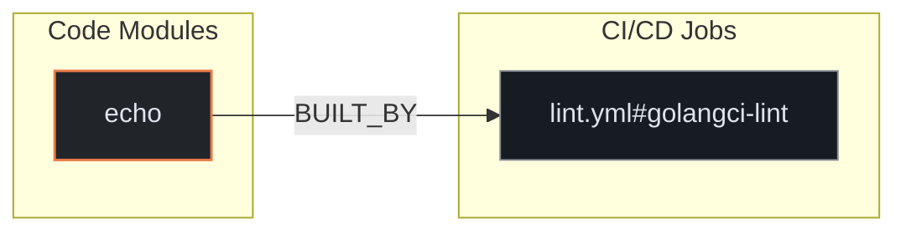

# Repository Architecture Analysis: getsentry/sentry-go

## Metadata
- **SHA**: `bd76d5242520430b83311fba3175f9e4e133e981`
- **Primary Ecosystem**: Go

## Quality Metrics
- **ast_engine**: fallback
- **avg_cognitive_complexity**: 0.0
- **avg_cyclomatic_complexity**: 0.0
- **component_count**: 235
- **dead_code_count**: 0
- **dead_code_symbols**: 0 entry(ies)
- **duplication_pct**: 0.0
- **file_complexities**: 0 entry(ies)
- **files_analyzed**: 235
- **fitness_passed**: True
- **fitness_violation_count**: 0
- **framework**: Go Gin / Echo / Fiber
- **import_edges**: 0 entry(ies)
- **loc**: 49270
- **max_cognitive_complexity**: 0
- **max_cyclomatic_complexity**: 0
- **sloc**: 40590
- **test_file_count**: 92

# Architecture: getsentry/sentry-go

## Context
- **Repository**: `getsentry/sentry-go`
- **SHA**: `bd76d5242520430b83311fba3175f9e4e133e981`
- **Ecosystem**: Go
- **Framework**: Go Gin / Echo / Fiber

## Building Block View

```mermaid
graph TD;
  classDef atlasRoot fill:#004882,stroke:#a3c9ff,stroke-width:2px,color:#d3e4ff
  classDef atlasCategory fill:#212428,stroke:#E87A48,stroke-width:1.5px,color:#dfe3eb
  classDef atlasWorkflow fill:#1b2026,stroke:#a3c9ff,stroke-width:1.5px,color:#dfe3eb
  classDef atlasJob fill:#171c22,stroke:#8d9199,stroke-width:1px,color:#dfe3eb
  classDef atlasTarget fill:#005227,stroke:#8bd99b,stroke-width:1.5px,color:#a7f6b6
  classDef atlasAlert fill:#93000a,stroke:#ffb4ab,stroke-width:1.5px,color:#ffdad6
  classDef atlasMore fill:#252a31,stroke:#8d9199,stroke-dasharray:4 4,color:#c3c6cf
    repo_root(["getsentry/sentry-go (235 components)"]):::atlasRoot
    dir_0__root_["(root) (63)"]:::atlasCategory
    repo_root --> dir_0__root_
    dir_1_internal["internal (55)"]:::atlasCategory
    repo_root --> dir_1_internal
    sub_1_0_telemetry["telemetry (17)"]:::atlasWorkflow
    dir_1_internal --> sub_1_0_telemetry
    sub_1_1_ratelimit["ratelimit (10)"]:::atlasWorkflow
    dir_1_internal --> sub_1_1_ratelimit
    sub_1_2_testutils["testutils (8)"]:::atlasWorkflow
    dir_1_internal --> sub_1_2_testutils
    sub_1_more["+8 more submodules (20)"]:::atlasMore
    dir_1_internal --> sub_1_more
    dir_2__examples["_examples (30)"]:::atlasCategory
    repo_root --> dir_2__examples
    sub_2_0_grpc["grpc (4)"]:::atlasWorkflow
    dir_2__examples --> sub_2_0_grpc
    sub_2_1_basic["basic (1)"]:::atlasWorkflow
    dir_2__examples --> sub_2_1_basic
    sub_2_2_crons["crons (1)"]:::atlasWorkflow
    dir_2__examples --> sub_2_2_crons
    sub_2_more["+24 more submodules (24)"]:::atlasMore
    dir_2__examples --> sub_2_more
    dir_3_sql["sql (18)"]:::atlasCategory
    repo_root --> dir_3_sql
    sub_3_0__module_root_["(module root) (14)"]:::atlasWorkflow
    dir_3_sql --> sub_3_0__module_root_
    sub_3_1_internal["internal (4)"]:::atlasWorkflow
    dir_3_sql --> sub_3_1_internal
    dir_4_protocol["protocol (7)"]:::atlasCategory
    repo_root --> dir_4_protocol
    dir_other_modules["+19 more modules (62)"]:::atlasMore
    repo_root --> dir_other_modules
```

## Component Details

Showing top 60 representative components out of 235 across 24 module group(s):

- **Module `(root)`** (63 components — module: 63)
- **Module `internal`** (55 components — module: 55)
- **Module `_examples`** (30 components — module: 30)
- **Module `sql`** (18 components — module: 18)
- **Module `protocol`** (7 components — module: 7)
- **Module `attribute`** (6 components — module: 6)
- **Module `otel`** (6 components — module: 6)
- **Module `grpc`** (5 components — module: 5)
- **Module `report`** (5 components — module: 5)
- **Module `slog`** (5 components — module: 5)
- **Module `crosstest`** (4 components — module: 4)
- **Module `zap`** (4 components — module: 4)

- **aggregator** (`report/aggregator.go`): module
- **aggregator_test** (`report/aggregator_test.go`): module
- **asserts** (`internal/testutils/asserts.go`): module
- **attachments_regression_test** (`internal/telemetry/attachments_regression_test.go`): module
- **baggage** (`baggage.go`): module
- **baggage** (`internal/otel/baggage/baggage.go`): module
- **baggage** (`internal/otel/baggage/internal/baggage/baggage.go`): module
- **baggage_test** (`baggage_test.go`): module
- **baggage_test** (`internal/otel/baggage/baggage_test.go`): module
- **body** (`internal/httputils/body.go`): module
- **body_test** (`internal/httputils/body_test.go`): module
- **bucketed_buffer** (`internal/telemetry/bucketed_buffer.go`): module
- **bucketed_buffer_test** (`internal/telemetry/bucketed_buffer_test.go`): module
- **buffer** (`internal/telemetry/buffer.go`): module
- **builder** (`attribute/builder.go`): module
- **builder_test** (`attribute/builder_test.go`): module
- **capture_options** (`capture_options.go`): module
- **capture_options_test** (`capture_options_test.go`): module
- **category** (`internal/ratelimit/category.go`): module
- **category** (`protocol/category.go`): module
- **category_test** (`internal/ratelimit/category_test.go`): module
- **check_in** (`check_in.go`): module
- **check_in_external_test** (`check_in_external_test.go`): module
- **client** (`client.go`): module
- **client** (`grpc/client.go`): module
- **client** (`internal/contextkey/client.go`): module
- **client_reports** (`client_reports.go`): module
- **client_reports_test** (`client_reports_test.go`): module
- **client_test** (`client_test.go`): module
- **client_test** (`grpc/client_test.go`): module
- **cmp** (`internal/testutils/cmp.go`): module
- **common** (`slog/common.go`): module
- **common_test** (`slog/common_test.go`): module
- **conn** (`sql/conn.go`): module
- **conn** (`sql/internal/fakedriver/conn.go`): module
- **connector** (`sql/connector.go`): module
- **consts** (`internal/testutils/consts.go`): module
- **converter** (`slog/converter.go`): module
- **converter** (`zap/converter.go`): module
- **converter_test** (`zap/converter_test.go`): module
- **data_collection** (`data_collection.go`): module
- **data_collection_filter** (`data_collection_filter.go`): module
- **data_collection_filter_test** (`data_collection_filter_test.go`): module
- **data_collection_test** (`data_collection_test.go`): module
- **dbsystem** (`sql/internal/dbsystem/dbsystem.go`): module
- **deadline** (`internal/ratelimit/deadline.go`): module
- **discard** (`internal/telemetry/discard.go`): module
- **doc** (`doc.go`): module
- **doc** (`internal/ratelimit/doc.go`): module
- **doc** (`protocol/doc.go`): module
- **doc** (`sql/doc.go`): module
- **driver** (`sql/driver.go`): module
- **driver** (`sql/internal/fakedriver/driver.go`): module
- **dsn** (`dsn.go`): module
- **dsn** (`protocol/dsn.go`): module
- **dsn_test** (`dsn_test.go`): module
- **dsn_test** (`protocol/dsn_test.go`): module
- **dynamic_sampling_context** (`dynamic_sampling_context.go`): module
- **dynamic_sampling_context_test** (`dynamic_sampling_context_test.go`): module
- **envelope** (`protocol/envelope.go`): module

## 6-Dimension Repository Scorecard

- **Overall Grade**: `B` (88.45/100)
- **Technical Debt Score**: 11.55
- **Estimated Remediation Effort**: 6.89h

| Dimension | Grade | Score | Weight | Details |
| :--- | :---: | :---: | :---: | :--- |
| Code Quality | `A` | 100.00 | 0.20 | avg_cc=0.00, max_cc=0, duplication=0.00%, dead_code=0 |
| Dependency Health | `B` | 85.00 | 0.15 | dependencies=353, outdated=0, vulnerable=0, has_lockfile=False |
| Maintainability | `A` | 100.00 | 0.15 | avg_cognitive=0.00, max_cognitive=0, fitness_violations=0, oversized_files=0 |
| Pipeline Health | `D` | 68.00 | 0.15 | workflows=6, operational_antipatterns=5, parallel_branches=False |
| Security | `A` | 100.00 | 0.20 | vulnerabilities=0, secrets=0, pipeline_security_findings=0 |
| Test Coverage | `C` | 70.00 | 0.15 | coverage=unavailable, ci_test_job=True, test_files_detected=True |

## Architecture Fitness & Workspace Boundaries

### Workspace Packages
- **github.com/getsentry/sentry-go** (`.`, go, go)
- **github.com/getsentry/sentry-go/cron** (`cron`, go, go) -> internal deps: `github.com/getsentry/sentry-go`
- **github.com/getsentry/sentry-go/crosstest** (`crosstest`, go, go) -> internal deps: `github.com/getsentry/sentry-go, github.com/getsentry/sentry-go/echo, github.com/getsentry/sentry-go/fasthttp, github.com/getsentry/sentry-go/fiber, github.com/getsentry/sentry-go/fiberv3, github.com/getsentry/sentry-go/gin, github.com/getsentry/sentry-go/grpc, github.com/getsentry/sentry-go/iris, github.com/getsentry/sentry-go/logrus, github.com/getsentry/sentry-go/negroni, github.com/getsentry/sentry-go/otel, github.com/getsentry/sentry-go/slog, github.com/getsentry/sentry-go/zap`
- **github.com/getsentry/sentry-go/echo** (`echo`, go, go) -> internal deps: `github.com/getsentry/sentry-go`
- **github.com/getsentry/sentry-go/fasthttp** (`fasthttp`, go, go) -> internal deps: `github.com/getsentry/sentry-go`
- **github.com/getsentry/sentry-go/fiber** (`fiber`, go, go) -> internal deps: `github.com/getsentry/sentry-go`
- **github.com/getsentry/sentry-go/fiberv3** (`fiberv3`, go, go) -> internal deps: `github.com/getsentry/sentry-go`
- **github.com/getsentry/sentry-go/gin** (`gin`, go, go) -> internal deps: `github.com/getsentry/sentry-go`
- **github.com/getsentry/sentry-go/grpc** (`grpc`, go, go) -> internal deps: `github.com/getsentry/sentry-go`
- **github.com/getsentry/sentry-go/iris** (`iris`, go, go) -> internal deps: `github.com/getsentry/sentry-go`
- **github.com/getsentry/sentry-go/logrus** (`logrus`, go, go) -> internal deps: `github.com/getsentry/sentry-go`
- **github.com/getsentry/sentry-go/negroni** (`negroni`, go, go) -> internal deps: `github.com/getsentry/sentry-go`
- **github.com/getsentry/sentry-go/otel** (`otel`, go, go) -> internal deps: `github.com/getsentry/sentry-go`
- **github.com/getsentry/sentry-go/otel/otlp** (`otel/otlp`, go, go) -> internal deps: `github.com/getsentry/sentry-go`
- **github.com/getsentry/sentry-go/slog** (`slog`, go, go) -> internal deps: `github.com/getsentry/sentry-go`
- **github.com/getsentry/sentry-go/sql** (`sql`, go, go) -> internal deps: `github.com/getsentry/sentry-go`
- **github.com/getsentry/sentry-go/zap** (`zap`, go, go) -> internal deps: `github.com/getsentry/sentry-go`
- **github.com/getsentry/sentry-go/zerolog** (`zerolog`, go, go) -> internal deps: `github.com/getsentry/sentry-go`

## Supply Chain Dependencies, Vulnerabilities & Secrets

- **Dependencies Parsed**: 353 | **Vulnerabilities**: 0 | **Secrets**: 0

### Inventory Sample
- `github.com/DataDog/go-sqllexer` `0.2.1` (golang, `sql/go.mod`)
- `github.com/buger/jsonparser` `1.1.2` (golang, `zerolog/go.mod`)
- `github.com/getsentry/sentry-go` `1.0.0-alpha.1` (golang, `cron/go.mod`)
- `github.com/getsentry/sentry-go` `1.0.0-alpha.1` (golang, `crosstest/go.mod`)
- `github.com/getsentry/sentry-go` `1.0.0-alpha.1` (golang, `echo/go.mod`)
- `github.com/getsentry/sentry-go` `1.0.0-alpha.1` (golang, `fasthttp/go.mod`)
- `github.com/getsentry/sentry-go` `1.0.0-alpha.1` (golang, `fiber/go.mod`)
- `github.com/getsentry/sentry-go` `1.0.0-alpha.1` (golang, `fiberv3/go.mod`)
- `github.com/getsentry/sentry-go` `1.0.0-alpha.1` (golang, `gin/go.mod`)
- `github.com/getsentry/sentry-go` `1.0.0-alpha.1` (golang, `grpc/go.mod`)
- `github.com/getsentry/sentry-go` `1.0.0-alpha.1` (golang, `iris/go.mod`)
- `github.com/getsentry/sentry-go` `1.0.0-alpha.1` (golang, `logrus/go.mod`)
- `github.com/getsentry/sentry-go` `1.0.0-alpha.1` (golang, `negroni/go.mod`)
- `github.com/getsentry/sentry-go` `1.0.0-alpha.1` (golang, `otel/go.mod`)
- `github.com/getsentry/sentry-go` `1.0.0-alpha.1` (golang, `otel/otlp/go.mod`)
- `github.com/getsentry/sentry-go` `1.0.0-alpha.1` (golang, `slog/go.mod`)
- `github.com/getsentry/sentry-go` `1.0.0-alpha.1` (golang, `sql/go.mod`)
- `github.com/getsentry/sentry-go` `1.0.0-alpha.1` (golang, `zap/go.mod`)
- `github.com/getsentry/sentry-go` `1.0.0-alpha.1` (golang, `zerolog/go.mod`)
- `github.com/getsentry/sentry-go/echo` `1.0.0-alpha.1` (golang, `crosstest/go.mod`)
- `github.com/getsentry/sentry-go/fasthttp` `1.0.0-alpha.1` (golang, `crosstest/go.mod`)
- `github.com/getsentry/sentry-go/fiber` `1.0.0-alpha.1` (golang, `crosstest/go.mod`)
- `github.com/getsentry/sentry-go/fiberv3` `1.0.0-alpha.1` (golang, `crosstest/go.mod`)
- `github.com/getsentry/sentry-go/gin` `1.0.0-alpha.1` (golang, `crosstest/go.mod`)
- `github.com/getsentry/sentry-go/grpc` `1.0.0-alpha.1` (golang, `crosstest/go.mod`)
- `github.com/getsentry/sentry-go/iris` `1.0.0-alpha.1` (golang, `crosstest/go.mod`)
- `github.com/getsentry/sentry-go/logrus` `1.0.0-alpha.1` (golang, `crosstest/go.mod`)
- `github.com/getsentry/sentry-go/negroni` `1.0.0-alpha.1` (golang, `crosstest/go.mod`)
- `github.com/getsentry/sentry-go/otel` `1.0.0-alpha.1` (golang, `crosstest/go.mod`)
- `github.com/getsentry/sentry-go/slog` `1.0.0-alpha.1` (golang, `crosstest/go.mod`)
- ... (+323 more dependencies)

## Section 7: Code-to-Cloud Deployment Traceability

- `echo` (code_module) --[BUILT_BY]--> `lint.yml#golangci-lint` (ci_job)

## CI/CD Pipeline Topology

```mermaid
graph TD;
  classDef atlasRoot fill:#004882,stroke:#a3c9ff,stroke-width:2px,color:#d3e4ff
  classDef atlasCategory fill:#212428,stroke:#E87A48,stroke-width:1.5px,color:#dfe3eb
  classDef atlasWorkflow fill:#1b2026,stroke:#a3c9ff,stroke-width:1.5px,color:#dfe3eb
  classDef atlasJob fill:#171c22,stroke:#8d9199,stroke-width:1px,color:#dfe3eb
  classDef atlasTarget fill:#005227,stroke:#8bd99b,stroke-width:1.5px,color:#a7f6b6
  classDef atlasAlert fill:#93000a,stroke:#ffb4ab,stroke-width:1.5px,color:#ffdad6
  classDef atlasMore fill:#252a31,stroke:#8d9199,stroke-dasharray:4 4,color:#c3c6cf
  pipeline_root(["getsentry/sentry-go (6 workflows)"]):::atlasRoot
  subgraph sg_grp_0_CI___Verification["CI & Verification (3 workflows · 3 jobs)"]
    direction TB
    subgraph sg_wf_2_Lint["Lint (1 jobs)"]
      direction TB
      wf_2_Lint(["Trigger: Lint"]):::atlasWorkflow
      job_2_golangci_lint["golangci-lint"]:::atlasJob
      wf_2_Lint --> job_2_golangci_lint
    end
    pipeline_root --> wf_2_Lint
    subgraph sg_wf_4_Test["Test (1 jobs)"]
      direction TB
      wf_4_Test(["Trigger: Test"]):::atlasWorkflow
      job_4_test["test"]:::atlasJob
      wf_4_Test --> job_4_test
    end
    pipeline_root --> wf_4_Test
    subgraph sg_wf_5_Validate_PR["Validate PR (1 jobs)"]
      direction TB
      wf_5_Validate_PR(["Trigger: Validate PR"]):::atlasWorkflow
      job_5_validate_pr["validate-pr"]:::atlasJob
      wf_5_Validate_PR --> job_5_validate_pr
    end
    pipeline_root --> wf_5_Validate_PR
  end
  subgraph sg_grp_1_Security___Governance["Security & Governance (2 workflows · 2 jobs)"]
    direction TB
    subgraph sg_wf_0_CodeQL["CodeQL (1 jobs)"]
      direction TB
      wf_0_CodeQL(["Trigger: CodeQL"]):::atlasWorkflow
      job_0_analyze["analyze"]:::atlasJob
      wf_0_CodeQL --> job_0_analyze
    end
    pipeline_root --> wf_0_CodeQL
    subgraph sg_wf_1_Go_vulnerability_audit["Go vulnerability audit (1 jobs)"]
      direction TB
      wf_1_Go_vulnerability_audit(["Trigger: Go vulnerability audit"]):::atlasWorkflow
      job_1_govulncheck["govulncheck"]:::atlasJob
      wf_1_Go_vulnerability_audit --> job_1_govulncheck
    end
    pipeline_root --> wf_1_Go_vulnerability_audit
  end
  subgraph sg_grp_2_Release___Deploy["Release & Deploy (1 workflows · 1 jobs)"]
    direction TB
    subgraph sg_wf_3_Prepare_Release["Prepare Release (1 jobs)"]
      direction TB
      wf_3_Prepare_Release(["Trigger: Prepare Release"]):::atlasWorkflow
      job_3_release["release"]:::atlasJob
      wf_3_Prepare_Release --> job_3_release
    end
    pipeline_root --> wf_3_Prepare_Release
  end
```

