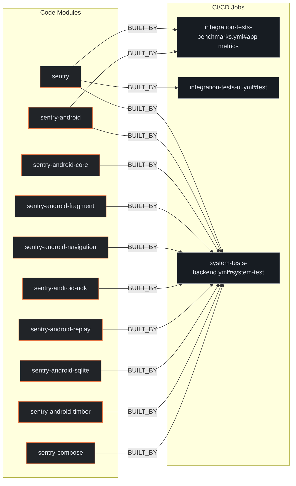

# Repository Architecture Analysis: getsentry/sentry-java

## Metadata
- **SHA**: `18d3d8d6e7c40551cacfd5a5498925e6e596d150`
- **Primary Ecosystem**: Java

## Quality Metrics
- **ast_engine**: tree-sitter
- **avg_cognitive_complexity**: 1.36
- **avg_cyclomatic_complexity**: 2.48
- **component_count**: 117
- **dead_code_count**: 91
- **dead_code_symbols**: 50 entry(ies)
- **duplication_pct**: 92.39
- **file_complexities**: 25 entry(ies)
- **files_analyzed**: 1407
- **fitness_passed**: False
- **fitness_violation_count**: 4
- **framework**: Spring Boot
- **import_edges**: 100 entry(ies)
- **loc**: 194657
- **max_cognitive_complexity**: 87
- **max_cyclomatic_complexity**: 133
- **sloc**: 152788
- **test_file_count**: 675

# Architecture: getsentry/sentry-java

## Context
- **Repository**: `getsentry/sentry-java`
- **SHA**: `18d3d8d6e7c40551cacfd5a5498925e6e596d150`
- **Ecosystem**: Java
- **Framework**: Spring Boot

## Building Block View

```mermaid
graph TD;
  classDef atlasRoot fill:#004882,stroke:#a3c9ff,stroke-width:2px,color:#d3e4ff
  classDef atlasCategory fill:#212428,stroke:#E87A48,stroke-width:1.5px,color:#dfe3eb
  classDef atlasWorkflow fill:#1b2026,stroke:#a3c9ff,stroke-width:1.5px,color:#dfe3eb
  classDef atlasJob fill:#171c22,stroke:#8d9199,stroke-width:1px,color:#dfe3eb
  classDef atlasTarget fill:#005227,stroke:#8bd99b,stroke-width:1.5px,color:#a7f6b6
  classDef atlasAlert fill:#93000a,stroke:#ffb4ab,stroke-width:1.5px,color:#ffdad6
  classDef atlasMore fill:#252a31,stroke:#8d9199,stroke-dasharray:4 4,color:#c3c6cf
    repo_root(["getsentry/sentry-java (117 components)"]):::atlasRoot
    subgraph sg_dir_0_sentry_samples["sentry-samples (71)"]
      direction TB
      dir_0_sentry_samples["sentry-samples (71)"]:::atlasCategory
      sub_0_0_sentry_samples_spring_boot_jakarta["sentry-samples-spring-boot-jakarta (9)"]:::atlasWorkflow
      dir_0_sentry_samples --> sub_0_0_sentry_samples_spring_boot_jakarta
      sub_0_1_sentry_samples_spring_boot_jakarta_opentelemetry["sentry-samples-spring-boot-jakarta-opentelemetry (9)"]:::atlasWorkflow
      dir_0_sentry_samples --> sub_0_1_sentry_samples_spring_boot_jakarta_opentelemetry
      sub_0_2_sentry_samples_spring_boot_jakarta_opentelemetry_noagent["sentry-samples-spring-boot-jakarta-opentelemetry-noagent (9)"]:::atlasWorkflow
      dir_0_sentry_samples --> sub_0_2_sentry_samples_spring_boot_jakarta_opentelemetry_noagent
      sub_0_more["+8 more submodules (44)"]:::atlasMore
      dir_0_sentry_samples --> sub_0_more
    end
    repo_root --> dir_0_sentry_samples
    subgraph sg_dir_1_sentry_spring_jakarta["sentry-spring-jakarta (17)"]
      direction TB
      dir_1_sentry_spring_jakarta["sentry-spring-jakarta (17)"]:::atlasCategory
      sub_1_0_src_main["src/main (13)"]:::atlasWorkflow
      dir_1_sentry_spring_jakarta --> sub_1_0_src_main
      sub_1_1_src_test["src/test (4)"]:::atlasWorkflow
      dir_1_sentry_spring_jakarta --> sub_1_1_src_test
    end
    repo_root --> dir_1_sentry_spring_jakarta
    subgraph sg_dir_2_sentry_spring["sentry-spring (16)"]
      direction TB
      dir_2_sentry_spring["sentry-spring (16)"]:::atlasCategory
      sub_2_0_src_main["src/main (12)"]:::atlasWorkflow
      dir_2_sentry_spring --> sub_2_0_src_main
      sub_2_1_src_test["src/test (4)"]:::atlasWorkflow
      dir_2_sentry_spring --> sub_2_1_src_test
    end
    repo_root --> dir_2_sentry_spring
    dir_3_sentry_spring_boot_jakarta["sentry-spring-boot-jakarta (7)"]:::atlasCategory
    repo_root --> dir_3_sentry_spring_boot_jakarta
    dir_4_sentry_spring_boot["sentry-spring-boot (6)"]:::atlasCategory
    repo_root --> dir_4_sentry_spring_boot
    dir_3_sentry_spring_boot_jakarta -.->|"16 deps"| sub_1_0_src_main
    sub_1_1_src_test -.->|"8 deps"| sub_0_0_sentry_samples_spring_boot_jakarta
    sub_1_1_src_test -.->|"8 deps"| sub_1_0_src_main
```

## Component Details

Showing top 60 representative components out of 117 across 5 module group(s):

- **Module `sentry-samples`** (71 components — API_ROUTE: 44, CONFIG: 17, SERVICE: 10)
- **Module `sentry-spring-jakarta`** (17 components — CONFIG: 13, API_ROUTE: 4)
- **Module `sentry-spring`** (16 components — CONFIG: 12, API_ROUTE: 4)
- **Module `sentry-spring-boot-jakarta`** (7 components — CONFIG: 5, API_ROUTE: 2)
- **Module `sentry-spring-boot`** (6 components — CONFIG: 4, API_ROUTE: 2)

- **SentryAutoConfiguration** (`sentry-spring-boot-jakarta/src/main/java/io/sentry/spring/boot/jakarta/SentryAutoConfiguration.java`): CONFIG (deps: SentryAdviceConfiguration, SentryCaptureExceptionParameterPointcutConfiguration, SentryExceptionParameterAdviceConfiguration, SentryGraphql22AutoConfiguration, SentryGraphqlAutoConfiguration, SentryOpenTelemetryAgentWithoutAutoInitConfiguration (+5 more))
- **SentryAutoConfiguration** (`sentry-spring-boot/src/main/java/io/sentry/spring/boot/SentryAutoConfiguration.java`): CONFIG (deps: SentryAdviceConfiguration, SentryCaptureExceptionParameterPointcutConfiguration, SentryExceptionParameterAdviceConfiguration, SentryGraphqlAutoConfiguration, SentryOpenTelemetryAgentWithoutAutoInitConfiguration, SentryOpenTelemetryNoAgentConfiguration (+4 more))
- **ExceptionHandlers** (`sentry-spring-jakarta/src/test/kotlin/io/sentry/spring/jakarta/mvc/SentrySpringIntegrationTest.kt`): API_ROUTE (deps: HelloController, SecurityConfiguration, SentryCaptureExceptionParameterConfiguration, SentryTracingConfiguration)
- **ExceptionHandlers** (`sentry-spring/src/test/kotlin/io/sentry/spring/mvc/SentrySpringIntegrationTest.kt`): API_ROUTE (deps: HelloController, SecurityConfiguration, SentryCaptureExceptionParameterConfiguration, SentryTracingConfiguration)
- **HelloController** (`sentry-spring-jakarta/src/test/kotlin/io/sentry/spring/jakarta/mvc/SentrySpringIntegrationTest.kt`): API_ROUTE (deps: ExceptionHandlers, SecurityConfiguration, SentryCaptureExceptionParameterConfiguration, SentryTracingConfiguration)
- **HelloController** (`sentry-spring/src/test/kotlin/io/sentry/spring/mvc/SentrySpringIntegrationTest.kt`): API_ROUTE (deps: ExceptionHandlers, SecurityConfiguration, SentryCaptureExceptionParameterConfiguration, SentryTracingConfiguration)
- **SentryTracingConfiguration** (`sentry-spring-jakarta/src/main/java/io/sentry/spring/jakarta/tracing/SentryTracingConfiguration.java`): CONFIG (deps: SentryAdviceConfiguration, SentrySpanPointcutConfiguration, SentryTransactionPointcutConfiguration)
- **SentryTracingConfiguration** (`sentry-spring/src/main/java/io/sentry/spring/tracing/SentryTracingConfiguration.java`): CONFIG (deps: SentryAdviceConfiguration, SentrySpanPointcutConfiguration, SentryTransactionPointcutConfiguration)
- **ExceptionHandlers** (`sentry-spring-boot-jakarta/src/test/kotlin/io/sentry/spring/boot/jakarta/it/SentrySpringIntegrationTest.kt`): API_ROUTE (deps: HelloController, SecurityConfiguration)
- **ExceptionHandlers** (`sentry-spring-boot/src/test/kotlin/io/sentry/spring/boot/it/SentrySpringIntegrationTest.kt`): API_ROUTE (deps: HelloController, SecurityConfiguration)
- **HelloController** (`sentry-spring-boot-jakarta/src/test/kotlin/io/sentry/spring/boot/jakarta/it/SentrySpringIntegrationTest.kt`): API_ROUTE (deps: ExceptionHandlers, SecurityConfiguration)
- **HelloController** (`sentry-spring-boot/src/test/kotlin/io/sentry/spring/boot/it/SentrySpringIntegrationTest.kt`): API_ROUTE (deps: ExceptionHandlers, SecurityConfiguration)
- **SentryCaptureExceptionParameterConfiguration** (`sentry-spring-jakarta/src/main/java/io/sentry/spring/jakarta/exception/SentryCaptureExceptionParameterConfiguration.java`): CONFIG (deps: SentryCaptureExceptionParameterPointcutConfiguration, SentryExceptionParameterAdviceConfiguration)
- **SentryCaptureExceptionParameterConfiguration** (`sentry-spring/src/main/java/io/sentry/spring/exception/SentryCaptureExceptionParameterConfiguration.java`): CONFIG (deps: SentryCaptureExceptionParameterPointcutConfiguration, SentryExceptionParameterAdviceConfiguration)
- **AssigneeController** (`sentry-samples/sentry-samples-spring-boot-jakarta-opentelemetry-noagent/src/main/java/io/sentry/samples/spring/boot/jakarta/graphql/AssigneeController.java`): API_ROUTE (deps: ProjectController)
- **AssigneeController** (`sentry-samples/sentry-samples-spring-boot-jakarta-opentelemetry/src/main/java/io/sentry/samples/spring/boot/jakarta/graphql/AssigneeController.java`): API_ROUTE (deps: ProjectController)
- **AssigneeController** (`sentry-samples/sentry-samples-spring-boot-jakarta/src/main/java/io/sentry/samples/spring/boot/jakarta/graphql/AssigneeController.java`): API_ROUTE (deps: ProjectController)
- **AssigneeController** (`sentry-samples/sentry-samples-spring-boot-opentelemetry-noagent/src/main/java/io/sentry/samples/spring/boot/graphql/AssigneeController.java`): API_ROUTE (deps: ProjectController)
- **AssigneeController** (`sentry-samples/sentry-samples-spring-boot-opentelemetry/src/main/java/io/sentry/samples/spring/boot/graphql/AssigneeController.java`): API_ROUTE (deps: ProjectController)
- **AssigneeController** (`sentry-samples/sentry-samples-spring-boot/src/main/java/io/sentry/samples/spring/boot/graphql/AssigneeController.java`): API_ROUTE (deps: ProjectController)
- **ExceptionHandlers** (`sentry-spring-jakarta/src/test/kotlin/io/sentry/spring/jakarta/webflux/SentryWebfluxIntegrationTest.kt`): API_ROUTE (deps: HelloController)
- **ExceptionHandlers** (`sentry-spring/src/test/kotlin/io/sentry/spring/webflux/SentryWebfluxIntegrationTest.kt`): API_ROUTE (deps: HelloController)
- **HelloController** (`sentry-spring-jakarta/src/test/kotlin/io/sentry/spring/jakarta/webflux/SentryWebfluxIntegrationTest.kt`): API_ROUTE (deps: ExceptionHandlers)
- **HelloController** (`sentry-spring/src/test/kotlin/io/sentry/spring/webflux/SentryWebfluxIntegrationTest.kt`): API_ROUTE (deps: ExceptionHandlers)
- **PersonController** (`sentry-samples/sentry-samples-spring-boot-jakarta-opentelemetry-noagent/src/main/java/io/sentry/samples/spring/boot/jakarta/PersonController.java`): API_ROUTE (deps: PersonService)
- **PersonController** (`sentry-samples/sentry-samples-spring-boot-jakarta-opentelemetry/src/main/java/io/sentry/samples/spring/boot/jakarta/PersonController.java`): API_ROUTE (deps: PersonService)
- **PersonController** (`sentry-samples/sentry-samples-spring-boot-jakarta/src/main/java/io/sentry/samples/spring/boot/jakarta/PersonController.java`): API_ROUTE (deps: PersonService)
- **PersonController** (`sentry-samples/sentry-samples-spring-boot-opentelemetry-noagent/src/main/java/io/sentry/samples/spring/boot/PersonController.java`): API_ROUTE (deps: PersonService)
- **PersonController** (`sentry-samples/sentry-samples-spring-boot-opentelemetry/src/main/java/io/sentry/samples/spring/boot/PersonController.java`): API_ROUTE (deps: PersonService)
- **PersonController** (`sentry-samples/sentry-samples-spring-boot-webflux-jakarta/src/main/java/io/sentry/samples/spring/boot/jakarta/PersonController.java`): API_ROUTE (deps: PersonService)
- **PersonController** (`sentry-samples/sentry-samples-spring-boot-webflux/src/main/java/io/sentry/samples/spring/boot/PersonController.java`): API_ROUTE (deps: PersonService)
- **PersonController** (`sentry-samples/sentry-samples-spring-boot/src/main/java/io/sentry/samples/spring/boot/PersonController.java`): API_ROUTE (deps: PersonService)
- **PersonController** (`sentry-samples/sentry-samples-spring-jakarta/src/main/java/io/sentry/samples/spring/jakarta/web/PersonController.java`): API_ROUTE (deps: PersonService)
- **PersonController** (`sentry-samples/sentry-samples-spring/src/main/java/io/sentry/samples/spring/web/PersonController.java`): API_ROUTE (deps: PersonService)
- **SentryGraphql22AutoConfiguration** (`sentry-spring-boot-jakarta/src/main/java/io/sentry/spring/boot/jakarta/graphql/SentryGraphql22AutoConfiguration.java`): CONFIG (deps: SentryProperties)
- **SentryGraphqlAutoConfiguration** (`sentry-spring-boot-jakarta/src/main/java/io/sentry/spring/boot/jakarta/graphql/SentryGraphqlAutoConfiguration.java`): CONFIG (deps: SentryProperties)
- **SentryGraphqlAutoConfiguration** (`sentry-spring-boot/src/main/java/io/sentry/spring/boot/graphql/SentryGraphqlAutoConfiguration.java`): CONFIG (deps: SentryProperties)
- **SentryLogbackAppenderAutoConfiguration** (`sentry-spring-boot-jakarta/src/main/java/io/sentry/spring/boot/jakarta/SentryLogbackAppenderAutoConfiguration.java`): CONFIG (deps: SentryProperties)
- **SentryLogbackAppenderAutoConfiguration** (`sentry-spring-boot/src/main/java/io/sentry/spring/boot/SentryLogbackAppenderAutoConfiguration.java`): CONFIG (deps: SentryProperties)
- **TaskCreatorController** (`sentry-samples/sentry-samples-spring-boot-jakarta-opentelemetry-noagent/src/main/java/io/sentry/samples/spring/boot/jakarta/graphql/TaskCreatorController.java`): API_ROUTE (deps: ProjectController)
- **TaskCreatorController** (`sentry-samples/sentry-samples-spring-boot-jakarta-opentelemetry/src/main/java/io/sentry/samples/spring/boot/jakarta/graphql/TaskCreatorController.java`): API_ROUTE (deps: ProjectController)
- **TaskCreatorController** (`sentry-samples/sentry-samples-spring-boot-jakarta/src/main/java/io/sentry/samples/spring/boot/jakarta/graphql/TaskCreatorController.java`): API_ROUTE (deps: ProjectController)
- **TaskCreatorController** (`sentry-samples/sentry-samples-spring-boot-opentelemetry-noagent/src/main/java/io/sentry/samples/spring/boot/graphql/TaskCreatorController.java`): API_ROUTE (deps: ProjectController)
- **TaskCreatorController** (`sentry-samples/sentry-samples-spring-boot-opentelemetry/src/main/java/io/sentry/samples/spring/boot/graphql/TaskCreatorController.java`): API_ROUTE (deps: ProjectController)
- **TaskCreatorController** (`sentry-samples/sentry-samples-spring-boot/src/main/java/io/sentry/samples/spring/boot/graphql/TaskCreatorController.java`): API_ROUTE (deps: ProjectController)
- **AppConfig** (`sentry-samples/sentry-samples-spring-jakarta/src/main/java/io/sentry/samples/spring/jakarta/AppConfig.java`): CONFIG
- **AppConfig** (`sentry-samples/sentry-samples-spring/src/main/java/io/sentry/samples/spring/AppConfig.java`): CONFIG
- **GreetingController** (`sentry-samples/sentry-samples-spring-boot-jakarta-opentelemetry-noagent/src/main/java/io/sentry/samples/spring/boot/jakarta/graphql/GreetingController.java`): API_ROUTE
- **GreetingController** (`sentry-samples/sentry-samples-spring-boot-jakarta-opentelemetry/src/main/java/io/sentry/samples/spring/boot/jakarta/graphql/GreetingController.java`): API_ROUTE
- **GreetingController** (`sentry-samples/sentry-samples-spring-boot-jakarta/src/main/java/io/sentry/samples/spring/boot/jakarta/graphql/GreetingController.java`): API_ROUTE
- **GreetingController** (`sentry-samples/sentry-samples-spring-boot-opentelemetry-noagent/src/main/java/io/sentry/samples/spring/boot/graphql/GreetingController.java`): API_ROUTE
- **GreetingController** (`sentry-samples/sentry-samples-spring-boot-opentelemetry/src/main/java/io/sentry/samples/spring/boot/graphql/GreetingController.java`): API_ROUTE
- **GreetingController** (`sentry-samples/sentry-samples-spring-boot-webflux-jakarta/src/main/java/io/sentry/samples/spring/boot/jakarta/graphql/GreetingController.java`): API_ROUTE
- **GreetingController** (`sentry-samples/sentry-samples-spring-boot-webflux/src/main/java/io/sentry/samples/spring/boot/graphql/GreetingController.java`): API_ROUTE
- **GreetingController** (`sentry-samples/sentry-samples-spring-boot/src/main/java/io/sentry/samples/spring/boot/graphql/GreetingController.java`): API_ROUTE
- **NetlixDgsApplication** (`sentry-samples/sentry-samples-netflix-dgs/src/main/java/io/sentry/samples/netflix/dgs/NetlixDgsApplication.java`): CONFIG
- **PersonService** (`sentry-samples/sentry-samples-spring-boot-jakarta-opentelemetry-noagent/src/main/java/io/sentry/samples/spring/boot/jakarta/PersonService.java`): SERVICE
- **PersonService** (`sentry-samples/sentry-samples-spring-boot-jakarta-opentelemetry/src/main/java/io/sentry/samples/spring/boot/jakarta/PersonService.java`): SERVICE
- **PersonService** (`sentry-samples/sentry-samples-spring-boot-jakarta/src/main/java/io/sentry/samples/spring/boot/jakarta/PersonService.java`): SERVICE
- **PersonService** (`sentry-samples/sentry-samples-spring-boot-opentelemetry-noagent/src/main/java/io/sentry/samples/spring/boot/PersonService.java`): SERVICE

## 6-Dimension Repository Scorecard

- **Overall Grade**: `F` (33.00/100)
- **Technical Debt Score**: 67.00
- **Estimated Remediation Effort**: 133.48h

| Dimension | Grade | Score | Weight | Details |
| :--- | :---: | :---: | :---: | :--- |
| Code Quality | `F` | 30.00 | 0.20 | avg_cc=2.48, max_cc=133, duplication=92.39%, dead_code=91 |
| Dependency Health | `B` | 85.00 | 0.15 | dependencies=25, outdated=0, vulnerable=0, has_lockfile=False |
| Maintainability | `F` | 25.00 | 0.15 | avg_cognitive=1.36, max_cognitive=87, fitness_violations=4, oversized_files=10 |
| Pipeline Health | `F` | 0.00 | 0.15 | workflows=16, operational_antipatterns=26, parallel_branches=True |
| Security | `F` | 0.00 | 0.20 | vulnerabilities=0, secrets=0, pipeline_security_findings=24 |
| Test Coverage | `C` | 70.00 | 0.15 | coverage=unavailable, ci_test_job=True, test_files_detected=True |

## Architecture Fitness & Workspace Boundaries

- **[HIGH] `ATRUSS-ARCH-004` (CIRCULAR_DEPENDENCY)**: Circular dependency detected between architectural components. (ExceptionHandlers -> HelloController -> ExceptionHandlers)
- **[MEDIUM] `ATRUSS-ARCH-005` (COMPLEXITY_THRESHOLD)**: Repository duplication_pct (92.39) exceeds policy threshold (15.0).
- **[MEDIUM] `ATRUSS-ARCH-005` (COMPLEXITY_THRESHOLD)**: Repository max_cognitive_complexity (87.0) exceeds policy threshold (25.0).
- **[MEDIUM] `ATRUSS-ARCH-005` (COMPLEXITY_THRESHOLD)**: Repository max_cyclomatic_complexity (133.0) exceeds policy threshold (20.0).

## Supply Chain Dependencies, Vulnerabilities & Secrets

- **Dependencies Parsed**: 25 | **Vulnerabilities**: 0 | **Secrets**: 0

### Inventory Sample
- `androidx.appcompat:appcompat` `1.3.0` (Maven, `sentry-android-integration-tests/test-app-plain/build.gradle.kts`)
- `androidx.appcompat:appcompat` `1.3.0` (Maven, `sentry-android-integration-tests/test-app-sentry/build.gradle.kts`)
- `androidx.constraintlayout:constraintlayout` `2.0.4` (Maven, `sentry-android-integration-tests/test-app-plain/build.gradle.kts`)
- `androidx.constraintlayout:constraintlayout` `2.0.4` (Maven, `sentry-android-integration-tests/test-app-sentry/build.gradle.kts`)
- `androidx.navigation:navigation-fragment` `2.3.5` (Maven, `sentry-android-integration-tests/test-app-plain/build.gradle.kts`)
- `androidx.navigation:navigation-fragment` `2.3.5` (Maven, `sentry-android-integration-tests/test-app-sentry/build.gradle.kts`)
- `androidx.navigation:navigation-ui` `2.3.5` (Maven, `sentry-android-integration-tests/test-app-plain/build.gradle.kts`)
- `androidx.navigation:navigation-ui` `2.3.5` (Maven, `sentry-android-integration-tests/test-app-sentry/build.gradle.kts`)
- `ch.qos.logback:logback-classic` `1.5.16` (Maven, `sentry-samples/sentry-samples-spring-boot-jakarta-opentelemetry-noagent/build.gradle.kts`)
- `ch.qos.logback:logback-classic` `1.5.16` (Maven, `sentry-samples/sentry-samples-spring-boot-jakarta-opentelemetry/build.gradle.kts`)
- `ch.qos.logback:logback-classic` `1.5.16` (Maven, `sentry-samples/sentry-samples-spring-boot-jakarta/build.gradle.kts`)
- `ch.qos.logback:logback-classic` `1.5.16` (Maven, `sentry-samples/sentry-samples-spring-boot-webflux-jakarta/build.gradle.kts`)
- `com.google.android.material:material` `1.4.0` (Maven, `sentry-android-integration-tests/test-app-plain/build.gradle.kts`)
- `com.google.android.material:material` `1.4.0` (Maven, `sentry-android-integration-tests/test-app-sentry/build.gradle.kts`)
- `com.netflix.graphql.dgs:graphql-dgs-spring-boot-starter` `*` (Maven, `sentry-samples/sentry-samples-netflix-dgs/build.gradle.kts`)
- `com.netflix.graphql.dgs:graphql-dgs-subscriptions-websockets-autoconfigure` `4.9.2` (Maven, `sentry-samples/sentry-samples-netflix-dgs/build.gradle.kts`)
- `com.netflix.graphql.dgs:graphql-error-types` `4.9.2` (Maven, `sentry-graphql-22/build.gradle.kts`)
- `com.netflix.graphql.dgs:graphql-error-types` `4.9.2` (Maven, `sentry-graphql-core/build.gradle.kts`)
- `com.netflix.graphql.dgs:graphql-error-types` `4.9.2` (Maven, `sentry-graphql/build.gradle.kts`)
- `javax.servlet:javax.servlet-api` `4.0.1` (Maven, `sentry-samples/sentry-samples-servlet/build.gradle.kts`)
- `org.apache.httpcomponents:httpclient` `*` (Maven, `sentry-samples/sentry-samples-spring-boot-opentelemetry-noagent/build.gradle.kts`)
- `org.apache.httpcomponents:httpclient` `*` (Maven, `sentry-samples/sentry-samples-spring-boot-opentelemetry/build.gradle.kts`)
- `org.apache.httpcomponents:httpclient` `*` (Maven, `sentry-samples/sentry-samples-spring-boot-webflux/build.gradle.kts`)
- `org.apache.httpcomponents:httpclient` `*` (Maven, `sentry-samples/sentry-samples-spring-boot/build.gradle.kts`)
- `org.jetbrains.kotlinx:kotlinx-coroutines-test` `1.7.3` (Maven, `sentry-apollo-4/build.gradle.kts`)

## Section 7: Code-to-Cloud Deployment Traceability

- `sentry` (code_module) --[BUILT_BY]--> `integration-tests-benchmarks.yml#app-metrics` (ci_job)
- `sentry` (code_module) --[BUILT_BY]--> `integration-tests-ui.yml#test` (ci_job)
- `sentry` (code_module) --[BUILT_BY]--> `system-tests-backend.yml#system-test` (ci_job)
- `sentry-android` (code_module) --[BUILT_BY]--> `integration-tests-benchmarks.yml#app-metrics` (ci_job)
- `sentry-android` (code_module) --[BUILT_BY]--> `system-tests-backend.yml#system-test` (ci_job)
- `sentry-android-core` (code_module) --[BUILT_BY]--> `system-tests-backend.yml#system-test` (ci_job)
- `sentry-android-fragment` (code_module) --[BUILT_BY]--> `system-tests-backend.yml#system-test` (ci_job)
- `sentry-android-navigation` (code_module) --[BUILT_BY]--> `system-tests-backend.yml#system-test` (ci_job)
- `sentry-android-ndk` (code_module) --[BUILT_BY]--> `system-tests-backend.yml#system-test` (ci_job)
- `sentry-android-replay` (code_module) --[BUILT_BY]--> `system-tests-backend.yml#system-test` (ci_job)
- `sentry-android-sqlite` (code_module) --[BUILT_BY]--> `system-tests-backend.yml#system-test` (ci_job)
- `sentry-android-timber` (code_module) --[BUILT_BY]--> `system-tests-backend.yml#system-test` (ci_job)
- `sentry-compose` (code_module) --[BUILT_BY]--> `system-tests-backend.yml#system-test` (ci_job)

## CI/CD Pipeline Topology

```mermaid
graph TD;
  classDef atlasRoot fill:#004882,stroke:#a3c9ff,stroke-width:2px,color:#d3e4ff
  classDef atlasCategory fill:#212428,stroke:#E87A48,stroke-width:1.5px,color:#dfe3eb
  classDef atlasWorkflow fill:#1b2026,stroke:#a3c9ff,stroke-width:1.5px,color:#dfe3eb
  classDef atlasJob fill:#171c22,stroke:#8d9199,stroke-width:1px,color:#dfe3eb
  classDef atlasTarget fill:#005227,stroke:#8bd99b,stroke-width:1.5px,color:#a7f6b6
  classDef atlasAlert fill:#93000a,stroke:#ffb4ab,stroke-width:1.5px,color:#ffdad6
  classDef atlasMore fill:#252a31,stroke:#8d9199,stroke-dasharray:4 4,color:#c3c6cf
  pipeline_root(["getsentry/sentry-java (16 workflows)"]):::atlasRoot
  subgraph sg_grp_0_CI___Verification["CI & Verification (10 workflows · 12 jobs)"]
    direction TB
    subgraph sg_wf_0_Add_Platform_Label["Add Platform Label (1 jobs)"]
      direction TB
      wf_0_Add_Platform_Label(["Trigger: Add Platform Label"]):::atlasWorkflow
      job_0_add_label["add_label"]:::atlasJob
      wf_0_Add_Platform_Label --> job_0_add_label
    end
    pipeline_root --> wf_0_Add_Platform_Label
    subgraph sg_wf_1_AGP_Matrix_Compatibility["AGP Matrix Compatibility (1 jobs)"]
      direction TB
      wf_1_AGP_Matrix_Compatibility(["Trigger: AGP Matrix Compatibility"]):::atlasWorkflow
      job_1_agp_matrix_compatibility["agp-matrix-compatibility"]:::atlasJob
      wf_1_AGP_Matrix_Compatibility --> job_1_agp_matrix_compatibility
    end
    pipeline_root --> wf_1_AGP_Matrix_Compatibility
    subgraph sg_wf_3_Changes_In_High_Risk_Code["Changes In High Risk Code (2 jobs)"]
      direction TB
      wf_3_Changes_In_High_Risk_Code(["Trigger: Changes In High Risk Code"]):::atlasWorkflow
      job_3_files_changed["files-changed"]:::atlasJob
      job_3_validate_high_risk_code["validate-high-risk-code"]:::atlasJob
      wf_3_Changes_In_High_Risk_Code --> job_3_files_changed
      job_3_files_changed --> job_3_validate_high_risk_code
    end
    pipeline_root --> wf_3_Changes_In_High_Risk_Code
    subgraph sg_wf_10_UI_Tests_Critical["UI Tests Critical (2 jobs)"]
      direction TB
      wf_10_UI_Tests_Critical(["Trigger: UI Tests Critical"]):::atlasWorkflow
      job_10_build["build"]:::atlasJob
      job_10_run_maestro_tests["run-maestro-tests"]:::atlasJob
      wf_10_UI_Tests_Critical --> job_10_build
      job_10_build --> job_10_run_maestro_tests
    end
    pipeline_root --> wf_10_UI_Tests_Critical
  end
  subgraph sg_grp_1_Release___Deploy["Release & Deploy (3 workflows · 3 jobs)"]
    direction TB
    subgraph sg_wf_8_Generate_Javadocs["Generate Javadocs (1 jobs)"]
      direction TB
      wf_8_Generate_Javadocs(["Trigger: Generate Javadocs"]):::atlasWorkflow
      job_8_build_and_deploy_javadocs["build-and-deploy-javadocs"]:::atlasJob
      wf_8_Generate_Javadocs --> job_8_build_and_deploy_javadocs
    end
    pipeline_root --> wf_8_Generate_Javadocs
    subgraph sg_wf_12_Build_Release_Artifacts["Build Release Artifacts (1 jobs)"]
      direction TB
      wf_12_Build_Release_Artifacts(["Trigger: Build Release Artifacts"]):::atlasWorkflow
      job_12_release["release"]:::atlasJob
      wf_12_Build_Release_Artifacts --> job_12_release
    end
    pipeline_root --> wf_12_Build_Release_Artifacts
    subgraph sg_wf_13_release["release (1 jobs)"]
      direction TB
      wf_13_release(["Trigger: release"]):::atlasWorkflow
      job_13_release["release"]:::atlasJob
      wf_13_release --> job_13_release
    end
    pipeline_root --> wf_13_release
  end
  subgraph sg_grp_2_Scheduled___Manual["Scheduled & Manual (2 workflows · 4 jobs)"]
    direction TB
    subgraph sg_wf_9_Integration_Tests___Benchmarks["Integration Tests - Benchmarks (2 jobs)"]
      direction TB
      wf_9_Integration_Tests___Benchmarks(["Trigger: Integration Tests - Benchmarks"]):::atlasWorkflow
      job_9_test["test"]:::atlasJob
      job_9_app_metrics["app-metrics"]:::atlasJob
      wf_9_Integration_Tests___Benchmarks --> job_9_test
      wf_9_Integration_Tests___Benchmarks --> job_9_app_metrics
    end
    pipeline_root --> wf_9_Integration_Tests___Benchmarks
    subgraph sg_wf_15_Update_Dependencies["Update Dependencies (2 jobs)"]
      direction TB
      wf_15_Update_Dependencies(["Trigger: Update Dependencies"]):::atlasWorkflow
      job_15_native["native"]:::atlasJob
      job_15_gradle_wrapper["gradle-wrapper"]:::atlasJob
      wf_15_Update_Dependencies --> job_15_native
      wf_15_Update_Dependencies --> job_15_gradle_wrapper
    end
    pipeline_root --> wf_15_Update_Dependencies
  end
  subgraph sg_grp_3_Security___Governance["Security & Governance (1 workflows · 1 jobs)"]
    direction TB
    subgraph sg_wf_4_CodeQL["CodeQL (1 jobs)"]
      direction TB
      wf_4_CodeQL(["Trigger: CodeQL"]):::atlasWorkflow
      job_4_analyze["analyze"]:::atlasJob
      wf_4_CodeQL --> job_4_analyze
    end
    pipeline_root --> wf_4_CodeQL
  end
  wf_more["+6 more workflows"]:::atlasMore
  pipeline_root --> wf_more
```

