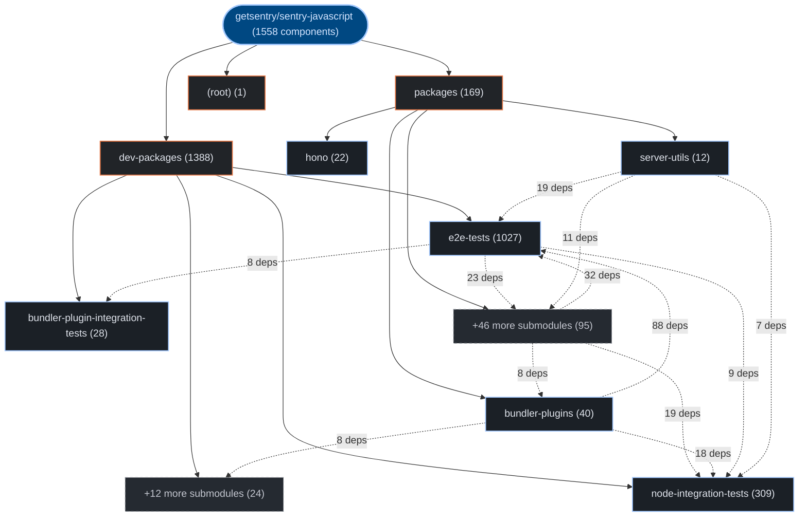

# Repository Architecture Analysis: getsentry/sentry-javascript

## Metadata
- **SHA**: `14e0d5683730ffd62f123e70e59e9210ed31172d`
- **Primary Ecosystem**: JavaScript/TypeScript

## Quality Metrics
- **ast_engine**: tree-sitter
- **avg_cognitive_complexity**: 1.0
- **avg_cyclomatic_complexity**: 1.86
- **component_count**: 1558
- **dead_code_count**: 64
- **dead_code_symbols**: 50 entry(ies)
- **duplication_pct**: 93.08
- **file_complexities**: 25 entry(ies)
- **files_analyzed**: 9694
- **fitness_passed**: False
- **fitness_violation_count**: 11
- **framework**: Next.js
- **import_edges**: 100 entry(ies)
- **loc**: 764999
- **max_cognitive_complexity**: 55
- **max_cyclomatic_complexity**: 31
- **sloc**: 579053
- **test_file_count**: 2242

# Architecture: getsentry/sentry-javascript

## Context
- **Repository**: `getsentry/sentry-javascript`
- **SHA**: `14e0d5683730ffd62f123e70e59e9210ed31172d`
- **Ecosystem**: JavaScript/TypeScript
- **Framework**: Next.js

## Building Block View



## Component Details

Showing top 60 representative components out of 1558 across 3 module group(s):

- **Module `dev-packages`** (1388 components — API_ROUTE: 595, UI_COMPONENT: 518, MODULE: 246)
- **Module `packages`** (169 components — UI_COMPONENT: 59, MODULE: 55, SERVICE: 31)
- **Module `(root)`** (1 components — MODULE: 1)

- **UNKNOWN_COMPONENT** (`packages/react/src/errorboundary.tsx`): UI_COMPONENT (deps: API_api_pages-router-api-error, API_api_request-error, API_api_test-error, ActionError, ClickError, ClickErrorPage (+17 more))
- **AddToCart** (`packages/bundler-plugins/test/babel-plugin/sentry-label.test.ts`): UI_COMPONENT (deps: API_api_index, ErrorBoundary, GET_error_:param, GET_hello_:name, GET_json, GET_root (+8 more))
- **App** (`packages/bundler-plugins/test/babel-plugin/experimental.test.ts`): UI_COMPONENT (deps: API_api_index, ErrorBoundary, GET_error_:param, GET_hello_:name, GET_json, GET_root (+8 more))
- **App** (`packages/bundler-plugins/test/babel-plugin/test-plugin.test.ts`): UI_COMPONENT (deps: API_api_index, ErrorBoundary, GET_error_:param, GET_hello_:name, GET_json, GET_root (+8 more))
- **Card** (`packages/bundler-plugins/test/babel-plugin/sentry-label.test.ts`): UI_COMPONENT (deps: API_api_index, ErrorBoundary, GET_error_:param, GET_hello_:name, GET_json, GET_root (+8 more))
- **Client** (`packages/server-utils/test/orchestrion/moduleInjectedTransform.test.ts`): SERVICE (deps: API_api_index, ErrorBoundary, GET_error_:param, GET_hello_:name, GET_json, GET_root (+8 more))
- **Header** (`packages/bundler-plugins/test/babel-plugin/sentry-label.test.ts`): UI_COMPONENT (deps: API_api_index, ErrorBoundary, GET_error_:param, GET_hello_:name, GET_json, GET_root (+8 more))
- **IgnoredComp** (`packages/bundler-plugins/test/babel-plugin/sentry-label.test.ts`): UI_COMPONENT (deps: API_api_index, ErrorBoundary, GET_error_:param, GET_hello_:name, GET_json, GET_root (+8 more))
- **MockClient** (`packages/browser/test/tracing/request.test.ts`): SERVICE (deps: BedrockClient, BrowserClient, BunClient, CDPClient, Client, ClientErrorPage (+8 more))
- **MyComponent** (`packages/bundler-plugins/test/babel-plugin/sentry-label.test.ts`): UI_COMPONENT (deps: API_api_index, ErrorBoundary, GET_error_:param, GET_hello_:name, GET_json, GET_root (+8 more))
- **SaveButton** (`packages/bundler-plugins/test/babel-plugin/sentry-label.test.ts`): UI_COMPONENT (deps: API_api_index, ErrorBoundary, GET_error_:param, GET_hello_:name, GET_json, GET_root (+8 more))
- **TestComponent** (`packages/bundler-plugins/test/babel-plugin/experimental.test.ts`): UI_COMPONENT (deps: API_api_index, ErrorBoundary, GET_error_:param, GET_hello_:name, GET_json, GET_root (+8 more))
- **TestComponent** (`packages/bundler-plugins/test/babel-plugin/test-plugin.test.ts`): UI_COMPONENT (deps: API_api_index, ErrorBoundary, GET_error_:param, GET_hello_:name, GET_json, GET_root (+8 more))
- **FakeClient** (`packages/core/test/lib/integrations/fetch.test.ts`): SERVICE (deps: BedrockClient, BrowserClient, BunClient, CDPClient, Client, ClientErrorPage (+7 more))
- **ServerRuntimeClient** (`packages/core/src/server-runtime-client.ts`): SERVICE (deps: BedrockClient, BrowserClient, BunClient, CDPClient, Client, ClientErrorPage (+6 more))
- **TestClient** (`packages/core/test/mocks/client.ts`): SERVICE (deps: BedrockClient, BrowserClient, BunClient, CDPClient, Client, ClientErrorPage (+6 more))
- **Client** (`packages/core/src/client.ts`): SERVICE (deps: APP_NAME, DEFAULT_IGNORED_ELEMENTS, DEFAULT_SERVER_EXTERNAL_PACKAGES, DbIoredis, Dialog, GET_test-normalized-request (+5 more))
- **NodeClient** (`packages/core/src/client.ts`): SERVICE (deps: APP_NAME, DEFAULT_IGNORED_ELEMENTS, DEFAULT_SERVER_EXTERNAL_PACKAGES, DbIoredis, Dialog, GET_test-normalized-request (+5 more))
- **Dialog** (`packages/feedback/src/modal/components/Dialog.tsx`): UI_COMPONENT (deps: APP_NAME, DEFAULT_IGNORED_ELEMENTS, DEFAULT_SERVER_EXTERNAL_PACKAGES, DialogHeader, Form, KNOWN_INCOMPATIBLE_PLUGINS (+3 more))
- **Home** (`dev-packages/e2e-tests/test-applications/nextjs-16-userfeedback/app/page.tsx`): UI_COMPONENT (deps: AttachToFeedbackButton, CrashReportButton, CreateFeedbackFormButton, FeedbackButton, MyFeedbackForm, ThemeSwitcher (+3 more))
- **GET_error_:cause** (`dev-packages/e2e-tests/test-applications/hono-4-legacy/src/routes.ts`): API_ROUTE (deps: API_api_endpoint-behind-faulty-middleware, API_api_endpoint-behind-middleware, ErrorMiddlewarePage, MultiMiddlewarePage, Route, SENTRY_INTERNAL (+1 more))
- **GET_error_:cause** (`dev-packages/e2e-tests/test-applications/hono-4/src/routes.ts`): API_ROUTE (deps: API_api_endpoint-behind-faulty-middleware, API_api_endpoint-behind-middleware, ErrorMiddlewarePage, MultiMiddlewarePage, Route, SENTRY_INTERNAL (+1 more))
- **GET_http-exception_:code** (`dev-packages/e2e-tests/test-applications/hono-4-legacy/src/routes.ts`): API_ROUTE (deps: API_api_endpoint-behind-faulty-middleware, API_api_endpoint-behind-middleware, ErrorMiddlewarePage, MultiMiddlewarePage, Route, SENTRY_INTERNAL (+1 more))
- **GET_http-exception_:code** (`dev-packages/e2e-tests/test-applications/hono-4/src/routes.ts`): API_ROUTE (deps: API_api_endpoint-behind-faulty-middleware, API_api_endpoint-behind-middleware, ErrorMiddlewarePage, MultiMiddlewarePage, Route, SENTRY_INTERNAL (+1 more))
- **GET_linked-error** (`dev-packages/e2e-tests/test-applications/hono-4-legacy/src/routes.ts`): API_ROUTE (deps: API_api_endpoint-behind-faulty-middleware, API_api_endpoint-behind-middleware, ErrorMiddlewarePage, MultiMiddlewarePage, Route, SENTRY_INTERNAL (+1 more))
- **GET_linked-error** (`dev-packages/e2e-tests/test-applications/hono-4/src/routes.ts`): API_ROUTE (deps: API_api_endpoint-behind-faulty-middleware, API_api_endpoint-behind-middleware, ErrorMiddlewarePage, MultiMiddlewarePage, Route, SENTRY_INTERNAL (+1 more))
- **GET_root** (`dev-packages/e2e-tests/test-applications/hono-4-legacy/src/routes.ts`): API_ROUTE (deps: API_api_endpoint-behind-faulty-middleware, API_api_endpoint-behind-middleware, ErrorMiddlewarePage, MultiMiddlewarePage, Route, SENTRY_INTERNAL (+1 more))
- **GET_root** (`dev-packages/e2e-tests/test-applications/hono-4/src/routes.ts`): API_ROUTE (deps: API_api_endpoint-behind-faulty-middleware, API_api_endpoint-behind-middleware, ErrorMiddlewarePage, MultiMiddlewarePage, Route, SENTRY_INTERNAL (+1 more))
- **GET_test-late-get** (`dev-packages/e2e-tests/test-applications/hono-4-legacy/src/routes.ts`): API_ROUTE (deps: API_api_endpoint-behind-faulty-middleware, API_api_endpoint-behind-middleware, ErrorMiddlewarePage, MultiMiddlewarePage, Route, SENTRY_INTERNAL (+1 more))
- **GET_test-late-get** (`dev-packages/e2e-tests/test-applications/hono-4/src/routes.ts`): API_ROUTE (deps: API_api_endpoint-behind-faulty-middleware, API_api_endpoint-behind-middleware, ErrorMiddlewarePage, MultiMiddlewarePage, Route, SENTRY_INTERNAL (+1 more))
- **GET_test-main-inline_combined_resource** (`dev-packages/e2e-tests/test-applications/hono-4-legacy/src/routes.ts`): API_ROUTE (deps: API_api_endpoint-behind-faulty-middleware, API_api_endpoint-behind-middleware, ErrorMiddlewarePage, MultiMiddlewarePage, Route, SENTRY_INTERNAL (+1 more))
- **GET_test-main-inline_combined_resource** (`dev-packages/e2e-tests/test-applications/hono-4/src/routes.ts`): API_ROUTE (deps: API_api_endpoint-behind-faulty-middleware, API_api_endpoint-behind-middleware, ErrorMiddlewarePage, MultiMiddlewarePage, Route, SENTRY_INTERNAL (+1 more))
- **GET_test-main-inline_get** (`dev-packages/e2e-tests/test-applications/hono-4-legacy/src/routes.ts`): API_ROUTE (deps: API_api_endpoint-behind-faulty-middleware, API_api_endpoint-behind-middleware, ErrorMiddlewarePage, MultiMiddlewarePage, Route, SENTRY_INTERNAL (+1 more))
- **GET_test-main-inline_get** (`dev-packages/e2e-tests/test-applications/hono-4/src/routes.ts`): API_ROUTE (deps: API_api_endpoint-behind-faulty-middleware, API_api_endpoint-behind-middleware, ErrorMiddlewarePage, MultiMiddlewarePage, Route, SENTRY_INTERNAL (+1 more))
- **GET_test-param_:paramId** (`dev-packages/e2e-tests/test-applications/hono-4-legacy/src/routes.ts`): API_ROUTE (deps: API_api_endpoint-behind-faulty-middleware, API_api_endpoint-behind-middleware, ErrorMiddlewarePage, MultiMiddlewarePage, Route, SENTRY_INTERNAL (+1 more))
- **GET_test-param_:paramId** (`dev-packages/e2e-tests/test-applications/hono-4/src/routes.ts`): API_ROUTE (deps: API_api_endpoint-behind-faulty-middleware, API_api_endpoint-behind-middleware, ErrorMiddlewarePage, MultiMiddlewarePage, Route, SENTRY_INTERNAL (+1 more))
- **POST_test-main-inline_post** (`dev-packages/e2e-tests/test-applications/hono-4-legacy/src/routes.ts`): API_ROUTE (deps: API_api_endpoint-behind-faulty-middleware, API_api_endpoint-behind-middleware, ErrorMiddlewarePage, MultiMiddlewarePage, Route, SENTRY_INTERNAL (+1 more))
- **POST_test-main-inline_post** (`dev-packages/e2e-tests/test-applications/hono-4/src/routes.ts`): API_ROUTE (deps: API_api_endpoint-behind-faulty-middleware, API_api_endpoint-behind-middleware, ErrorMiddlewarePage, MultiMiddlewarePage, Route, SENTRY_INTERNAL (+1 more))
- **ScreenshotEditorFactory** (`packages/feedback/src/screenshot/components/ScreenshotEditor.tsx`): UI_COMPONENT (deps: APP_NAME, DEFAULT_IGNORED_ELEMENTS, DEFAULT_SERVER_EXTERNAL_PACKAGES, IconCloseFactory, KNOWN_INCOMPATIBLE_PLUGINS, RUNTIME (+1 more))
- **Route** (`dev-packages/e2e-tests/test-applications/tanstackstart-react-static/app/routes/api.test-middleware.ts`): UI_COMPONENT (deps: API_api_endpoint-behind-faulty-middleware, API_api_endpoint-behind-middleware, ErrorMiddlewarePage, MultiMiddlewarePage, SENTRY_INTERNAL, WithMiddlewarePage)
- **Route** (`dev-packages/e2e-tests/test-applications/tanstackstart-react-static/app/routes/test-middleware.tsx`): UI_COMPONENT (deps: API_api_endpoint-behind-faulty-middleware, API_api_endpoint-behind-middleware, ErrorMiddlewarePage, MultiMiddlewarePage, SENTRY_INTERNAL, WithMiddlewarePage)
- **Route** (`dev-packages/e2e-tests/test-applications/tanstackstart-react/src/routes/api.test-middleware.ts`): UI_COMPONENT (deps: API_api_endpoint-behind-faulty-middleware, API_api_endpoint-behind-middleware, ErrorMiddlewarePage, MultiMiddlewarePage, SENTRY_INTERNAL, WithMiddlewarePage)
- **Route** (`dev-packages/e2e-tests/test-applications/tanstackstart-react/src/routes/test-middleware.tsx`): UI_COMPONENT (deps: API_api_endpoint-behind-faulty-middleware, API_api_endpoint-behind-middleware, ErrorMiddlewarePage, MultiMiddlewarePage, SENTRY_INTERNAL, WithMiddlewarePage)
- **Form** (`packages/feedback/src/modal/components/Form.tsx`): UI_COMPONENT (deps: APP_NAME, DEFAULT_IGNORED_ELEMENTS, DEFAULT_SERVER_EXTERNAL_PACKAGES, KNOWN_INCOMPATIBLE_PLUGINS, RUNTIME)
- **TestClient** (`packages/server-utils/test/integrations/vercel-ai/skip-workers-ai.test.ts`): SERVICE (deps: APP_NAME, DEFAULT_IGNORED_ELEMENTS, DEFAULT_SERVER_EXTERNAL_PACKAGES, KNOWN_INCOMPATIBLE_PLUGINS, RUNTIME)
- **App** (`dev-packages/e2e-tests/test-applications/react-router-7-framework-instrumentation/app/root.tsx`): UI_COMPONENT (deps: ErrorBoundary, Layout, PageRoot, Route)
- **App** (`dev-packages/e2e-tests/test-applications/react-router-7-framework-spa/app/root.tsx`): UI_COMPONENT (deps: ErrorBoundary, Layout, PageRoot, Route)
- **App** (`dev-packages/e2e-tests/test-applications/react-router-7-framework-static/app/root.tsx`): UI_COMPONENT (deps: ErrorBoundary, Layout, PageRoot, Route)
- **App** (`dev-packages/e2e-tests/test-applications/react-router-7-framework/app/root.tsx`): UI_COMPONENT (deps: ErrorBoundary, Layout, PageRoot, Route)
- **App** (`dev-packages/e2e-tests/test-applications/react-router-8-framework/app/root.tsx`): UI_COMPONENT (deps: ErrorBoundary, Layout, PageRoot, Route)
- **ErrorBoundary** (`dev-packages/e2e-tests/test-applications/react-router-7-framework-instrumentation/app/root.tsx`): UI_COMPONENT (deps: App, Layout, PageRoot, Route)
- **ErrorBoundary** (`dev-packages/e2e-tests/test-applications/react-router-7-framework-spa/app/root.tsx`): UI_COMPONENT (deps: App, Layout, PageRoot, Route)
- **ErrorBoundary** (`dev-packages/e2e-tests/test-applications/react-router-7-framework-static/app/root.tsx`): UI_COMPONENT (deps: App, Layout, PageRoot, Route)
- **ErrorBoundary** (`dev-packages/e2e-tests/test-applications/react-router-7-framework/app/root.tsx`): UI_COMPONENT (deps: App, Layout, PageRoot, Route)
- **ErrorBoundary** (`dev-packages/e2e-tests/test-applications/react-router-8-framework/app/root.tsx`): UI_COMPONENT (deps: App, Layout, PageRoot, Route)
- **Layout** (`dev-packages/e2e-tests/test-applications/react-router-7-framework-instrumentation/app/root.tsx`): UI_COMPONENT (deps: App, ErrorBoundary, PageRoot, Route)
- **Layout** (`dev-packages/e2e-tests/test-applications/react-router-7-framework-spa/app/root.tsx`): UI_COMPONENT (deps: App, ErrorBoundary, PageRoot, Route)
- **Layout** (`dev-packages/e2e-tests/test-applications/react-router-7-framework-static/app/root.tsx`): UI_COMPONENT (deps: App, ErrorBoundary, PageRoot, Route)
- **Layout** (`dev-packages/e2e-tests/test-applications/react-router-7-framework/app/root.tsx`): UI_COMPONENT (deps: App, ErrorBoundary, PageRoot, Route)
- **Layout** (`dev-packages/e2e-tests/test-applications/react-router-8-framework/app/root.tsx`): UI_COMPONENT (deps: App, ErrorBoundary, PageRoot, Route)

## 6-Dimension Repository Scorecard

- **Overall Grade**: `F` (29.45/100)
- **Technical Debt Score**: 70.55
- **Estimated Remediation Effort**: 213.25h

| Dimension | Grade | Score | Weight | Details |
| :--- | :---: | :---: | :---: | :--- |
| Code Quality | `F` | 31.00 | 0.20 | avg_cc=1.86, max_cc=31, duplication=93.08%, dead_code=64 |
| Dependency Health | `B` | 85.00 | 0.15 | dependencies=3277, outdated=0, vulnerable=0, has_lockfile=False |
| Maintainability | `F` | 0.00 | 0.15 | avg_cognitive=1.00, max_cognitive=55, fitness_violations=11, oversized_files=2 |
| Pipeline Health | `F` | 0.00 | 0.15 | workflows=27, operational_antipatterns=37, parallel_branches=True |
| Security | `F` | 0.00 | 0.20 | vulnerabilities=0, secrets=0, pipeline_security_findings=69 |
| Test Coverage | `C` | 70.00 | 0.15 | coverage=unavailable, ci_test_job=True, test_files_detected=True |

## Architecture Fitness & Workspace Boundaries

- **[HIGH] `ATRUSS-ARCH-004` (CIRCULAR_DEPENDENCY)**: Circular dependency detected between architectural components. (App -> ErrorBoundary -> App)
- **[HIGH] `ATRUSS-ARCH-004` (CIRCULAR_DEPENDENCY)**: Circular dependency detected between architectural components. (App -> ErrorBoundary -> Layout -> App)
- **[HIGH] `ATRUSS-ARCH-004` (CIRCULAR_DEPENDENCY)**: Circular dependency detected between architectural components. (App -> Layout -> App)
- **[HIGH] `ATRUSS-ARCH-004` (CIRCULAR_DEPENDENCY)**: Circular dependency detected between architectural components. (App -> Layout -> ErrorBoundary -> App)
- **[HIGH] `ATRUSS-ARCH-004` (CIRCULAR_DEPENDENCY)**: Circular dependency detected between architectural components. (ErrorBoundary -> Layout -> ErrorBoundary)
- **[HIGH] `ATRUSS-ARCH-004` (CIRCULAR_DEPENDENCY)**: Circular dependency detected between architectural components. (Project -> ServerActionPage -> Project)
- **[HIGH] `ATRUSS-ARCH-004` (CIRCULAR_DEPENDENCY)**: Circular dependency detected between architectural components. (ServerLoaderErrorPage -> ServerLoaderPage -> ServerLoaderErrorPage)
- **[HIGH] `ATRUSS-ARCH-004` (CIRCULAR_DEPENDENCY)**: Circular dependency detected between architectural components. (ServerRuntimeClient -> TestClient -> ServerRuntimeClient)
- **[MEDIUM] `ATRUSS-ARCH-005` (COMPLEXITY_THRESHOLD)**: Repository duplication_pct (93.08) exceeds policy threshold (15.0).
- **[MEDIUM] `ATRUSS-ARCH-005` (COMPLEXITY_THRESHOLD)**: Repository max_cognitive_complexity (55.0) exceeds policy threshold (25.0).
- **[MEDIUM] `ATRUSS-ARCH-005` (COMPLEXITY_THRESHOLD)**: Repository max_cyclomatic_complexity (31.0) exceeds policy threshold (20.0).

### Workspace Packages
- **@sentry-internal/browser-integration-tests** (`dev-packages/browser-integration-tests`, react_ts_js, pnpm) -> internal deps: `@sentry/browser, @sentry/browser-utils, @sentry/core, @sentry/replay, @sentry/replay-canvas, @sentry/wasm`
- **@sentry-internal/browser-min-version-tests** (`dev-packages/browser-min-version-tests`, react_ts_js, pnpm) -> internal deps: `@sentry-internal/test-utils`
- **@sentry-internal/bun-integration-tests** (`dev-packages/bun-integration-tests`, react_ts_js, pnpm) -> internal deps: `@sentry-internal/node-integration-tests, @sentry/bun, @sentry/core, @sentry/hono`
- **@sentry-internal/bundler-plugin-integration-tests** (`dev-packages/bundler-plugin-integration-tests`, react_ts_js, pnpm) -> internal deps: `@sentry/bundler-plugins`
- **@sentry-internal/bundler-tests** (`dev-packages/bundler-tests`, react_ts_js, pnpm) -> internal deps: `@sentry/astro, @sentry/browser, @sentry/bun, @sentry/cloudflare, @sentry/deno, @sentry/nextjs, @sentry/node, @sentry/nuxt, @sentry/react-router, @sentry/remix, @sentry/solidstart, @sentry/sveltekit, @sentry/tanstackstart-react, @sentry/vercel-edge`
- **@sentry-internal/clear-cache-gh-action** (`dev-packages/clear-cache-gh-action`, react_ts_js, pnpm)
- **@sentry-internal/cloudflare-integration-tests** (`dev-packages/cloudflare-integration-tests`, react_ts_js, pnpm) -> internal deps: `@sentry-internal/test-utils, @sentry/cloudflare, @sentry/core, @sentry/hono`
- **@sentry-internal/deno-integration-tests** (`dev-packages/deno-integration-tests`, react_ts_js, pnpm) -> internal deps: `@sentry-internal/node-integration-tests, @sentry/core, @sentry/deno`
- **@sentry-internal/e2e-tests** (`dev-packages/e2e-tests`, react_ts_js, pnpm)
- **@sentry-internal/external-contributor-gh-action** (`dev-packages/external-contributor-gh-action`, react_ts_js, pnpm)
- **@sentry-internal/node-integration-tests** (`dev-packages/node-integration-tests`, react_ts_js, pnpm) -> internal deps: `@sentry-internal/rollup-utils, @sentry-internal/test-utils, @sentry/aws-serverless, @sentry/core, @sentry/hono, @sentry/node, @sentry/node-native, @sentry/server-runtime-injection, @sentry/server-utils`
- **@sentry-internal/optional-e2e-gh-action** (`dev-packages/optional-e2e-gh-action`, react_ts_js, pnpm)
- **@sentry-internal/rollup-utils** (`dev-packages/rollup-utils`, react_ts_js, pnpm)
- **@sentry-internal/size-limit-gh-action** (`dev-packages/size-limit-gh-action`, react_ts_js, pnpm)
- **@sentry-internal/test-utils** (`dev-packages/test-utils`, react_ts_js, pnpm) -> internal deps: `@sentry-internal/rollup-utils, @sentry/core`
- **@sentry/angular** (`packages/angular`, react_ts_js, pnpm) -> internal deps: `@sentry/browser, @sentry/core`
- **@sentry/astro** (`packages/astro`, react_ts_js, pnpm) -> internal deps: `@sentry-internal/rollup-utils, @sentry/browser, @sentry/bundler-plugins, @sentry/cloudflare, @sentry/core, @sentry/node, @sentry/server-runtime-injection, @sentry/server-utils`
- **@sentry/aws-serverless** (`packages/aws-serverless`, react_ts_js, pnpm) -> internal deps: `@sentry-internal/rollup-utils, @sentry/core, @sentry/node, @sentry/server-runtime-injection, @sentry/server-utils`
- **@sentry/browser** (`packages/browser`, react_ts_js, pnpm) -> internal deps: `@sentry-internal/integration-shims, @sentry-internal/rollup-utils, @sentry/browser-utils, @sentry/core, @sentry/feedback, @sentry/replay, @sentry/replay-canvas`
- **@sentry/browser-utils** (`packages/browser-utils`, react_ts_js, pnpm) -> internal deps: `@sentry-internal/rollup-utils, @sentry/core`
- **@sentry/bun** (`packages/bun`, react_ts_js, pnpm) -> internal deps: `@sentry-internal/rollup-utils, @sentry/bundler-plugins, @sentry/core, @sentry/node, @sentry/server-utils`
- **@sentry/bundler-plugins** (`packages/bundler-plugins`, react_ts_js, pnpm) -> internal deps: `@sentry-internal/rollup-utils, @sentry-internal/test-utils, @sentry/core`
- **@sentry/cloudflare** (`packages/cloudflare`, react_ts_js, pnpm) -> internal deps: `@sentry-internal/rollup-utils, @sentry/core, @sentry/opentelemetry, @sentry/server-utils`
- **@sentry/core** (`packages/core`, react_ts_js, pnpm) -> internal deps: `@sentry-internal/rollup-utils`
- **@sentry/deno** (`packages/deno`, react_ts_js, pnpm) -> internal deps: `@sentry-internal/rollup-utils, @sentry/core, @sentry/server-runtime-injection, @sentry/server-utils`
- **@sentry/effect** (`packages/effect`, react_ts_js, pnpm) -> internal deps: `@sentry-internal/rollup-utils, @sentry/browser, @sentry/core, @sentry/node`
- **@sentry/elysia** (`packages/elysia`, react_ts_js, pnpm) -> internal deps: `@sentry-internal/rollup-utils, @sentry/bun, @sentry/core`
- **@sentry/ember** (`packages/ember`, react_ts_js, pnpm) -> internal deps: `@sentry/browser, @sentry/core`
- **@sentry/esbuild-plugin** (`packages/esbuild-plugin`, react_ts_js, pnpm) -> internal deps: `@sentry-internal/rollup-utils, @sentry/bundler-plugins`
- **@sentry/eslint-config-sdk** (`packages/eslint-config-sdk`, react_ts_js, pnpm) -> internal deps: `@sentry/eslint-plugin-sdk, @sentry/typescript`
- **@sentry/eslint-plugin-sdk** (`packages/eslint-plugin-sdk`, react_ts_js, pnpm)
- **@sentry/feedback** (`packages/feedback`, react_ts_js, pnpm) -> internal deps: `@sentry-internal/rollup-utils, @sentry/core`
- **@sentry/gatsby** (`packages/gatsby`, react_ts_js, pnpm) -> internal deps: `@sentry-internal/rollup-utils, @sentry/bundler-plugins, @sentry/core, @sentry/react`
- **@sentry/google-cloud-serverless** (`packages/google-cloud-serverless`, react_ts_js, pnpm) -> internal deps: `@sentry-internal/rollup-utils, @sentry/core, @sentry/node, @sentry/server-runtime-injection, @sentry/server-utils`
- **@sentry/hono** (`packages/hono`, react_ts_js, pnpm) -> internal deps: `@sentry-internal/rollup-utils, @sentry/bun, @sentry/cloudflare, @sentry/core, @sentry/deno, @sentry/node, @sentry/server-utils`
- **@sentry-internal/integration-shims** (`packages/integration-shims`, react_ts_js, pnpm) -> internal deps: `@sentry-internal/rollup-utils, @sentry/core`
- **@sentry/nestjs** (`packages/nestjs`, react_ts_js, pnpm) -> internal deps: `@sentry-internal/rollup-utils, @sentry/core, @sentry/node, @sentry/server-utils`
- **@sentry/nextjs** (`packages/nextjs`, react_ts_js, pnpm) -> internal deps: `@sentry-internal/rollup-utils, @sentry/browser-utils, @sentry/bun, @sentry/bundler-plugins, @sentry/cloudflare, @sentry/core, @sentry/deno, @sentry/node, @sentry/opentelemetry, @sentry/react, @sentry/server-runtime-injection, @sentry/server-utils, @sentry/vercel-edge`
- **@sentry/nitro** (`packages/nitro`, react_ts_js, pnpm) -> internal deps: `@sentry-internal/rollup-utils, @sentry/bundler-plugins, @sentry/core, @sentry/node, @sentry/server-runtime-injection, @sentry/server-utils`
- **@sentry/node** (`packages/node`, react_ts_js, pnpm) -> internal deps: `@sentry-internal/rollup-utils, @sentry/bundler-plugins, @sentry/core, @sentry/opentelemetry, @sentry/server-runtime-injection, @sentry/server-utils`

## Supply Chain Dependencies, Vulnerabilities & Secrets

- **Dependencies Parsed**: 3277 | **Vulnerabilities**: 0 | **Secrets**: 0

### Inventory Sample
- `@actions/artifact` `6.2.1` (npm, `dev-packages/size-limit-gh-action/package.json`)
- `@actions/core` `3.0.1` (npm, `dev-packages/clear-cache-gh-action/package.json`)
- `@actions/core` `3.0.1` (npm, `dev-packages/external-contributor-gh-action/package.json`)
- `@actions/core` `3.0.1` (npm, `dev-packages/optional-e2e-gh-action/package.json`)
- `@actions/core` `3.0.1` (npm, `dev-packages/size-limit-gh-action/package.json`)
- `@actions/exec` `1.1.1` (npm, `dev-packages/size-limit-gh-action/package.json`)
- `@actions/github` `9.1.1` (npm, `dev-packages/clear-cache-gh-action/package.json`)
- `@actions/github` `9.1.1` (npm, `dev-packages/optional-e2e-gh-action/package.json`)
- `@actions/github` `9.1.1` (npm, `dev-packages/size-limit-gh-action/package.json`)
- `@ai-sdk/openai` `4.0.95` (npm, `dev-packages/e2e-tests/test-applications/node-openai-decisions/package.json`)
- `@angular-devkit/build-angular` `14.2.13` (npm, `packages/angular/package.json`)
- `@angular-devkit/build-angular` `17.1.1` (npm, `dev-packages/e2e-tests/test-applications/angular-17/package.json`)
- `@angular-devkit/build-angular` `18.0.0` (npm, `dev-packages/e2e-tests/test-applications/angular-18/package.json`)
- `@angular-devkit/build-angular` `19.0.0` (npm, `dev-packages/e2e-tests/test-applications/angular-19/package.json`)
- `@angular-devkit/build-angular` `20.0.0` (npm, `dev-packages/e2e-tests/test-applications/angular-20/package.json`)
- `@angular-devkit/build-angular` `21.0.0` (npm, `dev-packages/e2e-tests/test-applications/angular-21/package.json`)
- `@angular/animations` `21.0.0` (npm, `dev-packages/e2e-tests/test-applications/angular-21/package.json`)
- `@angular/animations` `22.0.0` (npm, `dev-packages/e2e-tests/test-applications/angular-22/package.json`)
- `@angular/build` `22.0.0` (npm, `dev-packages/e2e-tests/test-applications/angular-22/package.json`)
- `@angular/cli` `14.2.13` (npm, `packages/angular/package.json`)
- `@angular/cli` `17.1.1` (npm, `dev-packages/e2e-tests/test-applications/angular-17/package.json`)
- `@angular/cli` `18.0.0` (npm, `dev-packages/e2e-tests/test-applications/angular-18/package.json`)
- `@angular/cli` `19.0.0` (npm, `dev-packages/e2e-tests/test-applications/angular-19/package.json`)
- `@angular/cli` `20.0.0` (npm, `dev-packages/e2e-tests/test-applications/angular-20/package.json`)
- `@angular/cli` `21.0.0` (npm, `dev-packages/e2e-tests/test-applications/angular-21/package.json`)
- `@angular/cli` `22.0.0` (npm, `dev-packages/e2e-tests/test-applications/angular-22/package.json`)
- `@angular/common` `14.3.0` (npm, `packages/angular/package.json`)
- `@angular/common` `17.1.0` (npm, `dev-packages/e2e-tests/test-applications/angular-17/package.json`)
- `@angular/common` `18.0.0` (npm, `dev-packages/e2e-tests/test-applications/angular-18/package.json`)
- `@angular/common` `19.0.0` (npm, `dev-packages/e2e-tests/test-applications/angular-19/package.json`)
- ... (+3247 more dependencies)

## Section 7: Code-to-Cloud Deployment Traceability

```mermaid
flowchart LR
    classDef atlasCategory fill:#212428,stroke:#E87A48,stroke-width:1.5px,color:#dfe3eb
    classDef atlasWorkflow fill:#1b2026,stroke:#a3c9ff,stroke-width:1.5px,color:#dfe3eb
    classDef atlasJob fill:#171c22,stroke:#8d9199,stroke-width:1px,color:#dfe3eb
    classDef atlasTarget fill:#005227,stroke:#8bd99b,stroke-width:1.5px,color:#a7f6b6
    subgraph code_modules["Code Modules"]
        mod_dev_packages_browser_integration_tests["dev-packages/browser-integration-tests"]:::atlasCategory
        mod_dev_packages_browser_min_version_tests["dev-packages/browser-min-version-tests"]:::atlasCategory
        mod_dev_packages_bun_integration_tests["dev-packages/bun-integration-tests"]:::atlasCategory
        mod_dev_packages_bundler_plugin_integration_tests["dev-packages/bundler-plugin-integration-tests"]:::atlasCategory
        mod_dev_packages_cloudflare_integration_tests["dev-packages/cloudflare-integration-tests"]:::atlasCategory
        mod_dev_packages_deno_integration_tests["dev-packages/deno-integration-tests"]:::atlasCategory
        mod_dev_packages_e2e_tests["dev-packages/e2e-tests"]:::atlasCategory
        mod_dev_packages_e2e_tests_test_applications_astro_6["dev-packages/e2e-tests/test-applications/astro-6"]:::atlasCategory
        mod_dev_packages_e2e_tests_test_applications_astro_6_cf_workers["dev-packages/e2e-tests/test-applications/astro-6-cf-workers"]:::atlasCategory
        mod_dev_packages_e2e_tests_test_applications_astro_7["dev-packages/e2e-tests/test-applications/astro-7"]:::atlasCategory
        mod_dev_packages_e2e_tests_test_applications_astro_7_static["dev-packages/e2e-tests/test-applications/astro-7-static"]:::atlasCategory
        mod_dev_packages_e2e_tests_test_applications_bun_mysql["dev-packages/e2e-tests/test-applications/bun-mysql"]:::atlasCategory
        mod_dev_packages_e2e_tests_test_applications_cloudflare_local_workers_tests["dev-packages/e2e-tests/test-applications/cloudflare-local-workers/tests"]:::atlasCategory
        mod_dev_packages_e2e_tests_test_applications_cloudflare_mcp_tests["dev-packages/e2e-tests/test-applications/cloudflare-mcp/tests"]:::atlasCategory
        mod_dev_packages_e2e_tests_test_applications_cloudflare_orchestrion_mysql["dev-packages/e2e-tests/test-applications/cloudflare-orchestrion-mysql"]:::atlasCategory
        mod_dev_packages_e2e_tests_test_applications_cloudflare_workers_static_tests["dev-packages/e2e-tests/test-applications/cloudflare-workers-static/tests"]:::atlasCategory
        mod_dev_packages_e2e_tests_test_applications_cloudflare_workers_tests["dev-packages/e2e-tests/test-applications/cloudflare-workers/tests"]:::atlasCategory
        mod_dev_packages_e2e_tests_test_applications_cloudflare_workersentrypoint_tests["dev-packages/e2e-tests/test-applications/cloudflare-workersentrypoint/tests"]:::atlasCategory
        mod_dev_packages_e2e_tests_test_applications_create_remix_app_v2["dev-packages/e2e-tests/test-applications/create-remix-app-v2"]:::atlasCategory
        mod_dev_packages_e2e_tests_test_applications_create_remix_app_v2_static["dev-packages/e2e-tests/test-applications/create-remix-app-v2-static"]:::atlasCategory
        mod_dev_packages_e2e_tests_test_applications_deno["dev-packages/e2e-tests/test-applications/deno"]:::atlasCategory
        mod_dev_packages_e2e_tests_test_applications_nestjs_bullmq["dev-packages/e2e-tests/test-applications/nestjs-bullmq"]:::atlasCategory
        mod_dev_packages_e2e_tests_test_applications_nextjs_16["dev-packages/e2e-tests/test-applications/nextjs-16"]:::atlasCategory
        mod_dev_packages_e2e_tests_test_applications_nextjs_16_static["dev-packages/e2e-tests/test-applications/nextjs-16-static"]:::atlasCategory
        mod_dev_packages_e2e_tests_test_applications_node_bullmq["dev-packages/e2e-tests/test-applications/node-bullmq"]:::atlasCategory
        mod_dev_packages_e2e_tests_test_applications_node_express["dev-packages/e2e-tests/test-applications/node-express"]:::atlasCategory
        mod_dev_packages_e2e_tests_test_applications_node_express_esm_loader["dev-packages/e2e-tests/test-applications/node-express-esm-loader"]:::atlasCategory
        mod_dev_packages_e2e_tests_test_applications_node_express_v5["dev-packages/e2e-tests/test-applications/node-express-v5"]:::atlasCategory
        mod_dev_packages_e2e_tests_test_applications_node_prisma_8["dev-packages/e2e-tests/test-applications/node-prisma-8"]:::atlasCategory
        mod_dev_packages_e2e_tests_test_applications_nuxt_3_dynamic_import_server["dev-packages/e2e-tests/test-applications/nuxt-3-dynamic-import/server"]:::atlasCategory
        mod_dev_packages_e2e_tests_test_applications_nuxt_3_min_server["dev-packages/e2e-tests/test-applications/nuxt-3-min/server"]:::atlasCategory
        mod_dev_packages_e2e_tests_test_applications_nuxt_3_top_level_import_server["dev-packages/e2e-tests/test-applications/nuxt-3-top-level-import/server"]:::atlasCategory
        mod_dev_packages_e2e_tests_test_applications_nuxt_3_server["dev-packages/e2e-tests/test-applications/nuxt-3/server"]:::atlasCategory
        mod_dev_packages_e2e_tests_test_applications_nuxt_4["dev-packages/e2e-tests/test-applications/nuxt-4"]:::atlasCategory
        mod_dev_packages_e2e_tests_test_applications_nuxt_4_cloudflare["dev-packages/e2e-tests/test-applications/nuxt-4-cloudflare"]:::atlasCategory
        mod_dev_packages_e2e_tests_test_applications_nuxt_4_static["dev-packages/e2e-tests/test-applications/nuxt-4-static"]:::atlasCategory
        mod_dev_packages_e2e_tests_test_applications_nuxt_4_static_server["dev-packages/e2e-tests/test-applications/nuxt-4-static/server"]:::atlasCategory
        mod_dev_packages_e2e_tests_test_applications_nuxt_4_server["dev-packages/e2e-tests/test-applications/nuxt-4/server"]:::atlasCategory
        mod_dev_packages_e2e_tests_test_applications_nuxt_5["dev-packages/e2e-tests/test-applications/nuxt-5"]:::atlasCategory
        mod_dev_packages_e2e_tests_test_applications_nuxt_5_server["dev-packages/e2e-tests/test-applications/nuxt-5/server"]:::atlasCategory
        mod_dev_packages_e2e_tests_test_applications_react_router_7_framework["dev-packages/e2e-tests/test-applications/react-router-7-framework"]:::atlasCategory
        mod_dev_packages_e2e_tests_test_applications_react_router_7_framework_instrumentation["dev-packages/e2e-tests/test-applications/react-router-7-framework-instrumentation"]:::atlasCategory
        mod_dev_packages_e2e_tests_test_applications_react_router_7_framework_static["dev-packages/e2e-tests/test-applications/react-router-7-framework-static"]:::atlasCategory
        mod_dev_packages_e2e_tests_test_applications_react_router_8_framework["dev-packages/e2e-tests/test-applications/react-router-8-framework"]:::atlasCategory
        mod_dev_packages_e2e_tests_test_applications_solid["dev-packages/e2e-tests/test-applications/solid"]:::atlasCategory
        mod_dev_packages_e2e_tests_test_applications_solidstart["dev-packages/e2e-tests/test-applications/solidstart"]:::atlasCategory
        mod_dev_packages_e2e_tests_test_applications_solidstart_static["dev-packages/e2e-tests/test-applications/solidstart-static"]:::atlasCategory
        mod_dev_packages_e2e_tests_test_applications_sveltekit_2["dev-packages/e2e-tests/test-applications/sveltekit-2"]:::atlasCategory
        mod_dev_packages_e2e_tests_test_applications_sveltekit_2_static["dev-packages/e2e-tests/test-applications/sveltekit-2-static"]:::atlasCategory
        mod_dev_packages_e2e_tests_test_applications_sveltekit_cloudflare_pages["dev-packages/e2e-tests/test-applications/sveltekit-cloudflare-pages"]:::atlasCategory
        mod_dev_packages_e2e_tests_test_applications_tanstackstart_react["dev-packages/e2e-tests/test-applications/tanstackstart-react"]:::atlasCategory
        mod_dev_packages_e2e_tests_test_applications_tanstackstart_react_static["dev-packages/e2e-tests/test-applications/tanstackstart-react-static"]:::atlasCategory
        mod_dev_packages_node_integration_tests["dev-packages/node-integration-tests"]:::atlasCategory
        mod_dev_packages_node_integration_tests_suites_tracing_amqplib["dev-packages/node-integration-tests/suites/tracing/amqplib"]:::atlasCategory
        mod_dev_packages_node_integration_tests_suites_tracing_bullmq["dev-packages/node-integration-tests/suites/tracing/bullmq"]:::atlasCategory
        mod_dev_packages_node_integration_tests_suites_tracing_ioredis_dc["dev-packages/node-integration-tests/suites/tracing/ioredis-dc"]:::atlasCategory
        mod_dev_packages_node_integration_tests_suites_tracing_kafkajs["dev-packages/node-integration-tests/suites/tracing/kafkajs"]:::atlasCategory
        mod_dev_packages_node_integration_tests_suites_tracing_knex_mysql2["dev-packages/node-integration-tests/suites/tracing/knex/mysql2"]:::atlasCategory
        mod_dev_packages_node_integration_tests_suites_tracing_knex_pg["dev-packages/node-integration-tests/suites/tracing/knex/pg"]:::atlasCategory
        mod_dev_packages_node_integration_tests_suites_tracing_mysql2["dev-packages/node-integration-tests/suites/tracing/mysql2"]:::atlasCategory
        mod_dev_packages_node_integration_tests_suites_tracing_mysql2_tracing_channel["dev-packages/node-integration-tests/suites/tracing/mysql2-tracing-channel"]:::atlasCategory
        mod_dev_packages_node_integration_tests_suites_tracing_neon["dev-packages/node-integration-tests/suites/tracing/neon"]:::atlasCategory
        mod_dev_packages_node_integration_tests_suites_tracing_postgres["dev-packages/node-integration-tests/suites/tracing/postgres"]:::atlasCategory
        mod_dev_packages_node_integration_tests_suites_tracing_postgresjs["dev-packages/node-integration-tests/suites/tracing/postgresjs"]:::atlasCategory
        mod_dev_packages_node_integration_tests_suites_tracing_postgresjs_tracing_channel["dev-packages/node-integration-tests/suites/tracing/postgresjs-tracing-channel"]:::atlasCategory
        mod_dev_packages_node_integration_tests_suites_tracing_prisma_orm_v5["dev-packages/node-integration-tests/suites/tracing/prisma-orm-v5"]:::atlasCategory
        mod_dev_packages_node_integration_tests_suites_tracing_prisma_orm_v6["dev-packages/node-integration-tests/suites/tracing/prisma-orm-v6"]:::atlasCategory
        mod_dev_packages_node_integration_tests_suites_tracing_prisma_orm_v7["dev-packages/node-integration-tests/suites/tracing/prisma-orm-v7"]:::atlasCategory
        mod_dev_packages_node_integration_tests_suites_tracing_prisma_orm_v7_prisma["dev-packages/node-integration-tests/suites/tracing/prisma-orm-v7/prisma"]:::atlasCategory
        mod_dev_packages_node_integration_tests_suites_tracing_prisma_orm_v8["dev-packages/node-integration-tests/suites/tracing/prisma-orm-v8"]:::atlasCategory
        mod_dev_packages_node_integration_tests_suites_tracing_redis["dev-packages/node-integration-tests/suites/tracing/redis"]:::atlasCategory
        mod_dev_packages_node_integration_tests_suites_tracing_redis_cache["dev-packages/node-integration-tests/suites/tracing/redis-cache"]:::atlasCategory
        mod_dev_packages_node_integration_tests_suites_tracing_redis_dc["dev-packages/node-integration-tests/suites/tracing/redis-dc"]:::atlasCategory
        mod_dev_packages_node_integration_tests_suites_tracing_tedious["dev-packages/node-integration-tests/suites/tracing/tedious"]:::atlasCategory
        mod_packages_astro_test["packages/astro/test"]:::atlasCategory
        mod_packages_aws_serverless_test["packages/aws-serverless/test"]:::atlasCategory
        mod_packages_browser["packages/browser"]:::atlasCategory
        mod_packages_browser_utils_test["packages/browser-utils/test"]:::atlasCategory
        mod_packages_browser_test["packages/browser/test"]:::atlasCategory
        mod_packages_bun_test["packages/bun/test"]:::atlasCategory
        mod_packages_bundler_plugins_test["packages/bundler-plugins/test"]:::atlasCategory
        mod_packages_cloudflare_test["packages/cloudflare/test"]:::atlasCategory
        mod_packages_core_test["packages/core/test"]:::atlasCategory
        mod_packages_deno["packages/deno"]:::atlasCategory
        mod_packages_deno_test["packages/deno/test"]:::atlasCategory
        mod_packages_esbuild_plugin_test["packages/esbuild-plugin/test"]:::atlasCategory
        mod_packages_gatsby_test["packages/gatsby/test"]:::atlasCategory
        mod_packages_google_cloud_serverless_test["packages/google-cloud-serverless/test"]:::atlasCategory
        mod_packages_nextjs_test["packages/nextjs/test"]:::atlasCategory
        mod_packages_nitro_test["packages/nitro/test"]:::atlasCategory
        mod_packages_node_test["packages/node/test"]:::atlasCategory
        mod_packages_nuxt_test["packages/nuxt/test"]:::atlasCategory
        mod_packages_opentelemetry_test["packages/opentelemetry/test"]:::atlasCategory
        mod_packages_profiling_node_test["packages/profiling-node/test"]:::atlasCategory
        mod_packages_react_router_test["packages/react-router/test"]:::atlasCategory
        mod_packages_react_test["packages/react/test"]:::atlasCategory
        mod_packages_remix_test["packages/remix/test"]:::atlasCategory
        mod_packages_replay_canvas_test["packages/replay-canvas/test"]:::atlasCategory
        mod_packages_replay_internal_test["packages/replay-internal/test"]:::atlasCategory
        mod_packages_replay_worker_test["packages/replay-worker/test"]:::atlasCategory
        mod_packages_rollup_plugin_test["packages/rollup-plugin/test"]:::atlasCategory
        mod_packages_solid_test["packages/solid/test"]:::atlasCategory
        mod_packages_solidstart_test["packages/solidstart/test"]:::atlasCategory
        mod_packages_svelte_test["packages/svelte/test"]:::atlasCategory
        mod_packages_sveltekit_test["packages/sveltekit/test"]:::atlasCategory
        mod_packages_tanstackstart_react_test["packages/tanstackstart-react/test"]:::atlasCategory
        mod_packages_vercel_edge_test["packages/vercel-edge/test"]:::atlasCategory
        mod_packages_vite_plugin_test["packages/vite-plugin/test"]:::atlasCategory
        mod_packages_vue_test["packages/vue/test"]:::atlasCategory
        mod_packages_wasm_test["packages/wasm/test"]:::atlasCategory
        mod_packages_webpack_plugin_test["packages/webpack-plugin/test"]:::atlasCategory
    end
    subgraph build_artifacts["Build Artifacts / Containers"]
        art_dev_packages_e2e_tests_test_applications_astro_6_cf_workers_docker_compose_yml["dev-packages/e2e-tests/test-applications/astro-6-cf-workers/docker-compose.yml"]:::atlasWorkflow
        art_dev_packages_e2e_tests_test_applications_astro_7_static_docker_compose_yml["dev-packages/e2e-tests/test-applications/astro-7-static/docker-compose.yml"]:::atlasWorkflow
        art_dev_packages_e2e_tests_test_applications_astro_7_docker_compose_yml["dev-packages/e2e-tests/test-applications/astro-7/docker-compose.yml"]:::atlasWorkflow
        art_dev_packages_e2e_tests_test_applications_bun_mysql_docker_compose_yml["dev-packages/e2e-tests/test-applications/bun-mysql/docker-compose.yml"]:::atlasWorkflow
        art_dev_packages_e2e_tests_test_applications_cloudflare_orchestrion_mysql_docker_compose_yml["dev-packages/e2e-tests/test-applications/cloudflare-orchestrion-mysql/docker-compose.yml"]:::atlasWorkflow
        art_dev_packages_e2e_tests_test_applications_create_remix_app_v2_static_docker_compose_yml["dev-packages/e2e-tests/test-applications/create-remix-app-v2-static/docker-compose.yml"]:::atlasWorkflow
        art_dev_packages_e2e_tests_test_applications_create_remix_app_v2_docker_compose_yml["dev-packages/e2e-tests/test-applications/create-remix-app-v2/docker-compose.yml"]:::atlasWorkflow
        art_dev_packages_e2e_tests_test_applications_deno_docker_compose_yml["dev-packages/e2e-tests/test-applications/deno/docker-compose.yml"]:::atlasWorkflow
        art_dev_packages_e2e_tests_test_applications_nestjs_bullmq_docker_compose_yml["dev-packages/e2e-tests/test-applications/nestjs-bullmq/docker-compose.yml"]:::atlasWorkflow
        art_dev_packages_e2e_tests_test_applications_nextjs_16_static_docker_compose_yml["dev-packages/e2e-tests/test-applications/nextjs-16-static/docker-compose.yml"]:::atlasWorkflow
        art_dev_packages_e2e_tests_test_applications_nextjs_16_docker_compose_yml["dev-packages/e2e-tests/test-applications/nextjs-16/docker-compose.yml"]:::atlasWorkflow
        art_dev_packages_e2e_tests_test_applications_node_bullmq_docker_compose_yml["dev-packages/e2e-tests/test-applications/node-bullmq/docker-compose.yml"]:::atlasWorkflow
        art_dev_packages_e2e_tests_test_applications_node_express_esm_loader_docker_compose_yml["dev-packages/e2e-tests/test-applications/node-express-esm-loader/docker-compose.yml"]:::atlasWorkflow
        art_dev_packages_e2e_tests_test_applications_node_express_v5_docker_compose_yml["dev-packages/e2e-tests/test-applications/node-express-v5/docker-compose.yml"]:::atlasWorkflow
        art_dev_packages_e2e_tests_test_applications_node_prisma_8_docker_compose_yml["dev-packages/e2e-tests/test-applications/node-prisma-8/docker-compose.yml"]:::atlasWorkflow
        art_dev_packages_e2e_tests_test_applications_nuxt_4_cloudflare_docker_compose_yml["dev-packages/e2e-tests/test-applications/nuxt-4-cloudflare/docker-compose.yml"]:::atlasWorkflow
        art_dev_packages_e2e_tests_test_applications_nuxt_4_static_docker_compose_yml["dev-packages/e2e-tests/test-applications/nuxt-4-static/docker-compose.yml"]:::atlasWorkflow
        art_dev_packages_e2e_tests_test_applications_nuxt_4_docker_compose_yml["dev-packages/e2e-tests/test-applications/nuxt-4/docker-compose.yml"]:::atlasWorkflow
        art_dev_packages_e2e_tests_test_applications_nuxt_5_docker_compose_yml["dev-packages/e2e-tests/test-applications/nuxt-5/docker-compose.yml"]:::atlasWorkflow
        art_dev_packages_e2e_tests_test_applications_react_router_7_framework_instrumentation_docker_compose_yml["dev-packages/e2e-tests/test-applications/react-router-7-framework-instrumentation/docker-compose.yml"]:::atlasWorkflow
        art_dev_packages_e2e_tests_test_applications_react_router_7_framework_static_docker_compose_yml["dev-packages/e2e-tests/test-applications/react-router-7-framework-static/docker-compose.yml"]:::atlasWorkflow
        art_dev_packages_e2e_tests_test_applications_react_router_7_framework_docker_compose_yml["dev-packages/e2e-tests/test-applications/react-router-7-framework/docker-compose.yml"]:::atlasWorkflow
        art_dev_packages_e2e_tests_test_applications_react_router_8_framework_docker_compose_yml["dev-packages/e2e-tests/test-applications/react-router-8-framework/docker-compose.yml"]:::atlasWorkflow
        art_dev_packages_e2e_tests_test_applications_solidstart_static_docker_compose_yml["dev-packages/e2e-tests/test-applications/solidstart-static/docker-compose.yml"]:::atlasWorkflow
        art_dev_packages_e2e_tests_test_applications_solidstart_docker_compose_yml["dev-packages/e2e-tests/test-applications/solidstart/docker-compose.yml"]:::atlasWorkflow
        art_dev_packages_e2e_tests_test_applications_sveltekit_2_static_docker_compose_yml["dev-packages/e2e-tests/test-applications/sveltekit-2-static/docker-compose.yml"]:::atlasWorkflow
        art_dev_packages_e2e_tests_test_applications_sveltekit_2_docker_compose_yml["dev-packages/e2e-tests/test-applications/sveltekit-2/docker-compose.yml"]:::atlasWorkflow
        art_dev_packages_e2e_tests_test_applications_sveltekit_cloudflare_pages_docker_compose_yml["dev-packages/e2e-tests/test-applications/sveltekit-cloudflare-pages/docker-compose.yml"]:::atlasWorkflow
        art_dev_packages_e2e_tests_test_applications_tanstackstart_react_static_docker_compose_yml["dev-packages/e2e-tests/test-applications/tanstackstart-react-static/docker-compose.yml"]:::atlasWorkflow
        art_dev_packages_e2e_tests_test_applications_tanstackstart_react_docker_compose_yml["dev-packages/e2e-tests/test-applications/tanstackstart-react/docker-compose.yml"]:::atlasWorkflow
        art_dev_packages_node_integration_tests_suites_tracing_amqplib_docker_compose_yml["dev-packages/node-integration-tests/suites/tracing/amqplib/docker-compose.yml"]:::atlasWorkflow
        art_dev_packages_node_integration_tests_suites_tracing_bullmq_docker_compose_yml["dev-packages/node-integration-tests/suites/tracing/bullmq/docker-compose.yml"]:::atlasWorkflow
        art_dev_packages_node_integration_tests_suites_tracing_ioredis_dc_docker_compose_yml["dev-packages/node-integration-tests/suites/tracing/ioredis-dc/docker-compose.yml"]:::atlasWorkflow
        art_dev_packages_node_integration_tests_suites_tracing_kafkajs_docker_compose_yml["dev-packages/node-integration-tests/suites/tracing/kafkajs/docker-compose.yml"]:::atlasWorkflow
        art_dev_packages_node_integration_tests_suites_tracing_knex_mysql2_docker_compose_yml["dev-packages/node-integration-tests/suites/tracing/knex/mysql2/docker-compose.yml"]:::atlasWorkflow
        art_dev_packages_node_integration_tests_suites_tracing_knex_pg_docker_compose_yml["dev-packages/node-integration-tests/suites/tracing/knex/pg/docker-compose.yml"]:::atlasWorkflow
        art_dev_packages_node_integration_tests_suites_tracing_mysql2_tracing_channel_docker_compose_yml["dev-packages/node-integration-tests/suites/tracing/mysql2-tracing-channel/docker-compose.yml"]:::atlasWorkflow
        art_dev_packages_node_integration_tests_suites_tracing_mysql2_docker_compose_yml["dev-packages/node-integration-tests/suites/tracing/mysql2/docker-compose.yml"]:::atlasWorkflow
        art_dev_packages_node_integration_tests_suites_tracing_neon_docker_compose_yml["dev-packages/node-integration-tests/suites/tracing/neon/docker-compose.yml"]:::atlasWorkflow
        art_dev_packages_node_integration_tests_suites_tracing_postgres_docker_compose_yml["dev-packages/node-integration-tests/suites/tracing/postgres/docker-compose.yml"]:::atlasWorkflow
        art_dev_packages_node_integration_tests_suites_tracing_postgresjs_tracing_channel_docker_compose_yml["dev-packages/node-integration-tests/suites/tracing/postgresjs-tracing-channel/docker-compose.yml"]:::atlasWorkflow
        art_dev_packages_node_integration_tests_suites_tracing_postgresjs_docker_compose_yml["dev-packages/node-integration-tests/suites/tracing/postgresjs/docker-compose.yml"]:::atlasWorkflow
        art_dev_packages_node_integration_tests_suites_tracing_prisma_orm_v5_docker_compose_yml["dev-packages/node-integration-tests/suites/tracing/prisma-orm-v5/docker-compose.yml"]:::atlasWorkflow
        art_dev_packages_node_integration_tests_suites_tracing_prisma_orm_v6_docker_compose_yml["dev-packages/node-integration-tests/suites/tracing/prisma-orm-v6/docker-compose.yml"]:::atlasWorkflow
        art_dev_packages_node_integration_tests_suites_tracing_prisma_orm_v7_docker_compose_yml["dev-packages/node-integration-tests/suites/tracing/prisma-orm-v7/docker-compose.yml"]:::atlasWorkflow
        art_dev_packages_node_integration_tests_suites_tracing_prisma_orm_v8_docker_compose_yml["dev-packages/node-integration-tests/suites/tracing/prisma-orm-v8/docker-compose.yml"]:::atlasWorkflow
        art_dev_packages_node_integration_tests_suites_tracing_redis_cache_docker_compose_yml["dev-packages/node-integration-tests/suites/tracing/redis-cache/docker-compose.yml"]:::atlasWorkflow
        art_dev_packages_node_integration_tests_suites_tracing_redis_dc_docker_compose_yml["dev-packages/node-integration-tests/suites/tracing/redis-dc/docker-compose.yml"]:::atlasWorkflow
        art_dev_packages_node_integration_tests_suites_tracing_redis_docker_compose_yml["dev-packages/node-integration-tests/suites/tracing/redis/docker-compose.yml"]:::atlasWorkflow
        art_dev_packages_node_integration_tests_suites_tracing_tedious_docker_compose_yml["dev-packages/node-integration-tests/suites/tracing/tedious/docker-compose.yml"]:::atlasWorkflow
    end
    subgraph ci_jobs["CI/CD Jobs"]
        job_auto_fix_issue_yml_auto_fix_issue["auto-fix-issue.yml#auto-fix-issue"]:::atlasJob
        job_build_yml_job_browser_loader_tests["build.yml#job_browser_loader_tests"]:::atlasJob
        job_build_yml_job_browser_min_version_tests["build.yml#job_browser_min_version_tests"]:::atlasJob
        job_build_yml_job_browser_playwright_tests["build.yml#job_browser_playwright_tests"]:::atlasJob
        job_build_yml_job_build["build.yml#job_build"]:::atlasJob
        job_build_yml_job_bun_integration_tests["build.yml#job_bun_integration_tests"]:::atlasJob
        job_build_yml_job_bundler_plugin_integration_tests["build.yml#job_bundler_plugin_integration_tests"]:::atlasJob
        job_build_yml_job_cloudflare_integration_tests["build.yml#job_cloudflare_integration_tests"]:::atlasJob
        job_build_yml_job_deno_integration_tests["build.yml#job_deno_integration_tests"]:::atlasJob
        job_build_yml_job_deno_unit_tests["build.yml#job_deno_unit_tests"]:::atlasJob
        job_build_yml_job_node_integration_tests["build.yml#job_node_integration_tests"]:::atlasJob
        job_build_yml_job_optional_cloudflare_integration_tests["build.yml#job_optional_cloudflare_integration_tests"]:::atlasJob
        job_build_yml_job_sql_server_integration_tests["build.yml#job_sql_server_integration_tests"]:::atlasJob
        job_canary_yml_job_e2e_prepare["canary.yml#job_e2e_prepare"]:::atlasJob
        job_dependabot_auto_triage_yml_fix_dev["dependabot-auto-triage.yml#fix-dev"]:::atlasJob
        job_dependabot_auto_triage_yml_fix_runtime["dependabot-auto-triage.yml#fix-runtime"]:::atlasJob
        job_track_framework_updates_yml_track_updates["track-framework-updates.yml#track-updates"]:::atlasJob
    end
    subgraph runtime_envs["Runtime Environments"]
        env_ci_triage["ci-triage"]:::atlasTarget
    end
    job_auto_fix_issue_yml_auto_fix_issue -->|DEPLOYS_TO| env_ci_triage
    job_dependabot_auto_triage_yml_fix_dev -->|DEPLOYS_TO| env_ci_triage
    job_dependabot_auto_triage_yml_fix_runtime -->|DEPLOYS_TO| env_ci_triage
    job_track_framework_updates_yml_track_updates -->|DEPLOYS_TO| env_ci_triage
    mod_dev_packages_browser_integration_tests -->|BUILT_BY| job_build_yml_job_browser_loader_tests
    mod_dev_packages_browser_integration_tests -->|BUILT_BY| job_build_yml_job_browser_playwright_tests
    mod_dev_packages_browser_min_version_tests -->|BUILT_BY| job_build_yml_job_browser_min_version_tests
    mod_dev_packages_bun_integration_tests -->|BUILT_BY| job_build_yml_job_bun_integration_tests
    mod_dev_packages_bundler_plugin_integration_tests -->|BUILT_BY| job_build_yml_job_bundler_plugin_integration_tests
    mod_dev_packages_cloudflare_integration_tests -->|BUILT_BY| job_build_yml_job_cloudflare_integration_tests
    mod_dev_packages_cloudflare_integration_tests -->|BUILT_BY| job_build_yml_job_optional_cloudflare_integration_tests
    mod_dev_packages_deno_integration_tests -->|BUILT_BY| job_build_yml_job_deno_integration_tests
    mod_dev_packages_e2e_tests -->|BUILT_BY| job_build_yml_job_build
    mod_dev_packages_e2e_tests -->|BUILT_BY| job_canary_yml_job_e2e_prepare
    mod_dev_packages_e2e_tests_test_applications_astro_6 -->|PACKAGED_BY| art_dev_packages_e2e_tests_test_applications_astro_6_cf_workers_docker_compose_yml
    mod_dev_packages_e2e_tests_test_applications_astro_6_cf_workers -->|PACKAGED_BY| art_dev_packages_e2e_tests_test_applications_astro_6_cf_workers_docker_compose_yml
    mod_dev_packages_e2e_tests_test_applications_astro_7 -->|PACKAGED_BY| art_dev_packages_e2e_tests_test_applications_astro_7_static_docker_compose_yml
    mod_dev_packages_e2e_tests_test_applications_astro_7 -->|PACKAGED_BY| art_dev_packages_e2e_tests_test_applications_astro_7_docker_compose_yml
    mod_dev_packages_e2e_tests_test_applications_astro_7_static -->|PACKAGED_BY| art_dev_packages_e2e_tests_test_applications_astro_7_static_docker_compose_yml
    mod_dev_packages_e2e_tests_test_applications_bun_mysql -->|PACKAGED_BY| art_dev_packages_e2e_tests_test_applications_bun_mysql_docker_compose_yml
    mod_dev_packages_e2e_tests_test_applications_cloudflare_local_workers_tests -->|PACKAGED_BY| art_dev_packages_e2e_tests_test_applications_astro_6_cf_workers_docker_compose_yml
    mod_dev_packages_e2e_tests_test_applications_cloudflare_local_workers_tests -->|PACKAGED_BY| art_dev_packages_e2e_tests_test_applications_astro_7_static_docker_compose_yml
    mod_dev_packages_e2e_tests_test_applications_cloudflare_local_workers_tests -->|PACKAGED_BY| art_dev_packages_e2e_tests_test_applications_astro_7_docker_compose_yml
    mod_dev_packages_e2e_tests_test_applications_cloudflare_local_workers_tests -->|PACKAGED_BY| art_dev_packages_e2e_tests_test_applications_bun_mysql_docker_compose_yml
    mod_dev_packages_e2e_tests_test_applications_cloudflare_local_workers_tests -->|PACKAGED_BY| art_dev_packages_e2e_tests_test_applications_cloudflare_orchestrion_mysql_docker_compose_yml
    mod_dev_packages_e2e_tests_test_applications_cloudflare_local_workers_tests -->|PACKAGED_BY| art_dev_packages_e2e_tests_test_applications_create_remix_app_v2_static_docker_compose_yml
    mod_dev_packages_e2e_tests_test_applications_cloudflare_local_workers_tests -->|PACKAGED_BY| art_dev_packages_e2e_tests_test_applications_create_remix_app_v2_docker_compose_yml
    mod_dev_packages_e2e_tests_test_applications_cloudflare_local_workers_tests -->|PACKAGED_BY| art_dev_packages_e2e_tests_test_applications_deno_docker_compose_yml
    mod_dev_packages_e2e_tests_test_applications_cloudflare_local_workers_tests -->|PACKAGED_BY| art_dev_packages_e2e_tests_test_applications_nestjs_bullmq_docker_compose_yml
    mod_dev_packages_e2e_tests_test_applications_cloudflare_local_workers_tests -->|PACKAGED_BY| art_dev_packages_e2e_tests_test_applications_nextjs_16_static_docker_compose_yml
    mod_dev_packages_e2e_tests_test_applications_cloudflare_local_workers_tests -->|PACKAGED_BY| art_dev_packages_e2e_tests_test_applications_nextjs_16_docker_compose_yml
    mod_dev_packages_e2e_tests_test_applications_cloudflare_local_workers_tests -->|PACKAGED_BY| art_dev_packages_e2e_tests_test_applications_node_bullmq_docker_compose_yml
    mod_dev_packages_e2e_tests_test_applications_cloudflare_local_workers_tests -->|PACKAGED_BY| art_dev_packages_e2e_tests_test_applications_node_express_esm_loader_docker_compose_yml
    mod_dev_packages_e2e_tests_test_applications_cloudflare_local_workers_tests -->|PACKAGED_BY| art_dev_packages_e2e_tests_test_applications_node_express_v5_docker_compose_yml
    mod_dev_packages_e2e_tests_test_applications_cloudflare_local_workers_tests -->|PACKAGED_BY| art_dev_packages_e2e_tests_test_applications_node_prisma_8_docker_compose_yml
    mod_dev_packages_e2e_tests_test_applications_cloudflare_local_workers_tests -->|PACKAGED_BY| art_dev_packages_e2e_tests_test_applications_nuxt_4_cloudflare_docker_compose_yml
    mod_dev_packages_e2e_tests_test_applications_cloudflare_local_workers_tests -->|PACKAGED_BY| art_dev_packages_e2e_tests_test_applications_nuxt_4_static_docker_compose_yml
    mod_dev_packages_e2e_tests_test_applications_cloudflare_local_workers_tests -->|PACKAGED_BY| art_dev_packages_e2e_tests_test_applications_nuxt_4_docker_compose_yml
    mod_dev_packages_e2e_tests_test_applications_cloudflare_local_workers_tests -->|PACKAGED_BY| art_dev_packages_e2e_tests_test_applications_nuxt_5_docker_compose_yml
    mod_dev_packages_e2e_tests_test_applications_cloudflare_local_workers_tests -->|PACKAGED_BY| art_dev_packages_e2e_tests_test_applications_react_router_7_framework_instrumentation_docker_compose_yml
    mod_dev_packages_e2e_tests_test_applications_cloudflare_local_workers_tests -->|PACKAGED_BY| art_dev_packages_e2e_tests_test_applications_react_router_7_framework_static_docker_compose_yml
    mod_dev_packages_e2e_tests_test_applications_cloudflare_local_workers_tests -->|PACKAGED_BY| art_dev_packages_e2e_tests_test_applications_react_router_7_framework_docker_compose_yml
    mod_dev_packages_e2e_tests_test_applications_cloudflare_local_workers_tests -->|PACKAGED_BY| art_dev_packages_e2e_tests_test_applications_react_router_8_framework_docker_compose_yml
    mod_dev_packages_e2e_tests_test_applications_cloudflare_local_workers_tests -->|PACKAGED_BY| art_dev_packages_e2e_tests_test_applications_solidstart_static_docker_compose_yml
    mod_dev_packages_e2e_tests_test_applications_cloudflare_local_workers_tests -->|PACKAGED_BY| art_dev_packages_e2e_tests_test_applications_solidstart_docker_compose_yml
    mod_dev_packages_e2e_tests_test_applications_cloudflare_local_workers_tests -->|PACKAGED_BY| art_dev_packages_e2e_tests_test_applications_sveltekit_2_static_docker_compose_yml
    mod_dev_packages_e2e_tests_test_applications_cloudflare_local_workers_tests -->|PACKAGED_BY| art_dev_packages_e2e_tests_test_applications_sveltekit_2_docker_compose_yml
    mod_dev_packages_e2e_tests_test_applications_cloudflare_local_workers_tests -->|PACKAGED_BY| art_dev_packages_e2e_tests_test_applications_sveltekit_cloudflare_pages_docker_compose_yml
    mod_dev_packages_e2e_tests_test_applications_cloudflare_local_workers_tests -->|PACKAGED_BY| art_dev_packages_e2e_tests_test_applications_tanstackstart_react_static_docker_compose_yml
    mod_dev_packages_e2e_tests_test_applications_cloudflare_local_workers_tests -->|PACKAGED_BY| art_dev_packages_e2e_tests_test_applications_tanstackstart_react_docker_compose_yml
    mod_dev_packages_e2e_tests_test_applications_cloudflare_local_workers_tests -->|PACKAGED_BY| art_dev_packages_node_integration_tests_suites_tracing_knex_mysql2_docker_compose_yml
    mod_dev_packages_e2e_tests_test_applications_cloudflare_local_workers_tests -->|PACKAGED_BY| art_dev_packages_node_integration_tests_suites_tracing_knex_pg_docker_compose_yml
    mod_dev_packages_e2e_tests_test_applications_cloudflare_local_workers_tests -->|PACKAGED_BY| art_dev_packages_node_integration_tests_suites_tracing_neon_docker_compose_yml
    mod_dev_packages_e2e_tests_test_applications_cloudflare_local_workers_tests -->|PACKAGED_BY| art_dev_packages_node_integration_tests_suites_tracing_postgres_docker_compose_yml
    mod_dev_packages_e2e_tests_test_applications_cloudflare_local_workers_tests -->|PACKAGED_BY| art_dev_packages_node_integration_tests_suites_tracing_prisma_orm_v5_docker_compose_yml
    mod_dev_packages_e2e_tests_test_applications_cloudflare_local_workers_tests -->|PACKAGED_BY| art_dev_packages_node_integration_tests_suites_tracing_prisma_orm_v6_docker_compose_yml
    mod_dev_packages_e2e_tests_test_applications_cloudflare_local_workers_tests -->|PACKAGED_BY| art_dev_packages_node_integration_tests_suites_tracing_prisma_orm_v7_docker_compose_yml
    mod_dev_packages_e2e_tests_test_applications_cloudflare_local_workers_tests -->|PACKAGED_BY| art_dev_packages_node_integration_tests_suites_tracing_prisma_orm_v8_docker_compose_yml
    mod_dev_packages_e2e_tests_test_applications_cloudflare_mcp_tests -->|PACKAGED_BY| art_dev_packages_e2e_tests_test_applications_astro_6_cf_workers_docker_compose_yml
    mod_dev_packages_e2e_tests_test_applications_cloudflare_mcp_tests -->|PACKAGED_BY| art_dev_packages_e2e_tests_test_applications_astro_7_static_docker_compose_yml
    mod_dev_packages_e2e_tests_test_applications_cloudflare_mcp_tests -->|PACKAGED_BY| art_dev_packages_e2e_tests_test_applications_astro_7_docker_compose_yml
    mod_dev_packages_e2e_tests_test_applications_cloudflare_mcp_tests -->|PACKAGED_BY| art_dev_packages_e2e_tests_test_applications_bun_mysql_docker_compose_yml
    mod_dev_packages_e2e_tests_test_applications_cloudflare_mcp_tests -->|PACKAGED_BY| art_dev_packages_e2e_tests_test_applications_cloudflare_orchestrion_mysql_docker_compose_yml
    mod_dev_packages_e2e_tests_test_applications_cloudflare_mcp_tests -->|PACKAGED_BY| art_dev_packages_e2e_tests_test_applications_create_remix_app_v2_static_docker_compose_yml
    mod_dev_packages_e2e_tests_test_applications_cloudflare_mcp_tests -->|PACKAGED_BY| art_dev_packages_e2e_tests_test_applications_create_remix_app_v2_docker_compose_yml
    mod_dev_packages_e2e_tests_test_applications_cloudflare_mcp_tests -->|PACKAGED_BY| art_dev_packages_e2e_tests_test_applications_deno_docker_compose_yml
    mod_dev_packages_e2e_tests_test_applications_cloudflare_mcp_tests -->|PACKAGED_BY| art_dev_packages_e2e_tests_test_applications_nestjs_bullmq_docker_compose_yml
    mod_dev_packages_e2e_tests_test_applications_cloudflare_mcp_tests -->|PACKAGED_BY| art_dev_packages_e2e_tests_test_applications_nextjs_16_static_docker_compose_yml
    mod_dev_packages_e2e_tests_test_applications_cloudflare_mcp_tests -->|PACKAGED_BY| art_dev_packages_e2e_tests_test_applications_nextjs_16_docker_compose_yml
    mod_dev_packages_e2e_tests_test_applications_cloudflare_mcp_tests -->|PACKAGED_BY| art_dev_packages_e2e_tests_test_applications_node_bullmq_docker_compose_yml
    mod_dev_packages_e2e_tests_test_applications_cloudflare_mcp_tests -->|PACKAGED_BY| art_dev_packages_e2e_tests_test_applications_node_express_esm_loader_docker_compose_yml
    mod_dev_packages_e2e_tests_test_applications_cloudflare_mcp_tests -->|PACKAGED_BY| art_dev_packages_e2e_tests_test_applications_node_express_v5_docker_compose_yml
    mod_dev_packages_e2e_tests_test_applications_cloudflare_mcp_tests -->|PACKAGED_BY| art_dev_packages_e2e_tests_test_applications_node_prisma_8_docker_compose_yml
    mod_dev_packages_e2e_tests_test_applications_cloudflare_mcp_tests -->|PACKAGED_BY| art_dev_packages_e2e_tests_test_applications_nuxt_4_cloudflare_docker_compose_yml
    mod_dev_packages_e2e_tests_test_applications_cloudflare_mcp_tests -->|PACKAGED_BY| art_dev_packages_e2e_tests_test_applications_nuxt_4_static_docker_compose_yml
    mod_dev_packages_e2e_tests_test_applications_cloudflare_mcp_tests -->|PACKAGED_BY| art_dev_packages_e2e_tests_test_applications_nuxt_4_docker_compose_yml
    mod_dev_packages_e2e_tests_test_applications_cloudflare_mcp_tests -->|PACKAGED_BY| art_dev_packages_e2e_tests_test_applications_nuxt_5_docker_compose_yml
    mod_dev_packages_e2e_tests_test_applications_cloudflare_mcp_tests -->|PACKAGED_BY| art_dev_packages_e2e_tests_test_applications_react_router_7_framework_instrumentation_docker_compose_yml
    mod_dev_packages_e2e_tests_test_applications_cloudflare_mcp_tests -->|PACKAGED_BY| art_dev_packages_e2e_tests_test_applications_react_router_7_framework_static_docker_compose_yml
    mod_dev_packages_e2e_tests_test_applications_cloudflare_mcp_tests -->|PACKAGED_BY| art_dev_packages_e2e_tests_test_applications_react_router_7_framework_docker_compose_yml
    mod_dev_packages_e2e_tests_test_applications_cloudflare_mcp_tests -->|PACKAGED_BY| art_dev_packages_e2e_tests_test_applications_react_router_8_framework_docker_compose_yml
    mod_dev_packages_e2e_tests_test_applications_cloudflare_mcp_tests -->|PACKAGED_BY| art_dev_packages_e2e_tests_test_applications_solidstart_static_docker_compose_yml
    mod_dev_packages_e2e_tests_test_applications_cloudflare_mcp_tests -->|PACKAGED_BY| art_dev_packages_e2e_tests_test_applications_solidstart_docker_compose_yml
    mod_dev_packages_e2e_tests_test_applications_cloudflare_mcp_tests -->|PACKAGED_BY| art_dev_packages_e2e_tests_test_applications_sveltekit_2_static_docker_compose_yml
    mod_dev_packages_e2e_tests_test_applications_cloudflare_mcp_tests -->|PACKAGED_BY| art_dev_packages_e2e_tests_test_applications_sveltekit_2_docker_compose_yml
    mod_dev_packages_e2e_tests_test_applications_cloudflare_mcp_tests -->|PACKAGED_BY| art_dev_packages_e2e_tests_test_applications_sveltekit_cloudflare_pages_docker_compose_yml
    mod_dev_packages_e2e_tests_test_applications_cloudflare_mcp_tests -->|PACKAGED_BY| art_dev_packages_e2e_tests_test_applications_tanstackstart_react_static_docker_compose_yml
    mod_dev_packages_e2e_tests_test_applications_cloudflare_mcp_tests -->|PACKAGED_BY| art_dev_packages_e2e_tests_test_applications_tanstackstart_react_docker_compose_yml
    mod_dev_packages_e2e_tests_test_applications_cloudflare_mcp_tests -->|PACKAGED_BY| art_dev_packages_node_integration_tests_suites_tracing_knex_mysql2_docker_compose_yml
    mod_dev_packages_e2e_tests_test_applications_cloudflare_mcp_tests -->|PACKAGED_BY| art_dev_packages_node_integration_tests_suites_tracing_knex_pg_docker_compose_yml
    mod_dev_packages_e2e_tests_test_applications_cloudflare_mcp_tests -->|PACKAGED_BY| art_dev_packages_node_integration_tests_suites_tracing_neon_docker_compose_yml
    mod_dev_packages_e2e_tests_test_applications_cloudflare_mcp_tests -->|PACKAGED_BY| art_dev_packages_node_integration_tests_suites_tracing_postgres_docker_compose_yml
    mod_dev_packages_e2e_tests_test_applications_cloudflare_mcp_tests -->|PACKAGED_BY| art_dev_packages_node_integration_tests_suites_tracing_prisma_orm_v5_docker_compose_yml
    mod_dev_packages_e2e_tests_test_applications_cloudflare_mcp_tests -->|PACKAGED_BY| art_dev_packages_node_integration_tests_suites_tracing_prisma_orm_v6_docker_compose_yml
    mod_dev_packages_e2e_tests_test_applications_cloudflare_mcp_tests -->|PACKAGED_BY| art_dev_packages_node_integration_tests_suites_tracing_prisma_orm_v7_docker_compose_yml
    mod_dev_packages_e2e_tests_test_applications_cloudflare_mcp_tests -->|PACKAGED_BY| art_dev_packages_node_integration_tests_suites_tracing_prisma_orm_v8_docker_compose_yml
    mod_dev_packages_e2e_tests_test_applications_cloudflare_orchestrion_mysql -->|PACKAGED_BY| art_dev_packages_e2e_tests_test_applications_cloudflare_orchestrion_mysql_docker_compose_yml
    mod_dev_packages_e2e_tests_test_applications_cloudflare_workers_static_tests -->|PACKAGED_BY| art_dev_packages_e2e_tests_test_applications_astro_6_cf_workers_docker_compose_yml
    mod_dev_packages_e2e_tests_test_applications_cloudflare_workers_static_tests -->|PACKAGED_BY| art_dev_packages_e2e_tests_test_applications_astro_7_static_docker_compose_yml
    mod_dev_packages_e2e_tests_test_applications_cloudflare_workers_static_tests -->|PACKAGED_BY| art_dev_packages_e2e_tests_test_applications_astro_7_docker_compose_yml
    mod_dev_packages_e2e_tests_test_applications_cloudflare_workers_static_tests -->|PACKAGED_BY| art_dev_packages_e2e_tests_test_applications_bun_mysql_docker_compose_yml
    mod_dev_packages_e2e_tests_test_applications_cloudflare_workers_static_tests -->|PACKAGED_BY| art_dev_packages_e2e_tests_test_applications_cloudflare_orchestrion_mysql_docker_compose_yml
    mod_dev_packages_e2e_tests_test_applications_cloudflare_workers_static_tests -->|PACKAGED_BY| art_dev_packages_e2e_tests_test_applications_create_remix_app_v2_static_docker_compose_yml
    mod_dev_packages_e2e_tests_test_applications_cloudflare_workers_static_tests -->|PACKAGED_BY| art_dev_packages_e2e_tests_test_applications_create_remix_app_v2_docker_compose_yml
    mod_dev_packages_e2e_tests_test_applications_cloudflare_workers_static_tests -->|PACKAGED_BY| art_dev_packages_e2e_tests_test_applications_deno_docker_compose_yml
    mod_dev_packages_e2e_tests_test_applications_cloudflare_workers_static_tests -->|PACKAGED_BY| art_dev_packages_e2e_tests_test_applications_nestjs_bullmq_docker_compose_yml
    mod_dev_packages_e2e_tests_test_applications_cloudflare_workers_static_tests -->|PACKAGED_BY| art_dev_packages_e2e_tests_test_applications_nextjs_16_static_docker_compose_yml
    mod_dev_packages_e2e_tests_test_applications_cloudflare_workers_static_tests -->|PACKAGED_BY| art_dev_packages_e2e_tests_test_applications_nextjs_16_docker_compose_yml
    mod_dev_packages_e2e_tests_test_applications_cloudflare_workers_static_tests -->|PACKAGED_BY| art_dev_packages_e2e_tests_test_applications_node_bullmq_docker_compose_yml
    mod_dev_packages_e2e_tests_test_applications_cloudflare_workers_static_tests -->|PACKAGED_BY| art_dev_packages_e2e_tests_test_applications_node_express_esm_loader_docker_compose_yml
    mod_dev_packages_e2e_tests_test_applications_cloudflare_workers_static_tests -->|PACKAGED_BY| art_dev_packages_e2e_tests_test_applications_node_express_v5_docker_compose_yml
    mod_dev_packages_e2e_tests_test_applications_cloudflare_workers_static_tests -->|PACKAGED_BY| art_dev_packages_e2e_tests_test_applications_node_prisma_8_docker_compose_yml
    mod_dev_packages_e2e_tests_test_applications_cloudflare_workers_static_tests -->|PACKAGED_BY| art_dev_packages_e2e_tests_test_applications_nuxt_4_cloudflare_docker_compose_yml
    mod_dev_packages_e2e_tests_test_applications_cloudflare_workers_static_tests -->|PACKAGED_BY| art_dev_packages_e2e_tests_test_applications_nuxt_4_static_docker_compose_yml
    mod_dev_packages_e2e_tests_test_applications_cloudflare_workers_static_tests -->|PACKAGED_BY| art_dev_packages_e2e_tests_test_applications_nuxt_4_docker_compose_yml
    mod_dev_packages_e2e_tests_test_applications_cloudflare_workers_static_tests -->|PACKAGED_BY| art_dev_packages_e2e_tests_test_applications_nuxt_5_docker_compose_yml
    mod_dev_packages_e2e_tests_test_applications_cloudflare_workers_static_tests -->|PACKAGED_BY| art_dev_packages_e2e_tests_test_applications_react_router_7_framework_instrumentation_docker_compose_yml
    mod_dev_packages_e2e_tests_test_applications_cloudflare_workers_static_tests -->|PACKAGED_BY| art_dev_packages_e2e_tests_test_applications_react_router_7_framework_static_docker_compose_yml
    mod_dev_packages_e2e_tests_test_applications_cloudflare_workers_static_tests -->|PACKAGED_BY| art_dev_packages_e2e_tests_test_applications_react_router_7_framework_docker_compose_yml
    mod_dev_packages_e2e_tests_test_applications_cloudflare_workers_static_tests -->|PACKAGED_BY| art_dev_packages_e2e_tests_test_applications_react_router_8_framework_docker_compose_yml
    mod_dev_packages_e2e_tests_test_applications_cloudflare_workers_static_tests -->|PACKAGED_BY| art_dev_packages_e2e_tests_test_applications_solidstart_static_docker_compose_yml
    mod_dev_packages_e2e_tests_test_applications_cloudflare_workers_static_tests -->|PACKAGED_BY| art_dev_packages_e2e_tests_test_applications_solidstart_docker_compose_yml
    mod_dev_packages_e2e_tests_test_applications_cloudflare_workers_static_tests -->|PACKAGED_BY| art_dev_packages_e2e_tests_test_applications_sveltekit_2_static_docker_compose_yml
    mod_dev_packages_e2e_tests_test_applications_cloudflare_workers_static_tests -->|PACKAGED_BY| art_dev_packages_e2e_tests_test_applications_sveltekit_2_docker_compose_yml
    mod_dev_packages_e2e_tests_test_applications_cloudflare_workers_static_tests -->|PACKAGED_BY| art_dev_packages_e2e_tests_test_applications_sveltekit_cloudflare_pages_docker_compose_yml
    mod_dev_packages_e2e_tests_test_applications_cloudflare_workers_static_tests -->|PACKAGED_BY| art_dev_packages_e2e_tests_test_applications_tanstackstart_react_static_docker_compose_yml
    mod_dev_packages_e2e_tests_test_applications_cloudflare_workers_static_tests -->|PACKAGED_BY| art_dev_packages_e2e_tests_test_applications_tanstackstart_react_docker_compose_yml
    mod_dev_packages_e2e_tests_test_applications_cloudflare_workers_static_tests -->|PACKAGED_BY| art_dev_packages_node_integration_tests_suites_tracing_knex_mysql2_docker_compose_yml
    mod_dev_packages_e2e_tests_test_applications_cloudflare_workers_static_tests -->|PACKAGED_BY| art_dev_packages_node_integration_tests_suites_tracing_knex_pg_docker_compose_yml
    mod_dev_packages_e2e_tests_test_applications_cloudflare_workers_static_tests -->|PACKAGED_BY| art_dev_packages_node_integration_tests_suites_tracing_neon_docker_compose_yml
    mod_dev_packages_e2e_tests_test_applications_cloudflare_workers_static_tests -->|PACKAGED_BY| art_dev_packages_node_integration_tests_suites_tracing_postgres_docker_compose_yml
    mod_dev_packages_e2e_tests_test_applications_cloudflare_workers_static_tests -->|PACKAGED_BY| art_dev_packages_node_integration_tests_suites_tracing_prisma_orm_v5_docker_compose_yml
    mod_dev_packages_e2e_tests_test_applications_cloudflare_workers_static_tests -->|PACKAGED_BY| art_dev_packages_node_integration_tests_suites_tracing_prisma_orm_v6_docker_compose_yml
    mod_dev_packages_e2e_tests_test_applications_cloudflare_workers_static_tests -->|PACKAGED_BY| art_dev_packages_node_integration_tests_suites_tracing_prisma_orm_v7_docker_compose_yml
    mod_dev_packages_e2e_tests_test_applications_cloudflare_workers_static_tests -->|PACKAGED_BY| art_dev_packages_node_integration_tests_suites_tracing_prisma_orm_v8_docker_compose_yml
    mod_dev_packages_e2e_tests_test_applications_cloudflare_workers_tests -->|PACKAGED_BY| art_dev_packages_e2e_tests_test_applications_astro_6_cf_workers_docker_compose_yml
    mod_dev_packages_e2e_tests_test_applications_cloudflare_workers_tests -->|PACKAGED_BY| art_dev_packages_e2e_tests_test_applications_astro_7_static_docker_compose_yml
    mod_dev_packages_e2e_tests_test_applications_cloudflare_workers_tests -->|PACKAGED_BY| art_dev_packages_e2e_tests_test_applications_astro_7_docker_compose_yml
    mod_dev_packages_e2e_tests_test_applications_cloudflare_workers_tests -->|PACKAGED_BY| art_dev_packages_e2e_tests_test_applications_bun_mysql_docker_compose_yml
    mod_dev_packages_e2e_tests_test_applications_cloudflare_workers_tests -->|PACKAGED_BY| art_dev_packages_e2e_tests_test_applications_cloudflare_orchestrion_mysql_docker_compose_yml
    mod_dev_packages_e2e_tests_test_applications_cloudflare_workers_tests -->|PACKAGED_BY| art_dev_packages_e2e_tests_test_applications_create_remix_app_v2_static_docker_compose_yml
    mod_dev_packages_e2e_tests_test_applications_cloudflare_workers_tests -->|PACKAGED_BY| art_dev_packages_e2e_tests_test_applications_create_remix_app_v2_docker_compose_yml
    mod_dev_packages_e2e_tests_test_applications_cloudflare_workers_tests -->|PACKAGED_BY| art_dev_packages_e2e_tests_test_applications_deno_docker_compose_yml
    mod_dev_packages_e2e_tests_test_applications_cloudflare_workers_tests -->|PACKAGED_BY| art_dev_packages_e2e_tests_test_applications_nestjs_bullmq_docker_compose_yml
    mod_dev_packages_e2e_tests_test_applications_cloudflare_workers_tests -->|PACKAGED_BY| art_dev_packages_e2e_tests_test_applications_nextjs_16_static_docker_compose_yml
    mod_dev_packages_e2e_tests_test_applications_cloudflare_workers_tests -->|PACKAGED_BY| art_dev_packages_e2e_tests_test_applications_nextjs_16_docker_compose_yml
    mod_dev_packages_e2e_tests_test_applications_cloudflare_workers_tests -->|PACKAGED_BY| art_dev_packages_e2e_tests_test_applications_node_bullmq_docker_compose_yml
    mod_dev_packages_e2e_tests_test_applications_cloudflare_workers_tests -->|PACKAGED_BY| art_dev_packages_e2e_tests_test_applications_node_express_esm_loader_docker_compose_yml
    mod_dev_packages_e2e_tests_test_applications_cloudflare_workers_tests -->|PACKAGED_BY| art_dev_packages_e2e_tests_test_applications_node_express_v5_docker_compose_yml
    mod_dev_packages_e2e_tests_test_applications_cloudflare_workers_tests -->|PACKAGED_BY| art_dev_packages_e2e_tests_test_applications_node_prisma_8_docker_compose_yml
    mod_dev_packages_e2e_tests_test_applications_cloudflare_workers_tests -->|PACKAGED_BY| art_dev_packages_e2e_tests_test_applications_nuxt_4_cloudflare_docker_compose_yml
    mod_dev_packages_e2e_tests_test_applications_cloudflare_workers_tests -->|PACKAGED_BY| art_dev_packages_e2e_tests_test_applications_nuxt_4_static_docker_compose_yml
    mod_dev_packages_e2e_tests_test_applications_cloudflare_workers_tests -->|PACKAGED_BY| art_dev_packages_e2e_tests_test_applications_nuxt_4_docker_compose_yml
    mod_dev_packages_e2e_tests_test_applications_cloudflare_workers_tests -->|PACKAGED_BY| art_dev_packages_e2e_tests_test_applications_nuxt_5_docker_compose_yml
    mod_dev_packages_e2e_tests_test_applications_cloudflare_workers_tests -->|PACKAGED_BY| art_dev_packages_e2e_tests_test_applications_react_router_7_framework_instrumentation_docker_compose_yml
    mod_dev_packages_e2e_tests_test_applications_cloudflare_workers_tests -->|PACKAGED_BY| art_dev_packages_e2e_tests_test_applications_react_router_7_framework_static_docker_compose_yml
    mod_dev_packages_e2e_tests_test_applications_cloudflare_workers_tests -->|PACKAGED_BY| art_dev_packages_e2e_tests_test_applications_react_router_7_framework_docker_compose_yml
    mod_dev_packages_e2e_tests_test_applications_cloudflare_workers_tests -->|PACKAGED_BY| art_dev_packages_e2e_tests_test_applications_react_router_8_framework_docker_compose_yml
    mod_dev_packages_e2e_tests_test_applications_cloudflare_workers_tests -->|PACKAGED_BY| art_dev_packages_e2e_tests_test_applications_solidstart_static_docker_compose_yml
    mod_dev_packages_e2e_tests_test_applications_cloudflare_workers_tests -->|PACKAGED_BY| art_dev_packages_e2e_tests_test_applications_solidstart_docker_compose_yml
    mod_dev_packages_e2e_tests_test_applications_cloudflare_workers_tests -->|PACKAGED_BY| art_dev_packages_e2e_tests_test_applications_sveltekit_2_static_docker_compose_yml
    mod_dev_packages_e2e_tests_test_applications_cloudflare_workers_tests -->|PACKAGED_BY| art_dev_packages_e2e_tests_test_applications_sveltekit_2_docker_compose_yml
    mod_dev_packages_e2e_tests_test_applications_cloudflare_workers_tests -->|PACKAGED_BY| art_dev_packages_e2e_tests_test_applications_sveltekit_cloudflare_pages_docker_compose_yml
    mod_dev_packages_e2e_tests_test_applications_cloudflare_workers_tests -->|PACKAGED_BY| art_dev_packages_e2e_tests_test_applications_tanstackstart_react_static_docker_compose_yml
    mod_dev_packages_e2e_tests_test_applications_cloudflare_workers_tests -->|PACKAGED_BY| art_dev_packages_e2e_tests_test_applications_tanstackstart_react_docker_compose_yml
    mod_dev_packages_e2e_tests_test_applications_cloudflare_workers_tests -->|PACKAGED_BY| art_dev_packages_node_integration_tests_suites_tracing_knex_mysql2_docker_compose_yml
    mod_dev_packages_e2e_tests_test_applications_cloudflare_workers_tests -->|PACKAGED_BY| art_dev_packages_node_integration_tests_suites_tracing_knex_pg_docker_compose_yml
    mod_dev_packages_e2e_tests_test_applications_cloudflare_workers_tests -->|PACKAGED_BY| art_dev_packages_node_integration_tests_suites_tracing_neon_docker_compose_yml
    mod_dev_packages_e2e_tests_test_applications_cloudflare_workers_tests -->|PACKAGED_BY| art_dev_packages_node_integration_tests_suites_tracing_postgres_docker_compose_yml
    mod_dev_packages_e2e_tests_test_applications_cloudflare_workers_tests -->|PACKAGED_BY| art_dev_packages_node_integration_tests_suites_tracing_prisma_orm_v5_docker_compose_yml
    mod_dev_packages_e2e_tests_test_applications_cloudflare_workers_tests -->|PACKAGED_BY| art_dev_packages_node_integration_tests_suites_tracing_prisma_orm_v6_docker_compose_yml
    mod_dev_packages_e2e_tests_test_applications_cloudflare_workers_tests -->|PACKAGED_BY| art_dev_packages_node_integration_tests_suites_tracing_prisma_orm_v7_docker_compose_yml
    mod_dev_packages_e2e_tests_test_applications_cloudflare_workers_tests -->|PACKAGED_BY| art_dev_packages_node_integration_tests_suites_tracing_prisma_orm_v8_docker_compose_yml
    mod_dev_packages_e2e_tests_test_applications_cloudflare_workersentrypoint_tests -->|PACKAGED_BY| art_dev_packages_e2e_tests_test_applications_astro_6_cf_workers_docker_compose_yml
    mod_dev_packages_e2e_tests_test_applications_cloudflare_workersentrypoint_tests -->|PACKAGED_BY| art_dev_packages_e2e_tests_test_applications_astro_7_static_docker_compose_yml
    mod_dev_packages_e2e_tests_test_applications_cloudflare_workersentrypoint_tests -->|PACKAGED_BY| art_dev_packages_e2e_tests_test_applications_astro_7_docker_compose_yml
    mod_dev_packages_e2e_tests_test_applications_cloudflare_workersentrypoint_tests -->|PACKAGED_BY| art_dev_packages_e2e_tests_test_applications_bun_mysql_docker_compose_yml
    mod_dev_packages_e2e_tests_test_applications_cloudflare_workersentrypoint_tests -->|PACKAGED_BY| art_dev_packages_e2e_tests_test_applications_cloudflare_orchestrion_mysql_docker_compose_yml
    mod_dev_packages_e2e_tests_test_applications_cloudflare_workersentrypoint_tests -->|PACKAGED_BY| art_dev_packages_e2e_tests_test_applications_create_remix_app_v2_static_docker_compose_yml
    mod_dev_packages_e2e_tests_test_applications_cloudflare_workersentrypoint_tests -->|PACKAGED_BY| art_dev_packages_e2e_tests_test_applications_create_remix_app_v2_docker_compose_yml
    mod_dev_packages_e2e_tests_test_applications_cloudflare_workersentrypoint_tests -->|PACKAGED_BY| art_dev_packages_e2e_tests_test_applications_deno_docker_compose_yml
    mod_dev_packages_e2e_tests_test_applications_cloudflare_workersentrypoint_tests -->|PACKAGED_BY| art_dev_packages_e2e_tests_test_applications_nestjs_bullmq_docker_compose_yml
    mod_dev_packages_e2e_tests_test_applications_cloudflare_workersentrypoint_tests -->|PACKAGED_BY| art_dev_packages_e2e_tests_test_applications_nextjs_16_static_docker_compose_yml
    mod_dev_packages_e2e_tests_test_applications_cloudflare_workersentrypoint_tests -->|PACKAGED_BY| art_dev_packages_e2e_tests_test_applications_nextjs_16_docker_compose_yml
    mod_dev_packages_e2e_tests_test_applications_cloudflare_workersentrypoint_tests -->|PACKAGED_BY| art_dev_packages_e2e_tests_test_applications_node_bullmq_docker_compose_yml
    mod_dev_packages_e2e_tests_test_applications_cloudflare_workersentrypoint_tests -->|PACKAGED_BY| art_dev_packages_e2e_tests_test_applications_node_express_esm_loader_docker_compose_yml
    mod_dev_packages_e2e_tests_test_applications_cloudflare_workersentrypoint_tests -->|PACKAGED_BY| art_dev_packages_e2e_tests_test_applications_node_express_v5_docker_compose_yml
    mod_dev_packages_e2e_tests_test_applications_cloudflare_workersentrypoint_tests -->|PACKAGED_BY| art_dev_packages_e2e_tests_test_applications_node_prisma_8_docker_compose_yml
    mod_dev_packages_e2e_tests_test_applications_cloudflare_workersentrypoint_tests -->|PACKAGED_BY| art_dev_packages_e2e_tests_test_applications_nuxt_4_cloudflare_docker_compose_yml
    mod_dev_packages_e2e_tests_test_applications_cloudflare_workersentrypoint_tests -->|PACKAGED_BY| art_dev_packages_e2e_tests_test_applications_nuxt_4_static_docker_compose_yml
    mod_dev_packages_e2e_tests_test_applications_cloudflare_workersentrypoint_tests -->|PACKAGED_BY| art_dev_packages_e2e_tests_test_applications_nuxt_4_docker_compose_yml
    mod_dev_packages_e2e_tests_test_applications_cloudflare_workersentrypoint_tests -->|PACKAGED_BY| art_dev_packages_e2e_tests_test_applications_nuxt_5_docker_compose_yml
    mod_dev_packages_e2e_tests_test_applications_cloudflare_workersentrypoint_tests -->|PACKAGED_BY| art_dev_packages_e2e_tests_test_applications_react_router_7_framework_instrumentation_docker_compose_yml
    mod_dev_packages_e2e_tests_test_applications_cloudflare_workersentrypoint_tests -->|PACKAGED_BY| art_dev_packages_e2e_tests_test_applications_react_router_7_framework_static_docker_compose_yml
    mod_dev_packages_e2e_tests_test_applications_cloudflare_workersentrypoint_tests -->|PACKAGED_BY| art_dev_packages_e2e_tests_test_applications_react_router_7_framework_docker_compose_yml
    mod_dev_packages_e2e_tests_test_applications_cloudflare_workersentrypoint_tests -->|PACKAGED_BY| art_dev_packages_e2e_tests_test_applications_react_router_8_framework_docker_compose_yml
    mod_dev_packages_e2e_tests_test_applications_cloudflare_workersentrypoint_tests -->|PACKAGED_BY| art_dev_packages_e2e_tests_test_applications_solidstart_static_docker_compose_yml
    mod_dev_packages_e2e_tests_test_applications_cloudflare_workersentrypoint_tests -->|PACKAGED_BY| art_dev_packages_e2e_tests_test_applications_solidstart_docker_compose_yml
    mod_dev_packages_e2e_tests_test_applications_cloudflare_workersentrypoint_tests -->|PACKAGED_BY| art_dev_packages_e2e_tests_test_applications_sveltekit_2_static_docker_compose_yml
    mod_dev_packages_e2e_tests_test_applications_cloudflare_workersentrypoint_tests -->|PACKAGED_BY| art_dev_packages_e2e_tests_test_applications_sveltekit_2_docker_compose_yml
    mod_dev_packages_e2e_tests_test_applications_cloudflare_workersentrypoint_tests -->|PACKAGED_BY| art_dev_packages_e2e_tests_test_applications_sveltekit_cloudflare_pages_docker_compose_yml
    mod_dev_packages_e2e_tests_test_applications_cloudflare_workersentrypoint_tests -->|PACKAGED_BY| art_dev_packages_e2e_tests_test_applications_tanstackstart_react_static_docker_compose_yml
    mod_dev_packages_e2e_tests_test_applications_cloudflare_workersentrypoint_tests -->|PACKAGED_BY| art_dev_packages_e2e_tests_test_applications_tanstackstart_react_docker_compose_yml
    mod_dev_packages_e2e_tests_test_applications_cloudflare_workersentrypoint_tests -->|PACKAGED_BY| art_dev_packages_node_integration_tests_suites_tracing_knex_mysql2_docker_compose_yml
    mod_dev_packages_e2e_tests_test_applications_cloudflare_workersentrypoint_tests -->|PACKAGED_BY| art_dev_packages_node_integration_tests_suites_tracing_knex_pg_docker_compose_yml
    mod_dev_packages_e2e_tests_test_applications_cloudflare_workersentrypoint_tests -->|PACKAGED_BY| art_dev_packages_node_integration_tests_suites_tracing_neon_docker_compose_yml
    mod_dev_packages_e2e_tests_test_applications_cloudflare_workersentrypoint_tests -->|PACKAGED_BY| art_dev_packages_node_integration_tests_suites_tracing_postgres_docker_compose_yml
    mod_dev_packages_e2e_tests_test_applications_cloudflare_workersentrypoint_tests -->|PACKAGED_BY| art_dev_packages_node_integration_tests_suites_tracing_prisma_orm_v5_docker_compose_yml
    mod_dev_packages_e2e_tests_test_applications_cloudflare_workersentrypoint_tests -->|PACKAGED_BY| art_dev_packages_node_integration_tests_suites_tracing_prisma_orm_v6_docker_compose_yml
    mod_dev_packages_e2e_tests_test_applications_cloudflare_workersentrypoint_tests -->|PACKAGED_BY| art_dev_packages_node_integration_tests_suites_tracing_prisma_orm_v7_docker_compose_yml
    mod_dev_packages_e2e_tests_test_applications_cloudflare_workersentrypoint_tests -->|PACKAGED_BY| art_dev_packages_node_integration_tests_suites_tracing_prisma_orm_v8_docker_compose_yml
    mod_dev_packages_e2e_tests_test_applications_create_remix_app_v2 -->|PACKAGED_BY| art_dev_packages_e2e_tests_test_applications_create_remix_app_v2_static_docker_compose_yml
    mod_dev_packages_e2e_tests_test_applications_create_remix_app_v2 -->|PACKAGED_BY| art_dev_packages_e2e_tests_test_applications_create_remix_app_v2_docker_compose_yml
    mod_dev_packages_e2e_tests_test_applications_create_remix_app_v2_static -->|PACKAGED_BY| art_dev_packages_e2e_tests_test_applications_create_remix_app_v2_static_docker_compose_yml
    mod_dev_packages_e2e_tests_test_applications_deno -->|PACKAGED_BY| art_dev_packages_e2e_tests_test_applications_deno_docker_compose_yml
    mod_dev_packages_e2e_tests_test_applications_nestjs_bullmq -->|PACKAGED_BY| art_dev_packages_e2e_tests_test_applications_nestjs_bullmq_docker_compose_yml
    mod_dev_packages_e2e_tests_test_applications_nextjs_16 -->|PACKAGED_BY| art_dev_packages_e2e_tests_test_applications_nextjs_16_static_docker_compose_yml
    mod_dev_packages_e2e_tests_test_applications_nextjs_16 -->|PACKAGED_BY| art_dev_packages_e2e_tests_test_applications_nextjs_16_docker_compose_yml
    mod_dev_packages_e2e_tests_test_applications_nextjs_16_static -->|PACKAGED_BY| art_dev_packages_e2e_tests_test_applications_nextjs_16_static_docker_compose_yml
    mod_dev_packages_e2e_tests_test_applications_node_bullmq -->|PACKAGED_BY| art_dev_packages_e2e_tests_test_applications_node_bullmq_docker_compose_yml
    mod_dev_packages_e2e_tests_test_applications_node_express -->|PACKAGED_BY| art_dev_packages_e2e_tests_test_applications_node_express_esm_loader_docker_compose_yml
    mod_dev_packages_e2e_tests_test_applications_node_express -->|PACKAGED_BY| art_dev_packages_e2e_tests_test_applications_node_express_v5_docker_compose_yml
    mod_dev_packages_e2e_tests_test_applications_node_express_esm_loader -->|PACKAGED_BY| art_dev_packages_e2e_tests_test_applications_node_express_esm_loader_docker_compose_yml
    mod_dev_packages_e2e_tests_test_applications_node_express_v5 -->|PACKAGED_BY| art_dev_packages_e2e_tests_test_applications_node_express_v5_docker_compose_yml
    mod_dev_packages_e2e_tests_test_applications_node_prisma_8 -->|PACKAGED_BY| art_dev_packages_e2e_tests_test_applications_node_prisma_8_docker_compose_yml
    mod_dev_packages_e2e_tests_test_applications_nuxt_3_dynamic_import_server -->|PACKAGED_BY| art_dev_packages_node_integration_tests_suites_tracing_kafkajs_docker_compose_yml
    mod_dev_packages_e2e_tests_test_applications_nuxt_3_dynamic_import_server -->|PACKAGED_BY| art_dev_packages_node_integration_tests_suites_tracing_knex_mysql2_docker_compose_yml
    mod_dev_packages_e2e_tests_test_applications_nuxt_3_dynamic_import_server -->|PACKAGED_BY| art_dev_packages_node_integration_tests_suites_tracing_mysql2_tracing_channel_docker_compose_yml
    mod_dev_packages_e2e_tests_test_applications_nuxt_3_dynamic_import_server -->|PACKAGED_BY| art_dev_packages_node_integration_tests_suites_tracing_neon_docker_compose_yml
    mod_dev_packages_e2e_tests_test_applications_nuxt_3_dynamic_import_server -->|PACKAGED_BY| art_dev_packages_node_integration_tests_suites_tracing_tedious_docker_compose_yml
    mod_dev_packages_e2e_tests_test_applications_nuxt_3_min_server -->|PACKAGED_BY| art_dev_packages_node_integration_tests_suites_tracing_kafkajs_docker_compose_yml
    mod_dev_packages_e2e_tests_test_applications_nuxt_3_min_server -->|PACKAGED_BY| art_dev_packages_node_integration_tests_suites_tracing_knex_mysql2_docker_compose_yml
    mod_dev_packages_e2e_tests_test_applications_nuxt_3_min_server -->|PACKAGED_BY| art_dev_packages_node_integration_tests_suites_tracing_mysql2_tracing_channel_docker_compose_yml
    mod_dev_packages_e2e_tests_test_applications_nuxt_3_min_server -->|PACKAGED_BY| art_dev_packages_node_integration_tests_suites_tracing_neon_docker_compose_yml
    mod_dev_packages_e2e_tests_test_applications_nuxt_3_min_server -->|PACKAGED_BY| art_dev_packages_node_integration_tests_suites_tracing_tedious_docker_compose_yml
    mod_dev_packages_e2e_tests_test_applications_nuxt_3_top_level_import_server -->|PACKAGED_BY| art_dev_packages_node_integration_tests_suites_tracing_kafkajs_docker_compose_yml
    mod_dev_packages_e2e_tests_test_applications_nuxt_3_top_level_import_server -->|PACKAGED_BY| art_dev_packages_node_integration_tests_suites_tracing_knex_mysql2_docker_compose_yml
    mod_dev_packages_e2e_tests_test_applications_nuxt_3_top_level_import_server -->|PACKAGED_BY| art_dev_packages_node_integration_tests_suites_tracing_mysql2_tracing_channel_docker_compose_yml
    mod_dev_packages_e2e_tests_test_applications_nuxt_3_top_level_import_server -->|PACKAGED_BY| art_dev_packages_node_integration_tests_suites_tracing_neon_docker_compose_yml
    mod_dev_packages_e2e_tests_test_applications_nuxt_3_top_level_import_server -->|PACKAGED_BY| art_dev_packages_node_integration_tests_suites_tracing_tedious_docker_compose_yml
    mod_dev_packages_e2e_tests_test_applications_nuxt_3_server -->|PACKAGED_BY| art_dev_packages_node_integration_tests_suites_tracing_kafkajs_docker_compose_yml
    mod_dev_packages_e2e_tests_test_applications_nuxt_3_server -->|PACKAGED_BY| art_dev_packages_node_integration_tests_suites_tracing_knex_mysql2_docker_compose_yml
    mod_dev_packages_e2e_tests_test_applications_nuxt_3_server -->|PACKAGED_BY| art_dev_packages_node_integration_tests_suites_tracing_mysql2_tracing_channel_docker_compose_yml
    mod_dev_packages_e2e_tests_test_applications_nuxt_3_server -->|PACKAGED_BY| art_dev_packages_node_integration_tests_suites_tracing_neon_docker_compose_yml
    mod_dev_packages_e2e_tests_test_applications_nuxt_3_server -->|PACKAGED_BY| art_dev_packages_node_integration_tests_suites_tracing_tedious_docker_compose_yml
    mod_dev_packages_e2e_tests_test_applications_nuxt_4 -->|PACKAGED_BY| art_dev_packages_e2e_tests_test_applications_nuxt_4_cloudflare_docker_compose_yml
    mod_dev_packages_e2e_tests_test_applications_nuxt_4 -->|PACKAGED_BY| art_dev_packages_e2e_tests_test_applications_nuxt_4_static_docker_compose_yml
    mod_dev_packages_e2e_tests_test_applications_nuxt_4 -->|PACKAGED_BY| art_dev_packages_e2e_tests_test_applications_nuxt_4_docker_compose_yml
    mod_dev_packages_e2e_tests_test_applications_nuxt_4_cloudflare -->|PACKAGED_BY| art_dev_packages_e2e_tests_test_applications_nuxt_4_cloudflare_docker_compose_yml
    mod_dev_packages_e2e_tests_test_applications_nuxt_4_static -->|PACKAGED_BY| art_dev_packages_e2e_tests_test_applications_nuxt_4_static_docker_compose_yml
    mod_dev_packages_e2e_tests_test_applications_nuxt_4_static_server -->|PACKAGED_BY| art_dev_packages_node_integration_tests_suites_tracing_kafkajs_docker_compose_yml
    mod_dev_packages_e2e_tests_test_applications_nuxt_4_static_server -->|PACKAGED_BY| art_dev_packages_node_integration_tests_suites_tracing_knex_mysql2_docker_compose_yml
    mod_dev_packages_e2e_tests_test_applications_nuxt_4_static_server -->|PACKAGED_BY| art_dev_packages_node_integration_tests_suites_tracing_mysql2_tracing_channel_docker_compose_yml
    mod_dev_packages_e2e_tests_test_applications_nuxt_4_static_server -->|PACKAGED_BY| art_dev_packages_node_integration_tests_suites_tracing_neon_docker_compose_yml
    mod_dev_packages_e2e_tests_test_applications_nuxt_4_static_server -->|PACKAGED_BY| art_dev_packages_node_integration_tests_suites_tracing_tedious_docker_compose_yml
    mod_dev_packages_e2e_tests_test_applications_nuxt_4_server -->|PACKAGED_BY| art_dev_packages_node_integration_tests_suites_tracing_kafkajs_docker_compose_yml
    mod_dev_packages_e2e_tests_test_applications_nuxt_4_server -->|PACKAGED_BY| art_dev_packages_node_integration_tests_suites_tracing_knex_mysql2_docker_compose_yml
    mod_dev_packages_e2e_tests_test_applications_nuxt_4_server -->|PACKAGED_BY| art_dev_packages_node_integration_tests_suites_tracing_mysql2_tracing_channel_docker_compose_yml
    mod_dev_packages_e2e_tests_test_applications_nuxt_4_server -->|PACKAGED_BY| art_dev_packages_node_integration_tests_suites_tracing_neon_docker_compose_yml
    mod_dev_packages_e2e_tests_test_applications_nuxt_4_server -->|PACKAGED_BY| art_dev_packages_node_integration_tests_suites_tracing_tedious_docker_compose_yml
    mod_dev_packages_e2e_tests_test_applications_nuxt_5 -->|PACKAGED_BY| art_dev_packages_e2e_tests_test_applications_nuxt_5_docker_compose_yml
    mod_dev_packages_e2e_tests_test_applications_nuxt_5_server -->|PACKAGED_BY| art_dev_packages_node_integration_tests_suites_tracing_kafkajs_docker_compose_yml
    mod_dev_packages_e2e_tests_test_applications_nuxt_5_server -->|PACKAGED_BY| art_dev_packages_node_integration_tests_suites_tracing_knex_mysql2_docker_compose_yml
    mod_dev_packages_e2e_tests_test_applications_nuxt_5_server -->|PACKAGED_BY| art_dev_packages_node_integration_tests_suites_tracing_mysql2_tracing_channel_docker_compose_yml
    mod_dev_packages_e2e_tests_test_applications_nuxt_5_server -->|PACKAGED_BY| art_dev_packages_node_integration_tests_suites_tracing_neon_docker_compose_yml
    mod_dev_packages_e2e_tests_test_applications_nuxt_5_server -->|PACKAGED_BY| art_dev_packages_node_integration_tests_suites_tracing_tedious_docker_compose_yml
    mod_dev_packages_e2e_tests_test_applications_react_router_7_framework -->|PACKAGED_BY| art_dev_packages_e2e_tests_test_applications_react_router_7_framework_docker_compose_yml
    mod_dev_packages_e2e_tests_test_applications_react_router_7_framework_instrumentation -->|PACKAGED_BY| art_dev_packages_e2e_tests_test_applications_react_router_7_framework_instrumentation_docker_compose_yml
    mod_dev_packages_e2e_tests_test_applications_react_router_7_framework_static -->|PACKAGED_BY| art_dev_packages_e2e_tests_test_applications_react_router_7_framework_static_docker_compose_yml
    mod_dev_packages_e2e_tests_test_applications_react_router_8_framework -->|PACKAGED_BY| art_dev_packages_e2e_tests_test_applications_react_router_8_framework_docker_compose_yml
    mod_dev_packages_e2e_tests_test_applications_solid -->|PACKAGED_BY| art_dev_packages_e2e_tests_test_applications_solidstart_static_docker_compose_yml
    mod_dev_packages_e2e_tests_test_applications_solid -->|PACKAGED_BY| art_dev_packages_e2e_tests_test_applications_solidstart_docker_compose_yml
    mod_dev_packages_e2e_tests_test_applications_solidstart -->|PACKAGED_BY| art_dev_packages_e2e_tests_test_applications_solidstart_static_docker_compose_yml
    mod_dev_packages_e2e_tests_test_applications_solidstart -->|PACKAGED_BY| art_dev_packages_e2e_tests_test_applications_solidstart_docker_compose_yml
    mod_dev_packages_e2e_tests_test_applications_solidstart_static -->|PACKAGED_BY| art_dev_packages_e2e_tests_test_applications_solidstart_static_docker_compose_yml
    mod_dev_packages_e2e_tests_test_applications_sveltekit_2 -->|PACKAGED_BY| art_dev_packages_e2e_tests_test_applications_sveltekit_2_static_docker_compose_yml
    mod_dev_packages_e2e_tests_test_applications_sveltekit_2 -->|PACKAGED_BY| art_dev_packages_e2e_tests_test_applications_sveltekit_2_docker_compose_yml
    mod_dev_packages_e2e_tests_test_applications_sveltekit_2_static -->|PACKAGED_BY| art_dev_packages_e2e_tests_test_applications_sveltekit_2_static_docker_compose_yml
    mod_dev_packages_e2e_tests_test_applications_sveltekit_cloudflare_pages -->|PACKAGED_BY| art_dev_packages_e2e_tests_test_applications_sveltekit_cloudflare_pages_docker_compose_yml
    mod_dev_packages_e2e_tests_test_applications_tanstackstart_react -->|PACKAGED_BY| art_dev_packages_e2e_tests_test_applications_tanstackstart_react_static_docker_compose_yml
    mod_dev_packages_e2e_tests_test_applications_tanstackstart_react -->|PACKAGED_BY| art_dev_packages_e2e_tests_test_applications_tanstackstart_react_docker_compose_yml
    mod_dev_packages_e2e_tests_test_applications_tanstackstart_react_static -->|PACKAGED_BY| art_dev_packages_e2e_tests_test_applications_tanstackstart_react_static_docker_compose_yml
    mod_dev_packages_node_integration_tests -->|BUILT_BY| job_build_yml_job_node_integration_tests
    mod_dev_packages_node_integration_tests -->|BUILT_BY| job_build_yml_job_sql_server_integration_tests
    mod_dev_packages_node_integration_tests_suites_tracing_amqplib -->|PACKAGED_BY| art_dev_packages_node_integration_tests_suites_tracing_amqplib_docker_compose_yml
    mod_dev_packages_node_integration_tests_suites_tracing_bullmq -->|PACKAGED_BY| art_dev_packages_e2e_tests_test_applications_nestjs_bullmq_docker_compose_yml
    mod_dev_packages_node_integration_tests_suites_tracing_bullmq -->|PACKAGED_BY| art_dev_packages_e2e_tests_test_applications_node_bullmq_docker_compose_yml
    mod_dev_packages_node_integration_tests_suites_tracing_bullmq -->|PACKAGED_BY| art_dev_packages_node_integration_tests_suites_tracing_bullmq_docker_compose_yml
    mod_dev_packages_node_integration_tests_suites_tracing_ioredis_dc -->|PACKAGED_BY| art_dev_packages_node_integration_tests_suites_tracing_ioredis_dc_docker_compose_yml
    mod_dev_packages_node_integration_tests_suites_tracing_kafkajs -->|PACKAGED_BY| art_dev_packages_node_integration_tests_suites_tracing_kafkajs_docker_compose_yml
    mod_dev_packages_node_integration_tests_suites_tracing_knex_mysql2 -->|PACKAGED_BY| art_dev_packages_node_integration_tests_suites_tracing_knex_mysql2_docker_compose_yml
    mod_dev_packages_node_integration_tests_suites_tracing_knex_pg -->|PACKAGED_BY| art_dev_packages_e2e_tests_test_applications_deno_docker_compose_yml
    mod_dev_packages_node_integration_tests_suites_tracing_knex_pg -->|PACKAGED_BY| art_dev_packages_e2e_tests_test_applications_nextjs_16_static_docker_compose_yml
    mod_dev_packages_node_integration_tests_suites_tracing_knex_pg -->|PACKAGED_BY| art_dev_packages_e2e_tests_test_applications_nextjs_16_docker_compose_yml
    mod_dev_packages_node_integration_tests_suites_tracing_knex_pg -->|PACKAGED_BY| art_dev_packages_e2e_tests_test_applications_node_prisma_8_docker_compose_yml
    mod_dev_packages_node_integration_tests_suites_tracing_knex_pg -->|PACKAGED_BY| art_dev_packages_node_integration_tests_suites_tracing_knex_mysql2_docker_compose_yml
    mod_dev_packages_node_integration_tests_suites_tracing_knex_pg -->|PACKAGED_BY| art_dev_packages_node_integration_tests_suites_tracing_knex_pg_docker_compose_yml
    mod_dev_packages_node_integration_tests_suites_tracing_knex_pg -->|PACKAGED_BY| art_dev_packages_node_integration_tests_suites_tracing_neon_docker_compose_yml
    mod_dev_packages_node_integration_tests_suites_tracing_knex_pg -->|PACKAGED_BY| art_dev_packages_node_integration_tests_suites_tracing_postgres_docker_compose_yml
    mod_dev_packages_node_integration_tests_suites_tracing_knex_pg -->|PACKAGED_BY| art_dev_packages_node_integration_tests_suites_tracing_postgresjs_tracing_channel_docker_compose_yml
    mod_dev_packages_node_integration_tests_suites_tracing_knex_pg -->|PACKAGED_BY| art_dev_packages_node_integration_tests_suites_tracing_postgresjs_docker_compose_yml
    mod_dev_packages_node_integration_tests_suites_tracing_knex_pg -->|PACKAGED_BY| art_dev_packages_node_integration_tests_suites_tracing_prisma_orm_v5_docker_compose_yml
    mod_dev_packages_node_integration_tests_suites_tracing_knex_pg -->|PACKAGED_BY| art_dev_packages_node_integration_tests_suites_tracing_prisma_orm_v6_docker_compose_yml
    mod_dev_packages_node_integration_tests_suites_tracing_knex_pg -->|PACKAGED_BY| art_dev_packages_node_integration_tests_suites_tracing_prisma_orm_v7_docker_compose_yml
    mod_dev_packages_node_integration_tests_suites_tracing_knex_pg -->|PACKAGED_BY| art_dev_packages_node_integration_tests_suites_tracing_prisma_orm_v8_docker_compose_yml
    mod_dev_packages_node_integration_tests_suites_tracing_mysql2 -->|PACKAGED_BY| art_dev_packages_node_integration_tests_suites_tracing_knex_mysql2_docker_compose_yml
    mod_dev_packages_node_integration_tests_suites_tracing_mysql2 -->|PACKAGED_BY| art_dev_packages_node_integration_tests_suites_tracing_mysql2_docker_compose_yml
    mod_dev_packages_node_integration_tests_suites_tracing_mysql2_tracing_channel -->|PACKAGED_BY| art_dev_packages_node_integration_tests_suites_tracing_mysql2_tracing_channel_docker_compose_yml
    mod_dev_packages_node_integration_tests_suites_tracing_neon -->|PACKAGED_BY| art_dev_packages_node_integration_tests_suites_tracing_neon_docker_compose_yml
    mod_dev_packages_node_integration_tests_suites_tracing_postgres -->|PACKAGED_BY| art_dev_packages_e2e_tests_test_applications_deno_docker_compose_yml
    mod_dev_packages_node_integration_tests_suites_tracing_postgres -->|PACKAGED_BY| art_dev_packages_e2e_tests_test_applications_nextjs_16_static_docker_compose_yml
    mod_dev_packages_node_integration_tests_suites_tracing_postgres -->|PACKAGED_BY| art_dev_packages_e2e_tests_test_applications_nextjs_16_docker_compose_yml
    mod_dev_packages_node_integration_tests_suites_tracing_postgres -->|PACKAGED_BY| art_dev_packages_e2e_tests_test_applications_node_prisma_8_docker_compose_yml
    mod_dev_packages_node_integration_tests_suites_tracing_postgres -->|PACKAGED_BY| art_dev_packages_node_integration_tests_suites_tracing_knex_pg_docker_compose_yml
    mod_dev_packages_node_integration_tests_suites_tracing_postgres -->|PACKAGED_BY| art_dev_packages_node_integration_tests_suites_tracing_neon_docker_compose_yml
    mod_dev_packages_node_integration_tests_suites_tracing_postgres -->|PACKAGED_BY| art_dev_packages_node_integration_tests_suites_tracing_postgres_docker_compose_yml
    mod_dev_packages_node_integration_tests_suites_tracing_postgres -->|PACKAGED_BY| art_dev_packages_node_integration_tests_suites_tracing_postgresjs_tracing_channel_docker_compose_yml
    mod_dev_packages_node_integration_tests_suites_tracing_postgres -->|PACKAGED_BY| art_dev_packages_node_integration_tests_suites_tracing_postgresjs_docker_compose_yml
    mod_dev_packages_node_integration_tests_suites_tracing_postgres -->|PACKAGED_BY| art_dev_packages_node_integration_tests_suites_tracing_prisma_orm_v5_docker_compose_yml
    mod_dev_packages_node_integration_tests_suites_tracing_postgres -->|PACKAGED_BY| art_dev_packages_node_integration_tests_suites_tracing_prisma_orm_v6_docker_compose_yml
    mod_dev_packages_node_integration_tests_suites_tracing_postgres -->|PACKAGED_BY| art_dev_packages_node_integration_tests_suites_tracing_prisma_orm_v7_docker_compose_yml
    mod_dev_packages_node_integration_tests_suites_tracing_postgres -->|PACKAGED_BY| art_dev_packages_node_integration_tests_suites_tracing_prisma_orm_v8_docker_compose_yml
    mod_dev_packages_node_integration_tests_suites_tracing_postgresjs -->|PACKAGED_BY| art_dev_packages_node_integration_tests_suites_tracing_postgresjs_docker_compose_yml
    mod_dev_packages_node_integration_tests_suites_tracing_postgresjs_tracing_channel -->|PACKAGED_BY| art_dev_packages_node_integration_tests_suites_tracing_postgresjs_tracing_channel_docker_compose_yml
    mod_dev_packages_node_integration_tests_suites_tracing_prisma_orm_v5 -->|PACKAGED_BY| art_dev_packages_node_integration_tests_suites_tracing_prisma_orm_v5_docker_compose_yml
    mod_dev_packages_node_integration_tests_suites_tracing_prisma_orm_v6 -->|PACKAGED_BY| art_dev_packages_node_integration_tests_suites_tracing_prisma_orm_v6_docker_compose_yml
    mod_dev_packages_node_integration_tests_suites_tracing_prisma_orm_v7 -->|PACKAGED_BY| art_dev_packages_node_integration_tests_suites_tracing_prisma_orm_v7_docker_compose_yml
    mod_dev_packages_node_integration_tests_suites_tracing_prisma_orm_v7_prisma -->|PACKAGED_BY| art_dev_packages_e2e_tests_test_applications_node_prisma_8_docker_compose_yml
    mod_dev_packages_node_integration_tests_suites_tracing_prisma_orm_v7_prisma -->|PACKAGED_BY| art_dev_packages_node_integration_tests_suites_tracing_prisma_orm_v5_docker_compose_yml
    mod_dev_packages_node_integration_tests_suites_tracing_prisma_orm_v7_prisma -->|PACKAGED_BY| art_dev_packages_node_integration_tests_suites_tracing_prisma_orm_v6_docker_compose_yml
    mod_dev_packages_node_integration_tests_suites_tracing_prisma_orm_v7_prisma -->|PACKAGED_BY| art_dev_packages_node_integration_tests_suites_tracing_prisma_orm_v7_docker_compose_yml
    mod_dev_packages_node_integration_tests_suites_tracing_prisma_orm_v7_prisma -->|PACKAGED_BY| art_dev_packages_node_integration_tests_suites_tracing_prisma_orm_v8_docker_compose_yml
    mod_dev_packages_node_integration_tests_suites_tracing_prisma_orm_v8 -->|PACKAGED_BY| art_dev_packages_node_integration_tests_suites_tracing_prisma_orm_v8_docker_compose_yml
    mod_dev_packages_node_integration_tests_suites_tracing_redis -->|PACKAGED_BY| art_dev_packages_e2e_tests_test_applications_astro_7_static_docker_compose_yml
    mod_dev_packages_node_integration_tests_suites_tracing_redis -->|PACKAGED_BY| art_dev_packages_e2e_tests_test_applications_astro_7_docker_compose_yml
    mod_dev_packages_node_integration_tests_suites_tracing_redis -->|PACKAGED_BY| art_dev_packages_e2e_tests_test_applications_create_remix_app_v2_static_docker_compose_yml
    mod_dev_packages_node_integration_tests_suites_tracing_redis -->|PACKAGED_BY| art_dev_packages_e2e_tests_test_applications_create_remix_app_v2_docker_compose_yml
    mod_dev_packages_node_integration_tests_suites_tracing_redis -->|PACKAGED_BY| art_dev_packages_e2e_tests_test_applications_deno_docker_compose_yml
    mod_dev_packages_node_integration_tests_suites_tracing_redis -->|PACKAGED_BY| art_dev_packages_e2e_tests_test_applications_nestjs_bullmq_docker_compose_yml
    mod_dev_packages_node_integration_tests_suites_tracing_redis -->|PACKAGED_BY| art_dev_packages_e2e_tests_test_applications_nextjs_16_static_docker_compose_yml
    mod_dev_packages_node_integration_tests_suites_tracing_redis -->|PACKAGED_BY| art_dev_packages_e2e_tests_test_applications_nextjs_16_docker_compose_yml
    mod_dev_packages_node_integration_tests_suites_tracing_redis -->|PACKAGED_BY| art_dev_packages_e2e_tests_test_applications_node_bullmq_docker_compose_yml
    mod_dev_packages_node_integration_tests_suites_tracing_redis -->|PACKAGED_BY| art_dev_packages_e2e_tests_test_applications_nuxt_4_static_docker_compose_yml
    mod_dev_packages_node_integration_tests_suites_tracing_redis -->|PACKAGED_BY| art_dev_packages_e2e_tests_test_applications_nuxt_4_docker_compose_yml
    mod_dev_packages_node_integration_tests_suites_tracing_redis -->|PACKAGED_BY| art_dev_packages_e2e_tests_test_applications_react_router_7_framework_instrumentation_docker_compose_yml
    mod_dev_packages_node_integration_tests_suites_tracing_redis -->|PACKAGED_BY| art_dev_packages_e2e_tests_test_applications_react_router_7_framework_static_docker_compose_yml
    mod_dev_packages_node_integration_tests_suites_tracing_redis -->|PACKAGED_BY| art_dev_packages_e2e_tests_test_applications_react_router_7_framework_docker_compose_yml
    mod_dev_packages_node_integration_tests_suites_tracing_redis -->|PACKAGED_BY| art_dev_packages_e2e_tests_test_applications_react_router_8_framework_docker_compose_yml
    mod_dev_packages_node_integration_tests_suites_tracing_redis -->|PACKAGED_BY| art_dev_packages_e2e_tests_test_applications_solidstart_static_docker_compose_yml
    mod_dev_packages_node_integration_tests_suites_tracing_redis -->|PACKAGED_BY| art_dev_packages_e2e_tests_test_applications_solidstart_docker_compose_yml
    mod_dev_packages_node_integration_tests_suites_tracing_redis -->|PACKAGED_BY| art_dev_packages_e2e_tests_test_applications_sveltekit_2_static_docker_compose_yml
    mod_dev_packages_node_integration_tests_suites_tracing_redis -->|PACKAGED_BY| art_dev_packages_e2e_tests_test_applications_sveltekit_2_docker_compose_yml
    mod_dev_packages_node_integration_tests_suites_tracing_redis -->|PACKAGED_BY| art_dev_packages_e2e_tests_test_applications_tanstackstart_react_static_docker_compose_yml
    mod_dev_packages_node_integration_tests_suites_tracing_redis -->|PACKAGED_BY| art_dev_packages_e2e_tests_test_applications_tanstackstart_react_docker_compose_yml
    mod_dev_packages_node_integration_tests_suites_tracing_redis -->|PACKAGED_BY| art_dev_packages_node_integration_tests_suites_tracing_bullmq_docker_compose_yml
    mod_dev_packages_node_integration_tests_suites_tracing_redis -->|PACKAGED_BY| art_dev_packages_node_integration_tests_suites_tracing_ioredis_dc_docker_compose_yml
    mod_dev_packages_node_integration_tests_suites_tracing_redis -->|PACKAGED_BY| art_dev_packages_node_integration_tests_suites_tracing_redis_cache_docker_compose_yml
    mod_dev_packages_node_integration_tests_suites_tracing_redis -->|PACKAGED_BY| art_dev_packages_node_integration_tests_suites_tracing_redis_dc_docker_compose_yml
    mod_dev_packages_node_integration_tests_suites_tracing_redis -->|PACKAGED_BY| art_dev_packages_node_integration_tests_suites_tracing_redis_docker_compose_yml
    mod_dev_packages_node_integration_tests_suites_tracing_redis_cache -->|PACKAGED_BY| art_dev_packages_node_integration_tests_suites_tracing_redis_cache_docker_compose_yml
    mod_dev_packages_node_integration_tests_suites_tracing_redis_dc -->|PACKAGED_BY| art_dev_packages_node_integration_tests_suites_tracing_redis_dc_docker_compose_yml
    mod_dev_packages_node_integration_tests_suites_tracing_tedious -->|PACKAGED_BY| art_dev_packages_node_integration_tests_suites_tracing_tedious_docker_compose_yml
    mod_packages_astro_test -->|PACKAGED_BY| art_dev_packages_e2e_tests_test_applications_astro_6_cf_workers_docker_compose_yml
    mod_packages_astro_test -->|PACKAGED_BY| art_dev_packages_e2e_tests_test_applications_astro_7_static_docker_compose_yml
    mod_packages_astro_test -->|PACKAGED_BY| art_dev_packages_e2e_tests_test_applications_astro_7_docker_compose_yml
    mod_packages_astro_test -->|PACKAGED_BY| art_dev_packages_e2e_tests_test_applications_bun_mysql_docker_compose_yml
    mod_packages_astro_test -->|PACKAGED_BY| art_dev_packages_e2e_tests_test_applications_cloudflare_orchestrion_mysql_docker_compose_yml
    mod_packages_astro_test -->|PACKAGED_BY| art_dev_packages_e2e_tests_test_applications_create_remix_app_v2_static_docker_compose_yml
    mod_packages_astro_test -->|PACKAGED_BY| art_dev_packages_e2e_tests_test_applications_create_remix_app_v2_docker_compose_yml
    mod_packages_astro_test -->|PACKAGED_BY| art_dev_packages_e2e_tests_test_applications_deno_docker_compose_yml
    mod_packages_astro_test -->|PACKAGED_BY| art_dev_packages_e2e_tests_test_applications_nestjs_bullmq_docker_compose_yml
    mod_packages_astro_test -->|PACKAGED_BY| art_dev_packages_e2e_tests_test_applications_nextjs_16_static_docker_compose_yml
    mod_packages_astro_test -->|PACKAGED_BY| art_dev_packages_e2e_tests_test_applications_nextjs_16_docker_compose_yml
    mod_packages_astro_test -->|PACKAGED_BY| art_dev_packages_e2e_tests_test_applications_node_bullmq_docker_compose_yml
    mod_packages_astro_test -->|PACKAGED_BY| art_dev_packages_e2e_tests_test_applications_node_express_esm_loader_docker_compose_yml
    mod_packages_astro_test -->|PACKAGED_BY| art_dev_packages_e2e_tests_test_applications_node_express_v5_docker_compose_yml
    mod_packages_astro_test -->|PACKAGED_BY| art_dev_packages_e2e_tests_test_applications_node_prisma_8_docker_compose_yml
    mod_packages_astro_test -->|PACKAGED_BY| art_dev_packages_e2e_tests_test_applications_nuxt_4_cloudflare_docker_compose_yml
    mod_packages_astro_test -->|PACKAGED_BY| art_dev_packages_e2e_tests_test_applications_nuxt_4_static_docker_compose_yml
    mod_packages_astro_test -->|PACKAGED_BY| art_dev_packages_e2e_tests_test_applications_nuxt_4_docker_compose_yml
    mod_packages_astro_test -->|PACKAGED_BY| art_dev_packages_e2e_tests_test_applications_nuxt_5_docker_compose_yml
    mod_packages_astro_test -->|PACKAGED_BY| art_dev_packages_e2e_tests_test_applications_react_router_7_framework_instrumentation_docker_compose_yml
    mod_packages_astro_test -->|PACKAGED_BY| art_dev_packages_e2e_tests_test_applications_react_router_7_framework_static_docker_compose_yml
    mod_packages_astro_test -->|PACKAGED_BY| art_dev_packages_e2e_tests_test_applications_react_router_7_framework_docker_compose_yml
    mod_packages_astro_test -->|PACKAGED_BY| art_dev_packages_e2e_tests_test_applications_react_router_8_framework_docker_compose_yml
    mod_packages_astro_test -->|PACKAGED_BY| art_dev_packages_e2e_tests_test_applications_solidstart_static_docker_compose_yml
    mod_packages_astro_test -->|PACKAGED_BY| art_dev_packages_e2e_tests_test_applications_solidstart_docker_compose_yml
    mod_packages_astro_test -->|PACKAGED_BY| art_dev_packages_e2e_tests_test_applications_sveltekit_2_static_docker_compose_yml
    mod_packages_astro_test -->|PACKAGED_BY| art_dev_packages_e2e_tests_test_applications_sveltekit_2_docker_compose_yml
    mod_packages_astro_test -->|PACKAGED_BY| art_dev_packages_e2e_tests_test_applications_sveltekit_cloudflare_pages_docker_compose_yml
    mod_packages_astro_test -->|PACKAGED_BY| art_dev_packages_e2e_tests_test_applications_tanstackstart_react_static_docker_compose_yml
    mod_packages_astro_test -->|PACKAGED_BY| art_dev_packages_e2e_tests_test_applications_tanstackstart_react_docker_compose_yml
    mod_packages_astro_test -->|PACKAGED_BY| art_dev_packages_node_integration_tests_suites_tracing_amqplib_docker_compose_yml
    mod_packages_astro_test -->|PACKAGED_BY| art_dev_packages_node_integration_tests_suites_tracing_bullmq_docker_compose_yml
    mod_packages_astro_test -->|PACKAGED_BY| art_dev_packages_node_integration_tests_suites_tracing_ioredis_dc_docker_compose_yml
    mod_packages_astro_test -->|PACKAGED_BY| art_dev_packages_node_integration_tests_suites_tracing_kafkajs_docker_compose_yml
    mod_packages_astro_test -->|PACKAGED_BY| art_dev_packages_node_integration_tests_suites_tracing_knex_mysql2_docker_compose_yml
    mod_packages_astro_test -->|PACKAGED_BY| art_dev_packages_node_integration_tests_suites_tracing_knex_pg_docker_compose_yml
    mod_packages_astro_test -->|PACKAGED_BY| art_dev_packages_node_integration_tests_suites_tracing_mysql2_tracing_channel_docker_compose_yml
    mod_packages_astro_test -->|PACKAGED_BY| art_dev_packages_node_integration_tests_suites_tracing_mysql2_docker_compose_yml
    mod_packages_astro_test -->|PACKAGED_BY| art_dev_packages_node_integration_tests_suites_tracing_neon_docker_compose_yml
    mod_packages_astro_test -->|PACKAGED_BY| art_dev_packages_node_integration_tests_suites_tracing_postgres_docker_compose_yml
    mod_packages_astro_test -->|PACKAGED_BY| art_dev_packages_node_integration_tests_suites_tracing_postgresjs_tracing_channel_docker_compose_yml
    mod_packages_astro_test -->|PACKAGED_BY| art_dev_packages_node_integration_tests_suites_tracing_postgresjs_docker_compose_yml
    mod_packages_astro_test -->|PACKAGED_BY| art_dev_packages_node_integration_tests_suites_tracing_prisma_orm_v5_docker_compose_yml
    mod_packages_astro_test -->|PACKAGED_BY| art_dev_packages_node_integration_tests_suites_tracing_prisma_orm_v6_docker_compose_yml
    mod_packages_astro_test -->|PACKAGED_BY| art_dev_packages_node_integration_tests_suites_tracing_prisma_orm_v7_docker_compose_yml
    mod_packages_astro_test -->|PACKAGED_BY| art_dev_packages_node_integration_tests_suites_tracing_prisma_orm_v8_docker_compose_yml
    mod_packages_astro_test -->|PACKAGED_BY| art_dev_packages_node_integration_tests_suites_tracing_redis_cache_docker_compose_yml
    mod_packages_astro_test -->|PACKAGED_BY| art_dev_packages_node_integration_tests_suites_tracing_redis_dc_docker_compose_yml
    mod_packages_astro_test -->|PACKAGED_BY| art_dev_packages_node_integration_tests_suites_tracing_redis_docker_compose_yml
    mod_packages_astro_test -->|PACKAGED_BY| art_dev_packages_node_integration_tests_suites_tracing_tedious_docker_compose_yml
    mod_packages_aws_serverless_test -->|PACKAGED_BY| art_dev_packages_e2e_tests_test_applications_astro_6_cf_workers_docker_compose_yml
    mod_packages_aws_serverless_test -->|PACKAGED_BY| art_dev_packages_e2e_tests_test_applications_astro_7_static_docker_compose_yml
    mod_packages_aws_serverless_test -->|PACKAGED_BY| art_dev_packages_e2e_tests_test_applications_astro_7_docker_compose_yml
    mod_packages_aws_serverless_test -->|PACKAGED_BY| art_dev_packages_e2e_tests_test_applications_bun_mysql_docker_compose_yml
    mod_packages_aws_serverless_test -->|PACKAGED_BY| art_dev_packages_e2e_tests_test_applications_cloudflare_orchestrion_mysql_docker_compose_yml
    mod_packages_aws_serverless_test -->|PACKAGED_BY| art_dev_packages_e2e_tests_test_applications_create_remix_app_v2_static_docker_compose_yml
    mod_packages_aws_serverless_test -->|PACKAGED_BY| art_dev_packages_e2e_tests_test_applications_create_remix_app_v2_docker_compose_yml
    mod_packages_aws_serverless_test -->|PACKAGED_BY| art_dev_packages_e2e_tests_test_applications_deno_docker_compose_yml
    mod_packages_aws_serverless_test -->|PACKAGED_BY| art_dev_packages_e2e_tests_test_applications_nestjs_bullmq_docker_compose_yml
    mod_packages_aws_serverless_test -->|PACKAGED_BY| art_dev_packages_e2e_tests_test_applications_nextjs_16_static_docker_compose_yml
    mod_packages_aws_serverless_test -->|PACKAGED_BY| art_dev_packages_e2e_tests_test_applications_nextjs_16_docker_compose_yml
    mod_packages_aws_serverless_test -->|PACKAGED_BY| art_dev_packages_e2e_tests_test_applications_node_bullmq_docker_compose_yml
    mod_packages_aws_serverless_test -->|PACKAGED_BY| art_dev_packages_e2e_tests_test_applications_node_express_esm_loader_docker_compose_yml
    mod_packages_aws_serverless_test -->|PACKAGED_BY| art_dev_packages_e2e_tests_test_applications_node_express_v5_docker_compose_yml
    mod_packages_aws_serverless_test -->|PACKAGED_BY| art_dev_packages_e2e_tests_test_applications_node_prisma_8_docker_compose_yml
    mod_packages_aws_serverless_test -->|PACKAGED_BY| art_dev_packages_e2e_tests_test_applications_nuxt_4_cloudflare_docker_compose_yml
    mod_packages_aws_serverless_test -->|PACKAGED_BY| art_dev_packages_e2e_tests_test_applications_nuxt_4_static_docker_compose_yml
    mod_packages_aws_serverless_test -->|PACKAGED_BY| art_dev_packages_e2e_tests_test_applications_nuxt_4_docker_compose_yml
    mod_packages_aws_serverless_test -->|PACKAGED_BY| art_dev_packages_e2e_tests_test_applications_nuxt_5_docker_compose_yml
    mod_packages_aws_serverless_test -->|PACKAGED_BY| art_dev_packages_e2e_tests_test_applications_react_router_7_framework_instrumentation_docker_compose_yml
    mod_packages_aws_serverless_test -->|PACKAGED_BY| art_dev_packages_e2e_tests_test_applications_react_router_7_framework_static_docker_compose_yml
    mod_packages_aws_serverless_test -->|PACKAGED_BY| art_dev_packages_e2e_tests_test_applications_react_router_7_framework_docker_compose_yml
    mod_packages_aws_serverless_test -->|PACKAGED_BY| art_dev_packages_e2e_tests_test_applications_react_router_8_framework_docker_compose_yml
    mod_packages_aws_serverless_test -->|PACKAGED_BY| art_dev_packages_e2e_tests_test_applications_solidstart_static_docker_compose_yml
    mod_packages_aws_serverless_test -->|PACKAGED_BY| art_dev_packages_e2e_tests_test_applications_solidstart_docker_compose_yml
    mod_packages_aws_serverless_test -->|PACKAGED_BY| art_dev_packages_e2e_tests_test_applications_sveltekit_2_static_docker_compose_yml
    mod_packages_aws_serverless_test -->|PACKAGED_BY| art_dev_packages_e2e_tests_test_applications_sveltekit_2_docker_compose_yml
    mod_packages_aws_serverless_test -->|PACKAGED_BY| art_dev_packages_e2e_tests_test_applications_sveltekit_cloudflare_pages_docker_compose_yml
    mod_packages_aws_serverless_test -->|PACKAGED_BY| art_dev_packages_e2e_tests_test_applications_tanstackstart_react_static_docker_compose_yml
    mod_packages_aws_serverless_test -->|PACKAGED_BY| art_dev_packages_e2e_tests_test_applications_tanstackstart_react_docker_compose_yml
    mod_packages_aws_serverless_test -->|PACKAGED_BY| art_dev_packages_node_integration_tests_suites_tracing_amqplib_docker_compose_yml
    mod_packages_aws_serverless_test -->|PACKAGED_BY| art_dev_packages_node_integration_tests_suites_tracing_bullmq_docker_compose_yml
    mod_packages_aws_serverless_test -->|PACKAGED_BY| art_dev_packages_node_integration_tests_suites_tracing_ioredis_dc_docker_compose_yml
    mod_packages_aws_serverless_test -->|PACKAGED_BY| art_dev_packages_node_integration_tests_suites_tracing_kafkajs_docker_compose_yml
    mod_packages_aws_serverless_test -->|PACKAGED_BY| art_dev_packages_node_integration_tests_suites_tracing_knex_mysql2_docker_compose_yml
    mod_packages_aws_serverless_test -->|PACKAGED_BY| art_dev_packages_node_integration_tests_suites_tracing_knex_pg_docker_compose_yml
    mod_packages_aws_serverless_test -->|PACKAGED_BY| art_dev_packages_node_integration_tests_suites_tracing_mysql2_tracing_channel_docker_compose_yml
    mod_packages_aws_serverless_test -->|PACKAGED_BY| art_dev_packages_node_integration_tests_suites_tracing_mysql2_docker_compose_yml
    mod_packages_aws_serverless_test -->|PACKAGED_BY| art_dev_packages_node_integration_tests_suites_tracing_neon_docker_compose_yml
    mod_packages_aws_serverless_test -->|PACKAGED_BY| art_dev_packages_node_integration_tests_suites_tracing_postgres_docker_compose_yml
    mod_packages_aws_serverless_test -->|PACKAGED_BY| art_dev_packages_node_integration_tests_suites_tracing_postgresjs_tracing_channel_docker_compose_yml
    mod_packages_aws_serverless_test -->|PACKAGED_BY| art_dev_packages_node_integration_tests_suites_tracing_postgresjs_docker_compose_yml
    mod_packages_aws_serverless_test -->|PACKAGED_BY| art_dev_packages_node_integration_tests_suites_tracing_prisma_orm_v5_docker_compose_yml
    mod_packages_aws_serverless_test -->|PACKAGED_BY| art_dev_packages_node_integration_tests_suites_tracing_prisma_orm_v6_docker_compose_yml
    mod_packages_aws_serverless_test -->|PACKAGED_BY| art_dev_packages_node_integration_tests_suites_tracing_prisma_orm_v7_docker_compose_yml
    mod_packages_aws_serverless_test -->|PACKAGED_BY| art_dev_packages_node_integration_tests_suites_tracing_prisma_orm_v8_docker_compose_yml
    mod_packages_aws_serverless_test -->|PACKAGED_BY| art_dev_packages_node_integration_tests_suites_tracing_redis_cache_docker_compose_yml
    mod_packages_aws_serverless_test -->|PACKAGED_BY| art_dev_packages_node_integration_tests_suites_tracing_redis_dc_docker_compose_yml
    mod_packages_aws_serverless_test -->|PACKAGED_BY| art_dev_packages_node_integration_tests_suites_tracing_redis_docker_compose_yml
    mod_packages_aws_serverless_test -->|PACKAGED_BY| art_dev_packages_node_integration_tests_suites_tracing_tedious_docker_compose_yml
    mod_packages_browser -->|BUILT_BY| job_build_yml_job_browser_loader_tests
    mod_packages_browser -->|BUILT_BY| job_build_yml_job_browser_min_version_tests
    mod_packages_browser_utils_test -->|PACKAGED_BY| art_dev_packages_e2e_tests_test_applications_astro_6_cf_workers_docker_compose_yml
    mod_packages_browser_utils_test -->|PACKAGED_BY| art_dev_packages_e2e_tests_test_applications_astro_7_static_docker_compose_yml
    mod_packages_browser_utils_test -->|PACKAGED_BY| art_dev_packages_e2e_tests_test_applications_astro_7_docker_compose_yml
    mod_packages_browser_utils_test -->|PACKAGED_BY| art_dev_packages_e2e_tests_test_applications_bun_mysql_docker_compose_yml
    mod_packages_browser_utils_test -->|PACKAGED_BY| art_dev_packages_e2e_tests_test_applications_cloudflare_orchestrion_mysql_docker_compose_yml
    mod_packages_browser_utils_test -->|PACKAGED_BY| art_dev_packages_e2e_tests_test_applications_create_remix_app_v2_static_docker_compose_yml
    mod_packages_browser_utils_test -->|PACKAGED_BY| art_dev_packages_e2e_tests_test_applications_create_remix_app_v2_docker_compose_yml
    mod_packages_browser_utils_test -->|PACKAGED_BY| art_dev_packages_e2e_tests_test_applications_deno_docker_compose_yml
    mod_packages_browser_utils_test -->|PACKAGED_BY| art_dev_packages_e2e_tests_test_applications_nestjs_bullmq_docker_compose_yml
    mod_packages_browser_utils_test -->|PACKAGED_BY| art_dev_packages_e2e_tests_test_applications_nextjs_16_static_docker_compose_yml
    mod_packages_browser_utils_test -->|PACKAGED_BY| art_dev_packages_e2e_tests_test_applications_nextjs_16_docker_compose_yml
    mod_packages_browser_utils_test -->|PACKAGED_BY| art_dev_packages_e2e_tests_test_applications_node_bullmq_docker_compose_yml
    mod_packages_browser_utils_test -->|PACKAGED_BY| art_dev_packages_e2e_tests_test_applications_node_express_esm_loader_docker_compose_yml
    mod_packages_browser_utils_test -->|PACKAGED_BY| art_dev_packages_e2e_tests_test_applications_node_express_v5_docker_compose_yml
    mod_packages_browser_utils_test -->|PACKAGED_BY| art_dev_packages_e2e_tests_test_applications_node_prisma_8_docker_compose_yml
    mod_packages_browser_utils_test -->|PACKAGED_BY| art_dev_packages_e2e_tests_test_applications_nuxt_4_cloudflare_docker_compose_yml
    mod_packages_browser_utils_test -->|PACKAGED_BY| art_dev_packages_e2e_tests_test_applications_nuxt_4_static_docker_compose_yml
    mod_packages_browser_utils_test -->|PACKAGED_BY| art_dev_packages_e2e_tests_test_applications_nuxt_4_docker_compose_yml
    mod_packages_browser_utils_test -->|PACKAGED_BY| art_dev_packages_e2e_tests_test_applications_nuxt_5_docker_compose_yml
    mod_packages_browser_utils_test -->|PACKAGED_BY| art_dev_packages_e2e_tests_test_applications_react_router_7_framework_instrumentation_docker_compose_yml
    mod_packages_browser_utils_test -->|PACKAGED_BY| art_dev_packages_e2e_tests_test_applications_react_router_7_framework_static_docker_compose_yml
    mod_packages_browser_utils_test -->|PACKAGED_BY| art_dev_packages_e2e_tests_test_applications_react_router_7_framework_docker_compose_yml
    mod_packages_browser_utils_test -->|PACKAGED_BY| art_dev_packages_e2e_tests_test_applications_react_router_8_framework_docker_compose_yml
    mod_packages_browser_utils_test -->|PACKAGED_BY| art_dev_packages_e2e_tests_test_applications_solidstart_static_docker_compose_yml
    mod_packages_browser_utils_test -->|PACKAGED_BY| art_dev_packages_e2e_tests_test_applications_solidstart_docker_compose_yml
    mod_packages_browser_utils_test -->|PACKAGED_BY| art_dev_packages_e2e_tests_test_applications_sveltekit_2_static_docker_compose_yml
    mod_packages_browser_utils_test -->|PACKAGED_BY| art_dev_packages_e2e_tests_test_applications_sveltekit_2_docker_compose_yml
    mod_packages_browser_utils_test -->|PACKAGED_BY| art_dev_packages_e2e_tests_test_applications_sveltekit_cloudflare_pages_docker_compose_yml
    mod_packages_browser_utils_test -->|PACKAGED_BY| art_dev_packages_e2e_tests_test_applications_tanstackstart_react_static_docker_compose_yml
    mod_packages_browser_utils_test -->|PACKAGED_BY| art_dev_packages_e2e_tests_test_applications_tanstackstart_react_docker_compose_yml
    mod_packages_browser_utils_test -->|PACKAGED_BY| art_dev_packages_node_integration_tests_suites_tracing_amqplib_docker_compose_yml
    mod_packages_browser_utils_test -->|PACKAGED_BY| art_dev_packages_node_integration_tests_suites_tracing_bullmq_docker_compose_yml
    mod_packages_browser_utils_test -->|PACKAGED_BY| art_dev_packages_node_integration_tests_suites_tracing_ioredis_dc_docker_compose_yml
    mod_packages_browser_utils_test -->|PACKAGED_BY| art_dev_packages_node_integration_tests_suites_tracing_kafkajs_docker_compose_yml
    mod_packages_browser_utils_test -->|PACKAGED_BY| art_dev_packages_node_integration_tests_suites_tracing_knex_mysql2_docker_compose_yml
    mod_packages_browser_utils_test -->|PACKAGED_BY| art_dev_packages_node_integration_tests_suites_tracing_knex_pg_docker_compose_yml
    mod_packages_browser_utils_test -->|PACKAGED_BY| art_dev_packages_node_integration_tests_suites_tracing_mysql2_tracing_channel_docker_compose_yml
    mod_packages_browser_utils_test -->|PACKAGED_BY| art_dev_packages_node_integration_tests_suites_tracing_mysql2_docker_compose_yml
    mod_packages_browser_utils_test -->|PACKAGED_BY| art_dev_packages_node_integration_tests_suites_tracing_neon_docker_compose_yml
    mod_packages_browser_utils_test -->|PACKAGED_BY| art_dev_packages_node_integration_tests_suites_tracing_postgres_docker_compose_yml
    mod_packages_browser_utils_test -->|PACKAGED_BY| art_dev_packages_node_integration_tests_suites_tracing_postgresjs_tracing_channel_docker_compose_yml
    mod_packages_browser_utils_test -->|PACKAGED_BY| art_dev_packages_node_integration_tests_suites_tracing_postgresjs_docker_compose_yml
    mod_packages_browser_utils_test -->|PACKAGED_BY| art_dev_packages_node_integration_tests_suites_tracing_prisma_orm_v5_docker_compose_yml
    mod_packages_browser_utils_test -->|PACKAGED_BY| art_dev_packages_node_integration_tests_suites_tracing_prisma_orm_v6_docker_compose_yml
    mod_packages_browser_utils_test -->|PACKAGED_BY| art_dev_packages_node_integration_tests_suites_tracing_prisma_orm_v7_docker_compose_yml
    mod_packages_browser_utils_test -->|PACKAGED_BY| art_dev_packages_node_integration_tests_suites_tracing_prisma_orm_v8_docker_compose_yml
    mod_packages_browser_utils_test -->|PACKAGED_BY| art_dev_packages_node_integration_tests_suites_tracing_redis_cache_docker_compose_yml
    mod_packages_browser_utils_test -->|PACKAGED_BY| art_dev_packages_node_integration_tests_suites_tracing_redis_dc_docker_compose_yml
    mod_packages_browser_utils_test -->|PACKAGED_BY| art_dev_packages_node_integration_tests_suites_tracing_redis_docker_compose_yml
    mod_packages_browser_utils_test -->|PACKAGED_BY| art_dev_packages_node_integration_tests_suites_tracing_tedious_docker_compose_yml
    mod_packages_browser_test -->|PACKAGED_BY| art_dev_packages_e2e_tests_test_applications_astro_6_cf_workers_docker_compose_yml
    mod_packages_browser_test -->|PACKAGED_BY| art_dev_packages_e2e_tests_test_applications_astro_7_static_docker_compose_yml
    mod_packages_browser_test -->|PACKAGED_BY| art_dev_packages_e2e_tests_test_applications_astro_7_docker_compose_yml
    mod_packages_browser_test -->|PACKAGED_BY| art_dev_packages_e2e_tests_test_applications_bun_mysql_docker_compose_yml
    mod_packages_browser_test -->|PACKAGED_BY| art_dev_packages_e2e_tests_test_applications_cloudflare_orchestrion_mysql_docker_compose_yml
    mod_packages_browser_test -->|PACKAGED_BY| art_dev_packages_e2e_tests_test_applications_create_remix_app_v2_static_docker_compose_yml
    mod_packages_browser_test -->|PACKAGED_BY| art_dev_packages_e2e_tests_test_applications_create_remix_app_v2_docker_compose_yml
    mod_packages_browser_test -->|PACKAGED_BY| art_dev_packages_e2e_tests_test_applications_deno_docker_compose_yml
    mod_packages_browser_test -->|PACKAGED_BY| art_dev_packages_e2e_tests_test_applications_nestjs_bullmq_docker_compose_yml
    mod_packages_browser_test -->|PACKAGED_BY| art_dev_packages_e2e_tests_test_applications_nextjs_16_static_docker_compose_yml
    mod_packages_browser_test -->|PACKAGED_BY| art_dev_packages_e2e_tests_test_applications_nextjs_16_docker_compose_yml
    mod_packages_browser_test -->|PACKAGED_BY| art_dev_packages_e2e_tests_test_applications_node_bullmq_docker_compose_yml
    mod_packages_browser_test -->|PACKAGED_BY| art_dev_packages_e2e_tests_test_applications_node_express_esm_loader_docker_compose_yml
    mod_packages_browser_test -->|PACKAGED_BY| art_dev_packages_e2e_tests_test_applications_node_express_v5_docker_compose_yml
    mod_packages_browser_test -->|PACKAGED_BY| art_dev_packages_e2e_tests_test_applications_node_prisma_8_docker_compose_yml
    mod_packages_browser_test -->|PACKAGED_BY| art_dev_packages_e2e_tests_test_applications_nuxt_4_cloudflare_docker_compose_yml
    mod_packages_browser_test -->|PACKAGED_BY| art_dev_packages_e2e_tests_test_applications_nuxt_4_static_docker_compose_yml
    mod_packages_browser_test -->|PACKAGED_BY| art_dev_packages_e2e_tests_test_applications_nuxt_4_docker_compose_yml
    mod_packages_browser_test -->|PACKAGED_BY| art_dev_packages_e2e_tests_test_applications_nuxt_5_docker_compose_yml
    mod_packages_browser_test -->|PACKAGED_BY| art_dev_packages_e2e_tests_test_applications_react_router_7_framework_instrumentation_docker_compose_yml
    mod_packages_browser_test -->|PACKAGED_BY| art_dev_packages_e2e_tests_test_applications_react_router_7_framework_static_docker_compose_yml
    mod_packages_browser_test -->|PACKAGED_BY| art_dev_packages_e2e_tests_test_applications_react_router_7_framework_docker_compose_yml
    mod_packages_browser_test -->|PACKAGED_BY| art_dev_packages_e2e_tests_test_applications_react_router_8_framework_docker_compose_yml
    mod_packages_browser_test -->|PACKAGED_BY| art_dev_packages_e2e_tests_test_applications_solidstart_static_docker_compose_yml
    mod_packages_browser_test -->|PACKAGED_BY| art_dev_packages_e2e_tests_test_applications_solidstart_docker_compose_yml
    mod_packages_browser_test -->|PACKAGED_BY| art_dev_packages_e2e_tests_test_applications_sveltekit_2_static_docker_compose_yml
    mod_packages_browser_test -->|PACKAGED_BY| art_dev_packages_e2e_tests_test_applications_sveltekit_2_docker_compose_yml
    mod_packages_browser_test -->|PACKAGED_BY| art_dev_packages_e2e_tests_test_applications_sveltekit_cloudflare_pages_docker_compose_yml
    mod_packages_browser_test -->|PACKAGED_BY| art_dev_packages_e2e_tests_test_applications_tanstackstart_react_static_docker_compose_yml
    mod_packages_browser_test -->|PACKAGED_BY| art_dev_packages_e2e_tests_test_applications_tanstackstart_react_docker_compose_yml
    mod_packages_browser_test -->|PACKAGED_BY| art_dev_packages_node_integration_tests_suites_tracing_amqplib_docker_compose_yml
    mod_packages_browser_test -->|PACKAGED_BY| art_dev_packages_node_integration_tests_suites_tracing_bullmq_docker_compose_yml
    mod_packages_browser_test -->|PACKAGED_BY| art_dev_packages_node_integration_tests_suites_tracing_ioredis_dc_docker_compose_yml
    mod_packages_browser_test -->|PACKAGED_BY| art_dev_packages_node_integration_tests_suites_tracing_kafkajs_docker_compose_yml
    mod_packages_browser_test -->|PACKAGED_BY| art_dev_packages_node_integration_tests_suites_tracing_knex_mysql2_docker_compose_yml
    mod_packages_browser_test -->|PACKAGED_BY| art_dev_packages_node_integration_tests_suites_tracing_knex_pg_docker_compose_yml
    mod_packages_browser_test -->|PACKAGED_BY| art_dev_packages_node_integration_tests_suites_tracing_mysql2_tracing_channel_docker_compose_yml
    mod_packages_browser_test -->|PACKAGED_BY| art_dev_packages_node_integration_tests_suites_tracing_mysql2_docker_compose_yml
    mod_packages_browser_test -->|PACKAGED_BY| art_dev_packages_node_integration_tests_suites_tracing_neon_docker_compose_yml
    mod_packages_browser_test -->|PACKAGED_BY| art_dev_packages_node_integration_tests_suites_tracing_postgres_docker_compose_yml
    mod_packages_browser_test -->|PACKAGED_BY| art_dev_packages_node_integration_tests_suites_tracing_postgresjs_tracing_channel_docker_compose_yml
    mod_packages_browser_test -->|PACKAGED_BY| art_dev_packages_node_integration_tests_suites_tracing_postgresjs_docker_compose_yml
    mod_packages_browser_test -->|PACKAGED_BY| art_dev_packages_node_integration_tests_suites_tracing_prisma_orm_v5_docker_compose_yml
    mod_packages_browser_test -->|PACKAGED_BY| art_dev_packages_node_integration_tests_suites_tracing_prisma_orm_v6_docker_compose_yml
    mod_packages_browser_test -->|PACKAGED_BY| art_dev_packages_node_integration_tests_suites_tracing_prisma_orm_v7_docker_compose_yml
    mod_packages_browser_test -->|PACKAGED_BY| art_dev_packages_node_integration_tests_suites_tracing_prisma_orm_v8_docker_compose_yml
    mod_packages_browser_test -->|PACKAGED_BY| art_dev_packages_node_integration_tests_suites_tracing_redis_cache_docker_compose_yml
    mod_packages_browser_test -->|PACKAGED_BY| art_dev_packages_node_integration_tests_suites_tracing_redis_dc_docker_compose_yml
    mod_packages_browser_test -->|PACKAGED_BY| art_dev_packages_node_integration_tests_suites_tracing_redis_docker_compose_yml
    mod_packages_browser_test -->|PACKAGED_BY| art_dev_packages_node_integration_tests_suites_tracing_tedious_docker_compose_yml
    mod_packages_bun_test -->|PACKAGED_BY| art_dev_packages_e2e_tests_test_applications_astro_6_cf_workers_docker_compose_yml
    mod_packages_bun_test -->|PACKAGED_BY| art_dev_packages_e2e_tests_test_applications_astro_7_static_docker_compose_yml
    mod_packages_bun_test -->|PACKAGED_BY| art_dev_packages_e2e_tests_test_applications_astro_7_docker_compose_yml
    mod_packages_bun_test -->|PACKAGED_BY| art_dev_packages_e2e_tests_test_applications_bun_mysql_docker_compose_yml
    mod_packages_bun_test -->|PACKAGED_BY| art_dev_packages_e2e_tests_test_applications_cloudflare_orchestrion_mysql_docker_compose_yml
    mod_packages_bun_test -->|PACKAGED_BY| art_dev_packages_e2e_tests_test_applications_create_remix_app_v2_static_docker_compose_yml
    mod_packages_bun_test -->|PACKAGED_BY| art_dev_packages_e2e_tests_test_applications_create_remix_app_v2_docker_compose_yml
    mod_packages_bun_test -->|PACKAGED_BY| art_dev_packages_e2e_tests_test_applications_deno_docker_compose_yml
    mod_packages_bun_test -->|PACKAGED_BY| art_dev_packages_e2e_tests_test_applications_nestjs_bullmq_docker_compose_yml
    mod_packages_bun_test -->|PACKAGED_BY| art_dev_packages_e2e_tests_test_applications_nextjs_16_static_docker_compose_yml
    mod_packages_bun_test -->|PACKAGED_BY| art_dev_packages_e2e_tests_test_applications_nextjs_16_docker_compose_yml
    mod_packages_bun_test -->|PACKAGED_BY| art_dev_packages_e2e_tests_test_applications_node_bullmq_docker_compose_yml
    mod_packages_bun_test -->|PACKAGED_BY| art_dev_packages_e2e_tests_test_applications_node_express_esm_loader_docker_compose_yml
    mod_packages_bun_test -->|PACKAGED_BY| art_dev_packages_e2e_tests_test_applications_node_express_v5_docker_compose_yml
    mod_packages_bun_test -->|PACKAGED_BY| art_dev_packages_e2e_tests_test_applications_node_prisma_8_docker_compose_yml
    mod_packages_bun_test -->|PACKAGED_BY| art_dev_packages_e2e_tests_test_applications_nuxt_4_cloudflare_docker_compose_yml
    mod_packages_bun_test -->|PACKAGED_BY| art_dev_packages_e2e_tests_test_applications_nuxt_4_static_docker_compose_yml
    mod_packages_bun_test -->|PACKAGED_BY| art_dev_packages_e2e_tests_test_applications_nuxt_4_docker_compose_yml
    mod_packages_bun_test -->|PACKAGED_BY| art_dev_packages_e2e_tests_test_applications_nuxt_5_docker_compose_yml
    mod_packages_bun_test -->|PACKAGED_BY| art_dev_packages_e2e_tests_test_applications_react_router_7_framework_instrumentation_docker_compose_yml
    mod_packages_bun_test -->|PACKAGED_BY| art_dev_packages_e2e_tests_test_applications_react_router_7_framework_static_docker_compose_yml
    mod_packages_bun_test -->|PACKAGED_BY| art_dev_packages_e2e_tests_test_applications_react_router_7_framework_docker_compose_yml
    mod_packages_bun_test -->|PACKAGED_BY| art_dev_packages_e2e_tests_test_applications_react_router_8_framework_docker_compose_yml
    mod_packages_bun_test -->|PACKAGED_BY| art_dev_packages_e2e_tests_test_applications_solidstart_static_docker_compose_yml
    mod_packages_bun_test -->|PACKAGED_BY| art_dev_packages_e2e_tests_test_applications_solidstart_docker_compose_yml
    mod_packages_bun_test -->|PACKAGED_BY| art_dev_packages_e2e_tests_test_applications_sveltekit_2_static_docker_compose_yml
    mod_packages_bun_test -->|PACKAGED_BY| art_dev_packages_e2e_tests_test_applications_sveltekit_2_docker_compose_yml
    mod_packages_bun_test -->|PACKAGED_BY| art_dev_packages_e2e_tests_test_applications_sveltekit_cloudflare_pages_docker_compose_yml
    mod_packages_bun_test -->|PACKAGED_BY| art_dev_packages_e2e_tests_test_applications_tanstackstart_react_static_docker_compose_yml
    mod_packages_bun_test -->|PACKAGED_BY| art_dev_packages_e2e_tests_test_applications_tanstackstart_react_docker_compose_yml
    mod_packages_bun_test -->|PACKAGED_BY| art_dev_packages_node_integration_tests_suites_tracing_amqplib_docker_compose_yml
    mod_packages_bun_test -->|PACKAGED_BY| art_dev_packages_node_integration_tests_suites_tracing_bullmq_docker_compose_yml
    mod_packages_bun_test -->|PACKAGED_BY| art_dev_packages_node_integration_tests_suites_tracing_ioredis_dc_docker_compose_yml
    mod_packages_bun_test -->|PACKAGED_BY| art_dev_packages_node_integration_tests_suites_tracing_kafkajs_docker_compose_yml
    mod_packages_bun_test -->|PACKAGED_BY| art_dev_packages_node_integration_tests_suites_tracing_knex_mysql2_docker_compose_yml
    mod_packages_bun_test -->|PACKAGED_BY| art_dev_packages_node_integration_tests_suites_tracing_knex_pg_docker_compose_yml
    mod_packages_bun_test -->|PACKAGED_BY| art_dev_packages_node_integration_tests_suites_tracing_mysql2_tracing_channel_docker_compose_yml
    mod_packages_bun_test -->|PACKAGED_BY| art_dev_packages_node_integration_tests_suites_tracing_mysql2_docker_compose_yml
    mod_packages_bun_test -->|PACKAGED_BY| art_dev_packages_node_integration_tests_suites_tracing_neon_docker_compose_yml
    mod_packages_bun_test -->|PACKAGED_BY| art_dev_packages_node_integration_tests_suites_tracing_postgres_docker_compose_yml
    mod_packages_bun_test -->|PACKAGED_BY| art_dev_packages_node_integration_tests_suites_tracing_postgresjs_tracing_channel_docker_compose_yml
    mod_packages_bun_test -->|PACKAGED_BY| art_dev_packages_node_integration_tests_suites_tracing_postgresjs_docker_compose_yml
    mod_packages_bun_test -->|PACKAGED_BY| art_dev_packages_node_integration_tests_suites_tracing_prisma_orm_v5_docker_compose_yml
    mod_packages_bun_test -->|PACKAGED_BY| art_dev_packages_node_integration_tests_suites_tracing_prisma_orm_v6_docker_compose_yml
    mod_packages_bun_test -->|PACKAGED_BY| art_dev_packages_node_integration_tests_suites_tracing_prisma_orm_v7_docker_compose_yml
    mod_packages_bun_test -->|PACKAGED_BY| art_dev_packages_node_integration_tests_suites_tracing_prisma_orm_v8_docker_compose_yml
    mod_packages_bun_test -->|PACKAGED_BY| art_dev_packages_node_integration_tests_suites_tracing_redis_cache_docker_compose_yml
    mod_packages_bun_test -->|PACKAGED_BY| art_dev_packages_node_integration_tests_suites_tracing_redis_dc_docker_compose_yml
    mod_packages_bun_test -->|PACKAGED_BY| art_dev_packages_node_integration_tests_suites_tracing_redis_docker_compose_yml
    mod_packages_bun_test -->|PACKAGED_BY| art_dev_packages_node_integration_tests_suites_tracing_tedious_docker_compose_yml
    mod_packages_bundler_plugins_test -->|PACKAGED_BY| art_dev_packages_e2e_tests_test_applications_astro_6_cf_workers_docker_compose_yml
    mod_packages_bundler_plugins_test -->|PACKAGED_BY| art_dev_packages_e2e_tests_test_applications_astro_7_static_docker_compose_yml
    mod_packages_bundler_plugins_test -->|PACKAGED_BY| art_dev_packages_e2e_tests_test_applications_astro_7_docker_compose_yml
    mod_packages_bundler_plugins_test -->|PACKAGED_BY| art_dev_packages_e2e_tests_test_applications_bun_mysql_docker_compose_yml
    mod_packages_bundler_plugins_test -->|PACKAGED_BY| art_dev_packages_e2e_tests_test_applications_cloudflare_orchestrion_mysql_docker_compose_yml
    mod_packages_bundler_plugins_test -->|PACKAGED_BY| art_dev_packages_e2e_tests_test_applications_create_remix_app_v2_static_docker_compose_yml
    mod_packages_bundler_plugins_test -->|PACKAGED_BY| art_dev_packages_e2e_tests_test_applications_create_remix_app_v2_docker_compose_yml
    mod_packages_bundler_plugins_test -->|PACKAGED_BY| art_dev_packages_e2e_tests_test_applications_deno_docker_compose_yml
    mod_packages_bundler_plugins_test -->|PACKAGED_BY| art_dev_packages_e2e_tests_test_applications_nestjs_bullmq_docker_compose_yml
    mod_packages_bundler_plugins_test -->|PACKAGED_BY| art_dev_packages_e2e_tests_test_applications_nextjs_16_static_docker_compose_yml
    mod_packages_bundler_plugins_test -->|PACKAGED_BY| art_dev_packages_e2e_tests_test_applications_nextjs_16_docker_compose_yml
    mod_packages_bundler_plugins_test -->|PACKAGED_BY| art_dev_packages_e2e_tests_test_applications_node_bullmq_docker_compose_yml
    mod_packages_bundler_plugins_test -->|PACKAGED_BY| art_dev_packages_e2e_tests_test_applications_node_express_esm_loader_docker_compose_yml
    mod_packages_bundler_plugins_test -->|PACKAGED_BY| art_dev_packages_e2e_tests_test_applications_node_express_v5_docker_compose_yml
    mod_packages_bundler_plugins_test -->|PACKAGED_BY| art_dev_packages_e2e_tests_test_applications_node_prisma_8_docker_compose_yml
    mod_packages_bundler_plugins_test -->|PACKAGED_BY| art_dev_packages_e2e_tests_test_applications_nuxt_4_cloudflare_docker_compose_yml
    mod_packages_bundler_plugins_test -->|PACKAGED_BY| art_dev_packages_e2e_tests_test_applications_nuxt_4_static_docker_compose_yml
    mod_packages_bundler_plugins_test -->|PACKAGED_BY| art_dev_packages_e2e_tests_test_applications_nuxt_4_docker_compose_yml
    mod_packages_bundler_plugins_test -->|PACKAGED_BY| art_dev_packages_e2e_tests_test_applications_nuxt_5_docker_compose_yml
    mod_packages_bundler_plugins_test -->|PACKAGED_BY| art_dev_packages_e2e_tests_test_applications_react_router_7_framework_instrumentation_docker_compose_yml
    mod_packages_bundler_plugins_test -->|PACKAGED_BY| art_dev_packages_e2e_tests_test_applications_react_router_7_framework_static_docker_compose_yml
    mod_packages_bundler_plugins_test -->|PACKAGED_BY| art_dev_packages_e2e_tests_test_applications_react_router_7_framework_docker_compose_yml
    mod_packages_bundler_plugins_test -->|PACKAGED_BY| art_dev_packages_e2e_tests_test_applications_react_router_8_framework_docker_compose_yml
    mod_packages_bundler_plugins_test -->|PACKAGED_BY| art_dev_packages_e2e_tests_test_applications_solidstart_static_docker_compose_yml
    mod_packages_bundler_plugins_test -->|PACKAGED_BY| art_dev_packages_e2e_tests_test_applications_solidstart_docker_compose_yml
    mod_packages_bundler_plugins_test -->|PACKAGED_BY| art_dev_packages_e2e_tests_test_applications_sveltekit_2_static_docker_compose_yml
    mod_packages_bundler_plugins_test -->|PACKAGED_BY| art_dev_packages_e2e_tests_test_applications_sveltekit_2_docker_compose_yml
    mod_packages_bundler_plugins_test -->|PACKAGED_BY| art_dev_packages_e2e_tests_test_applications_sveltekit_cloudflare_pages_docker_compose_yml
    mod_packages_bundler_plugins_test -->|PACKAGED_BY| art_dev_packages_e2e_tests_test_applications_tanstackstart_react_static_docker_compose_yml
    mod_packages_bundler_plugins_test -->|PACKAGED_BY| art_dev_packages_e2e_tests_test_applications_tanstackstart_react_docker_compose_yml
    mod_packages_bundler_plugins_test -->|PACKAGED_BY| art_dev_packages_node_integration_tests_suites_tracing_amqplib_docker_compose_yml
    mod_packages_bundler_plugins_test -->|PACKAGED_BY| art_dev_packages_node_integration_tests_suites_tracing_bullmq_docker_compose_yml
    mod_packages_bundler_plugins_test -->|PACKAGED_BY| art_dev_packages_node_integration_tests_suites_tracing_ioredis_dc_docker_compose_yml
    mod_packages_bundler_plugins_test -->|PACKAGED_BY| art_dev_packages_node_integration_tests_suites_tracing_kafkajs_docker_compose_yml
    mod_packages_bundler_plugins_test -->|PACKAGED_BY| art_dev_packages_node_integration_tests_suites_tracing_knex_mysql2_docker_compose_yml
    mod_packages_bundler_plugins_test -->|PACKAGED_BY| art_dev_packages_node_integration_tests_suites_tracing_knex_pg_docker_compose_yml
    mod_packages_bundler_plugins_test -->|PACKAGED_BY| art_dev_packages_node_integration_tests_suites_tracing_mysql2_tracing_channel_docker_compose_yml
    mod_packages_bundler_plugins_test -->|PACKAGED_BY| art_dev_packages_node_integration_tests_suites_tracing_mysql2_docker_compose_yml
    mod_packages_bundler_plugins_test -->|PACKAGED_BY| art_dev_packages_node_integration_tests_suites_tracing_neon_docker_compose_yml
    mod_packages_bundler_plugins_test -->|PACKAGED_BY| art_dev_packages_node_integration_tests_suites_tracing_postgres_docker_compose_yml
    mod_packages_bundler_plugins_test -->|PACKAGED_BY| art_dev_packages_node_integration_tests_suites_tracing_postgresjs_tracing_channel_docker_compose_yml
    mod_packages_bundler_plugins_test -->|PACKAGED_BY| art_dev_packages_node_integration_tests_suites_tracing_postgresjs_docker_compose_yml
    mod_packages_bundler_plugins_test -->|PACKAGED_BY| art_dev_packages_node_integration_tests_suites_tracing_prisma_orm_v5_docker_compose_yml
    mod_packages_bundler_plugins_test -->|PACKAGED_BY| art_dev_packages_node_integration_tests_suites_tracing_prisma_orm_v6_docker_compose_yml
    mod_packages_bundler_plugins_test -->|PACKAGED_BY| art_dev_packages_node_integration_tests_suites_tracing_prisma_orm_v7_docker_compose_yml
    mod_packages_bundler_plugins_test -->|PACKAGED_BY| art_dev_packages_node_integration_tests_suites_tracing_prisma_orm_v8_docker_compose_yml
    mod_packages_bundler_plugins_test -->|PACKAGED_BY| art_dev_packages_node_integration_tests_suites_tracing_redis_cache_docker_compose_yml
    mod_packages_bundler_plugins_test -->|PACKAGED_BY| art_dev_packages_node_integration_tests_suites_tracing_redis_dc_docker_compose_yml
    mod_packages_bundler_plugins_test -->|PACKAGED_BY| art_dev_packages_node_integration_tests_suites_tracing_redis_docker_compose_yml
    mod_packages_bundler_plugins_test -->|PACKAGED_BY| art_dev_packages_node_integration_tests_suites_tracing_tedious_docker_compose_yml
    mod_packages_cloudflare_test -->|PACKAGED_BY| art_dev_packages_e2e_tests_test_applications_astro_6_cf_workers_docker_compose_yml
    mod_packages_cloudflare_test -->|PACKAGED_BY| art_dev_packages_e2e_tests_test_applications_astro_7_static_docker_compose_yml
    mod_packages_cloudflare_test -->|PACKAGED_BY| art_dev_packages_e2e_tests_test_applications_astro_7_docker_compose_yml
    mod_packages_cloudflare_test -->|PACKAGED_BY| art_dev_packages_e2e_tests_test_applications_bun_mysql_docker_compose_yml
    mod_packages_cloudflare_test -->|PACKAGED_BY| art_dev_packages_e2e_tests_test_applications_cloudflare_orchestrion_mysql_docker_compose_yml
    mod_packages_cloudflare_test -->|PACKAGED_BY| art_dev_packages_e2e_tests_test_applications_create_remix_app_v2_static_docker_compose_yml
    mod_packages_cloudflare_test -->|PACKAGED_BY| art_dev_packages_e2e_tests_test_applications_create_remix_app_v2_docker_compose_yml
    mod_packages_cloudflare_test -->|PACKAGED_BY| art_dev_packages_e2e_tests_test_applications_deno_docker_compose_yml
    mod_packages_cloudflare_test -->|PACKAGED_BY| art_dev_packages_e2e_tests_test_applications_nestjs_bullmq_docker_compose_yml
    mod_packages_cloudflare_test -->|PACKAGED_BY| art_dev_packages_e2e_tests_test_applications_nextjs_16_static_docker_compose_yml
    mod_packages_cloudflare_test -->|PACKAGED_BY| art_dev_packages_e2e_tests_test_applications_nextjs_16_docker_compose_yml
    mod_packages_cloudflare_test -->|PACKAGED_BY| art_dev_packages_e2e_tests_test_applications_node_bullmq_docker_compose_yml
    mod_packages_cloudflare_test -->|PACKAGED_BY| art_dev_packages_e2e_tests_test_applications_node_express_esm_loader_docker_compose_yml
    mod_packages_cloudflare_test -->|PACKAGED_BY| art_dev_packages_e2e_tests_test_applications_node_express_v5_docker_compose_yml
    mod_packages_cloudflare_test -->|PACKAGED_BY| art_dev_packages_e2e_tests_test_applications_node_prisma_8_docker_compose_yml
    mod_packages_cloudflare_test -->|PACKAGED_BY| art_dev_packages_e2e_tests_test_applications_nuxt_4_cloudflare_docker_compose_yml
    mod_packages_cloudflare_test -->|PACKAGED_BY| art_dev_packages_e2e_tests_test_applications_nuxt_4_static_docker_compose_yml
    mod_packages_cloudflare_test -->|PACKAGED_BY| art_dev_packages_e2e_tests_test_applications_nuxt_4_docker_compose_yml
    mod_packages_cloudflare_test -->|PACKAGED_BY| art_dev_packages_e2e_tests_test_applications_nuxt_5_docker_compose_yml
    mod_packages_cloudflare_test -->|PACKAGED_BY| art_dev_packages_e2e_tests_test_applications_react_router_7_framework_instrumentation_docker_compose_yml
    mod_packages_cloudflare_test -->|PACKAGED_BY| art_dev_packages_e2e_tests_test_applications_react_router_7_framework_static_docker_compose_yml
    mod_packages_cloudflare_test -->|PACKAGED_BY| art_dev_packages_e2e_tests_test_applications_react_router_7_framework_docker_compose_yml
    mod_packages_cloudflare_test -->|PACKAGED_BY| art_dev_packages_e2e_tests_test_applications_react_router_8_framework_docker_compose_yml
    mod_packages_cloudflare_test -->|PACKAGED_BY| art_dev_packages_e2e_tests_test_applications_solidstart_static_docker_compose_yml
    mod_packages_cloudflare_test -->|PACKAGED_BY| art_dev_packages_e2e_tests_test_applications_solidstart_docker_compose_yml
    mod_packages_cloudflare_test -->|PACKAGED_BY| art_dev_packages_e2e_tests_test_applications_sveltekit_2_static_docker_compose_yml
    mod_packages_cloudflare_test -->|PACKAGED_BY| art_dev_packages_e2e_tests_test_applications_sveltekit_2_docker_compose_yml
    mod_packages_cloudflare_test -->|PACKAGED_BY| art_dev_packages_e2e_tests_test_applications_sveltekit_cloudflare_pages_docker_compose_yml
    mod_packages_cloudflare_test -->|PACKAGED_BY| art_dev_packages_e2e_tests_test_applications_tanstackstart_react_static_docker_compose_yml
    mod_packages_cloudflare_test -->|PACKAGED_BY| art_dev_packages_e2e_tests_test_applications_tanstackstart_react_docker_compose_yml
    mod_packages_cloudflare_test -->|PACKAGED_BY| art_dev_packages_node_integration_tests_suites_tracing_amqplib_docker_compose_yml
    mod_packages_cloudflare_test -->|PACKAGED_BY| art_dev_packages_node_integration_tests_suites_tracing_bullmq_docker_compose_yml
    mod_packages_cloudflare_test -->|PACKAGED_BY| art_dev_packages_node_integration_tests_suites_tracing_ioredis_dc_docker_compose_yml
    mod_packages_cloudflare_test -->|PACKAGED_BY| art_dev_packages_node_integration_tests_suites_tracing_kafkajs_docker_compose_yml
    mod_packages_cloudflare_test -->|PACKAGED_BY| art_dev_packages_node_integration_tests_suites_tracing_knex_mysql2_docker_compose_yml
    mod_packages_cloudflare_test -->|PACKAGED_BY| art_dev_packages_node_integration_tests_suites_tracing_knex_pg_docker_compose_yml
    mod_packages_cloudflare_test -->|PACKAGED_BY| art_dev_packages_node_integration_tests_suites_tracing_mysql2_tracing_channel_docker_compose_yml
    mod_packages_cloudflare_test -->|PACKAGED_BY| art_dev_packages_node_integration_tests_suites_tracing_mysql2_docker_compose_yml
    mod_packages_cloudflare_test -->|PACKAGED_BY| art_dev_packages_node_integration_tests_suites_tracing_neon_docker_compose_yml
    mod_packages_cloudflare_test -->|PACKAGED_BY| art_dev_packages_node_integration_tests_suites_tracing_postgres_docker_compose_yml
    mod_packages_cloudflare_test -->|PACKAGED_BY| art_dev_packages_node_integration_tests_suites_tracing_postgresjs_tracing_channel_docker_compose_yml
    mod_packages_cloudflare_test -->|PACKAGED_BY| art_dev_packages_node_integration_tests_suites_tracing_postgresjs_docker_compose_yml
    mod_packages_cloudflare_test -->|PACKAGED_BY| art_dev_packages_node_integration_tests_suites_tracing_prisma_orm_v5_docker_compose_yml
    mod_packages_cloudflare_test -->|PACKAGED_BY| art_dev_packages_node_integration_tests_suites_tracing_prisma_orm_v6_docker_compose_yml
    mod_packages_cloudflare_test -->|PACKAGED_BY| art_dev_packages_node_integration_tests_suites_tracing_prisma_orm_v7_docker_compose_yml
    mod_packages_cloudflare_test -->|PACKAGED_BY| art_dev_packages_node_integration_tests_suites_tracing_prisma_orm_v8_docker_compose_yml
    mod_packages_cloudflare_test -->|PACKAGED_BY| art_dev_packages_node_integration_tests_suites_tracing_redis_cache_docker_compose_yml
    mod_packages_cloudflare_test -->|PACKAGED_BY| art_dev_packages_node_integration_tests_suites_tracing_redis_dc_docker_compose_yml
    mod_packages_cloudflare_test -->|PACKAGED_BY| art_dev_packages_node_integration_tests_suites_tracing_redis_docker_compose_yml
    mod_packages_cloudflare_test -->|PACKAGED_BY| art_dev_packages_node_integration_tests_suites_tracing_tedious_docker_compose_yml
    mod_packages_core_test -->|PACKAGED_BY| art_dev_packages_e2e_tests_test_applications_astro_6_cf_workers_docker_compose_yml
    mod_packages_core_test -->|PACKAGED_BY| art_dev_packages_e2e_tests_test_applications_astro_7_static_docker_compose_yml
    mod_packages_core_test -->|PACKAGED_BY| art_dev_packages_e2e_tests_test_applications_astro_7_docker_compose_yml
    mod_packages_core_test -->|PACKAGED_BY| art_dev_packages_e2e_tests_test_applications_bun_mysql_docker_compose_yml
    mod_packages_core_test -->|PACKAGED_BY| art_dev_packages_e2e_tests_test_applications_cloudflare_orchestrion_mysql_docker_compose_yml
    mod_packages_core_test -->|PACKAGED_BY| art_dev_packages_e2e_tests_test_applications_create_remix_app_v2_static_docker_compose_yml
    mod_packages_core_test -->|PACKAGED_BY| art_dev_packages_e2e_tests_test_applications_create_remix_app_v2_docker_compose_yml
    mod_packages_core_test -->|PACKAGED_BY| art_dev_packages_e2e_tests_test_applications_deno_docker_compose_yml
    mod_packages_core_test -->|PACKAGED_BY| art_dev_packages_e2e_tests_test_applications_nestjs_bullmq_docker_compose_yml
    mod_packages_core_test -->|PACKAGED_BY| art_dev_packages_e2e_tests_test_applications_nextjs_16_static_docker_compose_yml
    mod_packages_core_test -->|PACKAGED_BY| art_dev_packages_e2e_tests_test_applications_nextjs_16_docker_compose_yml
    mod_packages_core_test -->|PACKAGED_BY| art_dev_packages_e2e_tests_test_applications_node_bullmq_docker_compose_yml
    mod_packages_core_test -->|PACKAGED_BY| art_dev_packages_e2e_tests_test_applications_node_express_esm_loader_docker_compose_yml
    mod_packages_core_test -->|PACKAGED_BY| art_dev_packages_e2e_tests_test_applications_node_express_v5_docker_compose_yml
    mod_packages_core_test -->|PACKAGED_BY| art_dev_packages_e2e_tests_test_applications_node_prisma_8_docker_compose_yml
    mod_packages_core_test -->|PACKAGED_BY| art_dev_packages_e2e_tests_test_applications_nuxt_4_cloudflare_docker_compose_yml
    mod_packages_core_test -->|PACKAGED_BY| art_dev_packages_e2e_tests_test_applications_nuxt_4_static_docker_compose_yml
    mod_packages_core_test -->|PACKAGED_BY| art_dev_packages_e2e_tests_test_applications_nuxt_4_docker_compose_yml
    mod_packages_core_test -->|PACKAGED_BY| art_dev_packages_e2e_tests_test_applications_nuxt_5_docker_compose_yml
    mod_packages_core_test -->|PACKAGED_BY| art_dev_packages_e2e_tests_test_applications_react_router_7_framework_instrumentation_docker_compose_yml
    mod_packages_core_test -->|PACKAGED_BY| art_dev_packages_e2e_tests_test_applications_react_router_7_framework_static_docker_compose_yml
    mod_packages_core_test -->|PACKAGED_BY| art_dev_packages_e2e_tests_test_applications_react_router_7_framework_docker_compose_yml
    mod_packages_core_test -->|PACKAGED_BY| art_dev_packages_e2e_tests_test_applications_react_router_8_framework_docker_compose_yml
    mod_packages_core_test -->|PACKAGED_BY| art_dev_packages_e2e_tests_test_applications_solidstart_static_docker_compose_yml
    mod_packages_core_test -->|PACKAGED_BY| art_dev_packages_e2e_tests_test_applications_solidstart_docker_compose_yml
    mod_packages_core_test -->|PACKAGED_BY| art_dev_packages_e2e_tests_test_applications_sveltekit_2_static_docker_compose_yml
    mod_packages_core_test -->|PACKAGED_BY| art_dev_packages_e2e_tests_test_applications_sveltekit_2_docker_compose_yml
    mod_packages_core_test -->|PACKAGED_BY| art_dev_packages_e2e_tests_test_applications_sveltekit_cloudflare_pages_docker_compose_yml
    mod_packages_core_test -->|PACKAGED_BY| art_dev_packages_e2e_tests_test_applications_tanstackstart_react_static_docker_compose_yml
    mod_packages_core_test -->|PACKAGED_BY| art_dev_packages_e2e_tests_test_applications_tanstackstart_react_docker_compose_yml
    mod_packages_core_test -->|PACKAGED_BY| art_dev_packages_node_integration_tests_suites_tracing_amqplib_docker_compose_yml
    mod_packages_core_test -->|PACKAGED_BY| art_dev_packages_node_integration_tests_suites_tracing_bullmq_docker_compose_yml
    mod_packages_core_test -->|PACKAGED_BY| art_dev_packages_node_integration_tests_suites_tracing_ioredis_dc_docker_compose_yml
    mod_packages_core_test -->|PACKAGED_BY| art_dev_packages_node_integration_tests_suites_tracing_kafkajs_docker_compose_yml
    mod_packages_core_test -->|PACKAGED_BY| art_dev_packages_node_integration_tests_suites_tracing_knex_mysql2_docker_compose_yml
    mod_packages_core_test -->|PACKAGED_BY| art_dev_packages_node_integration_tests_suites_tracing_knex_pg_docker_compose_yml
    mod_packages_core_test -->|PACKAGED_BY| art_dev_packages_node_integration_tests_suites_tracing_mysql2_tracing_channel_docker_compose_yml
    mod_packages_core_test -->|PACKAGED_BY| art_dev_packages_node_integration_tests_suites_tracing_mysql2_docker_compose_yml
    mod_packages_core_test -->|PACKAGED_BY| art_dev_packages_node_integration_tests_suites_tracing_neon_docker_compose_yml
    mod_packages_core_test -->|PACKAGED_BY| art_dev_packages_node_integration_tests_suites_tracing_postgres_docker_compose_yml
    mod_packages_core_test -->|PACKAGED_BY| art_dev_packages_node_integration_tests_suites_tracing_postgresjs_tracing_channel_docker_compose_yml
    mod_packages_core_test -->|PACKAGED_BY| art_dev_packages_node_integration_tests_suites_tracing_postgresjs_docker_compose_yml
    mod_packages_core_test -->|PACKAGED_BY| art_dev_packages_node_integration_tests_suites_tracing_prisma_orm_v5_docker_compose_yml
    mod_packages_core_test -->|PACKAGED_BY| art_dev_packages_node_integration_tests_suites_tracing_prisma_orm_v6_docker_compose_yml
    mod_packages_core_test -->|PACKAGED_BY| art_dev_packages_node_integration_tests_suites_tracing_prisma_orm_v7_docker_compose_yml
    mod_packages_core_test -->|PACKAGED_BY| art_dev_packages_node_integration_tests_suites_tracing_prisma_orm_v8_docker_compose_yml
    mod_packages_core_test -->|PACKAGED_BY| art_dev_packages_node_integration_tests_suites_tracing_redis_cache_docker_compose_yml
    mod_packages_core_test -->|PACKAGED_BY| art_dev_packages_node_integration_tests_suites_tracing_redis_dc_docker_compose_yml
    mod_packages_core_test -->|PACKAGED_BY| art_dev_packages_node_integration_tests_suites_tracing_redis_docker_compose_yml
    mod_packages_core_test -->|PACKAGED_BY| art_dev_packages_node_integration_tests_suites_tracing_tedious_docker_compose_yml
    mod_packages_deno -->|BUILT_BY| job_build_yml_job_deno_integration_tests
    mod_packages_deno -->|BUILT_BY| job_build_yml_job_deno_unit_tests
    mod_packages_deno_test -->|PACKAGED_BY| art_dev_packages_e2e_tests_test_applications_astro_6_cf_workers_docker_compose_yml
    mod_packages_deno_test -->|PACKAGED_BY| art_dev_packages_e2e_tests_test_applications_astro_7_static_docker_compose_yml
    mod_packages_deno_test -->|PACKAGED_BY| art_dev_packages_e2e_tests_test_applications_astro_7_docker_compose_yml
    mod_packages_deno_test -->|PACKAGED_BY| art_dev_packages_e2e_tests_test_applications_bun_mysql_docker_compose_yml
    mod_packages_deno_test -->|PACKAGED_BY| art_dev_packages_e2e_tests_test_applications_cloudflare_orchestrion_mysql_docker_compose_yml
    mod_packages_deno_test -->|PACKAGED_BY| art_dev_packages_e2e_tests_test_applications_create_remix_app_v2_static_docker_compose_yml
    mod_packages_deno_test -->|PACKAGED_BY| art_dev_packages_e2e_tests_test_applications_create_remix_app_v2_docker_compose_yml
    mod_packages_deno_test -->|PACKAGED_BY| art_dev_packages_e2e_tests_test_applications_deno_docker_compose_yml
    mod_packages_deno_test -->|PACKAGED_BY| art_dev_packages_e2e_tests_test_applications_nestjs_bullmq_docker_compose_yml
    mod_packages_deno_test -->|PACKAGED_BY| art_dev_packages_e2e_tests_test_applications_nextjs_16_static_docker_compose_yml
    mod_packages_deno_test -->|PACKAGED_BY| art_dev_packages_e2e_tests_test_applications_nextjs_16_docker_compose_yml
    mod_packages_deno_test -->|PACKAGED_BY| art_dev_packages_e2e_tests_test_applications_node_bullmq_docker_compose_yml
    mod_packages_deno_test -->|PACKAGED_BY| art_dev_packages_e2e_tests_test_applications_node_express_esm_loader_docker_compose_yml
    mod_packages_deno_test -->|PACKAGED_BY| art_dev_packages_e2e_tests_test_applications_node_express_v5_docker_compose_yml
    mod_packages_deno_test -->|PACKAGED_BY| art_dev_packages_e2e_tests_test_applications_node_prisma_8_docker_compose_yml
    mod_packages_deno_test -->|PACKAGED_BY| art_dev_packages_e2e_tests_test_applications_nuxt_4_cloudflare_docker_compose_yml
    mod_packages_deno_test -->|PACKAGED_BY| art_dev_packages_e2e_tests_test_applications_nuxt_4_static_docker_compose_yml
    mod_packages_deno_test -->|PACKAGED_BY| art_dev_packages_e2e_tests_test_applications_nuxt_4_docker_compose_yml
    mod_packages_deno_test -->|PACKAGED_BY| art_dev_packages_e2e_tests_test_applications_nuxt_5_docker_compose_yml
    mod_packages_deno_test -->|PACKAGED_BY| art_dev_packages_e2e_tests_test_applications_react_router_7_framework_instrumentation_docker_compose_yml
    mod_packages_deno_test -->|PACKAGED_BY| art_dev_packages_e2e_tests_test_applications_react_router_7_framework_static_docker_compose_yml
    mod_packages_deno_test -->|PACKAGED_BY| art_dev_packages_e2e_tests_test_applications_react_router_7_framework_docker_compose_yml
    mod_packages_deno_test -->|PACKAGED_BY| art_dev_packages_e2e_tests_test_applications_react_router_8_framework_docker_compose_yml
    mod_packages_deno_test -->|PACKAGED_BY| art_dev_packages_e2e_tests_test_applications_solidstart_static_docker_compose_yml
    mod_packages_deno_test -->|PACKAGED_BY| art_dev_packages_e2e_tests_test_applications_solidstart_docker_compose_yml
    mod_packages_deno_test -->|PACKAGED_BY| art_dev_packages_e2e_tests_test_applications_sveltekit_2_static_docker_compose_yml
    mod_packages_deno_test -->|PACKAGED_BY| art_dev_packages_e2e_tests_test_applications_sveltekit_2_docker_compose_yml
    mod_packages_deno_test -->|PACKAGED_BY| art_dev_packages_e2e_tests_test_applications_sveltekit_cloudflare_pages_docker_compose_yml
    mod_packages_deno_test -->|PACKAGED_BY| art_dev_packages_e2e_tests_test_applications_tanstackstart_react_static_docker_compose_yml
    mod_packages_deno_test -->|PACKAGED_BY| art_dev_packages_e2e_tests_test_applications_tanstackstart_react_docker_compose_yml
    mod_packages_deno_test -->|PACKAGED_BY| art_dev_packages_node_integration_tests_suites_tracing_amqplib_docker_compose_yml
    mod_packages_deno_test -->|PACKAGED_BY| art_dev_packages_node_integration_tests_suites_tracing_bullmq_docker_compose_yml
    mod_packages_deno_test -->|PACKAGED_BY| art_dev_packages_node_integration_tests_suites_tracing_ioredis_dc_docker_compose_yml
    mod_packages_deno_test -->|PACKAGED_BY| art_dev_packages_node_integration_tests_suites_tracing_kafkajs_docker_compose_yml
    mod_packages_deno_test -->|PACKAGED_BY| art_dev_packages_node_integration_tests_suites_tracing_knex_mysql2_docker_compose_yml
    mod_packages_deno_test -->|PACKAGED_BY| art_dev_packages_node_integration_tests_suites_tracing_knex_pg_docker_compose_yml
    mod_packages_deno_test -->|PACKAGED_BY| art_dev_packages_node_integration_tests_suites_tracing_mysql2_tracing_channel_docker_compose_yml
    mod_packages_deno_test -->|PACKAGED_BY| art_dev_packages_node_integration_tests_suites_tracing_mysql2_docker_compose_yml
    mod_packages_deno_test -->|PACKAGED_BY| art_dev_packages_node_integration_tests_suites_tracing_neon_docker_compose_yml
    mod_packages_deno_test -->|PACKAGED_BY| art_dev_packages_node_integration_tests_suites_tracing_postgres_docker_compose_yml
    mod_packages_deno_test -->|PACKAGED_BY| art_dev_packages_node_integration_tests_suites_tracing_postgresjs_tracing_channel_docker_compose_yml
    mod_packages_deno_test -->|PACKAGED_BY| art_dev_packages_node_integration_tests_suites_tracing_postgresjs_docker_compose_yml
    mod_packages_deno_test -->|PACKAGED_BY| art_dev_packages_node_integration_tests_suites_tracing_prisma_orm_v5_docker_compose_yml
    mod_packages_deno_test -->|PACKAGED_BY| art_dev_packages_node_integration_tests_suites_tracing_prisma_orm_v6_docker_compose_yml
    mod_packages_deno_test -->|PACKAGED_BY| art_dev_packages_node_integration_tests_suites_tracing_prisma_orm_v7_docker_compose_yml
    mod_packages_deno_test -->|PACKAGED_BY| art_dev_packages_node_integration_tests_suites_tracing_prisma_orm_v8_docker_compose_yml
    mod_packages_deno_test -->|PACKAGED_BY| art_dev_packages_node_integration_tests_suites_tracing_redis_cache_docker_compose_yml
    mod_packages_deno_test -->|PACKAGED_BY| art_dev_packages_node_integration_tests_suites_tracing_redis_dc_docker_compose_yml
    mod_packages_deno_test -->|PACKAGED_BY| art_dev_packages_node_integration_tests_suites_tracing_redis_docker_compose_yml
    mod_packages_deno_test -->|PACKAGED_BY| art_dev_packages_node_integration_tests_suites_tracing_tedious_docker_compose_yml
    mod_packages_esbuild_plugin_test -->|PACKAGED_BY| art_dev_packages_e2e_tests_test_applications_astro_6_cf_workers_docker_compose_yml
    mod_packages_esbuild_plugin_test -->|PACKAGED_BY| art_dev_packages_e2e_tests_test_applications_astro_7_static_docker_compose_yml
    mod_packages_esbuild_plugin_test -->|PACKAGED_BY| art_dev_packages_e2e_tests_test_applications_astro_7_docker_compose_yml
    mod_packages_esbuild_plugin_test -->|PACKAGED_BY| art_dev_packages_e2e_tests_test_applications_bun_mysql_docker_compose_yml
    mod_packages_esbuild_plugin_test -->|PACKAGED_BY| art_dev_packages_e2e_tests_test_applications_cloudflare_orchestrion_mysql_docker_compose_yml
    mod_packages_esbuild_plugin_test -->|PACKAGED_BY| art_dev_packages_e2e_tests_test_applications_create_remix_app_v2_static_docker_compose_yml
    mod_packages_esbuild_plugin_test -->|PACKAGED_BY| art_dev_packages_e2e_tests_test_applications_create_remix_app_v2_docker_compose_yml
    mod_packages_esbuild_plugin_test -->|PACKAGED_BY| art_dev_packages_e2e_tests_test_applications_deno_docker_compose_yml
    mod_packages_esbuild_plugin_test -->|PACKAGED_BY| art_dev_packages_e2e_tests_test_applications_nestjs_bullmq_docker_compose_yml
    mod_packages_esbuild_plugin_test -->|PACKAGED_BY| art_dev_packages_e2e_tests_test_applications_nextjs_16_static_docker_compose_yml
    mod_packages_esbuild_plugin_test -->|PACKAGED_BY| art_dev_packages_e2e_tests_test_applications_nextjs_16_docker_compose_yml
    mod_packages_esbuild_plugin_test -->|PACKAGED_BY| art_dev_packages_e2e_tests_test_applications_node_bullmq_docker_compose_yml
    mod_packages_esbuild_plugin_test -->|PACKAGED_BY| art_dev_packages_e2e_tests_test_applications_node_express_esm_loader_docker_compose_yml
    mod_packages_esbuild_plugin_test -->|PACKAGED_BY| art_dev_packages_e2e_tests_test_applications_node_express_v5_docker_compose_yml
    mod_packages_esbuild_plugin_test -->|PACKAGED_BY| art_dev_packages_e2e_tests_test_applications_node_prisma_8_docker_compose_yml
    mod_packages_esbuild_plugin_test -->|PACKAGED_BY| art_dev_packages_e2e_tests_test_applications_nuxt_4_cloudflare_docker_compose_yml
    mod_packages_esbuild_plugin_test -->|PACKAGED_BY| art_dev_packages_e2e_tests_test_applications_nuxt_4_static_docker_compose_yml
    mod_packages_esbuild_plugin_test -->|PACKAGED_BY| art_dev_packages_e2e_tests_test_applications_nuxt_4_docker_compose_yml
    mod_packages_esbuild_plugin_test -->|PACKAGED_BY| art_dev_packages_e2e_tests_test_applications_nuxt_5_docker_compose_yml
    mod_packages_esbuild_plugin_test -->|PACKAGED_BY| art_dev_packages_e2e_tests_test_applications_react_router_7_framework_instrumentation_docker_compose_yml
    mod_packages_esbuild_plugin_test -->|PACKAGED_BY| art_dev_packages_e2e_tests_test_applications_react_router_7_framework_static_docker_compose_yml
    mod_packages_esbuild_plugin_test -->|PACKAGED_BY| art_dev_packages_e2e_tests_test_applications_react_router_7_framework_docker_compose_yml
    mod_packages_esbuild_plugin_test -->|PACKAGED_BY| art_dev_packages_e2e_tests_test_applications_react_router_8_framework_docker_compose_yml
    mod_packages_esbuild_plugin_test -->|PACKAGED_BY| art_dev_packages_e2e_tests_test_applications_solidstart_static_docker_compose_yml
    mod_packages_esbuild_plugin_test -->|PACKAGED_BY| art_dev_packages_e2e_tests_test_applications_solidstart_docker_compose_yml
    mod_packages_esbuild_plugin_test -->|PACKAGED_BY| art_dev_packages_e2e_tests_test_applications_sveltekit_2_static_docker_compose_yml
    mod_packages_esbuild_plugin_test -->|PACKAGED_BY| art_dev_packages_e2e_tests_test_applications_sveltekit_2_docker_compose_yml
    mod_packages_esbuild_plugin_test -->|PACKAGED_BY| art_dev_packages_e2e_tests_test_applications_sveltekit_cloudflare_pages_docker_compose_yml
    mod_packages_esbuild_plugin_test -->|PACKAGED_BY| art_dev_packages_e2e_tests_test_applications_tanstackstart_react_static_docker_compose_yml
    mod_packages_esbuild_plugin_test -->|PACKAGED_BY| art_dev_packages_e2e_tests_test_applications_tanstackstart_react_docker_compose_yml
    mod_packages_esbuild_plugin_test -->|PACKAGED_BY| art_dev_packages_node_integration_tests_suites_tracing_amqplib_docker_compose_yml
    mod_packages_esbuild_plugin_test -->|PACKAGED_BY| art_dev_packages_node_integration_tests_suites_tracing_bullmq_docker_compose_yml
    mod_packages_esbuild_plugin_test -->|PACKAGED_BY| art_dev_packages_node_integration_tests_suites_tracing_ioredis_dc_docker_compose_yml
    mod_packages_esbuild_plugin_test -->|PACKAGED_BY| art_dev_packages_node_integration_tests_suites_tracing_kafkajs_docker_compose_yml
    mod_packages_esbuild_plugin_test -->|PACKAGED_BY| art_dev_packages_node_integration_tests_suites_tracing_knex_mysql2_docker_compose_yml
    mod_packages_esbuild_plugin_test -->|PACKAGED_BY| art_dev_packages_node_integration_tests_suites_tracing_knex_pg_docker_compose_yml
    mod_packages_esbuild_plugin_test -->|PACKAGED_BY| art_dev_packages_node_integration_tests_suites_tracing_mysql2_tracing_channel_docker_compose_yml
    mod_packages_esbuild_plugin_test -->|PACKAGED_BY| art_dev_packages_node_integration_tests_suites_tracing_mysql2_docker_compose_yml
    mod_packages_esbuild_plugin_test -->|PACKAGED_BY| art_dev_packages_node_integration_tests_suites_tracing_neon_docker_compose_yml
    mod_packages_esbuild_plugin_test -->|PACKAGED_BY| art_dev_packages_node_integration_tests_suites_tracing_postgres_docker_compose_yml
    mod_packages_esbuild_plugin_test -->|PACKAGED_BY| art_dev_packages_node_integration_tests_suites_tracing_postgresjs_tracing_channel_docker_compose_yml
    mod_packages_esbuild_plugin_test -->|PACKAGED_BY| art_dev_packages_node_integration_tests_suites_tracing_postgresjs_docker_compose_yml
    mod_packages_esbuild_plugin_test -->|PACKAGED_BY| art_dev_packages_node_integration_tests_suites_tracing_prisma_orm_v5_docker_compose_yml
    mod_packages_esbuild_plugin_test -->|PACKAGED_BY| art_dev_packages_node_integration_tests_suites_tracing_prisma_orm_v6_docker_compose_yml
    mod_packages_esbuild_plugin_test -->|PACKAGED_BY| art_dev_packages_node_integration_tests_suites_tracing_prisma_orm_v7_docker_compose_yml
    mod_packages_esbuild_plugin_test -->|PACKAGED_BY| art_dev_packages_node_integration_tests_suites_tracing_prisma_orm_v8_docker_compose_yml
    mod_packages_esbuild_plugin_test -->|PACKAGED_BY| art_dev_packages_node_integration_tests_suites_tracing_redis_cache_docker_compose_yml
    mod_packages_esbuild_plugin_test -->|PACKAGED_BY| art_dev_packages_node_integration_tests_suites_tracing_redis_dc_docker_compose_yml
    mod_packages_esbuild_plugin_test -->|PACKAGED_BY| art_dev_packages_node_integration_tests_suites_tracing_redis_docker_compose_yml
    mod_packages_esbuild_plugin_test -->|PACKAGED_BY| art_dev_packages_node_integration_tests_suites_tracing_tedious_docker_compose_yml
    mod_packages_gatsby_test -->|PACKAGED_BY| art_dev_packages_e2e_tests_test_applications_astro_6_cf_workers_docker_compose_yml
    mod_packages_gatsby_test -->|PACKAGED_BY| art_dev_packages_e2e_tests_test_applications_astro_7_static_docker_compose_yml
    mod_packages_gatsby_test -->|PACKAGED_BY| art_dev_packages_e2e_tests_test_applications_astro_7_docker_compose_yml
    mod_packages_gatsby_test -->|PACKAGED_BY| art_dev_packages_e2e_tests_test_applications_bun_mysql_docker_compose_yml
    mod_packages_gatsby_test -->|PACKAGED_BY| art_dev_packages_e2e_tests_test_applications_cloudflare_orchestrion_mysql_docker_compose_yml
    mod_packages_gatsby_test -->|PACKAGED_BY| art_dev_packages_e2e_tests_test_applications_create_remix_app_v2_static_docker_compose_yml
    mod_packages_gatsby_test -->|PACKAGED_BY| art_dev_packages_e2e_tests_test_applications_create_remix_app_v2_docker_compose_yml
    mod_packages_gatsby_test -->|PACKAGED_BY| art_dev_packages_e2e_tests_test_applications_deno_docker_compose_yml
    mod_packages_gatsby_test -->|PACKAGED_BY| art_dev_packages_e2e_tests_test_applications_nestjs_bullmq_docker_compose_yml
    mod_packages_gatsby_test -->|PACKAGED_BY| art_dev_packages_e2e_tests_test_applications_nextjs_16_static_docker_compose_yml
    mod_packages_gatsby_test -->|PACKAGED_BY| art_dev_packages_e2e_tests_test_applications_nextjs_16_docker_compose_yml
    mod_packages_gatsby_test -->|PACKAGED_BY| art_dev_packages_e2e_tests_test_applications_node_bullmq_docker_compose_yml
    mod_packages_gatsby_test -->|PACKAGED_BY| art_dev_packages_e2e_tests_test_applications_node_express_esm_loader_docker_compose_yml
    mod_packages_gatsby_test -->|PACKAGED_BY| art_dev_packages_e2e_tests_test_applications_node_express_v5_docker_compose_yml
    mod_packages_gatsby_test -->|PACKAGED_BY| art_dev_packages_e2e_tests_test_applications_node_prisma_8_docker_compose_yml
    mod_packages_gatsby_test -->|PACKAGED_BY| art_dev_packages_e2e_tests_test_applications_nuxt_4_cloudflare_docker_compose_yml
    mod_packages_gatsby_test -->|PACKAGED_BY| art_dev_packages_e2e_tests_test_applications_nuxt_4_static_docker_compose_yml
    mod_packages_gatsby_test -->|PACKAGED_BY| art_dev_packages_e2e_tests_test_applications_nuxt_4_docker_compose_yml
    mod_packages_gatsby_test -->|PACKAGED_BY| art_dev_packages_e2e_tests_test_applications_nuxt_5_docker_compose_yml
    mod_packages_gatsby_test -->|PACKAGED_BY| art_dev_packages_e2e_tests_test_applications_react_router_7_framework_instrumentation_docker_compose_yml
    mod_packages_gatsby_test -->|PACKAGED_BY| art_dev_packages_e2e_tests_test_applications_react_router_7_framework_static_docker_compose_yml
    mod_packages_gatsby_test -->|PACKAGED_BY| art_dev_packages_e2e_tests_test_applications_react_router_7_framework_docker_compose_yml
    mod_packages_gatsby_test -->|PACKAGED_BY| art_dev_packages_e2e_tests_test_applications_react_router_8_framework_docker_compose_yml
    mod_packages_gatsby_test -->|PACKAGED_BY| art_dev_packages_e2e_tests_test_applications_solidstart_static_docker_compose_yml
    mod_packages_gatsby_test -->|PACKAGED_BY| art_dev_packages_e2e_tests_test_applications_solidstart_docker_compose_yml
    mod_packages_gatsby_test -->|PACKAGED_BY| art_dev_packages_e2e_tests_test_applications_sveltekit_2_static_docker_compose_yml
    mod_packages_gatsby_test -->|PACKAGED_BY| art_dev_packages_e2e_tests_test_applications_sveltekit_2_docker_compose_yml
    mod_packages_gatsby_test -->|PACKAGED_BY| art_dev_packages_e2e_tests_test_applications_sveltekit_cloudflare_pages_docker_compose_yml
    mod_packages_gatsby_test -->|PACKAGED_BY| art_dev_packages_e2e_tests_test_applications_tanstackstart_react_static_docker_compose_yml
    mod_packages_gatsby_test -->|PACKAGED_BY| art_dev_packages_e2e_tests_test_applications_tanstackstart_react_docker_compose_yml
    mod_packages_gatsby_test -->|PACKAGED_BY| art_dev_packages_node_integration_tests_suites_tracing_amqplib_docker_compose_yml
    mod_packages_gatsby_test -->|PACKAGED_BY| art_dev_packages_node_integration_tests_suites_tracing_bullmq_docker_compose_yml
    mod_packages_gatsby_test -->|PACKAGED_BY| art_dev_packages_node_integration_tests_suites_tracing_ioredis_dc_docker_compose_yml
    mod_packages_gatsby_test -->|PACKAGED_BY| art_dev_packages_node_integration_tests_suites_tracing_kafkajs_docker_compose_yml
    mod_packages_gatsby_test -->|PACKAGED_BY| art_dev_packages_node_integration_tests_suites_tracing_knex_mysql2_docker_compose_yml
    mod_packages_gatsby_test -->|PACKAGED_BY| art_dev_packages_node_integration_tests_suites_tracing_knex_pg_docker_compose_yml
    mod_packages_gatsby_test -->|PACKAGED_BY| art_dev_packages_node_integration_tests_suites_tracing_mysql2_tracing_channel_docker_compose_yml
    mod_packages_gatsby_test -->|PACKAGED_BY| art_dev_packages_node_integration_tests_suites_tracing_mysql2_docker_compose_yml
    mod_packages_gatsby_test -->|PACKAGED_BY| art_dev_packages_node_integration_tests_suites_tracing_neon_docker_compose_yml
    mod_packages_gatsby_test -->|PACKAGED_BY| art_dev_packages_node_integration_tests_suites_tracing_postgres_docker_compose_yml
    mod_packages_gatsby_test -->|PACKAGED_BY| art_dev_packages_node_integration_tests_suites_tracing_postgresjs_tracing_channel_docker_compose_yml
    mod_packages_gatsby_test -->|PACKAGED_BY| art_dev_packages_node_integration_tests_suites_tracing_postgresjs_docker_compose_yml
    mod_packages_gatsby_test -->|PACKAGED_BY| art_dev_packages_node_integration_tests_suites_tracing_prisma_orm_v5_docker_compose_yml
    mod_packages_gatsby_test -->|PACKAGED_BY| art_dev_packages_node_integration_tests_suites_tracing_prisma_orm_v6_docker_compose_yml
    mod_packages_gatsby_test -->|PACKAGED_BY| art_dev_packages_node_integration_tests_suites_tracing_prisma_orm_v7_docker_compose_yml
    mod_packages_gatsby_test -->|PACKAGED_BY| art_dev_packages_node_integration_tests_suites_tracing_prisma_orm_v8_docker_compose_yml
    mod_packages_gatsby_test -->|PACKAGED_BY| art_dev_packages_node_integration_tests_suites_tracing_redis_cache_docker_compose_yml
    mod_packages_gatsby_test -->|PACKAGED_BY| art_dev_packages_node_integration_tests_suites_tracing_redis_dc_docker_compose_yml
    mod_packages_gatsby_test -->|PACKAGED_BY| art_dev_packages_node_integration_tests_suites_tracing_redis_docker_compose_yml
    mod_packages_gatsby_test -->|PACKAGED_BY| art_dev_packages_node_integration_tests_suites_tracing_tedious_docker_compose_yml
    mod_packages_google_cloud_serverless_test -->|PACKAGED_BY| art_dev_packages_e2e_tests_test_applications_astro_6_cf_workers_docker_compose_yml
    mod_packages_google_cloud_serverless_test -->|PACKAGED_BY| art_dev_packages_e2e_tests_test_applications_astro_7_static_docker_compose_yml
    mod_packages_google_cloud_serverless_test -->|PACKAGED_BY| art_dev_packages_e2e_tests_test_applications_astro_7_docker_compose_yml
    mod_packages_google_cloud_serverless_test -->|PACKAGED_BY| art_dev_packages_e2e_tests_test_applications_bun_mysql_docker_compose_yml
    mod_packages_google_cloud_serverless_test -->|PACKAGED_BY| art_dev_packages_e2e_tests_test_applications_cloudflare_orchestrion_mysql_docker_compose_yml
    mod_packages_google_cloud_serverless_test -->|PACKAGED_BY| art_dev_packages_e2e_tests_test_applications_create_remix_app_v2_static_docker_compose_yml
    mod_packages_google_cloud_serverless_test -->|PACKAGED_BY| art_dev_packages_e2e_tests_test_applications_create_remix_app_v2_docker_compose_yml
    mod_packages_google_cloud_serverless_test -->|PACKAGED_BY| art_dev_packages_e2e_tests_test_applications_deno_docker_compose_yml
    mod_packages_google_cloud_serverless_test -->|PACKAGED_BY| art_dev_packages_e2e_tests_test_applications_nestjs_bullmq_docker_compose_yml
    mod_packages_google_cloud_serverless_test -->|PACKAGED_BY| art_dev_packages_e2e_tests_test_applications_nextjs_16_static_docker_compose_yml
    mod_packages_google_cloud_serverless_test -->|PACKAGED_BY| art_dev_packages_e2e_tests_test_applications_nextjs_16_docker_compose_yml
    mod_packages_google_cloud_serverless_test -->|PACKAGED_BY| art_dev_packages_e2e_tests_test_applications_node_bullmq_docker_compose_yml
    mod_packages_google_cloud_serverless_test -->|PACKAGED_BY| art_dev_packages_e2e_tests_test_applications_node_express_esm_loader_docker_compose_yml
    mod_packages_google_cloud_serverless_test -->|PACKAGED_BY| art_dev_packages_e2e_tests_test_applications_node_express_v5_docker_compose_yml
    mod_packages_google_cloud_serverless_test -->|PACKAGED_BY| art_dev_packages_e2e_tests_test_applications_node_prisma_8_docker_compose_yml
    mod_packages_google_cloud_serverless_test -->|PACKAGED_BY| art_dev_packages_e2e_tests_test_applications_nuxt_4_cloudflare_docker_compose_yml
    mod_packages_google_cloud_serverless_test -->|PACKAGED_BY| art_dev_packages_e2e_tests_test_applications_nuxt_4_static_docker_compose_yml
    mod_packages_google_cloud_serverless_test -->|PACKAGED_BY| art_dev_packages_e2e_tests_test_applications_nuxt_4_docker_compose_yml
    mod_packages_google_cloud_serverless_test -->|PACKAGED_BY| art_dev_packages_e2e_tests_test_applications_nuxt_5_docker_compose_yml
    mod_packages_google_cloud_serverless_test -->|PACKAGED_BY| art_dev_packages_e2e_tests_test_applications_react_router_7_framework_instrumentation_docker_compose_yml
    mod_packages_google_cloud_serverless_test -->|PACKAGED_BY| art_dev_packages_e2e_tests_test_applications_react_router_7_framework_static_docker_compose_yml
    mod_packages_google_cloud_serverless_test -->|PACKAGED_BY| art_dev_packages_e2e_tests_test_applications_react_router_7_framework_docker_compose_yml
    mod_packages_google_cloud_serverless_test -->|PACKAGED_BY| art_dev_packages_e2e_tests_test_applications_react_router_8_framework_docker_compose_yml
    mod_packages_google_cloud_serverless_test -->|PACKAGED_BY| art_dev_packages_e2e_tests_test_applications_solidstart_static_docker_compose_yml
    mod_packages_google_cloud_serverless_test -->|PACKAGED_BY| art_dev_packages_e2e_tests_test_applications_solidstart_docker_compose_yml
    mod_packages_google_cloud_serverless_test -->|PACKAGED_BY| art_dev_packages_e2e_tests_test_applications_sveltekit_2_static_docker_compose_yml
    mod_packages_google_cloud_serverless_test -->|PACKAGED_BY| art_dev_packages_e2e_tests_test_applications_sveltekit_2_docker_compose_yml
    mod_packages_google_cloud_serverless_test -->|PACKAGED_BY| art_dev_packages_e2e_tests_test_applications_sveltekit_cloudflare_pages_docker_compose_yml
    mod_packages_google_cloud_serverless_test -->|PACKAGED_BY| art_dev_packages_e2e_tests_test_applications_tanstackstart_react_static_docker_compose_yml
    mod_packages_google_cloud_serverless_test -->|PACKAGED_BY| art_dev_packages_e2e_tests_test_applications_tanstackstart_react_docker_compose_yml
    mod_packages_google_cloud_serverless_test -->|PACKAGED_BY| art_dev_packages_node_integration_tests_suites_tracing_amqplib_docker_compose_yml
    mod_packages_google_cloud_serverless_test -->|PACKAGED_BY| art_dev_packages_node_integration_tests_suites_tracing_bullmq_docker_compose_yml
    mod_packages_google_cloud_serverless_test -->|PACKAGED_BY| art_dev_packages_node_integration_tests_suites_tracing_ioredis_dc_docker_compose_yml
    mod_packages_google_cloud_serverless_test -->|PACKAGED_BY| art_dev_packages_node_integration_tests_suites_tracing_kafkajs_docker_compose_yml
    mod_packages_google_cloud_serverless_test -->|PACKAGED_BY| art_dev_packages_node_integration_tests_suites_tracing_knex_mysql2_docker_compose_yml
    mod_packages_google_cloud_serverless_test -->|PACKAGED_BY| art_dev_packages_node_integration_tests_suites_tracing_knex_pg_docker_compose_yml
    mod_packages_google_cloud_serverless_test -->|PACKAGED_BY| art_dev_packages_node_integration_tests_suites_tracing_mysql2_tracing_channel_docker_compose_yml
    mod_packages_google_cloud_serverless_test -->|PACKAGED_BY| art_dev_packages_node_integration_tests_suites_tracing_mysql2_docker_compose_yml
    mod_packages_google_cloud_serverless_test -->|PACKAGED_BY| art_dev_packages_node_integration_tests_suites_tracing_neon_docker_compose_yml
    mod_packages_google_cloud_serverless_test -->|PACKAGED_BY| art_dev_packages_node_integration_tests_suites_tracing_postgres_docker_compose_yml
    mod_packages_google_cloud_serverless_test -->|PACKAGED_BY| art_dev_packages_node_integration_tests_suites_tracing_postgresjs_tracing_channel_docker_compose_yml
    mod_packages_google_cloud_serverless_test -->|PACKAGED_BY| art_dev_packages_node_integration_tests_suites_tracing_postgresjs_docker_compose_yml
    mod_packages_google_cloud_serverless_test -->|PACKAGED_BY| art_dev_packages_node_integration_tests_suites_tracing_prisma_orm_v5_docker_compose_yml
    mod_packages_google_cloud_serverless_test -->|PACKAGED_BY| art_dev_packages_node_integration_tests_suites_tracing_prisma_orm_v6_docker_compose_yml
    mod_packages_google_cloud_serverless_test -->|PACKAGED_BY| art_dev_packages_node_integration_tests_suites_tracing_prisma_orm_v7_docker_compose_yml
    mod_packages_google_cloud_serverless_test -->|PACKAGED_BY| art_dev_packages_node_integration_tests_suites_tracing_prisma_orm_v8_docker_compose_yml
    mod_packages_google_cloud_serverless_test -->|PACKAGED_BY| art_dev_packages_node_integration_tests_suites_tracing_redis_cache_docker_compose_yml
    mod_packages_google_cloud_serverless_test -->|PACKAGED_BY| art_dev_packages_node_integration_tests_suites_tracing_redis_dc_docker_compose_yml
    mod_packages_google_cloud_serverless_test -->|PACKAGED_BY| art_dev_packages_node_integration_tests_suites_tracing_redis_docker_compose_yml
    mod_packages_google_cloud_serverless_test -->|PACKAGED_BY| art_dev_packages_node_integration_tests_suites_tracing_tedious_docker_compose_yml
    mod_packages_nextjs_test -->|PACKAGED_BY| art_dev_packages_e2e_tests_test_applications_astro_6_cf_workers_docker_compose_yml
    mod_packages_nextjs_test -->|PACKAGED_BY| art_dev_packages_e2e_tests_test_applications_astro_7_static_docker_compose_yml
    mod_packages_nextjs_test -->|PACKAGED_BY| art_dev_packages_e2e_tests_test_applications_astro_7_docker_compose_yml
    mod_packages_nextjs_test -->|PACKAGED_BY| art_dev_packages_e2e_tests_test_applications_bun_mysql_docker_compose_yml
    mod_packages_nextjs_test -->|PACKAGED_BY| art_dev_packages_e2e_tests_test_applications_cloudflare_orchestrion_mysql_docker_compose_yml
    mod_packages_nextjs_test -->|PACKAGED_BY| art_dev_packages_e2e_tests_test_applications_create_remix_app_v2_static_docker_compose_yml
    mod_packages_nextjs_test -->|PACKAGED_BY| art_dev_packages_e2e_tests_test_applications_create_remix_app_v2_docker_compose_yml
    mod_packages_nextjs_test -->|PACKAGED_BY| art_dev_packages_e2e_tests_test_applications_deno_docker_compose_yml
    mod_packages_nextjs_test -->|PACKAGED_BY| art_dev_packages_e2e_tests_test_applications_nestjs_bullmq_docker_compose_yml
    mod_packages_nextjs_test -->|PACKAGED_BY| art_dev_packages_e2e_tests_test_applications_nextjs_16_static_docker_compose_yml
    mod_packages_nextjs_test -->|PACKAGED_BY| art_dev_packages_e2e_tests_test_applications_nextjs_16_docker_compose_yml
    mod_packages_nextjs_test -->|PACKAGED_BY| art_dev_packages_e2e_tests_test_applications_node_bullmq_docker_compose_yml
    mod_packages_nextjs_test -->|PACKAGED_BY| art_dev_packages_e2e_tests_test_applications_node_express_esm_loader_docker_compose_yml
    mod_packages_nextjs_test -->|PACKAGED_BY| art_dev_packages_e2e_tests_test_applications_node_express_v5_docker_compose_yml
    mod_packages_nextjs_test -->|PACKAGED_BY| art_dev_packages_e2e_tests_test_applications_node_prisma_8_docker_compose_yml
    mod_packages_nextjs_test -->|PACKAGED_BY| art_dev_packages_e2e_tests_test_applications_nuxt_4_cloudflare_docker_compose_yml
    mod_packages_nextjs_test -->|PACKAGED_BY| art_dev_packages_e2e_tests_test_applications_nuxt_4_static_docker_compose_yml
    mod_packages_nextjs_test -->|PACKAGED_BY| art_dev_packages_e2e_tests_test_applications_nuxt_4_docker_compose_yml
    mod_packages_nextjs_test -->|PACKAGED_BY| art_dev_packages_e2e_tests_test_applications_nuxt_5_docker_compose_yml
    mod_packages_nextjs_test -->|PACKAGED_BY| art_dev_packages_e2e_tests_test_applications_react_router_7_framework_instrumentation_docker_compose_yml
    mod_packages_nextjs_test -->|PACKAGED_BY| art_dev_packages_e2e_tests_test_applications_react_router_7_framework_static_docker_compose_yml
    mod_packages_nextjs_test -->|PACKAGED_BY| art_dev_packages_e2e_tests_test_applications_react_router_7_framework_docker_compose_yml
    mod_packages_nextjs_test -->|PACKAGED_BY| art_dev_packages_e2e_tests_test_applications_react_router_8_framework_docker_compose_yml
    mod_packages_nextjs_test -->|PACKAGED_BY| art_dev_packages_e2e_tests_test_applications_solidstart_static_docker_compose_yml
    mod_packages_nextjs_test -->|PACKAGED_BY| art_dev_packages_e2e_tests_test_applications_solidstart_docker_compose_yml
    mod_packages_nextjs_test -->|PACKAGED_BY| art_dev_packages_e2e_tests_test_applications_sveltekit_2_static_docker_compose_yml
    mod_packages_nextjs_test -->|PACKAGED_BY| art_dev_packages_e2e_tests_test_applications_sveltekit_2_docker_compose_yml
    mod_packages_nextjs_test -->|PACKAGED_BY| art_dev_packages_e2e_tests_test_applications_sveltekit_cloudflare_pages_docker_compose_yml
    mod_packages_nextjs_test -->|PACKAGED_BY| art_dev_packages_e2e_tests_test_applications_tanstackstart_react_static_docker_compose_yml
    mod_packages_nextjs_test -->|PACKAGED_BY| art_dev_packages_e2e_tests_test_applications_tanstackstart_react_docker_compose_yml
    mod_packages_nextjs_test -->|PACKAGED_BY| art_dev_packages_node_integration_tests_suites_tracing_amqplib_docker_compose_yml
    mod_packages_nextjs_test -->|PACKAGED_BY| art_dev_packages_node_integration_tests_suites_tracing_bullmq_docker_compose_yml
    mod_packages_nextjs_test -->|PACKAGED_BY| art_dev_packages_node_integration_tests_suites_tracing_ioredis_dc_docker_compose_yml
    mod_packages_nextjs_test -->|PACKAGED_BY| art_dev_packages_node_integration_tests_suites_tracing_kafkajs_docker_compose_yml
    mod_packages_nextjs_test -->|PACKAGED_BY| art_dev_packages_node_integration_tests_suites_tracing_knex_mysql2_docker_compose_yml
    mod_packages_nextjs_test -->|PACKAGED_BY| art_dev_packages_node_integration_tests_suites_tracing_knex_pg_docker_compose_yml
    mod_packages_nextjs_test -->|PACKAGED_BY| art_dev_packages_node_integration_tests_suites_tracing_mysql2_tracing_channel_docker_compose_yml
    mod_packages_nextjs_test -->|PACKAGED_BY| art_dev_packages_node_integration_tests_suites_tracing_mysql2_docker_compose_yml
    mod_packages_nextjs_test -->|PACKAGED_BY| art_dev_packages_node_integration_tests_suites_tracing_neon_docker_compose_yml
    mod_packages_nextjs_test -->|PACKAGED_BY| art_dev_packages_node_integration_tests_suites_tracing_postgres_docker_compose_yml
    mod_packages_nextjs_test -->|PACKAGED_BY| art_dev_packages_node_integration_tests_suites_tracing_postgresjs_tracing_channel_docker_compose_yml
    mod_packages_nextjs_test -->|PACKAGED_BY| art_dev_packages_node_integration_tests_suites_tracing_postgresjs_docker_compose_yml
    mod_packages_nextjs_test -->|PACKAGED_BY| art_dev_packages_node_integration_tests_suites_tracing_prisma_orm_v5_docker_compose_yml
    mod_packages_nextjs_test -->|PACKAGED_BY| art_dev_packages_node_integration_tests_suites_tracing_prisma_orm_v6_docker_compose_yml
    mod_packages_nextjs_test -->|PACKAGED_BY| art_dev_packages_node_integration_tests_suites_tracing_prisma_orm_v7_docker_compose_yml
    mod_packages_nextjs_test -->|PACKAGED_BY| art_dev_packages_node_integration_tests_suites_tracing_prisma_orm_v8_docker_compose_yml
    mod_packages_nextjs_test -->|PACKAGED_BY| art_dev_packages_node_integration_tests_suites_tracing_redis_cache_docker_compose_yml
    mod_packages_nextjs_test -->|PACKAGED_BY| art_dev_packages_node_integration_tests_suites_tracing_redis_dc_docker_compose_yml
    mod_packages_nextjs_test -->|PACKAGED_BY| art_dev_packages_node_integration_tests_suites_tracing_redis_docker_compose_yml
    mod_packages_nextjs_test -->|PACKAGED_BY| art_dev_packages_node_integration_tests_suites_tracing_tedious_docker_compose_yml
    mod_packages_nitro_test -->|PACKAGED_BY| art_dev_packages_e2e_tests_test_applications_astro_6_cf_workers_docker_compose_yml
    mod_packages_nitro_test -->|PACKAGED_BY| art_dev_packages_e2e_tests_test_applications_astro_7_static_docker_compose_yml
    mod_packages_nitro_test -->|PACKAGED_BY| art_dev_packages_e2e_tests_test_applications_astro_7_docker_compose_yml
    mod_packages_nitro_test -->|PACKAGED_BY| art_dev_packages_e2e_tests_test_applications_bun_mysql_docker_compose_yml
    mod_packages_nitro_test -->|PACKAGED_BY| art_dev_packages_e2e_tests_test_applications_cloudflare_orchestrion_mysql_docker_compose_yml
    mod_packages_nitro_test -->|PACKAGED_BY| art_dev_packages_e2e_tests_test_applications_create_remix_app_v2_static_docker_compose_yml
    mod_packages_nitro_test -->|PACKAGED_BY| art_dev_packages_e2e_tests_test_applications_create_remix_app_v2_docker_compose_yml
    mod_packages_nitro_test -->|PACKAGED_BY| art_dev_packages_e2e_tests_test_applications_deno_docker_compose_yml
    mod_packages_nitro_test -->|PACKAGED_BY| art_dev_packages_e2e_tests_test_applications_nestjs_bullmq_docker_compose_yml
    mod_packages_nitro_test -->|PACKAGED_BY| art_dev_packages_e2e_tests_test_applications_nextjs_16_static_docker_compose_yml
    mod_packages_nitro_test -->|PACKAGED_BY| art_dev_packages_e2e_tests_test_applications_nextjs_16_docker_compose_yml
    mod_packages_nitro_test -->|PACKAGED_BY| art_dev_packages_e2e_tests_test_applications_node_bullmq_docker_compose_yml
    mod_packages_nitro_test -->|PACKAGED_BY| art_dev_packages_e2e_tests_test_applications_node_express_esm_loader_docker_compose_yml
    mod_packages_nitro_test -->|PACKAGED_BY| art_dev_packages_e2e_tests_test_applications_node_express_v5_docker_compose_yml
    mod_packages_nitro_test -->|PACKAGED_BY| art_dev_packages_e2e_tests_test_applications_node_prisma_8_docker_compose_yml
    mod_packages_nitro_test -->|PACKAGED_BY| art_dev_packages_e2e_tests_test_applications_nuxt_4_cloudflare_docker_compose_yml
    mod_packages_nitro_test -->|PACKAGED_BY| art_dev_packages_e2e_tests_test_applications_nuxt_4_static_docker_compose_yml
    mod_packages_nitro_test -->|PACKAGED_BY| art_dev_packages_e2e_tests_test_applications_nuxt_4_docker_compose_yml
    mod_packages_nitro_test -->|PACKAGED_BY| art_dev_packages_e2e_tests_test_applications_nuxt_5_docker_compose_yml
    mod_packages_nitro_test -->|PACKAGED_BY| art_dev_packages_e2e_tests_test_applications_react_router_7_framework_instrumentation_docker_compose_yml
    mod_packages_nitro_test -->|PACKAGED_BY| art_dev_packages_e2e_tests_test_applications_react_router_7_framework_static_docker_compose_yml
    mod_packages_nitro_test -->|PACKAGED_BY| art_dev_packages_e2e_tests_test_applications_react_router_7_framework_docker_compose_yml
    mod_packages_nitro_test -->|PACKAGED_BY| art_dev_packages_e2e_tests_test_applications_react_router_8_framework_docker_compose_yml
    mod_packages_nitro_test -->|PACKAGED_BY| art_dev_packages_e2e_tests_test_applications_solidstart_static_docker_compose_yml
    mod_packages_nitro_test -->|PACKAGED_BY| art_dev_packages_e2e_tests_test_applications_solidstart_docker_compose_yml
    mod_packages_nitro_test -->|PACKAGED_BY| art_dev_packages_e2e_tests_test_applications_sveltekit_2_static_docker_compose_yml
    mod_packages_nitro_test -->|PACKAGED_BY| art_dev_packages_e2e_tests_test_applications_sveltekit_2_docker_compose_yml
    mod_packages_nitro_test -->|PACKAGED_BY| art_dev_packages_e2e_tests_test_applications_sveltekit_cloudflare_pages_docker_compose_yml
    mod_packages_nitro_test -->|PACKAGED_BY| art_dev_packages_e2e_tests_test_applications_tanstackstart_react_static_docker_compose_yml
    mod_packages_nitro_test -->|PACKAGED_BY| art_dev_packages_e2e_tests_test_applications_tanstackstart_react_docker_compose_yml
    mod_packages_nitro_test -->|PACKAGED_BY| art_dev_packages_node_integration_tests_suites_tracing_amqplib_docker_compose_yml
    mod_packages_nitro_test -->|PACKAGED_BY| art_dev_packages_node_integration_tests_suites_tracing_bullmq_docker_compose_yml
    mod_packages_nitro_test -->|PACKAGED_BY| art_dev_packages_node_integration_tests_suites_tracing_ioredis_dc_docker_compose_yml
    mod_packages_nitro_test -->|PACKAGED_BY| art_dev_packages_node_integration_tests_suites_tracing_kafkajs_docker_compose_yml
    mod_packages_nitro_test -->|PACKAGED_BY| art_dev_packages_node_integration_tests_suites_tracing_knex_mysql2_docker_compose_yml
    mod_packages_nitro_test -->|PACKAGED_BY| art_dev_packages_node_integration_tests_suites_tracing_knex_pg_docker_compose_yml
    mod_packages_nitro_test -->|PACKAGED_BY| art_dev_packages_node_integration_tests_suites_tracing_mysql2_tracing_channel_docker_compose_yml
    mod_packages_nitro_test -->|PACKAGED_BY| art_dev_packages_node_integration_tests_suites_tracing_mysql2_docker_compose_yml
    mod_packages_nitro_test -->|PACKAGED_BY| art_dev_packages_node_integration_tests_suites_tracing_neon_docker_compose_yml
    mod_packages_nitro_test -->|PACKAGED_BY| art_dev_packages_node_integration_tests_suites_tracing_postgres_docker_compose_yml
    mod_packages_nitro_test -->|PACKAGED_BY| art_dev_packages_node_integration_tests_suites_tracing_postgresjs_tracing_channel_docker_compose_yml
    mod_packages_nitro_test -->|PACKAGED_BY| art_dev_packages_node_integration_tests_suites_tracing_postgresjs_docker_compose_yml
    mod_packages_nitro_test -->|PACKAGED_BY| art_dev_packages_node_integration_tests_suites_tracing_prisma_orm_v5_docker_compose_yml
    mod_packages_nitro_test -->|PACKAGED_BY| art_dev_packages_node_integration_tests_suites_tracing_prisma_orm_v6_docker_compose_yml
    mod_packages_nitro_test -->|PACKAGED_BY| art_dev_packages_node_integration_tests_suites_tracing_prisma_orm_v7_docker_compose_yml
    mod_packages_nitro_test -->|PACKAGED_BY| art_dev_packages_node_integration_tests_suites_tracing_prisma_orm_v8_docker_compose_yml
    mod_packages_nitro_test -->|PACKAGED_BY| art_dev_packages_node_integration_tests_suites_tracing_redis_cache_docker_compose_yml
    mod_packages_nitro_test -->|PACKAGED_BY| art_dev_packages_node_integration_tests_suites_tracing_redis_dc_docker_compose_yml
    mod_packages_nitro_test -->|PACKAGED_BY| art_dev_packages_node_integration_tests_suites_tracing_redis_docker_compose_yml
    mod_packages_nitro_test -->|PACKAGED_BY| art_dev_packages_node_integration_tests_suites_tracing_tedious_docker_compose_yml
    mod_packages_node_test -->|PACKAGED_BY| art_dev_packages_e2e_tests_test_applications_astro_6_cf_workers_docker_compose_yml
    mod_packages_node_test -->|PACKAGED_BY| art_dev_packages_e2e_tests_test_applications_astro_7_static_docker_compose_yml
    mod_packages_node_test -->|PACKAGED_BY| art_dev_packages_e2e_tests_test_applications_astro_7_docker_compose_yml
    mod_packages_node_test -->|PACKAGED_BY| art_dev_packages_e2e_tests_test_applications_bun_mysql_docker_compose_yml
    mod_packages_node_test -->|PACKAGED_BY| art_dev_packages_e2e_tests_test_applications_cloudflare_orchestrion_mysql_docker_compose_yml
    mod_packages_node_test -->|PACKAGED_BY| art_dev_packages_e2e_tests_test_applications_create_remix_app_v2_static_docker_compose_yml
    mod_packages_node_test -->|PACKAGED_BY| art_dev_packages_e2e_tests_test_applications_create_remix_app_v2_docker_compose_yml
    mod_packages_node_test -->|PACKAGED_BY| art_dev_packages_e2e_tests_test_applications_deno_docker_compose_yml
    mod_packages_node_test -->|PACKAGED_BY| art_dev_packages_e2e_tests_test_applications_nestjs_bullmq_docker_compose_yml
    mod_packages_node_test -->|PACKAGED_BY| art_dev_packages_e2e_tests_test_applications_nextjs_16_static_docker_compose_yml
    mod_packages_node_test -->|PACKAGED_BY| art_dev_packages_e2e_tests_test_applications_nextjs_16_docker_compose_yml
    mod_packages_node_test -->|PACKAGED_BY| art_dev_packages_e2e_tests_test_applications_node_bullmq_docker_compose_yml
    mod_packages_node_test -->|PACKAGED_BY| art_dev_packages_e2e_tests_test_applications_node_express_esm_loader_docker_compose_yml
    mod_packages_node_test -->|PACKAGED_BY| art_dev_packages_e2e_tests_test_applications_node_express_v5_docker_compose_yml
    mod_packages_node_test -->|PACKAGED_BY| art_dev_packages_e2e_tests_test_applications_node_prisma_8_docker_compose_yml
    mod_packages_node_test -->|PACKAGED_BY| art_dev_packages_e2e_tests_test_applications_nuxt_4_cloudflare_docker_compose_yml
    mod_packages_node_test -->|PACKAGED_BY| art_dev_packages_e2e_tests_test_applications_nuxt_4_static_docker_compose_yml
    mod_packages_node_test -->|PACKAGED_BY| art_dev_packages_e2e_tests_test_applications_nuxt_4_docker_compose_yml
    mod_packages_node_test -->|PACKAGED_BY| art_dev_packages_e2e_tests_test_applications_nuxt_5_docker_compose_yml
    mod_packages_node_test -->|PACKAGED_BY| art_dev_packages_e2e_tests_test_applications_react_router_7_framework_instrumentation_docker_compose_yml
    mod_packages_node_test -->|PACKAGED_BY| art_dev_packages_e2e_tests_test_applications_react_router_7_framework_static_docker_compose_yml
    mod_packages_node_test -->|PACKAGED_BY| art_dev_packages_e2e_tests_test_applications_react_router_7_framework_docker_compose_yml
    mod_packages_node_test -->|PACKAGED_BY| art_dev_packages_e2e_tests_test_applications_react_router_8_framework_docker_compose_yml
    mod_packages_node_test -->|PACKAGED_BY| art_dev_packages_e2e_tests_test_applications_solidstart_static_docker_compose_yml
    mod_packages_node_test -->|PACKAGED_BY| art_dev_packages_e2e_tests_test_applications_solidstart_docker_compose_yml
    mod_packages_node_test -->|PACKAGED_BY| art_dev_packages_e2e_tests_test_applications_sveltekit_2_static_docker_compose_yml
    mod_packages_node_test -->|PACKAGED_BY| art_dev_packages_e2e_tests_test_applications_sveltekit_2_docker_compose_yml
    mod_packages_node_test -->|PACKAGED_BY| art_dev_packages_e2e_tests_test_applications_sveltekit_cloudflare_pages_docker_compose_yml
    mod_packages_node_test -->|PACKAGED_BY| art_dev_packages_e2e_tests_test_applications_tanstackstart_react_static_docker_compose_yml
    mod_packages_node_test -->|PACKAGED_BY| art_dev_packages_e2e_tests_test_applications_tanstackstart_react_docker_compose_yml
    mod_packages_node_test -->|PACKAGED_BY| art_dev_packages_node_integration_tests_suites_tracing_amqplib_docker_compose_yml
    mod_packages_node_test -->|PACKAGED_BY| art_dev_packages_node_integration_tests_suites_tracing_bullmq_docker_compose_yml
    mod_packages_node_test -->|PACKAGED_BY| art_dev_packages_node_integration_tests_suites_tracing_ioredis_dc_docker_compose_yml
    mod_packages_node_test -->|PACKAGED_BY| art_dev_packages_node_integration_tests_suites_tracing_kafkajs_docker_compose_yml
    mod_packages_node_test -->|PACKAGED_BY| art_dev_packages_node_integration_tests_suites_tracing_knex_mysql2_docker_compose_yml
    mod_packages_node_test -->|PACKAGED_BY| art_dev_packages_node_integration_tests_suites_tracing_knex_pg_docker_compose_yml
    mod_packages_node_test -->|PACKAGED_BY| art_dev_packages_node_integration_tests_suites_tracing_mysql2_tracing_channel_docker_compose_yml
    mod_packages_node_test -->|PACKAGED_BY| art_dev_packages_node_integration_tests_suites_tracing_mysql2_docker_compose_yml
    mod_packages_node_test -->|PACKAGED_BY| art_dev_packages_node_integration_tests_suites_tracing_neon_docker_compose_yml
    mod_packages_node_test -->|PACKAGED_BY| art_dev_packages_node_integration_tests_suites_tracing_postgres_docker_compose_yml
    mod_packages_node_test -->|PACKAGED_BY| art_dev_packages_node_integration_tests_suites_tracing_postgresjs_tracing_channel_docker_compose_yml
    mod_packages_node_test -->|PACKAGED_BY| art_dev_packages_node_integration_tests_suites_tracing_postgresjs_docker_compose_yml
    mod_packages_node_test -->|PACKAGED_BY| art_dev_packages_node_integration_tests_suites_tracing_prisma_orm_v5_docker_compose_yml
    mod_packages_node_test -->|PACKAGED_BY| art_dev_packages_node_integration_tests_suites_tracing_prisma_orm_v6_docker_compose_yml
    mod_packages_node_test -->|PACKAGED_BY| art_dev_packages_node_integration_tests_suites_tracing_prisma_orm_v7_docker_compose_yml
    mod_packages_node_test -->|PACKAGED_BY| art_dev_packages_node_integration_tests_suites_tracing_prisma_orm_v8_docker_compose_yml
    mod_packages_node_test -->|PACKAGED_BY| art_dev_packages_node_integration_tests_suites_tracing_redis_cache_docker_compose_yml
    mod_packages_node_test -->|PACKAGED_BY| art_dev_packages_node_integration_tests_suites_tracing_redis_dc_docker_compose_yml
    mod_packages_node_test -->|PACKAGED_BY| art_dev_packages_node_integration_tests_suites_tracing_redis_docker_compose_yml
    mod_packages_node_test -->|PACKAGED_BY| art_dev_packages_node_integration_tests_suites_tracing_tedious_docker_compose_yml
    mod_packages_nuxt_test -->|PACKAGED_BY| art_dev_packages_e2e_tests_test_applications_astro_6_cf_workers_docker_compose_yml
    mod_packages_nuxt_test -->|PACKAGED_BY| art_dev_packages_e2e_tests_test_applications_astro_7_static_docker_compose_yml
    mod_packages_nuxt_test -->|PACKAGED_BY| art_dev_packages_e2e_tests_test_applications_astro_7_docker_compose_yml
    mod_packages_nuxt_test -->|PACKAGED_BY| art_dev_packages_e2e_tests_test_applications_bun_mysql_docker_compose_yml
    mod_packages_nuxt_test -->|PACKAGED_BY| art_dev_packages_e2e_tests_test_applications_cloudflare_orchestrion_mysql_docker_compose_yml
    mod_packages_nuxt_test -->|PACKAGED_BY| art_dev_packages_e2e_tests_test_applications_create_remix_app_v2_static_docker_compose_yml
    mod_packages_nuxt_test -->|PACKAGED_BY| art_dev_packages_e2e_tests_test_applications_create_remix_app_v2_docker_compose_yml
    mod_packages_nuxt_test -->|PACKAGED_BY| art_dev_packages_e2e_tests_test_applications_deno_docker_compose_yml
    mod_packages_nuxt_test -->|PACKAGED_BY| art_dev_packages_e2e_tests_test_applications_nestjs_bullmq_docker_compose_yml
    mod_packages_nuxt_test -->|PACKAGED_BY| art_dev_packages_e2e_tests_test_applications_nextjs_16_static_docker_compose_yml
    mod_packages_nuxt_test -->|PACKAGED_BY| art_dev_packages_e2e_tests_test_applications_nextjs_16_docker_compose_yml
    mod_packages_nuxt_test -->|PACKAGED_BY| art_dev_packages_e2e_tests_test_applications_node_bullmq_docker_compose_yml
    mod_packages_nuxt_test -->|PACKAGED_BY| art_dev_packages_e2e_tests_test_applications_node_express_esm_loader_docker_compose_yml
    mod_packages_nuxt_test -->|PACKAGED_BY| art_dev_packages_e2e_tests_test_applications_node_express_v5_docker_compose_yml
    mod_packages_nuxt_test -->|PACKAGED_BY| art_dev_packages_e2e_tests_test_applications_node_prisma_8_docker_compose_yml
    mod_packages_nuxt_test -->|PACKAGED_BY| art_dev_packages_e2e_tests_test_applications_nuxt_4_cloudflare_docker_compose_yml
    mod_packages_nuxt_test -->|PACKAGED_BY| art_dev_packages_e2e_tests_test_applications_nuxt_4_static_docker_compose_yml
    mod_packages_nuxt_test -->|PACKAGED_BY| art_dev_packages_e2e_tests_test_applications_nuxt_4_docker_compose_yml
    mod_packages_nuxt_test -->|PACKAGED_BY| art_dev_packages_e2e_tests_test_applications_nuxt_5_docker_compose_yml
    mod_packages_nuxt_test -->|PACKAGED_BY| art_dev_packages_e2e_tests_test_applications_react_router_7_framework_instrumentation_docker_compose_yml
    mod_packages_nuxt_test -->|PACKAGED_BY| art_dev_packages_e2e_tests_test_applications_react_router_7_framework_static_docker_compose_yml
    mod_packages_nuxt_test -->|PACKAGED_BY| art_dev_packages_e2e_tests_test_applications_react_router_7_framework_docker_compose_yml
    mod_packages_nuxt_test -->|PACKAGED_BY| art_dev_packages_e2e_tests_test_applications_react_router_8_framework_docker_compose_yml
    mod_packages_nuxt_test -->|PACKAGED_BY| art_dev_packages_e2e_tests_test_applications_solidstart_static_docker_compose_yml
    mod_packages_nuxt_test -->|PACKAGED_BY| art_dev_packages_e2e_tests_test_applications_solidstart_docker_compose_yml
    mod_packages_nuxt_test -->|PACKAGED_BY| art_dev_packages_e2e_tests_test_applications_sveltekit_2_static_docker_compose_yml
    mod_packages_nuxt_test -->|PACKAGED_BY| art_dev_packages_e2e_tests_test_applications_sveltekit_2_docker_compose_yml
    mod_packages_nuxt_test -->|PACKAGED_BY| art_dev_packages_e2e_tests_test_applications_sveltekit_cloudflare_pages_docker_compose_yml
    mod_packages_nuxt_test -->|PACKAGED_BY| art_dev_packages_e2e_tests_test_applications_tanstackstart_react_static_docker_compose_yml
    mod_packages_nuxt_test -->|PACKAGED_BY| art_dev_packages_e2e_tests_test_applications_tanstackstart_react_docker_compose_yml
    mod_packages_nuxt_test -->|PACKAGED_BY| art_dev_packages_node_integration_tests_suites_tracing_amqplib_docker_compose_yml
    mod_packages_nuxt_test -->|PACKAGED_BY| art_dev_packages_node_integration_tests_suites_tracing_bullmq_docker_compose_yml
    mod_packages_nuxt_test -->|PACKAGED_BY| art_dev_packages_node_integration_tests_suites_tracing_ioredis_dc_docker_compose_yml
    mod_packages_nuxt_test -->|PACKAGED_BY| art_dev_packages_node_integration_tests_suites_tracing_kafkajs_docker_compose_yml
    mod_packages_nuxt_test -->|PACKAGED_BY| art_dev_packages_node_integration_tests_suites_tracing_knex_mysql2_docker_compose_yml
    mod_packages_nuxt_test -->|PACKAGED_BY| art_dev_packages_node_integration_tests_suites_tracing_knex_pg_docker_compose_yml
    mod_packages_nuxt_test -->|PACKAGED_BY| art_dev_packages_node_integration_tests_suites_tracing_mysql2_tracing_channel_docker_compose_yml
    mod_packages_nuxt_test -->|PACKAGED_BY| art_dev_packages_node_integration_tests_suites_tracing_mysql2_docker_compose_yml
    mod_packages_nuxt_test -->|PACKAGED_BY| art_dev_packages_node_integration_tests_suites_tracing_neon_docker_compose_yml
    mod_packages_nuxt_test -->|PACKAGED_BY| art_dev_packages_node_integration_tests_suites_tracing_postgres_docker_compose_yml
    mod_packages_nuxt_test -->|PACKAGED_BY| art_dev_packages_node_integration_tests_suites_tracing_postgresjs_tracing_channel_docker_compose_yml
    mod_packages_nuxt_test -->|PACKAGED_BY| art_dev_packages_node_integration_tests_suites_tracing_postgresjs_docker_compose_yml
    mod_packages_nuxt_test -->|PACKAGED_BY| art_dev_packages_node_integration_tests_suites_tracing_prisma_orm_v5_docker_compose_yml
    mod_packages_nuxt_test -->|PACKAGED_BY| art_dev_packages_node_integration_tests_suites_tracing_prisma_orm_v6_docker_compose_yml
    mod_packages_nuxt_test -->|PACKAGED_BY| art_dev_packages_node_integration_tests_suites_tracing_prisma_orm_v7_docker_compose_yml
    mod_packages_nuxt_test -->|PACKAGED_BY| art_dev_packages_node_integration_tests_suites_tracing_prisma_orm_v8_docker_compose_yml
    mod_packages_nuxt_test -->|PACKAGED_BY| art_dev_packages_node_integration_tests_suites_tracing_redis_cache_docker_compose_yml
    mod_packages_nuxt_test -->|PACKAGED_BY| art_dev_packages_node_integration_tests_suites_tracing_redis_dc_docker_compose_yml
    mod_packages_nuxt_test -->|PACKAGED_BY| art_dev_packages_node_integration_tests_suites_tracing_redis_docker_compose_yml
    mod_packages_nuxt_test -->|PACKAGED_BY| art_dev_packages_node_integration_tests_suites_tracing_tedious_docker_compose_yml
    mod_packages_opentelemetry_test -->|PACKAGED_BY| art_dev_packages_e2e_tests_test_applications_astro_6_cf_workers_docker_compose_yml
    mod_packages_opentelemetry_test -->|PACKAGED_BY| art_dev_packages_e2e_tests_test_applications_astro_7_static_docker_compose_yml
    mod_packages_opentelemetry_test -->|PACKAGED_BY| art_dev_packages_e2e_tests_test_applications_astro_7_docker_compose_yml
    mod_packages_opentelemetry_test -->|PACKAGED_BY| art_dev_packages_e2e_tests_test_applications_bun_mysql_docker_compose_yml
    mod_packages_opentelemetry_test -->|PACKAGED_BY| art_dev_packages_e2e_tests_test_applications_cloudflare_orchestrion_mysql_docker_compose_yml
    mod_packages_opentelemetry_test -->|PACKAGED_BY| art_dev_packages_e2e_tests_test_applications_create_remix_app_v2_static_docker_compose_yml
    mod_packages_opentelemetry_test -->|PACKAGED_BY| art_dev_packages_e2e_tests_test_applications_create_remix_app_v2_docker_compose_yml
    mod_packages_opentelemetry_test -->|PACKAGED_BY| art_dev_packages_e2e_tests_test_applications_deno_docker_compose_yml
    mod_packages_opentelemetry_test -->|PACKAGED_BY| art_dev_packages_e2e_tests_test_applications_nestjs_bullmq_docker_compose_yml
    mod_packages_opentelemetry_test -->|PACKAGED_BY| art_dev_packages_e2e_tests_test_applications_nextjs_16_static_docker_compose_yml
    mod_packages_opentelemetry_test -->|PACKAGED_BY| art_dev_packages_e2e_tests_test_applications_nextjs_16_docker_compose_yml
    mod_packages_opentelemetry_test -->|PACKAGED_BY| art_dev_packages_e2e_tests_test_applications_node_bullmq_docker_compose_yml
    mod_packages_opentelemetry_test -->|PACKAGED_BY| art_dev_packages_e2e_tests_test_applications_node_express_esm_loader_docker_compose_yml
    mod_packages_opentelemetry_test -->|PACKAGED_BY| art_dev_packages_e2e_tests_test_applications_node_express_v5_docker_compose_yml
    mod_packages_opentelemetry_test -->|PACKAGED_BY| art_dev_packages_e2e_tests_test_applications_node_prisma_8_docker_compose_yml
    mod_packages_opentelemetry_test -->|PACKAGED_BY| art_dev_packages_e2e_tests_test_applications_nuxt_4_cloudflare_docker_compose_yml
    mod_packages_opentelemetry_test -->|PACKAGED_BY| art_dev_packages_e2e_tests_test_applications_nuxt_4_static_docker_compose_yml
    mod_packages_opentelemetry_test -->|PACKAGED_BY| art_dev_packages_e2e_tests_test_applications_nuxt_4_docker_compose_yml
    mod_packages_opentelemetry_test -->|PACKAGED_BY| art_dev_packages_e2e_tests_test_applications_nuxt_5_docker_compose_yml
    mod_packages_opentelemetry_test -->|PACKAGED_BY| art_dev_packages_e2e_tests_test_applications_react_router_7_framework_instrumentation_docker_compose_yml
    mod_packages_opentelemetry_test -->|PACKAGED_BY| art_dev_packages_e2e_tests_test_applications_react_router_7_framework_static_docker_compose_yml
    mod_packages_opentelemetry_test -->|PACKAGED_BY| art_dev_packages_e2e_tests_test_applications_react_router_7_framework_docker_compose_yml
    mod_packages_opentelemetry_test -->|PACKAGED_BY| art_dev_packages_e2e_tests_test_applications_react_router_8_framework_docker_compose_yml
    mod_packages_opentelemetry_test -->|PACKAGED_BY| art_dev_packages_e2e_tests_test_applications_solidstart_static_docker_compose_yml
    mod_packages_opentelemetry_test -->|PACKAGED_BY| art_dev_packages_e2e_tests_test_applications_solidstart_docker_compose_yml
    mod_packages_opentelemetry_test -->|PACKAGED_BY| art_dev_packages_e2e_tests_test_applications_sveltekit_2_static_docker_compose_yml
    mod_packages_opentelemetry_test -->|PACKAGED_BY| art_dev_packages_e2e_tests_test_applications_sveltekit_2_docker_compose_yml
    mod_packages_opentelemetry_test -->|PACKAGED_BY| art_dev_packages_e2e_tests_test_applications_sveltekit_cloudflare_pages_docker_compose_yml
    mod_packages_opentelemetry_test -->|PACKAGED_BY| art_dev_packages_e2e_tests_test_applications_tanstackstart_react_static_docker_compose_yml
    mod_packages_opentelemetry_test -->|PACKAGED_BY| art_dev_packages_e2e_tests_test_applications_tanstackstart_react_docker_compose_yml
    mod_packages_opentelemetry_test -->|PACKAGED_BY| art_dev_packages_node_integration_tests_suites_tracing_amqplib_docker_compose_yml
    mod_packages_opentelemetry_test -->|PACKAGED_BY| art_dev_packages_node_integration_tests_suites_tracing_bullmq_docker_compose_yml
    mod_packages_opentelemetry_test -->|PACKAGED_BY| art_dev_packages_node_integration_tests_suites_tracing_ioredis_dc_docker_compose_yml
    mod_packages_opentelemetry_test -->|PACKAGED_BY| art_dev_packages_node_integration_tests_suites_tracing_kafkajs_docker_compose_yml
    mod_packages_opentelemetry_test -->|PACKAGED_BY| art_dev_packages_node_integration_tests_suites_tracing_knex_mysql2_docker_compose_yml
    mod_packages_opentelemetry_test -->|PACKAGED_BY| art_dev_packages_node_integration_tests_suites_tracing_knex_pg_docker_compose_yml
    mod_packages_opentelemetry_test -->|PACKAGED_BY| art_dev_packages_node_integration_tests_suites_tracing_mysql2_tracing_channel_docker_compose_yml
    mod_packages_opentelemetry_test -->|PACKAGED_BY| art_dev_packages_node_integration_tests_suites_tracing_mysql2_docker_compose_yml
    mod_packages_opentelemetry_test -->|PACKAGED_BY| art_dev_packages_node_integration_tests_suites_tracing_neon_docker_compose_yml
    mod_packages_opentelemetry_test -->|PACKAGED_BY| art_dev_packages_node_integration_tests_suites_tracing_postgres_docker_compose_yml
    mod_packages_opentelemetry_test -->|PACKAGED_BY| art_dev_packages_node_integration_tests_suites_tracing_postgresjs_tracing_channel_docker_compose_yml
    mod_packages_opentelemetry_test -->|PACKAGED_BY| art_dev_packages_node_integration_tests_suites_tracing_postgresjs_docker_compose_yml
    mod_packages_opentelemetry_test -->|PACKAGED_BY| art_dev_packages_node_integration_tests_suites_tracing_prisma_orm_v5_docker_compose_yml
    mod_packages_opentelemetry_test -->|PACKAGED_BY| art_dev_packages_node_integration_tests_suites_tracing_prisma_orm_v6_docker_compose_yml
    mod_packages_opentelemetry_test -->|PACKAGED_BY| art_dev_packages_node_integration_tests_suites_tracing_prisma_orm_v7_docker_compose_yml
    mod_packages_opentelemetry_test -->|PACKAGED_BY| art_dev_packages_node_integration_tests_suites_tracing_prisma_orm_v8_docker_compose_yml
    mod_packages_opentelemetry_test -->|PACKAGED_BY| art_dev_packages_node_integration_tests_suites_tracing_redis_cache_docker_compose_yml
    mod_packages_opentelemetry_test -->|PACKAGED_BY| art_dev_packages_node_integration_tests_suites_tracing_redis_dc_docker_compose_yml
    mod_packages_opentelemetry_test -->|PACKAGED_BY| art_dev_packages_node_integration_tests_suites_tracing_redis_docker_compose_yml
    mod_packages_opentelemetry_test -->|PACKAGED_BY| art_dev_packages_node_integration_tests_suites_tracing_tedious_docker_compose_yml
    mod_packages_profiling_node_test -->|PACKAGED_BY| art_dev_packages_e2e_tests_test_applications_astro_6_cf_workers_docker_compose_yml
    mod_packages_profiling_node_test -->|PACKAGED_BY| art_dev_packages_e2e_tests_test_applications_astro_7_static_docker_compose_yml
    mod_packages_profiling_node_test -->|PACKAGED_BY| art_dev_packages_e2e_tests_test_applications_astro_7_docker_compose_yml
    mod_packages_profiling_node_test -->|PACKAGED_BY| art_dev_packages_e2e_tests_test_applications_bun_mysql_docker_compose_yml
    mod_packages_profiling_node_test -->|PACKAGED_BY| art_dev_packages_e2e_tests_test_applications_cloudflare_orchestrion_mysql_docker_compose_yml
    mod_packages_profiling_node_test -->|PACKAGED_BY| art_dev_packages_e2e_tests_test_applications_create_remix_app_v2_static_docker_compose_yml
    mod_packages_profiling_node_test -->|PACKAGED_BY| art_dev_packages_e2e_tests_test_applications_create_remix_app_v2_docker_compose_yml
    mod_packages_profiling_node_test -->|PACKAGED_BY| art_dev_packages_e2e_tests_test_applications_deno_docker_compose_yml
    mod_packages_profiling_node_test -->|PACKAGED_BY| art_dev_packages_e2e_tests_test_applications_nestjs_bullmq_docker_compose_yml
    mod_packages_profiling_node_test -->|PACKAGED_BY| art_dev_packages_e2e_tests_test_applications_nextjs_16_static_docker_compose_yml
    mod_packages_profiling_node_test -->|PACKAGED_BY| art_dev_packages_e2e_tests_test_applications_nextjs_16_docker_compose_yml
    mod_packages_profiling_node_test -->|PACKAGED_BY| art_dev_packages_e2e_tests_test_applications_node_bullmq_docker_compose_yml
    mod_packages_profiling_node_test -->|PACKAGED_BY| art_dev_packages_e2e_tests_test_applications_node_express_esm_loader_docker_compose_yml
    mod_packages_profiling_node_test -->|PACKAGED_BY| art_dev_packages_e2e_tests_test_applications_node_express_v5_docker_compose_yml
    mod_packages_profiling_node_test -->|PACKAGED_BY| art_dev_packages_e2e_tests_test_applications_node_prisma_8_docker_compose_yml
    mod_packages_profiling_node_test -->|PACKAGED_BY| art_dev_packages_e2e_tests_test_applications_nuxt_4_cloudflare_docker_compose_yml
    mod_packages_profiling_node_test -->|PACKAGED_BY| art_dev_packages_e2e_tests_test_applications_nuxt_4_static_docker_compose_yml
    mod_packages_profiling_node_test -->|PACKAGED_BY| art_dev_packages_e2e_tests_test_applications_nuxt_4_docker_compose_yml
    mod_packages_profiling_node_test -->|PACKAGED_BY| art_dev_packages_e2e_tests_test_applications_nuxt_5_docker_compose_yml
    mod_packages_profiling_node_test -->|PACKAGED_BY| art_dev_packages_e2e_tests_test_applications_react_router_7_framework_instrumentation_docker_compose_yml
    mod_packages_profiling_node_test -->|PACKAGED_BY| art_dev_packages_e2e_tests_test_applications_react_router_7_framework_static_docker_compose_yml
    mod_packages_profiling_node_test -->|PACKAGED_BY| art_dev_packages_e2e_tests_test_applications_react_router_7_framework_docker_compose_yml
    mod_packages_profiling_node_test -->|PACKAGED_BY| art_dev_packages_e2e_tests_test_applications_react_router_8_framework_docker_compose_yml
    mod_packages_profiling_node_test -->|PACKAGED_BY| art_dev_packages_e2e_tests_test_applications_solidstart_static_docker_compose_yml
    mod_packages_profiling_node_test -->|PACKAGED_BY| art_dev_packages_e2e_tests_test_applications_solidstart_docker_compose_yml
    mod_packages_profiling_node_test -->|PACKAGED_BY| art_dev_packages_e2e_tests_test_applications_sveltekit_2_static_docker_compose_yml
    mod_packages_profiling_node_test -->|PACKAGED_BY| art_dev_packages_e2e_tests_test_applications_sveltekit_2_docker_compose_yml
    mod_packages_profiling_node_test -->|PACKAGED_BY| art_dev_packages_e2e_tests_test_applications_sveltekit_cloudflare_pages_docker_compose_yml
    mod_packages_profiling_node_test -->|PACKAGED_BY| art_dev_packages_e2e_tests_test_applications_tanstackstart_react_static_docker_compose_yml
    mod_packages_profiling_node_test -->|PACKAGED_BY| art_dev_packages_e2e_tests_test_applications_tanstackstart_react_docker_compose_yml
    mod_packages_profiling_node_test -->|PACKAGED_BY| art_dev_packages_node_integration_tests_suites_tracing_amqplib_docker_compose_yml
    mod_packages_profiling_node_test -->|PACKAGED_BY| art_dev_packages_node_integration_tests_suites_tracing_bullmq_docker_compose_yml
    mod_packages_profiling_node_test -->|PACKAGED_BY| art_dev_packages_node_integration_tests_suites_tracing_ioredis_dc_docker_compose_yml
    mod_packages_profiling_node_test -->|PACKAGED_BY| art_dev_packages_node_integration_tests_suites_tracing_kafkajs_docker_compose_yml
    mod_packages_profiling_node_test -->|PACKAGED_BY| art_dev_packages_node_integration_tests_suites_tracing_knex_mysql2_docker_compose_yml
    mod_packages_profiling_node_test -->|PACKAGED_BY| art_dev_packages_node_integration_tests_suites_tracing_knex_pg_docker_compose_yml
    mod_packages_profiling_node_test -->|PACKAGED_BY| art_dev_packages_node_integration_tests_suites_tracing_mysql2_tracing_channel_docker_compose_yml
    mod_packages_profiling_node_test -->|PACKAGED_BY| art_dev_packages_node_integration_tests_suites_tracing_mysql2_docker_compose_yml
    mod_packages_profiling_node_test -->|PACKAGED_BY| art_dev_packages_node_integration_tests_suites_tracing_neon_docker_compose_yml
    mod_packages_profiling_node_test -->|PACKAGED_BY| art_dev_packages_node_integration_tests_suites_tracing_postgres_docker_compose_yml
    mod_packages_profiling_node_test -->|PACKAGED_BY| art_dev_packages_node_integration_tests_suites_tracing_postgresjs_tracing_channel_docker_compose_yml
    mod_packages_profiling_node_test -->|PACKAGED_BY| art_dev_packages_node_integration_tests_suites_tracing_postgresjs_docker_compose_yml
    mod_packages_profiling_node_test -->|PACKAGED_BY| art_dev_packages_node_integration_tests_suites_tracing_prisma_orm_v5_docker_compose_yml
    mod_packages_profiling_node_test -->|PACKAGED_BY| art_dev_packages_node_integration_tests_suites_tracing_prisma_orm_v6_docker_compose_yml
    mod_packages_profiling_node_test -->|PACKAGED_BY| art_dev_packages_node_integration_tests_suites_tracing_prisma_orm_v7_docker_compose_yml
    mod_packages_profiling_node_test -->|PACKAGED_BY| art_dev_packages_node_integration_tests_suites_tracing_prisma_orm_v8_docker_compose_yml
    mod_packages_profiling_node_test -->|PACKAGED_BY| art_dev_packages_node_integration_tests_suites_tracing_redis_cache_docker_compose_yml
    mod_packages_profiling_node_test -->|PACKAGED_BY| art_dev_packages_node_integration_tests_suites_tracing_redis_dc_docker_compose_yml
    mod_packages_profiling_node_test -->|PACKAGED_BY| art_dev_packages_node_integration_tests_suites_tracing_redis_docker_compose_yml
    mod_packages_profiling_node_test -->|PACKAGED_BY| art_dev_packages_node_integration_tests_suites_tracing_tedious_docker_compose_yml
    mod_packages_react_router_test -->|PACKAGED_BY| art_dev_packages_e2e_tests_test_applications_astro_6_cf_workers_docker_compose_yml
    mod_packages_react_router_test -->|PACKAGED_BY| art_dev_packages_e2e_tests_test_applications_astro_7_static_docker_compose_yml
    mod_packages_react_router_test -->|PACKAGED_BY| art_dev_packages_e2e_tests_test_applications_astro_7_docker_compose_yml
    mod_packages_react_router_test -->|PACKAGED_BY| art_dev_packages_e2e_tests_test_applications_bun_mysql_docker_compose_yml
    mod_packages_react_router_test -->|PACKAGED_BY| art_dev_packages_e2e_tests_test_applications_cloudflare_orchestrion_mysql_docker_compose_yml
    mod_packages_react_router_test -->|PACKAGED_BY| art_dev_packages_e2e_tests_test_applications_create_remix_app_v2_static_docker_compose_yml
    mod_packages_react_router_test -->|PACKAGED_BY| art_dev_packages_e2e_tests_test_applications_create_remix_app_v2_docker_compose_yml
    mod_packages_react_router_test -->|PACKAGED_BY| art_dev_packages_e2e_tests_test_applications_deno_docker_compose_yml
    mod_packages_react_router_test -->|PACKAGED_BY| art_dev_packages_e2e_tests_test_applications_nestjs_bullmq_docker_compose_yml
    mod_packages_react_router_test -->|PACKAGED_BY| art_dev_packages_e2e_tests_test_applications_nextjs_16_static_docker_compose_yml
    mod_packages_react_router_test -->|PACKAGED_BY| art_dev_packages_e2e_tests_test_applications_nextjs_16_docker_compose_yml
    mod_packages_react_router_test -->|PACKAGED_BY| art_dev_packages_e2e_tests_test_applications_node_bullmq_docker_compose_yml
    mod_packages_react_router_test -->|PACKAGED_BY| art_dev_packages_e2e_tests_test_applications_node_express_esm_loader_docker_compose_yml
    mod_packages_react_router_test -->|PACKAGED_BY| art_dev_packages_e2e_tests_test_applications_node_express_v5_docker_compose_yml
    mod_packages_react_router_test -->|PACKAGED_BY| art_dev_packages_e2e_tests_test_applications_node_prisma_8_docker_compose_yml
    mod_packages_react_router_test -->|PACKAGED_BY| art_dev_packages_e2e_tests_test_applications_nuxt_4_cloudflare_docker_compose_yml
    mod_packages_react_router_test -->|PACKAGED_BY| art_dev_packages_e2e_tests_test_applications_nuxt_4_static_docker_compose_yml
    mod_packages_react_router_test -->|PACKAGED_BY| art_dev_packages_e2e_tests_test_applications_nuxt_4_docker_compose_yml
    mod_packages_react_router_test -->|PACKAGED_BY| art_dev_packages_e2e_tests_test_applications_nuxt_5_docker_compose_yml
    mod_packages_react_router_test -->|PACKAGED_BY| art_dev_packages_e2e_tests_test_applications_react_router_7_framework_instrumentation_docker_compose_yml
    mod_packages_react_router_test -->|PACKAGED_BY| art_dev_packages_e2e_tests_test_applications_react_router_7_framework_static_docker_compose_yml
    mod_packages_react_router_test -->|PACKAGED_BY| art_dev_packages_e2e_tests_test_applications_react_router_7_framework_docker_compose_yml
    mod_packages_react_router_test -->|PACKAGED_BY| art_dev_packages_e2e_tests_test_applications_react_router_8_framework_docker_compose_yml
    mod_packages_react_router_test -->|PACKAGED_BY| art_dev_packages_e2e_tests_test_applications_solidstart_static_docker_compose_yml
    mod_packages_react_router_test -->|PACKAGED_BY| art_dev_packages_e2e_tests_test_applications_solidstart_docker_compose_yml
    mod_packages_react_router_test -->|PACKAGED_BY| art_dev_packages_e2e_tests_test_applications_sveltekit_2_static_docker_compose_yml
    mod_packages_react_router_test -->|PACKAGED_BY| art_dev_packages_e2e_tests_test_applications_sveltekit_2_docker_compose_yml
    mod_packages_react_router_test -->|PACKAGED_BY| art_dev_packages_e2e_tests_test_applications_sveltekit_cloudflare_pages_docker_compose_yml
    mod_packages_react_router_test -->|PACKAGED_BY| art_dev_packages_e2e_tests_test_applications_tanstackstart_react_static_docker_compose_yml
    mod_packages_react_router_test -->|PACKAGED_BY| art_dev_packages_e2e_tests_test_applications_tanstackstart_react_docker_compose_yml
    mod_packages_react_router_test -->|PACKAGED_BY| art_dev_packages_node_integration_tests_suites_tracing_amqplib_docker_compose_yml
    mod_packages_react_router_test -->|PACKAGED_BY| art_dev_packages_node_integration_tests_suites_tracing_bullmq_docker_compose_yml
    mod_packages_react_router_test -->|PACKAGED_BY| art_dev_packages_node_integration_tests_suites_tracing_ioredis_dc_docker_compose_yml
    mod_packages_react_router_test -->|PACKAGED_BY| art_dev_packages_node_integration_tests_suites_tracing_kafkajs_docker_compose_yml
    mod_packages_react_router_test -->|PACKAGED_BY| art_dev_packages_node_integration_tests_suites_tracing_knex_mysql2_docker_compose_yml
    mod_packages_react_router_test -->|PACKAGED_BY| art_dev_packages_node_integration_tests_suites_tracing_knex_pg_docker_compose_yml
    mod_packages_react_router_test -->|PACKAGED_BY| art_dev_packages_node_integration_tests_suites_tracing_mysql2_tracing_channel_docker_compose_yml
    mod_packages_react_router_test -->|PACKAGED_BY| art_dev_packages_node_integration_tests_suites_tracing_mysql2_docker_compose_yml
    mod_packages_react_router_test -->|PACKAGED_BY| art_dev_packages_node_integration_tests_suites_tracing_neon_docker_compose_yml
    mod_packages_react_router_test -->|PACKAGED_BY| art_dev_packages_node_integration_tests_suites_tracing_postgres_docker_compose_yml
    mod_packages_react_router_test -->|PACKAGED_BY| art_dev_packages_node_integration_tests_suites_tracing_postgresjs_tracing_channel_docker_compose_yml
    mod_packages_react_router_test -->|PACKAGED_BY| art_dev_packages_node_integration_tests_suites_tracing_postgresjs_docker_compose_yml
    mod_packages_react_router_test -->|PACKAGED_BY| art_dev_packages_node_integration_tests_suites_tracing_prisma_orm_v5_docker_compose_yml
    mod_packages_react_router_test -->|PACKAGED_BY| art_dev_packages_node_integration_tests_suites_tracing_prisma_orm_v6_docker_compose_yml
    mod_packages_react_router_test -->|PACKAGED_BY| art_dev_packages_node_integration_tests_suites_tracing_prisma_orm_v7_docker_compose_yml
    mod_packages_react_router_test -->|PACKAGED_BY| art_dev_packages_node_integration_tests_suites_tracing_prisma_orm_v8_docker_compose_yml
    mod_packages_react_router_test -->|PACKAGED_BY| art_dev_packages_node_integration_tests_suites_tracing_redis_cache_docker_compose_yml
    mod_packages_react_router_test -->|PACKAGED_BY| art_dev_packages_node_integration_tests_suites_tracing_redis_dc_docker_compose_yml
    mod_packages_react_router_test -->|PACKAGED_BY| art_dev_packages_node_integration_tests_suites_tracing_redis_docker_compose_yml
    mod_packages_react_router_test -->|PACKAGED_BY| art_dev_packages_node_integration_tests_suites_tracing_tedious_docker_compose_yml
    mod_packages_react_test -->|PACKAGED_BY| art_dev_packages_e2e_tests_test_applications_astro_6_cf_workers_docker_compose_yml
    mod_packages_react_test -->|PACKAGED_BY| art_dev_packages_e2e_tests_test_applications_astro_7_static_docker_compose_yml
    mod_packages_react_test -->|PACKAGED_BY| art_dev_packages_e2e_tests_test_applications_astro_7_docker_compose_yml
    mod_packages_react_test -->|PACKAGED_BY| art_dev_packages_e2e_tests_test_applications_bun_mysql_docker_compose_yml
    mod_packages_react_test -->|PACKAGED_BY| art_dev_packages_e2e_tests_test_applications_cloudflare_orchestrion_mysql_docker_compose_yml
    mod_packages_react_test -->|PACKAGED_BY| art_dev_packages_e2e_tests_test_applications_create_remix_app_v2_static_docker_compose_yml
    mod_packages_react_test -->|PACKAGED_BY| art_dev_packages_e2e_tests_test_applications_create_remix_app_v2_docker_compose_yml
    mod_packages_react_test -->|PACKAGED_BY| art_dev_packages_e2e_tests_test_applications_deno_docker_compose_yml
    mod_packages_react_test -->|PACKAGED_BY| art_dev_packages_e2e_tests_test_applications_nestjs_bullmq_docker_compose_yml
    mod_packages_react_test -->|PACKAGED_BY| art_dev_packages_e2e_tests_test_applications_nextjs_16_static_docker_compose_yml
    mod_packages_react_test -->|PACKAGED_BY| art_dev_packages_e2e_tests_test_applications_nextjs_16_docker_compose_yml
    mod_packages_react_test -->|PACKAGED_BY| art_dev_packages_e2e_tests_test_applications_node_bullmq_docker_compose_yml
    mod_packages_react_test -->|PACKAGED_BY| art_dev_packages_e2e_tests_test_applications_node_express_esm_loader_docker_compose_yml
    mod_packages_react_test -->|PACKAGED_BY| art_dev_packages_e2e_tests_test_applications_node_express_v5_docker_compose_yml
    mod_packages_react_test -->|PACKAGED_BY| art_dev_packages_e2e_tests_test_applications_node_prisma_8_docker_compose_yml
    mod_packages_react_test -->|PACKAGED_BY| art_dev_packages_e2e_tests_test_applications_nuxt_4_cloudflare_docker_compose_yml
    mod_packages_react_test -->|PACKAGED_BY| art_dev_packages_e2e_tests_test_applications_nuxt_4_static_docker_compose_yml
    mod_packages_react_test -->|PACKAGED_BY| art_dev_packages_e2e_tests_test_applications_nuxt_4_docker_compose_yml
    mod_packages_react_test -->|PACKAGED_BY| art_dev_packages_e2e_tests_test_applications_nuxt_5_docker_compose_yml
    mod_packages_react_test -->|PACKAGED_BY| art_dev_packages_e2e_tests_test_applications_react_router_7_framework_instrumentation_docker_compose_yml
    mod_packages_react_test -->|PACKAGED_BY| art_dev_packages_e2e_tests_test_applications_react_router_7_framework_static_docker_compose_yml
    mod_packages_react_test -->|PACKAGED_BY| art_dev_packages_e2e_tests_test_applications_react_router_7_framework_docker_compose_yml
    mod_packages_react_test -->|PACKAGED_BY| art_dev_packages_e2e_tests_test_applications_react_router_8_framework_docker_compose_yml
    mod_packages_react_test -->|PACKAGED_BY| art_dev_packages_e2e_tests_test_applications_solidstart_static_docker_compose_yml
    mod_packages_react_test -->|PACKAGED_BY| art_dev_packages_e2e_tests_test_applications_solidstart_docker_compose_yml
    mod_packages_react_test -->|PACKAGED_BY| art_dev_packages_e2e_tests_test_applications_sveltekit_2_static_docker_compose_yml
    mod_packages_react_test -->|PACKAGED_BY| art_dev_packages_e2e_tests_test_applications_sveltekit_2_docker_compose_yml
    mod_packages_react_test -->|PACKAGED_BY| art_dev_packages_e2e_tests_test_applications_sveltekit_cloudflare_pages_docker_compose_yml
    mod_packages_react_test -->|PACKAGED_BY| art_dev_packages_e2e_tests_test_applications_tanstackstart_react_static_docker_compose_yml
    mod_packages_react_test -->|PACKAGED_BY| art_dev_packages_e2e_tests_test_applications_tanstackstart_react_docker_compose_yml
    mod_packages_react_test -->|PACKAGED_BY| art_dev_packages_node_integration_tests_suites_tracing_amqplib_docker_compose_yml
    mod_packages_react_test -->|PACKAGED_BY| art_dev_packages_node_integration_tests_suites_tracing_bullmq_docker_compose_yml
    mod_packages_react_test -->|PACKAGED_BY| art_dev_packages_node_integration_tests_suites_tracing_ioredis_dc_docker_compose_yml
    mod_packages_react_test -->|PACKAGED_BY| art_dev_packages_node_integration_tests_suites_tracing_kafkajs_docker_compose_yml
    mod_packages_react_test -->|PACKAGED_BY| art_dev_packages_node_integration_tests_suites_tracing_knex_mysql2_docker_compose_yml
    mod_packages_react_test -->|PACKAGED_BY| art_dev_packages_node_integration_tests_suites_tracing_knex_pg_docker_compose_yml
    mod_packages_react_test -->|PACKAGED_BY| art_dev_packages_node_integration_tests_suites_tracing_mysql2_tracing_channel_docker_compose_yml
    mod_packages_react_test -->|PACKAGED_BY| art_dev_packages_node_integration_tests_suites_tracing_mysql2_docker_compose_yml
    mod_packages_react_test -->|PACKAGED_BY| art_dev_packages_node_integration_tests_suites_tracing_neon_docker_compose_yml
    mod_packages_react_test -->|PACKAGED_BY| art_dev_packages_node_integration_tests_suites_tracing_postgres_docker_compose_yml
    mod_packages_react_test -->|PACKAGED_BY| art_dev_packages_node_integration_tests_suites_tracing_postgresjs_tracing_channel_docker_compose_yml
    mod_packages_react_test -->|PACKAGED_BY| art_dev_packages_node_integration_tests_suites_tracing_postgresjs_docker_compose_yml
    mod_packages_react_test -->|PACKAGED_BY| art_dev_packages_node_integration_tests_suites_tracing_prisma_orm_v5_docker_compose_yml
    mod_packages_react_test -->|PACKAGED_BY| art_dev_packages_node_integration_tests_suites_tracing_prisma_orm_v6_docker_compose_yml
    mod_packages_react_test -->|PACKAGED_BY| art_dev_packages_node_integration_tests_suites_tracing_prisma_orm_v7_docker_compose_yml
    mod_packages_react_test -->|PACKAGED_BY| art_dev_packages_node_integration_tests_suites_tracing_prisma_orm_v8_docker_compose_yml
    mod_packages_react_test -->|PACKAGED_BY| art_dev_packages_node_integration_tests_suites_tracing_redis_cache_docker_compose_yml
    mod_packages_react_test -->|PACKAGED_BY| art_dev_packages_node_integration_tests_suites_tracing_redis_dc_docker_compose_yml
    mod_packages_react_test -->|PACKAGED_BY| art_dev_packages_node_integration_tests_suites_tracing_redis_docker_compose_yml
    mod_packages_react_test -->|PACKAGED_BY| art_dev_packages_node_integration_tests_suites_tracing_tedious_docker_compose_yml
    mod_packages_remix_test -->|PACKAGED_BY| art_dev_packages_e2e_tests_test_applications_astro_6_cf_workers_docker_compose_yml
    mod_packages_remix_test -->|PACKAGED_BY| art_dev_packages_e2e_tests_test_applications_astro_7_static_docker_compose_yml
    mod_packages_remix_test -->|PACKAGED_BY| art_dev_packages_e2e_tests_test_applications_astro_7_docker_compose_yml
    mod_packages_remix_test -->|PACKAGED_BY| art_dev_packages_e2e_tests_test_applications_bun_mysql_docker_compose_yml
    mod_packages_remix_test -->|PACKAGED_BY| art_dev_packages_e2e_tests_test_applications_cloudflare_orchestrion_mysql_docker_compose_yml
    mod_packages_remix_test -->|PACKAGED_BY| art_dev_packages_e2e_tests_test_applications_create_remix_app_v2_static_docker_compose_yml
    mod_packages_remix_test -->|PACKAGED_BY| art_dev_packages_e2e_tests_test_applications_create_remix_app_v2_docker_compose_yml
    mod_packages_remix_test -->|PACKAGED_BY| art_dev_packages_e2e_tests_test_applications_deno_docker_compose_yml
    mod_packages_remix_test -->|PACKAGED_BY| art_dev_packages_e2e_tests_test_applications_nestjs_bullmq_docker_compose_yml
    mod_packages_remix_test -->|PACKAGED_BY| art_dev_packages_e2e_tests_test_applications_nextjs_16_static_docker_compose_yml
    mod_packages_remix_test -->|PACKAGED_BY| art_dev_packages_e2e_tests_test_applications_nextjs_16_docker_compose_yml
    mod_packages_remix_test -->|PACKAGED_BY| art_dev_packages_e2e_tests_test_applications_node_bullmq_docker_compose_yml
    mod_packages_remix_test -->|PACKAGED_BY| art_dev_packages_e2e_tests_test_applications_node_express_esm_loader_docker_compose_yml
    mod_packages_remix_test -->|PACKAGED_BY| art_dev_packages_e2e_tests_test_applications_node_express_v5_docker_compose_yml
    mod_packages_remix_test -->|PACKAGED_BY| art_dev_packages_e2e_tests_test_applications_node_prisma_8_docker_compose_yml
    mod_packages_remix_test -->|PACKAGED_BY| art_dev_packages_e2e_tests_test_applications_nuxt_4_cloudflare_docker_compose_yml
    mod_packages_remix_test -->|PACKAGED_BY| art_dev_packages_e2e_tests_test_applications_nuxt_4_static_docker_compose_yml
    mod_packages_remix_test -->|PACKAGED_BY| art_dev_packages_e2e_tests_test_applications_nuxt_4_docker_compose_yml
    mod_packages_remix_test -->|PACKAGED_BY| art_dev_packages_e2e_tests_test_applications_nuxt_5_docker_compose_yml
    mod_packages_remix_test -->|PACKAGED_BY| art_dev_packages_e2e_tests_test_applications_react_router_7_framework_instrumentation_docker_compose_yml
    mod_packages_remix_test -->|PACKAGED_BY| art_dev_packages_e2e_tests_test_applications_react_router_7_framework_static_docker_compose_yml
    mod_packages_remix_test -->|PACKAGED_BY| art_dev_packages_e2e_tests_test_applications_react_router_7_framework_docker_compose_yml
    mod_packages_remix_test -->|PACKAGED_BY| art_dev_packages_e2e_tests_test_applications_react_router_8_framework_docker_compose_yml
    mod_packages_remix_test -->|PACKAGED_BY| art_dev_packages_e2e_tests_test_applications_solidstart_static_docker_compose_yml
    mod_packages_remix_test -->|PACKAGED_BY| art_dev_packages_e2e_tests_test_applications_solidstart_docker_compose_yml
    mod_packages_remix_test -->|PACKAGED_BY| art_dev_packages_e2e_tests_test_applications_sveltekit_2_static_docker_compose_yml
    mod_packages_remix_test -->|PACKAGED_BY| art_dev_packages_e2e_tests_test_applications_sveltekit_2_docker_compose_yml
    mod_packages_remix_test -->|PACKAGED_BY| art_dev_packages_e2e_tests_test_applications_sveltekit_cloudflare_pages_docker_compose_yml
    mod_packages_remix_test -->|PACKAGED_BY| art_dev_packages_e2e_tests_test_applications_tanstackstart_react_static_docker_compose_yml
    mod_packages_remix_test -->|PACKAGED_BY| art_dev_packages_e2e_tests_test_applications_tanstackstart_react_docker_compose_yml
    mod_packages_remix_test -->|PACKAGED_BY| art_dev_packages_node_integration_tests_suites_tracing_amqplib_docker_compose_yml
    mod_packages_remix_test -->|PACKAGED_BY| art_dev_packages_node_integration_tests_suites_tracing_bullmq_docker_compose_yml
    mod_packages_remix_test -->|PACKAGED_BY| art_dev_packages_node_integration_tests_suites_tracing_ioredis_dc_docker_compose_yml
    mod_packages_remix_test -->|PACKAGED_BY| art_dev_packages_node_integration_tests_suites_tracing_kafkajs_docker_compose_yml
    mod_packages_remix_test -->|PACKAGED_BY| art_dev_packages_node_integration_tests_suites_tracing_knex_mysql2_docker_compose_yml
    mod_packages_remix_test -->|PACKAGED_BY| art_dev_packages_node_integration_tests_suites_tracing_knex_pg_docker_compose_yml
    mod_packages_remix_test -->|PACKAGED_BY| art_dev_packages_node_integration_tests_suites_tracing_mysql2_tracing_channel_docker_compose_yml
    mod_packages_remix_test -->|PACKAGED_BY| art_dev_packages_node_integration_tests_suites_tracing_mysql2_docker_compose_yml
    mod_packages_remix_test -->|PACKAGED_BY| art_dev_packages_node_integration_tests_suites_tracing_neon_docker_compose_yml
    mod_packages_remix_test -->|PACKAGED_BY| art_dev_packages_node_integration_tests_suites_tracing_postgres_docker_compose_yml
    mod_packages_remix_test -->|PACKAGED_BY| art_dev_packages_node_integration_tests_suites_tracing_postgresjs_tracing_channel_docker_compose_yml
    mod_packages_remix_test -->|PACKAGED_BY| art_dev_packages_node_integration_tests_suites_tracing_postgresjs_docker_compose_yml
    mod_packages_remix_test -->|PACKAGED_BY| art_dev_packages_node_integration_tests_suites_tracing_prisma_orm_v5_docker_compose_yml
    mod_packages_remix_test -->|PACKAGED_BY| art_dev_packages_node_integration_tests_suites_tracing_prisma_orm_v6_docker_compose_yml
    mod_packages_remix_test -->|PACKAGED_BY| art_dev_packages_node_integration_tests_suites_tracing_prisma_orm_v7_docker_compose_yml
    mod_packages_remix_test -->|PACKAGED_BY| art_dev_packages_node_integration_tests_suites_tracing_prisma_orm_v8_docker_compose_yml
    mod_packages_remix_test -->|PACKAGED_BY| art_dev_packages_node_integration_tests_suites_tracing_redis_cache_docker_compose_yml
    mod_packages_remix_test -->|PACKAGED_BY| art_dev_packages_node_integration_tests_suites_tracing_redis_dc_docker_compose_yml
    mod_packages_remix_test -->|PACKAGED_BY| art_dev_packages_node_integration_tests_suites_tracing_redis_docker_compose_yml
    mod_packages_remix_test -->|PACKAGED_BY| art_dev_packages_node_integration_tests_suites_tracing_tedious_docker_compose_yml
    mod_packages_replay_canvas_test -->|PACKAGED_BY| art_dev_packages_e2e_tests_test_applications_astro_6_cf_workers_docker_compose_yml
    mod_packages_replay_canvas_test -->|PACKAGED_BY| art_dev_packages_e2e_tests_test_applications_astro_7_static_docker_compose_yml
    mod_packages_replay_canvas_test -->|PACKAGED_BY| art_dev_packages_e2e_tests_test_applications_astro_7_docker_compose_yml
    mod_packages_replay_canvas_test -->|PACKAGED_BY| art_dev_packages_e2e_tests_test_applications_bun_mysql_docker_compose_yml
    mod_packages_replay_canvas_test -->|PACKAGED_BY| art_dev_packages_e2e_tests_test_applications_cloudflare_orchestrion_mysql_docker_compose_yml
    mod_packages_replay_canvas_test -->|PACKAGED_BY| art_dev_packages_e2e_tests_test_applications_create_remix_app_v2_static_docker_compose_yml
    mod_packages_replay_canvas_test -->|PACKAGED_BY| art_dev_packages_e2e_tests_test_applications_create_remix_app_v2_docker_compose_yml
    mod_packages_replay_canvas_test -->|PACKAGED_BY| art_dev_packages_e2e_tests_test_applications_deno_docker_compose_yml
    mod_packages_replay_canvas_test -->|PACKAGED_BY| art_dev_packages_e2e_tests_test_applications_nestjs_bullmq_docker_compose_yml
    mod_packages_replay_canvas_test -->|PACKAGED_BY| art_dev_packages_e2e_tests_test_applications_nextjs_16_static_docker_compose_yml
    mod_packages_replay_canvas_test -->|PACKAGED_BY| art_dev_packages_e2e_tests_test_applications_nextjs_16_docker_compose_yml
    mod_packages_replay_canvas_test -->|PACKAGED_BY| art_dev_packages_e2e_tests_test_applications_node_bullmq_docker_compose_yml
    mod_packages_replay_canvas_test -->|PACKAGED_BY| art_dev_packages_e2e_tests_test_applications_node_express_esm_loader_docker_compose_yml
    mod_packages_replay_canvas_test -->|PACKAGED_BY| art_dev_packages_e2e_tests_test_applications_node_express_v5_docker_compose_yml
    mod_packages_replay_canvas_test -->|PACKAGED_BY| art_dev_packages_e2e_tests_test_applications_node_prisma_8_docker_compose_yml
    mod_packages_replay_canvas_test -->|PACKAGED_BY| art_dev_packages_e2e_tests_test_applications_nuxt_4_cloudflare_docker_compose_yml
    mod_packages_replay_canvas_test -->|PACKAGED_BY| art_dev_packages_e2e_tests_test_applications_nuxt_4_static_docker_compose_yml
    mod_packages_replay_canvas_test -->|PACKAGED_BY| art_dev_packages_e2e_tests_test_applications_nuxt_4_docker_compose_yml
    mod_packages_replay_canvas_test -->|PACKAGED_BY| art_dev_packages_e2e_tests_test_applications_nuxt_5_docker_compose_yml
    mod_packages_replay_canvas_test -->|PACKAGED_BY| art_dev_packages_e2e_tests_test_applications_react_router_7_framework_instrumentation_docker_compose_yml
    mod_packages_replay_canvas_test -->|PACKAGED_BY| art_dev_packages_e2e_tests_test_applications_react_router_7_framework_static_docker_compose_yml
    mod_packages_replay_canvas_test -->|PACKAGED_BY| art_dev_packages_e2e_tests_test_applications_react_router_7_framework_docker_compose_yml
    mod_packages_replay_canvas_test -->|PACKAGED_BY| art_dev_packages_e2e_tests_test_applications_react_router_8_framework_docker_compose_yml
    mod_packages_replay_canvas_test -->|PACKAGED_BY| art_dev_packages_e2e_tests_test_applications_solidstart_static_docker_compose_yml
    mod_packages_replay_canvas_test -->|PACKAGED_BY| art_dev_packages_e2e_tests_test_applications_solidstart_docker_compose_yml
    mod_packages_replay_canvas_test -->|PACKAGED_BY| art_dev_packages_e2e_tests_test_applications_sveltekit_2_static_docker_compose_yml
    mod_packages_replay_canvas_test -->|PACKAGED_BY| art_dev_packages_e2e_tests_test_applications_sveltekit_2_docker_compose_yml
    mod_packages_replay_canvas_test -->|PACKAGED_BY| art_dev_packages_e2e_tests_test_applications_sveltekit_cloudflare_pages_docker_compose_yml
    mod_packages_replay_canvas_test -->|PACKAGED_BY| art_dev_packages_e2e_tests_test_applications_tanstackstart_react_static_docker_compose_yml
    mod_packages_replay_canvas_test -->|PACKAGED_BY| art_dev_packages_e2e_tests_test_applications_tanstackstart_react_docker_compose_yml
    mod_packages_replay_canvas_test -->|PACKAGED_BY| art_dev_packages_node_integration_tests_suites_tracing_amqplib_docker_compose_yml
    mod_packages_replay_canvas_test -->|PACKAGED_BY| art_dev_packages_node_integration_tests_suites_tracing_bullmq_docker_compose_yml
    mod_packages_replay_canvas_test -->|PACKAGED_BY| art_dev_packages_node_integration_tests_suites_tracing_ioredis_dc_docker_compose_yml
    mod_packages_replay_canvas_test -->|PACKAGED_BY| art_dev_packages_node_integration_tests_suites_tracing_kafkajs_docker_compose_yml
    mod_packages_replay_canvas_test -->|PACKAGED_BY| art_dev_packages_node_integration_tests_suites_tracing_knex_mysql2_docker_compose_yml
    mod_packages_replay_canvas_test -->|PACKAGED_BY| art_dev_packages_node_integration_tests_suites_tracing_knex_pg_docker_compose_yml
    mod_packages_replay_canvas_test -->|PACKAGED_BY| art_dev_packages_node_integration_tests_suites_tracing_mysql2_tracing_channel_docker_compose_yml
    mod_packages_replay_canvas_test -->|PACKAGED_BY| art_dev_packages_node_integration_tests_suites_tracing_mysql2_docker_compose_yml
    mod_packages_replay_canvas_test -->|PACKAGED_BY| art_dev_packages_node_integration_tests_suites_tracing_neon_docker_compose_yml
    mod_packages_replay_canvas_test -->|PACKAGED_BY| art_dev_packages_node_integration_tests_suites_tracing_postgres_docker_compose_yml
    mod_packages_replay_canvas_test -->|PACKAGED_BY| art_dev_packages_node_integration_tests_suites_tracing_postgresjs_tracing_channel_docker_compose_yml
    mod_packages_replay_canvas_test -->|PACKAGED_BY| art_dev_packages_node_integration_tests_suites_tracing_postgresjs_docker_compose_yml
    mod_packages_replay_canvas_test -->|PACKAGED_BY| art_dev_packages_node_integration_tests_suites_tracing_prisma_orm_v5_docker_compose_yml
    mod_packages_replay_canvas_test -->|PACKAGED_BY| art_dev_packages_node_integration_tests_suites_tracing_prisma_orm_v6_docker_compose_yml
    mod_packages_replay_canvas_test -->|PACKAGED_BY| art_dev_packages_node_integration_tests_suites_tracing_prisma_orm_v7_docker_compose_yml
    mod_packages_replay_canvas_test -->|PACKAGED_BY| art_dev_packages_node_integration_tests_suites_tracing_prisma_orm_v8_docker_compose_yml
    mod_packages_replay_canvas_test -->|PACKAGED_BY| art_dev_packages_node_integration_tests_suites_tracing_redis_cache_docker_compose_yml
    mod_packages_replay_canvas_test -->|PACKAGED_BY| art_dev_packages_node_integration_tests_suites_tracing_redis_dc_docker_compose_yml
    mod_packages_replay_canvas_test -->|PACKAGED_BY| art_dev_packages_node_integration_tests_suites_tracing_redis_docker_compose_yml
    mod_packages_replay_canvas_test -->|PACKAGED_BY| art_dev_packages_node_integration_tests_suites_tracing_tedious_docker_compose_yml
    mod_packages_replay_internal_test -->|PACKAGED_BY| art_dev_packages_e2e_tests_test_applications_astro_6_cf_workers_docker_compose_yml
    mod_packages_replay_internal_test -->|PACKAGED_BY| art_dev_packages_e2e_tests_test_applications_astro_7_static_docker_compose_yml
    mod_packages_replay_internal_test -->|PACKAGED_BY| art_dev_packages_e2e_tests_test_applications_astro_7_docker_compose_yml
    mod_packages_replay_internal_test -->|PACKAGED_BY| art_dev_packages_e2e_tests_test_applications_bun_mysql_docker_compose_yml
    mod_packages_replay_internal_test -->|PACKAGED_BY| art_dev_packages_e2e_tests_test_applications_cloudflare_orchestrion_mysql_docker_compose_yml
    mod_packages_replay_internal_test -->|PACKAGED_BY| art_dev_packages_e2e_tests_test_applications_create_remix_app_v2_static_docker_compose_yml
    mod_packages_replay_internal_test -->|PACKAGED_BY| art_dev_packages_e2e_tests_test_applications_create_remix_app_v2_docker_compose_yml
    mod_packages_replay_internal_test -->|PACKAGED_BY| art_dev_packages_e2e_tests_test_applications_deno_docker_compose_yml
    mod_packages_replay_internal_test -->|PACKAGED_BY| art_dev_packages_e2e_tests_test_applications_nestjs_bullmq_docker_compose_yml
    mod_packages_replay_internal_test -->|PACKAGED_BY| art_dev_packages_e2e_tests_test_applications_nextjs_16_static_docker_compose_yml
    mod_packages_replay_internal_test -->|PACKAGED_BY| art_dev_packages_e2e_tests_test_applications_nextjs_16_docker_compose_yml
    mod_packages_replay_internal_test -->|PACKAGED_BY| art_dev_packages_e2e_tests_test_applications_node_bullmq_docker_compose_yml
    mod_packages_replay_internal_test -->|PACKAGED_BY| art_dev_packages_e2e_tests_test_applications_node_express_esm_loader_docker_compose_yml
    mod_packages_replay_internal_test -->|PACKAGED_BY| art_dev_packages_e2e_tests_test_applications_node_express_v5_docker_compose_yml
    mod_packages_replay_internal_test -->|PACKAGED_BY| art_dev_packages_e2e_tests_test_applications_node_prisma_8_docker_compose_yml
    mod_packages_replay_internal_test -->|PACKAGED_BY| art_dev_packages_e2e_tests_test_applications_nuxt_4_cloudflare_docker_compose_yml
    mod_packages_replay_internal_test -->|PACKAGED_BY| art_dev_packages_e2e_tests_test_applications_nuxt_4_static_docker_compose_yml
    mod_packages_replay_internal_test -->|PACKAGED_BY| art_dev_packages_e2e_tests_test_applications_nuxt_4_docker_compose_yml
    mod_packages_replay_internal_test -->|PACKAGED_BY| art_dev_packages_e2e_tests_test_applications_nuxt_5_docker_compose_yml
    mod_packages_replay_internal_test -->|PACKAGED_BY| art_dev_packages_e2e_tests_test_applications_react_router_7_framework_instrumentation_docker_compose_yml
    mod_packages_replay_internal_test -->|PACKAGED_BY| art_dev_packages_e2e_tests_test_applications_react_router_7_framework_static_docker_compose_yml
    mod_packages_replay_internal_test -->|PACKAGED_BY| art_dev_packages_e2e_tests_test_applications_react_router_7_framework_docker_compose_yml
    mod_packages_replay_internal_test -->|PACKAGED_BY| art_dev_packages_e2e_tests_test_applications_react_router_8_framework_docker_compose_yml
    mod_packages_replay_internal_test -->|PACKAGED_BY| art_dev_packages_e2e_tests_test_applications_solidstart_static_docker_compose_yml
    mod_packages_replay_internal_test -->|PACKAGED_BY| art_dev_packages_e2e_tests_test_applications_solidstart_docker_compose_yml
    mod_packages_replay_internal_test -->|PACKAGED_BY| art_dev_packages_e2e_tests_test_applications_sveltekit_2_static_docker_compose_yml
    mod_packages_replay_internal_test -->|PACKAGED_BY| art_dev_packages_e2e_tests_test_applications_sveltekit_2_docker_compose_yml
    mod_packages_replay_internal_test -->|PACKAGED_BY| art_dev_packages_e2e_tests_test_applications_sveltekit_cloudflare_pages_docker_compose_yml
    mod_packages_replay_internal_test -->|PACKAGED_BY| art_dev_packages_e2e_tests_test_applications_tanstackstart_react_static_docker_compose_yml
    mod_packages_replay_internal_test -->|PACKAGED_BY| art_dev_packages_e2e_tests_test_applications_tanstackstart_react_docker_compose_yml
    mod_packages_replay_internal_test -->|PACKAGED_BY| art_dev_packages_node_integration_tests_suites_tracing_amqplib_docker_compose_yml
    mod_packages_replay_internal_test -->|PACKAGED_BY| art_dev_packages_node_integration_tests_suites_tracing_bullmq_docker_compose_yml
    mod_packages_replay_internal_test -->|PACKAGED_BY| art_dev_packages_node_integration_tests_suites_tracing_ioredis_dc_docker_compose_yml
    mod_packages_replay_internal_test -->|PACKAGED_BY| art_dev_packages_node_integration_tests_suites_tracing_kafkajs_docker_compose_yml
    mod_packages_replay_internal_test -->|PACKAGED_BY| art_dev_packages_node_integration_tests_suites_tracing_knex_mysql2_docker_compose_yml
    mod_packages_replay_internal_test -->|PACKAGED_BY| art_dev_packages_node_integration_tests_suites_tracing_knex_pg_docker_compose_yml
    mod_packages_replay_internal_test -->|PACKAGED_BY| art_dev_packages_node_integration_tests_suites_tracing_mysql2_tracing_channel_docker_compose_yml
    mod_packages_replay_internal_test -->|PACKAGED_BY| art_dev_packages_node_integration_tests_suites_tracing_mysql2_docker_compose_yml
    mod_packages_replay_internal_test -->|PACKAGED_BY| art_dev_packages_node_integration_tests_suites_tracing_neon_docker_compose_yml
    mod_packages_replay_internal_test -->|PACKAGED_BY| art_dev_packages_node_integration_tests_suites_tracing_postgres_docker_compose_yml
    mod_packages_replay_internal_test -->|PACKAGED_BY| art_dev_packages_node_integration_tests_suites_tracing_postgresjs_tracing_channel_docker_compose_yml
    mod_packages_replay_internal_test -->|PACKAGED_BY| art_dev_packages_node_integration_tests_suites_tracing_postgresjs_docker_compose_yml
    mod_packages_replay_internal_test -->|PACKAGED_BY| art_dev_packages_node_integration_tests_suites_tracing_prisma_orm_v5_docker_compose_yml
    mod_packages_replay_internal_test -->|PACKAGED_BY| art_dev_packages_node_integration_tests_suites_tracing_prisma_orm_v6_docker_compose_yml
    mod_packages_replay_internal_test -->|PACKAGED_BY| art_dev_packages_node_integration_tests_suites_tracing_prisma_orm_v7_docker_compose_yml
    mod_packages_replay_internal_test -->|PACKAGED_BY| art_dev_packages_node_integration_tests_suites_tracing_prisma_orm_v8_docker_compose_yml
    mod_packages_replay_internal_test -->|PACKAGED_BY| art_dev_packages_node_integration_tests_suites_tracing_redis_cache_docker_compose_yml
    mod_packages_replay_internal_test -->|PACKAGED_BY| art_dev_packages_node_integration_tests_suites_tracing_redis_dc_docker_compose_yml
    mod_packages_replay_internal_test -->|PACKAGED_BY| art_dev_packages_node_integration_tests_suites_tracing_redis_docker_compose_yml
    mod_packages_replay_internal_test -->|PACKAGED_BY| art_dev_packages_node_integration_tests_suites_tracing_tedious_docker_compose_yml
    mod_packages_replay_worker_test -->|PACKAGED_BY| art_dev_packages_e2e_tests_test_applications_astro_6_cf_workers_docker_compose_yml
    mod_packages_replay_worker_test -->|PACKAGED_BY| art_dev_packages_e2e_tests_test_applications_astro_7_static_docker_compose_yml
    mod_packages_replay_worker_test -->|PACKAGED_BY| art_dev_packages_e2e_tests_test_applications_astro_7_docker_compose_yml
    mod_packages_replay_worker_test -->|PACKAGED_BY| art_dev_packages_e2e_tests_test_applications_bun_mysql_docker_compose_yml
    mod_packages_replay_worker_test -->|PACKAGED_BY| art_dev_packages_e2e_tests_test_applications_cloudflare_orchestrion_mysql_docker_compose_yml
    mod_packages_replay_worker_test -->|PACKAGED_BY| art_dev_packages_e2e_tests_test_applications_create_remix_app_v2_static_docker_compose_yml
    mod_packages_replay_worker_test -->|PACKAGED_BY| art_dev_packages_e2e_tests_test_applications_create_remix_app_v2_docker_compose_yml
    mod_packages_replay_worker_test -->|PACKAGED_BY| art_dev_packages_e2e_tests_test_applications_deno_docker_compose_yml
    mod_packages_replay_worker_test -->|PACKAGED_BY| art_dev_packages_e2e_tests_test_applications_nestjs_bullmq_docker_compose_yml
    mod_packages_replay_worker_test -->|PACKAGED_BY| art_dev_packages_e2e_tests_test_applications_nextjs_16_static_docker_compose_yml
    mod_packages_replay_worker_test -->|PACKAGED_BY| art_dev_packages_e2e_tests_test_applications_nextjs_16_docker_compose_yml
    mod_packages_replay_worker_test -->|PACKAGED_BY| art_dev_packages_e2e_tests_test_applications_node_bullmq_docker_compose_yml
    mod_packages_replay_worker_test -->|PACKAGED_BY| art_dev_packages_e2e_tests_test_applications_node_express_esm_loader_docker_compose_yml
    mod_packages_replay_worker_test -->|PACKAGED_BY| art_dev_packages_e2e_tests_test_applications_node_express_v5_docker_compose_yml
    mod_packages_replay_worker_test -->|PACKAGED_BY| art_dev_packages_e2e_tests_test_applications_node_prisma_8_docker_compose_yml
    mod_packages_replay_worker_test -->|PACKAGED_BY| art_dev_packages_e2e_tests_test_applications_nuxt_4_cloudflare_docker_compose_yml
    mod_packages_replay_worker_test -->|PACKAGED_BY| art_dev_packages_e2e_tests_test_applications_nuxt_4_static_docker_compose_yml
    mod_packages_replay_worker_test -->|PACKAGED_BY| art_dev_packages_e2e_tests_test_applications_nuxt_4_docker_compose_yml
    mod_packages_replay_worker_test -->|PACKAGED_BY| art_dev_packages_e2e_tests_test_applications_nuxt_5_docker_compose_yml
    mod_packages_replay_worker_test -->|PACKAGED_BY| art_dev_packages_e2e_tests_test_applications_react_router_7_framework_instrumentation_docker_compose_yml
    mod_packages_replay_worker_test -->|PACKAGED_BY| art_dev_packages_e2e_tests_test_applications_react_router_7_framework_static_docker_compose_yml
    mod_packages_replay_worker_test -->|PACKAGED_BY| art_dev_packages_e2e_tests_test_applications_react_router_7_framework_docker_compose_yml
    mod_packages_replay_worker_test -->|PACKAGED_BY| art_dev_packages_e2e_tests_test_applications_react_router_8_framework_docker_compose_yml
    mod_packages_replay_worker_test -->|PACKAGED_BY| art_dev_packages_e2e_tests_test_applications_solidstart_static_docker_compose_yml
    mod_packages_replay_worker_test -->|PACKAGED_BY| art_dev_packages_e2e_tests_test_applications_solidstart_docker_compose_yml
    mod_packages_replay_worker_test -->|PACKAGED_BY| art_dev_packages_e2e_tests_test_applications_sveltekit_2_static_docker_compose_yml
    mod_packages_replay_worker_test -->|PACKAGED_BY| art_dev_packages_e2e_tests_test_applications_sveltekit_2_docker_compose_yml
    mod_packages_replay_worker_test -->|PACKAGED_BY| art_dev_packages_e2e_tests_test_applications_sveltekit_cloudflare_pages_docker_compose_yml
    mod_packages_replay_worker_test -->|PACKAGED_BY| art_dev_packages_e2e_tests_test_applications_tanstackstart_react_static_docker_compose_yml
    mod_packages_replay_worker_test -->|PACKAGED_BY| art_dev_packages_e2e_tests_test_applications_tanstackstart_react_docker_compose_yml
    mod_packages_replay_worker_test -->|PACKAGED_BY| art_dev_packages_node_integration_tests_suites_tracing_amqplib_docker_compose_yml
    mod_packages_replay_worker_test -->|PACKAGED_BY| art_dev_packages_node_integration_tests_suites_tracing_bullmq_docker_compose_yml
    mod_packages_replay_worker_test -->|PACKAGED_BY| art_dev_packages_node_integration_tests_suites_tracing_ioredis_dc_docker_compose_yml
    mod_packages_replay_worker_test -->|PACKAGED_BY| art_dev_packages_node_integration_tests_suites_tracing_kafkajs_docker_compose_yml
    mod_packages_replay_worker_test -->|PACKAGED_BY| art_dev_packages_node_integration_tests_suites_tracing_knex_mysql2_docker_compose_yml
    mod_packages_replay_worker_test -->|PACKAGED_BY| art_dev_packages_node_integration_tests_suites_tracing_knex_pg_docker_compose_yml
    mod_packages_replay_worker_test -->|PACKAGED_BY| art_dev_packages_node_integration_tests_suites_tracing_mysql2_tracing_channel_docker_compose_yml
    mod_packages_replay_worker_test -->|PACKAGED_BY| art_dev_packages_node_integration_tests_suites_tracing_mysql2_docker_compose_yml
    mod_packages_replay_worker_test -->|PACKAGED_BY| art_dev_packages_node_integration_tests_suites_tracing_neon_docker_compose_yml
    mod_packages_replay_worker_test -->|PACKAGED_BY| art_dev_packages_node_integration_tests_suites_tracing_postgres_docker_compose_yml
    mod_packages_replay_worker_test -->|PACKAGED_BY| art_dev_packages_node_integration_tests_suites_tracing_postgresjs_tracing_channel_docker_compose_yml
    mod_packages_replay_worker_test -->|PACKAGED_BY| art_dev_packages_node_integration_tests_suites_tracing_postgresjs_docker_compose_yml
    mod_packages_replay_worker_test -->|PACKAGED_BY| art_dev_packages_node_integration_tests_suites_tracing_prisma_orm_v5_docker_compose_yml
    mod_packages_replay_worker_test -->|PACKAGED_BY| art_dev_packages_node_integration_tests_suites_tracing_prisma_orm_v6_docker_compose_yml
    mod_packages_replay_worker_test -->|PACKAGED_BY| art_dev_packages_node_integration_tests_suites_tracing_prisma_orm_v7_docker_compose_yml
    mod_packages_replay_worker_test -->|PACKAGED_BY| art_dev_packages_node_integration_tests_suites_tracing_prisma_orm_v8_docker_compose_yml
    mod_packages_replay_worker_test -->|PACKAGED_BY| art_dev_packages_node_integration_tests_suites_tracing_redis_cache_docker_compose_yml
    mod_packages_replay_worker_test -->|PACKAGED_BY| art_dev_packages_node_integration_tests_suites_tracing_redis_dc_docker_compose_yml
    mod_packages_replay_worker_test -->|PACKAGED_BY| art_dev_packages_node_integration_tests_suites_tracing_redis_docker_compose_yml
    mod_packages_replay_worker_test -->|PACKAGED_BY| art_dev_packages_node_integration_tests_suites_tracing_tedious_docker_compose_yml
    mod_packages_rollup_plugin_test -->|PACKAGED_BY| art_dev_packages_e2e_tests_test_applications_astro_6_cf_workers_docker_compose_yml
    mod_packages_rollup_plugin_test -->|PACKAGED_BY| art_dev_packages_e2e_tests_test_applications_astro_7_static_docker_compose_yml
    mod_packages_rollup_plugin_test -->|PACKAGED_BY| art_dev_packages_e2e_tests_test_applications_astro_7_docker_compose_yml
    mod_packages_rollup_plugin_test -->|PACKAGED_BY| art_dev_packages_e2e_tests_test_applications_bun_mysql_docker_compose_yml
    mod_packages_rollup_plugin_test -->|PACKAGED_BY| art_dev_packages_e2e_tests_test_applications_cloudflare_orchestrion_mysql_docker_compose_yml
    mod_packages_rollup_plugin_test -->|PACKAGED_BY| art_dev_packages_e2e_tests_test_applications_create_remix_app_v2_static_docker_compose_yml
    mod_packages_rollup_plugin_test -->|PACKAGED_BY| art_dev_packages_e2e_tests_test_applications_create_remix_app_v2_docker_compose_yml
    mod_packages_rollup_plugin_test -->|PACKAGED_BY| art_dev_packages_e2e_tests_test_applications_deno_docker_compose_yml
    mod_packages_rollup_plugin_test -->|PACKAGED_BY| art_dev_packages_e2e_tests_test_applications_nestjs_bullmq_docker_compose_yml
    mod_packages_rollup_plugin_test -->|PACKAGED_BY| art_dev_packages_e2e_tests_test_applications_nextjs_16_static_docker_compose_yml
    mod_packages_rollup_plugin_test -->|PACKAGED_BY| art_dev_packages_e2e_tests_test_applications_nextjs_16_docker_compose_yml
    mod_packages_rollup_plugin_test -->|PACKAGED_BY| art_dev_packages_e2e_tests_test_applications_node_bullmq_docker_compose_yml
    mod_packages_rollup_plugin_test -->|PACKAGED_BY| art_dev_packages_e2e_tests_test_applications_node_express_esm_loader_docker_compose_yml
    mod_packages_rollup_plugin_test -->|PACKAGED_BY| art_dev_packages_e2e_tests_test_applications_node_express_v5_docker_compose_yml
    mod_packages_rollup_plugin_test -->|PACKAGED_BY| art_dev_packages_e2e_tests_test_applications_node_prisma_8_docker_compose_yml
    mod_packages_rollup_plugin_test -->|PACKAGED_BY| art_dev_packages_e2e_tests_test_applications_nuxt_4_cloudflare_docker_compose_yml
    mod_packages_rollup_plugin_test -->|PACKAGED_BY| art_dev_packages_e2e_tests_test_applications_nuxt_4_static_docker_compose_yml
    mod_packages_rollup_plugin_test -->|PACKAGED_BY| art_dev_packages_e2e_tests_test_applications_nuxt_4_docker_compose_yml
    mod_packages_rollup_plugin_test -->|PACKAGED_BY| art_dev_packages_e2e_tests_test_applications_nuxt_5_docker_compose_yml
    mod_packages_rollup_plugin_test -->|PACKAGED_BY| art_dev_packages_e2e_tests_test_applications_react_router_7_framework_instrumentation_docker_compose_yml
    mod_packages_rollup_plugin_test -->|PACKAGED_BY| art_dev_packages_e2e_tests_test_applications_react_router_7_framework_static_docker_compose_yml
    mod_packages_rollup_plugin_test -->|PACKAGED_BY| art_dev_packages_e2e_tests_test_applications_react_router_7_framework_docker_compose_yml
    mod_packages_rollup_plugin_test -->|PACKAGED_BY| art_dev_packages_e2e_tests_test_applications_react_router_8_framework_docker_compose_yml
    mod_packages_rollup_plugin_test -->|PACKAGED_BY| art_dev_packages_e2e_tests_test_applications_solidstart_static_docker_compose_yml
    mod_packages_rollup_plugin_test -->|PACKAGED_BY| art_dev_packages_e2e_tests_test_applications_solidstart_docker_compose_yml
    mod_packages_rollup_plugin_test -->|PACKAGED_BY| art_dev_packages_e2e_tests_test_applications_sveltekit_2_static_docker_compose_yml
    mod_packages_rollup_plugin_test -->|PACKAGED_BY| art_dev_packages_e2e_tests_test_applications_sveltekit_2_docker_compose_yml
    mod_packages_rollup_plugin_test -->|PACKAGED_BY| art_dev_packages_e2e_tests_test_applications_sveltekit_cloudflare_pages_docker_compose_yml
    mod_packages_rollup_plugin_test -->|PACKAGED_BY| art_dev_packages_e2e_tests_test_applications_tanstackstart_react_static_docker_compose_yml
    mod_packages_rollup_plugin_test -->|PACKAGED_BY| art_dev_packages_e2e_tests_test_applications_tanstackstart_react_docker_compose_yml
    mod_packages_rollup_plugin_test -->|PACKAGED_BY| art_dev_packages_node_integration_tests_suites_tracing_amqplib_docker_compose_yml
    mod_packages_rollup_plugin_test -->|PACKAGED_BY| art_dev_packages_node_integration_tests_suites_tracing_bullmq_docker_compose_yml
    mod_packages_rollup_plugin_test -->|PACKAGED_BY| art_dev_packages_node_integration_tests_suites_tracing_ioredis_dc_docker_compose_yml
    mod_packages_rollup_plugin_test -->|PACKAGED_BY| art_dev_packages_node_integration_tests_suites_tracing_kafkajs_docker_compose_yml
    mod_packages_rollup_plugin_test -->|PACKAGED_BY| art_dev_packages_node_integration_tests_suites_tracing_knex_mysql2_docker_compose_yml
    mod_packages_rollup_plugin_test -->|PACKAGED_BY| art_dev_packages_node_integration_tests_suites_tracing_knex_pg_docker_compose_yml
    mod_packages_rollup_plugin_test -->|PACKAGED_BY| art_dev_packages_node_integration_tests_suites_tracing_mysql2_tracing_channel_docker_compose_yml
    mod_packages_rollup_plugin_test -->|PACKAGED_BY| art_dev_packages_node_integration_tests_suites_tracing_mysql2_docker_compose_yml
    mod_packages_rollup_plugin_test -->|PACKAGED_BY| art_dev_packages_node_integration_tests_suites_tracing_neon_docker_compose_yml
    mod_packages_rollup_plugin_test -->|PACKAGED_BY| art_dev_packages_node_integration_tests_suites_tracing_postgres_docker_compose_yml
    mod_packages_rollup_plugin_test -->|PACKAGED_BY| art_dev_packages_node_integration_tests_suites_tracing_postgresjs_tracing_channel_docker_compose_yml
    mod_packages_rollup_plugin_test -->|PACKAGED_BY| art_dev_packages_node_integration_tests_suites_tracing_postgresjs_docker_compose_yml
    mod_packages_rollup_plugin_test -->|PACKAGED_BY| art_dev_packages_node_integration_tests_suites_tracing_prisma_orm_v5_docker_compose_yml
    mod_packages_rollup_plugin_test -->|PACKAGED_BY| art_dev_packages_node_integration_tests_suites_tracing_prisma_orm_v6_docker_compose_yml
    mod_packages_rollup_plugin_test -->|PACKAGED_BY| art_dev_packages_node_integration_tests_suites_tracing_prisma_orm_v7_docker_compose_yml
    mod_packages_rollup_plugin_test -->|PACKAGED_BY| art_dev_packages_node_integration_tests_suites_tracing_prisma_orm_v8_docker_compose_yml
    mod_packages_rollup_plugin_test -->|PACKAGED_BY| art_dev_packages_node_integration_tests_suites_tracing_redis_cache_docker_compose_yml
    mod_packages_rollup_plugin_test -->|PACKAGED_BY| art_dev_packages_node_integration_tests_suites_tracing_redis_dc_docker_compose_yml
    mod_packages_rollup_plugin_test -->|PACKAGED_BY| art_dev_packages_node_integration_tests_suites_tracing_redis_docker_compose_yml
    mod_packages_rollup_plugin_test -->|PACKAGED_BY| art_dev_packages_node_integration_tests_suites_tracing_tedious_docker_compose_yml
    mod_packages_solid_test -->|PACKAGED_BY| art_dev_packages_e2e_tests_test_applications_astro_6_cf_workers_docker_compose_yml
    mod_packages_solid_test -->|PACKAGED_BY| art_dev_packages_e2e_tests_test_applications_astro_7_static_docker_compose_yml
    mod_packages_solid_test -->|PACKAGED_BY| art_dev_packages_e2e_tests_test_applications_astro_7_docker_compose_yml
    mod_packages_solid_test -->|PACKAGED_BY| art_dev_packages_e2e_tests_test_applications_bun_mysql_docker_compose_yml
    mod_packages_solid_test -->|PACKAGED_BY| art_dev_packages_e2e_tests_test_applications_cloudflare_orchestrion_mysql_docker_compose_yml
    mod_packages_solid_test -->|PACKAGED_BY| art_dev_packages_e2e_tests_test_applications_create_remix_app_v2_static_docker_compose_yml
    mod_packages_solid_test -->|PACKAGED_BY| art_dev_packages_e2e_tests_test_applications_create_remix_app_v2_docker_compose_yml
    mod_packages_solid_test -->|PACKAGED_BY| art_dev_packages_e2e_tests_test_applications_deno_docker_compose_yml
    mod_packages_solid_test -->|PACKAGED_BY| art_dev_packages_e2e_tests_test_applications_nestjs_bullmq_docker_compose_yml
    mod_packages_solid_test -->|PACKAGED_BY| art_dev_packages_e2e_tests_test_applications_nextjs_16_static_docker_compose_yml
    mod_packages_solid_test -->|PACKAGED_BY| art_dev_packages_e2e_tests_test_applications_nextjs_16_docker_compose_yml
    mod_packages_solid_test -->|PACKAGED_BY| art_dev_packages_e2e_tests_test_applications_node_bullmq_docker_compose_yml
    mod_packages_solid_test -->|PACKAGED_BY| art_dev_packages_e2e_tests_test_applications_node_express_esm_loader_docker_compose_yml
    mod_packages_solid_test -->|PACKAGED_BY| art_dev_packages_e2e_tests_test_applications_node_express_v5_docker_compose_yml
    mod_packages_solid_test -->|PACKAGED_BY| art_dev_packages_e2e_tests_test_applications_node_prisma_8_docker_compose_yml
    mod_packages_solid_test -->|PACKAGED_BY| art_dev_packages_e2e_tests_test_applications_nuxt_4_cloudflare_docker_compose_yml
    mod_packages_solid_test -->|PACKAGED_BY| art_dev_packages_e2e_tests_test_applications_nuxt_4_static_docker_compose_yml
    mod_packages_solid_test -->|PACKAGED_BY| art_dev_packages_e2e_tests_test_applications_nuxt_4_docker_compose_yml
    mod_packages_solid_test -->|PACKAGED_BY| art_dev_packages_e2e_tests_test_applications_nuxt_5_docker_compose_yml
    mod_packages_solid_test -->|PACKAGED_BY| art_dev_packages_e2e_tests_test_applications_react_router_7_framework_instrumentation_docker_compose_yml
    mod_packages_solid_test -->|PACKAGED_BY| art_dev_packages_e2e_tests_test_applications_react_router_7_framework_static_docker_compose_yml
    mod_packages_solid_test -->|PACKAGED_BY| art_dev_packages_e2e_tests_test_applications_react_router_7_framework_docker_compose_yml
    mod_packages_solid_test -->|PACKAGED_BY| art_dev_packages_e2e_tests_test_applications_react_router_8_framework_docker_compose_yml
    mod_packages_solid_test -->|PACKAGED_BY| art_dev_packages_e2e_tests_test_applications_solidstart_static_docker_compose_yml
    mod_packages_solid_test -->|PACKAGED_BY| art_dev_packages_e2e_tests_test_applications_solidstart_docker_compose_yml
    mod_packages_solid_test -->|PACKAGED_BY| art_dev_packages_e2e_tests_test_applications_sveltekit_2_static_docker_compose_yml
    mod_packages_solid_test -->|PACKAGED_BY| art_dev_packages_e2e_tests_test_applications_sveltekit_2_docker_compose_yml
    mod_packages_solid_test -->|PACKAGED_BY| art_dev_packages_e2e_tests_test_applications_sveltekit_cloudflare_pages_docker_compose_yml
    mod_packages_solid_test -->|PACKAGED_BY| art_dev_packages_e2e_tests_test_applications_tanstackstart_react_static_docker_compose_yml
    mod_packages_solid_test -->|PACKAGED_BY| art_dev_packages_e2e_tests_test_applications_tanstackstart_react_docker_compose_yml
    mod_packages_solid_test -->|PACKAGED_BY| art_dev_packages_node_integration_tests_suites_tracing_amqplib_docker_compose_yml
    mod_packages_solid_test -->|PACKAGED_BY| art_dev_packages_node_integration_tests_suites_tracing_bullmq_docker_compose_yml
    mod_packages_solid_test -->|PACKAGED_BY| art_dev_packages_node_integration_tests_suites_tracing_ioredis_dc_docker_compose_yml
    mod_packages_solid_test -->|PACKAGED_BY| art_dev_packages_node_integration_tests_suites_tracing_kafkajs_docker_compose_yml
    mod_packages_solid_test -->|PACKAGED_BY| art_dev_packages_node_integration_tests_suites_tracing_knex_mysql2_docker_compose_yml
    mod_packages_solid_test -->|PACKAGED_BY| art_dev_packages_node_integration_tests_suites_tracing_knex_pg_docker_compose_yml
    mod_packages_solid_test -->|PACKAGED_BY| art_dev_packages_node_integration_tests_suites_tracing_mysql2_tracing_channel_docker_compose_yml
    mod_packages_solid_test -->|PACKAGED_BY| art_dev_packages_node_integration_tests_suites_tracing_mysql2_docker_compose_yml
    mod_packages_solid_test -->|PACKAGED_BY| art_dev_packages_node_integration_tests_suites_tracing_neon_docker_compose_yml
    mod_packages_solid_test -->|PACKAGED_BY| art_dev_packages_node_integration_tests_suites_tracing_postgres_docker_compose_yml
    mod_packages_solid_test -->|PACKAGED_BY| art_dev_packages_node_integration_tests_suites_tracing_postgresjs_tracing_channel_docker_compose_yml
    mod_packages_solid_test -->|PACKAGED_BY| art_dev_packages_node_integration_tests_suites_tracing_postgresjs_docker_compose_yml
    mod_packages_solid_test -->|PACKAGED_BY| art_dev_packages_node_integration_tests_suites_tracing_prisma_orm_v5_docker_compose_yml
    mod_packages_solid_test -->|PACKAGED_BY| art_dev_packages_node_integration_tests_suites_tracing_prisma_orm_v6_docker_compose_yml
    mod_packages_solid_test -->|PACKAGED_BY| art_dev_packages_node_integration_tests_suites_tracing_prisma_orm_v7_docker_compose_yml
    mod_packages_solid_test -->|PACKAGED_BY| art_dev_packages_node_integration_tests_suites_tracing_prisma_orm_v8_docker_compose_yml
    mod_packages_solid_test -->|PACKAGED_BY| art_dev_packages_node_integration_tests_suites_tracing_redis_cache_docker_compose_yml
    mod_packages_solid_test -->|PACKAGED_BY| art_dev_packages_node_integration_tests_suites_tracing_redis_dc_docker_compose_yml
    mod_packages_solid_test -->|PACKAGED_BY| art_dev_packages_node_integration_tests_suites_tracing_redis_docker_compose_yml
    mod_packages_solid_test -->|PACKAGED_BY| art_dev_packages_node_integration_tests_suites_tracing_tedious_docker_compose_yml
    mod_packages_solidstart_test -->|PACKAGED_BY| art_dev_packages_e2e_tests_test_applications_astro_6_cf_workers_docker_compose_yml
    mod_packages_solidstart_test -->|PACKAGED_BY| art_dev_packages_e2e_tests_test_applications_astro_7_static_docker_compose_yml
    mod_packages_solidstart_test -->|PACKAGED_BY| art_dev_packages_e2e_tests_test_applications_astro_7_docker_compose_yml
    mod_packages_solidstart_test -->|PACKAGED_BY| art_dev_packages_e2e_tests_test_applications_bun_mysql_docker_compose_yml
    mod_packages_solidstart_test -->|PACKAGED_BY| art_dev_packages_e2e_tests_test_applications_cloudflare_orchestrion_mysql_docker_compose_yml
    mod_packages_solidstart_test -->|PACKAGED_BY| art_dev_packages_e2e_tests_test_applications_create_remix_app_v2_static_docker_compose_yml
    mod_packages_solidstart_test -->|PACKAGED_BY| art_dev_packages_e2e_tests_test_applications_create_remix_app_v2_docker_compose_yml
    mod_packages_solidstart_test -->|PACKAGED_BY| art_dev_packages_e2e_tests_test_applications_deno_docker_compose_yml
    mod_packages_solidstart_test -->|PACKAGED_BY| art_dev_packages_e2e_tests_test_applications_nestjs_bullmq_docker_compose_yml
    mod_packages_solidstart_test -->|PACKAGED_BY| art_dev_packages_e2e_tests_test_applications_nextjs_16_static_docker_compose_yml
    mod_packages_solidstart_test -->|PACKAGED_BY| art_dev_packages_e2e_tests_test_applications_nextjs_16_docker_compose_yml
    mod_packages_solidstart_test -->|PACKAGED_BY| art_dev_packages_e2e_tests_test_applications_node_bullmq_docker_compose_yml
    mod_packages_solidstart_test -->|PACKAGED_BY| art_dev_packages_e2e_tests_test_applications_node_express_esm_loader_docker_compose_yml
    mod_packages_solidstart_test -->|PACKAGED_BY| art_dev_packages_e2e_tests_test_applications_node_express_v5_docker_compose_yml
    mod_packages_solidstart_test -->|PACKAGED_BY| art_dev_packages_e2e_tests_test_applications_node_prisma_8_docker_compose_yml
    mod_packages_solidstart_test -->|PACKAGED_BY| art_dev_packages_e2e_tests_test_applications_nuxt_4_cloudflare_docker_compose_yml
    mod_packages_solidstart_test -->|PACKAGED_BY| art_dev_packages_e2e_tests_test_applications_nuxt_4_static_docker_compose_yml
    mod_packages_solidstart_test -->|PACKAGED_BY| art_dev_packages_e2e_tests_test_applications_nuxt_4_docker_compose_yml
    mod_packages_solidstart_test -->|PACKAGED_BY| art_dev_packages_e2e_tests_test_applications_nuxt_5_docker_compose_yml
    mod_packages_solidstart_test -->|PACKAGED_BY| art_dev_packages_e2e_tests_test_applications_react_router_7_framework_instrumentation_docker_compose_yml
    mod_packages_solidstart_test -->|PACKAGED_BY| art_dev_packages_e2e_tests_test_applications_react_router_7_framework_static_docker_compose_yml
    mod_packages_solidstart_test -->|PACKAGED_BY| art_dev_packages_e2e_tests_test_applications_react_router_7_framework_docker_compose_yml
    mod_packages_solidstart_test -->|PACKAGED_BY| art_dev_packages_e2e_tests_test_applications_react_router_8_framework_docker_compose_yml
    mod_packages_solidstart_test -->|PACKAGED_BY| art_dev_packages_e2e_tests_test_applications_solidstart_static_docker_compose_yml
    mod_packages_solidstart_test -->|PACKAGED_BY| art_dev_packages_e2e_tests_test_applications_solidstart_docker_compose_yml
    mod_packages_solidstart_test -->|PACKAGED_BY| art_dev_packages_e2e_tests_test_applications_sveltekit_2_static_docker_compose_yml
    mod_packages_solidstart_test -->|PACKAGED_BY| art_dev_packages_e2e_tests_test_applications_sveltekit_2_docker_compose_yml
    mod_packages_solidstart_test -->|PACKAGED_BY| art_dev_packages_e2e_tests_test_applications_sveltekit_cloudflare_pages_docker_compose_yml
    mod_packages_solidstart_test -->|PACKAGED_BY| art_dev_packages_e2e_tests_test_applications_tanstackstart_react_static_docker_compose_yml
    mod_packages_solidstart_test -->|PACKAGED_BY| art_dev_packages_e2e_tests_test_applications_tanstackstart_react_docker_compose_yml
    mod_packages_solidstart_test -->|PACKAGED_BY| art_dev_packages_node_integration_tests_suites_tracing_amqplib_docker_compose_yml
    mod_packages_solidstart_test -->|PACKAGED_BY| art_dev_packages_node_integration_tests_suites_tracing_bullmq_docker_compose_yml
    mod_packages_solidstart_test -->|PACKAGED_BY| art_dev_packages_node_integration_tests_suites_tracing_ioredis_dc_docker_compose_yml
    mod_packages_solidstart_test -->|PACKAGED_BY| art_dev_packages_node_integration_tests_suites_tracing_kafkajs_docker_compose_yml
    mod_packages_solidstart_test -->|PACKAGED_BY| art_dev_packages_node_integration_tests_suites_tracing_knex_mysql2_docker_compose_yml
    mod_packages_solidstart_test -->|PACKAGED_BY| art_dev_packages_node_integration_tests_suites_tracing_knex_pg_docker_compose_yml
    mod_packages_solidstart_test -->|PACKAGED_BY| art_dev_packages_node_integration_tests_suites_tracing_mysql2_tracing_channel_docker_compose_yml
    mod_packages_solidstart_test -->|PACKAGED_BY| art_dev_packages_node_integration_tests_suites_tracing_mysql2_docker_compose_yml
    mod_packages_solidstart_test -->|PACKAGED_BY| art_dev_packages_node_integration_tests_suites_tracing_neon_docker_compose_yml
    mod_packages_solidstart_test -->|PACKAGED_BY| art_dev_packages_node_integration_tests_suites_tracing_postgres_docker_compose_yml
    mod_packages_solidstart_test -->|PACKAGED_BY| art_dev_packages_node_integration_tests_suites_tracing_postgresjs_tracing_channel_docker_compose_yml
    mod_packages_solidstart_test -->|PACKAGED_BY| art_dev_packages_node_integration_tests_suites_tracing_postgresjs_docker_compose_yml
    mod_packages_solidstart_test -->|PACKAGED_BY| art_dev_packages_node_integration_tests_suites_tracing_prisma_orm_v5_docker_compose_yml
    mod_packages_solidstart_test -->|PACKAGED_BY| art_dev_packages_node_integration_tests_suites_tracing_prisma_orm_v6_docker_compose_yml
    mod_packages_solidstart_test -->|PACKAGED_BY| art_dev_packages_node_integration_tests_suites_tracing_prisma_orm_v7_docker_compose_yml
    mod_packages_solidstart_test -->|PACKAGED_BY| art_dev_packages_node_integration_tests_suites_tracing_prisma_orm_v8_docker_compose_yml
    mod_packages_solidstart_test -->|PACKAGED_BY| art_dev_packages_node_integration_tests_suites_tracing_redis_cache_docker_compose_yml
    mod_packages_solidstart_test -->|PACKAGED_BY| art_dev_packages_node_integration_tests_suites_tracing_redis_dc_docker_compose_yml
    mod_packages_solidstart_test -->|PACKAGED_BY| art_dev_packages_node_integration_tests_suites_tracing_redis_docker_compose_yml
    mod_packages_solidstart_test -->|PACKAGED_BY| art_dev_packages_node_integration_tests_suites_tracing_tedious_docker_compose_yml
    mod_packages_svelte_test -->|PACKAGED_BY| art_dev_packages_e2e_tests_test_applications_astro_6_cf_workers_docker_compose_yml
    mod_packages_svelte_test -->|PACKAGED_BY| art_dev_packages_e2e_tests_test_applications_astro_7_static_docker_compose_yml
    mod_packages_svelte_test -->|PACKAGED_BY| art_dev_packages_e2e_tests_test_applications_astro_7_docker_compose_yml
    mod_packages_svelte_test -->|PACKAGED_BY| art_dev_packages_e2e_tests_test_applications_bun_mysql_docker_compose_yml
    mod_packages_svelte_test -->|PACKAGED_BY| art_dev_packages_e2e_tests_test_applications_cloudflare_orchestrion_mysql_docker_compose_yml
    mod_packages_svelte_test -->|PACKAGED_BY| art_dev_packages_e2e_tests_test_applications_create_remix_app_v2_static_docker_compose_yml
    mod_packages_svelte_test -->|PACKAGED_BY| art_dev_packages_e2e_tests_test_applications_create_remix_app_v2_docker_compose_yml
    mod_packages_svelte_test -->|PACKAGED_BY| art_dev_packages_e2e_tests_test_applications_deno_docker_compose_yml
    mod_packages_svelte_test -->|PACKAGED_BY| art_dev_packages_e2e_tests_test_applications_nestjs_bullmq_docker_compose_yml
    mod_packages_svelte_test -->|PACKAGED_BY| art_dev_packages_e2e_tests_test_applications_nextjs_16_static_docker_compose_yml
    mod_packages_svelte_test -->|PACKAGED_BY| art_dev_packages_e2e_tests_test_applications_nextjs_16_docker_compose_yml
    mod_packages_svelte_test -->|PACKAGED_BY| art_dev_packages_e2e_tests_test_applications_node_bullmq_docker_compose_yml
    mod_packages_svelte_test -->|PACKAGED_BY| art_dev_packages_e2e_tests_test_applications_node_express_esm_loader_docker_compose_yml
    mod_packages_svelte_test -->|PACKAGED_BY| art_dev_packages_e2e_tests_test_applications_node_express_v5_docker_compose_yml
    mod_packages_svelte_test -->|PACKAGED_BY| art_dev_packages_e2e_tests_test_applications_node_prisma_8_docker_compose_yml
    mod_packages_svelte_test -->|PACKAGED_BY| art_dev_packages_e2e_tests_test_applications_nuxt_4_cloudflare_docker_compose_yml
    mod_packages_svelte_test -->|PACKAGED_BY| art_dev_packages_e2e_tests_test_applications_nuxt_4_static_docker_compose_yml
    mod_packages_svelte_test -->|PACKAGED_BY| art_dev_packages_e2e_tests_test_applications_nuxt_4_docker_compose_yml
    mod_packages_svelte_test -->|PACKAGED_BY| art_dev_packages_e2e_tests_test_applications_nuxt_5_docker_compose_yml
    mod_packages_svelte_test -->|PACKAGED_BY| art_dev_packages_e2e_tests_test_applications_react_router_7_framework_instrumentation_docker_compose_yml
    mod_packages_svelte_test -->|PACKAGED_BY| art_dev_packages_e2e_tests_test_applications_react_router_7_framework_static_docker_compose_yml
    mod_packages_svelte_test -->|PACKAGED_BY| art_dev_packages_e2e_tests_test_applications_react_router_7_framework_docker_compose_yml
    mod_packages_svelte_test -->|PACKAGED_BY| art_dev_packages_e2e_tests_test_applications_react_router_8_framework_docker_compose_yml
    mod_packages_svelte_test -->|PACKAGED_BY| art_dev_packages_e2e_tests_test_applications_solidstart_static_docker_compose_yml
    mod_packages_svelte_test -->|PACKAGED_BY| art_dev_packages_e2e_tests_test_applications_solidstart_docker_compose_yml
    mod_packages_svelte_test -->|PACKAGED_BY| art_dev_packages_e2e_tests_test_applications_sveltekit_2_static_docker_compose_yml
    mod_packages_svelte_test -->|PACKAGED_BY| art_dev_packages_e2e_tests_test_applications_sveltekit_2_docker_compose_yml
    mod_packages_svelte_test -->|PACKAGED_BY| art_dev_packages_e2e_tests_test_applications_sveltekit_cloudflare_pages_docker_compose_yml
    mod_packages_svelte_test -->|PACKAGED_BY| art_dev_packages_e2e_tests_test_applications_tanstackstart_react_static_docker_compose_yml
    mod_packages_svelte_test -->|PACKAGED_BY| art_dev_packages_e2e_tests_test_applications_tanstackstart_react_docker_compose_yml
    mod_packages_svelte_test -->|PACKAGED_BY| art_dev_packages_node_integration_tests_suites_tracing_amqplib_docker_compose_yml
    mod_packages_svelte_test -->|PACKAGED_BY| art_dev_packages_node_integration_tests_suites_tracing_bullmq_docker_compose_yml
    mod_packages_svelte_test -->|PACKAGED_BY| art_dev_packages_node_integration_tests_suites_tracing_ioredis_dc_docker_compose_yml
    mod_packages_svelte_test -->|PACKAGED_BY| art_dev_packages_node_integration_tests_suites_tracing_kafkajs_docker_compose_yml
    mod_packages_svelte_test -->|PACKAGED_BY| art_dev_packages_node_integration_tests_suites_tracing_knex_mysql2_docker_compose_yml
    mod_packages_svelte_test -->|PACKAGED_BY| art_dev_packages_node_integration_tests_suites_tracing_knex_pg_docker_compose_yml
    mod_packages_svelte_test -->|PACKAGED_BY| art_dev_packages_node_integration_tests_suites_tracing_mysql2_tracing_channel_docker_compose_yml
    mod_packages_svelte_test -->|PACKAGED_BY| art_dev_packages_node_integration_tests_suites_tracing_mysql2_docker_compose_yml
    mod_packages_svelte_test -->|PACKAGED_BY| art_dev_packages_node_integration_tests_suites_tracing_neon_docker_compose_yml
    mod_packages_svelte_test -->|PACKAGED_BY| art_dev_packages_node_integration_tests_suites_tracing_postgres_docker_compose_yml
    mod_packages_svelte_test -->|PACKAGED_BY| art_dev_packages_node_integration_tests_suites_tracing_postgresjs_tracing_channel_docker_compose_yml
    mod_packages_svelte_test -->|PACKAGED_BY| art_dev_packages_node_integration_tests_suites_tracing_postgresjs_docker_compose_yml
    mod_packages_svelte_test -->|PACKAGED_BY| art_dev_packages_node_integration_tests_suites_tracing_prisma_orm_v5_docker_compose_yml
    mod_packages_svelte_test -->|PACKAGED_BY| art_dev_packages_node_integration_tests_suites_tracing_prisma_orm_v6_docker_compose_yml
    mod_packages_svelte_test -->|PACKAGED_BY| art_dev_packages_node_integration_tests_suites_tracing_prisma_orm_v7_docker_compose_yml
    mod_packages_svelte_test -->|PACKAGED_BY| art_dev_packages_node_integration_tests_suites_tracing_prisma_orm_v8_docker_compose_yml
    mod_packages_svelte_test -->|PACKAGED_BY| art_dev_packages_node_integration_tests_suites_tracing_redis_cache_docker_compose_yml
    mod_packages_svelte_test -->|PACKAGED_BY| art_dev_packages_node_integration_tests_suites_tracing_redis_dc_docker_compose_yml
    mod_packages_svelte_test -->|PACKAGED_BY| art_dev_packages_node_integration_tests_suites_tracing_redis_docker_compose_yml
    mod_packages_svelte_test -->|PACKAGED_BY| art_dev_packages_node_integration_tests_suites_tracing_tedious_docker_compose_yml
    mod_packages_sveltekit_test -->|PACKAGED_BY| art_dev_packages_e2e_tests_test_applications_astro_6_cf_workers_docker_compose_yml
    mod_packages_sveltekit_test -->|PACKAGED_BY| art_dev_packages_e2e_tests_test_applications_astro_7_static_docker_compose_yml
    mod_packages_sveltekit_test -->|PACKAGED_BY| art_dev_packages_e2e_tests_test_applications_astro_7_docker_compose_yml
    mod_packages_sveltekit_test -->|PACKAGED_BY| art_dev_packages_e2e_tests_test_applications_bun_mysql_docker_compose_yml
    mod_packages_sveltekit_test -->|PACKAGED_BY| art_dev_packages_e2e_tests_test_applications_cloudflare_orchestrion_mysql_docker_compose_yml
    mod_packages_sveltekit_test -->|PACKAGED_BY| art_dev_packages_e2e_tests_test_applications_create_remix_app_v2_static_docker_compose_yml
    mod_packages_sveltekit_test -->|PACKAGED_BY| art_dev_packages_e2e_tests_test_applications_create_remix_app_v2_docker_compose_yml
    mod_packages_sveltekit_test -->|PACKAGED_BY| art_dev_packages_e2e_tests_test_applications_deno_docker_compose_yml
    mod_packages_sveltekit_test -->|PACKAGED_BY| art_dev_packages_e2e_tests_test_applications_nestjs_bullmq_docker_compose_yml
    mod_packages_sveltekit_test -->|PACKAGED_BY| art_dev_packages_e2e_tests_test_applications_nextjs_16_static_docker_compose_yml
    mod_packages_sveltekit_test -->|PACKAGED_BY| art_dev_packages_e2e_tests_test_applications_nextjs_16_docker_compose_yml
    mod_packages_sveltekit_test -->|PACKAGED_BY| art_dev_packages_e2e_tests_test_applications_node_bullmq_docker_compose_yml
    mod_packages_sveltekit_test -->|PACKAGED_BY| art_dev_packages_e2e_tests_test_applications_node_express_esm_loader_docker_compose_yml
    mod_packages_sveltekit_test -->|PACKAGED_BY| art_dev_packages_e2e_tests_test_applications_node_express_v5_docker_compose_yml
    mod_packages_sveltekit_test -->|PACKAGED_BY| art_dev_packages_e2e_tests_test_applications_node_prisma_8_docker_compose_yml
    mod_packages_sveltekit_test -->|PACKAGED_BY| art_dev_packages_e2e_tests_test_applications_nuxt_4_cloudflare_docker_compose_yml
    mod_packages_sveltekit_test -->|PACKAGED_BY| art_dev_packages_e2e_tests_test_applications_nuxt_4_static_docker_compose_yml
    mod_packages_sveltekit_test -->|PACKAGED_BY| art_dev_packages_e2e_tests_test_applications_nuxt_4_docker_compose_yml
    mod_packages_sveltekit_test -->|PACKAGED_BY| art_dev_packages_e2e_tests_test_applications_nuxt_5_docker_compose_yml
    mod_packages_sveltekit_test -->|PACKAGED_BY| art_dev_packages_e2e_tests_test_applications_react_router_7_framework_instrumentation_docker_compose_yml
    mod_packages_sveltekit_test -->|PACKAGED_BY| art_dev_packages_e2e_tests_test_applications_react_router_7_framework_static_docker_compose_yml
    mod_packages_sveltekit_test -->|PACKAGED_BY| art_dev_packages_e2e_tests_test_applications_react_router_7_framework_docker_compose_yml
    mod_packages_sveltekit_test -->|PACKAGED_BY| art_dev_packages_e2e_tests_test_applications_react_router_8_framework_docker_compose_yml
    mod_packages_sveltekit_test -->|PACKAGED_BY| art_dev_packages_e2e_tests_test_applications_solidstart_static_docker_compose_yml
    mod_packages_sveltekit_test -->|PACKAGED_BY| art_dev_packages_e2e_tests_test_applications_solidstart_docker_compose_yml
    mod_packages_sveltekit_test -->|PACKAGED_BY| art_dev_packages_e2e_tests_test_applications_sveltekit_2_static_docker_compose_yml
    mod_packages_sveltekit_test -->|PACKAGED_BY| art_dev_packages_e2e_tests_test_applications_sveltekit_2_docker_compose_yml
    mod_packages_sveltekit_test -->|PACKAGED_BY| art_dev_packages_e2e_tests_test_applications_sveltekit_cloudflare_pages_docker_compose_yml
    mod_packages_sveltekit_test -->|PACKAGED_BY| art_dev_packages_e2e_tests_test_applications_tanstackstart_react_static_docker_compose_yml
    mod_packages_sveltekit_test -->|PACKAGED_BY| art_dev_packages_e2e_tests_test_applications_tanstackstart_react_docker_compose_yml
    mod_packages_sveltekit_test -->|PACKAGED_BY| art_dev_packages_node_integration_tests_suites_tracing_amqplib_docker_compose_yml
    mod_packages_sveltekit_test -->|PACKAGED_BY| art_dev_packages_node_integration_tests_suites_tracing_bullmq_docker_compose_yml
    mod_packages_sveltekit_test -->|PACKAGED_BY| art_dev_packages_node_integration_tests_suites_tracing_ioredis_dc_docker_compose_yml
    mod_packages_sveltekit_test -->|PACKAGED_BY| art_dev_packages_node_integration_tests_suites_tracing_kafkajs_docker_compose_yml
    mod_packages_sveltekit_test -->|PACKAGED_BY| art_dev_packages_node_integration_tests_suites_tracing_knex_mysql2_docker_compose_yml
    mod_packages_sveltekit_test -->|PACKAGED_BY| art_dev_packages_node_integration_tests_suites_tracing_knex_pg_docker_compose_yml
    mod_packages_sveltekit_test -->|PACKAGED_BY| art_dev_packages_node_integration_tests_suites_tracing_mysql2_tracing_channel_docker_compose_yml
    mod_packages_sveltekit_test -->|PACKAGED_BY| art_dev_packages_node_integration_tests_suites_tracing_mysql2_docker_compose_yml
    mod_packages_sveltekit_test -->|PACKAGED_BY| art_dev_packages_node_integration_tests_suites_tracing_neon_docker_compose_yml
    mod_packages_sveltekit_test -->|PACKAGED_BY| art_dev_packages_node_integration_tests_suites_tracing_postgres_docker_compose_yml
    mod_packages_sveltekit_test -->|PACKAGED_BY| art_dev_packages_node_integration_tests_suites_tracing_postgresjs_tracing_channel_docker_compose_yml
    mod_packages_sveltekit_test -->|PACKAGED_BY| art_dev_packages_node_integration_tests_suites_tracing_postgresjs_docker_compose_yml
    mod_packages_sveltekit_test -->|PACKAGED_BY| art_dev_packages_node_integration_tests_suites_tracing_prisma_orm_v5_docker_compose_yml
    mod_packages_sveltekit_test -->|PACKAGED_BY| art_dev_packages_node_integration_tests_suites_tracing_prisma_orm_v6_docker_compose_yml
    mod_packages_sveltekit_test -->|PACKAGED_BY| art_dev_packages_node_integration_tests_suites_tracing_prisma_orm_v7_docker_compose_yml
    mod_packages_sveltekit_test -->|PACKAGED_BY| art_dev_packages_node_integration_tests_suites_tracing_prisma_orm_v8_docker_compose_yml
    mod_packages_sveltekit_test -->|PACKAGED_BY| art_dev_packages_node_integration_tests_suites_tracing_redis_cache_docker_compose_yml
    mod_packages_sveltekit_test -->|PACKAGED_BY| art_dev_packages_node_integration_tests_suites_tracing_redis_dc_docker_compose_yml
    mod_packages_sveltekit_test -->|PACKAGED_BY| art_dev_packages_node_integration_tests_suites_tracing_redis_docker_compose_yml
    mod_packages_sveltekit_test -->|PACKAGED_BY| art_dev_packages_node_integration_tests_suites_tracing_tedious_docker_compose_yml
    mod_packages_tanstackstart_react_test -->|PACKAGED_BY| art_dev_packages_e2e_tests_test_applications_astro_6_cf_workers_docker_compose_yml
    mod_packages_tanstackstart_react_test -->|PACKAGED_BY| art_dev_packages_e2e_tests_test_applications_astro_7_static_docker_compose_yml
    mod_packages_tanstackstart_react_test -->|PACKAGED_BY| art_dev_packages_e2e_tests_test_applications_astro_7_docker_compose_yml
    mod_packages_tanstackstart_react_test -->|PACKAGED_BY| art_dev_packages_e2e_tests_test_applications_bun_mysql_docker_compose_yml
    mod_packages_tanstackstart_react_test -->|PACKAGED_BY| art_dev_packages_e2e_tests_test_applications_cloudflare_orchestrion_mysql_docker_compose_yml
    mod_packages_tanstackstart_react_test -->|PACKAGED_BY| art_dev_packages_e2e_tests_test_applications_create_remix_app_v2_static_docker_compose_yml
    mod_packages_tanstackstart_react_test -->|PACKAGED_BY| art_dev_packages_e2e_tests_test_applications_create_remix_app_v2_docker_compose_yml
    mod_packages_tanstackstart_react_test -->|PACKAGED_BY| art_dev_packages_e2e_tests_test_applications_deno_docker_compose_yml
    mod_packages_tanstackstart_react_test -->|PACKAGED_BY| art_dev_packages_e2e_tests_test_applications_nestjs_bullmq_docker_compose_yml
    mod_packages_tanstackstart_react_test -->|PACKAGED_BY| art_dev_packages_e2e_tests_test_applications_nextjs_16_static_docker_compose_yml
    mod_packages_tanstackstart_react_test -->|PACKAGED_BY| art_dev_packages_e2e_tests_test_applications_nextjs_16_docker_compose_yml
    mod_packages_tanstackstart_react_test -->|PACKAGED_BY| art_dev_packages_e2e_tests_test_applications_node_bullmq_docker_compose_yml
    mod_packages_tanstackstart_react_test -->|PACKAGED_BY| art_dev_packages_e2e_tests_test_applications_node_express_esm_loader_docker_compose_yml
    mod_packages_tanstackstart_react_test -->|PACKAGED_BY| art_dev_packages_e2e_tests_test_applications_node_express_v5_docker_compose_yml
    mod_packages_tanstackstart_react_test -->|PACKAGED_BY| art_dev_packages_e2e_tests_test_applications_node_prisma_8_docker_compose_yml
    mod_packages_tanstackstart_react_test -->|PACKAGED_BY| art_dev_packages_e2e_tests_test_applications_nuxt_4_cloudflare_docker_compose_yml
    mod_packages_tanstackstart_react_test -->|PACKAGED_BY| art_dev_packages_e2e_tests_test_applications_nuxt_4_static_docker_compose_yml
    mod_packages_tanstackstart_react_test -->|PACKAGED_BY| art_dev_packages_e2e_tests_test_applications_nuxt_4_docker_compose_yml
    mod_packages_tanstackstart_react_test -->|PACKAGED_BY| art_dev_packages_e2e_tests_test_applications_nuxt_5_docker_compose_yml
    mod_packages_tanstackstart_react_test -->|PACKAGED_BY| art_dev_packages_e2e_tests_test_applications_react_router_7_framework_instrumentation_docker_compose_yml
    mod_packages_tanstackstart_react_test -->|PACKAGED_BY| art_dev_packages_e2e_tests_test_applications_react_router_7_framework_static_docker_compose_yml
    mod_packages_tanstackstart_react_test -->|PACKAGED_BY| art_dev_packages_e2e_tests_test_applications_react_router_7_framework_docker_compose_yml
    mod_packages_tanstackstart_react_test -->|PACKAGED_BY| art_dev_packages_e2e_tests_test_applications_react_router_8_framework_docker_compose_yml
    mod_packages_tanstackstart_react_test -->|PACKAGED_BY| art_dev_packages_e2e_tests_test_applications_solidstart_static_docker_compose_yml
    mod_packages_tanstackstart_react_test -->|PACKAGED_BY| art_dev_packages_e2e_tests_test_applications_solidstart_docker_compose_yml
    mod_packages_tanstackstart_react_test -->|PACKAGED_BY| art_dev_packages_e2e_tests_test_applications_sveltekit_2_static_docker_compose_yml
    mod_packages_tanstackstart_react_test -->|PACKAGED_BY| art_dev_packages_e2e_tests_test_applications_sveltekit_2_docker_compose_yml
    mod_packages_tanstackstart_react_test -->|PACKAGED_BY| art_dev_packages_e2e_tests_test_applications_sveltekit_cloudflare_pages_docker_compose_yml
    mod_packages_tanstackstart_react_test -->|PACKAGED_BY| art_dev_packages_e2e_tests_test_applications_tanstackstart_react_static_docker_compose_yml
    mod_packages_tanstackstart_react_test -->|PACKAGED_BY| art_dev_packages_e2e_tests_test_applications_tanstackstart_react_docker_compose_yml
    mod_packages_tanstackstart_react_test -->|PACKAGED_BY| art_dev_packages_node_integration_tests_suites_tracing_amqplib_docker_compose_yml
    mod_packages_tanstackstart_react_test -->|PACKAGED_BY| art_dev_packages_node_integration_tests_suites_tracing_bullmq_docker_compose_yml
    mod_packages_tanstackstart_react_test -->|PACKAGED_BY| art_dev_packages_node_integration_tests_suites_tracing_ioredis_dc_docker_compose_yml
    mod_packages_tanstackstart_react_test -->|PACKAGED_BY| art_dev_packages_node_integration_tests_suites_tracing_kafkajs_docker_compose_yml
    mod_packages_tanstackstart_react_test -->|PACKAGED_BY| art_dev_packages_node_integration_tests_suites_tracing_knex_mysql2_docker_compose_yml
    mod_packages_tanstackstart_react_test -->|PACKAGED_BY| art_dev_packages_node_integration_tests_suites_tracing_knex_pg_docker_compose_yml
    mod_packages_tanstackstart_react_test -->|PACKAGED_BY| art_dev_packages_node_integration_tests_suites_tracing_mysql2_tracing_channel_docker_compose_yml
    mod_packages_tanstackstart_react_test -->|PACKAGED_BY| art_dev_packages_node_integration_tests_suites_tracing_mysql2_docker_compose_yml
    mod_packages_tanstackstart_react_test -->|PACKAGED_BY| art_dev_packages_node_integration_tests_suites_tracing_neon_docker_compose_yml
    mod_packages_tanstackstart_react_test -->|PACKAGED_BY| art_dev_packages_node_integration_tests_suites_tracing_postgres_docker_compose_yml
    mod_packages_tanstackstart_react_test -->|PACKAGED_BY| art_dev_packages_node_integration_tests_suites_tracing_postgresjs_tracing_channel_docker_compose_yml
    mod_packages_tanstackstart_react_test -->|PACKAGED_BY| art_dev_packages_node_integration_tests_suites_tracing_postgresjs_docker_compose_yml
    mod_packages_tanstackstart_react_test -->|PACKAGED_BY| art_dev_packages_node_integration_tests_suites_tracing_prisma_orm_v5_docker_compose_yml
    mod_packages_tanstackstart_react_test -->|PACKAGED_BY| art_dev_packages_node_integration_tests_suites_tracing_prisma_orm_v6_docker_compose_yml
    mod_packages_tanstackstart_react_test -->|PACKAGED_BY| art_dev_packages_node_integration_tests_suites_tracing_prisma_orm_v7_docker_compose_yml
    mod_packages_tanstackstart_react_test -->|PACKAGED_BY| art_dev_packages_node_integration_tests_suites_tracing_prisma_orm_v8_docker_compose_yml
    mod_packages_tanstackstart_react_test -->|PACKAGED_BY| art_dev_packages_node_integration_tests_suites_tracing_redis_cache_docker_compose_yml
    mod_packages_tanstackstart_react_test -->|PACKAGED_BY| art_dev_packages_node_integration_tests_suites_tracing_redis_dc_docker_compose_yml
    mod_packages_tanstackstart_react_test -->|PACKAGED_BY| art_dev_packages_node_integration_tests_suites_tracing_redis_docker_compose_yml
    mod_packages_tanstackstart_react_test -->|PACKAGED_BY| art_dev_packages_node_integration_tests_suites_tracing_tedious_docker_compose_yml
    mod_packages_vercel_edge_test -->|PACKAGED_BY| art_dev_packages_e2e_tests_test_applications_astro_6_cf_workers_docker_compose_yml
    mod_packages_vercel_edge_test -->|PACKAGED_BY| art_dev_packages_e2e_tests_test_applications_astro_7_static_docker_compose_yml
    mod_packages_vercel_edge_test -->|PACKAGED_BY| art_dev_packages_e2e_tests_test_applications_astro_7_docker_compose_yml
    mod_packages_vercel_edge_test -->|PACKAGED_BY| art_dev_packages_e2e_tests_test_applications_bun_mysql_docker_compose_yml
    mod_packages_vercel_edge_test -->|PACKAGED_BY| art_dev_packages_e2e_tests_test_applications_cloudflare_orchestrion_mysql_docker_compose_yml
    mod_packages_vercel_edge_test -->|PACKAGED_BY| art_dev_packages_e2e_tests_test_applications_create_remix_app_v2_static_docker_compose_yml
    mod_packages_vercel_edge_test -->|PACKAGED_BY| art_dev_packages_e2e_tests_test_applications_create_remix_app_v2_docker_compose_yml
    mod_packages_vercel_edge_test -->|PACKAGED_BY| art_dev_packages_e2e_tests_test_applications_deno_docker_compose_yml
    mod_packages_vercel_edge_test -->|PACKAGED_BY| art_dev_packages_e2e_tests_test_applications_nestjs_bullmq_docker_compose_yml
    mod_packages_vercel_edge_test -->|PACKAGED_BY| art_dev_packages_e2e_tests_test_applications_nextjs_16_static_docker_compose_yml
    mod_packages_vercel_edge_test -->|PACKAGED_BY| art_dev_packages_e2e_tests_test_applications_nextjs_16_docker_compose_yml
    mod_packages_vercel_edge_test -->|PACKAGED_BY| art_dev_packages_e2e_tests_test_applications_node_bullmq_docker_compose_yml
    mod_packages_vercel_edge_test -->|PACKAGED_BY| art_dev_packages_e2e_tests_test_applications_node_express_esm_loader_docker_compose_yml
    mod_packages_vercel_edge_test -->|PACKAGED_BY| art_dev_packages_e2e_tests_test_applications_node_express_v5_docker_compose_yml
    mod_packages_vercel_edge_test -->|PACKAGED_BY| art_dev_packages_e2e_tests_test_applications_node_prisma_8_docker_compose_yml
    mod_packages_vercel_edge_test -->|PACKAGED_BY| art_dev_packages_e2e_tests_test_applications_nuxt_4_cloudflare_docker_compose_yml
    mod_packages_vercel_edge_test -->|PACKAGED_BY| art_dev_packages_e2e_tests_test_applications_nuxt_4_static_docker_compose_yml
    mod_packages_vercel_edge_test -->|PACKAGED_BY| art_dev_packages_e2e_tests_test_applications_nuxt_4_docker_compose_yml
    mod_packages_vercel_edge_test -->|PACKAGED_BY| art_dev_packages_e2e_tests_test_applications_nuxt_5_docker_compose_yml
    mod_packages_vercel_edge_test -->|PACKAGED_BY| art_dev_packages_e2e_tests_test_applications_react_router_7_framework_instrumentation_docker_compose_yml
    mod_packages_vercel_edge_test -->|PACKAGED_BY| art_dev_packages_e2e_tests_test_applications_react_router_7_framework_static_docker_compose_yml
    mod_packages_vercel_edge_test -->|PACKAGED_BY| art_dev_packages_e2e_tests_test_applications_react_router_7_framework_docker_compose_yml
    mod_packages_vercel_edge_test -->|PACKAGED_BY| art_dev_packages_e2e_tests_test_applications_react_router_8_framework_docker_compose_yml
    mod_packages_vercel_edge_test -->|PACKAGED_BY| art_dev_packages_e2e_tests_test_applications_solidstart_static_docker_compose_yml
    mod_packages_vercel_edge_test -->|PACKAGED_BY| art_dev_packages_e2e_tests_test_applications_solidstart_docker_compose_yml
    mod_packages_vercel_edge_test -->|PACKAGED_BY| art_dev_packages_e2e_tests_test_applications_sveltekit_2_static_docker_compose_yml
    mod_packages_vercel_edge_test -->|PACKAGED_BY| art_dev_packages_e2e_tests_test_applications_sveltekit_2_docker_compose_yml
    mod_packages_vercel_edge_test -->|PACKAGED_BY| art_dev_packages_e2e_tests_test_applications_sveltekit_cloudflare_pages_docker_compose_yml
    mod_packages_vercel_edge_test -->|PACKAGED_BY| art_dev_packages_e2e_tests_test_applications_tanstackstart_react_static_docker_compose_yml
    mod_packages_vercel_edge_test -->|PACKAGED_BY| art_dev_packages_e2e_tests_test_applications_tanstackstart_react_docker_compose_yml
    mod_packages_vercel_edge_test -->|PACKAGED_BY| art_dev_packages_node_integration_tests_suites_tracing_amqplib_docker_compose_yml
    mod_packages_vercel_edge_test -->|PACKAGED_BY| art_dev_packages_node_integration_tests_suites_tracing_bullmq_docker_compose_yml
    mod_packages_vercel_edge_test -->|PACKAGED_BY| art_dev_packages_node_integration_tests_suites_tracing_ioredis_dc_docker_compose_yml
    mod_packages_vercel_edge_test -->|PACKAGED_BY| art_dev_packages_node_integration_tests_suites_tracing_kafkajs_docker_compose_yml
    mod_packages_vercel_edge_test -->|PACKAGED_BY| art_dev_packages_node_integration_tests_suites_tracing_knex_mysql2_docker_compose_yml
    mod_packages_vercel_edge_test -->|PACKAGED_BY| art_dev_packages_node_integration_tests_suites_tracing_knex_pg_docker_compose_yml
    mod_packages_vercel_edge_test -->|PACKAGED_BY| art_dev_packages_node_integration_tests_suites_tracing_mysql2_tracing_channel_docker_compose_yml
    mod_packages_vercel_edge_test -->|PACKAGED_BY| art_dev_packages_node_integration_tests_suites_tracing_mysql2_docker_compose_yml
    mod_packages_vercel_edge_test -->|PACKAGED_BY| art_dev_packages_node_integration_tests_suites_tracing_neon_docker_compose_yml
    mod_packages_vercel_edge_test -->|PACKAGED_BY| art_dev_packages_node_integration_tests_suites_tracing_postgres_docker_compose_yml
    mod_packages_vercel_edge_test -->|PACKAGED_BY| art_dev_packages_node_integration_tests_suites_tracing_postgresjs_tracing_channel_docker_compose_yml
    mod_packages_vercel_edge_test -->|PACKAGED_BY| art_dev_packages_node_integration_tests_suites_tracing_postgresjs_docker_compose_yml
    mod_packages_vercel_edge_test -->|PACKAGED_BY| art_dev_packages_node_integration_tests_suites_tracing_prisma_orm_v5_docker_compose_yml
    mod_packages_vercel_edge_test -->|PACKAGED_BY| art_dev_packages_node_integration_tests_suites_tracing_prisma_orm_v6_docker_compose_yml
    mod_packages_vercel_edge_test -->|PACKAGED_BY| art_dev_packages_node_integration_tests_suites_tracing_prisma_orm_v7_docker_compose_yml
    mod_packages_vercel_edge_test -->|PACKAGED_BY| art_dev_packages_node_integration_tests_suites_tracing_prisma_orm_v8_docker_compose_yml
    mod_packages_vercel_edge_test -->|PACKAGED_BY| art_dev_packages_node_integration_tests_suites_tracing_redis_cache_docker_compose_yml
    mod_packages_vercel_edge_test -->|PACKAGED_BY| art_dev_packages_node_integration_tests_suites_tracing_redis_dc_docker_compose_yml
    mod_packages_vercel_edge_test -->|PACKAGED_BY| art_dev_packages_node_integration_tests_suites_tracing_redis_docker_compose_yml
    mod_packages_vercel_edge_test -->|PACKAGED_BY| art_dev_packages_node_integration_tests_suites_tracing_tedious_docker_compose_yml
    mod_packages_vite_plugin_test -->|PACKAGED_BY| art_dev_packages_e2e_tests_test_applications_astro_6_cf_workers_docker_compose_yml
    mod_packages_vite_plugin_test -->|PACKAGED_BY| art_dev_packages_e2e_tests_test_applications_astro_7_static_docker_compose_yml
    mod_packages_vite_plugin_test -->|PACKAGED_BY| art_dev_packages_e2e_tests_test_applications_astro_7_docker_compose_yml
    mod_packages_vite_plugin_test -->|PACKAGED_BY| art_dev_packages_e2e_tests_test_applications_bun_mysql_docker_compose_yml
    mod_packages_vite_plugin_test -->|PACKAGED_BY| art_dev_packages_e2e_tests_test_applications_cloudflare_orchestrion_mysql_docker_compose_yml
    mod_packages_vite_plugin_test -->|PACKAGED_BY| art_dev_packages_e2e_tests_test_applications_create_remix_app_v2_static_docker_compose_yml
    mod_packages_vite_plugin_test -->|PACKAGED_BY| art_dev_packages_e2e_tests_test_applications_create_remix_app_v2_docker_compose_yml
    mod_packages_vite_plugin_test -->|PACKAGED_BY| art_dev_packages_e2e_tests_test_applications_deno_docker_compose_yml
    mod_packages_vite_plugin_test -->|PACKAGED_BY| art_dev_packages_e2e_tests_test_applications_nestjs_bullmq_docker_compose_yml
    mod_packages_vite_plugin_test -->|PACKAGED_BY| art_dev_packages_e2e_tests_test_applications_nextjs_16_static_docker_compose_yml
    mod_packages_vite_plugin_test -->|PACKAGED_BY| art_dev_packages_e2e_tests_test_applications_nextjs_16_docker_compose_yml
    mod_packages_vite_plugin_test -->|PACKAGED_BY| art_dev_packages_e2e_tests_test_applications_node_bullmq_docker_compose_yml
    mod_packages_vite_plugin_test -->|PACKAGED_BY| art_dev_packages_e2e_tests_test_applications_node_express_esm_loader_docker_compose_yml
    mod_packages_vite_plugin_test -->|PACKAGED_BY| art_dev_packages_e2e_tests_test_applications_node_express_v5_docker_compose_yml
    mod_packages_vite_plugin_test -->|PACKAGED_BY| art_dev_packages_e2e_tests_test_applications_node_prisma_8_docker_compose_yml
    mod_packages_vite_plugin_test -->|PACKAGED_BY| art_dev_packages_e2e_tests_test_applications_nuxt_4_cloudflare_docker_compose_yml
    mod_packages_vite_plugin_test -->|PACKAGED_BY| art_dev_packages_e2e_tests_test_applications_nuxt_4_static_docker_compose_yml
    mod_packages_vite_plugin_test -->|PACKAGED_BY| art_dev_packages_e2e_tests_test_applications_nuxt_4_docker_compose_yml
    mod_packages_vite_plugin_test -->|PACKAGED_BY| art_dev_packages_e2e_tests_test_applications_nuxt_5_docker_compose_yml
    mod_packages_vite_plugin_test -->|PACKAGED_BY| art_dev_packages_e2e_tests_test_applications_react_router_7_framework_instrumentation_docker_compose_yml
    mod_packages_vite_plugin_test -->|PACKAGED_BY| art_dev_packages_e2e_tests_test_applications_react_router_7_framework_static_docker_compose_yml
    mod_packages_vite_plugin_test -->|PACKAGED_BY| art_dev_packages_e2e_tests_test_applications_react_router_7_framework_docker_compose_yml
    mod_packages_vite_plugin_test -->|PACKAGED_BY| art_dev_packages_e2e_tests_test_applications_react_router_8_framework_docker_compose_yml
    mod_packages_vite_plugin_test -->|PACKAGED_BY| art_dev_packages_e2e_tests_test_applications_solidstart_static_docker_compose_yml
    mod_packages_vite_plugin_test -->|PACKAGED_BY| art_dev_packages_e2e_tests_test_applications_solidstart_docker_compose_yml
    mod_packages_vite_plugin_test -->|PACKAGED_BY| art_dev_packages_e2e_tests_test_applications_sveltekit_2_static_docker_compose_yml
    mod_packages_vite_plugin_test -->|PACKAGED_BY| art_dev_packages_e2e_tests_test_applications_sveltekit_2_docker_compose_yml
    mod_packages_vite_plugin_test -->|PACKAGED_BY| art_dev_packages_e2e_tests_test_applications_sveltekit_cloudflare_pages_docker_compose_yml
    mod_packages_vite_plugin_test -->|PACKAGED_BY| art_dev_packages_e2e_tests_test_applications_tanstackstart_react_static_docker_compose_yml
    mod_packages_vite_plugin_test -->|PACKAGED_BY| art_dev_packages_e2e_tests_test_applications_tanstackstart_react_docker_compose_yml
    mod_packages_vite_plugin_test -->|PACKAGED_BY| art_dev_packages_node_integration_tests_suites_tracing_amqplib_docker_compose_yml
    mod_packages_vite_plugin_test -->|PACKAGED_BY| art_dev_packages_node_integration_tests_suites_tracing_bullmq_docker_compose_yml
    mod_packages_vite_plugin_test -->|PACKAGED_BY| art_dev_packages_node_integration_tests_suites_tracing_ioredis_dc_docker_compose_yml
    mod_packages_vite_plugin_test -->|PACKAGED_BY| art_dev_packages_node_integration_tests_suites_tracing_kafkajs_docker_compose_yml
    mod_packages_vite_plugin_test -->|PACKAGED_BY| art_dev_packages_node_integration_tests_suites_tracing_knex_mysql2_docker_compose_yml
    mod_packages_vite_plugin_test -->|PACKAGED_BY| art_dev_packages_node_integration_tests_suites_tracing_knex_pg_docker_compose_yml
    mod_packages_vite_plugin_test -->|PACKAGED_BY| art_dev_packages_node_integration_tests_suites_tracing_mysql2_tracing_channel_docker_compose_yml
    mod_packages_vite_plugin_test -->|PACKAGED_BY| art_dev_packages_node_integration_tests_suites_tracing_mysql2_docker_compose_yml
    mod_packages_vite_plugin_test -->|PACKAGED_BY| art_dev_packages_node_integration_tests_suites_tracing_neon_docker_compose_yml
    mod_packages_vite_plugin_test -->|PACKAGED_BY| art_dev_packages_node_integration_tests_suites_tracing_postgres_docker_compose_yml
    mod_packages_vite_plugin_test -->|PACKAGED_BY| art_dev_packages_node_integration_tests_suites_tracing_postgresjs_tracing_channel_docker_compose_yml
    mod_packages_vite_plugin_test -->|PACKAGED_BY| art_dev_packages_node_integration_tests_suites_tracing_postgresjs_docker_compose_yml
    mod_packages_vite_plugin_test -->|PACKAGED_BY| art_dev_packages_node_integration_tests_suites_tracing_prisma_orm_v5_docker_compose_yml
    mod_packages_vite_plugin_test -->|PACKAGED_BY| art_dev_packages_node_integration_tests_suites_tracing_prisma_orm_v6_docker_compose_yml
    mod_packages_vite_plugin_test -->|PACKAGED_BY| art_dev_packages_node_integration_tests_suites_tracing_prisma_orm_v7_docker_compose_yml
    mod_packages_vite_plugin_test -->|PACKAGED_BY| art_dev_packages_node_integration_tests_suites_tracing_prisma_orm_v8_docker_compose_yml
    mod_packages_vite_plugin_test -->|PACKAGED_BY| art_dev_packages_node_integration_tests_suites_tracing_redis_cache_docker_compose_yml
    mod_packages_vite_plugin_test -->|PACKAGED_BY| art_dev_packages_node_integration_tests_suites_tracing_redis_dc_docker_compose_yml
    mod_packages_vite_plugin_test -->|PACKAGED_BY| art_dev_packages_node_integration_tests_suites_tracing_redis_docker_compose_yml
    mod_packages_vite_plugin_test -->|PACKAGED_BY| art_dev_packages_node_integration_tests_suites_tracing_tedious_docker_compose_yml
    mod_packages_vue_test -->|PACKAGED_BY| art_dev_packages_e2e_tests_test_applications_astro_6_cf_workers_docker_compose_yml
    mod_packages_vue_test -->|PACKAGED_BY| art_dev_packages_e2e_tests_test_applications_astro_7_static_docker_compose_yml
    mod_packages_vue_test -->|PACKAGED_BY| art_dev_packages_e2e_tests_test_applications_astro_7_docker_compose_yml
    mod_packages_vue_test -->|PACKAGED_BY| art_dev_packages_e2e_tests_test_applications_bun_mysql_docker_compose_yml
    mod_packages_vue_test -->|PACKAGED_BY| art_dev_packages_e2e_tests_test_applications_cloudflare_orchestrion_mysql_docker_compose_yml
    mod_packages_vue_test -->|PACKAGED_BY| art_dev_packages_e2e_tests_test_applications_create_remix_app_v2_static_docker_compose_yml
    mod_packages_vue_test -->|PACKAGED_BY| art_dev_packages_e2e_tests_test_applications_create_remix_app_v2_docker_compose_yml
    mod_packages_vue_test -->|PACKAGED_BY| art_dev_packages_e2e_tests_test_applications_deno_docker_compose_yml
    mod_packages_vue_test -->|PACKAGED_BY| art_dev_packages_e2e_tests_test_applications_nestjs_bullmq_docker_compose_yml
    mod_packages_vue_test -->|PACKAGED_BY| art_dev_packages_e2e_tests_test_applications_nextjs_16_static_docker_compose_yml
    mod_packages_vue_test -->|PACKAGED_BY| art_dev_packages_e2e_tests_test_applications_nextjs_16_docker_compose_yml
    mod_packages_vue_test -->|PACKAGED_BY| art_dev_packages_e2e_tests_test_applications_node_bullmq_docker_compose_yml
    mod_packages_vue_test -->|PACKAGED_BY| art_dev_packages_e2e_tests_test_applications_node_express_esm_loader_docker_compose_yml
    mod_packages_vue_test -->|PACKAGED_BY| art_dev_packages_e2e_tests_test_applications_node_express_v5_docker_compose_yml
    mod_packages_vue_test -->|PACKAGED_BY| art_dev_packages_e2e_tests_test_applications_node_prisma_8_docker_compose_yml
    mod_packages_vue_test -->|PACKAGED_BY| art_dev_packages_e2e_tests_test_applications_nuxt_4_cloudflare_docker_compose_yml
    mod_packages_vue_test -->|PACKAGED_BY| art_dev_packages_e2e_tests_test_applications_nuxt_4_static_docker_compose_yml
    mod_packages_vue_test -->|PACKAGED_BY| art_dev_packages_e2e_tests_test_applications_nuxt_4_docker_compose_yml
    mod_packages_vue_test -->|PACKAGED_BY| art_dev_packages_e2e_tests_test_applications_nuxt_5_docker_compose_yml
    mod_packages_vue_test -->|PACKAGED_BY| art_dev_packages_e2e_tests_test_applications_react_router_7_framework_instrumentation_docker_compose_yml
    mod_packages_vue_test -->|PACKAGED_BY| art_dev_packages_e2e_tests_test_applications_react_router_7_framework_static_docker_compose_yml
    mod_packages_vue_test -->|PACKAGED_BY| art_dev_packages_e2e_tests_test_applications_react_router_7_framework_docker_compose_yml
    mod_packages_vue_test -->|PACKAGED_BY| art_dev_packages_e2e_tests_test_applications_react_router_8_framework_docker_compose_yml
    mod_packages_vue_test -->|PACKAGED_BY| art_dev_packages_e2e_tests_test_applications_solidstart_static_docker_compose_yml
    mod_packages_vue_test -->|PACKAGED_BY| art_dev_packages_e2e_tests_test_applications_solidstart_docker_compose_yml
    mod_packages_vue_test -->|PACKAGED_BY| art_dev_packages_e2e_tests_test_applications_sveltekit_2_static_docker_compose_yml
    mod_packages_vue_test -->|PACKAGED_BY| art_dev_packages_e2e_tests_test_applications_sveltekit_2_docker_compose_yml
    mod_packages_vue_test -->|PACKAGED_BY| art_dev_packages_e2e_tests_test_applications_sveltekit_cloudflare_pages_docker_compose_yml
    mod_packages_vue_test -->|PACKAGED_BY| art_dev_packages_e2e_tests_test_applications_tanstackstart_react_static_docker_compose_yml
    mod_packages_vue_test -->|PACKAGED_BY| art_dev_packages_e2e_tests_test_applications_tanstackstart_react_docker_compose_yml
    mod_packages_vue_test -->|PACKAGED_BY| art_dev_packages_node_integration_tests_suites_tracing_amqplib_docker_compose_yml
    mod_packages_vue_test -->|PACKAGED_BY| art_dev_packages_node_integration_tests_suites_tracing_bullmq_docker_compose_yml
    mod_packages_vue_test -->|PACKAGED_BY| art_dev_packages_node_integration_tests_suites_tracing_ioredis_dc_docker_compose_yml
    mod_packages_vue_test -->|PACKAGED_BY| art_dev_packages_node_integration_tests_suites_tracing_kafkajs_docker_compose_yml
    mod_packages_vue_test -->|PACKAGED_BY| art_dev_packages_node_integration_tests_suites_tracing_knex_mysql2_docker_compose_yml
    mod_packages_vue_test -->|PACKAGED_BY| art_dev_packages_node_integration_tests_suites_tracing_knex_pg_docker_compose_yml
    mod_packages_vue_test -->|PACKAGED_BY| art_dev_packages_node_integration_tests_suites_tracing_mysql2_tracing_channel_docker_compose_yml
    mod_packages_vue_test -->|PACKAGED_BY| art_dev_packages_node_integration_tests_suites_tracing_mysql2_docker_compose_yml
    mod_packages_vue_test -->|PACKAGED_BY| art_dev_packages_node_integration_tests_suites_tracing_neon_docker_compose_yml
    mod_packages_vue_test -->|PACKAGED_BY| art_dev_packages_node_integration_tests_suites_tracing_postgres_docker_compose_yml
    mod_packages_vue_test -->|PACKAGED_BY| art_dev_packages_node_integration_tests_suites_tracing_postgresjs_tracing_channel_docker_compose_yml
    mod_packages_vue_test -->|PACKAGED_BY| art_dev_packages_node_integration_tests_suites_tracing_postgresjs_docker_compose_yml
    mod_packages_vue_test -->|PACKAGED_BY| art_dev_packages_node_integration_tests_suites_tracing_prisma_orm_v5_docker_compose_yml
    mod_packages_vue_test -->|PACKAGED_BY| art_dev_packages_node_integration_tests_suites_tracing_prisma_orm_v6_docker_compose_yml
    mod_packages_vue_test -->|PACKAGED_BY| art_dev_packages_node_integration_tests_suites_tracing_prisma_orm_v7_docker_compose_yml
    mod_packages_vue_test -->|PACKAGED_BY| art_dev_packages_node_integration_tests_suites_tracing_prisma_orm_v8_docker_compose_yml
    mod_packages_vue_test -->|PACKAGED_BY| art_dev_packages_node_integration_tests_suites_tracing_redis_cache_docker_compose_yml
    mod_packages_vue_test -->|PACKAGED_BY| art_dev_packages_node_integration_tests_suites_tracing_redis_dc_docker_compose_yml
    mod_packages_vue_test -->|PACKAGED_BY| art_dev_packages_node_integration_tests_suites_tracing_redis_docker_compose_yml
    mod_packages_vue_test -->|PACKAGED_BY| art_dev_packages_node_integration_tests_suites_tracing_tedious_docker_compose_yml
    mod_packages_wasm_test -->|PACKAGED_BY| art_dev_packages_e2e_tests_test_applications_astro_6_cf_workers_docker_compose_yml
    mod_packages_wasm_test -->|PACKAGED_BY| art_dev_packages_e2e_tests_test_applications_astro_7_static_docker_compose_yml
    mod_packages_wasm_test -->|PACKAGED_BY| art_dev_packages_e2e_tests_test_applications_astro_7_docker_compose_yml
    mod_packages_wasm_test -->|PACKAGED_BY| art_dev_packages_e2e_tests_test_applications_bun_mysql_docker_compose_yml
    mod_packages_wasm_test -->|PACKAGED_BY| art_dev_packages_e2e_tests_test_applications_cloudflare_orchestrion_mysql_docker_compose_yml
    mod_packages_wasm_test -->|PACKAGED_BY| art_dev_packages_e2e_tests_test_applications_create_remix_app_v2_static_docker_compose_yml
    mod_packages_wasm_test -->|PACKAGED_BY| art_dev_packages_e2e_tests_test_applications_create_remix_app_v2_docker_compose_yml
    mod_packages_wasm_test -->|PACKAGED_BY| art_dev_packages_e2e_tests_test_applications_deno_docker_compose_yml
    mod_packages_wasm_test -->|PACKAGED_BY| art_dev_packages_e2e_tests_test_applications_nestjs_bullmq_docker_compose_yml
    mod_packages_wasm_test -->|PACKAGED_BY| art_dev_packages_e2e_tests_test_applications_nextjs_16_static_docker_compose_yml
    mod_packages_wasm_test -->|PACKAGED_BY| art_dev_packages_e2e_tests_test_applications_nextjs_16_docker_compose_yml
    mod_packages_wasm_test -->|PACKAGED_BY| art_dev_packages_e2e_tests_test_applications_node_bullmq_docker_compose_yml
    mod_packages_wasm_test -->|PACKAGED_BY| art_dev_packages_e2e_tests_test_applications_node_express_esm_loader_docker_compose_yml
    mod_packages_wasm_test -->|PACKAGED_BY| art_dev_packages_e2e_tests_test_applications_node_express_v5_docker_compose_yml
    mod_packages_wasm_test -->|PACKAGED_BY| art_dev_packages_e2e_tests_test_applications_node_prisma_8_docker_compose_yml
    mod_packages_wasm_test -->|PACKAGED_BY| art_dev_packages_e2e_tests_test_applications_nuxt_4_cloudflare_docker_compose_yml
    mod_packages_wasm_test -->|PACKAGED_BY| art_dev_packages_e2e_tests_test_applications_nuxt_4_static_docker_compose_yml
    mod_packages_wasm_test -->|PACKAGED_BY| art_dev_packages_e2e_tests_test_applications_nuxt_4_docker_compose_yml
    mod_packages_wasm_test -->|PACKAGED_BY| art_dev_packages_e2e_tests_test_applications_nuxt_5_docker_compose_yml
    mod_packages_wasm_test -->|PACKAGED_BY| art_dev_packages_e2e_tests_test_applications_react_router_7_framework_instrumentation_docker_compose_yml
    mod_packages_wasm_test -->|PACKAGED_BY| art_dev_packages_e2e_tests_test_applications_react_router_7_framework_static_docker_compose_yml
    mod_packages_wasm_test -->|PACKAGED_BY| art_dev_packages_e2e_tests_test_applications_react_router_7_framework_docker_compose_yml
    mod_packages_wasm_test -->|PACKAGED_BY| art_dev_packages_e2e_tests_test_applications_react_router_8_framework_docker_compose_yml
    mod_packages_wasm_test -->|PACKAGED_BY| art_dev_packages_e2e_tests_test_applications_solidstart_static_docker_compose_yml
    mod_packages_wasm_test -->|PACKAGED_BY| art_dev_packages_e2e_tests_test_applications_solidstart_docker_compose_yml
    mod_packages_wasm_test -->|PACKAGED_BY| art_dev_packages_e2e_tests_test_applications_sveltekit_2_static_docker_compose_yml
    mod_packages_wasm_test -->|PACKAGED_BY| art_dev_packages_e2e_tests_test_applications_sveltekit_2_docker_compose_yml
    mod_packages_wasm_test -->|PACKAGED_BY| art_dev_packages_e2e_tests_test_applications_sveltekit_cloudflare_pages_docker_compose_yml
    mod_packages_wasm_test -->|PACKAGED_BY| art_dev_packages_e2e_tests_test_applications_tanstackstart_react_static_docker_compose_yml
    mod_packages_wasm_test -->|PACKAGED_BY| art_dev_packages_e2e_tests_test_applications_tanstackstart_react_docker_compose_yml
    mod_packages_wasm_test -->|PACKAGED_BY| art_dev_packages_node_integration_tests_suites_tracing_amqplib_docker_compose_yml
    mod_packages_wasm_test -->|PACKAGED_BY| art_dev_packages_node_integration_tests_suites_tracing_bullmq_docker_compose_yml
    mod_packages_wasm_test -->|PACKAGED_BY| art_dev_packages_node_integration_tests_suites_tracing_ioredis_dc_docker_compose_yml
    mod_packages_wasm_test -->|PACKAGED_BY| art_dev_packages_node_integration_tests_suites_tracing_kafkajs_docker_compose_yml
    mod_packages_wasm_test -->|PACKAGED_BY| art_dev_packages_node_integration_tests_suites_tracing_knex_mysql2_docker_compose_yml
    mod_packages_wasm_test -->|PACKAGED_BY| art_dev_packages_node_integration_tests_suites_tracing_knex_pg_docker_compose_yml
    mod_packages_wasm_test -->|PACKAGED_BY| art_dev_packages_node_integration_tests_suites_tracing_mysql2_tracing_channel_docker_compose_yml
    mod_packages_wasm_test -->|PACKAGED_BY| art_dev_packages_node_integration_tests_suites_tracing_mysql2_docker_compose_yml
    mod_packages_wasm_test -->|PACKAGED_BY| art_dev_packages_node_integration_tests_suites_tracing_neon_docker_compose_yml
    mod_packages_wasm_test -->|PACKAGED_BY| art_dev_packages_node_integration_tests_suites_tracing_postgres_docker_compose_yml
    mod_packages_wasm_test -->|PACKAGED_BY| art_dev_packages_node_integration_tests_suites_tracing_postgresjs_tracing_channel_docker_compose_yml
    mod_packages_wasm_test -->|PACKAGED_BY| art_dev_packages_node_integration_tests_suites_tracing_postgresjs_docker_compose_yml
    mod_packages_wasm_test -->|PACKAGED_BY| art_dev_packages_node_integration_tests_suites_tracing_prisma_orm_v5_docker_compose_yml
    mod_packages_wasm_test -->|PACKAGED_BY| art_dev_packages_node_integration_tests_suites_tracing_prisma_orm_v6_docker_compose_yml
    mod_packages_wasm_test -->|PACKAGED_BY| art_dev_packages_node_integration_tests_suites_tracing_prisma_orm_v7_docker_compose_yml
    mod_packages_wasm_test -->|PACKAGED_BY| art_dev_packages_node_integration_tests_suites_tracing_prisma_orm_v8_docker_compose_yml
    mod_packages_wasm_test -->|PACKAGED_BY| art_dev_packages_node_integration_tests_suites_tracing_redis_cache_docker_compose_yml
    mod_packages_wasm_test -->|PACKAGED_BY| art_dev_packages_node_integration_tests_suites_tracing_redis_dc_docker_compose_yml
    mod_packages_wasm_test -->|PACKAGED_BY| art_dev_packages_node_integration_tests_suites_tracing_redis_docker_compose_yml
    mod_packages_wasm_test -->|PACKAGED_BY| art_dev_packages_node_integration_tests_suites_tracing_tedious_docker_compose_yml
    mod_packages_webpack_plugin_test -->|PACKAGED_BY| art_dev_packages_e2e_tests_test_applications_astro_6_cf_workers_docker_compose_yml
    mod_packages_webpack_plugin_test -->|PACKAGED_BY| art_dev_packages_e2e_tests_test_applications_astro_7_static_docker_compose_yml
    mod_packages_webpack_plugin_test -->|PACKAGED_BY| art_dev_packages_e2e_tests_test_applications_astro_7_docker_compose_yml
    mod_packages_webpack_plugin_test -->|PACKAGED_BY| art_dev_packages_e2e_tests_test_applications_bun_mysql_docker_compose_yml
    mod_packages_webpack_plugin_test -->|PACKAGED_BY| art_dev_packages_e2e_tests_test_applications_cloudflare_orchestrion_mysql_docker_compose_yml
    mod_packages_webpack_plugin_test -->|PACKAGED_BY| art_dev_packages_e2e_tests_test_applications_create_remix_app_v2_static_docker_compose_yml
    mod_packages_webpack_plugin_test -->|PACKAGED_BY| art_dev_packages_e2e_tests_test_applications_create_remix_app_v2_docker_compose_yml
    mod_packages_webpack_plugin_test -->|PACKAGED_BY| art_dev_packages_e2e_tests_test_applications_deno_docker_compose_yml
    mod_packages_webpack_plugin_test -->|PACKAGED_BY| art_dev_packages_e2e_tests_test_applications_nestjs_bullmq_docker_compose_yml
    mod_packages_webpack_plugin_test -->|PACKAGED_BY| art_dev_packages_e2e_tests_test_applications_nextjs_16_static_docker_compose_yml
    mod_packages_webpack_plugin_test -->|PACKAGED_BY| art_dev_packages_e2e_tests_test_applications_nextjs_16_docker_compose_yml
    mod_packages_webpack_plugin_test -->|PACKAGED_BY| art_dev_packages_e2e_tests_test_applications_node_bullmq_docker_compose_yml
    mod_packages_webpack_plugin_test -->|PACKAGED_BY| art_dev_packages_e2e_tests_test_applications_node_express_esm_loader_docker_compose_yml
    mod_packages_webpack_plugin_test -->|PACKAGED_BY| art_dev_packages_e2e_tests_test_applications_node_express_v5_docker_compose_yml
    mod_packages_webpack_plugin_test -->|PACKAGED_BY| art_dev_packages_e2e_tests_test_applications_node_prisma_8_docker_compose_yml
    mod_packages_webpack_plugin_test -->|PACKAGED_BY| art_dev_packages_e2e_tests_test_applications_nuxt_4_cloudflare_docker_compose_yml
    mod_packages_webpack_plugin_test -->|PACKAGED_BY| art_dev_packages_e2e_tests_test_applications_nuxt_4_static_docker_compose_yml
    mod_packages_webpack_plugin_test -->|PACKAGED_BY| art_dev_packages_e2e_tests_test_applications_nuxt_4_docker_compose_yml
    mod_packages_webpack_plugin_test -->|PACKAGED_BY| art_dev_packages_e2e_tests_test_applications_nuxt_5_docker_compose_yml
    mod_packages_webpack_plugin_test -->|PACKAGED_BY| art_dev_packages_e2e_tests_test_applications_react_router_7_framework_instrumentation_docker_compose_yml
    mod_packages_webpack_plugin_test -->|PACKAGED_BY| art_dev_packages_e2e_tests_test_applications_react_router_7_framework_static_docker_compose_yml
    mod_packages_webpack_plugin_test -->|PACKAGED_BY| art_dev_packages_e2e_tests_test_applications_react_router_7_framework_docker_compose_yml
    mod_packages_webpack_plugin_test -->|PACKAGED_BY| art_dev_packages_e2e_tests_test_applications_react_router_8_framework_docker_compose_yml
    mod_packages_webpack_plugin_test -->|PACKAGED_BY| art_dev_packages_e2e_tests_test_applications_solidstart_static_docker_compose_yml
    mod_packages_webpack_plugin_test -->|PACKAGED_BY| art_dev_packages_e2e_tests_test_applications_solidstart_docker_compose_yml
    mod_packages_webpack_plugin_test -->|PACKAGED_BY| art_dev_packages_e2e_tests_test_applications_sveltekit_2_static_docker_compose_yml
    mod_packages_webpack_plugin_test -->|PACKAGED_BY| art_dev_packages_e2e_tests_test_applications_sveltekit_2_docker_compose_yml
    mod_packages_webpack_plugin_test -->|PACKAGED_BY| art_dev_packages_e2e_tests_test_applications_sveltekit_cloudflare_pages_docker_compose_yml
    mod_packages_webpack_plugin_test -->|PACKAGED_BY| art_dev_packages_e2e_tests_test_applications_tanstackstart_react_static_docker_compose_yml
    mod_packages_webpack_plugin_test -->|PACKAGED_BY| art_dev_packages_e2e_tests_test_applications_tanstackstart_react_docker_compose_yml
    mod_packages_webpack_plugin_test -->|PACKAGED_BY| art_dev_packages_node_integration_tests_suites_tracing_amqplib_docker_compose_yml
    mod_packages_webpack_plugin_test -->|PACKAGED_BY| art_dev_packages_node_integration_tests_suites_tracing_bullmq_docker_compose_yml
    mod_packages_webpack_plugin_test -->|PACKAGED_BY| art_dev_packages_node_integration_tests_suites_tracing_ioredis_dc_docker_compose_yml
    mod_packages_webpack_plugin_test -->|PACKAGED_BY| art_dev_packages_node_integration_tests_suites_tracing_kafkajs_docker_compose_yml
    mod_packages_webpack_plugin_test -->|PACKAGED_BY| art_dev_packages_node_integration_tests_suites_tracing_knex_mysql2_docker_compose_yml
    mod_packages_webpack_plugin_test -->|PACKAGED_BY| art_dev_packages_node_integration_tests_suites_tracing_knex_pg_docker_compose_yml
    mod_packages_webpack_plugin_test -->|PACKAGED_BY| art_dev_packages_node_integration_tests_suites_tracing_mysql2_tracing_channel_docker_compose_yml
    mod_packages_webpack_plugin_test -->|PACKAGED_BY| art_dev_packages_node_integration_tests_suites_tracing_mysql2_docker_compose_yml
    mod_packages_webpack_plugin_test -->|PACKAGED_BY| art_dev_packages_node_integration_tests_suites_tracing_neon_docker_compose_yml
    mod_packages_webpack_plugin_test -->|PACKAGED_BY| art_dev_packages_node_integration_tests_suites_tracing_postgres_docker_compose_yml
    mod_packages_webpack_plugin_test -->|PACKAGED_BY| art_dev_packages_node_integration_tests_suites_tracing_postgresjs_tracing_channel_docker_compose_yml
    mod_packages_webpack_plugin_test -->|PACKAGED_BY| art_dev_packages_node_integration_tests_suites_tracing_postgresjs_docker_compose_yml
    mod_packages_webpack_plugin_test -->|PACKAGED_BY| art_dev_packages_node_integration_tests_suites_tracing_prisma_orm_v5_docker_compose_yml
    mod_packages_webpack_plugin_test -->|PACKAGED_BY| art_dev_packages_node_integration_tests_suites_tracing_prisma_orm_v6_docker_compose_yml
    mod_packages_webpack_plugin_test -->|PACKAGED_BY| art_dev_packages_node_integration_tests_suites_tracing_prisma_orm_v7_docker_compose_yml
    mod_packages_webpack_plugin_test -->|PACKAGED_BY| art_dev_packages_node_integration_tests_suites_tracing_prisma_orm_v8_docker_compose_yml
    mod_packages_webpack_plugin_test -->|PACKAGED_BY| art_dev_packages_node_integration_tests_suites_tracing_redis_cache_docker_compose_yml
    mod_packages_webpack_plugin_test -->|PACKAGED_BY| art_dev_packages_node_integration_tests_suites_tracing_redis_dc_docker_compose_yml
    mod_packages_webpack_plugin_test -->|PACKAGED_BY| art_dev_packages_node_integration_tests_suites_tracing_redis_docker_compose_yml
    mod_packages_webpack_plugin_test -->|PACKAGED_BY| art_dev_packages_node_integration_tests_suites_tracing_tedious_docker_compose_yml
    art_dev_packages_e2e_tests_test_applications_astro_6_cf_workers_docker_compose_yml -->|BUILT_BY| job_build_yml_job_build
    art_dev_packages_e2e_tests_test_applications_astro_6_cf_workers_docker_compose_yml -->|BUILT_BY| job_canary_yml_job_e2e_prepare
    art_dev_packages_e2e_tests_test_applications_astro_7_static_docker_compose_yml -->|BUILT_BY| job_build_yml_job_build
    art_dev_packages_e2e_tests_test_applications_astro_7_static_docker_compose_yml -->|BUILT_BY| job_canary_yml_job_e2e_prepare
    art_dev_packages_e2e_tests_test_applications_astro_7_docker_compose_yml -->|BUILT_BY| job_build_yml_job_build
    art_dev_packages_e2e_tests_test_applications_astro_7_docker_compose_yml -->|BUILT_BY| job_canary_yml_job_e2e_prepare
    art_dev_packages_e2e_tests_test_applications_bun_mysql_docker_compose_yml -->|BUILT_BY| job_build_yml_job_build
    art_dev_packages_e2e_tests_test_applications_bun_mysql_docker_compose_yml -->|BUILT_BY| job_canary_yml_job_e2e_prepare
    art_dev_packages_e2e_tests_test_applications_cloudflare_orchestrion_mysql_docker_compose_yml -->|BUILT_BY| job_build_yml_job_build
    art_dev_packages_e2e_tests_test_applications_cloudflare_orchestrion_mysql_docker_compose_yml -->|BUILT_BY| job_canary_yml_job_e2e_prepare
    art_dev_packages_e2e_tests_test_applications_create_remix_app_v2_static_docker_compose_yml -->|BUILT_BY| job_build_yml_job_build
    art_dev_packages_e2e_tests_test_applications_create_remix_app_v2_static_docker_compose_yml -->|BUILT_BY| job_canary_yml_job_e2e_prepare
    art_dev_packages_e2e_tests_test_applications_create_remix_app_v2_docker_compose_yml -->|BUILT_BY| job_build_yml_job_build
    art_dev_packages_e2e_tests_test_applications_create_remix_app_v2_docker_compose_yml -->|BUILT_BY| job_canary_yml_job_e2e_prepare
    art_dev_packages_e2e_tests_test_applications_deno_docker_compose_yml -->|BUILT_BY| job_build_yml_job_build
    art_dev_packages_e2e_tests_test_applications_deno_docker_compose_yml -->|BUILT_BY| job_canary_yml_job_e2e_prepare
    art_dev_packages_e2e_tests_test_applications_nestjs_bullmq_docker_compose_yml -->|BUILT_BY| job_build_yml_job_build
    art_dev_packages_e2e_tests_test_applications_nestjs_bullmq_docker_compose_yml -->|BUILT_BY| job_canary_yml_job_e2e_prepare
    art_dev_packages_e2e_tests_test_applications_nextjs_16_static_docker_compose_yml -->|BUILT_BY| job_build_yml_job_build
    art_dev_packages_e2e_tests_test_applications_nextjs_16_static_docker_compose_yml -->|BUILT_BY| job_canary_yml_job_e2e_prepare
    art_dev_packages_e2e_tests_test_applications_nextjs_16_docker_compose_yml -->|BUILT_BY| job_build_yml_job_build
    art_dev_packages_e2e_tests_test_applications_nextjs_16_docker_compose_yml -->|BUILT_BY| job_canary_yml_job_e2e_prepare
    art_dev_packages_e2e_tests_test_applications_node_bullmq_docker_compose_yml -->|BUILT_BY| job_build_yml_job_build
    art_dev_packages_e2e_tests_test_applications_node_bullmq_docker_compose_yml -->|BUILT_BY| job_canary_yml_job_e2e_prepare
    art_dev_packages_e2e_tests_test_applications_node_express_esm_loader_docker_compose_yml -->|BUILT_BY| job_build_yml_job_build
    art_dev_packages_e2e_tests_test_applications_node_express_esm_loader_docker_compose_yml -->|BUILT_BY| job_canary_yml_job_e2e_prepare
    art_dev_packages_e2e_tests_test_applications_node_express_v5_docker_compose_yml -->|BUILT_BY| job_build_yml_job_build
    art_dev_packages_e2e_tests_test_applications_node_express_v5_docker_compose_yml -->|BUILT_BY| job_canary_yml_job_e2e_prepare
    art_dev_packages_e2e_tests_test_applications_node_prisma_8_docker_compose_yml -->|BUILT_BY| job_build_yml_job_build
    art_dev_packages_e2e_tests_test_applications_node_prisma_8_docker_compose_yml -->|BUILT_BY| job_canary_yml_job_e2e_prepare
    art_dev_packages_e2e_tests_test_applications_nuxt_4_cloudflare_docker_compose_yml -->|BUILT_BY| job_build_yml_job_build
    art_dev_packages_e2e_tests_test_applications_nuxt_4_cloudflare_docker_compose_yml -->|BUILT_BY| job_canary_yml_job_e2e_prepare
    art_dev_packages_e2e_tests_test_applications_nuxt_4_static_docker_compose_yml -->|BUILT_BY| job_build_yml_job_build
    art_dev_packages_e2e_tests_test_applications_nuxt_4_static_docker_compose_yml -->|BUILT_BY| job_canary_yml_job_e2e_prepare
    art_dev_packages_e2e_tests_test_applications_nuxt_4_docker_compose_yml -->|BUILT_BY| job_build_yml_job_build
    art_dev_packages_e2e_tests_test_applications_nuxt_4_docker_compose_yml -->|BUILT_BY| job_canary_yml_job_e2e_prepare
    art_dev_packages_e2e_tests_test_applications_nuxt_5_docker_compose_yml -->|BUILT_BY| job_build_yml_job_build
    art_dev_packages_e2e_tests_test_applications_nuxt_5_docker_compose_yml -->|BUILT_BY| job_canary_yml_job_e2e_prepare
    art_dev_packages_e2e_tests_test_applications_react_router_7_framework_instrumentation_docker_compose_yml -->|BUILT_BY| job_build_yml_job_build
    art_dev_packages_e2e_tests_test_applications_react_router_7_framework_instrumentation_docker_compose_yml -->|BUILT_BY| job_canary_yml_job_e2e_prepare
    art_dev_packages_e2e_tests_test_applications_react_router_7_framework_static_docker_compose_yml -->|BUILT_BY| job_build_yml_job_build
    art_dev_packages_e2e_tests_test_applications_react_router_7_framework_static_docker_compose_yml -->|BUILT_BY| job_canary_yml_job_e2e_prepare
    art_dev_packages_e2e_tests_test_applications_react_router_7_framework_docker_compose_yml -->|BUILT_BY| job_build_yml_job_build
    art_dev_packages_e2e_tests_test_applications_react_router_7_framework_docker_compose_yml -->|BUILT_BY| job_canary_yml_job_e2e_prepare
    art_dev_packages_e2e_tests_test_applications_react_router_8_framework_docker_compose_yml -->|BUILT_BY| job_build_yml_job_build
    art_dev_packages_e2e_tests_test_applications_react_router_8_framework_docker_compose_yml -->|BUILT_BY| job_canary_yml_job_e2e_prepare
    art_dev_packages_e2e_tests_test_applications_solidstart_static_docker_compose_yml -->|BUILT_BY| job_build_yml_job_build
    art_dev_packages_e2e_tests_test_applications_solidstart_static_docker_compose_yml -->|BUILT_BY| job_canary_yml_job_e2e_prepare
    art_dev_packages_e2e_tests_test_applications_solidstart_docker_compose_yml -->|BUILT_BY| job_build_yml_job_build
    art_dev_packages_e2e_tests_test_applications_solidstart_docker_compose_yml -->|BUILT_BY| job_canary_yml_job_e2e_prepare
    art_dev_packages_e2e_tests_test_applications_sveltekit_2_static_docker_compose_yml -->|BUILT_BY| job_build_yml_job_build
    art_dev_packages_e2e_tests_test_applications_sveltekit_2_static_docker_compose_yml -->|BUILT_BY| job_canary_yml_job_e2e_prepare
    art_dev_packages_e2e_tests_test_applications_sveltekit_2_docker_compose_yml -->|BUILT_BY| job_build_yml_job_build
    art_dev_packages_e2e_tests_test_applications_sveltekit_2_docker_compose_yml -->|BUILT_BY| job_canary_yml_job_e2e_prepare
    art_dev_packages_e2e_tests_test_applications_sveltekit_cloudflare_pages_docker_compose_yml -->|BUILT_BY| job_build_yml_job_build
    art_dev_packages_e2e_tests_test_applications_sveltekit_cloudflare_pages_docker_compose_yml -->|BUILT_BY| job_canary_yml_job_e2e_prepare
    art_dev_packages_e2e_tests_test_applications_tanstackstart_react_static_docker_compose_yml -->|BUILT_BY| job_build_yml_job_build
    art_dev_packages_e2e_tests_test_applications_tanstackstart_react_static_docker_compose_yml -->|BUILT_BY| job_canary_yml_job_e2e_prepare
    art_dev_packages_e2e_tests_test_applications_tanstackstart_react_docker_compose_yml -->|BUILT_BY| job_build_yml_job_build
    art_dev_packages_e2e_tests_test_applications_tanstackstart_react_docker_compose_yml -->|BUILT_BY| job_canary_yml_job_e2e_prepare
    art_dev_packages_node_integration_tests_suites_tracing_amqplib_docker_compose_yml -->|BUILT_BY| job_build_yml_job_node_integration_tests
    art_dev_packages_node_integration_tests_suites_tracing_amqplib_docker_compose_yml -->|BUILT_BY| job_build_yml_job_sql_server_integration_tests
    art_dev_packages_node_integration_tests_suites_tracing_bullmq_docker_compose_yml -->|BUILT_BY| job_build_yml_job_node_integration_tests
    art_dev_packages_node_integration_tests_suites_tracing_bullmq_docker_compose_yml -->|BUILT_BY| job_build_yml_job_sql_server_integration_tests
    art_dev_packages_node_integration_tests_suites_tracing_ioredis_dc_docker_compose_yml -->|BUILT_BY| job_build_yml_job_node_integration_tests
    art_dev_packages_node_integration_tests_suites_tracing_ioredis_dc_docker_compose_yml -->|BUILT_BY| job_build_yml_job_sql_server_integration_tests
    art_dev_packages_node_integration_tests_suites_tracing_kafkajs_docker_compose_yml -->|BUILT_BY| job_build_yml_job_node_integration_tests
    art_dev_packages_node_integration_tests_suites_tracing_kafkajs_docker_compose_yml -->|BUILT_BY| job_build_yml_job_sql_server_integration_tests
    art_dev_packages_node_integration_tests_suites_tracing_knex_mysql2_docker_compose_yml -->|BUILT_BY| job_build_yml_job_node_integration_tests
    art_dev_packages_node_integration_tests_suites_tracing_knex_mysql2_docker_compose_yml -->|BUILT_BY| job_build_yml_job_sql_server_integration_tests
    art_dev_packages_node_integration_tests_suites_tracing_knex_pg_docker_compose_yml -->|BUILT_BY| job_build_yml_job_node_integration_tests
    art_dev_packages_node_integration_tests_suites_tracing_knex_pg_docker_compose_yml -->|BUILT_BY| job_build_yml_job_sql_server_integration_tests
    art_dev_packages_node_integration_tests_suites_tracing_mysql2_tracing_channel_docker_compose_yml -->|BUILT_BY| job_build_yml_job_node_integration_tests
    art_dev_packages_node_integration_tests_suites_tracing_mysql2_tracing_channel_docker_compose_yml -->|BUILT_BY| job_build_yml_job_sql_server_integration_tests
    art_dev_packages_node_integration_tests_suites_tracing_mysql2_docker_compose_yml -->|BUILT_BY| job_build_yml_job_node_integration_tests
    art_dev_packages_node_integration_tests_suites_tracing_mysql2_docker_compose_yml -->|BUILT_BY| job_build_yml_job_sql_server_integration_tests
    art_dev_packages_node_integration_tests_suites_tracing_neon_docker_compose_yml -->|BUILT_BY| job_build_yml_job_node_integration_tests
    art_dev_packages_node_integration_tests_suites_tracing_neon_docker_compose_yml -->|BUILT_BY| job_build_yml_job_sql_server_integration_tests
    art_dev_packages_node_integration_tests_suites_tracing_postgres_docker_compose_yml -->|BUILT_BY| job_build_yml_job_node_integration_tests
    art_dev_packages_node_integration_tests_suites_tracing_postgres_docker_compose_yml -->|BUILT_BY| job_build_yml_job_sql_server_integration_tests
    art_dev_packages_node_integration_tests_suites_tracing_postgresjs_tracing_channel_docker_compose_yml -->|BUILT_BY| job_build_yml_job_node_integration_tests
    art_dev_packages_node_integration_tests_suites_tracing_postgresjs_tracing_channel_docker_compose_yml -->|BUILT_BY| job_build_yml_job_sql_server_integration_tests
    art_dev_packages_node_integration_tests_suites_tracing_postgresjs_docker_compose_yml -->|BUILT_BY| job_build_yml_job_node_integration_tests
    art_dev_packages_node_integration_tests_suites_tracing_postgresjs_docker_compose_yml -->|BUILT_BY| job_build_yml_job_sql_server_integration_tests
    art_dev_packages_node_integration_tests_suites_tracing_prisma_orm_v5_docker_compose_yml -->|BUILT_BY| job_build_yml_job_node_integration_tests
    art_dev_packages_node_integration_tests_suites_tracing_prisma_orm_v5_docker_compose_yml -->|BUILT_BY| job_build_yml_job_sql_server_integration_tests
    art_dev_packages_node_integration_tests_suites_tracing_prisma_orm_v6_docker_compose_yml -->|BUILT_BY| job_build_yml_job_node_integration_tests
    art_dev_packages_node_integration_tests_suites_tracing_prisma_orm_v6_docker_compose_yml -->|BUILT_BY| job_build_yml_job_sql_server_integration_tests
    art_dev_packages_node_integration_tests_suites_tracing_prisma_orm_v7_docker_compose_yml -->|BUILT_BY| job_build_yml_job_node_integration_tests
    art_dev_packages_node_integration_tests_suites_tracing_prisma_orm_v7_docker_compose_yml -->|BUILT_BY| job_build_yml_job_sql_server_integration_tests
    art_dev_packages_node_integration_tests_suites_tracing_prisma_orm_v8_docker_compose_yml -->|BUILT_BY| job_build_yml_job_node_integration_tests
    art_dev_packages_node_integration_tests_suites_tracing_prisma_orm_v8_docker_compose_yml -->|BUILT_BY| job_build_yml_job_sql_server_integration_tests
    art_dev_packages_node_integration_tests_suites_tracing_redis_cache_docker_compose_yml -->|BUILT_BY| job_build_yml_job_node_integration_tests
    art_dev_packages_node_integration_tests_suites_tracing_redis_cache_docker_compose_yml -->|BUILT_BY| job_build_yml_job_sql_server_integration_tests
    art_dev_packages_node_integration_tests_suites_tracing_redis_dc_docker_compose_yml -->|BUILT_BY| job_build_yml_job_node_integration_tests
    art_dev_packages_node_integration_tests_suites_tracing_redis_dc_docker_compose_yml -->|BUILT_BY| job_build_yml_job_sql_server_integration_tests
    art_dev_packages_node_integration_tests_suites_tracing_redis_docker_compose_yml -->|BUILT_BY| job_build_yml_job_node_integration_tests
    art_dev_packages_node_integration_tests_suites_tracing_redis_docker_compose_yml -->|BUILT_BY| job_build_yml_job_sql_server_integration_tests
    art_dev_packages_node_integration_tests_suites_tracing_tedious_docker_compose_yml -->|BUILT_BY| job_build_yml_job_node_integration_tests
    art_dev_packages_node_integration_tests_suites_tracing_tedious_docker_compose_yml -->|BUILT_BY| job_build_yml_job_sql_server_integration_tests
```

- `auto-fix-issue.yml#auto-fix-issue` (ci_job) --[DEPLOYS_TO]--> `ci-triage` (environment)
- `dependabot-auto-triage.yml#fix-dev` (ci_job) --[DEPLOYS_TO]--> `ci-triage` (environment)
- `dependabot-auto-triage.yml#fix-runtime` (ci_job) --[DEPLOYS_TO]--> `ci-triage` (environment)
- `track-framework-updates.yml#track-updates` (ci_job) --[DEPLOYS_TO]--> `ci-triage` (environment)
- `dev-packages/browser-integration-tests` (code_module) --[BUILT_BY]--> `build.yml#job_browser_loader_tests` (ci_job)
- `dev-packages/browser-integration-tests` (code_module) --[BUILT_BY]--> `build.yml#job_browser_playwright_tests` (ci_job)
- `dev-packages/browser-min-version-tests` (code_module) --[BUILT_BY]--> `build.yml#job_browser_min_version_tests` (ci_job)
- `dev-packages/bun-integration-tests` (code_module) --[BUILT_BY]--> `build.yml#job_bun_integration_tests` (ci_job)
- `dev-packages/bundler-plugin-integration-tests` (code_module) --[BUILT_BY]--> `build.yml#job_bundler_plugin_integration_tests` (ci_job)
- `dev-packages/cloudflare-integration-tests` (code_module) --[BUILT_BY]--> `build.yml#job_cloudflare_integration_tests` (ci_job)
- `dev-packages/cloudflare-integration-tests` (code_module) --[BUILT_BY]--> `build.yml#job_optional_cloudflare_integration_tests` (ci_job)
- `dev-packages/deno-integration-tests` (code_module) --[BUILT_BY]--> `build.yml#job_deno_integration_tests` (ci_job)
- `dev-packages/e2e-tests` (code_module) --[BUILT_BY]--> `build.yml#job_build` (ci_job)
- `dev-packages/e2e-tests` (code_module) --[BUILT_BY]--> `canary.yml#job_e2e_prepare` (ci_job)
- `dev-packages/e2e-tests/test-applications/astro-6` (code_module) --[PACKAGED_BY]--> `dev-packages/e2e-tests/test-applications/astro-6-cf-workers/docker-compose.yml` (container)
- `dev-packages/e2e-tests/test-applications/astro-6-cf-workers` (code_module) --[PACKAGED_BY]--> `dev-packages/e2e-tests/test-applications/astro-6-cf-workers/docker-compose.yml` (container)
- `dev-packages/e2e-tests/test-applications/astro-7` (code_module) --[PACKAGED_BY]--> `dev-packages/e2e-tests/test-applications/astro-7-static/docker-compose.yml` (container)
- `dev-packages/e2e-tests/test-applications/astro-7` (code_module) --[PACKAGED_BY]--> `dev-packages/e2e-tests/test-applications/astro-7/docker-compose.yml` (container)
- `dev-packages/e2e-tests/test-applications/astro-7-static` (code_module) --[PACKAGED_BY]--> `dev-packages/e2e-tests/test-applications/astro-7-static/docker-compose.yml` (container)
- `dev-packages/e2e-tests/test-applications/bun-mysql` (code_module) --[PACKAGED_BY]--> `dev-packages/e2e-tests/test-applications/bun-mysql/docker-compose.yml` (container)
- `dev-packages/e2e-tests/test-applications/cloudflare-local-workers/tests` (code_module) --[PACKAGED_BY]--> `dev-packages/e2e-tests/test-applications/astro-6-cf-workers/docker-compose.yml` (container)
- `dev-packages/e2e-tests/test-applications/cloudflare-local-workers/tests` (code_module) --[PACKAGED_BY]--> `dev-packages/e2e-tests/test-applications/astro-7-static/docker-compose.yml` (container)
- `dev-packages/e2e-tests/test-applications/cloudflare-local-workers/tests` (code_module) --[PACKAGED_BY]--> `dev-packages/e2e-tests/test-applications/astro-7/docker-compose.yml` (container)
- `dev-packages/e2e-tests/test-applications/cloudflare-local-workers/tests` (code_module) --[PACKAGED_BY]--> `dev-packages/e2e-tests/test-applications/bun-mysql/docker-compose.yml` (container)
- `dev-packages/e2e-tests/test-applications/cloudflare-local-workers/tests` (code_module) --[PACKAGED_BY]--> `dev-packages/e2e-tests/test-applications/cloudflare-orchestrion-mysql/docker-compose.yml` (container)
- `dev-packages/e2e-tests/test-applications/cloudflare-local-workers/tests` (code_module) --[PACKAGED_BY]--> `dev-packages/e2e-tests/test-applications/create-remix-app-v2-static/docker-compose.yml` (container)
- `dev-packages/e2e-tests/test-applications/cloudflare-local-workers/tests` (code_module) --[PACKAGED_BY]--> `dev-packages/e2e-tests/test-applications/create-remix-app-v2/docker-compose.yml` (container)
- `dev-packages/e2e-tests/test-applications/cloudflare-local-workers/tests` (code_module) --[PACKAGED_BY]--> `dev-packages/e2e-tests/test-applications/deno/docker-compose.yml` (container)
- `dev-packages/e2e-tests/test-applications/cloudflare-local-workers/tests` (code_module) --[PACKAGED_BY]--> `dev-packages/e2e-tests/test-applications/nestjs-bullmq/docker-compose.yml` (container)
- `dev-packages/e2e-tests/test-applications/cloudflare-local-workers/tests` (code_module) --[PACKAGED_BY]--> `dev-packages/e2e-tests/test-applications/nextjs-16-static/docker-compose.yml` (container)
- `dev-packages/e2e-tests/test-applications/cloudflare-local-workers/tests` (code_module) --[PACKAGED_BY]--> `dev-packages/e2e-tests/test-applications/nextjs-16/docker-compose.yml` (container)
- `dev-packages/e2e-tests/test-applications/cloudflare-local-workers/tests` (code_module) --[PACKAGED_BY]--> `dev-packages/e2e-tests/test-applications/node-bullmq/docker-compose.yml` (container)
- `dev-packages/e2e-tests/test-applications/cloudflare-local-workers/tests` (code_module) --[PACKAGED_BY]--> `dev-packages/e2e-tests/test-applications/node-express-esm-loader/docker-compose.yml` (container)
- `dev-packages/e2e-tests/test-applications/cloudflare-local-workers/tests` (code_module) --[PACKAGED_BY]--> `dev-packages/e2e-tests/test-applications/node-express-v5/docker-compose.yml` (container)
- `dev-packages/e2e-tests/test-applications/cloudflare-local-workers/tests` (code_module) --[PACKAGED_BY]--> `dev-packages/e2e-tests/test-applications/node-prisma-8/docker-compose.yml` (container)
- `dev-packages/e2e-tests/test-applications/cloudflare-local-workers/tests` (code_module) --[PACKAGED_BY]--> `dev-packages/e2e-tests/test-applications/nuxt-4-cloudflare/docker-compose.yml` (container)
- `dev-packages/e2e-tests/test-applications/cloudflare-local-workers/tests` (code_module) --[PACKAGED_BY]--> `dev-packages/e2e-tests/test-applications/nuxt-4-static/docker-compose.yml` (container)
- `dev-packages/e2e-tests/test-applications/cloudflare-local-workers/tests` (code_module) --[PACKAGED_BY]--> `dev-packages/e2e-tests/test-applications/nuxt-4/docker-compose.yml` (container)
- `dev-packages/e2e-tests/test-applications/cloudflare-local-workers/tests` (code_module) --[PACKAGED_BY]--> `dev-packages/e2e-tests/test-applications/nuxt-5/docker-compose.yml` (container)
- `dev-packages/e2e-tests/test-applications/cloudflare-local-workers/tests` (code_module) --[PACKAGED_BY]--> `dev-packages/e2e-tests/test-applications/react-router-7-framework-instrumentation/docker-compose.yml` (container)


## CI/CD Pipeline Topology

```mermaid
graph TD;
  classDef atlasRoot fill:#004882,stroke:#a3c9ff,stroke-width:2px,color:#d3e4ff
  classDef atlasCategory fill:#212428,stroke:#E87A48,stroke-width:1.5px,color:#dfe3eb
  classDef atlasWorkflow fill:#1b2026,stroke:#a3c9ff,stroke-width:1.5px,color:#dfe3eb
  classDef atlasJob fill:#171c22,stroke:#8d9199,stroke-width:1px,color:#dfe3eb
  classDef atlasTarget fill:#005227,stroke:#8bd99b,stroke-width:1.5px,color:#a7f6b6
  classDef atlasAlert fill:#93000a,stroke:#ffb4ab,stroke-width:1.5px,color:#ffdad6
  classDef atlasMore fill:#252a31,stroke:#8d9199,stroke-dasharray:4 4,color:#c3c6cf
  pipeline_root(["getsentry/sentry-javascript (27 workflows)"]):::atlasRoot
  subgraph sg_grp_0_CI___Verification["CI & Verification (10 workflows · 10 jobs)"]
    direction TB
    subgraph sg_wf_7_Automation__Cleanup_E2E_workers["Automation: Cleanup E2E workers (1 jobs)"]
      direction TB
      wf_7_Automation__Cleanup_E2E_workers(["Trigger: Automation: Cleanup E2E workers"]):::atlasWorkflow
      job_7_cleanup["cleanup"]:::atlasJob
      wf_7_Automation__Cleanup_E2E_workers --> job_7_cleanup
    end
    pipeline_root --> wf_7_Automation__Cleanup_E2E_workers
    subgraph sg_wf_8_Automation__Cleanup_PR_caches["Automation: Cleanup PR caches (1 jobs)"]
      direction TB
      wf_8_Automation__Cleanup_PR_caches(["Trigger: Automation: Cleanup PR caches"]):::atlasWorkflow
      job_8_cleanup["cleanup"]:::atlasJob
      wf_8_Automation__Cleanup_PR_caches --> job_8_cleanup
    end
    pipeline_root --> wf_8_Automation__Cleanup_PR_caches
    subgraph sg_wf_17_Automation__Label_external_PRs["Automation: Label external PRs (1 jobs)"]
      direction TB
      wf_17_Automation__Label_external_PRs(["Trigger: Automation: Label external PRs"]):::atlasWorkflow
      job_17_label_external_pr["label_external_pr"]:::atlasJob
      wf_17_Automation__Label_external_PRs --> job_17_label_external_pr
    end
    pipeline_root --> wf_17_Automation__Label_external_PRs
  end
  subgraph sg_grp_1_Scheduled___Manual["Scheduled & Manual (8 workflows · 39 jobs)"]
    direction TB
    subgraph sg_wf_4_CI__Build___Test["CI: Build & Test (30 jobs)"]
      direction TB
      wf_4_CI__Build___Test(["Trigger: CI: Build & Test"]):::atlasWorkflow
      job_4_job_get_metadata["job_get_metadata"]:::atlasJob
      job_4_job_build["job_build"]:::atlasJob
      job_4_job_build_layer["job_build_layer"]:::atlasJob
      wf_4_CI__Build___Test --> job_4_job_get_metadata
      job_4_job_get_metadata --> job_4_job_build
      job_4_job_get_metadata --> job_4_job_build_layer
      job_4_job_build --> job_4_job_build_layer
    end
    pipeline_root --> wf_4_CI__Build___Test
    subgraph sg_wf_5_CI__Canary_Tests["CI: Canary Tests (2 jobs)"]
      direction TB
      wf_5_CI__Canary_Tests(["Trigger: CI: Canary Tests"]):::atlasWorkflow
      job_5_job_e2e_prepare["job_e2e_prepare"]:::atlasJob
      job_5_job_e2e_tests["job_e2e_tests"]:::atlasJob
      wf_5_CI__Canary_Tests --> job_5_job_e2e_prepare
      job_5_job_e2e_prepare --> job_5_job_e2e_tests
    end
    pipeline_root --> wf_5_CI__Canary_Tests
  end
  subgraph sg_grp_2_Release___Deploy["Release & Deploy (5 workflows · 5 jobs)"]
    direction TB
    subgraph sg_wf_21_Automation__Add_size_info_to_release["Automation: Add size info to release (1 jobs)"]
      direction TB
      wf_21_Automation__Add_size_info_to_release(["Trigger: Automation: Add size info to release"]):::atlasWorkflow
      job_21_release_size_info["release-size-info"]:::atlasJob
      wf_21_Automation__Add_size_info_to_release --> job_21_release_size_info
    end
    pipeline_root --> wf_21_Automation__Add_size_info_to_release
    subgraph sg_wf_22_Action__Prepare_Release["Action: Prepare Release (1 jobs)"]
      direction TB
      wf_22_Action__Prepare_Release(["Trigger: Action: Prepare Release"]):::atlasWorkflow
      job_22_release["release"]:::atlasJob
      wf_22_Action__Prepare_Release --> job_22_release
    end
    pipeline_root --> wf_22_Action__Prepare_Release
  end
  subgraph sg_grp_3_Security___Governance["Security & Governance (3 workflows · 5 jobs)"]
    direction TB
    subgraph sg_wf_10_CI__CodeQL["CI: CodeQL (1 jobs)"]
      direction TB
      wf_10_CI__CodeQL(["Trigger: CI: CodeQL"]):::atlasWorkflow
      job_10_analyze["analyze"]:::atlasJob
      wf_10_CI__CodeQL --> job_10_analyze
    end
    pipeline_root --> wf_10_CI__CodeQL
    subgraph sg_wf_11_Dependabot_auto_triage["Dependabot auto-triage (3 jobs)"]
      direction TB
      wf_11_Dependabot_auto_triage(["Trigger: Dependabot auto-triage"]):::atlasWorkflow
      job_11_classify["classify"]:::atlasJob
      job_11_fix_runtime["fix-runtime"]:::atlasJob
      job_11_fix_dev["fix-dev"]:::atlasJob
      wf_11_Dependabot_auto_triage --> job_11_classify
      job_11_classify --> job_11_fix_runtime
      job_11_classify --> job_11_fix_dev
    end
    pipeline_root --> wf_11_Dependabot_auto_triage
  end
  subgraph sg_grp_4_Automation___Other["Automation & Other (1 workflows · 1 jobs)"]
    direction TB
    subgraph sg_wf_6_Get_Metadata["Get Metadata (1 jobs)"]
      direction TB
      wf_6_Get_Metadata(["Trigger: Get Metadata"]):::atlasWorkflow
      job_6_get_metadata["get_metadata"]:::atlasJob
      wf_6_Get_Metadata --> job_6_get_metadata
    end
    pipeline_root --> wf_6_Get_Metadata
  end
  wf_more["+17 more workflows"]:::atlasMore
  pipeline_root --> wf_more
```


