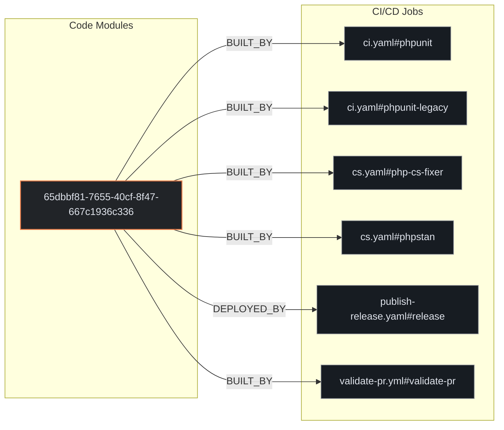
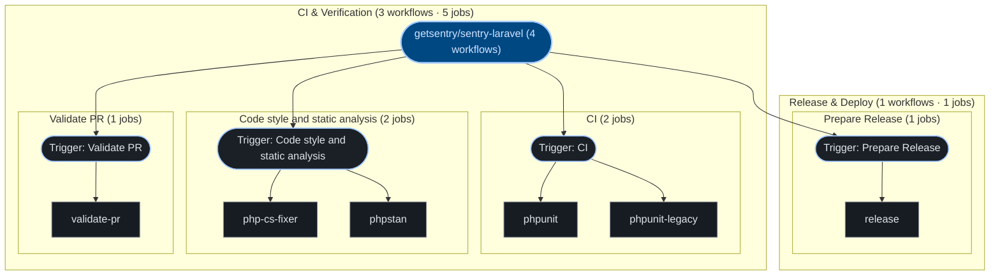

# Repository Architecture Analysis: getsentry/sentry-laravel

## Metadata
- **SHA**: `cf8f5ed70872a964d599b2caf43c163a07dc007b`
- **Primary Ecosystem**: PHP

## Quality Metrics
- **ast_engine**: fallback
- **avg_cognitive_complexity**: 0.0
- **avg_cyclomatic_complexity**: 0.0
- **component_count**: 141
- **dead_code_count**: 0
- **dead_code_symbols**: 0 entry(ies)
- **duplication_pct**: 0.0
- **file_complexities**: 0 entry(ies)
- **files_analyzed**: 141
- **fitness_passed**: True
- **fitness_violation_count**: 0
- **framework**: Laravel
- **import_edges**: 0 entry(ies)
- **loc**: 19143
- **max_cognitive_complexity**: 0
- **max_cyclomatic_complexity**: 0
- **sloc**: 13359
- **test_file_count**: 66

# Architecture: getsentry/sentry-laravel

## Context
- **Repository**: `getsentry/sentry-laravel`
- **SHA**: `cf8f5ed70872a964d599b2caf43c163a07dc007b`
- **Ecosystem**: PHP
- **Framework**: Laravel

## Building Block View

```mermaid
graph TD;
  classDef atlasRoot fill:#004882,stroke:#a3c9ff,stroke-width:2px,color:#d3e4ff
  classDef atlasCategory fill:#212428,stroke:#E87A48,stroke-width:1.5px,color:#dfe3eb
  classDef atlasWorkflow fill:#1b2026,stroke:#a3c9ff,stroke-width:1.5px,color:#dfe3eb
  classDef atlasJob fill:#171c22,stroke:#8d9199,stroke-width:1px,color:#dfe3eb
  classDef atlasTarget fill:#005227,stroke:#8bd99b,stroke-width:1.5px,color:#a7f6b6
  classDef atlasAlert fill:#93000a,stroke:#ffb4ab,stroke-width:1.5px,color:#ffdad6
  classDef atlasMore fill:#252a31,stroke:#8d9199,stroke-dasharray:4 4,color:#c3c6cf
    repo_root(["getsentry/sentry-laravel (141 components)"]):::atlasRoot
    subgraph sg_dir_0_src["src (72)"]
      direction TB
      dir_0_src["src (72)"]:::atlasCategory
      sub_0_0_Sentry_Laravel_Features["Sentry/Laravel/Features (35)"]:::atlasWorkflow
      dir_0_src --> sub_0_0_Sentry_Laravel_Features
      sub_0_1_Sentry_Laravel_Tracing["Sentry/Laravel/Tracing (10)"]:::atlasWorkflow
      dir_0_src --> sub_0_1_Sentry_Laravel_Tracing
      sub_0_2_Sentry_Laravel["Sentry/Laravel (8)"]:::atlasWorkflow
      dir_0_src --> sub_0_2_Sentry_Laravel
      sub_0_more["+6 more submodules (19)"]:::atlasMore
      dir_0_src --> sub_0_more
    end
    repo_root --> dir_0_src
    subgraph sg_dir_1_test["test (66)"]
      direction TB
      dir_1_test["test (66)"]:::atlasCategory
      sub_1_0_Sentry["Sentry (59)"]:::atlasWorkflow
      dir_1_test --> sub_1_0_Sentry
      sub_1_1_stubs["stubs (6)"]:::atlasWorkflow
      dir_1_test --> sub_1_1_stubs
      sub_1_2__module_root_["(module root) (1)"]:::atlasWorkflow
      dir_1_test --> sub_1_2__module_root_
    end
    repo_root --> dir_1_test
    dir_2__root_["(root) (1)"]:::atlasCategory
    repo_root --> dir_2__root_
    dir_3_config["config (1)"]:::atlasCategory
    repo_root --> dir_3_config
    dir_4_scripts["scripts (1)"]:::atlasCategory
    repo_root --> dir_4_scripts
```

## Component Details

Showing top 60 representative components out of 141 across 5 module group(s):

- **Module `src`** (72 components — module: 72)
- **Module `test`** (66 components — module: 66)
- **Module `(root)`** (1 components — module: 1)
- **Module `config`** (1 components — module: 1)
- **Module `scripts`** (1 components — module: 1)

- **.php-cs-fixer** (`.php-cs-fixer.php`): module
- **AboutCommandIntegration** (`src/Sentry/Laravel/Console/AboutCommandIntegration.php`): module
- **AboutCommandIntegrationTest** (`test/Sentry/Console/AboutCommandIntegrationTest.php`): module
- **AiConversationTracker** (`src/Sentry/Laravel/Features/Ai/AiConversationTracker.php`): module
- **AiDataSanitizer** (`src/Sentry/Laravel/Features/Ai/AiDataSanitizer.php`): module
- **AiDataSanitizerTest** (`test/Sentry/Features/Ai/AiDataSanitizerTest.php`): module
- **AiFailedInvocationTest** (`test/Sentry/Features/AiFailedInvocationTest.php`): module
- **AiIntegration** (`src/Sentry/Laravel/Features/AiIntegration.php`): module
- **AiIntegrationTest** (`test/Sentry/Features/AiIntegrationTest.php`): module
- **AiInvocationData** (`src/Sentry/Laravel/Features/Ai/AiInvocationData.php`): module
- **AiInvocationMeta** (`src/Sentry/Laravel/Features/Ai/AiInvocationMeta.php`): module
- **AiMessage** (`src/Sentry/Laravel/Features/Ai/AiMessage.php`): module
- **AiMessagePart** (`src/Sentry/Laravel/Features/Ai/AiMessagePart.php`): module
- **AiProviderUrlResolver** (`src/Sentry/Laravel/Features/Ai/AiProviderUrlResolver.php`): module
- **AiProviderUrlResolverTest** (`test/Sentry/Features/Ai/AiProviderUrlResolverTest.php`): module
- **AiSpanDataBag** (`src/Sentry/Laravel/Features/Ai/AiSpanDataBag.php`): module
- **AiSpanDataBagTest** (`test/Sentry/Features/Ai/AiSpanDataBagTest.php`): module
- **AuthEventsTest** (`test/Sentry/EventHandler/AuthEventsTest.php`): module
- **BacktraceHelper** (`src/Sentry/Laravel/Tracing/BacktraceHelper.php`): module
- **BaseServiceProvider** (`src/Sentry/Laravel/BaseServiceProvider.php`): module
- **BootstrapSpanTest** (`test/Sentry/Tracing/BootstrapSpanTest.php`): module
- **BoundedOrderedMap** (`src/Sentry/Laravel/Util/BoundedOrderedMap.php`): module
- **CacheIntegration** (`src/Sentry/Laravel/Features/CacheIntegration.php`): module
- **CacheIntegrationTest** (`test/Sentry/Features/CacheIntegrationTest.php`): module
- **ClassificationIntegration** (`src/Sentry/Laravel/Features/ClassificationIntegration.php`): module
- **ClassificationIntegrationTest** (`test/Sentry/Features/ClassificationIntegrationTest.php`): module
- **ClassificationInvocationData** (`src/Sentry/Laravel/Features/Classification/ClassificationInvocationData.php`): module
- **ClassificationMessageFormatter** (`src/Sentry/Laravel/Features/Classification/ClassificationMessageFormatter.php`): module
- **ClientBuilderDecoratorTest** (`test/Sentry/ClientBuilderDecoratorTest.php`): module
- **CloudFilesystemDecorator** (`src/Sentry/Laravel/Features/Storage/CloudFilesystemDecorator.php`): module
- **ConsoleExceptionScopePropagationTest** (`test/Sentry/Features/ConsoleExceptionScopePropagationTest.php`): module
- **ConsoleIntegration** (`src/Sentry/Laravel/Features/ConsoleIntegration.php`): module
- **ConsoleIntegrationTest** (`test/Sentry/Features/ConsoleIntegrationTest.php`): module
- **ConsoleSchedulingIntegration** (`src/Sentry/Laravel/Features/ConsoleSchedulingIntegration.php`): module
- **ConsoleSchedulingIntegrationTest** (`test/Sentry/Features/ConsoleSchedulingIntegrationTest.php`): module
- **ConsoleSchedulingMonitorAllTasksTest** (`test/Sentry/Features/ConsoleSchedulingMonitorAllTasksTest.php`): module
- **DatabaseEventsTest** (`test/Sentry/EventHandler/DatabaseEventsTest.php`): module
- **DatabaseIntegrationTest** (`test/Sentry/Features/DatabaseIntegrationTest.php`): module
- **DiscardedAttributeViolationReporter** (`src/Sentry/Laravel/Integration/ModelViolations/DiscardedAttributeViolationReporter.php`): module
- **EventHandler** (`src/Sentry/Laravel/EventHandler.php`): module
- **EventHandler** (`src/Sentry/Laravel/Tracing/EventHandler.php`): module
- **EventHandlerTest** (`test/Sentry/EventHandlerTest.php`): module
- **EventHandlerTest** (`test/Sentry/Tracing/EventHandlerTest.php`): module
- **ExceptionContextIntegration** (`src/Sentry/Laravel/Integration/ExceptionContextIntegration.php`): module
- **ExceptionContextIntegrationTest** (`test/Sentry/Integration/ExceptionContextIntegrationTest.php`): module
- **Facade** (`src/Sentry/Laravel/Facade.php`): module
- **Feature** (`src/Sentry/Laravel/Features/Feature.php`): module
- **Filesize** (`src/Sentry/Laravel/Util/Filesize.php`): module
- **FilesystemAdapterDecorator** (`src/Sentry/Laravel/Features/Storage/FilesystemAdapterDecorator.php`): module
- **FilesystemDecorator** (`src/Sentry/Laravel/Features/Storage/FilesystemDecorator.php`): module
- **FlushEventsMiddleware** (`src/Sentry/Laravel/Http/FlushEventsMiddleware.php`): module
- **FolioPackageIntegration** (`src/Sentry/Laravel/Features/FolioPackageIntegration.php`): module
- **FolioPackageIntegrationTest** (`test/Sentry/Features/FolioPackageIntegrationTest.php`): module
- **HttpClientDataCollectionTest** (`test/Sentry/Features/HttpClientDataCollectionTest.php`): module
- **HttpClientIntegration** (`src/Sentry/Laravel/Features/HttpClientIntegration.php`): module
- **HttpClientIntegrationTest** (`test/Sentry/Features/HttpClientIntegrationTest.php`): module
- **HttpClientOriginFixture** (`test/stubs/app/HttpClientOriginFixture.php`): module
- **HttpRequestIntegration** (`src/Sentry/Laravel/Features/Ai/HttpRequestIntegration.php`): module
- **Integration** (`src/Sentry/Laravel/Features/Storage/Integration.php`): module
- **Integration** (`src/Sentry/Laravel/Integration.php`): module

## 6-Dimension Repository Scorecard

- **Overall Grade**: `A` (90.55/100)
- **Technical Debt Score**: 9.45
- **Estimated Remediation Effort**: 7.36h

| Dimension | Grade | Score | Weight | Details |
| :--- | :---: | :---: | :---: | :--- |
| Code Quality | `A` | 100.00 | 0.20 | avg_cc=0.00, max_cc=0, duplication=0.00%, dead_code=0 |
| Dependency Health | `A` | 100.00 | 0.15 | dependencies=16, outdated=0, vulnerable=0, has_lockfile=False |
| Maintainability | `A` | 100.00 | 0.15 | avg_cognitive=0.00, max_cognitive=0, fitness_violations=0, oversized_files=0 |
| Pipeline Health | `D` | 67.00 | 0.15 | workflows=4, operational_antipatterns=7, parallel_branches=True |
| Security | `A` | 100.00 | 0.20 | vulnerabilities=0, secrets=0, pipeline_security_findings=0 |
| Test Coverage | `C` | 70.00 | 0.15 | coverage=unavailable, ci_test_job=False, test_files_detected=True |

## Supply Chain Dependencies, Vulnerabilities & Secrets

- **Dependencies Parsed**: 16 | **Vulnerabilities**: 0 | **Secrets**: 0

### Inventory Sample
- `illuminate/support` `6.0` (composer, `composer.json`)
- `nyholm/psr7` `1.0` (composer, `composer.json`)
- `sentry/sentry` `4.34.0` (composer, `composer.json`)
- `symfony/psr-http-message-bridge` `1.0` (composer, `composer.json`)
- `friendsofphp/php-cs-fixer` `3.11` (composer, `composer.json`)
- `guzzlehttp/guzzle` `7.2` (composer, `composer.json`)
- `laravel/ai` `0.1.5` (composer, `composer.json`)
- `laravel/folio` `1.1` (composer, `composer.json`)
- `laravel/framework` `6.0` (composer, `composer.json`)
- `laravel/octane` `2.15` (composer, `composer.json`)
- `laravel/pennant` `1.0` (composer, `composer.json`)
- `livewire/livewire` `2.0` (composer, `composer.json`)
- `mockery/mockery` `1.3` (composer, `composer.json`)
- `orchestra/testbench` `4.7` (composer, `composer.json`)
- `phpstan/phpstan` `1.10` (composer, `composer.json`)
- `phpunit/phpunit` `8.5` (composer, `composer.json`)

## Section 7: Code-to-Cloud Deployment Traceability

- `65dbbf81-7655-40cf-8f47-667c1936c336` (code_module) --[BUILT_BY]--> `ci.yaml#phpunit` (ci_job)
- `65dbbf81-7655-40cf-8f47-667c1936c336` (code_module) --[BUILT_BY]--> `ci.yaml#phpunit-legacy` (ci_job)
- `65dbbf81-7655-40cf-8f47-667c1936c336` (code_module) --[BUILT_BY]--> `cs.yaml#php-cs-fixer` (ci_job)
- `65dbbf81-7655-40cf-8f47-667c1936c336` (code_module) --[BUILT_BY]--> `cs.yaml#phpstan` (ci_job)
- `65dbbf81-7655-40cf-8f47-667c1936c336` (code_module) --[BUILT_BY]--> `validate-pr.yml#validate-pr` (ci_job)
- `65dbbf81-7655-40cf-8f47-667c1936c336` (code_module) --[DEPLOYED_BY]--> `publish-release.yaml#release` (ci_job)

## CI/CD Pipeline Topology

