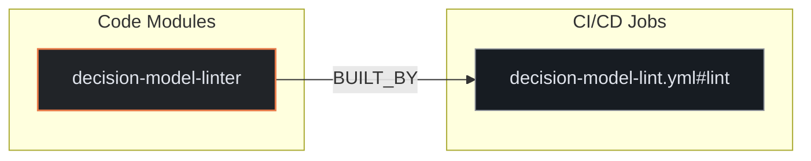

# Repository Architecture Analysis: getsentry/sentry-php

## Metadata
- **SHA**: `2c260c9a1579f4eb8eee9aab87cdb92c4198b131`
- **Primary Ecosystem**: PHP

## Quality Metrics
- **ast_engine**: tree-sitter
- **avg_cognitive_complexity**: 0.0
- **avg_cyclomatic_complexity**: 1.0
- **component_count**: 251
- **dead_code_count**: 0
- **dead_code_symbols**: 0 entry(ies)
- **duplication_pct**: 0.13
- **file_complexities**: 1 entry(ies)
- **files_analyzed**: 310
- **fitness_passed**: True
- **fitness_violation_count**: 0
- **framework**: Symfony
- **import_edges**: 3 entry(ies)
- **loc**: 57898
- **max_cognitive_complexity**: 0
- **max_cyclomatic_complexity**: 1
- **sloc**: 38932
- **test_file_count**: 180

# Architecture: getsentry/sentry-php

## Context
- **Repository**: `getsentry/sentry-php`
- **SHA**: `2c260c9a1579f4eb8eee9aab87cdb92c4198b131`
- **Ecosystem**: PHP
- **Framework**: Symfony

## Building Block View

```mermaid
graph TD;
    %% title: Building Block View — getsentry/sentry-php
  classDef atlasRoot fill:#004882,stroke:#a3c9ff,stroke-width:2px,color:#d3e4ff
  classDef atlasCategory fill:#212428,stroke:#E87A48,stroke-width:1.5px,color:#dfe3eb
  classDef atlasWorkflow fill:#1b2026,stroke:#a3c9ff,stroke-width:1.5px,color:#dfe3eb
  classDef atlasJob fill:#171c22,stroke:#8d9199,stroke-width:1px,color:#dfe3eb
  classDef atlasTarget fill:#005227,stroke:#8bd99b,stroke-width:1.5px,color:#a7f6b6
  classDef atlasAlert fill:#93000a,stroke:#ffb4ab,stroke-width:1.5px,color:#ffdad6
  classDef atlasMore fill:#252a31,stroke:#8d9199,stroke-dasharray:4 4,color:#c3c6cf
    repo_root(["getsentry/sentry-php (251 components)"]):::atlasRoot
    subgraph sg_dir_0_src["src (174)"]
      direction TB
      dir_0_src["src (174)"]:::atlasCategory
      sub_0_0__module_root_["(module root) (28)"]:::atlasWorkflow
      dir_0_src --> sub_0_0__module_root_
      sub_0_1_Serializer["Serializer (20)"]:::atlasWorkflow
      dir_0_src --> sub_0_1_Serializer
      sub_0_2_DataCollection["DataCollection (18)"]:::atlasWorkflow
      dir_0_src --> sub_0_2_DataCollection
      sub_0_more["+19 more submodules (108)"]:::atlasMore
      dir_0_src --> sub_0_more
    end
    repo_root --> dir_0_src
    subgraph sg_dir_1_tests["tests (74)"]
      direction TB
      dir_1_tests["tests (74)"]:::atlasCategory
      sub_1_0__module_root_["(module root) (29)"]:::atlasWorkflow
      dir_1_tests --> sub_1_0__module_root_
      sub_1_1_DataCollection["DataCollection (14)"]:::atlasWorkflow
      dir_1_tests --> sub_1_1_DataCollection
      sub_1_2_Integration["Integration (9)"]:::atlasWorkflow
      dir_1_tests --> sub_1_2_Integration
      sub_1_more["+6 more submodules (22)"]:::atlasMore
      dir_1_tests --> sub_1_more
    end
    repo_root --> dir_1_tests
    dir_2__root_["(root) (1)"]:::atlasCategory
    repo_root --> dir_2__root_
    dir_3_decision_model_linter["decision-model-linter (1)"]:::atlasCategory
    repo_root --> dir_3_decision_model_linter
    dir_4_stubs["stubs (1)"]:::atlasCategory
    repo_root --> dir_4_stubs
```

## Component Details

Showing top 60 representative components out of 251 across 5 module group(s):

- **Module `src`** (174 components — module: 174)
- **Module `tests`** (74 components — module: 74)
- **Module `(root)`** (1 components — module: 1)
- **Module `decision-model-linter`** (1 components — MODULE: 1)
- **Module `stubs`** (1 components — module: 1)

- **.php-cs-fixer.dist** (`.php-cs-fixer.dist.php`): module
- **AbstractErrorListenerIntegration** (`src/Integration/AbstractErrorListenerIntegration.php`): module
- **AbstractSerializer** (`src/Serializer/AbstractSerializer.php`): module
- **AgentClient** (`src/Agent/Transport/AgentClient.php`): module
- **AgentClientBuilder** (`src/Agent/Transport/AgentClientBuilder.php`): module
- **AgentClientBuilderTest** (`tests/HttpClient/AgentClientBuilderTest.php`): module
- **AgentClientTest** (`tests/HttpClient/AgentClientTest.php`): module
- **Arr** (`src/Util/Arr.php`): module
- **Attachment** (`src/Attachment/Attachment.php`): module
- **AttachmentItem** (`src/Serializer/EnvelopItems/AttachmentItem.php`): module
- **AttachmentTest** (`tests/Attachment/AttachmentTest.php`): module
- **Attribute** (`src/Attributes/Attribute.php`): module
- **AttributeBag** (`src/Attributes/AttributeBag.php`): module
- **AttributeBagTest** (`tests/Attributes/AttributeBagTest.php`): module
- **AttributeTest** (`tests/Attributes/AttributeTest.php`): module
- **Breadcrumb** (`src/Breadcrumb.php`): module
- **BreadcrumbHandler** (`src/Monolog/BreadcrumbHandler.php`): module
- **BreadcrumbSeralizerTrait** (`src/Serializer/Traits/BreadcrumbSeralizerTrait.php`): module
- **BreadcrumbTest** (`tests/BreadcrumbTest.php`): module
- **BrokenClass** (`tests/Fixtures/code/BrokenClass.php`): module
- **ByteAttachment** (`src/Attachment/ByteAttachment.php`): module
- **CheckIn** (`src/CheckIn.php`): module
- **CheckInItem** (`src/Serializer/EnvelopItems/CheckInItem.php`): module
- **CheckInStatus** (`src/CheckInStatus.php`): module
- **CheckInTest** (`tests/CheckInTest.php`): module
- **Client** (`src/Client.php`): module
- **ClientBuilder** (`src/ClientBuilder.php`): module
- **ClientBuilderTest** (`tests/ClientBuilderTest.php`): module
- **ClientInterface** (`src/ClientInterface.php`): module
- **ClientReportAggregator** (`src/ClientReport/ClientReportAggregator.php`): module
- **ClientReportAggregatorTest** (`tests/ClientReport/ClientReportAggregatorTest.php`): module
- **ClientReportAssertions** (`tests/ClientReport/ClientReportAssertions.php`): module
- **ClientReportItem** (`src/Serializer/EnvelopItems/ClientReportItem.php`): module
- **ClientTest** (`tests/ClientTest.php`): module
- **CodeLocationResolver** (`src/Util/CodeLocationResolver.php`): module
- **CodeLocationResolverTest** (`tests/CodeLocationResolverTest.php`): module
- **CompatibilityLogLevelTrait** (`src/Monolog/CompatibilityLogLevelTrait.php`): module
- **CompatibilityProcessingHandlerTrait** (`src/Monolog/CompatibilityProcessingHandlerTrait.php`): module
- **ContinuousProfiler** (`src/Profiling/ContinuousProfiler.php`): module
- **CounterMetric** (`src/Metrics/Types/CounterMetric.php`): module
- **DataCategory** (`src/Transport/DataCategory.php`): module
- **DataCollectionOptions** (`src/DataCollection/DataCollectionOptions.php`): module
- **DataCollectionOptionsTest** (`tests/DataCollection/DataCollectionOptionsTest.php`): module
- **DataCollectionPolicy** (`src/DataCollection/DataCollectionPolicy.php`): module
- **DataCollectionPolicyTest** (`tests/DataCollection/DataCollectionPolicyTest.php`): module
- **DatabaseDataCollector** (`src/DataCollection/DatabaseDataCollector.php`): module
- **DatabaseDataCollectorTest** (`tests/DataCollection/DatabaseDataCollectorTest.php`): module
- **DebugFileLogger** (`src/Logger/DebugFileLogger.php`): module
- **DebugLogger** (`src/Logger/DebugLogger.php`): module
- **DebugStdOutLogger** (`src/Logger/DebugStdOutLogger.php`): module
- **DiscardedEvent** (`src/ClientReport/DiscardedEvent.php`): module
- **DistributionMetric** (`src/Metrics/Types/DistributionMetric.php`): module
- **Dsn** (`src/Dsn.php`): module
- **DsnTest** (`tests/DsnTest.php`): module
- **DynamicSamplingContext** (`src/Tracing/DynamicSamplingContext.php`): module
- **EnvelopeItemInterface** (`src/Serializer/EnvelopItems/EnvelopeItemInterface.php`): module
- **EnvironmentIntegration** (`src/Integration/EnvironmentIntegration.php`): module
- **EnvironmentIntegrationTest** (`tests/Integration/EnvironmentIntegrationTest.php`): module
- **ErrorHandler** (`src/ErrorHandler.php`): module
- **ErrorListenerIntegration** (`src/Integration/ErrorListenerIntegration.php`): module

## 6-Dimension Repository Scorecard

- **Overall Grade**: `D` (66.90/100)
- **Technical Debt Score**: 33.10
- **Estimated Remediation Effort**: 48.30h

| Dimension | Grade | Score | Weight | Details |
| :--- | :---: | :---: | :---: | :--- |
| Code Quality | `A` | 99.81 | 0.20 | avg_cc=1.00, max_cc=1, duplication=0.13%, dead_code=0 |
| Dependency Health | `A` | 90.91 | 0.15 | dependencies=22, outdated=0, vulnerable=4, has_lockfile=True |
| Maintainability | `A` | 100.00 | 0.15 | avg_cognitive=0.00, max_cognitive=0, fitness_violations=0, oversized_files=0 |
| Pipeline Health | `F` | 52.00 | 0.15 | workflows=5, operational_antipatterns=11, parallel_branches=True |
| Security | `F` | 0.00 | 0.20 | vulnerabilities=27, secrets=0, pipeline_security_findings=3 |
| Test Coverage | `C` | 70.00 | 0.15 | coverage=unavailable, ci_test_job=True, test_files_detected=True |

## Supply Chain Dependencies, Vulnerabilities & Secrets

- **Dependencies Parsed**: 22 | **Vulnerabilities**: 27 | **Secrets**: 0

### Known Vulnerabilities (OSV)
- **[MEDIUM] `GHSA-25mq-v84q-4j7r`** `guzzlehttp/guzzle` `` (fixed: `none`, UNREACHABLE_DORMANT)
- **[MEDIUM] `GHSA-34xg-wgjx-8xph`** `guzzlehttp/psr7` `` (fixed: `none`, UNREACHABLE_DORMANT)
- **[MEDIUM] `GHSA-94pj-82f3-465w`** `guzzlehttp/guzzle` `` (fixed: `none`, UNREACHABLE_DORMANT)
- **[MEDIUM] `GHSA-9vw2-f4vp-x7gf`** `phpunit/phpunit` `` (fixed: `none`, REACHABLE_FROM_CI)
- **[MEDIUM] `GHSA-c2w2-prh8-qm98`** `guzzlehttp/psr7` `` (fixed: `none`, UNREACHABLE_DORMANT)
- **[MEDIUM] `GHSA-cwmx-hcrq-mhc3`** `guzzlehttp/guzzle` `` (fixed: `none`, UNREACHABLE_DORMANT)
- **[MEDIUM] `GHSA-cwxw-98qj-8qjx`** `guzzlehttp/guzzle` `` (fixed: `none`, UNREACHABLE_DORMANT)
- **[MEDIUM] `GHSA-f283-ghqc-fg79`** `guzzlehttp/guzzle` `` (fixed: `none`, UNREACHABLE_DORMANT)
- **[MEDIUM] `GHSA-f2wf-25xc-69c9`** `guzzlehttp/guzzle` `` (fixed: `none`, UNREACHABLE_DORMANT)
- **[MEDIUM] `GHSA-f57v-q966-7fh6`** `monolog/monolog` `` (fixed: `none`, REACHABLE_FROM_CI)
- **[MEDIUM] `GHSA-f7vp-7xgx-4w4r`** `guzzlehttp/guzzle` `` (fixed: `none`, UNREACHABLE_DORMANT)
- **[MEDIUM] `GHSA-g446-98w2-8p5w`** `guzzlehttp/guzzle` `` (fixed: `none`, UNREACHABLE_DORMANT)
- **[MEDIUM] `GHSA-h95v-h523-3mw8`** `guzzlehttp/guzzle` `` (fixed: `none`, UNREACHABLE_DORMANT)
- **[MEDIUM] `GHSA-hq7v-mx3g-29hw`** `guzzlehttp/psr7` `` (fixed: `none`, UNREACHABLE_DORMANT)
- **[MEDIUM] `GHSA-m6ch-gg5f-wxx3`** `guzzlehttp/guzzle` `` (fixed: `none`, UNREACHABLE_DORMANT)
- **[MEDIUM] `GHSA-mh6w-vxff-9wqp`** `phpunit/phpunit` `` (fixed: `none`, REACHABLE_FROM_CI)
- **[MEDIUM] `GHSA-q559-8m2m-g699`** `guzzlehttp/guzzle` `` (fixed: `none`, UNREACHABLE_DORMANT)
- **[MEDIUM] `GHSA-q7rv-6hp3-vh96`** `guzzlehttp/psr7` `` (fixed: `none`, UNREACHABLE_DORMANT)
- **[MEDIUM] `GHSA-qrr6-mg7r-m243`** `phpunit/phpunit` `` (fixed: `none`, REACHABLE_FROM_CI)
- **[MEDIUM] `GHSA-r7c9-c69m-rph8`** `phpunit/phpunit` `` (fixed: `none`, REACHABLE_FROM_CI)
- **[MEDIUM] `GHSA-v5mv-p594-2x33`** `guzzlehttp/guzzle` `` (fixed: `none`, UNREACHABLE_DORMANT)
- **[MEDIUM] `GHSA-vm85-hxw5-5432`** `guzzlehttp/psr7` `` (fixed: `none`, UNREACHABLE_DORMANT)
- **[MEDIUM] `GHSA-vvj3-c3rp-c85p`** `phpunit/phpunit` `` (fixed: `none`, REACHABLE_FROM_CI)
- **[MEDIUM] `GHSA-w248-ffj2-4v5q`** `guzzlehttp/guzzle` `` (fixed: `none`, UNREACHABLE_DORMANT)
- **[MEDIUM] `GHSA-wm3w-8rrp-j577`** `guzzlehttp/guzzle` `` (fixed: `none`, UNREACHABLE_DORMANT)
- **[MEDIUM] `GHSA-wpwq-4j6v-78m3`** `guzzlehttp/guzzle` `` (fixed: `none`, UNREACHABLE_DORMANT)
- **[MEDIUM] `GHSA-wxmh-65f7-jcvw`** `guzzlehttp/psr7` `` (fixed: `none`, UNREACHABLE_DORMANT)

### Inventory Sample
- `guzzlehttp/psr7` `*` (composer, `composer.json`)
- `jean85/pretty-package-versions` `*` (composer, `composer.json`)
- `psr/log` `*` (composer, `composer.json`)
- `symfony/options-resolver` `*` (composer, `composer.json`)
- `@sentry/decision-model-linter` `0.3.0` (npm, `decision-model-linter/package-lock.json`)
- `@sentry/decision-model-linter` `0.3.0` (npm, `decision-model-linter/package.json`)
- `carthage-software/mago` `1.60.2` (composer, `composer.json`)
- `friendsofphp/php-cs-fixer` `3.4` (composer, `composer.json`)
- `guzzlehttp/guzzle` `*` (composer, `composer.json`)
- `guzzlehttp/promises` `*` (composer, `composer.json`)
- `monolog/monolog` `*` (composer, `composer.json`)
- `nyholm/psr7` `1.8` (composer, `composer.json`)
- `open-telemetry/api` `1.1` (composer, `composer.json`)
- `open-telemetry/context` `1.1` (composer, `composer.json`)
- `open-telemetry/exporter-otlp` `1.1` (composer, `composer.json`)
- `open-telemetry/gen-otlp-protobuf` `1.2.1` (composer, `composer.json`)
- `open-telemetry/sdk` `1.1` (composer, `composer.json`)
- `open-telemetry/sem-conv` `1.27` (composer, `composer.json`)
- `phpstan/phpstan` `2.2` (composer, `composer.json`)
- `phpunit/phpunit` `*` (composer, `composer.json`)
- `spiral/roadrunner-http` `3.6` (composer, `composer.json`)
- `spiral/roadrunner-worker` `3.6` (composer, `composer.json`)

## Section 7: Code-to-Cloud Deployment Traceability

- `decision-model-linter` (code_module) --[BUILT_BY]--> `decision-model-lint.yml#lint` (ci_job)

## CI/CD Pipeline Topology

```mermaid
graph TD;
  %% title: CI/CD Pipeline Topology — getsentry/sentry-php
  classDef atlasRoot fill:#004882,stroke:#a3c9ff,stroke-width:2px,color:#d3e4ff
  classDef atlasCategory fill:#212428,stroke:#E87A48,stroke-width:1.5px,color:#dfe3eb
  classDef atlasWorkflow fill:#1b2026,stroke:#a3c9ff,stroke-width:1.5px,color:#dfe3eb
  classDef atlasJob fill:#171c22,stroke:#8d9199,stroke-width:1px,color:#dfe3eb
  classDef atlasTarget fill:#005227,stroke:#8bd99b,stroke-width:1.5px,color:#a7f6b6
  classDef atlasAlert fill:#93000a,stroke:#ffb4ab,stroke-width:1.5px,color:#ffdad6
  classDef atlasMore fill:#252a31,stroke:#8d9199,stroke-dasharray:4 4,color:#c3c6cf
  pipeline_root(["getsentry/sentry-php (5 workflows)"]):::atlasRoot
  subgraph sg_grp_0_CI___Verification["CI & Verification (4 workflows · 9 jobs)"]
    direction TB
    subgraph sg_wf_0_Backward_compatibility["Backward compatibility (1 jobs)"]
      direction TB
      wf_0_Backward_compatibility(["Trigger: Backward compatibility"]):::atlasWorkflow
      job_0_roave_bc_check["roave-bc-check"]:::atlasJob
      wf_0_Backward_compatibility --> job_0_roave_bc_check
    end
    pipeline_root --> wf_0_Backward_compatibility
    subgraph sg_wf_1_CI["CI (4 jobs)"]
      direction TB
      wf_1_CI(["Trigger: CI"]):::atlasWorkflow
      job_1_tests["tests"]:::atlasJob
      job_1_opentelemetry_tests["opentelemetry-tests"]:::atlasJob
      job_1_runtime_tests_frankenphp["runtime-tests-frankenphp"]:::atlasJob
      wf_1_CI --> job_1_tests
      wf_1_CI --> job_1_opentelemetry_tests
      wf_1_CI --> job_1_runtime_tests_frankenphp
    end
    pipeline_root --> wf_1_CI
    subgraph sg_wf_2_Decision_model_lint["Decision model lint (1 jobs)"]
      direction TB
      wf_2_Decision_model_lint(["Trigger: Decision model lint"]):::atlasWorkflow
      job_2_lint["lint"]:::atlasJob
      wf_2_Decision_model_lint --> job_2_lint
    end
    pipeline_root --> wf_2_Decision_model_lint
    subgraph sg_wf_4_Code_style_and_static_analysis["Code style and static analysis (3 jobs)"]
      direction TB
      wf_4_Code_style_and_static_analysis(["Trigger: Code style and static analysis"]):::atlasWorkflow
      job_4_php_cs_fixer["php-cs-fixer"]:::atlasJob
      job_4_phpstan["phpstan"]:::atlasJob
      job_4_mago["mago"]:::atlasJob
      wf_4_Code_style_and_static_analysis --> job_4_php_cs_fixer
      wf_4_Code_style_and_static_analysis --> job_4_phpstan
      wf_4_Code_style_and_static_analysis --> job_4_mago
    end
    pipeline_root --> wf_4_Code_style_and_static_analysis
  end
  subgraph sg_grp_1_Release___Deploy["Release & Deploy (1 workflows · 1 jobs)"]
    direction TB
    subgraph sg_wf_3_Prepare_Release["Prepare Release (1 jobs)"]
      direction TB
      wf_3_Prepare_Release(["Trigger: Prepare Release"]):::atlasWorkflow
      job_3_release["release"]:::atlasJob
      wf_3_Prepare_Release --> job_3_release
    end
    pipeline_root --> wf_3_Prepare_Release
  end
```

