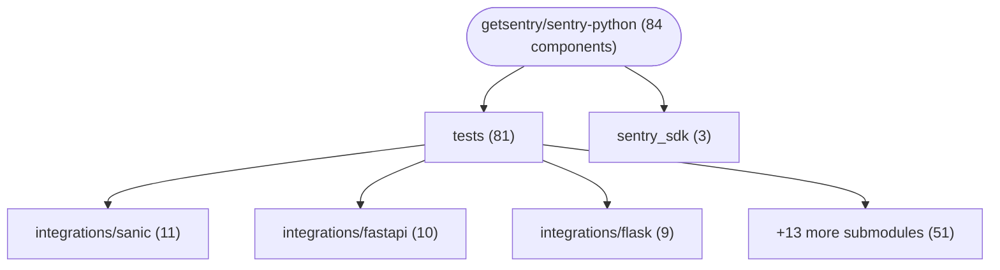
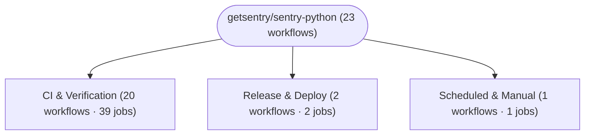

# Repository Architecture Analysis: getsentry/sentry-python

## Metadata
- **SHA**: `26ef57190d48d90e5ae2483db52dd4ce9b863f15`
- **Primary Ecosystem**: Python

## Quality Metrics
- **ast_engine**: tree-sitter
- **avg_cognitive_complexity**: 3.69
- **avg_cyclomatic_complexity**: 2.91
- **component_count**: 84
- **dead_code_count**: 34
- **dead_code_symbols**: 34 entry(ies)
- **duplication_pct**: 91.78
- **file_complexities**: 25 entry(ies)
- **files_analyzed**: 523
- **fitness_passed**: False
- **fitness_violation_count**: 3
- **framework**: Django
- **import_edges**: 100 entry(ies)
- **loc**: 228074
- **max_cognitive_complexity**: 330
- **max_cyclomatic_complexity**: 71
- **sloc**: 183279
- **test_file_count**: 348

# Architecture: getsentry/sentry-python

## Context
- **Repository**: `getsentry/sentry-python`
- **SHA**: `26ef57190d48d90e5ae2483db52dd4ce9b863f15`
- **Ecosystem**: Python
- **Framework**: Django

## Building Block View

## Component Details

Showing top 60 representative components out of 84 across 2 module group(s):

- **Module `tests`** (81 components — API_ROUTE: 72, CLI_COMMAND: 4, SERVICE: 3)
- **Module `sentry_sdk`** (3 components — SERVICE: 3)

- **Address** (`tests/integrations/sqlalchemy/test_sqlalchemy.py`): DATA_ACCESS_LAYER
- **Person** (`tests/integrations/sqlalchemy/test_sqlalchemy.py`): DATA_ACCESS_LAYER
- **TestService** (`tests/integrations/grpc/test_grpc.py`): SERVICE
- **TestService** (`tests/integrations/grpc/test_grpc_aio.py`): SERVICE
- **_** (`tests/integrations/trytond/test_trytond.py`): API_ROUTE
- **_PatchedAsyncMessageStreamManager** (`sentry_sdk/integrations/anthropic.py`): SERVICE
- **_PatchedMessageStreamManager** (`sentry_sdk/integrations/anthropic.py`): SERVICE
- **_ScopeManager** (`sentry_sdk/scope.py`): SERVICE
- **_error** (`tests/integrations/fastapi/test_fastapi.py`): API_ROUTE
- **_message** (`tests/integrations/fastapi/test_fastapi.py`): API_ROUTE
- **_message_with_id** (`tests/integrations/fastapi/test_fastapi.py`): API_ROUTE
- **_nomessage** (`tests/integrations/fastapi/test_fastapi.py`): API_ROUTE
- **_thread_ids_async** (`tests/integrations/fastapi/test_fastapi.py`): API_ROUTE
- **_thread_ids_async** (`tests/integrations/quart/test_quart.py`): API_ROUTE
- **_thread_ids_sync** (`tests/integrations/fastapi/test_fastapi.py`): API_ROUTE
- **_thread_ids_sync** (`tests/integrations/quart/test_quart.py`): API_ROUTE
- **badrequest** (`tests/integrations/chalice/test_chalice.py`): API_ROUTE
- **body_form** (`tests/integrations/fastapi/test_fastapi.py`): API_ROUTE
- **body_handler** (`tests/integrations/sanic/test_sanic.py`): API_ROUTE
- **body_json** (`tests/integrations/fastapi/test_fastapi.py`): API_ROUTE
- **body_json** (`tests/integrations/litestar/test_litestar.py`): API_ROUTE
- **body_json** (`tests/integrations/starlite/test_starlite.py`): API_ROUTE
- **boom** (`tests/integrations/chalice/test_chalice.py`): API_ROUTE
- **child_span_handler** (`tests/integrations/sanic/test_sanic.py`): API_ROUTE
- **child_span_handler_localhost** (`tests/integrations/sanic/test_sanic.py`): API_ROUTE
- **child_span_handler_ua** (`tests/integrations/sanic/test_sanic.py`): API_ROUTE
- **context_check** (`tests/integrations/sanic/test_sanic.py`): API_ROUTE
- **controller_error** (`tests/integrations/litestar/test_litestar.py`): API_ROUTE
- **controller_error** (`tests/integrations/starlite/test_starlite.py`): API_ROUTE
- **crash** (`tests/integrations/flask/test_flask.py`): API_ROUTE
- **crash** (`tests/integrations/pyramid/test_pyramid.py`): API_ROUTE
- **custom_error** (`tests/integrations/litestar/test_litestar.py`): API_ROUTE
- **custom_error** (`tests/integrations/starlite/test_starlite.py`): API_ROUTE
- **envelope** (`tests/integrations/aws_lambda/utils.py`): API_ROUTE
- **error** (`tests/integrations/bottle/test_bottle.py`): API_ROUTE
- **error** (`tests/integrations/flask/test_flask.py`): API_ROUTE
- **error** (`tests/integrations/litestar/test_litestar.py`): API_ROUTE
- **error** (`tests/integrations/quart/test_quart.py`): API_ROUTE
- **errors** (`tests/integrations/pyramid/test_pyramid.py`): API_ROUTE
- **fivehundred** (`tests/integrations/sanic/test_sanic.py`): API_ROUTE
- **foo** (`tests/integrations/flask/test_flask.py`): CLI_COMMAND
- **foo** (`tests/integrations/quart/test_quart.py`): CLI_COMMAND
- **gRPCTestService** (`tests/integrations/grpc/grpc_test_service_pb2_grpc.py`): SERVICE
- **get_user** (`tests/integrations/fastapi/test_fastapi.py`): API_ROUTE
- **graphql_server** (`tests/integrations/ariadne/test_ariadne.py`): API_ROUTE
- **graphql_server_async** (`tests/integrations/graphene/test_graphene.py`): API_ROUTE
- **graphql_server_sync** (`tests/integrations/graphene/test_graphene.py`): API_ROUTE
- **handle** (`tests/integrations/bottle/test_bottle.py`): API_ROUTE
- **has_request** (`tests/integrations/chalice/test_chalice.py`): API_ROUTE
- **here** (`tests/integrations/bottle/test_bottle.py`): API_ROUTE
- **hi** (`tests/integrations/bottle/test_bottle.py`): API_ROUTE
- **hi** (`tests/integrations/chalice/test_chalice.py`): API_ROUTE
- **hi** (`tests/integrations/flask/test_flask.py`): API_ROUTE
- **hi** (`tests/integrations/quart/test_quart.py`): API_ROUTE
- **hi** (`tests/integrations/sanic/test_sanic.py`): API_ROUTE
- **hi2** (`tests/integrations/pyramid/test_pyramid.py`): API_ROUTE
- **hi_tx** (`tests/integrations/flask/test_flask.py`): API_ROUTE
- **hi_tx** (`tests/integrations/quart/test_quart.py`): API_ROUTE
- **hi_with_id** (`tests/integrations/bottle/test_bottle.py`): API_ROUTE
- **hi_with_id** (`tests/integrations/chalice/test_chalice.py`): API_ROUTE

## 6-Dimension Repository Scorecard

- **Overall Grade**: `F` (37.05/100)
- **Technical Debt Score**: 62.95
- **Estimated Remediation Effort**: 136.09h

| Dimension | Grade | Score | Weight | Details |
| :--- | :---: | :---: | :---: | :--- |
| Code Quality | `F` | 30.00 | 0.20 | avg_cc=2.91, max_cc=71, duplication=91.78%, dead_code=34 |
| Dependency Health | `A` | 100.00 | 0.15 | dependencies=255, outdated=0, vulnerable=0, has_lockfile=True |
| Maintainability | `F` | 37.00 | 0.15 | avg_cognitive=3.69, max_cognitive=330, fitness_violations=3, oversized_files=25 |
| Pipeline Health | `F` | 0.00 | 0.15 | workflows=23, operational_antipatterns=40, parallel_branches=True |
| Security | `F` | 0.00 | 0.20 | vulnerabilities=0, secrets=1, pipeline_security_findings=18 |
| Test Coverage | `C` | 70.00 | 0.15 | coverage=unavailable, ci_test_job=True, test_files_detected=True |

## Architecture Fitness & Workspace Boundaries

- **[MEDIUM] `ATRUSS-ARCH-005` (COMPLEXITY_THRESHOLD)**: Repository duplication_pct (91.78) exceeds policy threshold (15.0).
- **[MEDIUM] `ATRUSS-ARCH-005` (COMPLEXITY_THRESHOLD)**: Repository max_cognitive_complexity (330.0) exceeds policy threshold (25.0).
- **[MEDIUM] `ATRUSS-ARCH-005` (COMPLEXITY_THRESHOLD)**: Repository max_cyclomatic_complexity (71.0) exceeds policy threshold (20.0).

## Supply Chain Dependencies, Vulnerabilities & Secrets

- **Dependencies Parsed**: 255 | **Vulnerabilities**: 0 | **Secrets**: 1

### Secret Findings (Redacted)
- **[CRITICAL] `ATRUSS-SEC-004`** at `tests/test.key:1` (`-----BEGIN ... PRIVATE KEY----- [REDACTED]`)

### Inventory Sample
- `UnleashClient` `6` (PyPI, `pyproject.toml`)
- `aiohttp` `3.14.3` (PyPI, `pyproject.toml`)
- `aiohttp` `3.14.5` (PyPI, `uv.lock`)
- `anthropic` `1.2.0` (PyPI, `pyproject.toml`)
- `anthropic` `2.6.0` (PyPI, `uv.lock`)
- `botocore-stubs` `*` (PyPI, `pyproject.toml`)
- `botocore-stubs` `1.43.126` (PyPI, `uv.lock`)
- `certifi` `*` (PyPI, `pyproject.toml`)
- `certifi` `2026.10.23` (PyPI, `uv.lock`)
- `coverage` `*` (PyPI, `pyproject.toml`)
- `coverage` `7.17.2` (PyPI, `uv.lock`)
- `dataclasses` `*` (PyPI, `pyproject.toml`)
- `gevent` `*` (PyPI, `pyproject.toml`)
- `gevent` `26.9.0` (PyPI, `uv.lock`)
- `google-genai` `2.21.0` (PyPI, `pyproject.toml`)
- `google-genai` `3.0.0` (PyPI, `uv.lock`)
- `httpcore` `*` (PyPI, `pyproject.toml`)
- `httpcore` `1.0.9` (PyPI, `uv.lock`)
- `httpx` `*` (PyPI, `pyproject.toml`)
- `httpx` `0.28.1` (PyPI, `uv.lock`)
- `httpx2` `*` (PyPI, `pyproject.toml`)
- `httpx2` `2.16.0` (PyPI, `uv.lock`)
- `huggingface-hub` `1.26.1` (PyPI, `pyproject.toml`)
- `huggingface-hub` `2.4.0` (PyPI, `uv.lock`)
- `jinja2` `*` (PyPI, `pyproject.toml`)
- `jinja2` `3.1.6` (PyPI, `uv.lock`)
- `langchain-core` `1.5.3` (PyPI, `pyproject.toml`)
- `langchain-core` `1.7.6` (PyPI, `uv.lock`)
- `launchdarkly-server-sdk` `*` (PyPI, `pyproject.toml`)
- `launchdarkly-server-sdk` `9.20.0` (PyPI, `uv.lock`)
- ... (+225 more dependencies)

## Section 7: Code-to-Cloud Deployment Traceability

```mermaid
flowchart LR
    subgraph code_modules["Code Modules"]
        mod_18511f1a_a8c9_425a_819d_2ad127c7da28["18511f1a-a8c9-425a-819d-2ad127c7da28"]
    end
    subgraph ci_jobs["CI/CD Jobs"]
        job_changelog_preview_yml_changelog_preview["changelog-preview.yml#changelog-preview"]
        job_ci_yml_build_lambda_layer["ci.yml#build_lambda_layer"]
        job_ci_yml_docs["ci.yml#docs"]
        job_ci_yml_lint["ci.yml#lint"]
        job_enforce_license_compliance_yml_enforce_license_compliance["enforce-license-compliance.yml#enforce-license-compliance"]
        job_release_comment_issues_yml_release_comment_issues["release-comment-issues.yml#release-comment-issues"]
        job_release_yml_release["release.yml#release"]
        job_test_integrations_agents_yml_test_agents["test-integrations-agents.yml#test-agents"]
        job_test_integrations_ai_workflow_yml_test_ai_workflow["test-integrations-ai-workflow.yml#test-ai_workflow"]
        job_test_integrations_ai_yml_test_ai["test-integrations-ai.yml#test-ai"]
        job_test_integrations_cloud_yml_test_cloud["test-integrations-cloud.yml#test-cloud"]
        job_test_integrations_common_yml_test_common["test-integrations-common.yml#test-common"]
        job_test_integrations_dbs_yml_test_dbs["test-integrations-dbs.yml#test-dbs"]
        job_test_integrations_flags_yml_test_flags["test-integrations-flags.yml#test-flags"]
        job_test_integrations_gevent_yml_test_gevent["test-integrations-gevent.yml#test-gevent"]
        job_test_integrations_graphql_yml_test_graphql["test-integrations-graphql.yml#test-graphql"]
        job_test_integrations_mcp_yml_test_mcp["test-integrations-mcp.yml#test-mcp"]
        job_test_integrations_misc_yml_test_misc["test-integrations-misc.yml#test-misc"]
        job_test_integrations_network_yml_test_network["test-integrations-network.yml#test-network"]
        job_test_integrations_tasks_yml_test_tasks["test-integrations-tasks.yml#test-tasks"]
        job_test_integrations_web_1_yml_test_web_1["test-integrations-web-1.yml#test-web_1"]
        job_test_integrations_web_2_yml_test_web_2["test-integrations-web-2.yml#test-web_2"]
        job_test_yml_agents["test.yml#agents"]
        job_test_yml_ai["test.yml#ai"]
        job_test_yml_ai_workflow["test.yml#ai_workflow"]
        job_test_yml_check_required["test.yml#check-required"]
        job_test_yml_cloud["test.yml#cloud"]
        job_test_yml_common["test.yml#common"]
        job_test_yml_dbs["test.yml#dbs"]
        job_test_yml_files_changed["test.yml#files-changed"]
        job_test_yml_flags["test.yml#flags"]
        job_test_yml_gevent["test.yml#gevent"]
        job_test_yml_graphql["test.yml#graphql"]
        job_test_yml_mcp["test.yml#mcp"]
        job_test_yml_misc["test.yml#misc"]
        job_test_yml_network["test.yml#network"]
        job_test_yml_report["test.yml#report"]
        job_test_yml_tasks["test.yml#tasks"]
        job_test_yml_web_1["test.yml#web_1"]
        job_test_yml_web_2["test.yml#web_2"]
        job_update_tox_yml_update_tox["update-tox.yml#update-tox"]
        job_validate_pr_yml_validate_pr["validate-pr.yml#validate-pr"]
    end
    subgraph runtime_envs["Runtime Environments"]
        env_aws["aws"]
    end
    job_ci_yml_build_lambda_layer -->|DEPLOYS_TO| env_aws
    mod_18511f1a_a8c9_425a_819d_2ad127c7da28 -->|BUILT_BY| job_changelog_preview_yml_changelog_preview
    mod_18511f1a_a8c9_425a_819d_2ad127c7da28 -->|BUILT_BY| job_ci_yml_docs
    mod_18511f1a_a8c9_425a_819d_2ad127c7da28 -->|BUILT_BY| job_ci_yml_lint
    mod_18511f1a_a8c9_425a_819d_2ad127c7da28 -->|BUILT_BY| job_enforce_license_compliance_yml_enforce_license_compliance
    mod_18511f1a_a8c9_425a_819d_2ad127c7da28 -->|BUILT_BY| job_test_integrations_agents_yml_test_agents
    mod_18511f1a_a8c9_425a_819d_2ad127c7da28 -->|BUILT_BY| job_test_integrations_ai_workflow_yml_test_ai_workflow
    mod_18511f1a_a8c9_425a_819d_2ad127c7da28 -->|BUILT_BY| job_test_integrations_ai_yml_test_ai
    mod_18511f1a_a8c9_425a_819d_2ad127c7da28 -->|BUILT_BY| job_test_integrations_cloud_yml_test_cloud
    mod_18511f1a_a8c9_425a_819d_2ad127c7da28 -->|BUILT_BY| job_test_integrations_common_yml_test_common
    mod_18511f1a_a8c9_425a_819d_2ad127c7da28 -->|BUILT_BY| job_test_integrations_dbs_yml_test_dbs
    mod_18511f1a_a8c9_425a_819d_2ad127c7da28 -->|BUILT_BY| job_test_integrations_flags_yml_test_flags
    mod_18511f1a_a8c9_425a_819d_2ad127c7da28 -->|BUILT_BY| job_test_integrations_gevent_yml_test_gevent
    mod_18511f1a_a8c9_425a_819d_2ad127c7da28 -->|BUILT_BY| job_test_integrations_graphql_yml_test_graphql
    mod_18511f1a_a8c9_425a_819d_2ad127c7da28 -->|BUILT_BY| job_test_integrations_mcp_yml_test_mcp
    mod_18511f1a_a8c9_425a_819d_2ad127c7da28 -->|BUILT_BY| job_test_integrations_misc_yml_test_misc
    mod_18511f1a_a8c9_425a_819d_2ad127c7da28 -->|BUILT_BY| job_test_integrations_network_yml_test_network
    mod_18511f1a_a8c9_425a_819d_2ad127c7da28 -->|BUILT_BY| job_test_integrations_tasks_yml_test_tasks
    mod_18511f1a_a8c9_425a_819d_2ad127c7da28 -->|BUILT_BY| job_test_integrations_web_1_yml_test_web_1
    mod_18511f1a_a8c9_425a_819d_2ad127c7da28 -->|BUILT_BY| job_test_integrations_web_2_yml_test_web_2
    mod_18511f1a_a8c9_425a_819d_2ad127c7da28 -->|BUILT_BY| job_test_yml_agents
    mod_18511f1a_a8c9_425a_819d_2ad127c7da28 -->|BUILT_BY| job_test_yml_ai
    mod_18511f1a_a8c9_425a_819d_2ad127c7da28 -->|BUILT_BY| job_test_yml_ai_workflow
    mod_18511f1a_a8c9_425a_819d_2ad127c7da28 -->|BUILT_BY| job_test_yml_check_required
    mod_18511f1a_a8c9_425a_819d_2ad127c7da28 -->|BUILT_BY| job_test_yml_cloud
    mod_18511f1a_a8c9_425a_819d_2ad127c7da28 -->|BUILT_BY| job_test_yml_common
    mod_18511f1a_a8c9_425a_819d_2ad127c7da28 -->|BUILT_BY| job_test_yml_dbs
    mod_18511f1a_a8c9_425a_819d_2ad127c7da28 -->|BUILT_BY| job_test_yml_files_changed
    mod_18511f1a_a8c9_425a_819d_2ad127c7da28 -->|BUILT_BY| job_test_yml_flags
    mod_18511f1a_a8c9_425a_819d_2ad127c7da28 -->|BUILT_BY| job_test_yml_gevent
    mod_18511f1a_a8c9_425a_819d_2ad127c7da28 -->|BUILT_BY| job_test_yml_graphql
    mod_18511f1a_a8c9_425a_819d_2ad127c7da28 -->|BUILT_BY| job_test_yml_mcp
    mod_18511f1a_a8c9_425a_819d_2ad127c7da28 -->|BUILT_BY| job_test_yml_misc
    mod_18511f1a_a8c9_425a_819d_2ad127c7da28 -->|BUILT_BY| job_test_yml_network
    mod_18511f1a_a8c9_425a_819d_2ad127c7da28 -->|BUILT_BY| job_test_yml_report
    mod_18511f1a_a8c9_425a_819d_2ad127c7da28 -->|BUILT_BY| job_test_yml_tasks
    mod_18511f1a_a8c9_425a_819d_2ad127c7da28 -->|BUILT_BY| job_test_yml_web_1
    mod_18511f1a_a8c9_425a_819d_2ad127c7da28 -->|BUILT_BY| job_test_yml_web_2
    mod_18511f1a_a8c9_425a_819d_2ad127c7da28 -->|BUILT_BY| job_update_tox_yml_update_tox
    mod_18511f1a_a8c9_425a_819d_2ad127c7da28 -->|BUILT_BY| job_validate_pr_yml_validate_pr
    mod_18511f1a_a8c9_425a_819d_2ad127c7da28 -->|DEPLOYED_BY| job_ci_yml_build_lambda_layer
    mod_18511f1a_a8c9_425a_819d_2ad127c7da28 -->|DEPLOYED_BY| job_release_comment_issues_yml_release_comment_issues
    mod_18511f1a_a8c9_425a_819d_2ad127c7da28 -->|DEPLOYED_BY| job_release_yml_release
```

- `ci.yml#build_lambda_layer` (ci_job) --[DEPLOYS_TO]--> `aws` (environment)
- `18511f1a-a8c9-425a-819d-2ad127c7da28` (code_module) --[BUILT_BY]--> `changelog-preview.yml#changelog-preview` (ci_job)
- `18511f1a-a8c9-425a-819d-2ad127c7da28` (code_module) --[BUILT_BY]--> `ci.yml#docs` (ci_job)
- `18511f1a-a8c9-425a-819d-2ad127c7da28` (code_module) --[BUILT_BY]--> `ci.yml#lint` (ci_job)
- `18511f1a-a8c9-425a-819d-2ad127c7da28` (code_module) --[BUILT_BY]--> `enforce-license-compliance.yml#enforce-license-compliance` (ci_job)
- `18511f1a-a8c9-425a-819d-2ad127c7da28` (code_module) --[BUILT_BY]--> `test-integrations-agents.yml#test-agents` (ci_job)
- `18511f1a-a8c9-425a-819d-2ad127c7da28` (code_module) --[BUILT_BY]--> `test-integrations-ai-workflow.yml#test-ai_workflow` (ci_job)
- `18511f1a-a8c9-425a-819d-2ad127c7da28` (code_module) --[BUILT_BY]--> `test-integrations-ai.yml#test-ai` (ci_job)
- `18511f1a-a8c9-425a-819d-2ad127c7da28` (code_module) --[BUILT_BY]--> `test-integrations-cloud.yml#test-cloud` (ci_job)
- `18511f1a-a8c9-425a-819d-2ad127c7da28` (code_module) --[BUILT_BY]--> `test-integrations-common.yml#test-common` (ci_job)
- `18511f1a-a8c9-425a-819d-2ad127c7da28` (code_module) --[BUILT_BY]--> `test-integrations-dbs.yml#test-dbs` (ci_job)
- `18511f1a-a8c9-425a-819d-2ad127c7da28` (code_module) --[BUILT_BY]--> `test-integrations-flags.yml#test-flags` (ci_job)
- `18511f1a-a8c9-425a-819d-2ad127c7da28` (code_module) --[BUILT_BY]--> `test-integrations-gevent.yml#test-gevent` (ci_job)
- `18511f1a-a8c9-425a-819d-2ad127c7da28` (code_module) --[BUILT_BY]--> `test-integrations-graphql.yml#test-graphql` (ci_job)
- `18511f1a-a8c9-425a-819d-2ad127c7da28` (code_module) --[BUILT_BY]--> `test-integrations-mcp.yml#test-mcp` (ci_job)
- `18511f1a-a8c9-425a-819d-2ad127c7da28` (code_module) --[BUILT_BY]--> `test-integrations-misc.yml#test-misc` (ci_job)
- `18511f1a-a8c9-425a-819d-2ad127c7da28` (code_module) --[BUILT_BY]--> `test-integrations-network.yml#test-network` (ci_job)
- `18511f1a-a8c9-425a-819d-2ad127c7da28` (code_module) --[BUILT_BY]--> `test-integrations-tasks.yml#test-tasks` (ci_job)
- `18511f1a-a8c9-425a-819d-2ad127c7da28` (code_module) --[BUILT_BY]--> `test-integrations-web-1.yml#test-web_1` (ci_job)
- `18511f1a-a8c9-425a-819d-2ad127c7da28` (code_module) --[BUILT_BY]--> `test-integrations-web-2.yml#test-web_2` (ci_job)
- `18511f1a-a8c9-425a-819d-2ad127c7da28` (code_module) --[BUILT_BY]--> `test.yml#agents` (ci_job)
- `18511f1a-a8c9-425a-819d-2ad127c7da28` (code_module) --[BUILT_BY]--> `test.yml#ai` (ci_job)
- `18511f1a-a8c9-425a-819d-2ad127c7da28` (code_module) --[BUILT_BY]--> `test.yml#ai_workflow` (ci_job)
- `18511f1a-a8c9-425a-819d-2ad127c7da28` (code_module) --[BUILT_BY]--> `test.yml#check-required` (ci_job)
- `18511f1a-a8c9-425a-819d-2ad127c7da28` (code_module) --[BUILT_BY]--> `test.yml#cloud` (ci_job)
- `18511f1a-a8c9-425a-819d-2ad127c7da28` (code_module) --[BUILT_BY]--> `test.yml#common` (ci_job)
- `18511f1a-a8c9-425a-819d-2ad127c7da28` (code_module) --[BUILT_BY]--> `test.yml#dbs` (ci_job)
- `18511f1a-a8c9-425a-819d-2ad127c7da28` (code_module) --[BUILT_BY]--> `test.yml#files-changed` (ci_job)
- `18511f1a-a8c9-425a-819d-2ad127c7da28` (code_module) --[BUILT_BY]--> `test.yml#flags` (ci_job)
- `18511f1a-a8c9-425a-819d-2ad127c7da28` (code_module) --[BUILT_BY]--> `test.yml#gevent` (ci_job)
- `18511f1a-a8c9-425a-819d-2ad127c7da28` (code_module) --[BUILT_BY]--> `test.yml#graphql` (ci_job)
- `18511f1a-a8c9-425a-819d-2ad127c7da28` (code_module) --[BUILT_BY]--> `test.yml#mcp` (ci_job)
- `18511f1a-a8c9-425a-819d-2ad127c7da28` (code_module) --[BUILT_BY]--> `test.yml#misc` (ci_job)
- `18511f1a-a8c9-425a-819d-2ad127c7da28` (code_module) --[BUILT_BY]--> `test.yml#network` (ci_job)
- `18511f1a-a8c9-425a-819d-2ad127c7da28` (code_module) --[BUILT_BY]--> `test.yml#report` (ci_job)
- `18511f1a-a8c9-425a-819d-2ad127c7da28` (code_module) --[BUILT_BY]--> `test.yml#tasks` (ci_job)
- `18511f1a-a8c9-425a-819d-2ad127c7da28` (code_module) --[BUILT_BY]--> `test.yml#web_1` (ci_job)
- `18511f1a-a8c9-425a-819d-2ad127c7da28` (code_module) --[BUILT_BY]--> `test.yml#web_2` (ci_job)
- `18511f1a-a8c9-425a-819d-2ad127c7da28` (code_module) --[BUILT_BY]--> `update-tox.yml#update-tox` (ci_job)
- `18511f1a-a8c9-425a-819d-2ad127c7da28` (code_module) --[BUILT_BY]--> `validate-pr.yml#validate-pr` (ci_job)

## CI/CD Pipeline Topology

