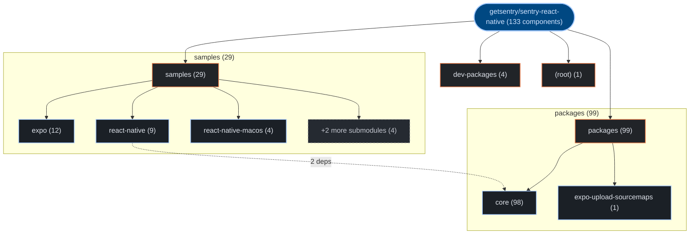
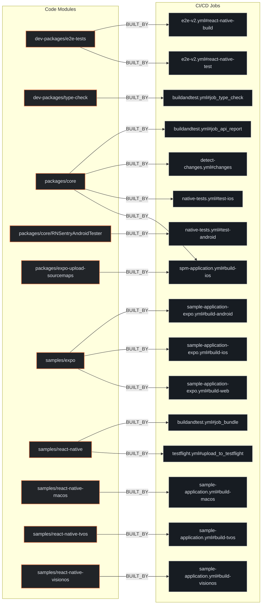

# Repository Architecture Analysis: getsentry/sentry-react-native

## Metadata
- **SHA**: `ff724718ea1f3c05d41ac5db51739be421c46c2f`
- **Primary Ecosystem**: JavaScript/TypeScript

## Quality Metrics
- **ast_engine**: tree-sitter
- **avg_cognitive_complexity**: 1.71
- **avg_cyclomatic_complexity**: 2.73
- **component_count**: 133
- **dead_code_count**: 22
- **dead_code_symbols**: 22 entry(ies)
- **duplication_pct**: 83.67
- **file_complexities**: 25 entry(ies)
- **files_analyzed**: 603
- **fitness_passed**: False
- **fitness_violation_count**: 12
- **framework**: React (Vite)
- **import_edges**: 100 entry(ies)
- **loc**: 101599
- **max_cognitive_complexity**: 206
- **max_cyclomatic_complexity**: 96
- **sloc**: 78068
- **test_file_count**: 241

# Architecture: getsentry/sentry-react-native

## Context
- **Repository**: `getsentry/sentry-react-native`
- **SHA**: `ff724718ea1f3c05d41ac5db51739be421c46c2f`
- **Ecosystem**: JavaScript/TypeScript
- **Framework**: React (Vite)

## Building Block View

## Component Details

Showing top 60 representative components out of 133 across 4 module group(s):

- **Module `packages`** (99 components — UI_COMPONENT: 88, MODULE: 7, SERVICE: 4)
- **Module `samples`** (29 components — UI_COMPONENT: 24, MODULE: 5)
- **Module `dev-packages`** (4 components — MODULE: 4)
- **Module `(root)`** (1 components — MODULE: 1)

- **INTEGRATION_NAME** (`packages/core/src/js/tracing/integrations/timeToDisplayIntegration.ts`): UI_COMPONENT (deps: DEFAULT_NAVIGATION_SPAN_NAME, NATIVE, SCOPE_SPAN_FIELD, SPAN_ORIGIN_AUTO_APP_START, SPAN_ORIGIN_AUTO_EXPO_ROUTER_NAVIGATION, SPAN_ORIGIN_AUTO_EXPO_ROUTER_PREFETCH (+16 more))
- **INTEGRATION_NAME** (`packages/core/src/js/tracing/reactnavigation.ts`): UI_COMPONENT (deps: DEFAULT_NAVIGATION_SPAN_NAME, NATIVE, RN_GLOBAL_OBJ, SCOPE_SPAN_FIELD, SENTRY_DISCARD_REASON_ATTRIBUTE, SPAN_ORIGIN_AUTO_APP_START (+16 more))
- **INTEGRATION_NAME** (`packages/core/src/js/tracing/reactnativenavigation.ts`): UI_COMPONENT (deps: DEFAULT_NAVIGATION_SPAN_NAME, SCOPE_SPAN_FIELD, SENTRY_DISCARD_REASON_ATTRIBUTE, SPAN_ORIGIN_AUTO_APP_START, SPAN_ORIGIN_AUTO_EXPO_ROUTER_NAVIGATION, SPAN_ORIGIN_AUTO_EXPO_ROUTER_PREFETCH (+14 more))
- **DEFAULT_NAVIGATION_SPAN_NAME** (`packages/core/src/js/tracing/span.ts`): UI_COMPONENT (deps: NATIVE, SENTRY_DISCARD_REASON_ATTRIBUTE, SPAN_ORIGIN_AUTO_APP_START, SPAN_ORIGIN_AUTO_EXPO_ROUTER_NAVIGATION, SPAN_ORIGIN_AUTO_EXPO_ROUTER_PREFETCH, SPAN_ORIGIN_AUTO_EXPO_UPDATES (+10 more))
- **SCOPE_SPAN_FIELD** (`packages/core/src/js/tracing/span.ts`): UI_COMPONENT (deps: NATIVE, SENTRY_DISCARD_REASON_ATTRIBUTE, SPAN_ORIGIN_AUTO_APP_START, SPAN_ORIGIN_AUTO_EXPO_ROUTER_NAVIGATION, SPAN_ORIGIN_AUTO_EXPO_ROUTER_PREFETCH, SPAN_ORIGIN_AUTO_EXPO_UPDATES (+10 more))
- **SPAN_THREAD_NAME** (`packages/core/src/js/tracing/span.ts`): UI_COMPONENT (deps: NATIVE, SENTRY_DISCARD_REASON_ATTRIBUTE, SPAN_ORIGIN_AUTO_APP_START, SPAN_ORIGIN_AUTO_EXPO_ROUTER_NAVIGATION, SPAN_ORIGIN_AUTO_EXPO_ROUTER_PREFETCH, SPAN_ORIGIN_AUTO_EXPO_UPDATES (+10 more))
- **SPAN_THREAD_NAME_JAVASCRIPT** (`packages/core/src/js/tracing/span.ts`): UI_COMPONENT (deps: NATIVE, SENTRY_DISCARD_REASON_ATTRIBUTE, SPAN_ORIGIN_AUTO_APP_START, SPAN_ORIGIN_AUTO_EXPO_ROUTER_NAVIGATION, SPAN_ORIGIN_AUTO_EXPO_ROUTER_PREFETCH, SPAN_ORIGIN_AUTO_EXPO_UPDATES (+10 more))
- **SPAN_THREAD_NAME_MAIN** (`packages/core/src/js/tracing/span.ts`): UI_COMPONENT (deps: NATIVE, SENTRY_DISCARD_REASON_ATTRIBUTE, SPAN_ORIGIN_AUTO_APP_START, SPAN_ORIGIN_AUTO_EXPO_ROUTER_NAVIGATION, SPAN_ORIGIN_AUTO_EXPO_ROUTER_PREFETCH, SPAN_ORIGIN_AUTO_EXPO_UPDATES (+10 more))
- **TimeToInitialDisplay** (`packages/core/src/js/tracing/timetodisplay.tsx`): UI_COMPONENT (deps: NATIVE, SPAN_ORIGIN_AUTO_APP_START, SPAN_ORIGIN_AUTO_EXPO_ROUTER_NAVIGATION, SPAN_ORIGIN_AUTO_EXPO_ROUTER_PREFETCH, SPAN_ORIGIN_AUTO_EXPO_UPDATES, SPAN_ORIGIN_AUTO_INTERACTION (+10 more))
- **TimeToFullDisplay** (`packages/core/src/js/tracing/timetodisplay.tsx`): UI_COMPONENT (deps: NATIVE, SPAN_ORIGIN_AUTO_APP_START, SPAN_ORIGIN_AUTO_EXPO_ROUTER_NAVIGATION, SPAN_ORIGIN_AUTO_EXPO_ROUTER_PREFETCH, SPAN_ORIGIN_AUTO_EXPO_UPDATES, SPAN_ORIGIN_AUTO_INTERACTION (+9 more))
- **ACTION_GESTURE_FALLBACK** (`packages/core/src/js/tracing/gesturetracing.ts`): UI_COMPONENT (deps: SPAN_ORIGIN_AUTO_APP_START, SPAN_ORIGIN_AUTO_EXPO_ROUTER_NAVIGATION, SPAN_ORIGIN_AUTO_EXPO_ROUTER_PREFETCH, SPAN_ORIGIN_AUTO_EXPO_UPDATES, SPAN_ORIGIN_AUTO_INTERACTION, SPAN_ORIGIN_AUTO_NAVIGATION_CUSTOM (+8 more))
- **DEFAULT_BREADCRUMB_CATEGORY** (`packages/core/src/js/tracing/gesturetracing.ts`): UI_COMPONENT (deps: SPAN_ORIGIN_AUTO_APP_START, SPAN_ORIGIN_AUTO_EXPO_ROUTER_NAVIGATION, SPAN_ORIGIN_AUTO_EXPO_ROUTER_PREFETCH, SPAN_ORIGIN_AUTO_EXPO_UPDATES, SPAN_ORIGIN_AUTO_INTERACTION, SPAN_ORIGIN_AUTO_NAVIGATION_CUSTOM (+8 more))
- **DEFAULT_BREADCRUMB_TYPE** (`packages/core/src/js/tracing/gesturetracing.ts`): UI_COMPONENT (deps: SPAN_ORIGIN_AUTO_APP_START, SPAN_ORIGIN_AUTO_EXPO_ROUTER_NAVIGATION, SPAN_ORIGIN_AUTO_EXPO_ROUTER_PREFETCH, SPAN_ORIGIN_AUTO_EXPO_UPDATES, SPAN_ORIGIN_AUTO_INTERACTION, SPAN_ORIGIN_AUTO_NAVIGATION_CUSTOM (+8 more))
- **GESTURE_POSTFIX_LENGTH** (`packages/core/src/js/tracing/gesturetracing.ts`): UI_COMPONENT (deps: SPAN_ORIGIN_AUTO_APP_START, SPAN_ORIGIN_AUTO_EXPO_ROUTER_NAVIGATION, SPAN_ORIGIN_AUTO_EXPO_ROUTER_PREFETCH, SPAN_ORIGIN_AUTO_EXPO_UPDATES, SPAN_ORIGIN_AUTO_INTERACTION, SPAN_ORIGIN_AUTO_NAVIGATION_CUSTOM (+8 more))
- **SpyClient** (`packages/core/test/client.test.ts`): SERVICE (deps: HERMES_CHUNK_DURATION_MS, NATIVE, ReactNativeClient, SDK_NAME, SDK_PACKAGE_NAME, SDK_VERSION (+3 more))
- **MOBILE_REPLAY_INTEGRATION_NAME** (`packages/core/src/js/replay/mobilereplay.ts`): UI_COMPONENT (deps: BLOB_DECODE_FAILED, DEFAULT_NETWORK_HEADERS, MAX_UTF8_SEQUENCE_BYTES, NATIVE, NETWORK_BODY_MAX_SIZE, NETWORK_BODY_READ_TIMEOUT_MS (+1 more))
- **DEFAULT_AGGREGATE_FLUSH_INTERVAL_MS** (`packages/core/src/js/integrations/turboModuleContext.ts`): UI_COMPONENT (deps: DEFAULT_NAVIGATION_SPAN_NAME, NATIVE, SCOPE_SPAN_FIELD, SPAN_THREAD_NAME, SPAN_THREAD_NAME_JAVASCRIPT, SPAN_THREAD_NAME_MAIN)
- **DEFAULT_MAX_TOP_MODULES_PER_SPAN** (`packages/core/src/js/integrations/turboModuleContext.ts`): UI_COMPONENT (deps: DEFAULT_NAVIGATION_SPAN_NAME, NATIVE, SCOPE_SPAN_FIELD, SPAN_THREAD_NAME, SPAN_THREAD_NAME_JAVASCRIPT, SPAN_THREAD_NAME_MAIN)
- **DEFAULT_SLOW_CALL_THRESHOLD_MS** (`packages/core/src/js/integrations/turboModuleContext.ts`): UI_COMPONENT (deps: DEFAULT_NAVIGATION_SPAN_NAME, NATIVE, SCOPE_SPAN_FIELD, SPAN_THREAD_NAME, SPAN_THREAD_NAME_JAVASCRIPT, SPAN_THREAD_NAME_MAIN)
- **INTEGRATION_NAME** (`packages/core/src/js/integrations/turboModuleContext.ts`): UI_COMPONENT (deps: DEFAULT_NAVIGATION_SPAN_NAME, NATIVE, SCOPE_SPAN_FIELD, SPAN_THREAD_NAME, SPAN_THREAD_NAME_JAVASCRIPT, SPAN_THREAD_NAME_MAIN)
- **INTEGRATION_NAME** (`packages/core/src/js/tracing/reactnativetracing.ts`): UI_COMPONENT (deps: DEFAULT_NAVIGATION_SPAN_NAME, SCOPE_SPAN_FIELD, SENTRY_DISCARD_REASON_ATTRIBUTE, SPAN_THREAD_NAME, SPAN_THREAD_NAME_JAVASCRIPT, SPAN_THREAD_NAME_MAIN)
- **MAX_PENDING_CALL_WINDOWS** (`packages/core/src/js/integrations/turboModuleContext.ts`): UI_COMPONENT (deps: DEFAULT_NAVIGATION_SPAN_NAME, NATIVE, SCOPE_SPAN_FIELD, SPAN_THREAD_NAME, SPAN_THREAD_NAME_JAVASCRIPT, SPAN_THREAD_NAME_MAIN)
- **MAX_PENDING_SPAN_ATTRIBUTES** (`packages/core/src/js/integrations/turboModuleContext.ts`): UI_COMPONENT (deps: DEFAULT_NAVIGATION_SPAN_NAME, NATIVE, SCOPE_SPAN_FIELD, SPAN_THREAD_NAME, SPAN_THREAD_NAME_JAVASCRIPT, SPAN_THREAD_NAME_MAIN)
- **NATIVE** (`packages/core/src/js/wrapper.ts`): UI_COMPONENT (deps: DEFAULT_BUNDLE_NAME, MOBILE_REPLAY_INTEGRATION_NAME, ReactNativeLibraries, SDK_NAME, SDK_PACKAGE_NAME, SDK_VERSION)
- **ReactNativeClient** (`packages/core/src/js/client.ts`): SERVICE (deps: HERMES_CHUNK_DURATION_MS, MOBILE_REPLAY_INTEGRATION_NAME, NATIVE, ReactNativeLibraries, TRACE_STOP_DELAY_MS, UI_PROFILING_INTEGRATION_NAME)
- **TURBO_MODULE_BREADCRUMB_CATEGORY** (`packages/core/src/js/integrations/turboModuleContext.ts`): UI_COMPONENT (deps: DEFAULT_NAVIGATION_SPAN_NAME, NATIVE, SCOPE_SPAN_FIELD, SPAN_THREAD_NAME, SPAN_THREAD_NAME_JAVASCRIPT, SPAN_THREAD_NAME_MAIN)
- **REPLAY_RESOLVED_RESPONSE_BODY_HINT_KEY** (`packages/core/src/js/replay/xhrUtils.ts`): UI_COMPONENT (deps: BLOB_DECODE_FAILED, DEFAULT_NETWORK_HEADERS, MAX_UTF8_SEQUENCE_BYTES, NETWORK_BODY_MAX_SIZE, NETWORK_BODY_READ_TIMEOUT_MS)
- **SENTRY_DISCARD_REASON_ATTRIBUTE** (`packages/core/src/js/tracing/onSpanEndUtils.ts`): UI_COMPONENT (deps: DEFAULT_NAVIGATION_SPAN_NAME, SCOPE_SPAN_FIELD, SPAN_THREAD_NAME, SPAN_THREAD_NAME_JAVASCRIPT, SPAN_THREAD_NAME_MAIN)
- **EditScreenInfo** (`samples/expo/components/EditScreenInfo.tsx`): UI_COMPONENT (deps: ExternalLink, MonoText, Text, View)
- **HERMES_CHUNK_DURATION_MS** (`packages/core/src/js/profiling/uiProfilingIntegration.ts`): UI_COMPONENT (deps: DEFAULT_BUNDLE_NAME, NATIVE, ReactNativeClient, TestClient)
- **TRACE_STOP_DELAY_MS** (`packages/core/src/js/profiling/uiProfilingIntegration.ts`): UI_COMPONENT (deps: DEFAULT_BUNDLE_NAME, NATIVE, ReactNativeClient, TestClient)
- **UI_PROFILING_INTEGRATION_NAME** (`packages/core/src/js/profiling/uiProfilingIntegration.ts`): UI_COMPONENT (deps: DEFAULT_BUNDLE_NAME, NATIVE, ReactNativeClient, TestClient)
- **OTA_UPDATES_CONTEXT_KEY** (`packages/core/src/js/integrations/expocontext.ts`): UI_COMPONENT (deps: NATIVE, ReactNativeClient, TestClient)
- **CALLBACK_MAX_AGE_MS** (`packages/core/src/js/turbomodule/turboModuleCallbacks.ts`): UI_COMPONENT (deps: HISTOGRAM_BUCKETS_MS, HISTOGRAM_BUCKET_LABELS)
- **DEFAULT_BUNDLE_NAME** (`packages/core/src/js/profiling/hermes.ts`): UI_COMPONENT (deps: ANDROID_DEFAULT_BUNDLE_NAME, IOS_DEFAULT_BUNDLE_NAME)
- **FALLBACK_TIMEOUT_MS** (`packages/core/src/js/utils/sentryeventemitterfallback.ts`): UI_COMPONENT (deps: NATIVE, NewFrameEventName)
- **MAX_PENDING_CALLBACK_CALLS** (`packages/core/src/js/turbomodule/turboModuleCallbacks.ts`): UI_COMPONENT (deps: HISTOGRAM_BUCKETS_MS, HISTOGRAM_BUCKET_LABELS)
- **MonoText** (`samples/expo/components/StyledText.tsx`): UI_COMPONENT (deps: Text, View)
- **TestClient** (`packages/core/test/replay/mobilereplay.sampling.test.ts`): SERVICE (deps: MOBILE_REPLAY_INTEGRATION_NAME, NATIVE)
- **ArticleCard** (`samples/react-native/src/components/ArticleCard.tsx`): UI_COMPONENT (deps: TimeToFullDisplay)
- **BACKGROUND_ANIMATION_DURATION** (`packages/core/src/js/feedback/FeedbackFormManager.tsx`): UI_COMPONENT (deps: OnShakeEventName)
- **DEFAULT_RAGE_TAP_THRESHOLD** (`packages/core/src/js/ragetap.ts`): UI_COMPONENT (deps: INTEGRATION_NAME)
- **DEFAULT_RAGE_TAP_TIME_WINDOW** (`packages/core/src/js/ragetap.ts`): UI_COMPONENT (deps: INTEGRATION_NAME)
- **FeedbackWidgetManager** (`packages/core/src/js/feedback/FeedbackFormManager.tsx`): UI_COMPONENT (deps: OnShakeEventName)
- **INTEGRATION_NAME** (`packages/core/src/js/integrations/appRegistry.ts`): UI_COMPONENT (deps: ReactNativeLibraries)
- **INTEGRATION_NAME** (`packages/core/src/js/integrations/deeplink.ts`): UI_COMPONENT (deps: TimeToFullDisplay)
- **NAVIGATION_CONTAINER_INTEGRATION_NAME** (`packages/core/src/js/NavigationContainer.tsx`): UI_COMPONENT (deps: INTEGRATION_NAME)
- **NavigationContainer** (`packages/core/src/js/NavigationContainer.tsx`): UI_COMPONENT (deps: INTEGRATION_NAME)
- **NewFrameEventName** (`packages/core/src/js/utils/sentryeventemitter.ts`): UI_COMPONENT (deps: NATIVE)
- **NewsScreen** (`samples/react-native/src/Screens/SpaceflightNewsScreen.tsx`): UI_COMPONENT (deps: ArticleCard)
- **OnShakeEventName** (`packages/core/src/js/feedback/ShakeToReportBug.ts`): UI_COMPONENT (deps: NATIVE)
- **PULL_DOWN_CLOSE_THRESHOLD** (`packages/core/src/js/feedback/FeedbackFormManager.tsx`): UI_COMPONENT (deps: OnShakeEventName)
- **SENTRY_BABEL_TRANSFORMER_OPTIONS** (`packages/core/src/js/tools/sentryBabelTransformerUtils.ts`): UI_COMPONENT (deps: ErrorBoundary)
- **SENTRY_DEFAULT_BABEL_TRANSFORMER_PATH** (`packages/core/src/js/tools/sentryBabelTransformerUtils.ts`): UI_COMPONENT (deps: ErrorBoundary)
- **SLIDE_ANIMATION_DURATION** (`packages/core/src/js/feedback/FeedbackFormManager.tsx`): UI_COMPONENT (deps: OnShakeEventName)
- **TURBO_MODULE_SPAN_NAME** (`samples/react-native/src/Screens/TurboModuleScreen.tsx`): UI_COMPONENT (deps: TimeToFullDisplay)
- **@sentry/expo-upload-sourcemaps** (`packages/expo-upload-sourcemaps/package.json`): MODULE
- **@sentry/react-native** (`packages/core/package.json`): MODULE
- **ANDROID_DEFAULT_BUNDLE_NAME** (`packages/core/src/js/integrations/rewriteframes.ts`): UI_COMPONENT
- **BLOB_DECODE_FAILED** (`packages/core/src/js/replay/networkUtils.ts`): UI_COMPONENT

## 6-Dimension Repository Scorecard

- **Overall Grade**: `F` (29.25/100)
- **Technical Debt Score**: 70.75
- **Estimated Remediation Effort**: 167.92h

| Dimension | Grade | Score | Weight | Details |
| :--- | :---: | :---: | :---: | :--- |
| Code Quality | `F` | 30.00 | 0.20 | avg_cc=2.73, max_cc=96, duplication=83.67%, dead_code=22 |
| Dependency Health | `B` | 85.00 | 0.15 | dependencies=295, outdated=0, vulnerable=0, has_lockfile=False |
| Maintainability | `F` | 0.00 | 0.15 | avg_cognitive=1.71, max_cognitive=206, fitness_violations=12, oversized_files=9 |
| Pipeline Health | `F` | 0.00 | 0.15 | workflows=24, operational_antipatterns=74, parallel_branches=True |
| Security | `F` | 0.00 | 0.20 | vulnerabilities=0, secrets=0, pipeline_security_findings=35 |
| Test Coverage | `C` | 70.00 | 0.15 | coverage=unavailable, ci_test_job=True, test_files_detected=True |

## Architecture Fitness & Workspace Boundaries

- **[HIGH] `ATRUSS-ARCH-004` (CIRCULAR_DEPENDENCY)**: Circular dependency detected between architectural components. (DEFAULT_NAVIGATION_SPAN_NAME -> SENTRY_DISCARD_REASON_ATTRIBUTE -> DEFAULT_NAVIGATION_SPAN_NAME)
- **[HIGH] `ATRUSS-ARCH-004` (CIRCULAR_DEPENDENCY)**: Circular dependency detected between architectural components. (HERMES_CHUNK_DURATION_MS -> ReactNativeClient -> HERMES_CHUNK_DURATION_MS)
- **[HIGH] `ATRUSS-ARCH-004` (CIRCULAR_DEPENDENCY)**: Circular dependency detected between architectural components. (MOBILE_REPLAY_INTEGRATION_NAME -> NATIVE -> MOBILE_REPLAY_INTEGRATION_NAME)
- **[HIGH] `ATRUSS-ARCH-004` (CIRCULAR_DEPENDENCY)**: Circular dependency detected between architectural components. (ReactNativeClient -> TRACE_STOP_DELAY_MS -> ReactNativeClient)
- **[HIGH] `ATRUSS-ARCH-004` (CIRCULAR_DEPENDENCY)**: Circular dependency detected between architectural components. (ReactNativeClient -> UI_PROFILING_INTEGRATION_NAME -> ReactNativeClient)
- **[HIGH] `ATRUSS-ARCH-004` (CIRCULAR_DEPENDENCY)**: Circular dependency detected between architectural components. (SCOPE_SPAN_FIELD -> SENTRY_DISCARD_REASON_ATTRIBUTE -> SCOPE_SPAN_FIELD)
- **[HIGH] `ATRUSS-ARCH-004` (CIRCULAR_DEPENDENCY)**: Circular dependency detected between architectural components. (SENTRY_DISCARD_REASON_ATTRIBUTE -> SPAN_THREAD_NAME -> SENTRY_DISCARD_REASON_ATTRIBUTE)
- **[HIGH] `ATRUSS-ARCH-004` (CIRCULAR_DEPENDENCY)**: Circular dependency detected between architectural components. (SENTRY_DISCARD_REASON_ATTRIBUTE -> SPAN_THREAD_NAME_JAVASCRIPT -> SENTRY_DISCARD_REASON_ATTRIBUTE)
- **[HIGH] `ATRUSS-ARCH-004` (CIRCULAR_DEPENDENCY)**: Circular dependency detected between architectural components. (SENTRY_DISCARD_REASON_ATTRIBUTE -> SPAN_THREAD_NAME_MAIN -> SENTRY_DISCARD_REASON_ATTRIBUTE)
- **[MEDIUM] `ATRUSS-ARCH-005` (COMPLEXITY_THRESHOLD)**: Repository duplication_pct (83.67) exceeds policy threshold (15.0).
- **[MEDIUM] `ATRUSS-ARCH-005` (COMPLEXITY_THRESHOLD)**: Repository max_cognitive_complexity (206.0) exceeds policy threshold (25.0).
- **[MEDIUM] `ATRUSS-ARCH-005` (COMPLEXITY_THRESHOLD)**: Repository max_cyclomatic_complexity (96.0) exceeds policy threshold (20.0).

### Workspace Packages
- **sentry-react-native-e2e-tests** (`dev-packages/e2e-tests`, react_ts_js, yarn) -> internal deps: `@sentry/react-native`
- **sentry-react-native-type-check** (`dev-packages/type-check`, react_ts_js, yarn)
- **sentry-react-native-samples-utils** (`dev-packages/utils`, react_ts_js, yarn)
- **@sentry/react-native** (`packages/core`, react_ts_js, yarn) -> internal deps: `@sentry/expo-upload-sourcemaps`
- **@sentry/expo-upload-sourcemaps** (`packages/expo-upload-sourcemaps`, react_ts_js, yarn)
- **sentry-react-native-expo-sample** (`samples/expo`, react_ts_js, yarn) -> internal deps: `@sentry/react-native, sentry-react-native-samples-utils`
- **sentry-react-native-sample** (`samples/react-native`, react_ts_js, yarn) -> internal deps: `@sentry/react-native, sentry-react-native-samples-utils`
- **sentry-react-native-macos-sample** (`samples/react-native-macos`, react_ts_js, yarn) -> internal deps: `@sentry/react-native, sentry-react-native-samples-utils`
- **sentry-react-native-tvos-sample** (`samples/react-native-tvos`, react_ts_js, yarn) -> internal deps: `@sentry/react-native, sentry-react-native-samples-utils`
- **sentry-react-native-visionos-sample** (`samples/react-native-visionos`, react_ts_js, yarn) -> internal deps: `@sentry/react-native, sentry-react-native-samples-utils`

## Supply Chain Dependencies, Vulnerabilities & Secrets

- **Dependencies Parsed**: 295 | **Vulnerabilities**: 0 | **Secrets**: 0

### Inventory Sample
- `androidx.appcompat:appcompat` `1.4.1` (Maven, `packages/core/RNSentryAndroidTester/app/build.gradle`)
- `androidx.appcompat:appcompat` `1.7.0` (Maven, `samples/react-native/android/app/build.gradle`)
- `androidx.core:core-ktx` `1.7.0` (Maven, `packages/core/RNSentryAndroidTester/app/build.gradle`)
- `androidx.test:core-ktx` `1.6.1` (Maven, `packages/core/RNSentryAndroidTester/app/build.gradle`)
- `com.android.tools.build:gradle` `*` (Maven, `samples/react-native-tvos/android/build.gradle`)
- `com.android.tools.build:gradle` `*` (Maven, `samples/react-native/android/build.gradle`)
- `com.facebook.react:hermes-android` `*` (Maven, `samples/react-native-tvos/android/app/build.gradle`)
- `com.facebook.react:hermes-android` `*` (Maven, `samples/react-native/android/app/build.gradle`)
- `com.facebook.react:react-android` `*` (Maven, `samples/react-native-tvos/android/app/build.gradle`)
- `com.facebook.react:react-android` `*` (Maven, `samples/react-native/android/app/build.gradle`)
- `com.facebook.react:react-android` `0.72.0` (Maven, `packages/core/RNSentryAndroidTester/app/build.gradle`)
- `com.facebook.react:react-native` `*` (Maven, `packages/core/android/build.gradle`)
- `com.facebook.react:react-native-gradle-plugin` `*` (Maven, `samples/react-native-tvos/android/build.gradle`)
- `com.facebook.react:react-native-gradle-plugin` `*` (Maven, `samples/react-native/android/build.gradle`)
- `com.google.android.material:material` `1.5.0` (Maven, `packages/core/RNSentryAndroidTester/app/build.gradle`)
- `com.google.android:android` `4.1.1.4` (Maven, `packages/core/android/expo-stubs/build.gradle`)
- `io.sentry:sentry` `8.64.0` (Maven, `packages/core/android/replay-stubs/build.gradle`)
- `io.sentry:sentry-android` `8.64.0` (Maven, `packages/core/android/build.gradle`)
- `io.sentry:sentry-android` `8.64.0` (Maven, `packages/core/android/expo-handler/build.gradle`)
- `io.sentry:sentry-android-gradle-plugin` `6.27.0` (Maven, `samples/react-native/android/build.gradle`)
- `io.sentry:sentry-spotlight` `8.64.0` (Maven, `packages/core/android/build.gradle`)
- `junit:junit` `4.13.2` (Maven, `packages/core/RNSentryAndroidTester/app/build.gradle`)
- `junit:junit` `4.13.2` (Maven, `packages/core/android/build.gradle`)
- `org.jetbrains.kotlin:kotlin-gradle-plugin` `*` (Maven, `samples/react-native-tvos/android/build.gradle`)
- `org.jetbrains.kotlin:kotlin-gradle-plugin` `*` (Maven, `samples/react-native/android/build.gradle`)
- `org.mockito.kotlin:mockito-kotlin` `5.2.1` (Maven, `packages/core/RNSentryAndroidTester/app/build.gradle`)
- `org.mockito:mockito-core` `5.10.0` (Maven, `packages/core/RNSentryAndroidTester/app/build.gradle`)
- `org.mockito:mockito-core` `5.12.0` (Maven, `packages/core/android/build.gradle`)
- `org.robolectric:robolectric` `4.14.1` (Maven, `packages/core/RNSentryAndroidTester/app/build.gradle`)
- `abbrev` `*` (gem, `samples/react-native-tvos/Gemfile`)
- ... (+265 more dependencies)

## Section 7: Code-to-Cloud Deployment Traceability

- `dev-packages/e2e-tests` (code_module) --[BUILT_BY]--> `e2e-v2.yml#react-native-build` (ci_job)
- `dev-packages/e2e-tests` (code_module) --[BUILT_BY]--> `e2e-v2.yml#react-native-test` (ci_job)
- `dev-packages/type-check` (code_module) --[BUILT_BY]--> `buildandtest.yml#job_type_check` (ci_job)
- `packages/core` (code_module) --[BUILT_BY]--> `buildandtest.yml#job_api_report` (ci_job)
- `packages/core` (code_module) --[BUILT_BY]--> `detect-changes.yml#changes` (ci_job)
- `packages/core` (code_module) --[BUILT_BY]--> `native-tests.yml#test-ios` (ci_job)
- `packages/core` (code_module) --[BUILT_BY]--> `spm-application.yml#build-ios` (ci_job)
- `packages/core/RNSentryAndroidTester` (code_module) --[BUILT_BY]--> `native-tests.yml#test-android` (ci_job)
- `packages/expo-upload-sourcemaps` (code_module) --[BUILT_BY]--> `spm-application.yml#build-ios` (ci_job)
- `samples/expo` (code_module) --[BUILT_BY]--> `sample-application-expo.yml#build-android` (ci_job)
- `samples/expo` (code_module) --[BUILT_BY]--> `sample-application-expo.yml#build-ios` (ci_job)
- `samples/expo` (code_module) --[BUILT_BY]--> `sample-application-expo.yml#build-web` (ci_job)
- `samples/react-native` (code_module) --[BUILT_BY]--> `buildandtest.yml#job_bundle` (ci_job)
- `samples/react-native` (code_module) --[BUILT_BY]--> `testflight.yml#upload_to_testflight` (ci_job)
- `samples/react-native-macos` (code_module) --[BUILT_BY]--> `sample-application.yml#build-macos` (ci_job)
- `samples/react-native-tvos` (code_module) --[BUILT_BY]--> `sample-application.yml#build-tvos` (ci_job)
- `samples/react-native-visionos` (code_module) --[BUILT_BY]--> `sample-application.yml#build-visionos` (ci_job)

## CI/CD Pipeline Topology

```mermaid
graph TD;
  classDef atlasRoot fill:#004882,stroke:#a3c9ff,stroke-width:2px,color:#d3e4ff
  classDef atlasCategory fill:#212428,stroke:#E87A48,stroke-width:1.5px,color:#dfe3eb
  classDef atlasWorkflow fill:#1b2026,stroke:#a3c9ff,stroke-width:1.5px,color:#dfe3eb
  classDef atlasJob fill:#171c22,stroke:#8d9199,stroke-width:1px,color:#dfe3eb
  classDef atlasTarget fill:#005227,stroke:#8bd99b,stroke-width:1.5px,color:#a7f6b6
  classDef atlasAlert fill:#93000a,stroke:#ffb4ab,stroke-width:1.5px,color:#ffdad6
  classDef atlasMore fill:#252a31,stroke:#8d9199,stroke-dasharray:4 4,color:#c3c6cf
  pipeline_root(["getsentry/sentry-react-native (24 workflows)"]):::atlasRoot
  subgraph sg_grp_0_CI___Verification["CI & Verification (17 workflows · 59 jobs)"]
    direction TB
    subgraph sg_wf_1_Build___Test["Build & Test (11 jobs)"]
      direction TB
      wf_1_Build___Test(["Trigger: Build & Test"]):::atlasWorkflow
      job_1_diff_check["diff_check"]:::atlasJob
      job_1_job_test["job_test"]:::atlasJob
      job_1_job_native_link_check["job_native_link_check"]:::atlasJob
      wf_1_Build___Test --> job_1_diff_check
      job_1_diff_check --> job_1_job_test
      job_1_diff_check --> job_1_job_native_link_check
    end
    pipeline_root --> wf_1_Build___Test
    subgraph sg_wf_9_End_to_End_Tests_V2["End-to-End Tests V2 (6 jobs)"]
      direction TB
      wf_9_End_to_End_Tests_V2(["Trigger: End-to-End Tests V2"]):::atlasWorkflow
      job_9_ready_to_merge_gate["ready-to-merge-gate"]:::atlasJob
      job_9_diff_check["diff_check"]:::atlasJob
      job_9_detect_changes["detect-changes"]:::atlasJob
      wf_9_End_to_End_Tests_V2 --> job_9_ready_to_merge_gate
      job_9_ready_to_merge_gate --> job_9_diff_check
      job_9_ready_to_merge_gate --> job_9_detect_changes
    end
    pipeline_root --> wf_9_End_to_End_Tests_V2
    subgraph sg_wf_16_Sample_Application["Sample Application (11 jobs)"]
      direction TB
      wf_16_Sample_Application(["Trigger: Sample Application"]):::atlasWorkflow
      job_16_ready_to_merge_gate["ready-to-merge-gate"]:::atlasJob
      job_16_diff_check["diff_check"]:::atlasJob
      job_16_detect_changes["detect-changes"]:::atlasJob
      wf_16_Sample_Application --> job_16_ready_to_merge_gate
      job_16_ready_to_merge_gate --> job_16_diff_check
      job_16_ready_to_merge_gate --> job_16_detect_changes
    end
    pipeline_root --> wf_16_Sample_Application
  end
  subgraph sg_grp_1_Automation___Other["Automation & Other (2 workflows · 2 jobs)"]
    direction TB
    subgraph sg_wf_8_Detect_Changes["Detect Changes (1 jobs)"]
      direction TB
      wf_8_Detect_Changes(["Trigger: Detect Changes"]):::atlasWorkflow
      job_8_changes["changes"]:::atlasJob
      wf_8_Detect_Changes --> job_8_changes
    end
    pipeline_root --> wf_8_Detect_Changes
    subgraph sg_wf_12_Ready_to_Merge_Workflow["Ready to Merge Workflow (1 jobs)"]
      direction TB
      wf_12_Ready_to_Merge_Workflow(["Trigger: Ready to Merge Workflow"]):::atlasWorkflow
      job_12_ready_to_merge_gate["ready-to-merge-gate"]:::atlasJob
      wf_12_Ready_to_Merge_Workflow --> job_12_ready_to_merge_gate
    end
    pipeline_root --> wf_12_Ready_to_Merge_Workflow
  end
  subgraph sg_grp_2_Release___Deploy["Release & Deploy (2 workflows · 2 jobs)"]
    direction TB
    subgraph sg_wf_13_Automation__Notify_issues_for_release["Automation: Notify issues for release (1 jobs)"]
      direction TB
      wf_13_Automation__Notify_issues_for_release(["Trigger: Automation: Notify issues for release"]):::atlasWorkflow
      job_13_release_comment_issues["release-comment-issues"]:::atlasJob
      wf_13_Automation__Notify_issues_for_release --> job_13_release_comment_issues
    end
    pipeline_root --> wf_13_Automation__Notify_issues_for_release
    subgraph sg_wf_14_Release["Release (1 jobs)"]
      direction TB
      wf_14_Release(["Trigger: Release"]):::atlasWorkflow
      job_14_release["release"]:::atlasJob
      wf_14_Release --> job_14_release
    end
    pipeline_root --> wf_14_Release
  end
  subgraph sg_grp_3_Scheduled___Manual["Scheduled & Manual (2 workflows · 10 jobs)"]
    direction TB
    subgraph sg_wf_10_iOS_Crash_Screenshot_No_Freeze["iOS Crash Screenshot No-Freeze (2 jobs)"]
      direction TB
      wf_10_iOS_Crash_Screenshot_No_Freeze(["Trigger: iOS Crash Screenshot No-Freeze"]):::atlasWorkflow
      job_10_ready_to_merge_gate["ready-to-merge-gate"]:::atlasJob
      job_10_verify["verify"]:::atlasJob
      wf_10_iOS_Crash_Screenshot_No_Freeze --> job_10_ready_to_merge_gate
      job_10_ready_to_merge_gate --> job_10_verify
    end
    pipeline_root --> wf_10_iOS_Crash_Screenshot_No_Freeze
    subgraph sg_wf_22_Update_Dependencies["Update Dependencies (8 jobs)"]
      direction TB
      wf_22_Update_Dependencies(["Trigger: Update Dependencies"]):::atlasWorkflow
      job_22_android["android"]:::atlasJob
      wf_22_Update_Dependencies --> job_22_android
    end
    pipeline_root --> wf_22_Update_Dependencies
  end
  subgraph sg_grp_4_Security___Governance["Security & Governance (1 workflows · 2 jobs)"]
    direction TB
    wf_6_CodeQL["CodeQL (2 jobs)"]:::atlasWorkflow
    pipeline_root --> wf_6_CodeQL
  end
  wf_more["+14 more workflows"]:::atlasMore
  pipeline_root --> wf_more
```

