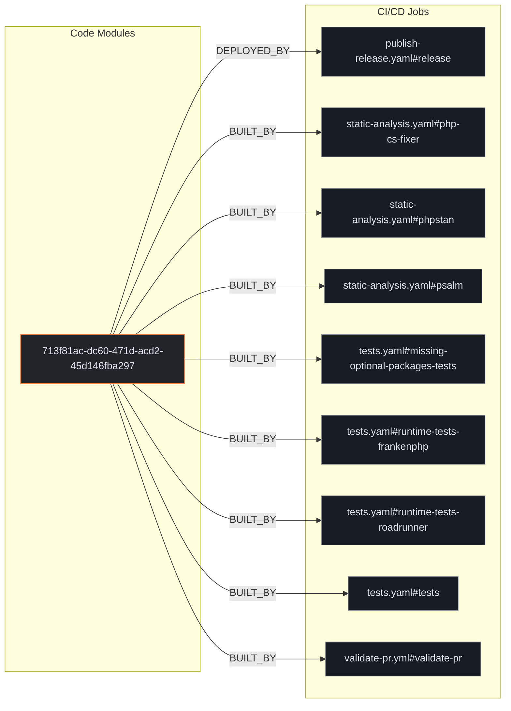
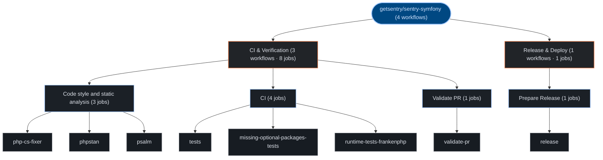

# Repository Architecture Analysis: getsentry/sentry-symfony

## Metadata
- **SHA**: `8b63bb688c6023cac2bf9ceb3f837ae9bb20cb25`
- **Primary Ecosystem**: PHP

## Quality Metrics
- **ast_engine**: fallback
- **avg_cognitive_complexity**: 0.0
- **avg_cyclomatic_complexity**: 0.0
- **component_count**: 222
- **dead_code_count**: 0
- **dead_code_symbols**: 0 entry(ies)
- **duplication_pct**: 0.0
- **file_complexities**: 0 entry(ies)
- **files_analyzed**: 222
- **fitness_passed**: True
- **fitness_violation_count**: 0
- **framework**: Symfony
- **import_edges**: 0 entry(ies)
- **loc**: 24528
- **max_cognitive_complexity**: 0
- **max_cyclomatic_complexity**: 0
- **sloc**: 16851
- **test_file_count**: 233

# Architecture: getsentry/sentry-symfony

## Context
- **Repository**: `getsentry/sentry-symfony`
- **SHA**: `8b63bb688c6023cac2bf9ceb3f837ae9bb20cb25`
- **Ecosystem**: PHP
- **Framework**: Symfony

## Building Block View

```mermaid
graph TD;
  classDef atlasRoot fill:#004882,stroke:#a3c9ff,stroke-width:2px,color:#d3e4ff
  classDef atlasCategory fill:#212428,stroke:#E87A48,stroke-width:1.5px,color:#dfe3eb
  classDef atlasWorkflow fill:#1b2026,stroke:#a3c9ff,stroke-width:1.5px,color:#dfe3eb
  classDef atlasJob fill:#171c22,stroke:#8d9199,stroke-width:1px,color:#dfe3eb
  classDef atlasTarget fill:#005227,stroke:#8bd99b,stroke-width:1.5px,color:#a7f6b6
  classDef atlasAlert fill:#93000a,stroke:#ffb4ab,stroke-width:1.5px,color:#ffdad6
  classDef atlasMore fill:#252a31,stroke:#8d9199,stroke-dasharray:4 4,color:#c3c6cf
    repo_root(["getsentry/sentry-symfony (222 components)"]):::atlasRoot
    dir_0_tests["tests (150)"]:::atlasCategory
    repo_root --> dir_0_tests
    sub_0_0_End2End["End2End (67)"]:::atlasWorkflow
    dir_0_tests --> sub_0_0_End2End
    sub_0_1_DependencyInjection["DependencyInjection (38)"]:::atlasWorkflow
    dir_0_tests --> sub_0_1_DependencyInjection
    sub_0_2_Tracing["Tracing (21)"]:::atlasWorkflow
    dir_0_tests --> sub_0_2_Tracing
    sub_0_more["+7 more submodules (24)"]:::atlasMore
    dir_0_tests --> sub_0_more
    dir_1_src["src (71)"]:::atlasCategory
    repo_root --> dir_1_src
    sub_1_0_Tracing["Tracing (33)"]:::atlasWorkflow
    dir_1_src --> sub_1_0_Tracing
    sub_1_1_EventListener["EventListener (15)"]:::atlasWorkflow
    dir_1_src --> sub_1_1_EventListener
    sub_1_2_DependencyInjection["DependencyInjection (11)"]:::atlasWorkflow
    dir_1_src --> sub_1_2_DependencyInjection
    sub_1_more["+6 more submodules (12)"]:::atlasMore
    dir_1_src --> sub_1_more
    dir_2__root_["(root) (1)"]:::atlasCategory
    repo_root --> dir_2__root_
```

## Component Details

Showing top 60 representative components out of 222 across 3 module group(s):

- **Module `tests`** (150 components — module: 150)
- **Module `src`** (71 components — module: 71)
- **Module `(root)`** (1 components — module: 1)

- **.php-cs-fixer.dist** (`.php-cs-fixer.dist.php`): module
- **AbstractConsoleListenerTest** (`tests/EventListener/AbstractConsoleListenerTest.php`): module
- **AbstractTraceableCacheAdapterTest** (`tests/Tracing/Cache/AbstractTraceableCacheAdapterTest.php`): module
- **AbstractTraceableHttpClient** (`src/Tracing/HttpClient/AbstractTraceableHttpClient.php`): module
- **AbstractTraceableResponse** (`src/Tracing/HttpClient/AbstractTraceableResponse.php`): module
- **AbstractTracingRequestListener** (`src/EventListener/AbstractTracingRequestListener.php`): module
- **AbstractTracingStatement** (`src/Tracing/Doctrine/DBAL/AbstractTracingStatement.php`): module
- **AddLoginListenerTagPass** (`src/DependencyInjection/Compiler/AddLoginListenerTagPass.php`): module
- **AddLoginListenerTagPassTest** (`tests/DependencyInjection/Compiler/AddLoginListenerTagPassTest.php`): module
- **BeforeSendLogCallback** (`tests/End2End/App/Callback/BeforeSendLogCallback.php`): module
- **BreadcrumbTestCommand** (`tests/End2End/App/Command/BreadcrumbTestCommand.php`): module
- **BreadcrumbTestCommandTest** (`tests/End2End/BreadcrumbTestCommandTest.php`): module
- **BufferFlushController** (`tests/End2End/App/Controller/BufferFlushController.php`): module
- **BufferFlushEnd2EndTest** (`tests/End2End/BufferFlushEnd2EndTest.php`): module
- **BufferFlushPass** (`src/DependencyInjection/Compiler/BufferFlushPass.php`): module
- **BufferFlushPassTest** (`tests/DependencyInjection/Compiler/BufferFlushPassTest.php`): module
- **BufferFlusher** (`src/EventListener/BufferFlusher.php`): module
- **CacheTracingPass** (`src/DependencyInjection/Compiler/CacheTracingPass.php`): module
- **CacheTracingPassTest** (`tests/DependencyInjection/Compiler/CacheTracingPassTest.php`): module
- **CapturedExceptionTracker** (`src/Monolog/CapturedExceptionTracker.php`): module
- **ClientIpEnd2EndTest** (`tests/End2End/ClientIpEnd2EndTest.php`): module
- **Configuration** (`src/DependencyInjection/Configuration.php`): module
- **ConfigurationTest** (`tests/DependencyInjection/ConfigurationTest.php`): module
- **ConnectionConfigurator** (`src/Tracing/Doctrine/DBAL/ConnectionConfigurator.php`): module
- **ConsoleInputSerializer** (`src/Serializer/ConsoleInputSerializer.php`): module
- **ConsoleInputSerializerTest** (`tests/Serializer/ConsoleInputSerializerTest.php`): module
- **ConsoleListener** (`src/EventListener/ConsoleListener.php`): module
- **ConsoleListenerTest** (`tests/EventListener/ConsoleListenerTest.php`): module
- **CrashCommand** (`tests/End2End/App/Command/CrashCommand.php`): module
- **CrashingSubcommandTestCommand** (`tests/End2End/App/Command/CrashingSubcommandTestCommand.php`): module
- **DataCollectionConsoleEnd2EndTest** (`tests/End2End/DataCollectionConsoleEnd2EndTest.php`): module
- **DataCollectionDatabaseQueryDataEnd2EndTest** (`tests/End2End/DataCollectionDatabaseQueryDataEnd2EndTest.php`): module
- **DataCollectionIncomingRequestEnd2EndTest** (`tests/End2End/DataCollectionIncomingRequestEnd2EndTest.php`): module
- **DataCollectionServerResponseEnd2EndTest** (`tests/End2End/DataCollectionServerResponseEnd2EndTest.php`): module
- **DataCollectionUserInfoEnd2EndTest** (`tests/End2End/DataCollectionUserInfoEnd2EndTest.php`): module
- **DbalPrepareSpanEnd2EndTest** (`tests/End2End/DbalPrepareSpanEnd2EndTest.php`): module
- **DbalTracingPass** (`src/DependencyInjection/Compiler/DbalTracingPass.php`): module
- **DbalTracingPassTest** (`tests/DependencyInjection/Compiler/DbalTracingPassTest.php`): module
- **DoctrineTestCase** (`tests/DoctrineTestCase.php`): module
- **DummyTestCommand** (`tests/End2End/App/Command/DummyTestCommand.php`): module
- **End2EndTest** (`tests/End2End/End2EndTest.php`): module
- **ErrorListener** (`src/EventListener/ErrorListener.php`): module
- **ErrorListenerTest** (`tests/EventListener/ErrorListenerTest.php`): module
- **ErrorReportingHandlersTest** (`tests/Monolog/ErrorReportingHandlersTest.php`): module
- **ErrorTypesParser** (`src/ErrorTypesParser.php`): module
- **ErrorTypesParserTest** (`tests/ErrorTypesParserTest.php`): module
- **FactoryCallback** (`tests/End2End/Fixtures/FactoryCallback.php`): module
- **FooMessage** (`tests/End2End/App/Messenger/FooMessage.php`): module
- **FooMessageHandler** (`tests/End2End/App/Messenger/FooMessageHandler.php`): module
- **HttpClientTracingPass** (`src/DependencyInjection/Compiler/HttpClientTracingPass.php`): module
- **HttpClientTracingPassTest** (`tests/DependencyInjection/Compiler/HttpClientTracingPassTest.php`): module
- **IgnoreSilencedDeprecationBeforeSendCallback** (`tests/End2End/App/Callback/IgnoreSilencedDeprecationBeforeSendCallback.php`): module
- **IntegrationConfigurator** (`src/Integration/IntegrationConfigurator.php`): module
- **IntegrationConfiguratorTest** (`tests/Integration/IntegrationConfiguratorTest.php`): module
- **IntegrationsCallbacksEnd2EndTest** (`tests/End2End/IntegrationsCallbacksEnd2EndTest.php`): module
- **InvokableCallback** (`tests/End2End/Fixtures/InvokableCallback.php`): module
- **Kernel** (`tests/End2End/App/Kernel.php`): module
- **KernelEventForwardCompatibilityTrait** (`src/EventListener/KernelEventForwardCompatibilityTrait.php`): module
- **KernelForBufferTest** (`tests/End2End/App/KernelForBufferTest.php`): module
- **KernelWithExtraConfig** (`tests/End2End/App/KernelWithExtraConfig.php`): module

## 6-Dimension Repository Scorecard

- **Overall Grade**: `C` (76.40/100)
- **Technical Debt Score**: 23.60
- **Estimated Remediation Effort**: 19.40h

| Dimension | Grade | Score | Weight | Details |
| :--- | :---: | :---: | :---: | :--- |
| Code Quality | `A` | 100.00 | 0.20 | avg_cc=0.00, max_cc=0, duplication=0.00%, dead_code=0 |
| Dependency Health | `A` | 100.00 | 0.15 | dependencies=34, outdated=0, vulnerable=0, has_lockfile=False |
| Maintainability | `A` | 100.00 | 0.15 | avg_cognitive=0.00, max_cognitive=0, fitness_violations=0, oversized_files=0 |
| Pipeline Health | `F` | 58.00 | 0.15 | workflows=4, operational_antipatterns=10, parallel_branches=True |
| Security | `F` | 36.00 | 0.20 | vulnerabilities=0, secrets=0, pipeline_security_findings=4 |
| Test Coverage | `C` | 70.00 | 0.15 | coverage=unavailable, ci_test_job=True, test_files_detected=True |

## Supply Chain Dependencies, Vulnerabilities & Secrets

- **Dependencies Parsed**: 34 | **Vulnerabilities**: 0 | **Secrets**: 0

### Inventory Sample
- `guzzlehttp/psr7` `*` (composer, `composer.json`)
- `jean85/pretty-package-versions` `1.5` (composer, `composer.json`)
- `sentry/sentry` `4.35.0` (composer, `composer.json`)
- `symfony/cache-contracts` `1.1` (composer, `composer.json`)
- `symfony/config` `4.4.20` (composer, `composer.json`)
- `symfony/console` `4.4.20` (composer, `composer.json`)
- `symfony/dependency-injection` `4.4.20` (composer, `composer.json`)
- `symfony/event-dispatcher` `4.4.20` (composer, `composer.json`)
- `symfony/http-kernel` `4.4.20` (composer, `composer.json`)
- `symfony/polyfill-php80` `1.22` (composer, `composer.json`)
- `symfony/psr-http-message-bridge` `1.2` (composer, `composer.json`)
- `symfony/yaml` `4.4.20` (composer, `composer.json`)
- `doctrine/dbal` `2.13` (composer, `composer.json`)
- `doctrine/doctrine-bundle` `2.6` (composer, `composer.json`)
- `friendsofphp/php-cs-fixer` `2.19` (composer, `composer.json`)
- `masterminds/html5` `2.8` (composer, `composer.json`)
- `phpstan/extension-installer` `1.0` (composer, `composer.json`)
- `phpstan/phpstan` `1.12.5` (composer, `composer.json`)
- `phpstan/phpstan-phpunit` `1.4.0` (composer, `composer.json`)
- `phpstan/phpstan-symfony` `1.4.10` (composer, `composer.json`)
- `phpunit/phpunit` `8.5.52` (composer, `composer.json`)
- `symfony/browser-kit` `4.4.20` (composer, `composer.json`)
- `symfony/cache` `4.4.20` (composer, `composer.json`)
- `symfony/dom-crawler` `4.4.20` (composer, `composer.json`)
- `symfony/framework-bundle` `4.4.20` (composer, `composer.json`)
- `symfony/http-client` `4.4.20` (composer, `composer.json`)
- `symfony/messenger` `4.4.20` (composer, `composer.json`)
- `symfony/monolog-bundle` `3.4` (composer, `composer.json`)
- `symfony/phpunit-bridge` `5.2.6` (composer, `composer.json`)
- `symfony/process` `4.4.20` (composer, `composer.json`)
- ... (+4 more dependencies)

## Section 7: Code-to-Cloud Deployment Traceability

- `713f81ac-dc60-471d-acd2-45d146fba297` (code_module) --[BUILT_BY]--> `static-analysis.yaml#php-cs-fixer` (ci_job)
- `713f81ac-dc60-471d-acd2-45d146fba297` (code_module) --[BUILT_BY]--> `static-analysis.yaml#phpstan` (ci_job)
- `713f81ac-dc60-471d-acd2-45d146fba297` (code_module) --[BUILT_BY]--> `static-analysis.yaml#psalm` (ci_job)
- `713f81ac-dc60-471d-acd2-45d146fba297` (code_module) --[BUILT_BY]--> `tests.yaml#missing-optional-packages-tests` (ci_job)
- `713f81ac-dc60-471d-acd2-45d146fba297` (code_module) --[BUILT_BY]--> `tests.yaml#runtime-tests-frankenphp` (ci_job)
- `713f81ac-dc60-471d-acd2-45d146fba297` (code_module) --[BUILT_BY]--> `tests.yaml#runtime-tests-roadrunner` (ci_job)
- `713f81ac-dc60-471d-acd2-45d146fba297` (code_module) --[BUILT_BY]--> `tests.yaml#tests` (ci_job)
- `713f81ac-dc60-471d-acd2-45d146fba297` (code_module) --[BUILT_BY]--> `validate-pr.yml#validate-pr` (ci_job)
- `713f81ac-dc60-471d-acd2-45d146fba297` (code_module) --[DEPLOYED_BY]--> `publish-release.yaml#release` (ci_job)

## CI/CD Pipeline Topology

