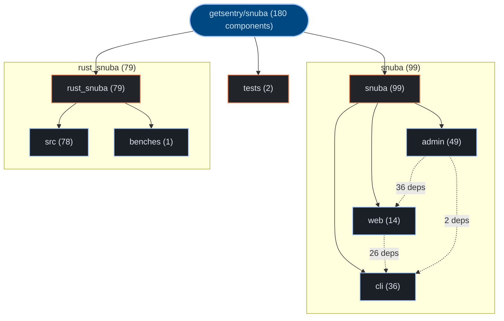
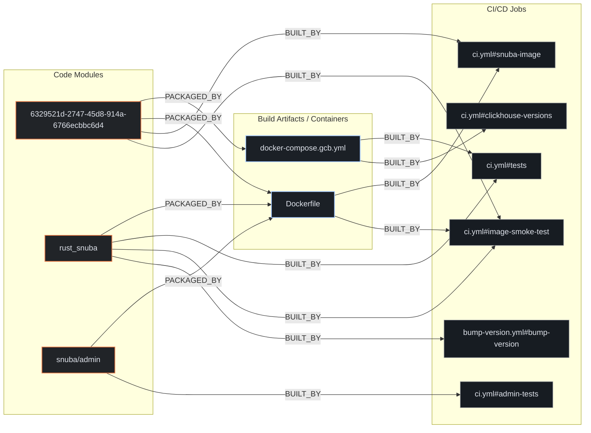

# Repository Architecture Analysis: getsentry/snuba

## Metadata
- **SHA**: `4784a75208454c7852b5a2ddf38199dd99985553`
- **Primary Ecosystem**: Python

## Quality Metrics
- **ast_engine**: tree-sitter
- **avg_cognitive_complexity**: 3.58
- **avg_cyclomatic_complexity**: 2.81
- **component_count**: 180
- **dead_code_count**: 147
- **dead_code_symbols**: 50 entry(ies)
- **duplication_pct**: 81.01
- **file_complexities**: 25 entry(ies)
- **files_analyzed**: 1376
- **fitness_passed**: False
- **fitness_violation_count**: 3
- **framework**: Flask
- **import_edges**: 100 entry(ies)
- **loc**: 244225
- **max_cognitive_complexity**: 212
- **max_cyclomatic_complexity**: 84
- **sloc**: 208661
- **test_file_count**: 461

# Architecture: getsentry/snuba

## Context
- **Repository**: `getsentry/snuba`
- **SHA**: `4784a75208454c7852b5a2ddf38199dd99985553`
- **Ecosystem**: Python
- **Framework**: Flask

## Building Block View

## Component Details

Showing top 60 representative components out of 180 across 3 module group(s):

- **Module `snuba`** (99 components — API_ROUTE: 49, CLI_COMMAND: 36, UI_COMPONENT: 13)
- **Module `rust_snuba`** (79 components — module: 79)
- **Module `tests`** (2 components — API_ROUTE: 2)

- **create_subscription** (`snuba/web/views.py`): API_ROUTE (deps: consumer, replacer, rpc)
- **delete_subscription** (`snuba/web/views.py`): API_ROUTE (deps: consumer, replacer, rpc)
- **drop** (`snuba/web/views.py`): API_ROUTE (deps: consumer, replacer, rpc)
- **error** (`snuba/web/views.py`): API_ROUTE (deps: consumer, replacer, rpc)
- **eventstream** (`snuba/web/views.py`): API_ROUTE (deps: consumer, replacer, rpc)
- **health** (`snuba/web/views.py`): API_ROUTE (deps: consumer, replacer, rpc)
- **health_envoy** (`snuba/web/views.py`): API_ROUTE (deps: consumer, replacer, rpc)
- **mql_dataset_query_view** (`snuba/web/views.py`): API_ROUTE (deps: consumer, replacer, rpc)
- **snql_dataset_query_view** (`snuba/web/views.py`): API_ROUTE (deps: consumer, replacer, rpc)
- **storage_delete** (`snuba/web/views.py`): API_ROUTE (deps: consumer, replacer, rpc)
- **unqualified_query_view** (`snuba/web/views.py`): API_ROUTE (deps: consumer, replacer, rpc)
- **write_bytes_to_entity** (`snuba/web/views.py`): API_ROUTE (deps: consumer, replacer, rpc)
- **write_json_to_entity** (`snuba/web/views.py`): API_ROUTE (deps: consumer, replacer, rpc)
- **rpc** (`snuba/web/views.py`): API_ROUTE (deps: consumer, replacer)
- **attach_partitions** (`snuba/cli/attach_partitions.py`): CLI_COMMAND (deps: prune_partitions)
- **auto_replacements_bypass_projects** (`snuba/admin/views.py`): API_ROUTE (deps: rpc)
- **bootstrap** (`snuba/cli/bootstrap.py`): CLI_COMMAND (deps: admin)
- **clickhouse_clusters** (`snuba/admin/views.py`): API_ROUTE (deps: rpc)
- **clickhouse_nodes** (`snuba/admin/views.py`): API_ROUTE (deps: rpc)
- **clickhouse_queries** (`snuba/admin/views.py`): API_ROUTE (deps: rpc)
- **clickhouse_querylog_query** (`snuba/admin/views.py`): API_ROUTE (deps: rpc)
- **clickhouse_querylog_schema** (`snuba/admin/views.py`): API_ROUTE (deps: rpc)
- **clickhouse_system_query** (`snuba/admin/views.py`): API_ROUTE (deps: rpc)
- **clickhouse_trace_query** (`snuba/admin/views.py`): API_ROUTE (deps: rpc)
- **copy_table_query** (`snuba/admin/views.py`): API_ROUTE (deps: rpc)
- **eap_stats** (`snuba/admin/views.py`): API_ROUTE (deps: rpc)
- **execute_job** (`snuba/admin/views.py`): API_ROUTE (deps: rpc)
- **execute_rpc_endpoint** (`snuba/admin/views.py`): API_ROUTE (deps: rpc)
- **generate** (`snuba/cli/migrations.py`): CLI_COMMAND (deps: status)
- **get_admin_regions** (`snuba/admin/views.py`): API_ROUTE (deps: rpc)
- **get_allowed_projects** (`snuba/admin/views.py`): API_ROUTE (deps: rpc)
- **get_job_logs** (`snuba/admin/views.py`): API_ROUTE (deps: rpc)
- **get_job_specs** (`snuba/admin/views.py`): API_ROUTE (deps: rpc)
- **get_job_types** (`snuba/admin/views.py`): API_ROUTE (deps: rpc)
- **health** (`snuba/admin/views.py`): API_ROUTE (deps: rpc)
- **list** (`snuba/cli/migrations.py`): CLI_COMMAND (deps: status)
- **list_rpc_endpoints** (`snuba/admin/views.py`): API_ROUTE (deps: rpc)
- **migrate** (`snuba/cli/migrations.py`): CLI_COMMAND (deps: status)
- **migrations_groups** (`snuba/admin/views.py`): API_ROUTE (deps: rpc)
- **migrations_groups_list** (`snuba/admin/views.py`): API_ROUTE (deps: rpc)
- **offline_replacer** (`snuba/cli/offline_replacer.py`): CLI_COMMAND (deps: replacer)
- **outcomes_analyzer_query** (`snuba/admin/views.py`): API_ROUTE (deps: rpc)
- **outcomes_enum_options_view** (`snuba/admin/views.py`): API_ROUTE (deps: rpc)
- **outcomes_queries** (`snuba/admin/views.py`): API_ROUTE (deps: rpc)
- **production_snql_query** (`snuba/admin/views.py`): API_ROUTE (deps: rpc)
- **querylog_queries** (`snuba/admin/views.py`): API_ROUTE (deps: rpc)
- **reverse** (`snuba/cli/migrations.py`): CLI_COMMAND (deps: status)
- **reverse_in_progress** (`snuba/cli/migrations.py`): CLI_COMMAND (deps: status)
- **reverse_migration** (`snuba/admin/views.py`): API_ROUTE (deps: rpc)
- **revert** (`snuba/cli/migrations.py`): CLI_COMMAND (deps: status)
- **root** (`snuba/admin/views.py`): API_ROUTE (deps: rpc)
- **run** (`snuba/cli/migrations.py`): CLI_COMMAND (deps: status)
- **run_job_by_type** (`snuba/admin/views.py`): API_ROUTE (deps: rpc)
- **run_migration** (`snuba/admin/views.py`): API_ROUTE (deps: rpc)
- **settings_endpoint** (`snuba/admin/views.py`): API_ROUTE (deps: rpc)
- **snuba_datasets** (`snuba/admin/views.py`): API_ROUTE (deps: rpc)
- **snuba_debug** (`snuba/admin/views.py`): API_ROUTE (deps: rpc)
- **summarize_trace_with_profile** (`snuba/admin/views.py`): API_ROUTE (deps: rpc)
- **tools** (`snuba/admin/views.py`): API_ROUTE (deps: rpc)
- **CustomSelect** (`snuba/admin/static/select.tsx`): UI_COMPONENT

## 6-Dimension Repository Scorecard

- **Overall Grade**: `F` (37.05/100)
- **Technical Debt Score**: 62.95
- **Estimated Remediation Effort**: 174.19h

| Dimension | Grade | Score | Weight | Details |
| :--- | :---: | :---: | :---: | :--- |
| Code Quality | `F` | 30.00 | 0.20 | avg_cc=2.81, max_cc=84, duplication=81.01%, dead_code=147 |
| Dependency Health | `A` | 100.00 | 0.15 | dependencies=845, outdated=0, vulnerable=0, has_lockfile=True |
| Maintainability | `F` | 37.00 | 0.15 | avg_cognitive=3.58, max_cognitive=212, fitness_violations=3, oversized_files=19 |
| Pipeline Health | `F` | 0.00 | 0.15 | workflows=15, operational_antipatterns=25, parallel_branches=True |
| Security | `F` | 0.00 | 0.20 | vulnerabilities=0, secrets=1, pipeline_security_findings=33 |
| Test Coverage | `C` | 70.00 | 0.15 | coverage=unavailable, ci_test_job=True, test_files_detected=True |

## Architecture Fitness & Workspace Boundaries

- **[MEDIUM] `ATRUSS-ARCH-005` (COMPLEXITY_THRESHOLD)**: Repository duplication_pct (81.01) exceeds policy threshold (15.0).
- **[MEDIUM] `ATRUSS-ARCH-005` (COMPLEXITY_THRESHOLD)**: Repository max_cognitive_complexity (212.0) exceeds policy threshold (25.0).
- **[MEDIUM] `ATRUSS-ARCH-005` (COMPLEXITY_THRESHOLD)**: Repository max_cyclomatic_complexity (84.0) exceeds policy threshold (20.0).

### Workspace Packages
- **rust_snuba** (`rust_snuba`, python, uv)

## Supply Chain Dependencies, Vulnerabilities & Secrets

- **Dependencies Parsed**: 845 | **Vulnerabilities**: 0 | **Secrets**: 1

### Secret Findings (Redacted)
- **[HIGH] `ATRUSS-SEC-005`** at `.github/workflows/validate-pipelines.yml:49` (`id_token_audience: '6105***REDACTED***'`)

### Inventory Sample
- `blinker` `1.9` (PyPI, `pyproject.toml`)
- `blinker` `1.9.0` (PyPI, `uv.lock`)
- `click` `8.1.7` (PyPI, `pyproject.toml`)
- `click` `8.1.7` (PyPI, `uv.lock`)
- `clickhouse-connect` `1.6.0` (PyPI, `pyproject.toml`)
- `clickhouse-connect` `1.6.0` (PyPI, `uv.lock`)
- `confluent-kafka` `2.13.2` (PyPI, `uv.lock`)
- `confluent-kafka` `2.7.0` (PyPI, `pyproject.toml`)
- `datadog` `0.49.1` (PyPI, `pyproject.toml`)
- `datadog` `0.52.1` (PyPI, `uv.lock`)
- `devservices` `1.5.0` (PyPI, `pyproject.toml`)
- `devservices` `1.5.0` (PyPI, `uv.lock`)
- `fastjsonschema` `2.16.2` (PyPI, `pyproject.toml`)
- `fastjsonschema` `2.16.2` (PyPI, `uv.lock`)
- `flask` `3.1.0` (PyPI, `pyproject.toml`)
- `flask` `3.1.3` (PyPI, `uv.lock`)
- `flask-compress` `1.15` (PyPI, `pyproject.toml`)
- `flask-compress` `1.24` (PyPI, `uv.lock`)
- `freezegun` `1.5.5` (PyPI, `pyproject.toml`)
- `freezegun` `1.5.5` (PyPI, `uv.lock`)
- `google-api-core` `2.19.1` (PyPI, `pyproject.toml`)
- `google-api-core` `2.19.1` (PyPI, `uv.lock`)
- `google-api-python-client` `2.88.0` (PyPI, `pyproject.toml`)
- `google-api-python-client` `2.88.0` (PyPI, `uv.lock`)
- `google-cloud-storage` `2.18.0` (PyPI, `pyproject.toml`)
- `google-cloud-storage` `2.18.0` (PyPI, `uv.lock`)
- `googleapis-common-protos` `1.63.2` (PyPI, `pyproject.toml`)
- `googleapis-common-protos` `1.63.2` (PyPI, `uv.lock`)
- `granian` `2.8` (PyPI, `pyproject.toml`)
- `granian` `2.8.6` (PyPI, `uv.lock`)
- ... (+815 more dependencies)

## Section 7: Code-to-Cloud Deployment Traceability

- `6329521d-2747-45d8-914a-6766ecbbc6d4` (code_module) --[BUILT_BY]--> `ci.yml#image-smoke-test` (ci_job)
- `6329521d-2747-45d8-914a-6766ecbbc6d4` (code_module) --[BUILT_BY]--> `ci.yml#snuba-image` (ci_job)
- `6329521d-2747-45d8-914a-6766ecbbc6d4` (code_module) --[PACKAGED_BY]--> `Dockerfile` (container)
- `6329521d-2747-45d8-914a-6766ecbbc6d4` (code_module) --[PACKAGED_BY]--> `docker-compose.gcb.yml` (container)
- `rust_snuba` (code_module) --[BUILT_BY]--> `bump-version.yml#bump-version` (ci_job)
- `rust_snuba` (code_module) --[BUILT_BY]--> `ci.yml#image-smoke-test` (ci_job)
- `rust_snuba` (code_module) --[BUILT_BY]--> `ci.yml#tests` (ci_job)
- `rust_snuba` (code_module) --[PACKAGED_BY]--> `Dockerfile` (container)
- `snuba/admin` (code_module) --[BUILT_BY]--> `ci.yml#admin-tests` (ci_job)
- `snuba/admin` (code_module) --[PACKAGED_BY]--> `Dockerfile` (container)
- `Dockerfile` (container) --[BUILT_BY]--> `ci.yml#image-smoke-test` (ci_job)
- `Dockerfile` (container) --[BUILT_BY]--> `ci.yml#snuba-image` (ci_job)
- `docker-compose.gcb.yml` (container) --[BUILT_BY]--> `ci.yml#clickhouse-versions` (ci_job)
- `docker-compose.gcb.yml` (container) --[BUILT_BY]--> `ci.yml#tests` (ci_job)

## CI/CD Pipeline Topology

```mermaid
graph TD;
  classDef atlasRoot fill:#004882,stroke:#a3c9ff,stroke-width:2px,color:#d3e4ff
  classDef atlasCategory fill:#212428,stroke:#E87A48,stroke-width:1.5px,color:#dfe3eb
  classDef atlasWorkflow fill:#1b2026,stroke:#a3c9ff,stroke-width:1.5px,color:#dfe3eb
  classDef atlasJob fill:#171c22,stroke:#8d9199,stroke-width:1px,color:#dfe3eb
  classDef atlasTarget fill:#005227,stroke:#8bd99b,stroke-width:1.5px,color:#a7f6b6
  classDef atlasAlert fill:#93000a,stroke:#ffb4ab,stroke-width:1.5px,color:#ffdad6
  classDef atlasMore fill:#252a31,stroke:#8d9199,stroke-dasharray:4 4,color:#c3c6cf
  pipeline_root(["getsentry/snuba (15 workflows)"]):::atlasRoot
  subgraph sg_grp_0_CI___Verification["CI & Verification (10 workflows · 28 jobs)"]
    direction TB
    subgraph sg_wf_2_ci["ci (13 jobs)"]
      direction TB
      wf_2_ci(["Trigger: ci"]):::atlasWorkflow
      job_2_files_changed["files-changed"]:::atlasJob
      job_2_bump_version_test["bump-version-test"]:::atlasJob
      job_2_linting["linting"]:::atlasJob
      wf_2_ci --> job_2_files_changed
      wf_2_ci --> job_2_bump_version_test
      wf_2_ci --> job_2_linting
    end
    pipeline_root --> wf_2_ci
    subgraph sg_wf_5_Dependency_Review["Dependency Review (1 jobs)"]
      direction TB
      wf_5_Dependency_Review(["Trigger: Dependency Review"]):::atlasWorkflow
      job_5_dependency_review["dependency-review"]:::atlasJob
      wf_5_Dependency_Review --> job_5_dependency_review
    end
    pipeline_root --> wf_5_Dependency_Review
    subgraph sg_wf_8_Enforce_License_Compliance["Enforce License Compliance (1 jobs)"]
      direction TB
      wf_8_Enforce_License_Compliance(["Trigger: Enforce License Compliance"]):::atlasWorkflow
      job_8_enforce_license_compliance["enforce-license-compliance"]:::atlasJob
      wf_8_Enforce_License_Compliance --> job_8_enforce_license_compliance
    end
    pipeline_root --> wf_8_Enforce_License_Compliance
    subgraph sg_wf_10_image_yml["image.yml (6 jobs)"]
      direction TB
      wf_10_image_yml(["Trigger: image.yml"]):::atlasWorkflow
      job_10_build_multiplatform["build-multiplatform"]:::atlasJob
      job_10_build_production["build-production"]:::atlasJob
      job_10_build_debug_multiplatform["build-debug-multiplatform"]:::atlasJob
      wf_10_image_yml --> job_10_build_multiplatform
      wf_10_image_yml --> job_10_build_production
      wf_10_image_yml --> job_10_build_debug_multiplatform
    end
    pipeline_root --> wf_10_image_yml
    subgraph sg_wf_14_Validate_Sentry_Options_Schema["Validate Sentry Options Schema (2 jobs)"]
      direction TB
      wf_14_Validate_Sentry_Options_Schema(["Trigger: Validate Sentry Options Schema"]):::atlasWorkflow
      job_14_cli_version["cli-version"]:::atlasJob
      job_14_validate_schema["validate-schema"]:::atlasJob
      wf_14_Validate_Sentry_Options_Schema --> job_14_cli_version
      job_14_cli_version --> job_14_validate_schema
    end
    pipeline_root --> wf_14_Validate_Sentry_Options_Schema
  end
  subgraph sg_grp_1_Release___Deploy["Release & Deploy (2 workflows · 3 jobs)"]
    direction TB
    subgraph sg_wf_12_release["release (1 jobs)"]
      direction TB
      wf_12_release(["Trigger: release"]):::atlasWorkflow
      job_12_release["release"]:::atlasJob
      wf_12_release --> job_12_release
    end
    pipeline_root --> wf_12_release
    subgraph sg_wf_13_Validate_Deployment_Pipelines["Validate Deployment Pipelines (2 jobs)"]
      direction TB
      wf_13_Validate_Deployment_Pipelines(["Trigger: Validate Deployment Pipelines"]):::atlasWorkflow
      job_13_files_changed["files-changed"]:::atlasJob
      job_13_validate["validate"]:::atlasJob
      wf_13_Validate_Deployment_Pipelines --> job_13_files_changed
      job_13_files_changed --> job_13_validate
    end
    pipeline_root --> wf_13_Validate_Deployment_Pipelines
  end
  subgraph sg_grp_2_Scheduled___Manual["Scheduled & Manual (2 workflows · 2 jobs)"]
    direction TB
    subgraph sg_wf_1_Bump_a_dependency["Bump a dependency (1 jobs)"]
      direction TB
      wf_1_Bump_a_dependency(["Trigger: Bump a dependency"]):::atlasWorkflow
      job_1_bump_version["bump-version"]:::atlasJob
      wf_1_Bump_a_dependency --> job_1_bump_version
    end
    pipeline_root --> wf_1_Bump_a_dependency
    subgraph sg_wf_9_fast_revert_yml["fast-revert.yml (1 jobs)"]
      direction TB
      wf_9_fast_revert_yml(["Trigger: fast-revert.yml"]):::atlasWorkflow
      job_9_revert["revert"]:::atlasJob
      wf_9_fast_revert_yml --> job_9_revert
    end
    pipeline_root --> wf_9_fast_revert_yml
  end
  subgraph sg_grp_3_Security___Governance["Security & Governance (1 workflows · 1 jobs)"]
    direction TB
    subgraph sg_wf_3_CodeQL["CodeQL (1 jobs)"]
      direction TB
      wf_3_CodeQL(["Trigger: CodeQL"]):::atlasWorkflow
      job_3_analyze["analyze"]:::atlasJob
      wf_3_CodeQL --> job_3_analyze
    end
    pipeline_root --> wf_3_CodeQL
  end
  wf_more["+5 more workflows"]:::atlasMore
  pipeline_root --> wf_more
```

