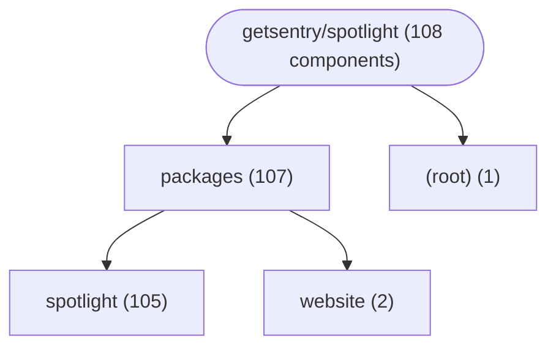
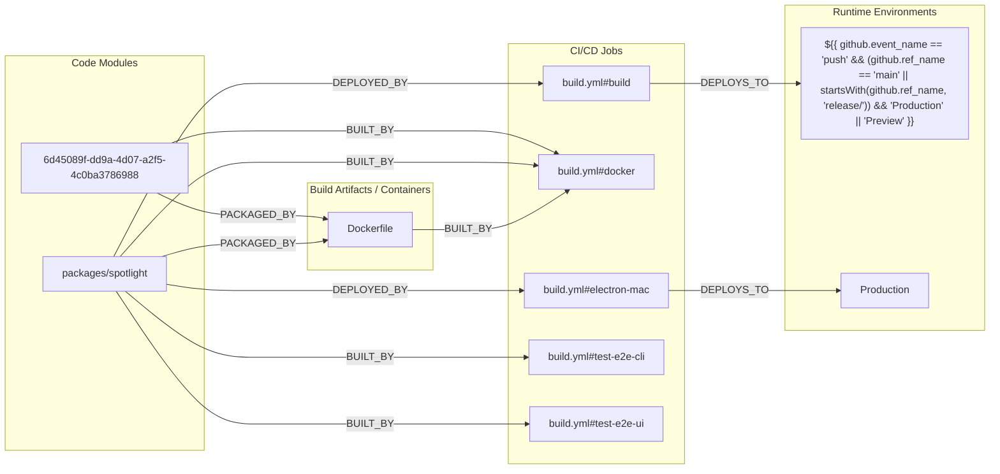
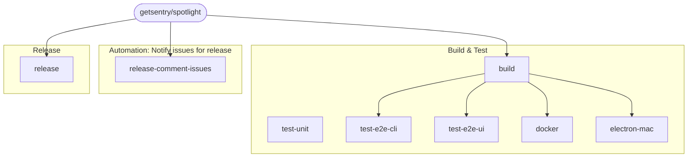

# Repository Architecture Analysis: getsentry/spotlight

## Metadata
- **SHA**: `a7785a0e5a67b895cd641465883c99986d071496`
- **Primary Ecosystem**: JavaScript/TypeScript

## Quality Metrics
- **ast_engine**: tree-sitter
- **avg_cognitive_complexity**: 5.35
- **avg_cyclomatic_complexity**: 4.52
- **component_count**: 108
- **dead_code_count**: 2
- **dead_code_symbols**: 2 entry(ies)
- **duplication_pct**: 73.61
- **file_complexities**: 25 entry(ies)
- **files_analyzed**: 293
- **fitness_passed**: False
- **fitness_violation_count**: 6
- **framework**: Next.js
- **import_edges**: 100 entry(ies)
- **loc**: 29401
- **max_cognitive_complexity**: 82
- **max_cyclomatic_complexity**: 40
- **sloc**: 23430
- **test_file_count**: 37

# Architecture: getsentry/spotlight

## Context
- **Repository**: `getsentry/spotlight`
- **SHA**: `a7785a0e5a67b895cd641465883c99986d071496`
- **Ecosystem**: JavaScript/TypeScript
- **Framework**: Next.js

## Building Block View

## Component Details

Showing top 60 representative components out of 108 across 2 module group(s):

- **Module `packages`** (107 components — UI_COMPONENT: 100, API_ROUTE: 5, MODULE: 2)
- **Module `(root)`** (1 components — MODULE: 1)

- **AITraceToggle** (`packages/spotlight/src/ui/telemetry/tabs/TracesTab.tsx`): UI_COMPONENT (deps: AIBadge, AITraceDetail, AITraceDetailsEmbedded, AITraceItem, AITraceList, AITranscription (+15 more))
- **TraceSplitViewLayout** (`packages/spotlight/src/ui/telemetry/tabs/TracesTab.tsx`): UI_COMPONENT (deps: AIBadge, AITraceDetail, AITraceDetailsEmbedded, AITraceItem, AITraceList, AITranscription (+15 more))
- **TracesTab** (`packages/spotlight/src/ui/telemetry/tabs/TracesTab.tsx`): UI_COMPONENT (deps: AIBadge, AITraceDetail, AITraceDetailsEmbedded, AITraceItem, AITraceList, AITranscription (+15 more))
- **EventList** (`packages/spotlight/src/ui/telemetry/components/events/EventList.tsx`): UI_COMPONENT (deps: EmptyState, Event, EventSummary, EventTitle, ListFilter, PlatformIcon (+5 more))
- **TraceList** (`packages/spotlight/src/ui/telemetry/components/traces/TraceList.tsx`): UI_COMPONENT (deps: AIBadge, AITraceItem, AITraceToggle, EmptyState, SpanHeader, TraceHeaderDetails (+4 more))
- **EventDetails** (`packages/spotlight/src/ui/telemetry/components/events/EventDetails.tsx`): UI_COMPONENT (deps: AICopyButton, EmptyState, Event, EventBreadcrumbs, EventContexts, EventSummary (+3 more))
- **TelemetryView** (`packages/spotlight/src/ui/telemetry/components/TelemetryView.tsx`): UI_COMPONENT (deps: AITraceToggle, ErrorsTab, FeedbackTab, InsightsTab, LogsTab, TelemetrySidebar (+2 more))
- **Telemetry** (`packages/spotlight/src/ui/telemetry/index.tsx`): UI_COMPONENT (deps: LOG_LEVELS, LOG_LEVEL_COLORS, SOURCE_COLORS, SOURCE_TYPES, SOURCE_WIDTH, TYPE_WIDTH (+1 more))
- **TraceContext** (`packages/spotlight/src/ui/telemetry/components/traces/TraceDetails/index.tsx`): UI_COMPONENT (deps: AITraceSplitView, DateTime, EmptyState, EventContexts, EventList, TelemetryTabs (+1 more))
- **TraceDetails** (`packages/spotlight/src/ui/telemetry/components/traces/TraceDetails/index.tsx`): UI_COMPONENT (deps: AITraceSplitView, DateTime, EmptyState, EventContexts, EventList, TelemetryTabs (+1 more))
- **AIBadge** (`packages/spotlight/src/ui/telemetry/components/traces/TraceItem.tsx`): UI_COMPONENT (deps: SearchProvider, SentryEventsContext, SentryEventsContextProvider, SpotlightContextProvider, TraceIcon, TraceRootTxnName)
- **EnvelopeList** (`packages/spotlight/src/ui/telemetry/components/insights/envelopes/EnvelopeList.tsx`): UI_COMPONENT (deps: EnvelopeDetails, PlatformIcon, SearchProvider, SentryEventsContext, SentryEventsContextProvider, SpotlightContextProvider)
- **FeedbackList** (`packages/spotlight/src/ui/telemetry/components/feedback/FeedbackList.tsx`): UI_COMPONENT (deps: EmptyState, PlatformIcon, SearchProvider, SentryEventsContext, SentryEventsContextProvider, SpotlightContextProvider)
- **SpanHeader** (`packages/spotlight/src/ui/telemetry/components/traces/TraceItem.tsx`): UI_COMPONENT (deps: SearchProvider, SentryEventsContext, SentryEventsContextProvider, SpotlightContextProvider, TraceIcon, TraceRootTxnName)
- **TraceHeaderDetails** (`packages/spotlight/src/ui/telemetry/components/traces/TraceItem.tsx`): UI_COMPONENT (deps: SearchProvider, SentryEventsContext, SentryEventsContextProvider, SpotlightContextProvider, TraceIcon, TraceRootTxnName)
- **TraceItem** (`packages/spotlight/src/ui/telemetry/components/traces/TraceItem.tsx`): UI_COMPONENT (deps: SearchProvider, SentryEventsContext, SentryEventsContextProvider, SpotlightContextProvider, TraceIcon, TraceRootTxnName)
- **TraceStatusBadge** (`packages/spotlight/src/ui/telemetry/components/traces/TraceItem.tsx`): UI_COMPONENT (deps: SearchProvider, SentryEventsContext, SentryEventsContextProvider, SpotlightContextProvider, TraceIcon, TraceRootTxnName)
- **AITraceList** (`packages/spotlight/src/ui/telemetry/components/insights/aiTraces/AITraceList.tsx`): UI_COMPONENT (deps: AITraceDetail, AITraceDetailsEmbedded, AITraceItem, EmptyState, SearchProvider)
- **SpanContext** (`packages/spotlight/src/ui/telemetry/components/traces/spans/SpanDetails.tsx`): UI_COMPONENT (deps: ContextView, DateTime, EmptyState, EventList, TelemetryTabs)
- **SpanDetails** (`packages/spotlight/src/ui/telemetry/components/traces/spans/SpanDetails.tsx`): UI_COMPONENT (deps: ContextView, DateTime, EmptyState, EventList, TelemetryTabs)
- **ErrorsTab** (`packages/spotlight/src/ui/telemetry/tabs/ErrorsTab.tsx`): UI_COMPONENT (deps: EventDetails, EventList, SentryEventsContext, SentryEventsContextProvider)
- **FeedbackTab** (`packages/spotlight/src/ui/telemetry/tabs/FeedbackTab.tsx`): UI_COMPONENT (deps: FeedbackDetails, FeedbackList, SentryEventsContext, SentryEventsContextProvider)
- **AITraceDetail** (`packages/spotlight/src/ui/telemetry/components/insights/aiTraces/AITraceDetails.tsx`): UI_COMPONENT (deps: DateTime, SearchProvider, SpanTree)
- **AITraceDetailsEmbedded** (`packages/spotlight/src/ui/telemetry/components/insights/aiTraces/AITraceDetails.tsx`): UI_COMPONENT (deps: DateTime, SearchProvider, SpanTree)
- **Event** (`packages/spotlight/src/ui/telemetry/components/events/Event.tsx`): UI_COMPONENT (deps: ErrorItem, ErrorSummary, ErrorTitle)
- **EventContexts** (`packages/spotlight/src/ui/telemetry/components/events/EventContexts.tsx`): UI_COMPONENT (deps: Attachment, CodeViewer, ContextView)
- **EventSummary** (`packages/spotlight/src/ui/telemetry/components/events/Event.tsx`): UI_COMPONENT (deps: ErrorItem, ErrorSummary, ErrorTitle)
- **EventTitle** (`packages/spotlight/src/ui/telemetry/components/events/Event.tsx`): UI_COMPONENT (deps: ErrorItem, ErrorSummary, ErrorTitle)
- **SdksTab** (`packages/spotlight/src/ui/telemetry/components/insights/sdks/index.tsx`): UI_COMPONENT (deps: SdkList, SentryEventsContext, SentryEventsContextProvider)
- **AITraceSplitView** (`packages/spotlight/src/ui/telemetry/components/insights/aiTraces/AITraceSplitView.tsx`): UI_COMPONENT (deps: AITraceDetail, AITraceDetailsEmbedded)
- **Attachment** (`packages/spotlight/src/ui/telemetry/components/insights/envelopes/Attachment.tsx`): UI_COMPONENT (deps: CodeViewer, JsonViewer)
- **DEFAULT_SPAN_NODE_WIDTH** (`packages/spotlight/src/ui/telemetry/components/traces/TraceDetails/components/TraceTreeview.tsx`): UI_COMPONENT (deps: DateTime, SpanTree)
- **FeedbackDetails** (`packages/spotlight/src/ui/telemetry/components/feedback/FeedbackDetails.tsx`): UI_COMPONENT (deps: EmptyState, PlatformIcon)
- **InsightsTab** (`packages/spotlight/src/ui/telemetry/tabs/InsightsTab.tsx`): UI_COMPONENT (deps: SentryEventsContext, SentryEventsContextProvider)
- **LogsTab** (`packages/spotlight/src/ui/telemetry/tabs/LogsTab.tsx`): UI_COMPONENT (deps: SentryEventsContext, SentryEventsContextProvider)
- **SdkList** (`packages/spotlight/src/ui/telemetry/components/insights/sdks/SdkList.tsx`): UI_COMPONENT (deps: EmptyState, PlatformIcon)
- **TraceTreeview** (`packages/spotlight/src/ui/telemetry/components/traces/TraceDetails/components/TraceTreeview.tsx`): UI_COMPONENT (deps: DateTime, SpanTree)
- **AITraceItem** (`packages/spotlight/src/ui/telemetry/components/insights/aiTraces/AITraceItem.tsx`): UI_COMPONENT (deps: DateTime)
- **AITranscription** (`packages/spotlight/src/ui/telemetry/components/insights/aiTraces/AITranscription.tsx`): UI_COMPONENT (deps: DateTime)
- **AItracesTab** (`packages/spotlight/src/ui/telemetry/components/insights/aiTraces/index.tsx`): UI_COMPONENT (deps: AITraceList)
- **App** (`packages/spotlight/src/ui/App.tsx`): UI_COMPONENT (deps: ShikiProvider)
- **ContextView** (`packages/spotlight/src/ui/telemetry/components/shared/ContextView.tsx`): UI_COMPONENT (deps: Tags)
- **EnvelopeDetails** (`packages/spotlight/src/ui/telemetry/components/insights/envelopes/EnvelopeDetails.tsx`): UI_COMPONENT (deps: Attachment)
- **EnvelopesTab** (`packages/spotlight/src/ui/telemetry/components/insights/envelopes/index.tsx`): UI_COMPONENT (deps: EnvelopeList)
- **ErrorItem** (`packages/spotlight/src/ui/telemetry/components/events/error/Error.tsx`): UI_COMPONENT (deps: Frame)
- **ErrorSummary** (`packages/spotlight/src/ui/telemetry/components/events/error/Error.tsx`): UI_COMPONENT (deps: Frame)
- **ErrorTitle** (`packages/spotlight/src/ui/telemetry/components/events/error/Error.tsx`): UI_COMPONENT (deps: Frame)
- **EventBreadcrumbs** (`packages/spotlight/src/ui/telemetry/components/events/EventBreadcrumbs.tsx`): UI_COMPONENT (deps: CodeViewer)
- **Frame** (`packages/spotlight/src/ui/telemetry/components/events/error/Frame.tsx`): UI_COMPONENT (deps: CodeViewer)
- **InsightsTabDetails** (`packages/spotlight/src/ui/telemetry/components/insights/index.tsx`): UI_COMPONENT (deps: Home)
- **ListFilter** (`packages/spotlight/src/ui/telemetry/components/shared/ListFilter.tsx`): UI_COMPONENT (deps: FilterDropdown)
- **LogDetails** (`packages/spotlight/src/ui/telemetry/components/log/LogDetail.tsx`): UI_COMPONENT (deps: DateTime)
- **SpanResizer** (`packages/spotlight/src/ui/telemetry/components/shared/SpanResizer.tsx`): UI_COMPONENT (deps: Resizer)
- **TraceIcon** (`packages/spotlight/src/ui/telemetry/components/traces/TraceIcon.tsx`): UI_COMPONENT (deps: PlatformIcon)
- **TraceListFilter** (`packages/spotlight/src/ui/telemetry/components/traces/TraceListFilter.tsx`): UI_COMPONENT (deps: FilterDropdown)
- **TraceProfileTree** (`packages/spotlight/src/ui/telemetry/components/traces/TraceDetails/components/TraceProfileTree.tsx`): UI_COMPONENT (deps: EmptyState)
- **6d45089f-dd9a-4d07-a2f5-4c0ba3786988** (`package.json`): MODULE
- **@spotlightjs/spotlight** (`packages/spotlight/package.json`): MODULE
- **@spotlightjs/website** (`packages/website/package.json`): MODULE
- **AICopyButton** (`packages/spotlight/src/ui/telemetry/components/events/AICopyButton.tsx`): UI_COMPONENT

## 6-Dimension Repository Scorecard

- **Overall Grade**: `F` (34.98/100)
- **Technical Debt Score**: 65.02
- **Estimated Remediation Effort**: 95.98h

| Dimension | Grade | Score | Weight | Details |
| :--- | :---: | :---: | :---: | :--- |
| Code Quality | `F` | 39.92 | 0.20 | avg_cc=4.52, max_cc=40, duplication=73.61%, dead_code=2 |
| Dependency Health | `A` | 100.00 | 0.15 | dependencies=1787, outdated=0, vulnerable=0, has_lockfile=True |
| Maintainability | `F` | 9.95 | 0.15 | avg_cognitive=5.35, max_cognitive=82, fitness_violations=6, oversized_files=2 |
| Pipeline Health | `F` | 0.00 | 0.15 | workflows=3, operational_antipatterns=13, parallel_branches=True |
| Security | `F` | 0.00 | 0.20 | vulnerabilities=0, secrets=2, pipeline_security_findings=21 |
| Test Coverage | `C` | 70.00 | 0.15 | coverage=unavailable, ci_test_job=True, test_files_detected=True |

## Architecture Fitness & Workspace Boundaries

- **[HIGH] `ATRUSS-ARCH-004` (CIRCULAR_DEPENDENCY)**: Circular dependency detected between architectural components. (AITraceToggle -> TraceList -> AITraceToggle)
- **[HIGH] `ATRUSS-ARCH-004` (CIRCULAR_DEPENDENCY)**: Circular dependency detected between architectural components. (TraceList -> TraceSplitViewLayout -> TraceList)
- **[HIGH] `ATRUSS-ARCH-004` (CIRCULAR_DEPENDENCY)**: Circular dependency detected between architectural components. (TraceList -> TracesTab -> TraceList)
- **[MEDIUM] `ATRUSS-ARCH-005` (COMPLEXITY_THRESHOLD)**: Repository duplication_pct (73.61) exceeds policy threshold (15.0).
- **[MEDIUM] `ATRUSS-ARCH-005` (COMPLEXITY_THRESHOLD)**: Repository max_cognitive_complexity (82.0) exceeds policy threshold (25.0).
- **[MEDIUM] `ATRUSS-ARCH-005` (COMPLEXITY_THRESHOLD)**: Repository max_cyclomatic_complexity (40.0) exceeds policy threshold (20.0).

### Workspace Packages
- **@spotlightjs/spotlight** (`packages/spotlight`, react_ts_js, pnpm)
- **@spotlightjs/website** (`packages/website`, react_ts_js, pnpm)

## Supply Chain Dependencies, Vulnerabilities & Secrets

- **Dependencies Parsed**: 1787 | **Vulnerabilities**: 0 | **Secrets**: 2

### Secret Findings (Redacted)
- **[CRITICAL] `ATRUSS-SEC-004`** at `.github/workflows/build.yml:90` (`-----BEGIN ... PRIVATE KEY----- [REDACTED]`)
- **[CRITICAL] `ATRUSS-SEC-004`** at `.github/workflows/build.yml:404` (`-----BEGIN ... PRIVATE KEY----- [REDACTED]`)

### Inventory Sample
- `@astrojs/react` `6.0.1` (npm, `packages/website/package.json`)
- `@astrojs/react` `6.0.1` (npm, `pnpm-lock.yaml`)
- `@astrojs/starlight` `0.41.5` (npm, `packages/website/package.json`)
- `@astrojs/starlight` `0.41.5` (npm, `pnpm-lock.yaml`)
- `@astrojs/starlight-tailwind` `5.0.0` (npm, `packages/website/package.json`)
- `@astrojs/starlight-tailwind` `5.0.0` (npm, `pnpm-lock.yaml`)
- `@astrojs/vercel` `11.0.3` (npm, `packages/website/package.json`)
- `@astrojs/vercel` `11.0.3` (npm, `pnpm-lock.yaml`)
- `@biomejs/biome` `1.9.4` (npm, `package.json`)
- `@biomejs/biome` `1.9.4` (npm, `pnpm-lock.yaml`)
- `@fontsource/raleway` `*` (npm, `packages/spotlight/package.json`)
- `@fontsource/raleway` `*` (npm, `packages/website/package.json`)
- `@fontsource/raleway` `5.2.5` (npm, `pnpm-lock.yaml`)
- `@hono/mcp` `0.2.2` (npm, `packages/spotlight/package.json`)
- `@hono/mcp` `0.2.2` (npm, `pnpm-lock.yaml`)
- `@hono/node-server` `2.1.6` (npm, `packages/spotlight/package.json`)
- `@hono/node-server` `2.1.6` (npm, `pnpm-lock.yaml`)
- `@jridgewell/trace-mapping` `0.3.25` (npm, `packages/spotlight/package.json`)
- `@jridgewell/trace-mapping` `0.3.31` (npm, `pnpm-lock.yaml`)
- `@microlink/react-json-view` `1.31.34` (npm, `pnpm-lock.yaml`)
- `@microlink/react-json-view` `1.31.9` (npm, `packages/spotlight/package.json`)
- `@modelcontextprotocol/sdk` `1.32.0` (npm, `packages/spotlight/package.json`)
- `@modelcontextprotocol/sdk` `1.32.0` (npm, `pnpm-lock.yaml`)
- `@playwright/test` `1.56.1` (npm, `packages/spotlight/package.json`)
- `@playwright/test` `1.56.1` (npm, `pnpm-lock.yaml`)
- `@radix-ui/react-dropdown-menu` `2.1.15` (npm, `packages/spotlight/package.json`)
- `@radix-ui/react-dropdown-menu` `2.1.15` (npm, `pnpm-lock.yaml`)
- `@radix-ui/react-slot` `1.2.3` (npm, `packages/spotlight/package.json`)
- `@radix-ui/react-slot` `1.2.3` (npm, `pnpm-lock.yaml`)
- `@radix-ui/react-tooltip` `1.2.7` (npm, `packages/spotlight/package.json`)
- ... (+1757 more dependencies)

## Section 7: Code-to-Cloud Deployment Traceability

- `build.yml#build` (ci_job) --[DEPLOYS_TO]--> `${{ github.event_name == 'push' && (github.ref_name == 'main' || startsWith(github.ref_name, 'release/')) && 'Production' || 'Preview' }}` (environment)
- `build.yml#electron-mac` (ci_job) --[DEPLOYS_TO]--> `Production` (environment)
- `6d45089f-dd9a-4d07-a2f5-4c0ba3786988` (code_module) --[BUILT_BY]--> `build.yml#docker` (ci_job)
- `6d45089f-dd9a-4d07-a2f5-4c0ba3786988` (code_module) --[PACKAGED_BY]--> `Dockerfile` (container)
- `packages/spotlight` (code_module) --[BUILT_BY]--> `build.yml#docker` (ci_job)
- `packages/spotlight` (code_module) --[BUILT_BY]--> `build.yml#test-e2e-cli` (ci_job)
- `packages/spotlight` (code_module) --[BUILT_BY]--> `build.yml#test-e2e-ui` (ci_job)
- `packages/spotlight` (code_module) --[DEPLOYED_BY]--> `build.yml#build` (ci_job)
- `packages/spotlight` (code_module) --[DEPLOYED_BY]--> `build.yml#electron-mac` (ci_job)
- `packages/spotlight` (code_module) --[PACKAGED_BY]--> `Dockerfile` (container)
- `Dockerfile` (container) --[BUILT_BY]--> `build.yml#docker` (ci_job)

## CI/CD Pipeline Topology

