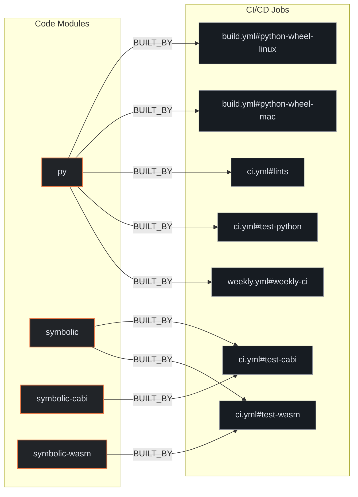

# Repository Architecture Analysis: getsentry/symbolic

## Metadata
- **SHA**: `3ed4b8ac7850ad5c781ddfa95743e96d81786b5b`
- **Primary Ecosystem**: Rust

## Quality Metrics
- **ast_engine**: tree-sitter
- **avg_cognitive_complexity**: 0.93
- **avg_cyclomatic_complexity**: 1.52
- **component_count**: 131
- **dead_code_count**: 4
- **dead_code_symbols**: 4 entry(ies)
- **duplication_pct**: 3.39
- **file_complexities**: 21 entry(ies)
- **files_analyzed**: 150
- **fitness_passed**: True
- **fitness_violation_count**: 0
- **framework**: Rust Cargo
- **import_edges**: 100 entry(ies)
- **loc**: 49913
- **max_cognitive_complexity**: 15
- **max_cyclomatic_complexity**: 8
- **sloc**: 33986
- **test_file_count**: 371

# Architecture: getsentry/symbolic

## Context
- **Repository**: `getsentry/symbolic`
- **SHA**: `3ed4b8ac7850ad5c781ddfa95743e96d81786b5b`
- **Ecosystem**: Rust
- **Framework**: Rust Cargo

## Building Block View

```mermaid
graph TD;
  classDef atlasRoot fill:#004882,stroke:#a3c9ff,stroke-width:2px,color:#d3e4ff
  classDef atlasCategory fill:#212428,stroke:#E87A48,stroke-width:1.5px,color:#dfe3eb
  classDef atlasWorkflow fill:#1b2026,stroke:#a3c9ff,stroke-width:1.5px,color:#dfe3eb
  classDef atlasJob fill:#171c22,stroke:#8d9199,stroke-width:1px,color:#dfe3eb
  classDef atlasTarget fill:#005227,stroke:#8bd99b,stroke-width:1.5px,color:#a7f6b6
  classDef atlasAlert fill:#93000a,stroke:#ffb4ab,stroke-width:1.5px,color:#ffdad6
  classDef atlasMore fill:#252a31,stroke:#8d9199,stroke-dasharray:4 4,color:#c3c6cf
    repo_root(["getsentry/symbolic (131 components)"]):::atlasRoot
    dir_0_symbolic_debuginfo["symbolic-debuginfo (28)"]:::atlasCategory
    repo_root --> dir_0_symbolic_debuginfo
    sub_0_0_src["src (23)"]:::atlasWorkflow
    dir_0_symbolic_debuginfo --> sub_0_0_src
    sub_0_1_tests["tests (3)"]:::atlasWorkflow
    dir_0_symbolic_debuginfo --> sub_0_1_tests
    sub_0_2_benches["benches (1)"]:::atlasWorkflow
    dir_0_symbolic_debuginfo --> sub_0_2_benches
    sub_0_more["+1 more submodules (1)"]:::atlasMore
    dir_0_symbolic_debuginfo --> sub_0_more
    dir_1_symbolic_symcache["symbolic-symcache (20)"]:::atlasCategory
    repo_root --> dir_1_symbolic_symcache
    sub_1_0_src["src (14)"]:::atlasWorkflow
    dir_1_symbolic_symcache --> sub_1_0_src
    sub_1_1_tests["tests (4)"]:::atlasWorkflow
    dir_1_symbolic_symcache --> sub_1_1_tests
    sub_1_2_benches["benches (1)"]:::atlasWorkflow
    dir_1_symbolic_symcache --> sub_1_2_benches
    sub_1_more["+1 more submodules (1)"]:::atlasMore
    dir_1_symbolic_symcache --> sub_1_more
    dir_2_symbolic_ppdb["symbolic-ppdb (15)"]:::atlasCategory
    repo_root --> dir_2_symbolic_ppdb
    sub_2_0_src["src (12)"]:::atlasWorkflow
    dir_2_symbolic_ppdb --> sub_2_0_src
    sub_2_1_tests["tests (2)"]:::atlasWorkflow
    dir_2_symbolic_ppdb --> sub_2_1_tests
    sub_2_2_fuzz["fuzz (1)"]:::atlasWorkflow
    dir_2_symbolic_ppdb --> sub_2_2_fuzz
    dir_3_examples["examples (9)"]:::atlasCategory
    repo_root --> dir_3_examples
    sub_3_0_addr2line["addr2line (1)"]:::atlasWorkflow
    dir_3_examples --> sub_3_0_addr2line
    sub_3_1_debuginfo_debug["debuginfo_debug (1)"]:::atlasWorkflow
    dir_3_examples --> sub_3_1_debuginfo_debug
    sub_3_2_dump_cfi["dump_cfi (1)"]:::atlasWorkflow
    dir_3_examples --> sub_3_2_dump_cfi
    sub_3_more["+6 more submodules (6)"]:::atlasMore
    dir_3_examples --> sub_3_more
    dir_4_symbolic_cabi["symbolic-cabi (9)"]:::atlasCategory
    repo_root --> dir_4_symbolic_cabi
    dir_other_modules["+9 more modules (50)"]:::atlasMore
    repo_root --> dir_other_modules
```

## Component Details

Showing top 60 representative components out of 131 across 14 module group(s):

- **Module `symbolic-debuginfo`** (28 components — module: 28)
- **Module `symbolic-symcache`** (20 components — module: 20)
- **Module `symbolic-ppdb`** (15 components — module: 15)
- **Module `examples`** (9 components — module: 9)
- **Module `symbolic-cabi`** (9 components — module: 9)
- **Module `symbolic-common`** (9 components — module: 9)
- **Module `symbolic-demangle`** (9 components — module: 9)
- **Module `symbolic-wasm`** (9 components — module: 8, MODULE: 1)
- **Module `symbolic-unreal`** (8 components — module: 8)
- **Module `symbolic-sourcemapcache`** (6 components — module: 6)
- **Module `symbolic-il2cpp`** (3 components — module: 3)
- **Module `symbolic-testutils`** (3 components — module: 2, MODULE: 1)

- **@sentry/symbolic** (`symbolic-wasm/npm/package.json`): MODULE
- **bcsymbolmap** (`symbolic-debuginfo/src/macho/bcsymbolmap.rs`): module
- **bcsymbolmap** (`symbolic-symcache/src/transform/bcsymbolmap.rs`): module
- **bench_writer** (`symbolic-symcache/benches/bench_writer.rs`): module
- **breakpad** (`symbolic-debuginfo/src/breakpad.rs`): module
- **breakpad** (`symbolic-symcache/tests/breakpad.rs`): module
- **breakpad_parser** (`symbolic-debuginfo/benches/breakpad_parser.rs`): module
- **build** (`symbolic-demangle/build.rs`): module
- **byteview** (`symbolic-common/src/byteview.rs`): module
- **cell** (`symbolic-common/src/cell.rs`): module
- **cfi** (`symbolic-cabi/src/cfi.rs`): module
- **common** (`symbolic-cabi/src/common.rs`): module
- **compact** (`symbolic-debuginfo/src/macho/compact.rs`): module
- **container** (`symbolic-unreal/src/container.rs`): module
- **context** (`symbolic-unreal/src/context.rs`): module
- **convert** (`symbolic-symcache/src/v9/convert.rs`): module
- **core** (`symbolic-cabi/src/core.rs`): module
- **debuginfo** (`symbolic-cabi/src/debuginfo.rs`): module
- **debuginfo** (`symbolic-wasm/tests/debuginfo.rs`): module
- **elf** (`symbolic-debuginfo/src/elf.rs`): module
- **error** (`symbolic-symcache/src/error.rs`): module
- **error** (`symbolic-unreal/src/error.rs`): module
- **from_object** (`symbolic-il2cpp/src/line_mapping/from_object.rs`): module
- **function_builder** (`symbolic-debuginfo/src/function_builder.rs`): module
- **function_stack** (`symbolic-debuginfo/src/function_stack.rs`): module
- **fuzz_demangle** (`symbolic-demangle/fuzz/fuzz_targets/fuzz_demangle.rs`): module
- **fuzz_objects** (`symbolic-debuginfo/fuzz/fuzz_targets/fuzz_objects.rs`): module
- **fuzz_ppdb** (`symbolic-ppdb/fuzz/fuzz_targets/fuzz_ppdb.rs`): module
- **fuzz_sourcemapcache** (`symbolic-sourcemapcache/fuzz/fuzz_targets/fuzz_sourcemapcache.rs`): module
- **fuzz_symcache_writer** (`symbolic-symcache/fuzz/fuzz_targets/fuzz_symcache_writer.rs`): module
- **fuzz_unreal** (`symbolic-unreal/fuzz/fuzz_targets/fuzz_unreal.rs`): module
- **heuristics** (`symbolic-common/src/heuristics.rs`): module
- **il2cpp** (`symbolic-symcache/src/transform/il2cpp.rs`): module
- **il2cpp** (`symbolic-wasm/src/il2cpp.rs`): module
- **il2cpp** (`symbolic-wasm/tests/il2cpp.rs`): module
- **integration** (`symbolic-sourcemapcache/tests/integration.rs`): module
- **js** (`symbolic-debuginfo/src/js.rs`): module
- **lib** (`symbolic-cabi/src/lib.rs`): module
- **lib** (`symbolic-cfi/src/lib.rs`): module
- **lib** (`symbolic-common/src/lib.rs`): module
- **lib** (`symbolic-debuginfo/src/lib.rs`): module
- **lib** (`symbolic-demangle/src/lib.rs`): module
- **lib** (`symbolic-il2cpp/src/lib.rs`): module
- **lib** (`symbolic-ppdb/src/lib.rs`): module
- **lib** (`symbolic-sourcemapcache/src/lib.rs`): module
- **lib** (`symbolic-symcache/src/lib.rs`): module
- **lib** (`symbolic-testutils/src/lib.rs`): module
- **lib** (`symbolic-unreal/src/lib.rs`): module
- **lib** (`symbolic-wasm/src/lib.rs`): module
- **lib** (`symbolic/src/lib.rs`): module
- **logs** (`symbolic-unreal/src/logs.rs`): module
- **lookup** (`symbolic-ppdb/src/cache/lookup.rs`): module
- **lookup** (`symbolic-sourcemapcache/src/lookup.rs`): module
- **lookup** (`symbolic-symcache/src/lookup.rs`): module
- **lookup** (`symbolic-symcache/src/v9/lookup.rs`): module
- **main** (`examples/addr2line/src/main.rs`): module
- **main** (`examples/debuginfo_debug/src/main.rs`): module
- **main** (`examples/dump_cfi/src/main.rs`): module
- **main** (`examples/dump_sources/src/main.rs`): module
- **main** (`examples/minidump_stackwalk/src/main.rs`): module

## 6-Dimension Repository Scorecard

- **Overall Grade**: `D` (61.38/100)
- **Technical Debt Score**: 38.62
- **Estimated Remediation Effort**: 38.83h

| Dimension | Grade | Score | Weight | Details |
| :--- | :---: | :---: | :---: | :--- |
| Code Quality | `B` | 86.91 | 0.20 | avg_cc=1.52, max_cc=8, duplication=3.39%, dead_code=4 |
| Dependency Health | `A` | 100.00 | 0.15 | dependencies=541, outdated=0, vulnerable=0, has_lockfile=True |
| Maintainability | `A` | 95.00 | 0.15 | avg_cognitive=0.93, max_cognitive=15, fitness_violations=0, oversized_files=1 |
| Pipeline Health | `F` | 7.00 | 0.15 | workflows=6, operational_antipatterns=22, parallel_branches=True |
| Security | `F` | 16.00 | 0.20 | vulnerabilities=0, secrets=0, pipeline_security_findings=9 |
| Test Coverage | `C` | 70.00 | 0.15 | coverage=unavailable, ci_test_job=True, test_files_detected=True |

## Architecture Fitness & Workspace Boundaries

### Workspace Packages
- **addr2line** (`examples/addr2line`, rust, cargo) -> internal deps: `symbolic`
- **debuginfo_debug** (`examples/debuginfo_debug`, rust, cargo) -> internal deps: `symbolic`
- **dump_cfi** (`examples/dump_cfi`, rust, cargo) -> internal deps: `symbolic`
- **dump_sources** (`examples/dump_sources`, rust, cargo) -> internal deps: `symbolic`
- **minidump_stackwalk** (`examples/minidump_stackwalk`, rust, cargo) -> internal deps: `symbolic`
- **object_debug** (`examples/object_debug`, rust, cargo) -> internal deps: `symbolic`
- **sourcemapcache_debug** (`examples/sourcemapcache_debug`, rust, cargo) -> internal deps: `symbolic`
- **symcache_debug** (`examples/symcache_debug`, rust, cargo) -> internal deps: `symbolic`
- **unreal_engine_crash** (`examples/unreal_engine_crash`, rust, cargo) -> internal deps: `symbolic`
- **symbolic** (`symbolic`, rust, cargo) -> internal deps: `symbolic-cfi, symbolic-common, symbolic-debuginfo, symbolic-demangle, symbolic-il2cpp, symbolic-ppdb, symbolic-sourcemapcache, symbolic-symcache, symbolic-unreal`
- **symbolic-cabi** (`symbolic-cabi`, rust, cargo) -> internal deps: `symbolic`
- **symbolic-cfi** (`symbolic-cfi`, rust, cargo) -> internal deps: `symbolic-common, symbolic-debuginfo, symbolic-testutils`
- **symbolic-common** (`symbolic-common`, rust, cargo) -> internal deps: `symbolic-testutils`
- **symbolic-debuginfo** (`symbolic-debuginfo`, rust, cargo) -> internal deps: `symbolic-common, symbolic-ppdb, symbolic-testutils`
- **symbolic-demangle** (`symbolic-demangle`, rust, cargo) -> internal deps: `symbolic-common`
- **symbolic-il2cpp** (`symbolic-il2cpp`, rust, cargo) -> internal deps: `symbolic-common, symbolic-debuginfo, symbolic-testutils`
- **symbolic-ppdb** (`symbolic-ppdb`, rust, cargo) -> internal deps: `symbolic-common, symbolic-debuginfo, symbolic-testutils`
- **symbolic-sourcemapcache** (`symbolic-sourcemapcache`, rust, cargo) -> internal deps: `symbolic-common, symbolic-testutils`
- **symbolic-symcache** (`symbolic-symcache`, rust, cargo) -> internal deps: `symbolic-common, symbolic-debuginfo, symbolic-il2cpp, symbolic-testutils`
- **symbolic-testutils** (`symbolic-testutils`, rust, cargo)
- **symbolic-unreal** (`symbolic-unreal`, rust, cargo) -> internal deps: `symbolic-testutils`
- **symbolic-wasm** (`symbolic-wasm`, rust, cargo) -> internal deps: `symbolic-common, symbolic-debuginfo, symbolic-il2cpp`

## Supply Chain Dependencies, Vulnerabilities & Secrets

- **Dependencies Parsed**: 541 | **Vulnerabilities**: 0 | **Secrets**: 0

### Inventory Sample
- `Microsoft.SourceLink.GitHub` `1.1.1` (NuGet, `symbolic-testutils/fixtures/ppdb-sourcelink-sample/src/ppdb-sourcelink-sample.csproj`)
- `anyhow` `*` (cargo, `examples/addr2line/Cargo.toml`)
- `anyhow` `*` (cargo, `examples/debuginfo_debug/Cargo.toml`)
- `anyhow` `*` (cargo, `examples/dump_cfi/Cargo.toml`)
- `anyhow` `*` (cargo, `examples/sourcemapcache_debug/Cargo.toml`)
- `anyhow` `*` (cargo, `examples/symcache_debug/Cargo.toml`)
- `anylog` `*` (cargo, `symbolic-unreal/Cargo.toml`)
- `async-trait` `*` (cargo, `examples/minidump_stackwalk/Cargo.toml`)
- `bitflags` `2` (cargo, `symbolic-demangle/Cargo.toml`)
- `bytes` `*` (cargo, `symbolic-unreal/Cargo.toml`)
- `chrono` `*` (cargo, `symbolic-unreal/Cargo.toml`)
- `clap` `*` (cargo, `examples/addr2line/Cargo.toml`)
- `clap` `*` (cargo, `examples/debuginfo_debug/Cargo.toml`)
- `clap` `*` (cargo, `examples/dump_cfi/Cargo.toml`)
- `clap` `*` (cargo, `examples/dump_sources/Cargo.toml`)
- `clap` `*` (cargo, `examples/minidump_stackwalk/Cargo.toml`)
- `clap` `*` (cargo, `examples/object_debug/Cargo.toml`)
- `clap` `*` (cargo, `examples/sourcemapcache_debug/Cargo.toml`)
- `clap` `*` (cargo, `examples/symcache_debug/Cargo.toml`)
- `clap` `*` (cargo, `examples/unreal_engine_crash/Cargo.toml`)
- `cpp_demangle` `*` (cargo, `symbolic-demangle/Cargo.toml`)
- `debugid` `*` (cargo, `symbolic-common/Cargo.toml`)
- `debugid` `*` (cargo, `symbolic-debuginfo/Cargo.toml`)
- `elementtree` `*` (cargo, `symbolic-debuginfo/Cargo.toml`)
- `elsa` `*` (cargo, `symbolic-debuginfo/Cargo.toml`)
- `fallible-iterator` `*` (cargo, `symbolic-debuginfo/Cargo.toml`)
- `flate2` `*` (cargo, `symbolic-debuginfo/Cargo.toml`)
- `flate2` `*` (cargo, `symbolic-ppdb/Cargo.toml`)
- `flate2` `*` (cargo, `symbolic-unreal/Cargo.toml`)
- `gimli` `*` (cargo, `symbolic-debuginfo/Cargo.toml`)
- ... (+511 more dependencies)

## Section 7: Code-to-Cloud Deployment Traceability

- `py` (code_module) --[BUILT_BY]--> `build.yml#python-wheel-linux` (ci_job)
- `py` (code_module) --[BUILT_BY]--> `build.yml#python-wheel-mac` (ci_job)
- `py` (code_module) --[BUILT_BY]--> `ci.yml#lints` (ci_job)
- `py` (code_module) --[BUILT_BY]--> `ci.yml#test-python` (ci_job)
- `py` (code_module) --[BUILT_BY]--> `weekly.yml#weekly-ci` (ci_job)
- `symbolic` (code_module) --[BUILT_BY]--> `ci.yml#test-cabi` (ci_job)
- `symbolic` (code_module) --[BUILT_BY]--> `ci.yml#test-wasm` (ci_job)
- `symbolic-cabi` (code_module) --[BUILT_BY]--> `ci.yml#test-cabi` (ci_job)
- `symbolic-wasm` (code_module) --[BUILT_BY]--> `ci.yml#test-wasm` (ci_job)

## CI/CD Pipeline Topology

```mermaid
graph TD;
  classDef atlasRoot fill:#004882,stroke:#a3c9ff,stroke-width:2px,color:#d3e4ff
  classDef atlasCategory fill:#212428,stroke:#E87A48,stroke-width:1.5px,color:#dfe3eb
  classDef atlasWorkflow fill:#1b2026,stroke:#a3c9ff,stroke-width:1.5px,color:#dfe3eb
  classDef atlasJob fill:#171c22,stroke:#8d9199,stroke-width:1px,color:#dfe3eb
  classDef atlasTarget fill:#005227,stroke:#8bd99b,stroke-width:1.5px,color:#a7f6b6
  classDef atlasAlert fill:#93000a,stroke:#ffb4ab,stroke-width:1.5px,color:#ffdad6
  classDef atlasMore fill:#252a31,stroke:#8d9199,stroke-dasharray:4 4,color:#c3c6cf
  pipeline_root(["getsentry/symbolic (6 workflows)"]):::atlasRoot
  subgraph sg_grp_0_CI___Verification["CI & Verification (3 workflows · 10 jobs)"]
    direction TB
    subgraph sg_wf_1_CI["CI (8 jobs)"]
      direction TB
      wf_1_CI(["Trigger: CI"]):::atlasWorkflow
      job_1_lints["lints"]:::atlasJob
      job_1_doc_comments["doc-comments"]:::atlasJob
      job_1_test_rust["test-rust"]:::atlasJob
      wf_1_CI --> job_1_lints
      wf_1_CI --> job_1_doc_comments
      wf_1_CI --> job_1_test_rust
    end
    pipeline_root --> wf_1_CI
    subgraph sg_wf_2_Danger["Danger (1 jobs)"]
      direction TB
      wf_2_Danger(["Trigger: Danger"]):::atlasWorkflow
      job_2_danger["danger"]:::atlasJob
      wf_2_Danger --> job_2_danger
    end
    pipeline_root --> wf_2_Danger
    subgraph sg_wf_3_Enforce_License_Compliance["Enforce License Compliance (1 jobs)"]
      direction TB
      wf_3_Enforce_License_Compliance(["Trigger: Enforce License Compliance"]):::atlasWorkflow
      job_3_enforce_license_compliance["enforce-license-compliance"]:::atlasJob
      wf_3_Enforce_License_Compliance --> job_3_enforce_license_compliance
    end
    pipeline_root --> wf_3_Enforce_License_Compliance
  end
  subgraph sg_grp_1_Release___Deploy["Release & Deploy (2 workflows · 6 jobs)"]
    direction TB
    subgraph sg_wf_0_Release_build["Release build (5 jobs)"]
      direction TB
      wf_0_Release_build(["Trigger: Release build"]):::atlasWorkflow
      job_0_python_wheel_mac["python-wheel-mac"]:::atlasJob
      job_0_python_wheel_linux["python-wheel-linux"]:::atlasJob
      job_0_sdist["sdist"]:::atlasJob
      wf_0_Release_build --> job_0_python_wheel_mac
      wf_0_Release_build --> job_0_python_wheel_linux
      wf_0_Release_build --> job_0_sdist
    end
    pipeline_root --> wf_0_Release_build
    subgraph sg_wf_4_Release["Release (1 jobs)"]
      direction TB
      wf_4_Release(["Trigger: Release"]):::atlasWorkflow
      job_4_release["release"]:::atlasJob
      wf_4_Release --> job_4_release
    end
    pipeline_root --> wf_4_Release
  end
  subgraph sg_grp_2_Scheduled___Manual["Scheduled & Manual (1 workflows · 2 jobs)"]
    direction TB
    subgraph sg_wf_5_Weekly_CI["Weekly CI (2 jobs)"]
      direction TB
      wf_5_Weekly_CI(["Trigger: Weekly CI"]):::atlasWorkflow
      job_5_weekly_ci["weekly-ci"]:::atlasJob
      job_5_weekly_audit["weekly-audit"]:::atlasJob
      wf_5_Weekly_CI --> job_5_weekly_ci
      wf_5_Weekly_CI --> job_5_weekly_audit
    end
    pipeline_root --> wf_5_Weekly_CI
  end
```

